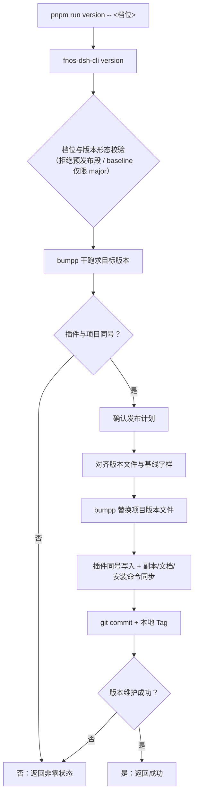
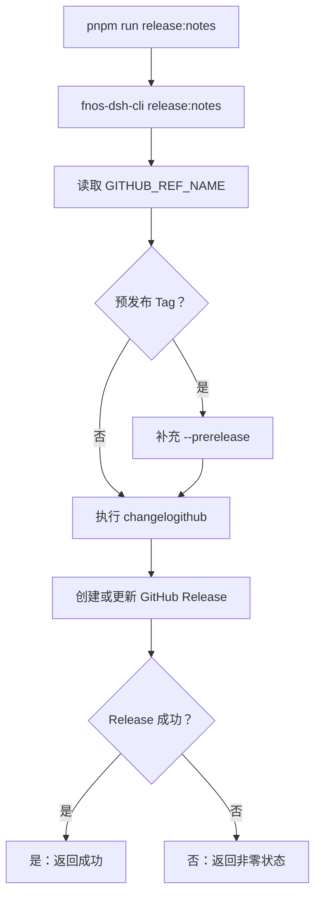
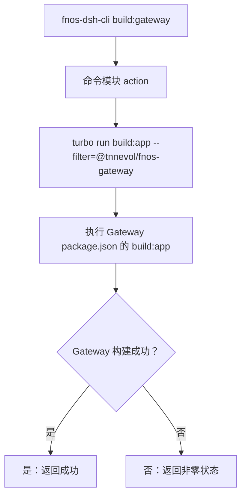

# CLI 命令参考

非 Turbo 任务沿用相同的表达方式：根命令进入 `fnos-dsh-cli`，命令模块负责交互和参数分支，最后执行实际工具并汇总状态。

各命令的调度图见下。Turbo 相关任务的完整说明见 [Turbo 任务](./turbo-tasks)。

## `version`

版本维护的统一入口：项目与全部插件同号推进，版本计算与文件替换由 bumpp 原生档位完成（`patch`/`minor`/`major`，语义见[版本管理](../build/versioning)）。

项目/FPK 版本更新根 `package.json`、`docs/package.json`、`packages/**/package.json`、`tooling/fnos-dsh-cli/package.json`、应用 `manifest`（version 与 desc 基线字样）和文档中的版本示例；插件直接沿用项目目标版本，并同步发布清单、插件总览与安装命令。默认创建提交和 `v<版本号>` Tag。

不会自动 push。完整流程见[版本管理](../build/versioning)。

## `release:notes`

读取当前 Tag，判断是否为预发布，再交给 `changelogithub` 生成 Release 说明。

## `build:gateway`

仅供 CI 或网关构建使用，不经过交互层。

构建 `fn-deepseek-harness` 的 FPK 时，CLI 会先调用这个入口产出网关 bundle，再执行 `fnpack build`。

## 相关页面

- [Turbo 任务](./turbo-tasks)
- [命令与脚本](./commands-and-scripts)
- [版本管理](../build/versioning)
- [发布流程](../build/release)
