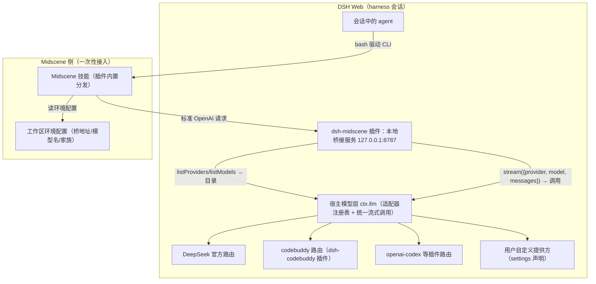
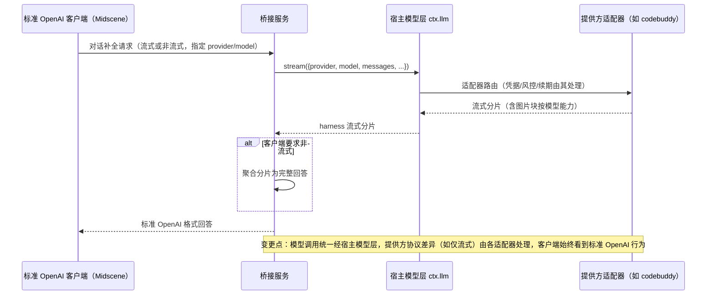
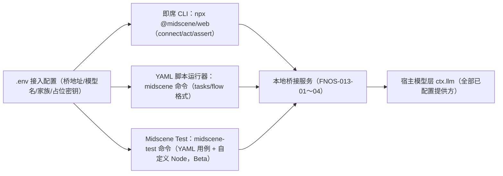

# PLAN-FNOS-013 Midscene 浏览器自动化桥接插件

| 字段 | 内容 |
| --- | --- |
| 计划编号 | PLAN-FNOS-013 |
| 计划日期 | 2026-10-10 |
| 对应需求 | [FNOS-013 Midscene 浏览器自动化桥接插件](/requirements/FNOS-013-midscene-browser-automation-bridge) |
| 本轮功能 | FNOS-013-01～14（桥接服务托管、模型目录、对话桥接、宿主凭据边界、会话内浏览器自动化、文档、测试规范登记、测试环境接入基线、真实用例示范、测试文档交叉引用、YAML 脚本运行器接入、Midscene Test 测试框架接入、浏览器自动化技能随插件内置、插件图标） |
| 计划状态 | <Badge type="info" text="规划中" /> |

## 计划目标

实现 FNOS-013-01～05：新增 `plugins/dsh-midscene-plugin` workspace，产出 `@tnnevol/dsh-midscene` 插件——随 DSH Web 托管一个本地 OpenAI 兼容桥接服务，**注入宿主模型层 `ctx.llm`**：模型目录映射全部已配置提供方与模型（「提供方/模型」命名空间），对话补全经 `ctx.llm.stream()` 统一流式调用（DeepSeek 官方、CodeBuddy、Codex、用户自定义提供方一视同仁）；凭据、请求协议与续期由各提供方插件在宿主内处理，桥不接触。随后安装 Midscene 浏览器技能并在会话中跑通自然语言 E2E 全链路（FNOS-013-05）。文档站新增插件说明页（FNOS-013-06）。

实现 FNOS-013-07～10：在[测试用例文档规范](/charter/tests-spec)新增「Midscene 浏览器自动化测试」章节（适用用例类型、三类被测环境接入、与人工走查/CDP 取证的分工、证据与清理要求）；在项目测试环境完成 Midscene 冒烟与接入基线；对项目自身页面完成一轮真实 E2E 示范（含亮/暗主题）并按[验收证据规范](/validation/README)登记证据；补齐测试规范、验收证据说明与插件说明页的交叉引用。

实现 FNOS-013-11～12：验证 YAML 脚本运行器（`@midscene/cli`，`midscene` 命令）与 Midscene Test 测试框架（`@midscene/test`，`midscene-test` 命令，Beta）经同一桥接服务与同一份接入配置跑通 Web 场景用例——两者读取的模型环境变量约定与即席 CLI 一致，预期零桥接改动，验证为主；结果（含 Beta 包版本基线）登记文档。

实现 FNOS-013-13：把 Midscene 浏览器自动化技能打进插件包，经 dsh 技能注册接缝（SkillProvider）随插件分发——用户安装插件即得技能，免去 `npx skills add`；技能文件从官方技能仓库同步，版本随上游跟随。

本计划不修改 DSH 官方源码，不修改任何既有提供方插件代码；桥接服务经宿主模型层 `ctx.llm` 调用模型（它是 `llm` 服务的标准消费者，不是适配器提供方），凭据与协议细节归各提供方插件；测试体系适配不修改被测应用代码，不改动既有验证命令与单元测试体系。

## 当前实现与目标设计

| 领域 | 当前实现 | 目标实现 | 迁移影响 |
| --- | --- | --- | --- |
| 浏览器自动化模型来源 | 无。Midscene 若要使用须自配外部模型端点与密钥，无法复用 DSH 已配置的模型与凭据 | 新增桥接插件，注入 `ctx.llm`：把 Midscene 的标准 OpenAI 请求翻译为宿主模型层调用（模型目录全量映射、消息/图片块转换、流式聚合），模型范围覆盖 DeepSeek 官方、已安装插件路由与用户自定义提供方 | 新增组件，无既有行为变化；chrome-devtools MCP 原样保留 |
| 模型凭据与协议 | 各提供方插件在宿主内独占管理（如 `dsh-codebuddy` 注册 `codebuddy` 路由并内置风控头与 token 续期） | 保持不变——桥经 `ctx.llm` 调用，凭据解析、请求协议、续期全部留在各提供方插件内；桥零凭据 | 零改动提供方插件；桥不读写任何凭据文件 |
| 会话内 E2E 测试 | 依赖 chrome-devtools MCP 逐步编排 | agent 通过 Midscene 技能（插件内置分发）以自然语言驱动浏览器 | 用户可选其一或共存；接入配置一次性写入工作区环境文件 |
| 项目 UI 走查执行方式 | 人工逐步操作 + 截图登记；CDP 脚本单点取证 | 新增 Midscene 自然语言执行路径：用例步骤写成自然语言指令与断言，执行后登记证据（FNOS-013-07～10） | 纯增量；人工走查与 CDP 取证保留，按用例类型选择；测试规范只增章节不改既有章节语义 |

无既有功能被替换；这是纯新增插件 + 一次性接入配置 + 测试规范增量章节的迁移形态。

## 影响范围分析

| 需求功能 | 代码模块 | 配置/数据 | 测试 | 文档 | 目标环境 |
| --- | --- | --- | --- | --- | --- |
| FNOS-013-01 | `plugins/dsh-midscene-plugin`（新增 workspace：`src/host/` 服务托管） | 插件 Config：端口（默认 8787）、默认模型、模型家族、请求超时 | 服务启停、端口占用报错、HMR 清理单测 | 插件说明页 | DSH Web、DSH Desktop |
| FNOS-013-02 | 同上（目录映射模块：`ctx.llm.listProviders()` + `listModels()` → OpenAI 列表，「提供方/模型」命名） | 无新数据 | 目录映射单测（多提供方、图片能力标注） | 同上 | DSH Web、DSH Desktop |
| FNOS-013-03 | 同上（消息转换与流式聚合模块：OpenAI 请求 ↔ `ctx.llm.stream()`） | 无新数据 | 流式/非流式/带图/多提供方路由/错误映射单测 | 同上 | DSH Web、DSH Desktop |
| FNOS-013-04 | 同上（宿主调用与错误归因模块） | 无新数据（桥不接触凭据） | 路由归因、未配置路由报错单测 | 同上 | DSH Web、DSH Desktop |
| FNOS-013-05 | 无仓库代码；技能装到 `~/.agents/skills/`，接入配置写入运行 Midscene 的工作区环境文件 | 工作区环境文件（模型地址指向本地桥、模型名、模型家族、占位密钥） | 会话内真实页面 E2E 走查 | 接入配置模板进说明页 | DSH Web（全链路）、DSH Desktop（走查） |
| FNOS-013-06 | `docs/plugins/dsh-midscene.md`（新增）、`docs/plugins/index.md`、`docs/.vitepress/config.mts` | 无 | `pnpm run check -- --sdd --docs` | 文档站 | 文档站 |
| FNOS-013-07 | 无源码改动 | 无 | `pnpm run check -- --sdd --docs` | `docs/charter/tests-spec.md` 新增「Midscene 浏览器自动化测试」章节 + 变更记录 | 文档站构建环境 |
| FNOS-013-08 | 无源码改动 | 全局技能目录（`~/.agents/skills/`）、本地工作区接入配置（不入仓库） | Midscene 冒烟走查 | 规范章节内含接入步骤 | DSH Web（本地） |
| FNOS-013-09 | 无源码改动 | 无 | 一轮真实 E2E（交互 + 视觉断言 + 亮/暗主题） | `docs/validation/` 新增证据记录 | DSH Web（本地）、DSH Desktop |
| FNOS-013-10 | 无源码改动 | 无 | 文档检查 | `docs/validation/README.md` 与 `docs/plugins/dsh-midscene.md` 交叉引用 | 文档站构建环境 |
| FNOS-013-11 | 无源码改动（预期零桥接改动；如 YAML 运行器触发桥接兼容问题才改 `plugins/dsh-midscene-plugin`） | 全局安装或项目内安装 `@midscene/cli`；共用接入配置 | Web 场景 YAML 脚本实测（打开页面 → AI 操作 → AI 断言 → 报告生成） | YAML 用例样例与运行方式进说明页 | DSH Web（本地） |
| FNOS-013-12 | 无源码改动（同上；Beta 协议兼容问题登记暂缓，不阻塞） | 脚手架生成的 Test 项目（`midscene-test create`）；共用接入配置 | 官方脚手架 Web 用例实测（YAML 用例 + 自定义 Node + 报告） | Test 接入方式、Beta 版本基线与已知限制进说明页 | DSH Web（本地） |
| FNOS-013-13 | `plugins/dsh-midscene-plugin`（`src/skills/` 技能注册模块 + 包内 `skills/` 目录）、`cordis.patch.yml`（如需 patch `skill-filesystem`） | 包内技能文件（从官方技能仓库同步，含来源与版本标注） | 技能注册/卸载单测、同名共存单测；Web/Desktop 技能目录走查 | 说明页注明技能来源与版本；安装/卸载行为进排错表 | DSH Web、DSH Desktop |
| FNOS-013-14 | `plugins/dsh-midscene-plugin/package.json`（`icon` 字段）+ 包内图标文件 | 图标资产（官方来源，≤256 KiB，包内路径） | 加载诊断核对（无 icon 相关错误）；Web/Desktop 图标显示走查（亮/暗） | 说明页/仓库内注明图标来源与版本 | DSH Web、DSH Desktop |

不涉及：DSH 官方源码、既有提供方插件（`dsh-codebuddy` 等）代码、用户凭据文件（桥不读写）、FPK 内置插件清单（`published-dsh-plugins.json`，首版不随 FPK 内置，确认稳定后再按发布流程纳入）。

发布形态说明：插件按 `@tnnevol/*` 插件通用流程发布到 npm（`next` 标签），用户通过 `dsh plugin --profile web add` 安装；FPK 内置与否属发布范围决策，实现验证通过后另行确认，不阻塞本计划。

## 架构与数据流



文字说明：桥接服务是宿主模型层的标准 OpenAI 门面——目录把 `ctx.llm` 的全部提供方与模型映射为标准列表（「提供方/模型」命名，如 `codebuddy/glm-5.3-flash`、`deepseek-official/deepseek-v4-pro`），调用把 OpenAI 请求转换为 `ctx.llm.stream()` 并聚合回标准响应。凭据、风控头、token 续期留在各提供方插件内，桥零凭据；新增提供方（装插件或配自定义端点）无需改桥即可用。测试体系适配（FNOS-013-07～10）复用同一桥接与技能接入，不新增模型或服务组件；Midscene 作为执行载体读取规范章节约定的接入配置，对本地 Web 直接驱动页面，对 Desktop 的接入方式以实测结论为准，执行证据走既有 `docs/validation/` 登记路径。



## 分阶段任务

### 阶段〇：预研与原型验证（T00）

| 任务 ID | 对应需求/验收 | 修改内容 | 前置条件 | 验证方式 |
| --- | --- | --- | --- | --- |
| PLAN-FNOS-013-T00-01 | FNOS-013-05 / AC-02 的基线 | 真实网页截图的坐标定位预研：取 3 类真实页面（密集文本、小控件、含弹窗），用调研报告 3.1 的验证方式测主流视觉模型的定位精度，形成精度基线结论 | 无 | `tmp/` 临时脚本实测（不入仓库）；结论登记本计划变更记录与需求调研结论 |
| PLAN-FNOS-013-T00-02 | FNOS-013-05 / AC-01、AC-02 | Midscene 家族协议兼容预研：CLI 指向临时脚本桥，以候选模型家族实跑 connect/act/assert；同时验证「提供方/模型」形式能否直接填入 `MIDSCENE_MODEL_NAME`，确定桥的模型名解析规则（含分隔符转义） | T00-01 | 真实页面全链路实测；不兼容时评估桥内坐标格式适配层（见决策 D2） |

阶段〇不成立时的处理：两条预研均失败则 FNOS-013-05 回退为「待确认」，桥接服务（01～04）照常实施——它对任何标准 OpenAI 客户端独立有价值。

### 阶段一：桥接插件实现（T01）

| 任务 ID | 对应需求/验收 | 修改内容 | 前置条件 | 验证方式 |
| --- | --- | --- | --- | --- |
| PLAN-FNOS-013-T01-01 | FNOS-013-01 / AC-01、AC-02 | 建立插件 workspace `plugins/dsh-midscene-plugin`：`package.json`（`dsh.bundle.patch`，`inject: ['llm']`）、`compatibility.json`（API `0.2.0-rc.2`，包清单含 `@deepseek-ai/dsh-llm`）、`cordis.patch.yml`（insert `dsh-midscene`）、tsdown/tsconfig/vitest 配置；Host 端用 `ctx.effect` 托管 HTTP 服务，HMR 完整清理 | 无 | 插件 typecheck + 构建；本地 profile `--patch` 加载后健康检查可用；重启后 `lsof` 端口干净 |
| PLAN-FNOS-013-T01-02 | FNOS-013-02 / AC-01～AC-03 | 模型目录模块：`ctx.llm.listProviders()` + 逐提供方 `listModels()` → 标准 OpenAI 列表；模型标识用「提供方/模型」（解析规则按 T00-02 结论，含转义），能力标注（`inputModalities` 含 `image`）映射为 OpenAI 元数据；提供方目录变化经 `llm/adapters-updated` 事件刷新缓存 | T01-01 | 单测：多提供方映射、「提供方/模型」编解码（含转义）、图片能力标注、目录刷新；curl 核对列表与 `ctx.llm` 一致 |
| PLAN-FNOS-013-T01-03 | FNOS-013-03 / AC-01～AC-05、FNOS-013-04 / AC-01～AC-04 | 对话桥接模块：解析请求中的「提供方/模型」→ `ctx.llm.stream({provider, model, messages, ...})`；OpenAI 消息/图片块 ↔ harness 消息词汇转换（图片数据 URI → 请求内图片块，按模型 `inputModalities` 门控）；客户端流式 → chunk 流转 SSE，非流式 → 聚合回标准响应；错误映射为标准错误格式并携带「提供方/模型」归因；未配置路由返回明确错误与设置指引 | T01-02 | 单测：流式/非流式/带图/多提供方路由/错误归因/未配置路由；curl 实测两类提供方各一轮 |
| PLAN-FNOS-013-T01-04 | FNOS-013-01 / AC-02、AC-03 | 服务生命周期与端口策略：只绑回环地址；端口占用时启动报错并附处理建议；DSH 停止/重启与配置热重载时完整释放端口 | T01-01 | 单测 + 本地 profile 实测（占用场景、HMR 场景） |
| PLAN-FNOS-013-T01-05 | FNOS-013-13 / AC-01、AC-02、AC-03 | 技能随插件内置：核实官方技能仓库的分发许可后，把 Midscene 浏览器技能文件同步进 `plugins/dsh-midscene-plugin/skills/`（保留官方内容并附来源/版本标注文件）；Host 端实现 `src/skills/` 模块——`apply()` 中向 `ctx.skills.registerProvider()` 注册 SkillProvider（provider 的 `list()` 返回包内技能候选、`get()` 加载完整定义，`resourceBase` 指向包内目录），插件卸载随 Cordis 效果自动注销 | T01-01；官方技能仓库分发许可核实 | 单测：候选列出、定义加载、插件卸载后技能消失、与用户自装同名技能的优先级（用户胜出）；本地 profile 实测技能目录可见且 `skill` 工具可加载 |
| PLAN-FNOS-013-T01-06 | FNOS-013-14 / AC-01～AC-03 | 插件图标（**资产已定案**，2026-10-12 用户确认）：采用 Midscene 官方站点 favicon（600×600 PNG 99 KiB，候选资产已存 `tmp/midscene-logo/`，sha256 `78cd10d7…e8ac944`）；放入 `plugins/dsh-midscene-plugin/icon.png`，`package.json` 顶层声明 `"icon": "icon.png"` 并把图标加入 `files` 白名单；包内附注文件登记来源（`https://midscenejs.com/favicon.png`，Midscene 主仓库 MIT 许可）与取用日期；体积 ≤256 KiB 已满足，路径在包内 | T01-01 | 插件加载无 icon 诊断错误；本地 profile 装入后插件管理页列表与详情显示图标（亮/暗主题各一遍）；npm pack 产物含图标文件 |

说明：原「凭据读取/风控头/token 续期」三个任务（旧 T01-02/03）随架构修订移除——这些职责由各提供方插件在宿主内承担，桥作为 `ctx.llm` 的标准消费者不实现任何提供方协议；桥的 `cordis.patch.yml` 不做任何凭据或请求头配置。

### 阶段二：安装验证与 Midscene 接入（T02）

| 任务 ID | 对应需求/验收 | 修改内容 | 前置条件 | 验证方式 |
| --- | --- | --- | --- | --- |
| PLAN-FNOS-013-T02-01 | FNOS-013-01～04 全部 AC | 插件安装到本地 web profile 并重启：`dsh plugin --profile web add`（本地开发期先 `--patch` 加载）；健康检查、目录、流式、非流式、带图、多提供方路由 curl 核对 | 阶段一完成 | 本地 DSH Web 按[本地 DSH Web](/development/local-dsh-web)流程验证；结果登记 |
| PLAN-FNOS-013-T02-02 | FNOS-013-05 / AC-01、AC-02 | Midscene 接入：修复本机 npm 权限问题（调研 M8）；`npx skills add web-infra-dev/midscene-skills` 安装技能；运行 Midscene 的工作区写入接入配置模板（桥地址/模型名/家族/占位密钥） | T02-01、T00-02 | dsh 会话内技能可发现；CLI connect/act/assert 在真实页面跑通 |
| PLAN-FNOS-013-T02-03 | FNOS-013-05 / AC-01～AC-03 | 会话内端到端：在 DSH Web 会话中让 agent 以自然语言完成一个小型 E2E（打开页面 → 交互 → 视觉断言）；同时确认 chrome-devtools MCP 仍可用 | T02-02 | 走查证据（命令与结果摘要）登记 `docs/validation/` |

### 阶段三：文档与测试体系适配（T03，07～10 规范登记部分可与阶段一并行）

| 任务 ID | 对应需求/验收 | 修改内容 | 前置条件 | 验证方式 |
| --- | --- | --- | --- | --- |
| PLAN-FNOS-013-T03-01 | FNOS-013-06 / AC-01、AC-02 | 新增 `docs/plugins/dsh-midscene.md`（安装、接入配置模板与模型选择指引、额度提示、故障排查表：npm 权限/模型路由错误/家族不匹配/无图片能力模型）；更新插件总览与 VitePress 侧边栏 | 阶段二完成 | `pnpm run check -- --sdd --docs`；文档构建通过；链接可达 |
| PLAN-FNOS-013-T03-02 | FNOS-013-07 / AC-01、AC-02 | [测试用例文档规范](/charter/tests-spec)新增「Midscene 浏览器自动化测试」章节：适用用例类型（UI 走查、E2E 交互断言）、三类被测环境接入（本地 Web 页面直连；Desktop 渲染进程 CDP 附加，兼容性标注待实测；NAS 桌面网页只读走查）、与人工走查/CDP 取证的分工原则、证据登记与清理要求、接入配置不入仓库红线；顺带修复该文件既有变更记录表的表头损坏（2026-10-08 行落在表头分隔行） | 无 | `pnpm run check -- --sdd --docs`；文档构建；目测章节可照做 |
| PLAN-FNOS-013-T03-03 | FNOS-013-10 / AC-01 | 交叉引用：`docs/validation/README.md` 增补「Midscene 执行证据登记」说明；与插件说明页互链（接入配置 ↔ 测试执行方式） | T03-01、T03-02 | 文档构建 + 链接检查通过 |
| PLAN-FNOS-013-T03-04 | FNOS-013-08 / AC-01～AC-03 | 项目测试环境接入基线：确认桥接插件已装入项目 `.dsh` web profile 且健康检查可用、全局技能已装、按规范章节在本地工作区写入接入配置（不入仓库）；随后做接入步骤复现性核对（不依赖个人环境知识逐步执行一遍，缺失步骤回写规范章节） | T02-02 | 冒烟：自然语言驱动本地 DSH Web 页面完成一个交互步骤；再次干净走查可复现；`git status` 确认无配置文件混入 |
| PLAN-FNOS-013-T03-05 | FNOS-013-09 / AC-01、AC-02 | 真实用例示范：对项目自身页面（如插件管理页）执行一轮 Midscene E2E——自然语言完成交互并给出视觉断言结论，亮色与暗色主题各核对一遍；执行中记录用例可维护性问题（指令稳定性、断言表达力）反馈回规范章节 | T03-04 | 证据登记 `docs/validation/`（版本三元组 + 环境标识）；结论与可维护性备注记入本计划变更记录 |
| PLAN-FNOS-013-T03-06 | FNOS-013-09 / AC-03 | 既有方式兼容确认：同一需求场景用人工走查或 CDP 取证复核一轮，确认规范未废弃既有方式 | T03-05 | 走查结论登记；两条执行路径均可用 |
| PLAN-FNOS-013-T03-07 | FNOS-013-09 / AC-01～AC-03（Desktop 部分） | Desktop 附加兼容性实测（待核实项）：以 Midscene CDP 端点方式附加项目 `.dsh/profiles/desktop` 的 Desktop 渲染进程（端口约定见[测试用例文档规范](/charter/tests-spec#dsh-desktop-测试)），记录可行或失败结论 | T03-04 | 实测结论登记本计划变更记录；失败则 Desktop 保持人工走查 + CDP 取证并在规范章节标注 |
| PLAN-FNOS-013-T03-08 | FNOS-013-01～13 | 测试用例回填：在 `docs/tests/` 建立与需求同编号的测试用例文档（结果、Bug、最终结论） | T03-02 | 按[测试用例文档规范](/charter/tests-spec)回填 |
| PLAN-FNOS-013-T03-09 | FNOS-013-11 / AC-01～AC-03 | YAML 脚本运行器验证：安装 `@midscene/cli`；在接入配置就绪的工作区编写 Web 场景 YAML（`tasks/flow`：打开页面 → AI 操作 → AI 断言），`midscene` 命令执行；核对模型请求走桥接、报告生成、流式/非流式行为与即席 CLI 一致 | T03-04 | YAML 脚本实测通过 + 报告产物；异常时定位桥接兼容点并修复（预期零改动） |
| PLAN-FNOS-013-T03-10 | FNOS-013-12 / AC-01、AC-02 | Midscene Test 验证（Beta）：`midscene-test create` 生成脚手架项目，配置共用接入配置；跑通官方 Web 场景样例（YAML 用例 + 自定义 Node）；登记实测通过的 `@midscene/test` 包版本与已知限制；协议不兼容时按行为约束登记暂缓 | T03-04 | Test 项目实测通过（或暂缓结论登记）；版本基线写入说明页 |

### 后续（不在本计划任务内）

- 发布到 npm（`next` 标签）与 FPK 内置决策：实现验证通过后按[发布流程](/build/release)另行执行，需发布权限；不阻塞本计划的完成判定。
- 设置卡片 UI（需求已列为不在本次范围内）。
- CI 化 Midscene 自动化流水线（定时回归、报告门禁）：需求已列为不在本次范围内，后续视需要另立需求。
- NAS 桌面网页 Midscene 只读走查：属测试规范适用场景的扩展验证，进入实施时在对应计划任务中登记。

## 交互和行为设计

### 桥接服务行为细则

1. **模型命名空间**：请求中的模型字段解析为「提供方/模型」（如 `codebuddy/glm-5.3-flash`）；解析规则（分隔符、模型 id 自含 `/` 的转义）按 T00-02 预研定案并写入文档。裸模型名（不带提供方前缀）按插件配置的默认提供方处理。
2. **模型目录**：聚合 `ctx.llm.listProviders()` 与各路由 `listModels()`；`llm/adapters-updated` 事件触发缓存刷新——新装提供方插件、配置新自定义端点后目录自动更新。
3. **请求转换**：OpenAI 消息结构 ↔ harness 消息词汇；图片（数据 URI）按所选模型 `inputModalities` 门控——模型不支持图片时返回明确错误（提示改用图片模型），支持时转换为请求图片块；温度/长度限制等字段映射到 `GenerateOptions` 对应字段。
4. **流式与非流式**：`ctx.llm.stream()` 产出 chunk 流；客户端要流式 → 转 OpenAI SSE 格式；要非流式 → 聚合为完整消息回标准响应。提供方的流式约束由其适配器在宿主内处理，桥不感知。
5. **错误映射**：`LlmError` 稳定错误码与提供方失败 → 标准错误对象，信息携带「提供方/模型」归因；未配置/不可用路由按宿主内适配器的既有状态给出指引（如「在 Web 设置中登录」「检查自定义端点配置」）。

### 后续需求的用例执行方式选择（规范章节核心内容草案，FNOS-013-07 章节的展开依据）

1. **单元/类型/构建验证**：沿用既有命令，不涉及 Midscene。
2. **UI 走查与 E2E 交互断言**（插件页、主题、会话交互等）：优先人工走查（快速小改动）或 Midscene（多步骤、需留证据、需复跑的用例）；用例文档「测试步骤」写成自然语言指令 + 断言，执行方式在执行结果备注标注。
3. **单点取证与排错**（NAS 安装日志、CDP 断言特定 DOM 状态）：保留 CDP 脚本路径。
4. **NAS 环境一律只读走查**：写操作（安装/卸载/设置变更）继续走 trim-cli 或应用中心人工流程。

### 接入配置模板（一次性；即席 CLI、YAML 脚本运行器、Midscene Test、项目测试共用同一份）

```sh
# 运行 npx @midscene/web 的工作区 .env
MIDSCENE_MODEL_BASE_URL="http://127.0.0.1:8787/v1"
MIDSCENE_MODEL_API_KEY="local-bridge"
MIDSCENE_MODEL_NAME="codebuddy/glm-5.3-flash"   # 「提供方/模型」任选 DSH 可用模型
MIDSCENE_MODEL_FAMILY="glm-v"                    # 家族值随所选模型确定；兼容性以 T00-02 预研结论为准
```

模型名按 T00-02 定案的「提供方/模型」形式填写；需要双模型分工时，`MIDSCENE_PLANNING_MODEL_*` 与 `MIDSCENE_INSIGHT_MODEL_*` 可分别指向不同「提供方/模型」（如规划用文本强模型、理解断言用图片模型）——全部经同一桥接服务路由。验证序列：`connect` 连接页面 → `act` 执行交互 → `assert` 视觉断言。

### 多运行方式共用说明（FNOS-013-11/12 依据）

Midscene 的三种运行方式读取同一套模型环境变量约定，接入基线完成后零增量配置：



文字说明：YAML 运行器与 Test 框架是同一执行内核之上的不同用例组织形态（旧 `tasks/flow` 链路维护态、Test 为官方推荐替代），模型请求路径与即席 CLI 完全一致；本计划对两者只做验证与文档登记，预期零桥接改动。差异点仅两处：`.env` 必须放在**工具运行目录**（与 YAML 文件位置无关）；Test 处于 Beta，需锚定实测版本。

### 内置技能分发设计（FNOS-013-13）

- **注册方式**：插件 Host 端在 `apply()` 内同步调用 `ctx.skills.registerProvider()`（dsh 技能注册表公开 API，0.2.0-rc.2 已核实），注册一个名为 `dsh-midscene` 的 SkillProvider：`list()` 返回包内 `skills/` 目录下的技能候选（kebab-case 名称、描述、`resourceBase` 指向包内目录），`get()` 按候选加载完整定义。插件卸载/HMR 时 Cordis 自动注销，技能同步消失。
- **与用户自装技能共存**：dsh 本地发现优先级为 项目目录 > 用户目录（`~/.agents/skills/` 等）> 插件注册；用户自行安装的同名技能在模型目录中胜出，插件技能只在用户未自装时可见——天然满足「不冲突、不重复提示」，单测锁定该优先级。
- **技能内容管理**：`skills/` 目录内容从官方技能仓库 `web-infra-dev/midscene-skills` 同步，保留原文并附 `SOURCE.md`（来源仓库、同步日期、上游 commit/版本）；上游更新时随插件版本迭代重新同步。同步脚本放 `scripts/`（一次性执行的工具，不进构建链）。
- **接入配置仍由用户放置**：技能教 agent「怎么用 Midscene 命令」，模型请求仍依赖工作区 `.env` 指向本地桥——插件说明页与技能内容中的配置模板保持一致，形成闭环：装插件得技能 + 桥，按文档放 `.env` 即全链路可用。
- **备选方案**（若 SkillProvider 注册路径实测受阻）：按官方 `@deepseek-ai/dsh-agent-preset` 先例，在插件 cordis.patch.yml 中 patch `dsh-skill-filesystem` 的 `customSkillDirs` 追加包内 skills 目录（`!!js` 表达式按包路径解析）；该方式依赖 patch 合并语义，作为降级路径登记。

## 数据、权限和错误处理

- **敏感数据**：桥不读取、不存储、不转发任何凭据——凭据解析与续期留在各提供方插件内（宿主内聚）；桥的日志不得输出请求体中的消息内容与图片数据。
- **错误与恢复**：端口占用 → 启动失败并明确报错（fail-fast，不静默换端口）；「提供方/模型」未配置或不可用 → 标准错误 + 设置指引；宿主模型层不可用（如插件加载失败）→ 健康检查如实反映。
- **资源清理**：HTTP 服务经 `ctx.effect` 托管，HMR/停用时等待完全停稳再放行，防端口残留；技能注册随 Cordis 效果自动注销。
- **权限边界**：桥作为 `llm` 服务的消费者只调用其公开接口（目录与流式调用），不触碰凭据存储、设置写入等其它接缝；HTTP 只绑回环。

## 依赖、风险和决策

| 项 | 内容 | 应对 |
| --- | --- | --- |
| 风险 R1（待核实） | 真实网页（密集文本、小控件）定位精度未知，受控图片 ≤1px 结论不能外推 | T00-01 先行预研形成基线；不佳时尝试更优主模型、提高截图分辨率；最终手段是引入第二视觉模型（Midscene 支持双模型分工，不必换掉主模型） |
| 风险 R2（待核实） | 模型家族提示词与坐标解析协议在 DSH 可用模型上可能不兼容 | T00-02 预研；不兼容时在桥内做坐标格式归一化适配层（D2） |
| 风险：「提供方/模型」命名与 Midscene 解析冲突 | 模型 id 自含 `/`（如 OpenRouter 风格 id）时命名可能歧义 | T00-02 定案解析规则（优先取已注册提供方前缀最长匹配 + 转义规则）；单测锁定编解码 |
| 风险：`ctx.llm` 服务面与 0.2.0-rc.2 实际实现有出入 | 已按类型定义核实 `listProviders/listModels/stream/prepareCall` 契约，但未实际编码验证 | T01-01 先做最小目录映射原型再铺开调用；受阻时按 `LlmRuntime` 实际签名调整，不动契约语义 |
| 风险：图片块转换语义 | harness 请求图片块基于附件引用体系，桥收到的是 OpenAI 数据 URI，两者表示不同 | T01-03 转换层把数据 URI 直接作为请求内图片字节传入（不经附件持久化——桥的调用是一次性请求，无需落盘）；单测覆盖 PNG/JPEG 两类 |
| 风险 R7 | 端口占用导致桥不可用且接入配置失配 | fail-fast 报错（AC-03）；只绑回环；文档写明端口冲突处理 |
| 风险：项目页面定位精度（待核实） | 插件管理页等密集控件界面的定位精度未实测（R1 在项目测试场景下的延伸） | T03-05 实测并以「用例可维护性」口径记录；精度不足时该类用例回退人工走查，规范标注适用边界 |
| 风险：Desktop CDP 附加不兼容（待核实） | Midscene 的 CDP 附加对 Electron 自定义协议渲染进程未验证 | T03-07 实测定案；失败即回退既有 Desktop 验证方式（人工走查 + CDP 取证），不影响其余功能 |
| 风险：规范被误读为「强制 Midscene」 | 测试规范新增章节可能被理解为所有 UI 用例必须自动化 | 章节开头明确「按用例类型选择执行方式」，人工走查与 CDP 取证地位不变（T03-02） |
| 风险：Midscene Test Beta 协议演进 | `@midscene/test` 处于 Beta，测试协议与 API 持续变化，脚手架/命令行为可能随版本漂移 | 以实测通过的包版本为基线并登记（T03-10）；协议不兼容时该功能暂缓、不阻塞其余功能；不把 Beta 变化当桥接缺陷 |
| 风险：YAML 运行器隐藏兼容点 | 官方文档声明 YAML/Test 与即席 CLI 同一套模型配置，但 `tasks/flow` 执行内核的请求形态可能有差异（如并发请求、超时模式） | T03-09 实测覆盖；异常时在桥内定位修复（桥已按标准 OpenAI 行为实现，风险低） |
| 风险：SkillProvider 注册契约与 0.2.0-rc.2 实际实现有出入 | 已按上游文档核实接口形态，但未实际编码验证 | T01-05 先做最小注册原型再铺开；受阻时降级为 patch `customSkillDirs` 方案（官方先例在用），两案都在计划内 |
| 风险：技能重分发的许可与上游跟随 | Midscene 技能仓库的分发许可未核实；上游更新后内置版本可能落后 | T01-05 前置核实许可；`SOURCE.md` 登记同步版本，上游跟随随插件版本迭代；许可不允许时回退为文档引导用户 `npx skills add`（即原 FNOS-013-05 流程，零回滚成本） |
| 风险：图标资产来源与使用边界 | ~~用户提供的 GitHub 签名临时 URL 已过期不可用；~~ Midscene 图标的商标使用约定未单独立约，但主项目为 MIT 许可、官方站点 favicon 为公开资产且被社区工具广泛引用 | **已定案（2026-10-12 用户确认）**：采用官方站点 favicon；来源（URL + 日期 + 许可）随包内附注文件登记；若上游后续提出商标使用约束，按其要求替换或移除（图标独立于功能，替换零成本） |
| 额度消耗 | Midscene 每步调视觉模型，按所选提供方计费；项目测试用例经桥接同样消耗额度 | 文档明确提示各提供方计费归属；提示用户可用 Midscene 自带缓存减少重复调用；示范用例选择小规模页面 |
| 决策 D1（修订） | 桥接入宿主模型层 `ctx.llm` 作为标准消费者，不做任何提供方协议实现、不读凭据。理由：`ctx.llm` 公开目录与流式调用契约（0.2.0-rc.2 类型定义核实），模型范围自动覆盖全部已配置提供方且随提供方演进零成本跟随；凭据与续期内聚在各提供方插件，桥零凭据。原「直读凭据文件 + 复刻刷新协议」方案废弃（硬编码 CodeBuddy、复制协议维护负担、无法覆盖其它提供方） | 若宿主模型层契约变化，按 `LlmRuntime` 实际签名调整桥的转换层 |
| 决策 D2 | 家族协议不兼容时，适配层做在桥内（把模型坐标输出归一化为 Midscene 期望格式），而不是要求用户换模型 | 桥是唯一可控点；Midscene 侧零改动的原则不变 |
| 决策 D3 | 首版不随 FPK 内置、不进 `published-dsh-plugins.json`，先以 npm 手动安装形态验证；稳定后按发布流程纳入 | 降低发布面风险；内置与否不影响功能验收 |
| 决策 D4 | 端口默认 8787 且占用即报错，不做自动换端口 | 静默换端口会让工作区接入配置失配，故障更难排查 |
| 决策 D5 | 测试体系适配做成测试用例文档规范的新章节，而不是另立测试工具文档 | 测试执行方式的权威位置就在测试用例文档规范；另立文档会造成双权威 |
| 决策 D6 | 测试示范首轮选本地 DSH Web 页面，不选 NAS；不引入 CI 化 Midscene 流水线 | 本地环境无 NAS 依赖、可快速复跑；当前收益不足以支撑门禁化，先把规范与执行路径跑通 |
| 回滚 | 插件卸载或从 profile 移除即完全回退（桥零凭据、零用户数据残留；接入配置文件由用户自行删除；技能随卸载消失） | 无数据风险 |

## 测试、打包、发布和回滚

- **包级**：插件 typecheck、单测（目录映射/消息转换/路由归因/生命周期/技能注册五组）、tsdown 构建；`pnpm run check -- --packages --plugins`。
- **本地 DSH Web**：`--patch` 加载 → 目录/流式/非流式/带图/多提供方路由 curl 核对（覆盖 DeepSeek 官方与 CodeBuddy 各一轮）→ 正式 `dsh plugin add` 安装重启复验；HMR 与重启后端口清理核对。
- **DSH Desktop**：按[测试用例文档规范](/charter/tests-spec#dsh-desktop-测试)使用上游开发态 Desktop 与项目 `.dsh/profiles/desktop`；测试完成后按规范把 Desktop 交还全局 profile。
- **会话内 E2E**：真实页面 connect/act/assert 全链路 + 会话内自然语言任务，证据登记 `docs/validation/`。
- **测试体系适配**：规范登记与交叉引用走文档构建与 SDD 检查；接入基线与示范用例在本地 DSH Web（`pnpm run start -- --web`，`DSH_HOME` 指向项目 `.dsh`）执行；接入配置不入仓库，`git status` 核对；无代码发布面。
- **文档**：`pnpm run check -- --sdd --docs`、`pnpm run build -- --docs`、`git diff --check`。
- **发布**：npm `next` 标签发布需发布权限；FPK 内置另行决策（D3）。
- **回滚**：单插件独立回退；无用户数据删除风险（桥零凭据）；规范章节独立可回退；接入配置与技能即删即净。

## 参考资料

- 调研报告：`Midscene × DeepSeek Harness 插件开发报告`（2026-10-10，含协议实测、风险 R1–R7 与验收清单；项目外文档，结论已摘录进需求调研结论）
- 风控头与设备指纹算法、刷新协议、目录协议的权威实现：`plugins/dsh-codebuddy-plugin/src/host/risk-headers.ts`、`src/host/auth-service.ts`、`src/host/codebuddy.ts`
- 插件骨架与打包先例：`plugins/dsh-codebuddy-plugin/package.json`、`compatibility.json`、`cordis.patch.yml`
- 插件机制与本地验证：[插件开发](/development/plugin-development)、[本地 DSH Web](/development/local-dsh-web)
- 测试体系权威规范：[测试用例文档规范](/charter/tests-spec)（执行环境、Desktop 端口、NAS 红线、auth 备份）
- 验收证据规范：[docs/validation/README.md](/validation/README)
- Midscene 官方文档（introduction / skills / bridge-mode / caching / model-common-config）：https://midscenejs.com/zh/
- Midscene MCP 退役公告：https://midscenejs.com/zh/mcp
- Midscene 技能仓库：https://github.com/web-infra-dev/midscene-skills
- YAML 脚本运行器（FNOS-013-11 依据）：https://midscenejs.com/zh/yaml-script-runner
- Midscene Test 概览（FNOS-013-12 依据，Beta 声明）：https://midscenejs.com/zh/midscene-test/overview
- Midscene 官方技能（FNOS-013-13 内容来源）：https://midscenejs.com/zh/skills.html、https://github.com/web-infra-dev/midscene-skills
- dsh Skills 子系统（FNOS-013-13 注册接缝依据，0.2.0-rc.2）：https://github.com/deepseek-ai/deepseek-harness/blob/master/docs/subsystems/skills.md
- 宿主模型层契约（FNOS-013-01～04 依据，0.2.0-rc.2）：`@deepseek-ai/dsh-llm` 类型定义（`LlmRuntime.listProviders/listModels/stream/prepareCall`、`GenerateOptions`、`LlmModelInfo.inputModalities`）
- 适配器注册先例：`plugins/dsh-codebuddy-plugin/src/index.ts`（`ctx.llm.registerAdapter(['codebuddy'], adapter)`——桥消费同一服务面的对照实现）
- 技能随包分发先例：web profile 组合配置中 `dsh-skill-filesystem` 的 `customSkillDirs` 指向 `@deepseek-ai/dsh-agent-preset` 包内 `skills/` 目录（`dsh --dump-config` 实测）
- 插件图标机制（FNOS-013-14 依据，0.2.0-rc.2）：`@deepseek-ai/dsh-package-manifest` 类型（`DshPackageManifest.icon`）+ `dsh-app-boot` 的 `iconOf()` 校验实现（格式/256 KiB/包内路径）；图标候选资产已存 `tmp/midscene-logo/`（官方站点 favicon 600×600）

## 完成状态

| 阶段 | 状态 |
| --- | --- |
| 阶段〇：预研与原型验证（T00） | <Badge type="info" text="规划中" /> |
| 阶段一：桥接插件实现（T01） | <Badge type="info" text="规划中" /> |
| 阶段二：安装验证与 Midscene 接入（T02） | <Badge type="info" text="规划中" /> |
| 阶段三：文档与测试体系适配（T03） | <Badge type="info" text="规划中" /> |

## 变更记录

| 日期 | 变更 | 说明 |
| --- | --- | --- |
| 2026-10-10 | 初始计划 | 建立 PLAN-FNOS-013，覆盖 FNOS-013-01～06。预研（真实页面精度、家族协议兼容）列为阶段〇前置；桥接插件实现为阶段一主体；决策 D1–D4 登记实现路径。 |
| 2026-10-10 | 并入测试体系适配（原 PLAN-FNOS-014） | 范围扩展：项目测试体系适配并入本计划，覆盖 FNOS-013-07～10——阶段三扩为「文档与测试体系适配」（T03-02 规范章节、T03-03 交叉引用、T03-04 接入基线、T03-05 真实用例示范、T03-06 既有方式兼容确认、T03-07 Desktop 附加实测），新增决策 D5/D6，风险表补充项目页面精度与 Desktop 附加两条待核实项。原独立计划 PLAN-FNOS-014 撤销（文档未发布，直接移除）；规范登记（T03-02/T03-03）可与阶段一并行先行。 |
| 2026-10-10 | 新增 FNOS-013-11/12（T03-09/T03-10） | 范围扩展：YAML 脚本运行器与 Midscene Test（Beta）接入验证。两者与即席 CLI 读取同一套模型环境变量约定（官方文档核实），桥接就绪后预期零改动可用，任务以验证与文档登记为主；架构图补多运行方式共用说明；风险表补 Beta 协议演进与 YAML 隐藏兼容点两条。Test 版本基线随 T03-10 登记。 |
| 2026-10-10 | 新增 FNOS-013-13（T01-05） | 范围扩展：浏览器自动化技能随插件内置分发（用户免执行 `npx skills add`）。实现走 `ctx.skills.registerProvider()` 注册 SkillProvider（上游 Skills 子系统文档核实），备选降级为 patch `skill-filesystem` 的 `customSkillDirs`（官方 `@deepseek-ai/dsh-agent-preset` 先例，web profile 实测）；「内置技能分发设计」章节登记注册方式、共存优先级、内容同步与许可核实前置；风险表补注册契约与分发许可两条。 |
| 2026-10-10 | 架构修订：模型来源改为宿主模型层（原方案废弃） | 需求方澄清后修订：桥不再直连 CodeBuddy 凭据（删凭据读取/风控头/token 续期三任务与对应风险 R4/R5），改为注入 `ctx.llm`（`inject: ['llm']`）作为标准消费者——模型目录全量映射 `listProviders/listModels`（「提供方/模型」命名，T00-02 补解析规则预研），调用走 `ctx.llm.stream()`，凭据与续期留在各提供方插件内（桥零凭据）。任务重排为 T01-01～06（目录、调用、生命周期、技能内置、插件图标）；风险表新增命名冲突、`ctx.llm` 契约出入、图片块转换三条并移除两条凭据风险；决策 D1 修订为「接入宿主模型层」。理由：Midscene 应能使用 DSH 全部可用模型而非限于 CodeBuddy。 |
| 2026-10-10 | 新增 FNOS-013-14（T01-06） | 范围扩展：插件图标。机制核实——`package.json` 顶层 `icon` 字段（相对包根、SVG/PNG/JPEG/WebP、≤256 KiB、realpath 不逃逸包目录，`dsh-app-boot` 实现源码核实；本仓库四插件首例）。资产来源——用户提供的 GitHub 签名 URL 已过期（实测 404），候选改用官方站点 favicon（600×600 PNG 99 KiB，已存 `tmp/midscene-logo/` 供评审），用户提供原图后可替换；商标使用约定核实列为 T01-06 前置，约定不允许时回退自绘通用图标。 |
| 2026-10-12 | 图标资产定案 | 用户确认采用官方站点 favicon（`https://midscenejs.com/favicon.png`，600×600 PNG 99 KiB，sha256 `78cd10d7…`，已存 `tmp/midscene-logo/`）；Midscene 主仓库 MIT 许可核实，来源 URL 与取用日期随包内附注文件登记；T01-06 由「候选评估」改为「按定案资产落位」，商标风险降级为「上游后续约束时替换（零成本）」。 |
