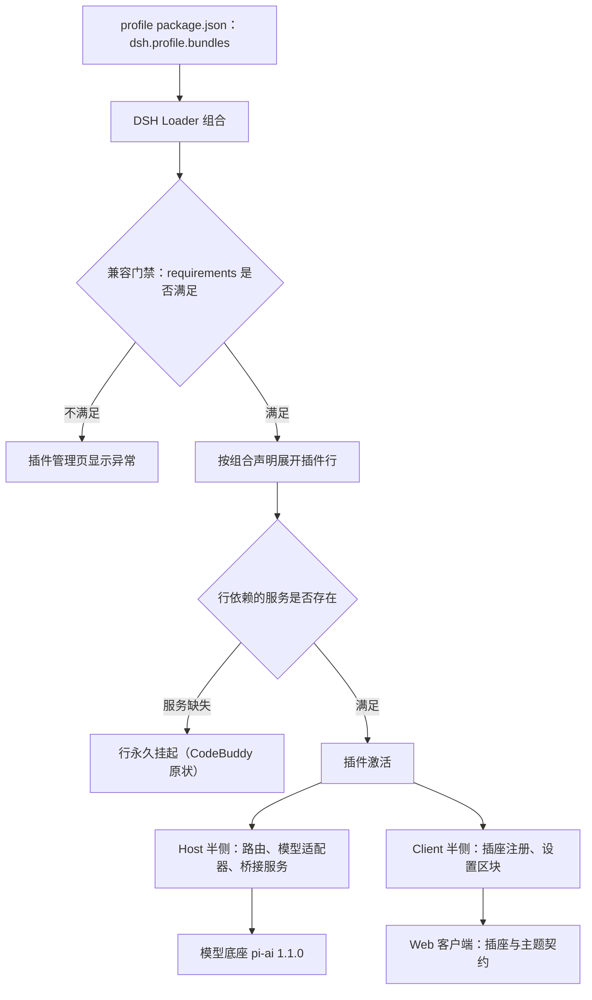
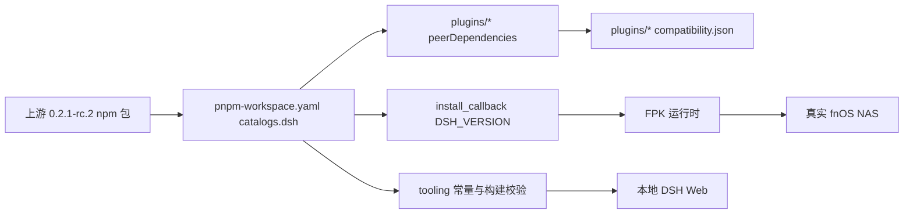

# PLAN-FNOS-014 DSH 0.2.1-rc.2 插件适配与新能力支持

| 字段 | 内容 |
| --- | --- |
| 计划编号 | PLAN-FNOS-014 |
| 计划日期 | 2026-10-18 |
| 对应需求 | [FNOS-014 DSH 0.2.1-rc.2 插件适配与新能力支持](/requirements/FNOS-014-dsh-021-rc2-adaptation) |
| 本轮功能 | FNOS-014-01 至 FNOS-014-14 全部进入本轮实施 |
| 上游依据 | 本地 Harness checkout `fork-pj/deepseek-harness`（`dsh-v0.2.1-rc.2`，HEAD `687f282e86`）；与 `dsh-v0.2.0-rc.2` 的全量源码对比（1482 条非合并提交）；上游 `docs/upgrade-guide/` 的 36 篇迁移指南；`@earendil-works/pi-ai@1.1.0` 发布产物与本仓库已安装 `0.87.1` 的逐文件比对 |
| 计划状态 | <Badge type="warning" text="待完成（本地双客户端已验，真机项待补）" /> |

## 计划目标

把六个插件（`dsh-fnos`、`dsh-codex-auth`、`dsh-codebuddy`、`dsh-failover-search`、`dsh-midscene`、`dsh-semi-ui-showcase`）的 DSH 依赖锚定与兼容声明从 `0.2.0-rc.2` 迁移到 `0.2.1-rc.2`，使插件通过新运行时的加载门禁并保持既有功能与用户数据不变（FNOS-014-01 至 FNOS-014-09）；同步仓库运行与构建基线（FNOS-014-10 至 FNOS-014-12）；逐项给出上游新增能力的支持结论（FNOS-014-13）；fnOS 插件的 NAS 侧验收在真实设备完成（FNOS-014-14）。

技术边界：本计划只做「让插件在新运行时上按既有行为工作」和「把新能力逐项判定并登记结论」，不为插件新增需求未登记的功能。

## 当前实现与目标设计

### 兼容门禁与判定规则变化（已在 `dsh-v0.2.1-rc.2` 源码核实）

- `packages/boot/app-boot/src/plugin-compatibility.ts`：本版起**先读包自身 `engines.dsh`**，存在时由它单独决定、忽略全部 `@deepseek-ai/dsh*` 同行依赖范围；不存在时才回退到同行依赖逐项 `semver.satisfies`。
- `engines.dsh` 内不接受 `workspace:^` / `workspace:~` / `workspace:*`（这些只在同行依赖里有效）；`engines` 不是对象或 `engines.dsh` 不是字符串会让清单不可读，直接拒装。
- 拒绝记录字段由 `peers` 改名为 `requirements`，键为 `engines.dsh` 或对应的同行依赖包名。
- 本仓库现有插件**均未声明 `engines.dsh`**，因此仍走同行依赖规则；本次保持这一形态，只重锚定版本，避免引入两套判定并存。

### 当前 → 目标

| 领域 | 当前实现 | 目标实现 | 迁移影响 |
| --- | --- | --- | --- |
| DSH 依赖基线（catalog） | `catalogs.dsh` 全部 `0.2.0-rc.2` | 全部 `0.2.1-rc.2` | lockfile 重解析；全部 DSH 包版本重取 |
| cordis / schemastery | `^4.0.4` / `3.18.4` | `^4.0.5` / `3.18.5`（与上游 vendor 对齐） | 均为 patch 级；插件不改代码 |
| 模型底座 | `@earendil-works/pi-ai` `0.87.1` | `1.1.0` | catalog 内 conflicts 段与 `minimumReleaseAgeExclude` 条目同步改名 |
| 插件依赖锚定 | 六插件 `peerDependencies` 精确 `0.2.0-rc.2` | 精确 `0.2.1-rc.2` | 插件重构建；契约测试断言同步 |
| 兼容声明 | 六插件 `compatibility.json` 声明 `0.2.0-rc.2` | 声明 `0.2.1-rc.2`；Codex Auth `piAi.version` 同步 `1.1.0` | 一致性测试更新 |
| 插件版本号 | `0.2.0-rc.2.6` | `0.2.1-rc.2.0` | `version -- plugin` 同步发布清单、总览表格与安装命令 |
| CodeBuddy 组合声明 | `connection` 行注入 `webRuntime` | 改为注入新版提供的服务 | 不改会让插件行永久 pending |
| 仓库构建校验常量 | `DSH_VERSION = 0.2.0-rc.2`、安装回调同值 | 同值为 `0.2.1-rc.2` | 构建期一致性校验通过 |
| 三方插件 | `dshmarket@1.66.27` | `1.66.37`（peer 含 `^0.2.1-rc.1`） | 应用安装最后一步不再被拒 |
| 本地 profile 版本常量 | `LOCAL_DSH_VERSION = 0.2.0-rc.2` | `0.2.1-rc.2` | 链接进 profile 的插件清单归一化目标同步 |
| 已退役的可选组合包 | web profile 的 `bundles` 含 `@deepseek-ai/dsh-experimental-schedule-bundle` | 由运行时自动清理 | 首次启动会重写 profile 清单，需确认插件不受影响 |

### 上游契约变化与处置结论

| 契约点 | 上游变化 | 本仓库现状 | 处置 |
| --- | --- | --- | --- |
| 宿主信任服务 | `webRuntime` → `webStartup`；旧服务字节不再存在 | CodeBuddy 组合声明注入 `webRuntime` | **必改**：注入改为新版可用服务（T02-01） |
| 模型底座 | `pi-ai` `0.87.1` → `1.1.0`；Azure 路由改名；缺失凭据路由不提供模型 | Codex Auth 使用 `createModels`/`openaiCodexProvider`/`getAuth`/`Provider`/`ApiKeyAuth`，形状未变；未用 Azure 路由 | 重锚定 + 回归验证（T03-01） |
| 工具呈现模式 | 移除 `both` | 未使用 | 无需改动 |
| 客户端组件导出 | 删除 `projectUserText`、`UserTextReferences` | 未使用 | 无需改动；复核新导出是否为能力缺口（T08-01） |
| 插件插座 | 新增 11、删除 1（`conversation.message.images`） | 使用的 7 个插座均未变 | 无需改动；评测新插座是否应采纳（T08-02） |
| 主题字体契约 | 单字号 → 三组字号 + 三组字体族；`ThemeSnapshot.fontSize` → `fontSizes`/`fontFamilies` | Showcase 持有 `ThemeSnapshot` 但不读 `fontSize` | 编译兼容；按新契约复核展示（T07-01） |
| 插件兼容判定 | `engines.dsh` 优先；`peers` → `requirements` | 未声明 `engines.dsh` | 保持同行依赖形态；文档说明规则（T10-02） |
| 插件管理接口 | HMR 下重复安装返回 `already-installed`；`BundleInfo` 新增必填字段 | 插件只读展示自身配置，不构造该类型 | 无需改动；安装链路复核（T10-01） |
| 实验性包改名 | 9 个包改 `dsh-experimental-*` | 未依赖 | 无需改动 |
| 可选组合包退役 | `schedule-bundle` 移除 | web profile 曾列该项 | 运行时自动清理；确认无副作用（T12-02） |
| 工作目录 / 子代理委派 / 作业 ID / SSH 启动 | 契约重构 | 插件未触及 | 无需改动 |
| 凭据优先级 | 存储值优先于环境变量 | 插件凭据自持文件，不依赖该优先级 | 登记影响（T09-01） |

## 影响范围分析

| 需求功能 | 代码模块 | 配置/数据 | 测试 | 文档 | 目标环境 |
| --- | --- | --- | --- | --- | --- |
| FNOS-014-01 | `plugins/*/package.json`、`plugins/*/compatibility.json`、`pnpm-workspace.yaml` | 插件依赖与兼容基线 | 六插件契约测试 | `docs/plugins/*`、总览页 | DSH Web、DSH Desktop |
| FNOS-014-02 | `plugins/dsh-codebuddy-plugin/cordis.patch.yml` | 组合声明 | 组合声明契约测试 | CodeBuddy 文档页 | DSH Web、DSH Desktop |
| FNOS-014-03 | `plugins/dsh-codex-auth-plugin/src/host/*`、`cordis.patch.yml` 的模型清单 | 模型配置、凭据文件 | 适配器与模型刷新测试 | Codex Auth 文档页 | DSH Web、DSH Desktop |
| FNOS-014-04 | `plugins/dsh-codebuddy-plugin/src/**` | 账号凭据、自动行为偏好 | 账号与统计测试 | CodeBuddy 文档页 | DSH Web、DSH Desktop |
| FNOS-014-05 | `plugins/dsh-failover-search-plugin/src/**` | 搜索凭据与用量记录 | 故障转移、抓取兜底、用量测试 | Failover Search 文档页 | DSH Web、DSH Desktop |
| FNOS-014-06 | `plugins/dsh-midscene-plugin/src/**` | 桥接设置与端口 | 桥接服务测试 | Midscene 文档页 | DSH Web、DSH Desktop |
| FNOS-014-07 | `plugins/dsh-semi-ui-showcase-plugin/src/**`、`packages/dsh-semi-ui/**` | 共享主题包 | 组件与主题测试 | Showcase 文档页 | DSH Web、DSH Desktop |
| FNOS-014-08 | 四个含客户端半侧插件的插座注册点 | 无 | 插座契约测试 | 插件 UI 规范页 | DSH Web、DSH Desktop |
| FNOS-014-09 | 各插件存储路径与读取逻辑 | 授权目录、凭据、偏好、用量 | 升级保数据用例 | 各插件文档页 | DSH Web、DSH Desktop |
| FNOS-014-10 | `docs/plugins/*`、`plugins/*/README.md`、`compatibility.json` | 文档与兼容声明 | 文档一致性测试 | 插件文档站 | 文档站构建环境 |
| FNOS-014-11 | `apps/fn-deepseek-harness/app/published-dsh-plugins.json` | 三方插件版本 | 构建校验测试 | `docs/build/versioning.md` | 真实 fnOS NAS |
| FNOS-014-12 | `pnpm-workspace.yaml`、`tooling/fnos-dsh-cli/src/**`、`apps/fn-deepseek-harness/cmd/install_callback` | 运行时基线常量 | CLI 基线测试、构建校验 | `docs/build/*`、`docs/development/*` | 本地构建、真实 fnOS NAS |
| FNOS-014-13 | `docs/plugins/` 新增能力结论页 | 无 | 文档构建 | 插件文档站 | DSH Web、文档站构建环境 |
| FNOS-014-14 | `plugins/dsh-fnos-plugin/**` | 授权目录持久化数据 | fnOS 插件测试 | fnOS 文档页 | 真实 fnOS NAS |

## 架构与数据流

插件在新运行时上的加载链路与本次变更点：

说明：兼容门禁判定的是「插件声明的版本范围」；行依赖判定的是「声明注入的服务当前是否存在」。两者相互独立，本次两条都要处置：版本重锚定解决门禁，服务改名解决行挂起。

依赖与版本流向：

说明：catalog 是唯一版本源；插件、构建校验与安装回调都从它派生或与它校验一致。任何一处漏改都会让「本地验证通过」与「FPK 装出的运行时」不一致，因此 T12 系列任务把三处一起改并加断言。

## 分阶段任务

### 阶段一：基线与声明迁移

| 任务 ID | 对应需求/验收 | 修改内容 | 前置条件 | 验证方式 |
| --- | --- | --- | --- | --- |
| PLAN-FNOS-014-T01-01 | FNOS-014-01 / AC-01、AC-02 | `pnpm-workspace.yaml`：`catalogs.dsh` 全部条目改 `0.2.1-rc.2`；`catalog['@deepseek-ai/dsh']`、`@deepseek-ai/cordis`、`@deepseek-ai/schemastery`、`@earendil-works/pi-ai` 同步；删除已不存在的 `@deepseek-ai/dsh-invariants` 条目；`minimumReleaseAgeExclude` 整段改为新版本的包名@版本；`conflicts_@earendil-works/pi-ai_h0_87_1` 段改名并改值 | 已核实全部 catalog 包在 `0.2.1-rc.2` 有发布 | `pnpm install` 成功；`pnpm exec dsh --version` 输出新版本 |
| PLAN-FNOS-014-T01-02 | FNOS-014-01 / AC-01 | 六插件 `peerDependencies` 中全部 `@deepseek-ai/dsh*` 与 `catalog:dsh` 解析结果锚定 `0.2.1-rc.2`；`compatibility.json` 的 `dshPluginApi.version` 同步；Codex Auth 的 `piAi.version` 改 `1.1.0` | T01-01 | 各插件 `typecheck`/`build`；契约测试断言 |
| PLAN-FNOS-014-T01-03 | FNOS-014-10 / AC-02 | 兼容声明形态决策落地：确认保持「同行依赖」路线，不引入 `engines.dsh`；在插件文档写明新判定规则与选择理由 | T01-02 | 文档构建；安装链路实测 |

### 阶段二：宿主服务改名适配

| 任务 ID | 对应需求/验收 | 修改内容 | 前置条件 | 验证方式 |
| --- | --- | --- | --- | --- |
| PLAN-FNOS-014-T02-01 | FNOS-014-02 / AC-01、AC-02 | CodeBuddy 组合声明中 `connection` 行的注入项由已删除的信任服务改为新版提供方；复核 `auth-service` 与该行的注入依赖一致 | T01-01 | 插件在 DSH Web 上加载无 pending；日志无未找到服务 |
| PLAN-FNOS-014-T02-02 | FNOS-014-02 / AC-01 | 扫描全部组合声明与 Host 代码，确认无其他已删除服务的引用（信任服务、不变式服务、已退役驱动包） | T02-01 | 全仓扫描脚本 + 单测 |

### 阶段三：模型底座跨大版本适配

| 任务 ID | 对应需求/验收 | 修改内容 | 前置条件 | 验证方式 |
| --- | --- | --- | --- | --- |
| PLAN-FNOS-014-T03-01 | FNOS-014-03 / AC-01～AC-04 | Codex Auth 在 `pi-ai 1.1.0` 上的适配复核：适配器构造、鉴权上下文、模型目录刷新、未登录态；确认新版「缺失凭据不提供模型」不改变插件未登录时的界面行为 | T01-01 | 适配器单测；未登录态走查 |
| PLAN-FNOS-014-T03-02 | FNOS-014-03 / AC-02 | 模型清单基线复核：新版底座 Codex 模型表新增条目，评估是否写入组合声明的固定清单；不改默认行为 | T03-01 | 模型选择器实测；配置一致性测试 |
| PLAN-FNOS-014-T03-03 | FNOS-014-05 / AC-01、AC-02 | Failover Search 复核对 `ctx.web` 与官方搜索/抓取提供方的依赖：新版接缝把提供方选择改为运行时逐次读取，确认组合声明与故障转移链路不受影响 | T01-01 | 故障转移单测；会话内搜索实测 |

### 阶段四：客户端契约复核

| 任务 ID | 对应需求/验收 | 修改内容 | 前置条件 | 验证方式 |
| --- | --- | --- | --- | --- |
| PLAN-FNOS-014-T04-01 | FNOS-014-08 / AC-01、AC-02 | 复核四个客户端插件注册的 7 个插座：位置、owner props、id 与优先级不与新内置项冲突 | T01-01 | 插座契约测试；双客户端走查 |
| PLAN-FNOS-014-T04-02 | FNOS-014-07 / AC-01、AC-02 | Showcase 按新主题契约复核：快照字段替换后类型兼容；亮/暗主题下展示区块渲染 | T01-01 | 组件测试；双客户端走查 |
| PLAN-FNOS-014-T04-03 | FNOS-014-15 / AC-01、AC-02、AC-03 | 主题缓存写入门槛适配：`ConfigFormSnapshot` 在 `0.2.1-rc.2` 移除了 `mode`，插件的 `snapshot.mode !== 'host'` 恒真使写入被永久跳过；门槛改按 `snapshot.status !== 'ready' \|\| !snapshot.writable` 表达并恢复写入（工作区已落地，单测的 `memory` 用例改为只读用例）。**必须与 [PLAN-FNOS-015](/plans/PLAN-FNOS-015-theme-cache-write-loop) 的 T01-03 最小守卫同批次交付**——恢复写入会重新暴露 issue #13 的循环，不允许「先恢复后修」的中间态上线 | T01-01 | 新运行时上写入恢复；「跟随系统」首屏防闪回归；发布批次核对已携带最小守卫 |

### 阶段五：仓库基线同步

| 任务 ID | 对应需求/验收 | 修改内容 | 前置条件 | 验证方式 |
| --- | --- | --- | --- | --- |
| PLAN-FNOS-014-T05-01 | FNOS-014-12 / AC-01、AC-02 | CLI 构建校验常量、本地 profile 版本常量、安装回调 `DSH_VERSION` 三处同步为 `0.2.1-rc.2`；一致性校验保持通过 | T01-01 | CLI 单测；`pnpm run build` 校验 |
| PLAN-FNOS-014-T05-02 | FNOS-014-11 / AC-01、AC-02 | `published-dsh-plugins.json` 的三方插件版本改到 peer 已覆盖新基线的版本 | T05-01 | 构建校验；真机安装 |
| PLAN-FNOS-014-T05-03 | FNOS-014-12 / AC-02 | 已退役可选组合包在本地 profile 中的残留条目清理与行为确认 | T05-01 | 启动本地 Web；核对 profile 清单 |

### 阶段六：新能力结论与文档

| 任务 ID | 对应需求/验收 | 修改内容 | 前置条件 | 验证方式 |
| --- | --- | --- | --- | --- |
| PLAN-FNOS-014-T06-01 | FNOS-014-13 / AC-01～AC-03 | 建立「新增能力支持结论表」文档页：逐项列出能力、是否适用、支持结论、依据与替代方案 | T01-01、T04-01 | 文档构建；链接检查 |
| PLAN-FNOS-014-T06-02 | FNOS-014-10 / AC-01、AC-03 | 插件文档、总览表格、安装命令、兼容基线说明更新到新版本 | T01-02 | 文档一致性测试；文档构建 |
| PLAN-FNOS-014-T06-03 | FNOS-014-09 / AC-01、AC-02 | 升级保数据核验：凭据、授权目录、偏好、模型配置、搜索用量在升级后保持 | T01-02 | 升级前后快照比对 |

### 阶段七：目标环境验收

| 任务 ID | 对应需求/验收 | 修改内容 | 前置条件 | 验证方式 |
| --- | --- | --- | --- | --- |
| PLAN-FNOS-014-T07-01 | FNOS-014-01 / AC-03 | DSH Web 全量走查：五个非 fnOS 插件安装、加载、功能可用 | 阶段一至六完成 | 本地 Web 走查记录 |
| PLAN-FNOS-014-T07-02 | FNOS-014-01 / AC-03 | DSH Desktop 全量走查：同一批插件在 Desktop 上安装与功能可用 | T07-01 | Desktop 走查记录（CDP 取证） |
| PLAN-FNOS-014-T07-03 | FNOS-014-14 / AC-01、AC-02 | 真实 fnOS NAS 验收：fnOS 插件安装与功能 | T05-02 | 真机验收记录 |

## 交互和行为设计

### 插件管理页

- `plugins.detail.section` 的 owner props 形状未变，四个插件按 `subject.kind` 自行过滤的写法保持有效；本次不改过滤逻辑，只复核位置与渲染。
- 上游新增 `plugins.tab`、`plugins.add.actions` 等插座属于插件市场与官方能力，本次不写入插件；是否采纳登记在 T06-01 的结论表中。
- 插件兼容提示文案由上游提供，本次不覆盖。

### 设置区块

- 设置分组与字段顺序不变；上游新增的字体相关设置属于主题能力，不并入插件设置区块。
- CodeBuddy 的配置入口仍走插件详情页区块，与升级前一致。

### 模型选择器

- 未登录 Codex Auth 时，新版底座会隐藏整个路由分组（凭据缺失即不提供模型）。这与「插件未登录」的用户预期一致，但需在文档与未登录态界面文案中说明，避免用户误以为插件故障。

### 破坏性操作保护

- 基线切换会让本地 profile 重新解析依赖；升级前提示需要重新构建全部插件产物，避免 profile 链到无产物目录。
- 已退役组合包的清理由运行时自动完成；清理会重写 profile 的 `package.json`，本次在验证阶段确认插件清单未被误删。

## 数据、权限和错误处理

- 用户数据一律不迁移、不重写：插件的凭据文件、授权目录持久化、偏好与用量记录保持原路径与原格式；升级只改声明与代码。
- 凭据优先级变化（存储值优先于环境变量）不影响本仓库插件：六个插件的凭据均由插件自有文件或宿主凭据服务持有，不依赖环境变量覆盖。
- 兼容门禁失败时保留上游给出的可读原因，不在插件侧吞掉错误。
- 行依赖未满足时，插件行会挂起而不是崩溃；本次通过 T02-02 的全仓扫描把这类「静默挂起」在构建期拦下，而不是留给运行时发现。
- 桥接服务端口占用、搜索来源不可用等既有错误处理行为保持不变。

## 依赖、风险和决策

### 已决定事项

1. **不引入 `engines.dsh`**：六个插件继续用同行依赖声明兼容范围，理由是与既有发布契约一致、且插件版本号本身编码了上游代际；引入两套判定会让排查变复杂。代价是每次基线更新都要改一遍 peer 列表，已在 T05-01 用一致性校验兜住。
2. **不接受精确版本豁免**：一律通过重锚定解决，不用 `allow-version` 绕过门禁。
3. **不改插件功能边界**：上游新增能力只做「支持与否」的判定与登记，不顺手加功能。

### 风险

| 风险 | 影响 | 缓解 |
| --- | --- | --- |
| 新版本发布不足一周，被依赖策略的发布时间窗阻断 | `pnpm install` 无法解析新版本 | catalog 的排除段同步更新；安装失败时先查发布窗而不是降版本 |
| 模型底座跨大版本，Codex Auth 的鉴权与模型刷新在真实账号上行为与单测不同 | 登录或模型目录不可用 | T03-01 单测 + 双客户端未登录/登录态各走一遍；保留回退到旧基线的路径 |
| 上游移除的行服务未在扫描中穷尽 | 运行时才发现插件挂起 | T02-02 用「从上游删除清单反查本地引用」的双向扫描，而不是只看插件自己的声明 |
| 本地 profile 已缓存的旧版本插件产物与声明不一致 | 本地验证结论失真 | T05-03 清理并重建产物后验证；验收记录写明产物来源 |
| 三方插件版本选择不当 | FPK 安装最后一步失败 | T05-02 先核对 peer 范围再改清单，真机安装为准 |
| fnOS 插件在真机上暴露新问题 | FNOS-014-14 无法关闭 | 按既有 FNOS-009 经验，真机问题单独记 Bug 并修复后复验 |

### 回退方案

- 全部改动集中在版本声明、一处组合声明与文档；回退等于把这批改动整体还原到 `0.2.0-rc.2` 基线，插件代码没有不可逆的结构变更。
- 插件版本号已提交的发布若需撤回，按 `docs/build/release.md` 的 dist-tag 规则处理，不删除已发布包。
- 用户数据在任何回退路径中都不删除、不改写。

## 测试、打包、发布和回滚

- **本地层次**：六个插件的 `typecheck`、单元测试与构建；共享包 `dsh-semi-ui`、`dsh-plugin-kit` 的测试；CLI 的基线一致性测试；全仓 `pnpm run check -- --packages --plugins --tooling`。
- **文档层次**：`pnpm run check -- --sdd` 与 `pnpm run build -- --docs`，含站内链接。
- **客户端层次**：DSH Web（`pnpm run start -- --web`）与 DSH Desktop（`fork-pj/deepseek-harness` 检出的开发态 Desktop，`DSH_HOME` 指向项目 `.dsh`）分别走查全部非 fnOS 插件；Desktop 用 CDP 取证，不用视觉通道。
- **应用层次**：FPK 构建与安装回调的一致性校验；三方插件版本核对。
- **真机层次**：真实 fnOS NAS 上安装 FPK，验证 fnOS 插件的主题跟随、授权目录、NAS 文件访问、会话日志导出，以及应用安装最后一步的三方插件安装。
- **发布**：功能改动与版本更新分两条提交；插件版本用 `pnpm run version -- plugin <别名> <档位>`，项目版本用 `pnpm run version -- project <档位>`；Tag 只留本地不推送。
- **回滚**：见上节。禁止在回滚中删除或改写用户凭据、授权目录与用量记录。

具体用例不在此展开，按[测试用例文档规范](/charter/tests-spec)在计划任务完成后回填 `docs/tests/FNOS-014-*.md`。

## 参考资料

- 上游 checkout：`fork-pj/deepseek-harness`，`dsh-v0.2.1-rc.2`（HEAD `687f282e86`）
- 上游迁移指南：`docs/upgrade-guide/v0.2.0-rc.2/`、`v0.2.1-alpha.1/`、`v0.2.1-alpha.2/`、`v0.2.1-alpha.3/`、`v0.2.1-alpha.4/`
- 兼容判定源码：`packages/boot/app-boot/src/plugin-compatibility.ts`、`src/profile-compatibility.ts`
- Web 组合声明：`packages/bundle/web-app/cordis.patch.yml`、`src/startup.ts`
- 插件管理类型：`packages/boot/plugin-manager/src/types.ts`
- 插座目录：`packages/extensions/cordis-client-runner/src/client/slot-catalog.ts`、`docs/subsystems/slots.md`
- 主题契约：`packages/client/ui-theme/src/index.ts`、`src/client/index.ts`
- 模型底座：`@earendil-works/pi-ai@1.1.0` 发布产物；`packages/llm/llm-pi-ai/src/adapter.ts`
- 本仓库既有基线方案：[PLAN-FNOS-009](/plans/PLAN-FNOS-009-dsh-020-rc2-adaptation)

## 完成状态

| 阶段 | 任务 | 状态 |
| --- | --- | --- |
| 一：基线与声明迁移 | T01-01～T01-03 | <Badge type="tip" text="已完成" /> |
| 二：宿主服务改名适配 | T02-01～T02-02 | <Badge type="tip" text="已完成" /> |
| 三：模型底座跨大版本适配 | T03-01～T03-03 | <Badge type="warning" text="代码已落地；交互实测待补" /> |
| 四：客户端契约复核 | T04-01～T04-03 | <Badge type="tip" text="已完成（T04-03 真机防闪待验）" /> |
| 五：仓库基线同步 | T05-01～T05-03 | <Badge type="warning" text="本地已完成；T05-02 真机安装待补" /> |
| 六：新能力结论与文档 | T06-01～T06-03 | <Badge type="tip" text="已完成" /> |
| 七：目标环境验收 | T07-01～T07-03 | <Badge type="warning" text="Web/Desktop 已完成；T07-03 待真机" /> |

## 变更记录

| 日期 | 变更 | 说明 |
| --- | --- | --- |
| 2026-10-18 | 初始登记 | 建立 PLAN-FNOS-014，按「基线与声明 → 宿主服务改名 → 模型底座 → 客户端契约 → 仓库基线 → 能力结论与文档 → 目标环境」七阶段拆分 18 个任务。已写明当前与目标设计、上游契约变化与处置结论、影响矩阵、风险与回退方案。 |
| 2026-10-18 | 新增 T04-03 | 覆盖 FNOS-014-15：`ConfigFormSnapshot.mode` 移除导致主题缓存写入门槛恒真（既有功能静默失效），改按新 API 恢复写入；并写明与 [PLAN-FNOS-015](/plans/PLAN-FNOS-015-theme-cache-write-loop) 的交付耦合——恢复写入必须同批次携带其最小守卫，避免把 issue #13 的循环带入发布版本。 |
| 2026-10-18 | 实施完成与本地验收 | 阶段一、二、四（T04-01/02）、六完成；阶段三、五、七的本地部分完成。实现中处置了四处上游契约变化引起的编译失败：`SettingsFormModel.bind()` 的 `SnapshotStore` 类型来源未声明（补依赖并显式标注返回类型）、`ConfigFormSnapshot.mode` 移除（门槛改按 `status` + `writable`）、`webServer.port` 变为可选（测试辅助函数同步）、多处守卫测试重复书写版本号（改为从 catalog 或源码常量读取）。DSH Web 与 DSH Desktop 双客户端走查通过，证据见 `docs/validation/FNOS-014-web-desktop-2026-10-18.md`。剩余：T05-02 与 T07-03 需真实 fnOS NAS，T03 的交互实测与 T04-03 的真机首屏防闪待补。 |
