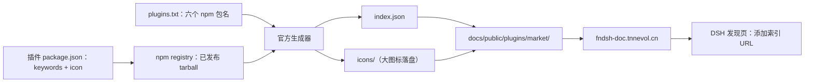

# PLAN-FNOS-016 插件市场索引与插件元数据

| 字段 | 内容 |
| --- | --- |
| 计划编号 | PLAN-FNOS-016 |
| 计划日期 | 2026-10-18 |
| 对应需求 | [FNOS-016 插件市场索引与插件元数据](/requirements/FNOS-016-plugin-market-index) |
| 本轮功能 | FNOS-016-01 至 FNOS-016-07 全部进入本轮实施 |
| 上游依据 | 上游 checkout `fork-pj/deepseek-harness`（`dsh-v0.2.1-rc.2`）：`packages/util/plugin-market-index`（格式与校验）、`apps/plugin-market-generator`（官方生成器）、`packages/boot/plugin-market`（索引读取）、`.agents/notes/implemented/feature/2026-10-02-plugin-market-index-format.zh.md` |
| 计划状态 | <Badge type="warning" text="待完成（双客户端已验；干净 profile 的安装链路待复验）" /> |

## 计划目标

为六个运行时插件补齐市场发现所需的元数据（`keywords` 与官方图标），发布补丁版本，再用上游官方生成器产出一份托管在文档站的市场索引，并建立「索引版本 = npm `next` 版本」的校验，避免索引随时间落后。

## 当前实现与目标设计

### 为什么必须先发版再生成（关键约束）

生成器**不读本地源码**，它读 npm 上已发布版本的 tarball：`apps/plugin-market-generator/src/metadata.ts` 的 `readDisplayMetadata` 从 tarball 内解析标题、描述、图标、关键词、作者与仓库。因此：

- 本地改完 `package.json` 但如果没发布，生成出的索引仍然没有 keywords、没有图标。
- 图标还必须在发布产物的 `files` 白名单里，否则 tarball 里根本没有该文件。

所以实施顺序被固定为：**改元数据 → 构建 → 发布补丁版本 → 跑生成器 → 提交索引**。

### 当前 → 目标

| 领域 | 当前实现 | 目标实现 | 迁移影响 |
| --- | --- | --- | --- |
| 关键词 | 六个插件均无 `keywords` | 每个插件按其实际能力填写 | 仅元数据，不影响运行时 |
| 图标 | 仅 Midscene 有 `icon.png` | 有官方素材的补上 `icon` 并加入 `files`；无素材的保持省略 | 包体积略增；需重新构建 |
| 插件版本 | `0.2.1-rc.2.0`（已发布） | 补丁版 `0.2.1-rc.2.1` | 需再次发布并更新发布清单 |
| 市场索引 | 不存在 | `docs/public/plugins/market/index.json`（+ 生成器写出的 `icons/`） | 新增静态文件，随文档站发布 |
| 索引维护 | 无 | 源列表 + 生成命令 + 一致性校验 | 发布流程增加一步 |

### 图标素材的处置结论（已逐个核实）

| 插件 | 对应品牌 | 素材情况 | 处置 |
| --- | --- | --- | --- |
| `dsh-fnos` | 飞牛 fnOS | 官网 favicon（ICO，144×144 位图）可用且为品牌标识 | 转为 PNG 使用 |
| `dsh-codebuddy` | 腾讯 CodeBuddy | 图标库提供该品牌的官方矢量标识（SVG） | 直接使用 SVG |
| `dsh-codex-auth` | OpenAI / Codex | 官方站点与图标库均无可直接取用的素材 | **省略图标** |
| `dsh-failover-search` | TinyFish / Tavily | Tavily favicon 为通用箭头图形，非同品牌标识；无其他可用素材 | **省略图标** |
| `dsh-semi-ui-showcase` | Semi Design | 官方 logo 地址返回 HTML 页面而非图片 | **省略图标** |
| `dsh-midscene` | 自有 | 已有 `icon.png` | 保持不动 |

省略不是退让：用通用箭头图形冒充 Tavily、或用文字拼一个「Semi」当成官方标识，都会让用户误认来源。占位图不影响可安装性。

### 索引文档形状

由生成器写出，关键字段：

```json
{
  "format": 1,
  "title": { "en": "…", "zh": "…" },
  "plugins": [
    {
      "name": "@tnnevol/dsh-fnos",
      "title": { "en": "…", "zh": "…" },
      "icon": "icons/<hash>.png",
      "repository": { "url": "…", "directory": "…" },
      "metadata": { "keywords": ["…"] },
      "versions": [
        { "version": "0.2.1-rc.2.1", "publishTimestamp": 0, "source": { "type": "npm" }, "engines": { "dsh": "…" } }
      ]
    }
  ]
}
```

分类、标签、排序键是市场自定义的不透明 id，生成器不产出。若要分类展示，需在生成后补充 `metadata.categories` 等声明——本计划**不做**，理由见「已决定事项」。

## 影响范围分析

| 需求功能 | 代码模块 | 配置/数据 | 测试 | 文档 | 目标环境 |
| --- | --- | --- | --- | --- | --- |
| FNOS-016-01 | `docs/public/plugins/market/**`、`docs/plugins/` 新增索引说明页 | 索引 JSON | 格式校验用例、一致性校验用例 | 文档站索引说明页 | DSH Web、DSH Desktop |
| FNOS-016-02 | 各插件 `package.json` 的 `icon`/`files`、新增图标文件 | 包内静态资源 | 图标存在性与格式用例 | 各插件文档页 | 文档站构建环境 |
| FNOS-016-03 | 各插件 `package.json` 的 `keywords` | 包元数据 | 关键词一致用例 | 插件总览页 | DSH Web、DSH Desktop |
| FNOS-016-04 | `tooling/fnos-dsh-cli` 一致性校验或仓库测试 | 发布清单 | 版本一致性用例 | 发布流程文档 | 本地构建环境 |
| FNOS-016-05 | 同上 | 索引与图标 | 格式与可达性用例 | 索引说明页 | 文档站构建环境 |
| FNOS-016-06 | `scripts` 下源列表与生成命令说明 | 源列表 `plugins.txt` | 幂等性用例 | 索引说明页 | 本地命令行 |

## 架构与数据流



说明：元数据必须先进 npm，生成器才能看到；索引与图标最后由文档站托管。这条链路决定了任务顺序不可颠倒。

## 分阶段任务

### 阶段一：插件元数据

| 任务 ID | 对应需求/验收 | 修改内容 | 前置条件 | 验证方式 |
| --- | --- | --- | --- | --- |
| PLAN-FNOS-016-T01-01 | FNOS-016-03 / AC-01、AC-02 | 六个插件 `package.json` 增加 `keywords`，按各插件实际能力填写 | — | 各插件 `check` 通过；关键词与实际能力逐项核对 |
| PLAN-FNOS-016-T01-02 | FNOS-016-02 / AC-01～AC-03 | fnOS 与 CodeBuddy 补 `icon` 与 `files` 白名单；其余三个保持省略并在计划中留痕 | — | 图标格式/体积校验；`pnpm pack` 产物内含图标 |
| PLAN-FNOS-016-T01-03 | FNOS-016-02 / AC-02 | 确认省略图标的三个插件包内无来源不明图片 | T01-02 | 包内文件清单核对 |
| PLAN-FNOS-016-T01-04 | FNOS-016-07 / AC-01、AC-02 | 五个缺 locale 的插件补 `locale/en.json` 与 `locale/zh.json` 的 `meta.title`/`meta.description`；`files` 加入 `locale`，`exports` 增加 `./locale/*.json` | T01-01 | 生成器读到可读标题；包内 `pnpm pack` 含 locale |

### 阶段二：发布补丁版本

| 任务 ID | 对应需求/验收 | 修改内容 | 前置条件 | 验证方式 |
| --- | --- | --- | --- | --- |
| PLAN-FNOS-016-T02-01 | FNOS-016-01 / AC-01 | 功能改动提交后，用 `pnpm run version -- plugin <别名> 0.2.1-rc.2.1` 发布六个插件补丁版本 | 阶段一完成 | 版本提交生成；发布清单同步 |
| PLAN-FNOS-016-T02-02 | FNOS-016-04 / AC-01 | `pnpm run publish` 逐个发布，确认 `next` 指向新版本 | T02-01 | `npm view <包> dist-tags.next` 核对 |
| PLAN-FNOS-016-T02-03 | FNOS-016-02 / AC-01 | 下载线上产物核对 keywords 与 icon 已进入 tarball | T02-02 | `npm pack <包>@<版本>` 解包检查 |

### 阶段三：生成与托管索引

| 任务 ID | 对应需求/验收 | 修改内容 | 前置条件 | 验证方式 |
| --- | --- | --- | --- | --- |
| PLAN-FNOS-016-T03-01 | FNOS-016-06 / AC-01、AC-02 | 新增源列表与生成命令说明（放 `docs/build/` 或插件开发文档） | — | 文档构建通过 |
| PLAN-FNOS-016-T03-02 | FNOS-016-01 / AC-01 | 用官方生成器产出 `docs/public/plugins/market/index.json` 与 `icons/` | T02-03 | 生成器退出码 0；格式校验通过 |
| PLAN-FNOS-016-T03-03 | FNOS-016-05 / AC-01、AC-02 | 校验索引：无未定义字段依赖、图标与索引同源或 https、无凭据/查询/片段 | T03-02 | 用上游校验器实测 |
| PLAN-FNOS-016-T03-04 | FNOS-016-06 / AC-02 | 重复生成一次确认输出确定（差异为空） | T03-02 | `git diff` 为空 |

### 阶段四：一致性校验与验收

| 任务 ID | 对应需求/验收 | 修改内容 | 前置条件 | 验证方式 |
| --- | --- | --- | --- | --- |
| PLAN-FNOS-016-T04-01 | FNOS-016-04 / AC-01 | 增加守卫用例：索引中每插件最高版本 = npm `next`；离线时跳过并报告 | T03-02 | 单测通过；断网时行为明确 |
| PLAN-FNOS-016-T04-02 | FNOS-016-01 / AC-01～AC-03 | DSH Web 与 DSH Desktop 的发现页实测：添加索引源、浏览、进详情、安装 | T03-02、T04-01 | 双客户端走查记录 |
| PLAN-FNOS-016-T04-03 | FNOS-016-03 / AC-01、AC-02 | 用意图词在发现页搜索，确认命中与不误命中 | T04-02 | 搜索实测 |
| PLAN-FNOS-016-T04-04 | FNOS-016-05 / AC-02 | 文档构建后确认索引与图标在站点根可访问 | T03-02 | 构建产物路径核对 |

## 交互和行为设计

### 发现页条目

- 条目标题、描述由生成器取自包元数据与 locale 文件；本仓库插件无 `locale/`，因此回退到 manifest 的 `name` 与 `description`。若希望发现页显示中文标题，需要在插件包内新增 locale 文件——**不在本次范围**，登记为后续。
- 图标：fnOS 与 CodeBuddy 显示官方标识；其余显示占位图。
- 版本列表：生成器会列出 npm 上所有未弃用的、声明了 `dsh.bundle` 的版本，因此历史上从 `0.2.0-rc.2.x` 起的版本都会出现。安装时用户选哪个版本由界面决定，兼容性由 DSH 的兼容门禁判定。

### 索引源管理

- 用户侧：在「发现」页添加索引 URL。本计划只负责产出索引，不实现客户端交互。
- 索引 URL 必须是 https；本项目文档站已启用 https。

### 破坏性操作保护

- 添加索引源会引入新的代码来源，DSH 界面本身带信任提示，插件侧无需额外处理。
- 重新生成索引会删除 `icons/` 下不再被引用的旧文件，这是生成器的既定行为，属预期。

## 数据、权限和错误处理

- 索引是公开静态文件，不含任何凭据、账号或内部地址。
- 图标文件为公开品牌素材，随 npm 包与文档站公开发布。
- 生成器若某个来源读取失败会退回缓存并返回退出码 1；此时索引可能缺少该插件的最新版本，必须重新运行直至退出码 0 才提交。
- 一致性校验在无法访问 npm 时应跳过而非失败，避免离线环境误报。

## 依赖、风险和决策

### 已决定事项

1. **用官方生成器，不手写索引**。手写意味着每次发版都要人工同步 `version`、`publishTimestamp` 与 `engines.dsh`，任何一处漏改都会让用户看到装不上的版本。
2. **不做自定义分类/标签/排序键**。这些是市场自定义的不透明 id，需要连同 `metadata` 声明一起维护；当前六个插件规模下分类收益低于维护成本。若后续插件数量增长再引入。
3. **图标宁缺毋滥**。只用可确认归属的官方品牌素材；取不到就省略。理由见「图标素材的处置结论」。
4. **索引放在文档站，不单独建站**。文档站已具备 https、CDN 与发布流水线，新增静态文件成本最低。
5. **一致性校验放仓库测试**，不放进 CLI 发布命令：发布命令已经在做 `latest` 维护，再加入联网校验会拖慢发布且在离线时误报。

### 风险

| 风险 | 影响 | 缓解 |
| --- | --- | --- |
| 补丁版本发布后 registry 传播延迟 | 生成器读到旧数据，索引缺关键词/图标 | 发布后核对 `npm view <包>@<新版本> keywords icon` 再生成 |
| 图标素材授权或归属存疑 | 品牌误用 | 只用确认可用的官方素材；三项省略并在文档注明原因 |
| 生成器把历史版本一并列出，条目版本过多 | 用户选择困难 | 属预期行为；靠详情页的兼容性提示筛选 |
| 索引随时间落后于 npm | 用户看到旧版本 | T04-01 守卫用例 + 发布流程新增一步 |
| 生成器依赖上游 checkout 与网络 | 本地不可复现 | 文档写明前置条件；产物本身入库，不要求每人重跑 |

### 回退方案

- 索引是新增文件，回退即删除该文件与文档页，不影响插件与已发布版本。
- 插件元数据（keywords/icon）回退需要再发一个补丁版本；图标文件删除后 `files` 白名单同步移除。

## 测试、打包、发布和回滚

- **本地层次**：六个插件的 `typecheck`/`test`/`build`；`pnpm run check -- --sdd`；格式校验用例。
- **发布层次**：补丁版本发布的 `next` 标签核对；线上 tarball 内容核对（keywords、icon、`files` 白名单）。
- **文档层次**：`pnpm run build -- --docs`，确认索引与图标出现在构建产物中。
- **客户端层次**：DSH Web 与 DSH Desktop 的发现页实测（需启用实验性自定义插件市场）。
- **回滚**：见上节。禁止在回滚中删除已发布版本或改写用户已添加的索引源配置。

具体用例在任务完成后回填到 `docs/tests/FNOS-016-*.md`。

## 参考资料

- 格式与校验：`packages/util/plugin-market-index/src/types.ts`、`src/index.ts`
- 官方生成器：`apps/plugin-market-generator/src/{metadata,generate,sources,packages}.ts`、`README.zh.md`
- 索引读取与展示：`packages/boot/plugin-market/`、`packages/client/ui-plugin-market/`
- 格式决策记录：`.agents/notes/implemented/feature/2026-10-02-plugin-market-index-format.zh.md`
- 发现页决策记录：`.agents/notes/implemented/feature/2026-10-02-plugin-market-discover.zh.md`
- 本仓库发布流程：[发布流程](/build/release)

## 完成状态

| 阶段 | 任务 | 状态 |
| --- | --- | --- |
| 一：插件元数据 | T01-01～T01-04 | <Badge type="tip" text="已完成" /> |
| 二：发布补丁版本 | T02-01～T02-03 | <Badge type="tip" text="已完成（两轮：rc.2.1 元数据、rc.2.2 locale）" /> |
| 三：生成与托管索引 | T03-01～T03-04 | <Badge type="tip" text="已完成" /> |
| 四：一致性校验与验收 | T04-01～T04-04 | <Badge type="tip" text="已完成（T04-02 含双客户端）" /> |

## 变更记录

| 日期 | 变更 | 说明 |
| --- | --- | --- |
| 2026-10-18 | 初始登记 | 建立 PLAN-FNOS-016，按「元数据 → 发版 → 生成索引 → 校验验收」四阶段拆分任务。已写明「必须先进 npm 才能被生成器看到」这一关键约束、图标素材逐个处置结论、五项已决定事项与回退方案。 |
| 2026-10-18 | 实施完成与本地验收 | 四个阶段的主体完成。实施中新发现缺 locale 导致索引标题显示包名，登记为 FNOS-016-07 并补 T01-04。元数据与 locale 分两轮发布（`0.2.1-rc.2.1`、`0.2.1-rc.2.2`）。生成器两次运行均 0 失败来源，重复生成差异为空。DSH Web 发现页实测通过。剩余：Desktop 走查（T04-02 的 Desktop 部分）与线上 URL 复核需在文档站部署后进行。 |
| 2026-10-18 | 新增 T01-04 | 覆盖 FNOS-016-07：五个插件缺 `locale/` 使索引标题回退为包名，补中英 locale 并在 `files`/`exports` 中放行。 |
