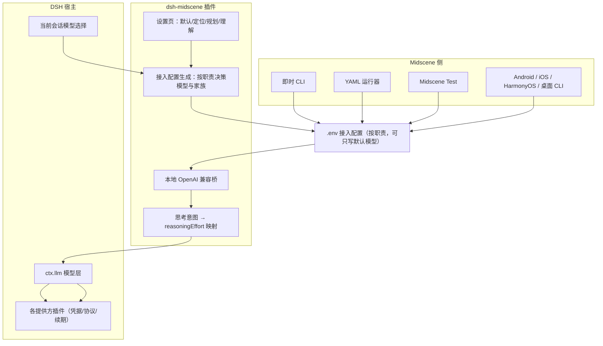
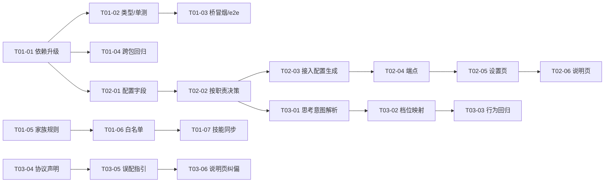
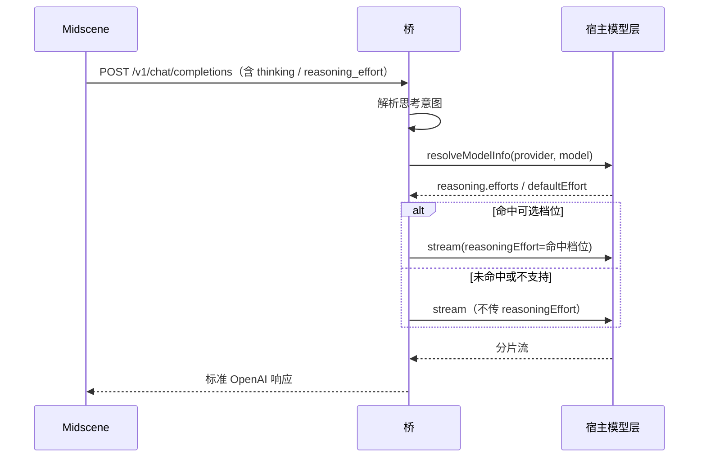

# PLAN-FNOS-021 Midscene 库能力对齐与接入简化

| 字段 | 内容 |
| --- | --- |
| 计划编号 | PLAN-FNOS-021 |
| 计划日期 | 2026-10-20 |
| 对应需求 | [FNOS-021 Midscene 库能力对齐与接入简化](/requirements/FNOS-021-midscene-library-integration) |
| 本轮功能 | FNOS-021-01 至 FNOS-021-07 |
| 计划状态 | <Badge type="warning" text="开发中（三阶段代码完成，界面与环境验收待补测）" /> |

## 计划目标

让插件托管的 Midscene 能力与上游稳定版对齐，并把「替用户配好模型环境」这件事从「一个模型」扩展到「四个职责」；同时修掉两处会静默失准的准确性缺陷，并把协议误配时的无上下文 404 改成可读指引（不改变现有成功路径）。

技术边界：所有改动落在本仓库插件内，不改 DSH 上游、不改 Midscene 上游代码；桥仍然只依赖宿主模型层 `ctx.llm`，不引入任何 `@midscene/*` 运行时依赖。

## 当前实现与目标设计

| 领域 | 当前实现 | 目标实现 | 迁移影响 |
| --- | --- | --- | --- |
| 库基线 | `@midscene/{web,test,computer}` 锁在 `1.15.1`（catalog 与安装等待期豁免列表各一处） | `1.16.0` | 锁文件更新；已写好的 `.env` 无需改动（默认协议仍为 Chat Completions） |
| 模型职责 | 单一 `model` 配置，只生成默认模型一套变量 | 默认 / 定位 / 规划 / 理解四个可选模型，各自生成一套变量 | 旧配置 `model` 字段保留为「默认模型」，已有用户不受影响 |
| 模型决策 | `chooseModel()` 对唯一模型执行「配置 → 会话 → 识图兜底」 | 同一决策函数按职责分别执行；专用职责不回落到其它职责 | 无：留空时行为与现状一致 |
| 家族推导 | 按「实际使用的模型」推导一次 | 按**每个职责自己的模型**推导，分别写入对应变量 | 无：单模型时结果不变 |
| 思考开关 | 请求体只读消息/温度/长度/停止词/工具，`thinking` 等字段丢弃 | 识别 Midscene 的思考开关意图，映射到宿主 `reasoningEffort`；模型不支持则原样放行 | 行为变化：使用 Midscene 时模型默认不再额外开思考 |
| 不支持形态 | `response_format` 被静默忽略（1.15.1 起即如此，现有验收全部通过）；协议误配时只有无上下文的 404 | `response_format` **继续保持忽略**（Midscene 有语义重试兜底）；接入配置显式声明协议；误配时给出可读指引 | 从「无上下文 404」变为「明确告知」；既有成功路径不变 |
| 家族规则 | `glm` / `doubao` 宽泛规则排在 `auto-glm`、UI-TARS 之前 | 具体规则优先，宽泛规则后置 | 修正 AutoGLM 与豆包 UI-TARS 的判定 |
| 家族白名单 | 20 项，缺 `jev` | 21 项 | 仅影响前缀识别与设置页提示 |
| 技能 | `midscenejs` 为 `v1.15.1` 快照 | `v1.16.0` 快照（skill version 1.1.0） | 整目录覆盖 + 哈希登记更新 |
| 说明页 | 含 4 处与实现不符的描述 | 与实现一致 | 纯文档 |

### 为什么升级不需要改桥

桥的请求转换与响应组装不 import 任何 `@midscene/*`：它把标准 OpenAI 请求翻译成宿主 `GenerateOptions`，再把宿主分片流组装回标准 OpenAI 响应。Midscene `1.16.0` 的默认协议仍是 `openai-chat`（只有 `gpt-5`/`gpt-6` 家族可选 Responses），因此升级只影响**客户端侧**，桥的契约面保持不变。这一点决定了阶段一可以只改依赖与测试，不动 `src/host/bridge-server.ts`。

### 为什么多职责必须按职责推导家族

家族决定坐标解析协议（形状、顺序、归一化基数）。上游对专用职责的家族是**独立变量**（`MIDSCENE_LOCATE_MODEL_FAMILY` 等），且专用模型**不逐字段继承**默认模型。若沿用「按默认模型推导一次」的写法，用户把定位模型换成另一个系列时，家族会停在默认模型那一套——正是需求里禁止的「静默失准」。

### 为什么思考开关走 `reasoningEffort` 而不是伪造字段

宿主 `GenerateOptions` 只有 `reasoningEffort`（适配器拥有的不透明档位 id），没有 `thinking`/`enable_thinking`。伪造一个超集字段对上游适配器无效，只会制造「以为传了」的假象。正确路径是：读取 Midscene 的意图 → 用 `llm.resolveModelInfo()` 取该模型真实可选的档位 → 命中才传，未命中就不传。这样不支持的模型照常工作，且不会在发起请求前被 `UNSUPPORTED_REASONING_EFFORT` 拦下。

## 影响范围分析

| 需求功能 | 代码模块 | 配置/数据 | 测试 | 文档 | 目标环境 |
| --- | --- | --- | --- | --- | --- |
| FNOS-021-01 | `pnpm-workspace.yaml`（catalog 与等待期豁免）、`plugins/dsh-midscene-plugin/package.json`、`packages/dsh-e2e-kit/package.json` 的 peer/dev 版本 | 锁文件 | 插件全量单测、`test:bridge` 冒烟、`tests/e2e` | 说明页版本基线 | 本地构测 |
| FNOS-021-02 | `src/contracts/config.ts`（新增三个模型字段）、`src/contracts/settings-rpc.ts`（快照与请求）、`src/host/model-choice.ts`（按职责决策）、`src/host/settings-routes.ts`、`src/client/settings-section.tsx`、`src/index.ts` | 插件配置新增三个可选字段，均为 volatile；旧字段语义收敛为「默认模型」 | `tests/host/model-choice.spec.ts`、`tests/contracts/config.spec.ts`、`tests/host/settings-routes.spec.ts`、e2e 设置页用例 | 说明页「指定测试模型」章节改写为四行 | DSH Web + DSH Desktop |
| FNOS-021-03 | 新增 `src/host/reasoning.ts`；`src/host/bridge-server.ts` 的补全路径接入 | 无 | 新增单测（意图解析、档位命中、不支持放行） | 说明页「额度与行为」补一句 | 本地构测 + DSH Web 实测 |
| FNOS-021-04 | `src/contracts/model-family.ts`（规则顺序）、`src/contracts/config.ts`（白名单 +1） | 无 | `tests/contracts/model-family.spec.ts`、`tests/contracts/config.spec.ts` | 无 | 本地构测 |
| FNOS-021-05 | `plugins/dsh-midscene-plugin/skills/midscenejs/`、`skills/SOURCE.md` | 无 | `tests/host/skills.spec.ts` 的哈希守卫 | `SOURCE.md` 的上游提交与同步日期 | 本地构测 |
| FNOS-021-06 | `src/contracts/config.ts`（配置生成加协议声明）、`src/host/bridge-server.ts`（协议路径的可读 404） | 无 | `tests/contracts/config.spec.ts`、`tests/host/bridge-server.spec.ts`（含「带 `response_format` 仍成功」） | 说明页「能力边界」小节 | 本地构测 + 实桥逐 provider 冒烟 |
| FNOS-021-07 | `docs/plugins/dsh-midscene.md` | 无 | 文档构建 + `--sdd` 检查 | 本体 | 文档站构建 |

**跨插件影响**：`packages/dsh-e2e-kit` 的 peer 依赖指向 catalog，catalog 升到 `1.16.0` 后它在 workspace 内自动跟随；`plugins/dsh-failover-search-plugin`、`plugins/dsh-codebuddy-plugin`、`apps/fn-deepseek-harness/tests` 同样通过 catalog 引用，需要一并回归它们的 `typecheck` 与 e2e 配置加载。

## 架构与数据流

要点：设置页只负责「选哪个模型」，接入配置生成负责「算出每个职责的模型与家族」，桥始终只处理标准 OpenAI 请求。Midscene 的三种运行方式与五类平台共用同一份 `.env`，因此四项功能只需在生成侧实现一次。

## 分阶段任务

### 阶段一：基线升级与准确性缺陷

| 任务 ID | 对应需求/验收 | 修改内容 | 前置条件 | 验证方式 |
| --- | --- | --- | --- | --- |
| PLAN-FNOS-021-T01-01 | FNOS-021-01 / AC-01 | `pnpm-workspace.yaml` 的 catalog 三行与等待期豁免列表中 6 个 `@midscene/*@1.15.1` 改为 `1.16.0`；执行安装更新锁文件 | 上游 `1.16.0` 已发布（已核实） | `pnpm install` 后 `node -e "require('@midscene/test/package.json').version"` 为 `1.16.0` |
| PLAN-FNOS-021-T01-02 | FNOS-021-01 / AC-02 | 跑插件类型检查、单测与构建；处理升级暴露的类型或行为差异 | T01-01 | `pnpm --filter @tnnevol/dsh-midscene run check` 全绿 |
| PLAN-FNOS-021-T01-03 | FNOS-021-01 / AC-03 | 跑 `test:bridge` 冒烟与 `tests/e2e`（需 DSH Web 与已装扩展的 Chrome）；确认桥未被要求改动 | T01-02 | 冒烟通过；e2e 通过或失败原因与升级无关（登记） |
| PLAN-FNOS-021-T01-04 | FNOS-021-01 / 回归 | 回归 `packages/dsh-e2e-kit` 与使用 catalog 的插件/应用的 typecheck 与 e2e 配置加载 | T01-01 | 相关包 typecheck 通过 |
| PLAN-FNOS-021-T01-05 | FNOS-021-04 / AC-01、AC-03 | 调整 `FAMILY_RULES` 顺序：`auto-glm` 提到 `glm` 之前；`vlm-ui-tars-*` 提到 `doubao-vision` 之前；补单测覆盖 `autoglm-phone`、`auto-glm-multilingual`、`doubao-1.5-ui-tars`、`ui-tars-1.5` | 无 | 新增单测全绿，且既有家族用例不回归 |
| PLAN-FNOS-021-T01-06 | FNOS-021-04 / AC-02 | `MIDSCENE_FAMILIES` 增加 `jev`；同步更新 `tests/contracts/config.spec.ts` 的长度断言 | T01-01（白名单以上游 1.16.0 为准） | 白名单与上游 `TModelFamily` 逐项一致 |
| PLAN-FNOS-021-T01-07 | FNOS-021-05 / AC-01、AC-02 | 用上游 `tnnevol/skills` 的 `skills/midscenejs`（`b63d3e3`，skill 1.1.0 / Midscene v1.16.0 快照）整目录覆盖；更新 `SOURCE.md` 的上游提交、同步日期与 14 个文件 sha256 | T01-06 | `tests/host/skills.spec.ts` 哈希守卫通过（22 条） |

### 阶段二：多职责模型接入

| 任务 ID | 对应需求/验收 | 修改内容 | 前置条件 | 验证方式 |
| --- | --- | --- | --- | --- |
| PLAN-FNOS-021-T02-01 | FNOS-021-02 / AC-01、AC-04 | `Config` 新增 `locateModel` / `planningModel` / `insightModel` 三个 volatile 字段（空串 = 沿用默认），`liveConfig`、`BridgeConfig`、`configuredModelOf` 同步 | 无 | 配置单测断言默认值与热更新读取 |
| PLAN-FNOS-021-T02-02 | FNOS-021-02 / AC-02、AC-03 | 抽出「按职责决策 + 按职责推导家族」的纯函数（每个职责独立调用既有 `chooseModel` / `resolveFamily`）；默认职责沿用 `model` 字段 | T02-01 | 单测覆盖：四职责全空、仅默认、仅定位、指定不存在模型 |
| PLAN-FNOS-021-T02-03 | FNOS-021-02 / AC-02 | `renderEnvFile` 扩展为按职责输出：默认职责保持现有四行；专用职责仅在配置了模型时输出其 `BASE_URL`/`API_KEY`/`NAME`/`FAMILY` 与 `*_STREAM_MODE` | T02-02 | 单测断言「全空时输出与升级前逐字符一致」 |
| PLAN-FNOS-021-T02-04 | FNOS-021-02 / AC-01、AC-04 | `/v1/midscene-env` 与设置快照按职责返回变量与家族；响应仍保留现有字段以免破坏已有客户端 | T02-03 | 端点单测 + 本地 curl 核对 |
| PLAN-FNOS-021-T02-05 | FNOS-021-02 / AC-01、AC-04 | 设置页把「指定测试模型」由单行扩展为四行；每行只列识图模型；不存在时如实提示；接入配置预览同步为多行 | T02-04 | 设置页 e2e 用例（新增 TC） |
| PLAN-FNOS-021-T02-06 | FNOS-021-02 / AC-02 | 同步更新说明页「指定测试模型」「协议家族是自动的」两节 | T02-05 | 文档构建 |

### 阶段三：思考开关透传与协议可诊断性

| 任务 ID | 对应需求/验收 | 修改内容 | 前置条件 | 验证方式 |
| --- | --- | --- | --- | --- |
| PLAN-FNOS-021-T03-01 | FNOS-021-03 / AC-01、AC-02 | 新增 `src/host/reasoning.ts`：解析请求体里的 `thinking.type` / `enable_thinking` / `reasoning_effort`，产出「关思考 / 开思考 / 指定档位」的意图 | 无 | 单测覆盖各家族字段形态 |
| PLAN-FNOS-021-T03-02 | FNOS-021-03 / AC-01、AC-02 | 桥在发起调用前用 `llm.resolveModelInfo()` 取 `reasoning.efforts`；意图映射到命中的档位 id，未命中则不传（不改其它字段） | T03-01 | 单测：命中传、未命中不传、`resolveModelInfo` 失败时降级为不传 |
| PLAN-FNOS-021-T03-03 | FNOS-021-03 / AC-03 | 回归验证消息、图片、工具、停止词与流式/非流式行为不变 | T03-02 | 既有 `tests/host/*` 全绿 |
| PLAN-FNOS-021-T03-04 | FNOS-021-06 / AC-01 | 接入配置显式写入协议声明（Chat Completions），用户无需自行判断 | 无 | 单测断言生成内容含协议说明；与现有四行兼容 |
| PLAN-FNOS-021-T03-05 | FNOS-021-06 / AC-02、AC-03、AC-04 | **保持忽略 `response_format`**（改成报错会把今天可用功能推成失败）；仅新增 `/v1/responses` 与 `/v1/systemone` 的可读 404 指引（说明本桥只提供 Chat Completions、Jev 不经本桥）；补单测断言「带 `response_format` 的请求仍成功」 | T03-04 | 端点单测：带该字段 → 200；打错协议路径 → 404 带指引；正常请求不变 |
| PLAN-FNOS-021-T03-06 | FNOS-021-07 / AC-01～AC-03 | 修正说明页四处漂移（`defaultProvider`、端口描述、`familyWarning`、家族下拉、`?model=`），补「能力边界」小节：结构化输出被忽略但由 Midscene 语义重试兜底、Responses 协议为何不需要、Jev 为何不经本桥 | T03-05 | 文档构建 + `pnpm run check -- --sdd` |

### 任务依赖

阶段一与阶段二/三之间只有「依赖已升级」一个前置，可并行推进；阶段三的思考链路（T03-01 → T03-02 → T03-03）与协议链路（T03-04 → T03-05 → T03-06）彼此独立，内部顺序不可颠倒。

## 交互和行为设计

### 设置页：由一行变四行

| 行 | 字段 | 留空含义 | 可选值 |
| --- | --- | --- | --- |
| 默认模型 | 既有「指定测试模型」 | 跟随 DSH 当前会话模型 | 具备识图能力的模型 |
| 定位模型 | 新增 | 使用默认模型 | 同上 |
| 规划模型 | 新增 | 使用默认模型 | 同上 |
| 页面理解模型 | 新增 | 使用默认模型 | 同上 |

行为要点：

1. **留空即继承**：与上游「未配置专用模型时该职责使用完整默认模型配置」一致；插件生成的 `.env` 里不写这三组变量，因此行为与升级前完全一致。
2. **不存在的模型如实提示**：与现有单行行为一致——保留用户选择并在界面标出「目录中不存在」，不静默改选。
3. **家族不暴露**：仍然不出现家族下拉。家族由每个职责自己的模型推导，界面上不呈现这个概念（与现状一致，避免用户拼出「家族与模型不匹配」的组合）。
4. **接入配置预览按职责分段**：默认职责四行保持原样在前；专用职责在后，带注释说明「仅在该职责指定了模型时出现」。

### 桥：思考意图的处理顺序

关键取舍：**宁可少传，不可乱传**。Midscene 的意图多为「关思考」，而宿主档位里通常存在 `off` 一类取值；命中就传 `off`，不命中就不传——不传时按宿主默认，可能仍会思考，但这比「传一个不存在的档位导致 400」安全。

### 桥：协议误配的指引

| 请求特征 | 当前行为 | 目标行为 |
| --- | --- | --- |
| 路径为 Chat Completions 且带 `response_format` | 该字段被忽略，请求正常成功 | **保持不变**：继续忽略并成功。改成报错会把今天可用的功能推成失败；模型返回非 JSON 时由 Midscene 的 `callAiAndParseWithRetry` 语义重试兜底 |
| 请求打到 `/v1/responses` | 404，无上下文 | 保留 404 状态码，补充可读提示「本桥只提供 Chat Completions，请将 `MIDSCENE_MODEL_PROTOCOL` 保持为默认 `openai-chat`」 |
| 请求指向 System One（`/v1/systemone`） | 404，无上下文 | 保留 404 状态码，补充「Jev 使用私有的 System One 协议，不经本桥；请改用通用模型作默认模型」 |

## 数据、权限和错误处理

- **持久化**：三个新字段写入插件配置文档，与现有字段同一份存储，不新增第二套配置来源。均为 volatile，热更新立即生效。
- **敏感数据**：接入密钥仍由桥生成并存于配置；多职责共用同一把密钥（同一桥、同一接入点）。密钥不进入日志。
- **错误处理**：
  - 目录读取失败 → 设置页退化为空列表并提示，不阻塞页面打开（沿用现状）。
  - 专用模型不存在 → 界面提示 + 生成配置时该职责回落默认模型，并在响应里带上「被跳过」的原因。
  - `resolveModelInfo` 失败或超时 → 思考意图降级为「不传」，请求照常发出。
- **兼容性**：`/v1/midscene-env` 的既有响应字段（`content`、`variables`、`resolvedModel`、`availableModels`）保持不变；新增字段是增量。

## 依赖、风险和决策

| 项 | 内容 |
| --- | --- |
| 上游事实依赖 | Midscene `1.16.0` 的职责变量清单、家族白名单、请求体字段，均已从包内类型与实现核实（见需求调研结论） |
| 风险 R1：升级引入行为变化 | `1.16.0` 强化了资源清理语义（超时后判定更悲观），既有 e2e 可能出现新的失败。**缓解**：阶段一单独跑一轮 e2e 并逐条登记，区分「真实回归」与「判定变严」 |
| 风险 R2：多职责组合抬高成本 | 用户可能给四个职责都配强模型。**缓解**：说明页明确「从默认模型起步，遇瓶颈再引入专用模型」；设置页对留空行显示「跟随默认」而非默认选中 |
| 风险 R3：思考档位语义不同 | 各提供方对 `off` 的映射不一致（有的用 `none`、有的用 `minimal`）。**缓解**：只使用宿主 `resolveModelInfo` 提供的档位 id，不自行猜测字符串；未命中不传 |
| 风险 R4：说明页改写的时效 | 上游新增能力快（本次 6 个发布跨 4 天），文档易再次漂移。**缓解**：说明页的变量清单以「按职责分组」表述而不是逐项枚举，减少跟随成本 |
| 决策 D1 | 不做 Jev | 私有 System One 协议 + 不能作默认模型，与「用 DSH 已有模型」定位冲突 |
| 决策 D2 | 不做 Responses 协议翻译 | **理由是不增加模型覆盖，不是做不到。** DSH 已在宿主内归一各提供方上游协议（Codex 的 responses、CodeBuddy 的私有形态），实桥逐 provider 实测证明单用 Chat Completions 即可触达全部已配置模型；宿主 `GenerateOptions` 也没有协议选择入口，实现需自建并行词汇。本次改为「接入配置显式声明协议 + 误配给指引」 |
| 决策 D5 | **保持忽略 `response_format`，不改成报错** | 该字段自 1.15.1 起就存在且桥一直忽略，现有 58 条验收用例在此状态下全部通过；Midscene 对解析失败有 `callAiAndParseWithRetry` 语义重试兜底。改成 400 会把今天可用的功能推成失败，属倒退 |
| 决策 D3 | 家族仍不暴露给用户 | 家族是内部协议细节，暴露必然产生错配组合；改为按职责自动推导 |
| 决策 D4 | 保留 `model` 字段语义为「默认模型」 | 避免配置迁移；已有用户配置无需改动 |

### 备用方案

若 `resolveModelInfo` 在某些提供方上返回不完整的 `reasoning` 信息（例如自定义端点未声明档位），思考意图一律降级为「不传」——功能退化为升级前的行为，不影响可用性。若上游后续把 `reasoningEffort` 以外的方式暴露思考开关，本计划的意图解析层可独立替换，不影响桥的其它部分。

## 测试、打包、发布和回滚

### 验证层次

| 层次 | 内容 | 环境 |
| --- | --- | --- |
| 包级 | 插件 typecheck、单测、构建；`packages/dsh-e2e-kit` typecheck | 本地 workspace |
| 桥级 | `test:bridge` 冒烟（真实 Chrome + 扩展）；`/v1/*` 端点单测 | 本地 |
| 交互级 | `tests/e2e`（Bridge Mode，设置页四行、家族不出现、接入配置预览） | DSH Web（`pnpm run start -- --web`，`DSH_HOME=<repo>/.dsh`） |
| 客户端 | 同套 e2e 在 DSH Desktop（开发态，CDP）复跑 | DSH Desktop |
| 文档 | 文档构建 + `pnpm run check -- --sdd` | 本地 |

**不需要真实 NAS**：本需求不涉及 fnOS 宿主能力。

### 打包与发布

按[发布流程](/build/release)执行；插件版本经 `pnpm run version` 更新（功能提交与版本提交分开）。发布后更新 `docs/plugins/index.md` 的版本号与说明页安装命令。

### 回滚

| 失败点 | 回滚方式 |
| --- | --- |
| 库升级导致 e2e 无法通过 | catalog 三行与豁免列表回退 `1.15.1`；已完成的家族/文档修正与之无关，可保留 |
| 多职责改动引入回归 | 三个新字段默认空串，功能上等价于关闭；必要时回退设置页与端点改动 |
| 思考透传引起请求失败 | 该映射独立成模块，可直接降级为「不传」常量返回 |
| 协议指引误伤正常请求 | 只对不存在的路径返回指引，不触碰 `/v1/chat/completions`；由 TC-038/TC-039 守卫 |

**禁止删除**：用户已有的插件配置（含接入密钥）不得在回滚中清除——换密钥会让已写入 `.env` 的用户立即 401。

## 参考资料

| 来源 | 用途 |
| --- | --- |
| `@midscene/shared@1.16.0` 的 `env/types.d.ts`、`env/parse-model-config.js` | 职责变量清单、家族白名单、专用模型不继承规则 |
| `@midscene/core@1.16.0` 的 `ai-model/models/*`、`service-caller/*` | 各家族请求体字段、System One 协议路径、协议默认值 |
| `@midscene/test@1.16.0`、`@midscene/web@1.16.0` 的 `dist/types` | 导出面变化与本仓库使用点的兼容性 |
| 上游 `changelog` 与 v1.15.2～v1.16.0 Release 说明 | 版本间能力清单 |
| `web-infra-dev/midscene-skills`（head `dec1d1c`）、`tnnevol/skills`（head `b63d3e3`） | 技能同步基线 |
| `@deepseek-ai/dsh-llm@0.2.1-rc.2` 类型定义与 `resolveCallWithInfo` 实现 | `reasoningEffort` 与 `resolveModelInfo` 契约 |
| Midscene 官方《模型选择指南》《模型配置参考》 | 四职责定义与 Jev 限制 |

## 完成状态

| 阶段 | 状态 | 说明 |
| --- | --- | --- |
| 阶段一 基线升级与准确性缺陷 | <Badge type="tip" text="已完成" /> | 7 个任务；T01-03 的桥冒烟与 e2e 待环境补测 |
| 阶段二 多职责模型接入 | <Badge type="tip" text="已完成" /> | 6 个任务；T02-05 的设置页需在 DSH Web 与 Desktop 双客户端验收 |
| 阶段三 思考透传与协议可诊断性 | <Badge type="tip" text="已完成" /> | 6 个任务；TC-042a 的逐 provider 冒烟待真实凭据环境 |

## 变更记录

| 日期 | 变更 | 说明 |
| --- | --- | --- |
| 2026-10-20 | 初始登记 | 建立 PLAN-FNOS-021。三阶段 18 个任务：阶段一依赖升级（catalog 与豁免列表）与家族/白名单/技能修正；阶段二把接入配置从单模型扩展到四职责；阶段三补思考开关透传与协议可诊断性。登记 4 项风险（升级判定变化、多职责成本、档位语义、文档时效）与 4 项决策（不做 Jev、不做 Responses、家族不暴露、保留 `model` 语义）。 |
| 2026-10-20 | 更正阶段三设计：拒绝改指引，避免倒退 | 原 T03-04 计划「请求带 `response_format` 就返回 400」。复核发现该字段自 1.15.1 起就存在、桥一直忽略，而现有 58 条验收用例在此状态下全部通过，Midscene 另有 `callAiAndParseWithRetry` 语义重试兜底——改成 400 会把可用功能推成失败。修订：① 阶段三改名为「思考开关透传与协议可诊断性」，任务由 5 个增至 6 个；② T03-04 改为「接入配置显式声明协议」；③ T03-05 明确「保持忽略 `response_format`」，只新增 `/v1/responses`、`/v1/systemone` 的可读 404 指引，并加单测钉住「带该字段仍返回 200」；④ 决策 D2 的理由由「仅 GPT 系可选」改为「**不增加模型覆盖**」，依据是实桥逐 provider 实测（codex/za-newapi/codebuddy/opencode-go/dsh-opencode-go 经 Chat Completions 全部正常）与宿主 `GenerateOptions` 无协议选择入口；⑤ 新增决策 D5 记录「保持忽略」的取舍。FNOS-021-06 相应从 P2 提到 P1。 |
| 2026-10-22 | 三阶段 19 个任务实现完成（本地构测） | 阶段一：catalog 与等待期豁免升至 `1.16.0`；`FAMILY_RULES` 顺序修正（`auto-glm` 先于 `glm-v`、`vlm-ui-tars-*` 先于 `doubao-*`）；白名单补 `jev`（21 项）；`midscenejs` 同步上游 `b3f7fd6`（22 个文件，零本地补丁）。阶段二：新增 `src/contracts/intents.ts`（四职责常量与 `dsh-model@<职责>` 命名）、`Config` 三字段、`resolveIntentModels()` 按职责决策与推导家族、`renderEnvFile` 按职责扩展、`/v1/midscene-env` 与设置快照按职责返回、设置页改为四职责 Tabs。阶段三：新增 `src/host/reasoning.ts`（意图解析 + 档位匹配 + 降级）、接入配置显式声明协议、`/v1/responses` 与 `/v1/systemone` 可读 404 指引、**保持忽略** `response_format` 并加倒退守卫。验证：包级单测 211 条全绿（新增 `reasoning.spec.ts` 15 条、`intent-models.spec.ts` 7 条），`typecheck`/`build`/全仓 `typecheck`（11/11）通过。执行期修复 `/v1/midscene-env` 的 `variables` 字典丢失专用职责键（`map` 误用，应 `flatMap`）。遗留：桥冒烟、e2e、双客户端界面验收与逐 provider 冒烟待环境补测。 |
