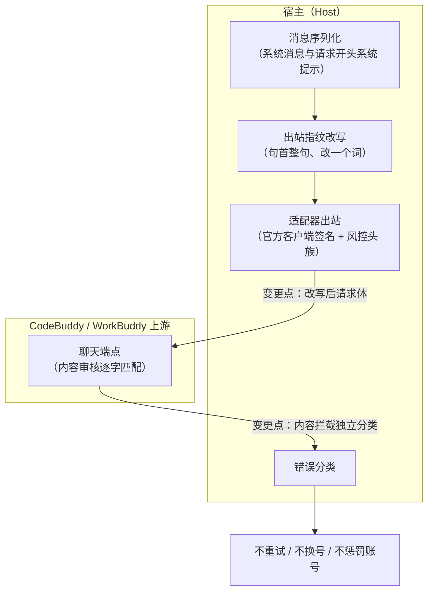

# PLAN-FNOS-022 CodeBuddy 模型调用被内容审核拦截修复

| 字段 | 内容 |
| --- | --- |
| 计划编号 | PLAN-FNOS-022 |
| 计划日期 | 2026-10-20 |
| 对应需求 | [FNOS-022 CodeBuddy 模型调用被内容审核拦截修复](/requirements/FNOS-022-codebuddy-content-block-fix) |
| 本轮功能 | FNOS-022-07、FNOS-022-08 |
| 计划状态 | <Badge type="tip" text="已完成（两阶段均完成，双客户端已验）" /> |
| 来源说明 | 本计划已不含任何参考项目对齐项——参考项目已于 2026-10-21 停止维护，相关功能在需求中取消 |

## 计划目标

恢复 CodeBuddy 插件的模型可用性：当前插件发往上游的每一次模型调用都被上游内容审核拦截，用户侧表现为模型完全无法使用。

技术边界：全部改动落在 `plugins/dsh-codebuddy-plugin` 内，不修改 DSH 上游代码，不引入新依赖。

## 当前实现与目标设计

| 领域 | 当前实现 | 目标实现 | 迁移影响 |
| --- | --- | --- | --- |
| 请求体出站内容 | 系统消息**逐字透传**，无任何改写 | 出站前对已识别的审核指纹做**单句最小改写**（改一个词，仅句首锚定、忽略大小写），语义不变；未命中时逐字不变 | 系统提示首句被改写，模型看到的身份说明措辞变化，指令含义不变 |
| 改写范围 | 无（不涉及） | 按实测收窄：单句改写后完整系统提示即通过，无需覆盖一整套指纹清单 | 实现面小；规则保留可扩展形态以备上游新增 |
| 内容拦截的错误归类 | HTTP 400 一律归入请求非法，与瞬时拒绝混同 | 内容审核拦截归入独立错误类别，不重试、不换号、不惩罚账号 | 拦截时失败次数由「1 + 2 次重试」变为 1 次 |
| 客户端标识 | 刻意使用官方客户端签名（宿主标识会被同类拦截） | 保持不变 | 无 |
| 角色白名单 | `developer` 已归一为 `system`（既有实现） | 保持不变 | 无 |

### 为什么只做单句改写，不照搬上游那套净化机制

上游是网关形态、需替各类客户端兜底，因此维护一整套指纹清单（键值型剥离、模板句改写、工具参数净化等）。本插件的待处理面只有「系统提示开头的一句」：实测确认单句改写后，真实的完整系统提示（约 19 KB）整体通过，其余内容不含其它指纹。

照搬那套清单会引入大量当前无用的规则并扩大误伤正常文本的可能。因此只做句首整句替换、改一个词；规则保持清单形态，上游若新增指纹再追加。

### 为什么内容拦截必须独立成码

它带业务码 11128，与 [FNOS-020](/requirements/FNOS-020-codebuddy-transient-400) 处理的那类「响应体只有一句话、不带业务码」的 400 **可以稳定区分**。而现有重试策略把 `INVALID_REQUEST` 纳入可重试集合，于是确定性拦截被当作瞬时抖动重试 2 次——纯属放大无效请求。

同时它与账号健康无关（实测同账号、同模型、仅改请求内容即切换结果），换账号同样无效，因此不得进换号集合。

### 为什么不做请求头伪造

上游的《停止维护声明》把「对非官方客户端的识别与拦截正在收紧」列为主要原因，因此专门验证了请求头层面。用官方 CLI 真实抓包构造完整请求头族（39 个头，含 SDK 指纹与分布式追踪头）做隔离实验：

| 组合 | 结果 |
| --- | --- |
| 插件现有请求头 + 原始系统提示 | 400 / 11128 |
| 官方完整请求头族 + 原始系统提示 | 400 / 11128 |
| 官方完整请求头族 + 改写后系统提示 | 200 |
| 插件现有请求头 + 改写后系统提示 | 200 |

**头族不影响判定**，伪造它不会改善可用性。故不纳入。

## 影响范围分析

| 需求功能 | 代码模块 | 配置/数据 | 测试 | 文档 | 目标环境 |
| --- | --- | --- | --- | --- | --- |
| FNOS-022-07 | `plugins/dsh-codebuddy-plugin/src/host/outbound-mask.ts`（新增）；`src/host/serialize.ts`（接入两条系统消息路径） | 无 | `tests/outbound-mask.spec.ts`、`tests/serialize.spec.ts` | `docs/plugins/dsh-codebuddy.md` 补拦截说明 | 本地构测 + DSH Web/Desktop |
| FNOS-022-08 | `src/host/adapter.ts`（错误分类、重试策略常量）；`src/host/types.ts`（错误详情取值） | 无 | `tests/error-envelope.spec.ts`、`tests/retry-policy.spec.ts` | `docs/plugins/dsh-codebuddy.md` 补错误码说明；`docs/troubleshooting.md` 补排查条目 | 本地构测 + DSH Web/Desktop |

## 架构与数据流

数据流要点：

- 改写位于**序列化之后、出站之前**，输入是即将发往上游的消息数组；它不改变 DSH 侧的消息语义，也不回写会话。
- 只接系统来源文本（请求开头系统提示 + session 内 system/developer）：实测上游只比对系统提示句首，改写用户正文属多余误伤。
- 内容拦截的分类发生在适配器收到非 2xx 响应时，产出的独立错误码**不进入**重试集合，也不进入换号触发集合（后者只认 `QUOTA` / `RATE_LIMIT`）。

## 分阶段任务

### 阶段一：实现与本地验证（已完成）

| 任务 ID | 对应需求/验收 | 修改内容 | 前置条件 | 验证方式 |
| --- | --- | --- | --- | --- |
| PLAN-FNOS-022-T01-01 | FNOS-022-07 / AC-02、AC-03、AC-07 | 新增出站改写模块：针对已识别的身份说明做整句替换（改一个词），**严格只在句首匹配**、忽略大小写；未命中时逐字返回原串；规则做成可扩展清单 | 无 | 单测：句首命中即替换且只改一个词；非句首出现时逐字不变；未命中时输出与输入逐字相同 |
| PLAN-FNOS-022-T01-02 | FNOS-022-07 / AC-01 | 接入**两条**系统消息路径：请求开头系统提示与 session 内 system/developer 消息；不改写用户正文与工具参数（实测不触发） | T01-01 | 单测：两条路径均被改写；用户消息逐字不变 |
| PLAN-FNOS-022-T01-03 | FNOS-022-07 / AC-06 | 用与真实场景长度相当的完整系统提示做整体验证，证明其余内容不含其它指纹 | T01-01、T01-02 | 真实账号端到端：改写前拦截、改写后通过、复测通过 |
| PLAN-FNOS-022-T01-04 | FNOS-022-08 / AC-01、AC-04 | 在错误分类中识别内容审核拦截（依据业务码 11128），归入独立错误类别；判定**先于**鉴权与 400 通用分支（实测 400 与 403 两种状态码都出现） | 无 | 单测：两种状态码均归入独立码，且与请求非法、额度耗尽、鉴权失败互不混淆 |
| PLAN-FNOS-022-T01-05 | FNOS-022-08 / AC-02、AC-03、AC-05 | 把内容拦截移出重试集合与换号触发集合；确认既有瞬时请求非法仍按既有策略重试 | T01-04 | 单测：可重试集合不含该码；既有 `INVALID_REQUEST` 仍在集合内 |
| PLAN-FNOS-022-T01-06 | FNOS-022-08 / AC-01 | 扩展错误详情取值，覆盖扁平与嵌套两种信封的三处业务码位置 | T01-04 | 单测：三种位置均能读出业务码 |
| PLAN-FNOS-022-T01-07 | 回归 | 跑插件全量测试与构建 | T01-01～T01-06 | 73 个测试文件 933 条用例全绿；typecheck 与 build 通过 |

### 阶段二：目标客户端走查

| 任务 ID | 对应需求/验收 | 修改内容 | 前置条件 | 验证方式 |
| --- | --- | --- | --- | --- |
| PLAN-FNOS-022-T02-01 | FNOS-022-07 / AC-01、AC-06 | DSH Web 真实会话：选中 CodeBuddy 模型发起对话，确认不再被拦截、模型正常返回 | 阶段一完成；具备可用真实账号 | 会话事件流与界面取证 |
| PLAN-FNOS-022-T02-02 | FNOS-022-07 / AC-01 | DSH Desktop 真实会话：同上 | 同 T02-01 | 双客户端结论按客户端分列登记 |
| PLAN-FNOS-022-T02-03 | FNOS-022-08 / AC-02、AC-03 | 真实拦截场景下确认只失败一次、不重试、不换号 | 阶段一完成；可构造拦截条件 | 事件流中确认请求次数与账号归属 |

## 执行进展

| 阶段 | 状态 | 说明 |
| --- | --- | --- |
| 阶段一 实现与本地验证 | <Badge type="tip" text="已完成" /> | T01-01～T01-07 全部完成。新增出站改写模块并接入两条系统消息路径；错误分类新增 `CONTENT_BLOCKED`。插件 73 个测试文件 933 条用例全绿，typecheck 与 build 通过。真实账号端到端：19,496 字节完整系统提示原样发送被拦（400/11128），改写后连续两次通过（200/200）。 |
| 阶段二 目标客户端走查 | <Badge type="tip" text="已完成" /> | T02-01～T02-03 全部完成：DSH Web 与 DSH Desktop 均确认模型正常返回；本地桩注入下内容拦截只失败一次、不重试、不换号。 |

### 阶段一任务完成情况

| 任务 | 状态 | 落点 |
| --- | --- | --- |
| T01-01 出站改写模块 | 完成 | `src/host/outbound-mask.ts` |
| T01-02 接入两条系统消息路径 | 完成 | `src/host/serialize.ts`（请求开头系统提示 + session system/developer） |
| T01-03 完整系统提示验证 | 完成 | 真实 19,496 字节系统提示端到端 |
| T01-04 内容拦截独立分类 | 完成 | `src/host/adapter.ts`（业务码 11128 → `CONTENT_BLOCKED`，判定先于鉴权与 400 分支） |
| T01-05 移出重试与换号集合 | 完成 | 未进可重试集合，未进换号集合；用例钉住 |
| T01-06 错误详情取值 | 完成 | `wireBusinessCode()` 覆盖扁平与嵌套信封 |
| T01-07 全量回归 | 完成 | 933 条用例全绿 |

## 交互和行为设计

不新增入口，不改变既有交互路径。两处用户可观察变化：

| 场景 | 当前 | 目标 |
| --- | --- | --- |
| 发起 CodeBuddy 对话 | 每次都被拦截，显示「请求被拦截，请重新发送」 | 正常返回模型内容 |
| 内容拦截确实发生时（改写未覆盖的新指纹） | 重试 2 次后失败，错误文案含义不明 | 一次即失败，错误说明「被上游内容策略拦截」 |

内容拦截的错误文案走既有错误信息通路，不新增界面元素。

## 数据、权限和错误处理

- 无新增持久化数据结构，无用户数据迁移，无凭据格式变化。
- 权限边界不变：仍只调用用户已登录账号自身的上游端点。
- **错误处理变化两处**：
  1. **内容拦截归入独立错误类别**：从「与瞬时请求非法混同、被重试 2 次」变为「一次即失败、不重试、不换号、不惩罚账号」。这是本轮对用户体验影响最大的一处。
  2. 既有瞬时请求非法的行为不变（仍在可重试集合内）。
- **出站改写的边界**：只改写出站请求，不回写会话、不修改本地会话历史、不影响用户在 DSH 界面看到的消息。改写对象是**即将发往上游的副本**，会话存储中的原文保持不变。

## 依赖、风险和决策

| 项 | 说明 |
| --- | --- |
| 依赖 | 无新增依赖。全部改动使用现有运行时能力（字符串处理、既有错误分类链路） |
| 风险一 | **改写是逐字匹配的规则集，上游可能新增指纹**。已实测当前只需覆盖一句即可通过；但上游若把匹配扩展到其它句子或改为语义判定，单句改写会失效。失效时的表现是「拦截 → 独立报错」，用户看到一次明确失败而非静默损坏（这正是同时做错误分类的原因）。缓解：规则做成可扩展清单；独立错误分类保证覆盖不全时失败一次即返回、可诊断 |
| 风险二 | **改写属于对上游审核规则的规避**。插件已有同类先例（上游拦截带宿主标识的客户端标识，插件因此刻意使用官方客户端签名），沿用该路线与既有设计一致；但它确实是在规避上游明确设置的规则，已在需求中显式登记并由用户确认实施 |
| 风险三 | 改写可能误伤正常文本。实测确认匹配为**整句精确匹配且严格锚定句首**：句首加词、加换行、句中或句尾出现同一句均不触发。缓解：改写只在句首位置生效（单测钉住），只替换整句且只改一个词，不做泛化替换 |
| 风险四 | **上游可能按「行为特征」而不仅按内容判定**。实测对照证据表明当前判定是内容驱动的（同一账号、同一端点、仅改内容即切换结果；逐条串行单请求排除了速率因素）；若上游改为按调用频率或客户端指纹组合判定，改写不足以解除拦截，需另行取证 |
| 风险五 | **上游正在整体收紧对非官方客户端的识别**。参考项目在同日以此为首要原因宣布停止维护。本次修复解决的是当前的拦截形态，不保证长期有效；上游若改变判定维度，需要重新取证。该风险无法通过代码消除，属使用非官方客户端的固有风险 |
| 风险六 | 存在与内容拦截无关的账号级错误（业务码 11140 / HTTP 403「request illegal」）：实测同账号在系统提示干净时也会返回，配官方完整请求头族同样无效，属账号授权状态、需重新登录。本计划不处理它（属账号运营范畴）；错误分类上它与内容拦截互不混淆 |
| 决策 | **不伪造官方客户端完整请求头族** | 已实测无效：官方头族配原始系统提示仍被拦。做它不改善可用性，只增加维护面 |
| 决策 | **不照搬上游整套指纹净化机制** | 实测单句改写即让完整系统提示整体通过，照搬会引入大量无用规则并扩大误伤面 |
| 决策 | 改写只覆盖系统来源文本 | 实测用户正文中的同一句不触发拦截，改写它属多余误伤 |

## 测试、打包、发布和回滚

验证分层：

- **本地包级**：插件 typecheck、单元测试、构建。T01-07 负责全量回归。
- **客户端走查**：阶段二在 DSH Web 与 DSH Desktop 验证 FNOS-022-07、08；真实 CodeBuddy 账号是必需条件。
- **用例回填**：阶段一的用例与执行结果已回填到 [FNOS-022 测试用例](/tests/FNOS-022-codebuddy-content-block-fix)；阶段二完成后在同一文档续补。
- **不要求 NAS 验收**：本轮全部改动落在不依赖 fnOS 专属能力的插件内。

回滚与降级：

- 两项功能相互独立，可按功能单独回滚：出站改写一组（T01-01～T01-03）、错误分类一组（T01-04～T01-06）。
- **改写若造成请求异常**，回滚 T01-01～T01-03 即可；此时模型调用恢复到「拦截但可诊断」状态（因 T01-04～T01-06 的分类改动独立保留，不会退化为无意义重试）。这是刻意拆开任务的目的：两者可分别回滚。
- 错误分类改动若需回滚，回滚 T01-04～T01-06 即可，出站改写不受影响。
- **禁止删除**：用户凭据、账号数据、会话与工作区数据本轮均不涉及；改写不回写会话存储，回滚后原始消息仍在。

## 参考资料

| 来源 | 版本 / 位置 | 用途 |
| --- | --- | --- |
| 现场复现证据 | 只读脚本（`tmp/` 下，git 忽略）：账号级复现、触发规则边界、完整系统提示处置、改写后行为验证 | FNOS-022-07、08 的触发条件、规则边界与修复范围依据 |
| 官方 CLI 抓包对照 | 官方客户端实测请求（`tmp/` 下脚本；抓包文件含账号标识，核对后已删除） | 证明拦截与请求头族无关 |
| 本仓库插件实现 | `plugins/dsh-codebuddy-plugin` | 出站透传与错误分类的现状取证 |
| 来源项目停止维护声明 | 开源项目 `workbuddy2api-panel` README（2026-10-21） | 取消参考项目对齐项的依据 |
| 仓库规范 | `docs/charter/requirements-spec.md`、`docs/charter/plans-spec.md`、`docs/charter/tests-spec.md` | 文档与验证要求 |

## 变更记录

| 日期 | 变更 | 说明 |
| --- | --- | --- |
| 2026-10-20 | 建立 PLAN-FNOS-022 | 依据对来源项目的逐域比对，拆出 6 项口径对齐功能与两阶段任务，登记 4 类不移植的上游变更与 5 项风险。 |
| 2026-10-21 | 纳入内容拦截问题，重排为三阶段 | 用户要求把「模型完全不可用」并入本计划。新增阶段一「模型可用性恢复」（8 个任务），原阶段一/二顺延为阶段二/三。改写与错误分类刻意拆成可分别回滚的两组。同时补做移植基线当日上游改动的全量复核。 |
| 2026-10-21 | 回填实测证据，收窄实现选型 | 逐项变体实测确定规则边界（句首锚定、忽略大小写、整句匹配）；把实现从「照搬上游整套净化」收窄为「单句最小改写」——真实完整系统提示仅改首句一个词即整体通过。风险项重写：原「可能误伤正常文本」降级为可控，新增「上游可能改按行为特征判定」风险。 |
| 2026-10-21 | 阶段一实现与本地验证完成 | 新增出站改写模块并接入两条系统消息路径；错误分类新增 `CONTENT_BLOCKED`。933 条用例全绿、typecheck 与 build 通过；真实账号端到端确认改写前 400/11128、改写后 200 且复测通过。另登记账号级错误 11140 为独立风险。 |
| 2026-10-21 | 实测排除请求头伪造，补登风险 | 抓取官方 CLI 真实请求（39 个头）做隔离实验：官方头族配原始系统提示仍被拦，插件头族配改写后系统提示即通过。据此把「伪造官方头族」「改用官方 SDK」列为决策不纳入，并补登「上游正在整体收紧」风险。 |
| 2026-10-21 | **收窄范围：删除参考项目对齐阶段** | 参考项目于 2026-10-21 发布停止维护声明，按「停更后不再跟进其口径」的决策，需求中已取消 FNOS-022-01～06 与 09。本计划相应删除原阶段二（账号门控与口径修正）的 9 个任务及其影响范围、风险、决策与参考资料，三阶段收窄为两阶段（阶段一已完成 + 阶段二双客户端走查）。文档标识改为「CodeBuddy 模型调用被内容审核拦截修复」。 |
| 2026-10-21 | 阶段二完成，计划收尾 | 双客户端走查通过：DSH Web（项目 `.dsh` profile，`turn/end kind=completed provider=codebuddy`）与 开发态 DSH Desktop（CDP 9333，页面「已完成，用时 1 秒」）。T02-03 用本地桩注入真实拦截验证：`assistant/attempt = 1`、无 `retry` 事件、`turn/end error.code = CONTENT_BLOCKED`，两次聊天请求（主请求 + 标题生成）均落在同一账号，未换号。测试后已恢复 endpoint 与自动切换设置。 |
