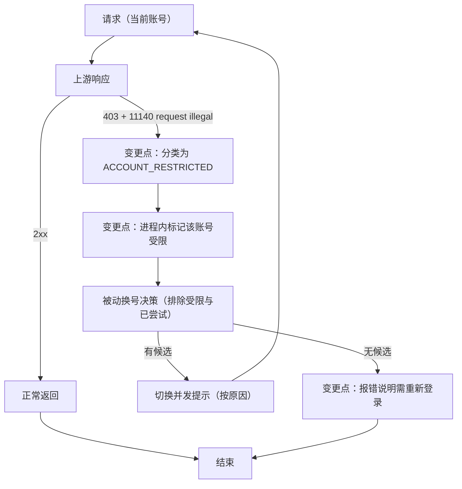

# PLAN-FNOS-023 CodeBuddy 受限账号触发自动切换

| 字段 | 内容 |
| --- | --- |
| 计划编号 | PLAN-FNOS-023 |
| 计划日期 | 2026-10-21 |
| 对应需求 | [FNOS-023 CodeBuddy 受限账号触发自动切换](/requirements/FNOS-023-codebuddy-restricted-account-failover) |
| 本轮功能 | FNOS-023-01 ～ FNOS-023-04 |
| 计划状态 | <Badge type="tip" text="已完成（阶段一全部完成；阶段二 DSH Web 已验，Desktop 待补）" /> |

## 计划目标

让「账号被上游限制」这一类失败进入既有的被动换号路径：识别独立错误码 → 触发切换（不受自动切换偏好限制）→ 给出按原因区分的可见提示 → 把受限账号排除出后续候选 → 无可用账号时如实报错。

技术边界：全部改动落在 `plugins/dsh-codebuddy-plugin` 内，不修改 DSH 上游代码，不引入新依赖，不写入凭据文件。

## 当前实现与目标设计

| 领域 | 当前实现 | 目标实现 | 迁移影响 |
| --- | --- | --- | --- |
| 11140 的错误分类 | 落进 `401/403 → AUTH` 通用分支 | 新增独立错误码 `ACCOUNT_RESTRICTED`，判定先于 `AUTH`；按文案区分 11140 的账号级与模型级限流两种形态 | 受限账号的报错码从 `AUTH` 变为 `ACCOUNT_RESTRICTED` |
| 换号触发集合 | 只认 `QUOTA` 与 `RATE_LIMIT` | 追加 `ACCOUNT_RESTRICTED` | 受限账号触发自动切换 |
| 自动切换偏好 | 关闭时**所有**换号被拦住 | 保持对额度/限流生效；`ACCOUNT_RESTRICTED` 不受其限制 | 偏好语义不变，受限是例外 |
| 换号提示文案 | 固定「额度不足」 | 按触发原因生成：额度不足 / 被限流 / 账号受限需重新登录 | 提示更准确 |
| 403 处理 | 一律 `session.invalidate()`（丢弃内存凭据） | 受限不移除凭据（token 仍有效），仅鉴权失败才失效 | 避免受限账号被反复重读同一无效态 |
| 受限账号后续选择 | 仍会被选为候选（凭据有效） | 进程内记录受限账号集合，从候选排除 | 后续请求不再先失败一次；重启或重新登录后复位 |

### 为什么受限要绕过「自动切换」偏好

该偏好描述的是「额度不足或请求被限流时自动改用其它账号」——一种优化。受限账号是**任何请求都无法服务**的状态，保持原样等于让插件不可用。因此在给出可见提示的前提下，受限触发的切换不等待偏好。

### 为什么受限账号不能只在本次请求内排除

被动换号本就把「已尝试过的账号」排除，但这只覆盖单次请求。受限是持续状态：若不做进程内记录，下一个请求仍会先撞一次 11140 再切换，用户每次都要多等一次失败。因此需要跨请求的进程内集合。

### 与内容拦截的边界

内容拦截（11128）对应 `CONTENT_BLOCKED`，**不进**换号集合——换账号不会让同一份请求内容变合法。两类错误的判定依据不同（业务码不同），实现上互不影响。

## 影响范围分析

| 需求功能 | 代码模块 | 配置/数据 | 测试 | 文档 | 目标环境 |
| --- | --- | --- | --- | --- | --- |
| FNOS-023-01 | `src/host/adapter.ts`（分类、换号触发、提示文案） | 无 | 分类与换号判定单测 | `docs/plugins/dsh-codebuddy.md` 补自动切换说明 | DSH Web、DSH Desktop |
| FNOS-023-02 | `src/host/adapter.ts`（提示文案） | 无 | 提示文案单测 | 同上 | 本地构测 |
| FNOS-023-03 | `src/host/session.ts`（受限集合）、`src/host/switch-policy.ts`（候选排除） | 进程内内存，不落盘 | 候选排除与复位单测 | 同上 | 本地构测 + 真实账号 |
| FNOS-023-04 | `src/host/adapter.ts`（全部受限时的错误与文案） | 无 | 错误语义单测 | `docs/troubleshooting.md` 补排查条目 | 本地构测 |

## 架构与数据流

数据流要点：

- 受限标记只存在于宿主进程内存，随进程结束消失；重新登录写入新凭据时清除对应标记。
- 候选排除在纯函数决策层完成，便于单测；适配器只负责取数、决策、执行。
- 提示在重试流开始前以文本产出，与既有换号提示同一通道。

## 分阶段任务

### 阶段一：实现与本地验证

| 任务 ID | 对应需求/验收 | 修改内容 | 前置条件 | 验证方式 |
| --- | --- | --- | --- | --- |
| PLAN-FNOS-023-T01-01 | FNOS-023-01 / AC-01 | 新增业务码 11140 识别与独立错误码 `ACCOUNT_RESTRICTED`；按文案区分账号级（`request illegal`）与模型级限流（其它文案归 `RATE_LIMIT`）；判定先于 `AUTH` | 无 | 单测：403+11140 归独立码；`request illegal` 与模型级文案分流；401 仍为 `AUTH` |
| PLAN-FNOS-023-T01-02 | FNOS-023-01 / AC-01、AC-03 | 把 `ACCOUNT_RESTRICTED` 加入换号触发集合，并让它在自动切换偏好关闭时仍可换号 | T01-01 | 单测：偏好关闭时受限触发切换、额度/限流仍被偏好拦住 |
| PLAN-FNOS-023-T01-03 | FNOS-023-02 / AC-01 | 提示文案按原因生成（额度不足 / 被限流 / 账号受限需重新登录） | T01-02 | 单测：三类原因各自文案正确 |
| PLAN-FNOS-023-T01-04 | FNOS-023-03 / AC-01、AC-03 | 在会话内存中记录受限账号；换号候选排除这些账号；标记不落盘 | 无 | 单测：受限账号被排除；凭据文件无新增字段 |
| PLAN-FNOS-023-T01-05 | FNOS-023-03 / AC-02 | 重新登录（写入新凭据）时清除该账号的受限标记 | T01-04 | 单测：登录后标记清除、账号重新进入候选 |
| PLAN-FNOS-023-T01-06 | FNOS-023-04 / AC-01、AC-02 | 全部账号受限时报 `ACCOUNT_RESTRICTED` 并给出「需重新登录」说明；确认内容拦截与鉴权失败语义不变 | T01-01 | 单测：无候选时错误码与文案正确；`CONTENT_BLOCKED` / `AUTH` 不受影响 |
| PLAN-FNOS-023-T01-07 | 回归 | 跑插件全量测试与构建 | T01-01～T01-06 | 73 文件全部用例通过；typecheck 与 build 通过 |

### 阶段二：真实受限账号验证

| 任务 ID | 对应需求/验收 | 修改内容 | 前置条件 | 验证方式 |
| --- | --- | --- | --- | --- |
| PLAN-FNOS-023-T02-01 | FNOS-023-01 / AC-01、AC-02 | 把活动账号设为真实受限账号，在 DSH Web 发送消息：应自动切到可用账号并成功回复，界面出现按原因说明的切换提示 | 阶段一完成；具备受限账号与可用账号 | 会话记录中确认切换与 `turn/end completed` |
| PLAN-FNOS-023-T02-02 | FNOS-023-03 / AC-01 | 紧接着再发一条：受限账号不应再被首先尝试（无新的受限失败） | T02-01 | 会话记录中受错误次数为 0 |
| PLAN-FNOS-023-T02-03 | FNOS-023-01 / AC-01、AC-02 | DSH Desktop 复验自动切换与提示 | T02-01 | 桌面端会话走查 |

## 执行进展

| 阶段 | 状态 | 说明 |
| --- | --- | --- |
| 阶段一 实现与本地验证 | <Badge type="tip" text="已完成" /> | T01-01～T01-07 全部完成；插件 941 条用例全绿，typecheck 与 build 通过。 |
| 阶段二 真实受限账号验证 | <Badge type="warning" text="部分完成" /> | T02-01、T02-02 通过（真实受限账号自动切换、提示可见、第二轮不再失败）；AC-03「偏好关闭仍换号」改由适配器级集成验证（显式 `autoSwitch: () => false`）；T02-03（DSH Desktop 复验）待补——本次改动全在宿主侧，Web 与 Desktop 共用同一逻辑。 |

## 交互和行为设计

不新增入口。用户可观察变化：

| 场景 | 当前 | 目标 |
| --- | --- | --- |
| 活动账号被上游限制 | 请求失败，错误码 `AUTH`，无切换 | 自动切换到其它账号继续，界面提示「账号「X」被上游限制，已切换至「Y」；该账号需重新登录」 |
| 受限账号之后再次请求 | 每个请求都先失败一次 | 直接使用可用账号，不再出现受限失败 |
| 全部账号受限 | 报 `AUTH` | 报 `ACCOUNT_RESTRICTED` 并说明需重新登录 |

## 数据、权限和错误处理

- 无新增持久化数据；受限集合只在进程内，不写凭据文件。
- 权限边界不变：仍只调用已登录账号自身的上游端点。
- 错误处理变化：受限从 `AUTH` 独立为 `ACCOUNT_RESTRICTED`，并进入换号路径；内容拦截与鉴权失败行为不变。

## 依赖、风险和决策

| 项 | 说明 |
| --- | --- |
| 依赖 | 无新增依赖 |
| 风险一 | 若上游把 11140 用于其它语义，可能误判为账号受限。缓解：只按「业务码 + `request illegal` 文案」识别，其它 11140 文案归 `RATE_LIMIT` |
| 风险二 | 全部账号受限时切换无意义，会尝试到候选耗尽才报错。缓解：候选排除 + 有界尝试；最终报错说明需重新登录 |
| 风险三 | 受限标记是进程内状态，宿主重启后失效，会再失败一次。缓解：可接受（一次请求的代价）；不引入磁盘状态 |
| 风险四 | 重新登录未必能解除上游限制。缓解：提示只说明「需重新登录」，不承诺恢复 |
| 决策 | 受限切换不受「自动切换」偏好限制 | 该账号无法服务任何请求，保持原样等于插件不可用；以可见提示交换用户知情 |
| 决策 | 受限标记不落盘 | 避免把外部状态写进凭据文件；一次失败的代价小于引入持久化状态的维护成本 |
| 决策 | 不改内容拦截的换号语义 | 换账号不会让同一份内容变合法，FNOS-022 的结论不变 |

## 测试、打包、发布和回滚

验证分层：

- **本地包级**：插件 typecheck、单元测试、构建；覆盖分类、触发、文案、候选排除、复位、无候选用例。
- **真实受限账号**：阶段二在 DSH Web 与 DSH Desktop 走查（受限账号 + 可用账号各至少一个）。
- **用例回填**：完成回填到 `docs/tests/` 对应文档。
- **不要求 NAS 验收**。

回滚：

- 分类与触发（T01-01～T01-03）与受限记录（T01-04～T01-06）可分别回滚。
- 回滚后行为回到「受限归 AUTH、不换号」，不残留磁盘状态。
- **禁止删除**：用户凭据、账号数据、会话数据不涉及。

## 参考资料

| 来源 | 用途 |
| --- | --- |
| `plugins/dsh-codebuddy-plugin` 的错误分类、换号判定与提示实现 | 现状取证 |
| 本地多账号实测（受限账号 403/11140，换账号即刻恢复） | 需求成立性依据 |
| [FNOS-022](/requirements/FNOS-022-codebuddy-content-block-fix) | 内容拦截与换号的边界结论 |
| 仓库规范 `docs/charter/{requirements,plans,tests}-spec.md` | 文档与验证要求 |

## 变更记录

| 日期 | 变更 | 说明 |
| --- | --- | --- |
| 2026-10-21 | 建立 PLAN-FNOS-023 | 按需求拆两阶段：阶段一实现与本地验证（7 个任务）、阶段二真实受限账号验证（3 个任务）。明确受限与内容拦截的边界、受限绕过自动切换偏好的理由、受限标记不落盘的取舍。 |
| 2026-10-21 | 实现完成并完成 DSH Web 验证 | 按原设计落地；实现期发现并修复一个既有缺陷（切换提示只发裸 text-delta，宿主不为它开块，界面完全不可见）：改为完整文本块，并给 `translate` 增加起始块索引参数以让出块 0。真实验证：受限账号触发切换并完成本轮（5 秒），提示可见；同会话第二轮受限失败 0 次。阶段二 T02-03（Desktop）待补。 |
