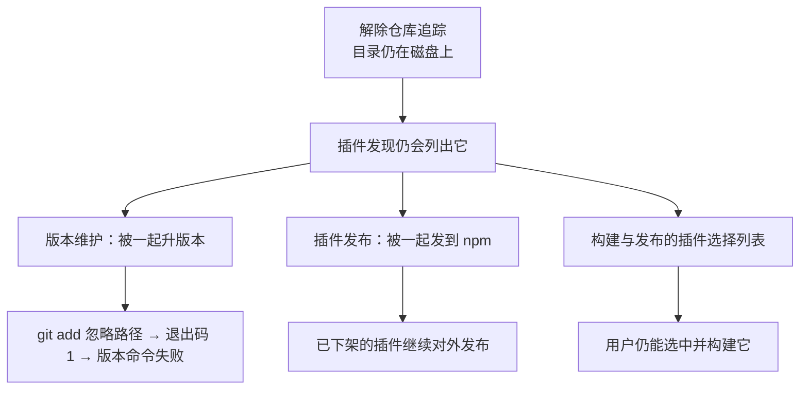

# PLAN-FNOS-025 CodeBuddy 插件下架

| 字段 | 内容 |
| --- | --- |
| 计划编号 | PLAN-FNOS-025 |
| 计划日期 | 2026-10-22 |
| 对应需求 | [FNOS-025 CodeBuddy 插件下架](/requirements/FNOS-025-codebuddy-plugin-delisting) |
| 本轮功能 | FNOS-025-01、FNOS-025-02、FNOS-025-03、FNOS-025-04 |
| 计划状态 | <Badge type="tip" text="已完成（三阶段全部完成；真实 NAS 验收不在本轮范围）" /> |

## 计划目标

让「插件已下架」成为一条**写下来的规则**，而不是「把文件挪走」的自然结果：

- 发布清单里没有它 → 应用不再分发它；
- 文档站里没有它 → 用户看不到它；
- 插件发现链路里没有它 → 版本维护与发布不会碰到它；
- 仓库不再追踪它 → 源码只留在本机。

安装期的升级清理机制**已具备**，无需新增代码，只需确认它在插件出清单后确实生效。

## 当前实现与目标设计

| 领域 | 当前实现 | 目标实现 | 迁移影响 |
| --- | --- | --- | --- |
| 应用分发清单 | `apps/fn-deepseek-harness/app/published-dsh-plugins.json` 含 `@tnnevol/dsh-codebuddy` | 移除该项 | 新装用户不再安装；老用户升级时被清理 |
| FPK 内置守卫 | 构建期断言清单**必须**含该插件 | 断言清单**不得**含该插件，且允许清单同步移除 | 守卫方向反转，防止被无意加回 |
| 插件发现 | 插件列表按 `plugins/` 目录**动态发现** | 增加**已下架插件目录**排除表 | 目录仍在磁盘上也不会进入版本维护与发布 |
| 版本维护 | 版本命令遍历插件列表并逐个 `git add` 其 `package.json` | 已下架插件不进入列表 → 不再被 `git add` | 版本命令不再因忽略路径失败 |
| 插件发布 | `publish --all` 遍历同一份插件列表 | 同上 | 不再把已下架插件发到 npm |
| 文档站 | 有插件专页、总览条目、侧边栏条目、图标表条目与多处数量断言 | 全部移除 | 文档站不再介绍该插件 |
| 插件市场索引 | 源列表含该包，索引含其条目 | 源列表移除并重新生成索引 | 「发现」页不再列出该插件 |
| 仓库追踪 | 插件目录 189 个文件受版本管理 | 解除追踪，源码保留在本机 | 仓库只保留历史快照 |
| 网关 RPC 通道 | `/codebuddy` 在内置路径白名单里 | **保留** | 仍持有该插件的用户不受影响 |

### 为什么必须动插件发现链路

插件列表是按目录动态发现的。只解除仓库追踪、只改发布清单，都不够：

因此「已下架」必须在插件发现处显式登记成规则。

### 为什么守卫要反转而不是直接删掉

构建期的内置插件守卫原本是「清单必须含该插件」——防止清单编辑把插件**悄悄丢掉**。插件下架后这条守卫方向相反：要防止它被**悄悄加回**。保留守卫（改为反向断言）比直接删除更符合本仓库「显式规则防静默回归」的做法。

### 网关 `/codebuddy` 通道为什么保留

安装回调的孤儿自有插件清理会在升级时把「已不在发布清单里的自有插件」从用户 profile 中移除，因此升级后用户不会再持有该插件。但仍存在两个窗口：用户手动从 npm 装回该插件、以及升级前后 profile 尚未清理完成。该路径是内置路径白名单里的一条字符串，保留成本为零；删除它则会让插件 RPC 静默 404，并连带删除两条配套用例。

## 影响范围分析

| 需求功能 | 代码模块 | 配置/数据 | 测试 | 文档 | 目标环境 |
| --- | --- | --- | --- | --- | --- |
| FNOS-025-01 | 应用发布清单、内置插件守卫 | 发布清单 JSON | 内置清单一致性守卫、FPK 安装验收用例 | 应用页内置插件表、应用介绍文案 | 真实 fnOS NAS |
| FNOS-025-02 | 文档站配置与页面 | 无 | 文档构建（死链检查） | 插件总览、插件专页、侧边栏、图标表、数量断言 | 文档站构建环境 |
| FNOS-025-03 | 仓库忽略规则 | `.gitignore` | 版本管理的文件集合检查 | 目录结构规范（可选） | 仓库工具链 |
| FNOS-025-04 | 插件发现、版本维护、发布命令 | 无 | 插件发现与发布相关用例 | 插件开发文档 | 仓库工具链 |

## 设计决策

| 决策 | 选择 | 否决方案 | 原因 |
| --- | --- | --- | --- |
| 源码去留 | 保留在本机，解除仓库追踪 | 直接删除目录 | 用户明确要求不删；保留历史实现与恢复可能 |
| 插件发现方式 | 显式排除表 | 按 git 是否追踪来发现 | 目录发现不应依赖 git 状态；显式表可读、可审计 |
| 内置守卫 | 反转成「不得含该插件」 | 直接删除守卫 | 防止清单被无意加回，符合本仓库防静默回归的做法 |
| 网关 `/codebuddy` | 保留 | 一并移除 | 保留成本为零；移除会让仍持有插件的用户静默失效 |
| npm 包 | 不强制下架 | `npm unpublish` | 本需求只保证仓库与文档不再推荐和分发；强制下架是另一件事 |
| 历史需求文档 | 保留不改 | 删除 FNOS-012～024 相关文档 | 已完成需求是历史验收记录，删除会破坏文档站可达性 |
| 锁文件 importer | 保留 | 移除 | 目录在本机仍存在，移除会让本地冻结安装失败；干净检出时残留 importer 被 pnpm 容忍 |

## 分阶段任务

### 阶段一：解除追踪与发布链路

| 任务 ID | 对应需求/验收 | 修改内容 | 前置条件 | 验证方式 |
| --- | --- | --- | --- | --- |
| PLAN-FNOS-025-T01-01 | FNOS-025-03 / AC-01、AC-02 | 把插件目录加入仓库忽略规则，并从版本管理索引中移除（文件保留在磁盘上） | 无 | 版本管理文件集合中查不到该目录；本机文件完整 |
| PLAN-FNOS-025-T01-02 | FNOS-025-01 / AC-01 | 从应用发布清单移除该插件 | 无 | 清单一致性守卫通过 |
| PLAN-FNOS-025-T01-03 | FNOS-025-01 / AC-01 | 内置插件守卫改为反向断言，并从允许清单移除 | T01-02 | 构建期校验通过 |
| PLAN-FNOS-025-T01-04 | FNOS-025-04 / AC-01 | 插件发现增加已下架插件排除表 | 无 | 版本维护与发布的候选列表里没有该插件 |
| PLAN-FNOS-025-T01-05 | FNOS-025-01 / AC-02、FNOS-025-04 / AC-01 | 同步更新版本维护的文档页映射与基线守卫用例 | T01-02、T01-04 | 仓库级守卫用例全绿 |

### 阶段二：文档站与市场索引

| 任务 ID | 对应需求/验收 | 修改内容 | 前置条件 | 验证方式 |
| --- | --- | --- | --- | --- |
| PLAN-FNOS-025-T02-01 | FNOS-025-02 / AC-01 | 删除插件专页与配图、侧边栏条目、总览条目、应用页条目、图标表条目 | 无 | 文档构建通过，无死链 |
| PLAN-FNOS-025-T02-02 | FNOS-025-02 / AC-01 | 修正各处插件数量与清单断言 | T02-01 | 全文检索无残留断言 |
| PLAN-FNOS-025-T02-03 | FNOS-025-04 / AC-02 | 从市场索引源列表移除该包并重新生成索引 | T01-02 | 索引条目数与源列表一致 |

### 阶段三：发布与验收

| 任务 ID | 对应需求/验收 | 修改内容 | 前置条件 | 验证方式 |
| --- | --- | --- | --- | --- |
| PLAN-FNOS-025-T03-01 | 全部 | 应用介绍文案与变更记录补充下架说明 | 阶段一、二 | 应用中心展示与实际分发一致 |
| PLAN-FNOS-025-T03-02 | 全部 | 全量回归：类型检查、规范检查、单测、文档构建、FPK 构建 | 阶段一、二 | 全部通过 |
| ~~PLAN-FNOS-025-T03-03~~ | —— | **已取消**：用户明确「老用户不用管了」，老用户环境清理不在本轮范围 | —— | —— |

## 执行进展

| 阶段 | 状态 | 说明 |
| --- | --- | --- |
| 阶段一 解除追踪与发布链路 | <Badge type="tip" text="已完成" /> | T01-01～T01-05 全部完成：插件目录已从版本管理中移除（源码保留在本机）、应用发布清单已移除该插件、内置守卫已反转为反向断言、插件发现已增加已下架插件排除表、版本维护的文档页映射与基线守卫用例已同步。 |
| 阶段二 文档站与市场索引 | <Badge type="tip" text="已完成" /> | T02-01～T02-03 全部完成：插件专页与配图、侧边栏条目、总览条目、应用页条目与图标表条目均已移除；各处插件数量与清单断言已修正；市场索引源列表已移除该包并重新生成（5 个插件）。 |
| 阶段三 发布与验收 | <Badge type="tip" text="已完成" /> | T03-01 已完成（应用介绍文案与变更记录补充下架说明）；T03-02 已完成（全量检查 25 个任务通过、FPK 构建通过并核对包内清单、干净检出模拟下全量检查同样通过）；T03-03 已取消——用户明确「老用户不用管了」，老用户环境清理与真实 NAS 验收不在本轮范围。 |

## 数据、权限和错误处理

- 无新增持久化数据、无权限变化。
- 用户数据变化：升级后该插件会从用户 profile 中移除。这是安装回调**既有的通用机制**（移除已不在发布清单里的自有插件），不是本轮引入的功能，也不在本轮的验收范围内。插件自身的账号凭据文件留在 `DSH_HOME` 中不被删除，文件权限问题仍按既有排查指引处理。
- 错误处理：无新增错误分类。

## 依赖、风险和决策

| 项 | 说明 |
| --- | --- |
| 依赖 | 无新增依赖。依赖上游不再变化（插件停止维护即不再跟进上游规则） |
| 风险一 | 用户仍可从 npm 手动安装该包并继续遭遇拦截。缓解：公告明确说明插件不再维护；拦截原因在上游，不在本仓库可控范围 |
| 风险二 | 文档站仍残留该插件的历史需求与验证记录。缓解：历史记录按仓库规范保留，不作为现行说明入口 |
| 风险三 | 仓库级守卫用例仍按旧插件清单断言。缓解：随本轮同步更新，并补一条「该插件不在发布清单里」的反向断言 |
| 决策 | 不动网关 `/codebuddy` 通道 | 保留成本为零，移除会造成仍持有插件的用户静默失效 |
| 决策 | 不卸载 npm 包 | 强制下架会波及已有用户的离线安装路径，属另一件事 |

## 测试、打包、发布和回滚

- 本地：类型检查、规范检查、全量单测、文档构建、FPK 构建；FPK 包内清单核对。
- 干净检出模拟：把插件目录移出工作区后，冻结安装与全量检查同样通过。
- 打包：FPK 构建时不再打包该插件归档。
- 回滚：本轮改动均为清单与文档层面的移除，回滚即恢复对应条目；用户侧被清理的插件可从 npm 重新安装。
- **禁止删除**：用户的凭据、账号、会话数据。

## 参考资料

| 来源 | 用途 |
| --- | --- |
| 仓库 issue #17、#18 | 用户侧故障报告与实测数据 |
| [FNOS-022](/requirements/FNOS-022-codebuddy-content-block-fix) | 前一轮适配及其已被上游规则推翻的结论 |
| 应用安装回调的插件安装与孤儿插件清理实现 | 升级清理路径取证 |
| 网关桥接的内置路径白名单与配套用例 | `/codebuddy` 通道取舍依据 |
| 仓库规范 `docs/charter/*-spec.md` | 需求、计划与文档的要求 |

## 变更记录

| 日期 | 变更 | 说明 |
| --- | --- | --- |
| 2026-10-22 | 阶段三完成，真实 NAS 验收取消 | 用户明确「老用户不用管了」：T03-03 取消，FNOS-025-05 移出需求范围，老用户环境清理改由安装回调的既有通用机制承担、不列入本轮验收。分发链路的验收依据为「FPK 包内清单核对 + 内置守卫 + 干净检出全量检查」，三者均已通过。计划状态改为已完成。 |
| 2026-10-22 | 阶段一、二完成 | 阶段一：解除仓库追踪（源码保留）、应用发布清单移除该插件、内置守卫反转为反向断言、插件发现增加已下架插件排除表、版本维护与基线守卫用例同步。阶段二：文档站移除插件专页、条目与数量断言；市场索引源列表移除并重新生成。阶段三的应用介绍文案已补充下架说明；本地验证（25 个检查任务、FPK 构建与包内清单核对、干净检出模拟）全部通过，真实 NAS 验收待执行。 |
| 2026-10-22 | 建立 PLAN-FNOS-025 | 三阶段 11 个任务：解除追踪与发布链路、文档站与市场索引、发布与验收。登记 3 条风险与 4 条决策，其中「插件发现必须显式排除」「网关 `/codebuddy` 通道保留」「锁文件 importer 保留」是本轮的关键技术判断。 |
