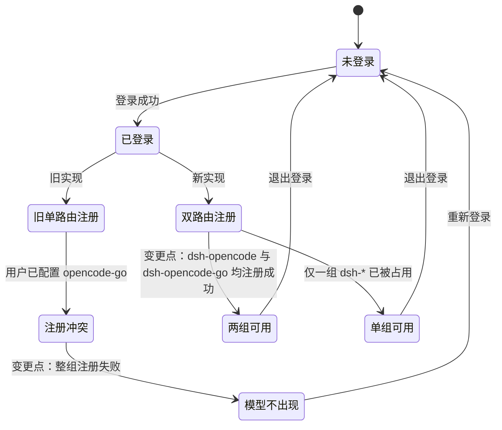
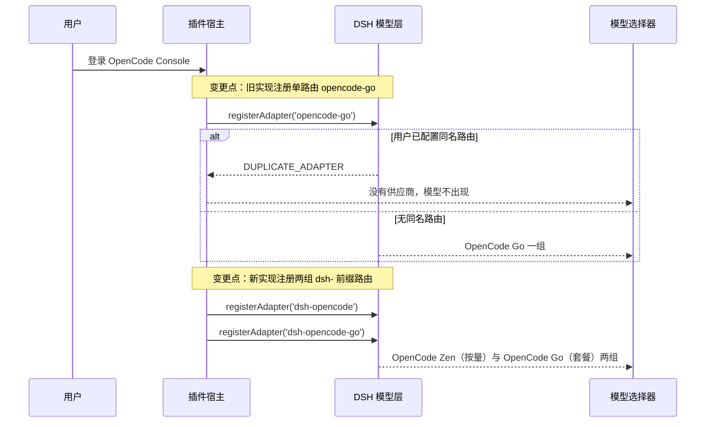
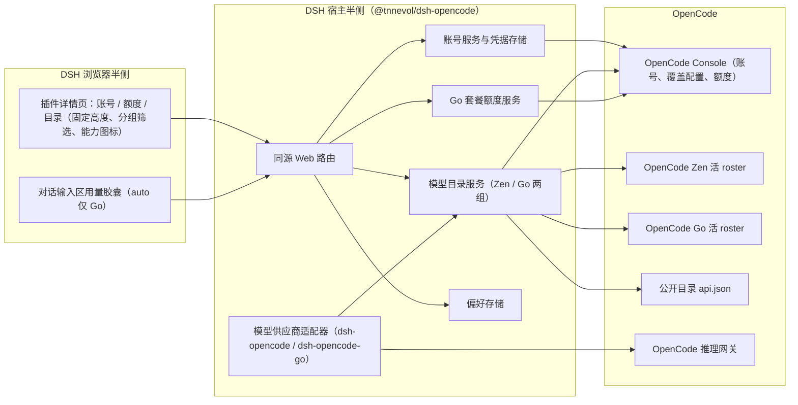
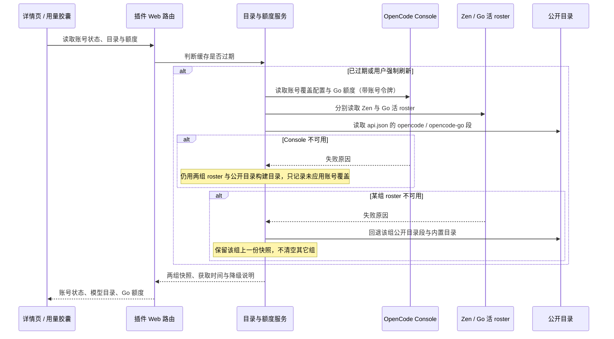
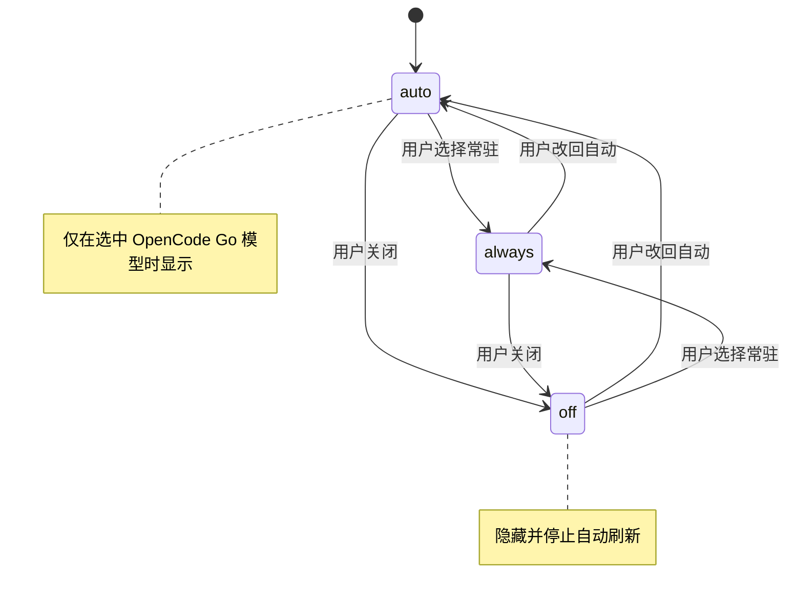

# PLAN-FNOS-026 OpenCode Zen 与 OpenCode Go 模型接入及套餐用量

| 字段 | 内容 |
| --- | --- |
| 计划编号 | PLAN-FNOS-026 |
| 计划日期 | 2026-10-23 |
| 对应需求 | [FNOS-026 OpenCode Zen 与 OpenCode Go 模型接入及套餐用量](/requirements/FNOS-026-dsh-opencode-plugin) |
| 本轮功能 | FNOS-026-01、FNOS-026-02、FNOS-026-03、FNOS-026-04、FNOS-026-05、FNOS-026-06、FNOS-026-07、FNOS-026-08、FNOS-026-09 |
| 计划状态 | <Badge type="warning" text="实施中（双供应商与模型列表改版实现中；发布相关任务待 npm 发布）" /> |

## 计划目标

按 FNOS-026 的功能编号实现一个不依赖 fnOS 宿主桥接的 DSH 插件 `@tnnevol/dsh-opencode`：

- **FNOS-026-01**：宿主侧的 Console 登录（设备码与 API Key）与凭据持久化；已登录时账号卡片隐藏 API Key 登录入口；
- **FNOS-026-02**：把 OpenCode Zen（按量）与 OpenCode Go（套餐）两组活 roster、公开目录与账号级覆盖注册成 DSH 模型供应商 `OpenCode Zen` 与 `OpenCode Go`；
- **FNOS-026-03、FNOS-026-04**：按上游目录把协议族、容量、推理、工具、图片输入、文本与免费标记投影到模型，并保证对话可用；
- **FNOS-026-05、FNOS-026-06**：Go 套餐额度卡片与对话输入区用量胶囊；Zen 按量模型不显示套餐额度；
- **FNOS-026-07、FNOS-026-08**：模型目录管理（固定高度、分组筛选与能力图标）、登录态与偏好持久化；
- **FNOS-026-09**：文档站说明页与菜单；市场源列表登记随 npm 发布执行。

技术边界：只新增插件与本仓库文档，不改 DSH 核心、其它插件与既有需求文档。FNOS-026-09 本轮完成页面与菜单；源列表登记、市场索引重生成与应用发布清单登记依赖 npm 发布，列为待执行任务。

## 当前实现与目标设计

| 领域 | 当前实现 | 目标实现 | 迁移影响 |
| --- | --- | --- | --- |
| 供应商路由 | 本插件注册单组 `opencode-go` 路由，供应商名 `OpenCode Go`；用户手工配置过同名路由时整组注册失败，模型不出现 | 注册两组路由：`dsh-opencode`（显示名 `OpenCode Zen`，OpenCode Zen 按量）与 `dsh-opencode-go`（显示名 `OpenCode Go`，套餐）；与用户手工配置的 `opencode` / `opencode-go` 并存，单组冲突只影响该组 | 选择器出现两组供应商；停用插件时两组一并撤销；手工配置保留 |
| 模型目录 | 单组目录：Go roster + 公开目录 `opencode-go` 段；Zen 模型不可用 | 两组目录：Zen roster + `opencode` 段（约 85 个）与 Go roster + `opencode-go` 段（约 36 个）；Console 配置按组增补、停用、覆盖能力/容量并下发路由头；roster 失败回退公开目录与内置目录 | 两组独立缓存与回退；上游增删模型无需升级插件 |
| 模型能力投影 | 单组投影，目录标签以思考等级与图片输入为主 | 两组投影；能力字段扩展为推理、工具调用、图片输入、文本输入、免费、上下文、最大输出；目录用图标与悬浮气泡表达五项勾选 | 目录 UI、模型信息与选择器字段同步 |
| 账号登录 | 单账号登录；已登录时仍显示 API Key 登录入口 | 同一 Console 账号同时服务两组；已登录时隐藏 API Key 登录入口，只保留退出登录 | 账号卡片交互变化；凭据格式与持久化位置不变 |
| 套餐额度 | 单组 Go 套餐额度 | 额度仍只对 `OpenCode Go` 生效；`OpenCode Zen`（按量）不显示套餐额度；输入区胶囊 auto 策略只在选中 Go 模型时出现 | 额度与胶囊按 plan 过滤 |
| 插件详情页 | 目录卡片单列表、内容区随模型数量撑高 | 目录卡片固定高度、内部滚动，搜索框与计数固定；新增「全部 / Go / Zen」筛选、每行 plan 标签与能力图标 | 样式、筛选与可访问性同步调整 |
| 分发与文档 | 仓库中没有该插件的页面、菜单条目与市场条目 | 说明页 + 插件总览行 + 菜单条目；发布后登记市场源列表、重生成索引并登记应用发布清单 | 文档站与市场可见性随发布推进 |

本需求仍是新增能力，没有重排其它需求的交互；但供应商注册从单路由改为双路由，属于本计划内部的实现口径变更，下面用状态图与时序图标出变更点。

供应商注册的状态变化：旧实现只注册 `opencode-go`，用户已配置同名路由时整组注册失败；新实现注册两组 `dsh-` 前缀路由，单组冲突不再导致两组都不可用。

登录后的注册时序：同名路由不再拦截整组注册，`OpenCode Zen` 与 `OpenCode Go` 各自独立。

## 影响范围分析

| 需求功能 | 代码模块 | 配置与数据 | 测试 | 文档 | 目标环境 |
| --- | --- | --- | --- | --- | --- |
| FNOS-026-01 | `plugins/dsh-opencode-plugin/src/host/`（登录、凭据）、`src/contracts/`（状态与路由）、`src/client/`（账号卡片） | `$DSH_HOME/.dsh-opencode-auth.json`（0600） | 登录态、非登录态、登录流程与已登录隐藏 API Key 入口用例 | 说明页「登录」小节 | DSH Web、DSH Desktop |
| FNOS-026-02 | 两组目录服务、双路由注册与路由状态诊断 | 无新增用户配置；目录快照仅内存缓存 | 双 roster、Console 增补/停用、回退、分组筛选与路由冲突回归用例 | 说明页「模型」小节 | DSH Web、DSH Desktop |
| FNOS-026-03 | 目录归一化与模型投影（推理、工具、图片、文本、免费、容量） | 无 | 能力字段、协议族、图片输入、思考等级与图标气泡用例 | 说明页「模型能力」小节 | DSH Web、DSH Desktop |
| FNOS-026-04 | 适配器调用路径与上游错误呈现 | 会话数据格式不变 | 文本、图片、402/403 与失败路径用例 | 说明页常见问题 | DSH Web、DSH Desktop |
| FNOS-026-05 | 额度服务、宿主路由、额度卡片 | 无持久化；快照带获取时间 | 三个窗口、倒计时、未订阅与失败态用例 | 说明页「套餐额度」小节 | DSH Web、DSH Desktop |
| FNOS-026-06 | 输入区插槽组件与 plan 过滤 | `$DSH_HOME/.dsh-opencode-preferences.json` | 三种策略、仅 Go 模型显示与数据一致性用例 | 说明页「用量胶囊」小节 | DSH Web、DSH Desktop |
| FNOS-026-07 | 目录卡片（固定高度、搜索、分组筛选、图标、隐藏、刷新）、偏好读写 | `$DSH_HOME/.dsh-opencode-preferences.json` | 搜索、筛选、滚动、隐藏、刷新用例 | 说明页设置表与模型目录小节 | DSH Web、DSH Desktop |
| FNOS-026-08 | 凭据与偏好存储 | 上述两个宿主文件 | 重启后持久化与隔离用例 | 说明页已知约束 | DSH Web、DSH Desktop |
| FNOS-026-09 | `docs/plugins/`、`docs/.vitepress/config.mts`、`docs/public/plugins/market/plugins.txt` 与三处索引 | 无 | 文档构建、菜单链接与源列表核对 | 本需求的三份 SDD 文档与插件说明页 | 文档站构建环境 |

## 架构与数据流

插件分宿主与浏览器两侧：宿主侧负责凭据、两组模型目录、Go 套餐额度与双路由适配；浏览器侧只渲染详情页卡片与输入区胶囊，两者通过插件同源 Web 路由通信。所有上游请求由宿主发出，浏览器不接触令牌。

目录与额度的刷新都走「先看缓存是否过期，再决定是否打上游」的路径；两组目录分别回退，Console 配置读取失败只影响账号覆盖，不影响模型全集：

## 分阶段任务

### 阶段一：宿主侧账号与凭据

| 任务 ID | 对应需求/验收 | 修改内容 | 前置条件 | 验证方式 |
| --- | --- | --- | --- | --- |
| PLAN-FNOS-026-T01-01 | FNOS-026-01 / AC-01、AC-02 | 设备码登录状态机：发起授权、把一次性代码与验证地址交给详情页、读取授权结果、处理取消与过期；挑战只保存在宿主侧 | 无 | 单测用桩 Console 覆盖「授权成功」「取消」「过期」三条路径，状态迁移与凭据写入时机正确 |
| PLAN-FNOS-026-T01-02 | FNOS-026-01 / AC-03 | 服务账号 API Key 登录：校验输入、失败提示、与设备码登录共用同一份凭据记录 | T01-01 的路由形状 | 无效 Key 得到可读错误且不写入凭据；有效 Key 进入已登录 |
| PLAN-FNOS-026-T01-03 | FNOS-026-01 / AC-04、AC-05；FNOS-026-08 / AC-01 | 凭据存储：宿主独占读写，文件 `0600`、目录 `0700`，原子写与文件锁，落盘格式带版本号；退出登录删除凭据 | 无 | 文件权限与格式断言；页面源码、网络响应与本地存储中查不到令牌明文；重启后登录态保持 |
| PLAN-FNOS-026-T01-04 | FNOS-026-01 / AC-02、AC-03；FNOS-026-04 / AC-04 | 凭据过期续期与失效降级：过期前续期，续期失败回到未登录并说明原因，不产生半登录状态 | T01-03 | 桩时钟下过期触发续期；续期失败后状态与凭据一致 |

### 阶段二：模型目录与双供应商适配

| 任务 ID | 对应需求/验收 | 修改内容 | 前置条件 | 验证方式 |
| --- | --- | --- | --- | --- |
| PLAN-FNOS-026-T02-01 | FNOS-026-02 / AC-01 | 解析账号覆盖配置：按 `opencode` / `opencode-go` 两个 provider 读取工作空间级条目（可为空）、增补条目、停用标记、能力与容量覆盖，以及 provider 级 `x-opencode-*` 路由头；空条目按「无额外覆盖」处理，结构不符时返回「不可读」而不是空目录 | 凭据可用（T01-03） | 用响应夹具断言空条目、增补、停用、能力覆盖与不可读分支 |
| PLAN-FNOS-026-T02-02 | FNOS-026-02 / AC-02、AC-03 | 两组模型全集来源与回退：Zen 与 Go 分别以活 roster 为准；某组 roster 不可用时用该组公开目录的非弃用条目，再失败回退内置目录或该组上一份快照并记录失败原因；账号配置不可读不影响任一组模型全集 | T02-01 | 夹具覆盖「两组 roster 可读」「单组 roster 不可读」「两组都失败」；空 Console 条目仍得到完整目录 |
| PLAN-FNOS-026-T02-03 | FNOS-026-03 / AC-01、AC-02、AC-03、AC-04 | 能力归一化：按 Console 的 `aisdk:` 包名或公开目录的 npm 包名识别协议族，投影端点、上下文窗口、最大输出、推理、工具调用、图片/文本输入、免费标记与逐模型思考等级；跳过图片生成与无法识别协议的条目并记录说明 | T02-02 | 两组公开目录夹具断言四种协议族、七项能力字段与容量；图片生成条目被跳过且给出说明 |
| PLAN-FNOS-026-T02-04 | FNOS-026-02 / AC-01、AC-05 | 向模型层注册 `dsh-opencode` 与 `dsh-opencode-go` 两组路由并投影各自动态目录；用户手工配置的 `opencode` / `opencode-go` 不再造成整组冲突，单组 `dsh-*` 冲突只影响该组并给出可诊断错误 | T02-01、T02-03 | 注册后选择器出现 `OpenCode Zen` 与 `OpenCode Go`；预置 `opencode-go` 配置时两组仍出现；单组冲突场景得到明确错误 |
| PLAN-FNOS-026-T02-05 | FNOS-026-07 / AC-03、AC-04；FNOS-026-08 / AC-02 | 目录缓存与刷新：按刷新间隔节流、强制刷新忽略节流、并发刷新合并为一次；两组共享一次刷新但各自保留快照与失败原因 | T02-02 | 桩计时验证节流与合并；单组刷新失败只影响该组快照 |
| PLAN-FNOS-026-T02-06 | FNOS-026-05 / AC-01、AC-02、AC-03、AC-04；FNOS-026-06 / AC-01 | 额度服务：按账号令牌读取 Go 套餐额度，归一化 5 小时、每周、每月三个窗口（已用百分比、重置时间、限流状态）与获取时间；胶囊在选中 Zen 模型时不触发套餐额度请求，额度卡片仍按账号读取 Go 额度；缺字段显示未知、失败保留上一份快照 | T01-03 | 响应夹具覆盖三窗口、缺字段与失败三种情况；失败时不产生 0%；选中 Zen 模型时胶囊不挂出、不请求额度 |
| PLAN-FNOS-026-T02-07 | FNOS-026-02 / AC-01、AC-04、AC-05；FNOS-026-01 / AC-04 | 双供应商与路由 id：在契约层定义 `OpenCode Zen`（按量）与 `OpenCode Go`（套餐）两组描述（id、显示名、plan），目录、适配器与选择器按组投影；退出登录时两组一并撤销；记录路由分组名与 plan 标签的稳定契约 | T02-04 | 单测断言两组描述与路由 id；选择器出现两个分组；退出登录后两组消失；已配置 `opencode-go` 的回归场景通过 |

### 阶段三：插件详情页与模型列表 UI

| 任务 ID | 对应需求/验收 | 修改内容 | 前置条件 | 验证方式 |
| --- | --- | --- | --- | --- |
| PLAN-FNOS-026-T03-01 | FNOS-026-01 / AC-01、AC-02、AC-03 | 账号卡片：未登录、授权中（含一次性代码与复制按钮）、已登录（账号与组织）、错误四种状态；已登录时不渲染「使用 API Key 登录」入口，只保留退出登录 | T01-01、T01-02 | DSH Web 与 DSH Desktop 上逐状态目视 + DOM 断言；已登录状态查不到 API Key 登录按钮 |
| PLAN-FNOS-026-T03-02 | FNOS-026-05 / AC-01、AC-02、AC-03、AC-04 | 额度卡片：三个窗口的已用百分比、重置倒计时、获取时间与刷新按钮；未订阅 Go 时显示未订阅说明；失败态显示原因 | T02-06 | 亮暗主题下百分比与倒计时可读；失败态不显示 0%；未订阅态不显示 0% |
| PLAN-FNOS-026-T03-03 | FNOS-026-07 / AC-01、AC-02 | 目录卡片：搜索、逐模型隐藏开关、刷新与获取时间 | T02-04 | 隐藏后选择器不再出现该模型；恢复后重新出现 |
| PLAN-FNOS-026-T03-04 | FNOS-026-06 / AC-01、AC-02、AC-03、AC-04 | 输入区用量胶囊：按策略显隐、显示已用比例与重置时间、修改策略后即时生效；auto 策略只在选中的模型属于 `OpenCode Go` 时挂出 | T03-02 的额度数据 | 三种策略各断言一次；选中 `OpenCode Zen`（按量）模型时不显示胶囊；亮暗主题下均可读 |
| PLAN-FNOS-026-T03-05 | FNOS-026-08 / AC-02；FNOS-026-07 / AC-02 | 偏好设置区：胶囊策略与自动刷新间隔的读写、校验与持久化 | T01-03 的宿主文件约定 | 重启后偏好保持；越界或非法值回落到默认值 |
| PLAN-FNOS-026-T03-06 | FNOS-026-06 / AC-03 | 胶囊与额度卡片同源：同一份快照驱动两处展示，刷新后同步更新 | T03-02、T03-04 | 两处已用比例一致，不出现两个数字 |
| PLAN-FNOS-026-T03-07 | FNOS-026-02 / AC-04；FNOS-026-03 / AC-05；FNOS-026-07 / AC-05；FNOS-026-01 / AC-03 | 模型列表 UI 改版：目录卡片固定高度、内部滚动，搜索框与计数固定；新增「全部 / Go / Zen」筛选与每行 plan 标签；能力改为「推理 / 工具 / 图片 / 文本 / 免费」图标，悬浮气泡显示勾选；已登录时移除 API Key 登录入口 | T02-07、T03-01、T03-03 | DSH Web 与 DSH Desktop 亮暗主题走查；DOM 断言筛选计数、滚动容器与固定工具栏；悬浮能看到气泡勾选；已登录状态无 API Key 入口 |

### 阶段四：文档站与发布登记

| 任务 ID | 对应需求/验收 | 修改内容 | 前置条件 | 验证方式 |
| --- | --- | --- | --- | --- |
| PLAN-FNOS-026-T04-01 | FNOS-026-09 / AC-01、AC-02 | 新增 `docs/plugins/dsh-opencode.md`；在插件总览加入一行并修正运行时插件数量表述；在 `/plugins/` 菜单加入条目 | 无 | 文档构建通过；菜单与页面可达 |
| PLAN-FNOS-026-T04-02 | FNOS-026-09 / AC-03 | **随 npm 发布执行**：在插件市场索引源列表加入 `@tnnevol/dsh-opencode`；不手工改写生成的索引文件 | npm 发布成功 | 源列表含该包；生成的索引文件未被手改 |
| PLAN-FNOS-026-T04-03 | 全部 | 需求、计划与测试用例文档登记：`docs/requirements/`、`docs/plans/`、`docs/tests/` 与本页，同步三个索引与三处菜单 | 无 | `pnpm run check -- --sdd` 通过；文档构建通过 |
| PLAN-FNOS-026-T04-04 | FNOS-026-09 / AC-03 | 插件发布后重新生成市场索引并核对条目，随后登记到应用发布清单 | npm 发布成功；发布前确认目标版本可用 | 索引条目与源列表一致；应用安装后插件可见 |

### 阶段五：验证与收尾

| 任务 ID | 对应需求/验收 | 修改内容 | 前置条件 | 验证方式 |
| --- | --- | --- | --- | --- |
| PLAN-FNOS-026-T05-01 | 全部 | 插件的类型检查、单测与构建 | 阶段一至三 | `pnpm --filter @tnnevol/dsh-opencode run check` 与 `build` 通过 |
| PLAN-FNOS-026-T05-02 | FNOS-026-01 至 FNOS-026-08 | DSH Web 与 DSH Desktop 走查，按测试用例文档执行；包含双供应商、分组筛选、能力图标与 `opencode-go` 冲突回归 | T05-01 | 用例结论回填 `docs/tests/FNOS-026-dsh-opencode-plugin.md` |
| PLAN-FNOS-026-T05-03 | FNOS-026-09 / AC-04 | 文档站构建与菜单链接核对 | T04-01 至 T04-03 | 构建通过、菜单目标均存在；`git diff --check` 干净 |
| PLAN-FNOS-026-T05-04 | 全部 | 版本更新：按仓库版本流程推进插件与应用版本（功能提交后独立版本提交） | T05-01 至 T05-03 | 版本串一致，发布流程可执行 |

## 交互和行为设计

### 插件详情页

入口为「插件管理 → `OpenCode` → 详情页」。页面由上到下依次是账号卡片、套餐额度卡片、模型目录卡片与设置区；所有操作只改插件自己的数据。

| 区块 | 状态 | 用户可见内容 | 可用操作 |
| --- | --- | --- | --- |
| 账号卡片 | 未登录 | 两种登录方式说明，「设备码登录」与「用 API Key 登录」入口 | 发起登录 |
| 账号卡片 | 授权中 | 一次性代码、复制按钮、验证地址、剩余有效期 | 取消登录 |
| 账号卡片 | 已登录 | 账号、组织、登录方式与登录时间；只显示退出登录，不显示 API Key 登录入口 | 退出登录 |
| 账号卡片 | 错误 | 失败原因与可执行的处置 | 重试 |
| 额度卡片 | 有数据 | OpenCode Go 的 5 小时、每周、每月三个窗口的已用百分比、重置倒计时、获取时间 | 刷新 |
| 额度卡片 | 失败或未订阅 | 失败原因与最近一次获取时间，或未订阅 Go 的说明；两者都不显示 0% | 刷新 |
| 目录卡片 | 有数据 | 固定高度的滚动列表；固定的搜索框、分组筛选与计数；每行包含名称、标识、plan 标签、能力图标、容量与逐模型隐藏开关 | 搜索、筛选、隐藏/恢复、刷新 |
| 目录卡片 | 空或失败 | 说明与重试入口；失败时保留上一份列表 | 刷新 |
| 设置区 | 始终 | 用量胶囊策略、自动刷新间隔 | 修改并保存 |

### 模型目录卡片

目录卡片自身固定高度，只有模型列表区内部滚动；卡片头部与工具栏（搜索框、分组筛选、计数、刷新）不随列表滚动，长目录不会把整页撑高。

| 筛选 | 包含的模型 |
| --- | --- |
| 全部 | `OpenCode Zen`（按量）与 `OpenCode Go`（套餐）两组 |
| Go | 仅 `plan=go` 的套餐模型 |
| 按量 | 仅 `plan=zen` 的按量模型 |

- 每行显示所属 plan 标签，与筛选值使用同一套文案（「按量」/「Go」）。
- 能力以「推理 / 工具 / 图片 / 文本 / 免费」五个图标表示；悬浮时显示气泡，逐项标记勾选或未勾选。
- 搜索、筛选与计数组合生效：计数显示当前筛选与搜索后的结果数，隐藏模型数量另行标注。
- 目录来源、获取时间与刷新入口保留在卡片头部；目录刷新失败时列表保留上一份快照并显示原因。

### 用量胶囊

胶囊位于对话输入区右侧，与其它状态控件同行，不遮挡输入框。三种策略的切换关系如下：

- `auto`：默认值。只在当前选中的模型属于 `OpenCode Go` 时显示；`OpenCode Zen`（按量）与其它供应商模型不显示，也不触发套餐额度请求。
- `always`：只要插件已登录就常驻显示，与当前选中的供应方无关；没有 Go 套餐数据时显示未知或未订阅，不补 0%。
- `off`：完全不显示，并停止额度自动刷新；详情页额度卡片不受影响，仍可手动刷新。

策略变化在宿主侧持久化，下一次进入会话或下一次对话即按新策略显示，无需重启 DSH。

### 文案与命名

- 供应商名称固定为 `OpenCode Zen`（按量）与 `OpenCode Go`（套餐），插件显示名固定为 `OpenCode`；路由 id 分别为 `dsh-opencode` 与 `dsh-opencode-go`。
- 分组筛选与 plan 标签统一使用「按量」与「Go」；需要在正文区分服务来源时写「OpenCode Zen（按量）」，不写成「Zen 套餐」或「Go 按量」。
- 三个额度窗口统一称「5 小时」「每周」「每月」，不混用「滚动窗口」「周额度」等别名。
- 「目录来源」按组说明模型集合来自活 roster、公开目录还是内置目录；账号配置不可读时另附「未应用账号覆盖」说明，不写成「降级」以免被理解为功能受损。
- 上游限制使用错误码与原文短语（`Insufficient account funds`、`FreeTierError`），不翻译成模糊的「额度问题」或「权限问题」。

## 数据、权限和错误处理

### 持久化

| 数据 | 位置 | 权限 | 读取与恢复策略 |
| --- | --- | --- | --- |
| 账号凭据（设备码令牌或 API Key、账号与组织信息） | `$DSH_HOME/.dsh-opencode-auth.json` | 文件 `0600`，目录 `0700` | 只由插件宿主读写，同一凭据同时服务两组路由；解析失败或格式版本不符时按未登录处理并给出可诊断错误，不覆盖原文件 |
| 插件偏好（胶囊策略、刷新间隔、隐藏模型） | `$DSH_HOME/.dsh-opencode-preferences.json` | 文件 `0600` | 缺失或损坏时回落到默认值；越界值夹到合法区间 |
| 目录与额度快照 | 进程内存 | — | 两组目录分别缓存；进程重启后重建，不落盘，避免把过期数据当成事实 |

### 权限

- 不新增 DSH 权限项，也不申请 fnOS 宿主权限；插件只做宿主侧文件读写与对 `opencode.ai` 的出站请求。
- 凭据文件权限被放宽或属主不可读时，按共享包的既有判定给出可诊断错误，不静默忽略。

### 错误处理

| 场景 | 用户可见 | 恢复动作 |
| --- | --- | --- |
| 未登录 | 账号卡片显示登录方式说明 | 发起登录 |
| 设备码过期或取消 | 回到未登录并说明原因 | 重新发起 |
| 令牌失效且续期失败 | 账号卡片回到未登录并提示重新登录 | 重新登录 |
| 账号覆盖配置不可读 | 目录卡片按组说明当前目录来源与未应用账号覆盖的原因 | 刷新或稍后重试 |
| 某组活 roster 不可读 | 该组回退公开目录与内置目录；目录卡片显示来源与失败原因 | 刷新 |
| 两组目录来源都不可读 | 目录卡片显示失败原因，保留上一份可用目录 | 刷新 |
| 额度不可读 | 额度卡片显示未知与失败原因，不显示 0% | 刷新 |
| 账号未订阅 OpenCode Go | 额度卡片显示未订阅说明，不显示 0%；模型目录仍可使用 | 在 Console 订阅后刷新 |
| Zen 余额不足（402） | 会话显示上游原文 `Insufficient account funds` 与可读说明；不自动重试 | 在 Console 充值后重试 |
| Zen 免费模型受限（403） | 会话显示 `FreeTierError` 与「仅可在 OpenCode 客户端使用」的说明；不绕过上游限制 | 改用付费 Zen 模型或 Go 模型 |
| 模型地区限制（403） | 会话显示上游原文（`RegionError` / `unsupported_country_region_territory`）与说明；不自动换模型、不重试 | 改用当前地区可用的同协议模型 |
| Google 工作空间隐私设置（400） | 会话显示上游原文与「需在工作空间 Privacy 设置允许会用于训练的付费端点」说明；不绕过 | 在 Console 允许后重试 |
| `opencode-go` 手工配置 | 不再冲突；两组插件路由与手工配置并存 | 无需处置 |
| 用户手工配置了 `dsh-opencode` / `dsh-opencode-go` | 详情页说明冲突来源与处置方式；另一组不受影响 | 用户移除同名配置后重试 |
| 网络不可直达 `opencode.ai` | 各卡片显示连接失败 | 检查网络后重试 |

## 依赖、风险和决策

### 依赖

| 依赖 | 版本 | 用途 |
| --- | --- | --- |
| `@earendil-works/pi-ai` | 1.1.0 | 模型对象与思考等级语义、内置 `opencode` / `opencode-go` 目录的兼容开关 |
| `@deepseek-ai/dsh-llm`、`@deepseek-ai/dsh-llm-pi-ai` | 0.2.1-rc.2 | 供应商路由注册与适配器契约 |
| `@tnnevol/dsh-plugin-kit` | workspace | 凭据文件权限判定 |
| `@tnnevol/dsh-semi-ui` | workspace | 详情页与胶囊的组件与主题 |
| OpenCode Console、Zen/Go 活 roster、公开目录、推理网关 | 上游在线服务 | 账号、两组目录、额度与推理 |

### 风险

| 风险 | 影响 | 缓解 |
| --- | --- | --- |
| 用户手工配置过同名路由 | 旧实现注册 `opencode-go` 时整组失败，模型不出现 | 已改用 `dsh-opencode` / `dsh-opencode-go` 前缀，与 `opencode` / `opencode-go` 手工配置并存；单组 `dsh-*` 冲突只影响该组并给出诊断 |
| OpenCode Zen 按量模型需要 Console 余额 | 未充值时模型可选中但调用失败（402） | 目录与选择器不隐藏模型；会话显示 `Insufficient account funds` 与可读说明；说明页与已知约束写明需余额，不自动重试 |
| OpenCode Zen 免费模型只允许 OpenCode 客户端使用 | 调用失败（403 `FreeTierError`），用户误以为是插件缺陷 | 目录仍按 roster 展示；会话显示上游原文与「仅可在 OpenCode 客户端使用」说明；说明页与测试文档登记为已知上游限制 |
| 部分模型受地区限制 | 调用失败（403），用户误以为是插件缺陷 | 目录仍按 roster 展示；会话显示上游原文；说明页与测试文档登记为已知上游限制 |
| Gemini 需要工作空间隐私设置 | 调用失败（400），用户误以为是协议未适配 | 会话显示上游原文与设置入口说明；测试文档登记为阻塞项 |
| 两组 roster 的模型数量与名称持续变化 | 文档中的「约 85 / 约 36」与真实目录漂移 | 文档只写约数并注明以实时目录为准；目录每次刷新按 roster 重建，不依赖内置快照 |
| Console 覆盖配置或额度响应字段漂移 | 增补/停用、能力覆盖或额度解析失败 | 模型全集不受影响（仍来自 roster/公开目录）；账号覆盖与额度显示未知并给出来源说明；解析层以夹具固定已知形态，失败时降级而非抛错到界面 |
| 同名模型同时出现在 Zen 与 Go 两组 | 选择器与目录中难以分辨来源，隐藏或切换时可能误操作 | 两组使用独立路由与显示分组；目录每行显示 plan 标签并支持按组筛选；说明页写明同名模型分属两组 |
| 公开目录体积较大 | 频繁刷新带来带宽与延迟开销 | 公开目录按小时级节流，roster 与账号配置按分钟级；只有强制刷新才立即全量拉取 |
| 运行环境无法直连 `opencode.ai` | 登录、目录与对话全部不可用 | 明确提示连接失败并停止重试；不内置代理，不静默回退到其它供应商 |
| 上游文档把 DSH 列为会话头支持不完整的客户端，部分模型路径可能缺稳定会话标识 | 可能影响网关的路由与缓存优化，不阻断调用 | 登记为观察项，不在本需求范围；以真实账号用例观察是否出现可感知影响 |
| 用户把「已用百分比」误解为金额或剩余额度 | 误判可用性 | 卡片与胶囊只展示百分比与重置时间，窗口名称与 Console 保持一致，不换算金额 |
| 固定高度滚动区域在小屏或键盘操作下可用性下降 | 目录较长时用户难以定位或滚动 | 用例核对滚动容器的键盘可达性与小屏布局；不满足时补焦点样式与滚动提示；搜索与筛选保持固定 |
| npm 上目标版本已被占用 | 发布失败 | 发布前核对目标版本，必要时先推进版本 |

### 决策

| 决策 | 选择 | 否决方案 | 原因 |
| --- | --- | --- | --- |
| 供应商路由名 | `dsh-opencode`（`OpenCode`）与 `dsh-opencode-go`（`OpenCode Go`） | 沿用 `opencode` / `opencode-go` | `opencode` / `opencode-go` 是 pi-ai 内置目录路由，用户可能在 `llm-pi-ai` 设置里手工声明；实测同名会与本插件注册冲突，导致登录后模型不出现。`dsh-` 前缀避开用户配置 |
| 供应商分组 | 按模型来源拆成 Zen 按量与 Go 套餐两组 | 合并为一个供应商 | 两组目录、余额/套餐约束与计费不同；合并后无法分别说明套餐额度，也无法按组筛选与排查 |
| 目录来源优先级 | 每组「活 roster → 公开目录对应段 → 内置目录或上一份快照」；Console 配置只做增补、停用、能力/容量覆盖与路由头 | 把 Console 配置当启用全集；或只用静态内置目录 | Console `models` 可为空，把它当全集会得到空目录；活 roster 才是模型全集，Console 只承载账号级覆盖与路由头 |
| 目录缓存策略 | 分层 TTL、两组共享一次刷新并各自保留快照、强制刷新忽略节流 | 每次打开都全量拉取 | 公开目录体积大，分层可兼顾新鲜度与开销；单组失败不拖累另一组 |
| 凭据存放位置 | 插件自有的 `0600` 宿主文件，一份凭据服务两组路由 | 写入 profile 配置或复用环境变量 | 凭据形态（访问令牌、续期令牌与账号元信息）超出 DSH 通用凭据字段；环境变量对普通用户不可管理 |
| 目录卡片布局 | 固定高度、列表内部滚动，搜索/筛选/计数固定在工具栏 | 让卡片随模型数量撑高整页 | 两组合计上百个模型；不固定高度会把详情页其它卡片推到很远，搜索与计数也会滚出视野 |
| 能力展示方式 | 五个能力图标 + 悬浮气泡勾选，容量以文本显示 | 每个能力一个标签堆在行内 | 标签堆叠在两组上百行时噪声大；图标加气泡在保持可扫读的同时提供细节 |
| 套餐额度适用范围 | 只对 `OpenCode Go` 生效；Zen 不显示套餐额度 | 两组共用同一额度面板 | Zen 按量不占用套餐额度，混用会误导用户判断可用性 |
| 界面承载方式 | 插件详情页自定义区块 | 设置弹框的官方配置表单 | 账号、额度与目录都是交互型区块，官方配置 schema 表达不了（按插件 UI 规范第 2 档） |
| 图片生成模型 | 不纳入适配 | 作为不可选条目展示 | DSH 对话需要文本输入协议；混入会让用户选中后无法对话 |
| 市场索引维护 | 只加源列表，发布后重生成 | 手工改写生成的索引文件 | 索引由官方生成器从 npm 产物读取，手改会与源列表漂移 |

## 测试、打包、发布和回滚

- **包级验证**：插件类型检查、单测与构建；SDD 文档检查与文档站构建。测试用例设计见[测试用例文档 FNOS-026](/tests/FNOS-026-dsh-opencode-plugin)，本页不展开用例表。
- **DSH Web**：`pnpm run start -- --web`（`DSH_HOME` 指向仓库 `.dsh`），用启动日志里带 token 的地址访问；覆盖两组供应商、分组筛选、能力图标、登录、对话、Go 额度与胶囊，并执行「已手工配置 `opencode-go`」的路由冲突回归。
- **DSH Desktop**：使用上游检出的开发态 Desktop（`fork-pj/deepseek-harness`），通过渲染进程调试端口取证；重点核对系统浏览器打开验证页、目录卡片固定高度与滚动、能力气泡、分组筛选与输入区胶囊位置。
- **文档站**：`pnpm run build -- --docs`（或 `pnpm exec vitepress build docs`）与 `git diff --check`；逐项核对新增菜单与页面链接目标存在。
- **打包与发布**：按仓库版本流程更新版本（功能提交与版本提交分开），随后发布插件；发布后重新生成市场索引，并登记到应用发布清单。
- **回滚**：停用或卸载插件即可撤销两组供应商注册，模型选择器回到手工配置方式；说明页、插件总览行、菜单条目与市场源列表按提交回退。插件自有的凭据与偏好文件只有用户明确要求时才删除。
- **禁止删除**：用户会话历史、其它供应商的凭据与配置；本插件不持久化目录与额度，无需清理这两类数据。

## 参考资料

| 来源 | 用途 |
| --- | --- |
| [OpenCode Console Go 文档](https://opencode.ai/v2/docs/console/go/) | Go 与 Go Plus 套餐、额度窗口、模型清单、协议端点与已知客户端问题 |
| [OpenCode Console 文档](https://opencode.ai/v2/docs/console/) | Console 工作空间、订阅与用量能力 |
| `https://opencode.ai/inference/v1/models` | OpenCode Zen 按量活 roster（模型集合） |
| `https://opencode.ai/inference/go/v1/models` | OpenCode Go 套餐活 roster（模型集合） |
| [公开模型目录](https://models.opencode.ai/api.json) | 模型清单与逐模型能力元数据形态（`opencode` / `opencode-go` 段） |
| `@earendil-works/pi-ai@1.1.0` | 内置 `opencode` / `opencode-go` 供应商、静态目录与思考等级语义 |
| `@deepseek-ai/dsh-llm-pi-ai@0.2.1-rc.2` | 供应商路由注册与适配器契约 |
| 仓库规范 `docs/charter/*-spec.md` | 需求、计划、测试用例与菜单的要求 |

## 完成状态

| 阶段 | 状态 | 完成条件 |
| --- | --- | --- |
| 阶段一 宿主侧账号与凭据 | <Badge type="warning" text="规划中" /> | 设备码与 API Key 登录、凭据存储与续期通过单测与桩验证；已登录隐藏 API Key 入口 |
| 阶段二 模型目录与双供应商适配 | <Badge type="warning" text="规划中" /> | 双 roster 来源与回退、账号覆盖叠加、能力归一化、Go 额度读取、双路由注册与刷新通过单测；`opencode-go` 冲突回归通过 |
| 阶段三 插件详情页与模型列表 UI | <Badge type="warning" text="规划中" /> | 三张卡片、固定高度目录、分组筛选、能力图标与胶囊在 DSH Web 与 DSH Desktop 渲染并通过用例 |
| 阶段四 文档站与发布登记 | <Badge type="warning" text="规划中" /> | T04-01 至 T04-03 完成；T04-04 待插件发布后执行 |
| 阶段五 验证与收尾 | <Badge type="warning" text="规划中" /> | 用例执行结论回填，构建与版本检查通过 |

登记时插件实现正在同一分支推进（双供应商契约、两组目录归一化与双路由已落地），各阶段完成时在本页变更记录追加说明，不提前修改完成状态。

## 变更记录

| 日期 | 变更 | 说明 |
| --- | --- | --- |
| 2026-10-23 | 回填协议实测与地区/隐私限制 | 修正 Go roster 独有模型的协议继承顺序（逐模型声明优先于 provider 缺省，`grok-4.6`/`qwen3.6-plus` 不再误投影为 Chat Completions）；补充模型地区限制（403）与 Gemini 工作空间隐私设置（400）的错误处理与风险。 |
| 2026-10-23 | 改为双供应商与模型列表 UI 改版口径 | 供应商由单路由 `opencode-go` 改为 `dsh-opencode`（`OpenCode`，OpenCode Zen 按量）与 `dsh-opencode-go`（`OpenCode Go`，套餐）两组，规避与用户手工配置 `opencode-go` 的同名冲突（该冲突是登录后模型不出现的根因）。目录改为每组活 roster（Zen 约 85、Go 约 36）+ 公开目录对应段，Console 配置只做增补/停用/能力与容量覆盖/路由头。同步改写计划目标、当前与目标设计、影响范围、架构与刷新时序、错误处理、依赖、风险与决策；新增「变更点」状态图与时序图。任务新增 [T02-07 双供应商与路由 id](#阶段二-模型目录与双供应商适配) 与 [T03-07 模型列表 UI 改版](#阶段三-插件详情页与模型列表-ui)，并更新 T02-01 至 T02-06、T03-01 至 T03-04 的验收关联。风险新增 Zen 余额 402、免费模型 403 与同名模型分组；决策新增双供应商分组、固定高度目录、图标气泡与「额度只对 Go」。 |
| 2026-10-23 | 按真实账号联调结果更正目录分层与任务口径 | 实测订阅账号的 Console 配置 `models` 为空对象，确认它是工作空间级覆盖而非启用列表。据此改写计划目标、当前与目标设计、架构与刷新时序、T02-01/T02-02/T02-03 任务、决策「目录来源优先级」、风险与错误处理：模型全集以公开模型清单为准，Console 配置只在可读时叠加停用、能力/容量与路由头；协议族识别兼容 Console 的 `aisdk:` 包名与公开目录的 npm 包名。 |
| 2026-10-23 | 建立 PLAN-FNOS-026 | 依据 FNOS-026 拆出五个阶段 24 个任务：宿主侧账号与凭据、模型目录与供应商适配、详情页与用量胶囊、文档站与发布登记、验证与收尾。登记 7 条风险与 7 条决策，其中「同名路由冲突的处置」「目录来源优先级」「凭据存放位置」是本轮的关键技术判断；T04-04（市场索引重生成与应用发布清单登记）以 npm 发布为前置，不在本轮完成。 |
