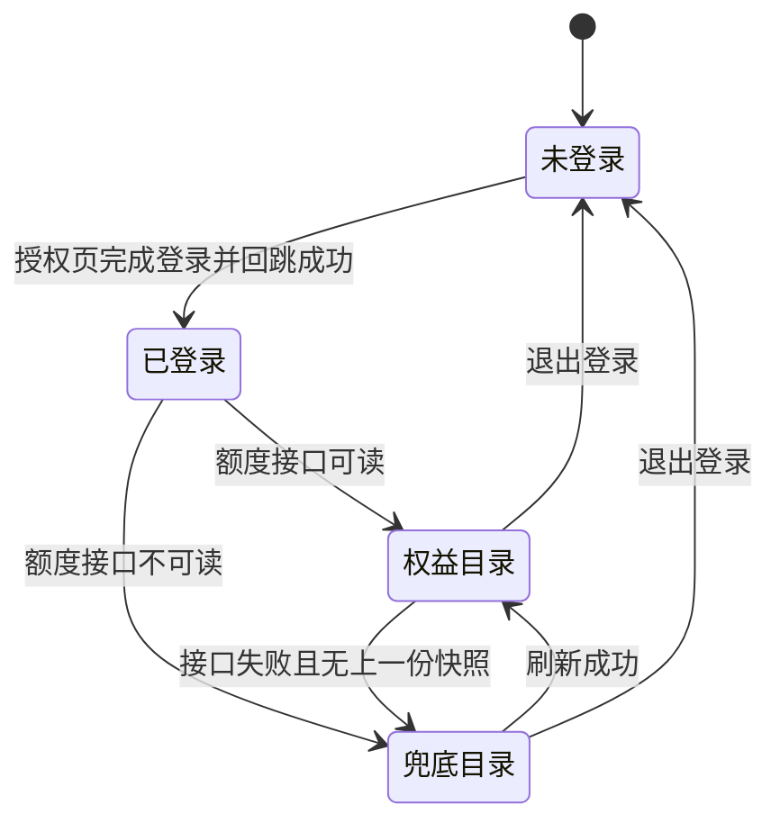
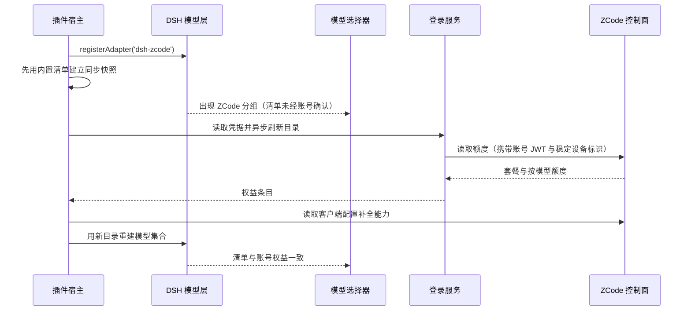
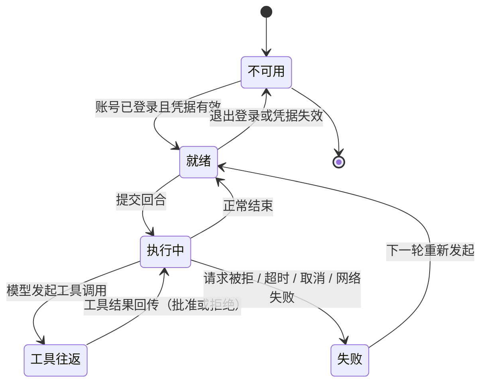
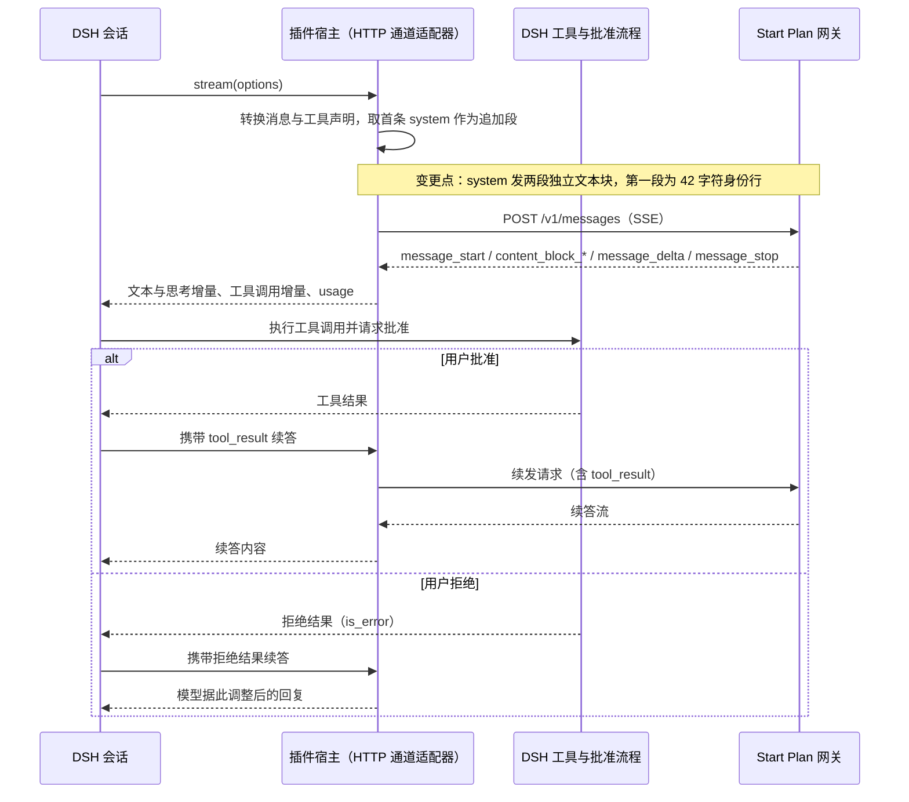
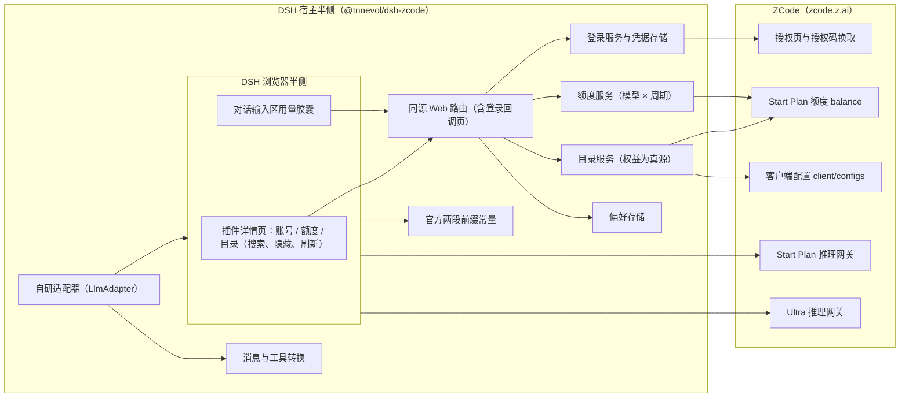
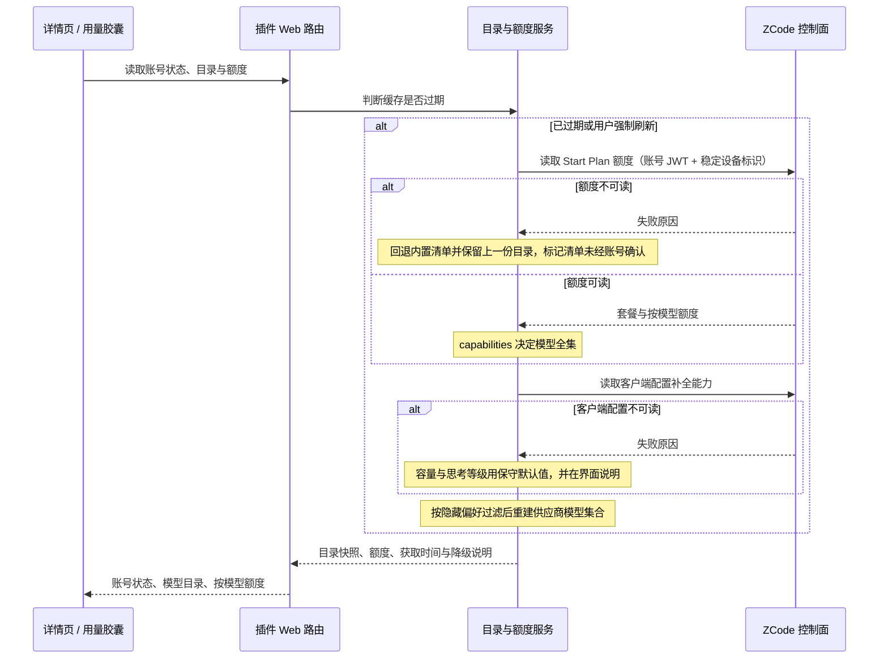
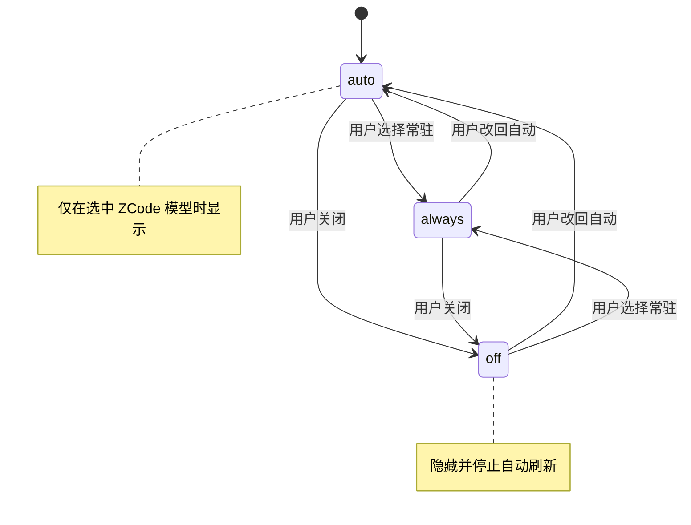

# PLAN-FNOS-027 ZCode Start Plan 模型接入与账号额度

| 字段 | 内容 |
| --- | --- |
| 计划编号 | PLAN-FNOS-027 |
| 计划日期 | 2026-10-24 |
| 对应需求 | [FNOS-027 ZCode Start Plan 模型接入与账号额度](/requirements/FNOS-027-dsh-zcode-plugin) |
| 本轮功能 | FNOS-027-01、FNOS-027-02、FNOS-027-03、FNOS-027-04、FNOS-027-05、FNOS-027-06、FNOS-027-07、FNOS-027-08 |
| 计划状态 | <Badge type="success" text="已完成（自研 HTTP 通道在 DSH Web 与 DSH Desktop 均验证通过；纯文本 / 工具调用 / 多轮工具结果 / 图文 / 智能体团队 / 思考等级 / 限流退避已实测；发布相关任务按插件未发布单列）" /> |

## 计划目标

按 FNOS-027 的功能编号实现一个不依赖 fnOS 宿主桥接的 DSH 插件 `@tnnevol/dsh-zcode`：

- **FNOS-027-01**：宿主侧的 ZCode 账号登录（BigModel 国内 / Z.ai 海外两个家族）——浏览器在上游授权页完成登录后回跳到插件同源回调，宿主用授权码换取凭据并持久化，回调走 `state` 校验；**不提供 API Key 登录**；
- **FNOS-027-02**：把账号权益（额度条目的 `capabilities`）作为模型清单真源，注册 DSH 模型供应商 `ZCode`（路由 `dsh-zcode`），并以稳定设备标识满足上游额度接口的必填头要求；
- **FNOS-027-03**：按上游客户端配置把上下文窗口、最大输出、图片输入与思考等级投影到模型，缺失时使用保守默认值；
- **FNOS-027-04**：Start Plan 回合由**插件自己收发 Anthropic Messages 完成**——请求的 `system` 必须按上游要求发出两段独立文本块（42 字符身份行 + 1211 字符行为提示词前缀），并按官方补齐 `metadata` / `tool_choice` / `thinking` / `output_config` 四个附加字段；业务码（`3001` / `3006` / `3007` / `1113` / `1214` / `3012`）映射为可读中文诊断；
- **FNOS-027-05**：按「模型 × 周期」展示额度窗口与套餐，保留上游粒度，缺失显示未知；进度值按「总剩余 / 总量」聚合；
- **FNOS-027-06、FNOS-027-07**：插件详情页（账号、额度、目录、设置）、对话输入区用量胶囊与登录态/偏好持久化；
- **FNOS-027-08**：文档站说明页与菜单；市场源列表登记随 npm 发布执行。

技术边界：只新增插件与本仓库文档，不改 DSH 核心、其它插件与既有需求文档。FNOS-027-08 本轮完成页面与菜单；源列表登记、市场索引重生成与应用发布清单登记依赖 npm 发布，列为待执行任务。

**本轮的关键约束**：`3012` 的判据已由二分实测确定为**请求的 `system` 形态**，不是账号风控——`system` 必须是官方 agent 的两段独立文本块，`system[0]` 逐字 42 字符、`system[1]` 以 1211 字符行为提示词开头；单块无论怎么拼接全部返回 405 + `3012`，两段独立块返回 200。请求头（22 个全试只有 `authorization` 必需）、请求签名（官方 agent 在 start-plan 模式下自己也不签名）、TLS 指纹、HTTP 版本、客户端证书与凭据来源逐项排除。因此**不再托管官方运行时**：插件自己组请求、自己解析 SSE，代价是两段前缀成为硬依赖——上游改字即整条通道失效，没有降级路径。工具由 DSH 侧执行并受其批准流程约束，不再有「工具归属不在 DSH」这条限制。

## 当前实现与目标设计

| 领域 | 当前实现 | 目标实现 | 迁移影响 |
| --- | --- | --- | --- |
| 供应商路由 | 仓库内没有 ZCode 供应商；用户只能用内置 `llm-pi-ai` 手工声明 OpenAI 兼容路由，或直接在 ZCode 客户端里用 | 只注册一个路由 `dsh-zcode`（显示名 `ZCode`），目录由账号权益驱动 | 选择器新增一个 `ZCode` 分组；退出登录时该分组整体撤销；与手工配置的 `zcode` / `zhipu` 并存 |
| 模型清单来源 | 手工配置必须逐条维护，且无法反映账号权益变化 | 以 `billing/balance` 的 `capabilities` 为真源；`client/configs` 只补全能力；两者都不可读时回退内置清单并标记未经账号确认 | 权益变化后刷新即生效，不需要改配置或升级插件；降级时界面说明来源 |
| 账号登录 | 无 | 上游授权页 + 同源回调：宿主生成 `state` 与授权地址 → 浏览器完成登录 → 回跳 `/plugins/dsh-zcode/auth/callback` → 宿主用授权码换取凭据 | 账号卡片提供家族选择（两家族共用同一入口）；不提供 Key 入口；回调需 `state` 校验 |
| 模型能力投影 | 手工配置只能给一个「兼容」壳子 | 上下文窗口、最大输出、图片输入、思考等级来自 `client/configs`；思考等级按 `off` / `minimal` / `low` → `low`、`medium` / `high` → `high`、`xhigh` / `max` → `max` 归并为上游三档 | 容量与能力随账号配置变化；缺失时用保守默认值并说明 |
| 额度口径 | 无 | 按「模型 × 周期」逐条展示，日额度与一次性活动额度分列；进度值按「总剩余 / 总量」聚合 | 明细不合并成一行；进度不是某一份额度的比例；不做金额换算 |
| 执行通道（Start Plan） | 插件在 Node 侧构造请求但 `system` 被拼成单块，被上游内容校验拒绝（405 + `3012`）；曾一度改为托管官方 `zcode app-server` 子进程 | **插件自行收发 Anthropic Messages**：`system` 发两段独立文本块（官方身份行 + 行为提示词前缀），补齐官方四个附加字段，自己解析 SSE | 移除对客户端发行包的运行时依赖；不再需要账号注入、数据目录对账与提交垫时；新增两段前缀常量作为硬依赖 |
| 执行通道（Ultra） | 无 | 同一条自研通道，端点为 `ultra/anthropic`，用家族 MaaS 令牌按量计费；该端点不校验系统提示词，因此不注入前缀 | 与 Start Plan 共用同一条 `dsh-zcode` 路由，按端点策略决定 `baseUrl`、凭据与是否注入前缀 |
| 通道数据与凭据 | 无 | 只有插件自有的凭据与偏好两个文件；不再有任何子进程数据目录 | 不读写用户 `~/.zcode`；升级后老环境的 `zcode-bridge/` 可直接删除 |
| 模型标识 | 目录 id 来自额度接口（全小写，如 `glm-5.3-flash`） | 目录层归一为官方书写（如 `GLM-5.3-Flash`），请求原样发出 | 不再需要 agent registry 的大小写映射 |
| 工具归属 | — | 模型发起的工具调用回到 DSH，走 DSH 工具实现与批准流程；拒绝时如实回传拒绝结果 | 用户可以审批与拒绝；不再需要「工具归属」硬规则注入与伪调用拦截 |
| 会话标题 | — | 由宿主自行生成，插件不再介入 | 删除本地的标题请求分支 |
| 分发与文档 | 仓库中没有该插件的页面、菜单条目与市场条目 | 说明页 + 插件总览行 + 菜单条目 + 三份 SDD 文档；发布后登记市场源列表 | 文档站与市场可见性随发布推进 |

供应商注册只有「未登录 / 已登录」两个状态，变化点在目录的来源与可信度，而不是供应商分组：

登录与首轮目录的时序：宿主在插件挂载时先给出一份内置清单，保证 headless 首轮对话不会落到空 provider 上；真实目录随后台刷新替换。

执行通道只有「就绪 / 执行中 / 工具往返」几个状态，失败不伪装成功；`变更点：` 相比上一轮的托管方案，请求发送者从官方 agent 子进程变回插件自己：

一轮对话的协议与数据流如下。`变更点：` 请求由插件组装：两段系统提示词 + 官方附加字段 + 转换后的消息与工具声明：

回合失败、超时与取消都以一条 `finish` 事件收尾（`error` / `aborted`），不产生空白助手消息；思考签名通过 `replayState` 跨轮带回，不进入可见正文。

## 影响范围分析

| 需求功能 | 代码模块 | 配置与数据 | 测试 | 文档 | 目标环境 |
| --- | --- | --- | --- | --- | --- |
| FNOS-027-01 | `src/host/auth.ts`（登录状态机与凭据生命周期）、`src/host/console-client.ts`（授权码换取）、`src/host/routes.ts`（登录 / 回调 / 取消 / 退出）、`src/contracts/` | `$DSH_HOME/.dsh-zcode-auth.json`（0600） | 登录态、非登录态、两个家族、回调 `state` 校验与授权码重放、无 Key 入口用例 | 说明页「登录」小节 | DSH Web、DSH Desktop |
| FNOS-027-02 | 目录服务、供应商注册、路由冲突诊断 | 无新增用户配置；目录快照仅内存缓存 | 权益清单、权益变化、兜底、路由冲突回归用例 | 说明页「模型」小节 | DSH Web、DSH Desktop |
| FNOS-027-03 | 目录归一化与模型投影（容量、思考等级、图片输入） | 无 | 能力字段、思考等级映射、图片模态、缺配置降级用例 | 说明页「模型能力」小节 | DSH Web、DSH Desktop |
| FNOS-027-04 | `src/host/http/messages-client.ts`（请求组装、SSE 解析、任务 ID 规范化）、`src/host/http/translate.ts`（消息 / 工具 / 图片转换与思考等级归并）、`src/host/http/adapter.ts`（`LlmAdapter` 实现、块状态与 `replayState`）、`src/host/start-plan-prefix.ts`（两段前缀与附加字段）、`src/host/provider.ts`（装配与附件读取接入）、`src/index.ts`（路由注册） | 无新增持久化；可选 `DSH_ZCODE_CALLBACK_URL`；会话数据格式不变 | 请求形态（两段 system）、附加字段、SSE 事件、思考签名跨轮、图片 base64、工具往返、失败 / 取消、端点分支用例 | 说明页「执行通道」「已知限制」与常见问题 | DSH Web（已验证）、DSH Desktop（待走查） |
| FNOS-027-05 | 额度服务、宿主路由、额度卡片 | 无持久化；快照带获取时间 | 套餐、按模型窗口、日额度与一次性额度分列、失败态用例 | 说明页「额度」小节 | DSH Web、DSH Desktop |
| FNOS-027-06 | 输入区插槽组件、详情页四块卡片、目录卡片、用量聚合纯函数 | `$DSH_HOME/.dsh-zcode-preferences.json` | 三种胶囊策略、搜索、隐藏、刷新、聚合与明细一致性用例 | 说明页设置表、模型目录与「百分比怎么算」小节 | DSH Web、DSH Desktop |
| FNOS-027-07 | 凭据与偏好存储 | 上述两个宿主文件 | 重启后持久化与隔离用例 | 说明页已知约束 | DSH Web、DSH Desktop |
| FNOS-027-08 | `docs/plugins/`、`docs/.vitepress/config.mts`、`docs/public/plugins/market/plugins.txt` 与四处索引 | 无 | 文档构建、菜单链接与源列表核对 | 本需求的三份 SDD 文档与插件说明页 | 文档站构建环境 |

## 架构与数据流

插件分宿主与浏览器两侧：宿主侧负责凭据、账号权益目录、额度、自研 HTTP 通道与唯一供应商适配；浏览器侧只渲染详情页卡片与输入区胶囊，两者通过插件同源 Web 路由通信。登录、目录与额度请求由宿主发出，**模型请求也由宿主发出**（`变更点：` 上一轮由托管的 agent 子进程发出）；浏览器不接触令牌。

登录回调落在插件自己的同源路由上，因此浏览器整页跳转那一跳不经过 SPA：宿主直接返回一页极简结果页（禁止脚本、无外部资源），只显示成功或失败文案，不带任何令牌。

目录与额度的刷新都走「先看缓存是否过期，再决定是否打上游」的路径；额度接口失败只降级清单来源，不清空已经可用的目录：

## 分阶段任务

### 阶段一：宿主侧登录与凭据

| 任务 ID | 对应需求/验收 | 修改内容 | 前置条件 | 验证方式 |
| --- | --- | --- | --- | --- |
| PLAN-FNOS-027-T01-01 | FNOS-027-01 / AC-01、AC-02 | 登录发起：按家族构造上游授权地址，宿主侧生成并保存一次性 `state` 与回调地址；把授权地址交给详情页，由页面在点击的同一手势内打开新标签（不在 `await` 之后打开，否则被弹窗拦截） | 无 | 单测用桩控制面覆盖「发起成功」「上游拒绝」两条路径；页面侧断言授权地址来自接口返回值而非本地拼接 |
| PLAN-FNOS-027-T01-02 | FNOS-027-01 / AC-02、AC-03 | 登录回调：注册同源回调路由，校验 `state` 与有效期后调用授权码换取；成功写入凭据并清理进行中的登录；失败返回可读原因。回调页是浏览器整页跳转，因此用 `state` 而非 CSRF 头校验，并返回禁止脚本执行的结果页 | T01-01 | 单测覆盖 state 不匹配、授权码重复使用、过期、上游换取失败四条路径；结果页无脚本、无外部资源、无令牌 |
| PLAN-FNOS-027-T01-03 | FNOS-027-01 / AC-05、AC-06；FNOS-027-07 / AC-01 | 凭据存储：宿主独占读写，文件 `0600`、目录 `0700`，原子写与文件锁，落盘文档带格式版本与字段白名单，未知字段视为格式漂移并拒绝；退出登录删除凭据 | 无 | 文件权限与格式断言；未知字段与旧版本文档被拒绝且不覆盖原文件；页面源码、网络响应与本地存储中查不到令牌明文；重启后登录态保持 |
| PLAN-FNOS-027-T01-04 | FNOS-027-01 / AC-04 | 登录入口收敛：路由只接受家族名，不提供 Key 提交分支；账号卡片已登录时只保留退出登录 | T01-01 | 向登录路由提交 Key 形态请求被拒绝；页面 DOM 中不存在 Key 输入控件与等价文案 |

### 阶段二：模型目录与供应商适配

| 任务 ID | 对应需求/验收 | 修改内容 | 前置条件 | 验证方式 |
| --- | --- | --- | --- | --- |
| PLAN-FNOS-027-T02-01 | FNOS-027-02 / AC-01、AC-02 | 额度解析：读取 `data.plans[]`（`plan_id` / `name` / `status` / `ends_at`）与 `data.balances[]`（`capabilities` / `show_name` / `total_units` / `used_units` / `remaining_units` / `period_start` / `period_end` / `expires_at`）；从 `capabilities` 的 `model:` 前缀还原模型 id 并归一为官方大小写；没有 `capability` 的条目视为账号级记录、不生成模型；上游没有 `period` 字段，周期由窗口时长推导（Unix 秒） | 凭据可用（T01-03） | 用响应夹具断言模型全集、大小写归一、无 capability 条目被跳过、周期推导（日额度 86399 秒与约 1.95 天窗口两种形态） |
| PLAN-FNOS-027-T02-02 | FNOS-027-02 / AC-03 | 清单来源与回退：额度可读时以权益为全集；不可读时回退内置清单（`GLM-5.3-Flash`、`GLM-5.2`、`GLM-5-Turbo`）并把来源标记为未经账号确认；未登录时也给一份内置清单保证选择器不是空的；任何一步失败都保留上一份可用快照并记录原因 | T02-01 | 夹具覆盖「权益可读」「权益不可读」「未登录」「权益为空」「客户端配置不可读」五种情况；失败时目录不被清空 |
| PLAN-FNOS-027-T02-03 | FNOS-027-03 / AC-01 至 AC-04 | 能力投影：从 `client/configs` 的 `data.builtinModels[]` 取 `contextWindow`、`maxCompletionTokens`、`reasoning.levels`（对象映射 low / high / max）与 `capabilities.vision`；思考等级按 `off` / `minimal` / `low` → `low`、`medium` / `high` → `high`、`xhigh` / `max` → `max` 归并为上游三档，未声明思考时只保留关闭档；缺失时用 400000 上下文与 80000 最大输出的保守默认值；图片输入投影为 `text` / `text+image` 两种输入模态 | T02-01 | 夹具断言 1000000 / 128000、三档思考等级、图片输入模态；缺配置时得到默认值并在快照里带说明 |
| PLAN-FNOS-027-T02-04 | FNOS-027-02 / AC-01、AC-04；FNOS-027-01 / AC-05；FNOS-027-04 / AC-01 | 供应商注册：只向模型层注册 `dsh-zcode` 一个路由，每次目录刷新更新模型集合；显示名固定为 `ZCode`（registry 在注册时缓存 `providerInfo`，不能依赖运行期状态）；用户手工配置的 `zcode` / `zhipu` 不冲突，同名 `dsh-zcode` 冲突给出可诊断错误且不覆盖用户配置；退出登录时不注册该路由 | T02-03 | 注册后选择器只出现一个 `ZCode`；预置手工路由时仍出现；同名冲突场景得到明确错误；退出登录后分组消失 |
| PLAN-FNOS-027-T02-05 | FNOS-027-02 / AC-01；FNOS-027-03 / AC-04 | 稳定设备标识：首次生成后缓存为进程内稳定值，并可注入已保存的值；额度、客户端配置与模型请求共用同一个标识（模型请求里同时写入 `x-device-mid` 头与 `metadata.user_id`），避免同一账号被当成新设备而要求重新授权 | T02-01 | 同一进程内多次请求断言 `x-device-mid` 一致；注入固定值后沿用该值；模型请求的 `metadata.user_id` 内嵌同一标识 |
| PLAN-FNOS-027-T02-06 | FNOS-027-02 / AC-02；FNOS-027-07 / AC-02 | 目录缓存与刷新：快照在最短复用期内复用，过期才刷新；并发刷新合并为一次；强制刷新忽略复用期；刷新间隔按偏好设置，最小值 1 分钟，`0` 表示关闭自动刷新 | T02-02 | 桩计时验证复用、合并与节流；偏好为 0 时不再产生定时请求 |

### 阶段三：自研 Anthropic Messages 通道与上游诊断

| 任务 ID | 对应需求/验收 | 修改内容 | 前置条件 | 验证方式 |
| --- | --- | --- | --- | --- |
| PLAN-FNOS-027-T03-01 | FNOS-027-04 / AC-01、AC-03 | 两段前缀常量：把官方 agent 的身份行（42 字符）与行为提示词（1211 字符，含前导换行）固化为常量，并提供「两段前缀」的取用函数；官方四个附加字段（`metadata` / `tool_choice` / `thinking` / `output_config`）按官方值与结构构造，`metadata.user_id` 为内嵌设备与会话标识的 JSON 字符串 | T02-05 | 单测锁定两段长度与逐字内容（42 / 1211）；断言附加字段存在且结构正确；断言前缀取用返回**两个**元素而非拼接后的字符串 |
| PLAN-FNOS-027-T03-02 | FNOS-027-04 / AC-01、AC-03 | 请求组装：`system` 数组发两段独立块——第一段为身份行原文，第二段为「行为提示词 + 空行 + DSH 自己的 system」（DSH 无 system 时只用行为提示词）；请求任务 ID 规范化为 6–64 字符（过短用设备标识补齐、过长截断），避免上游返回 `1214`；请求头带 `authorization: Bearer` 与 `x-api-key`（同值）、`anthropic-version` 与客户端身份头 | T03-01 | 单测断言 `system.length === 2`、`system[0]` 逐字相等、`system[1]` 以行为提示词开头且可追加；断言 `normalizeTaskId` 的补齐、截断与合法值原样返回；断言请求头同值 |
| PLAN-FNOS-027-T03-03 | FNOS-027-04 / AC-01、AC-06 | SSE 解析：按行解析 `data:` 载荷，覆盖 `message_start` / `content_block_start` / `content_block_delta`（`text_delta`、`thinking_delta`、`signature_delta`、`input_json_delta`）/ `content_block_stop` / `message_delta` / `message_stop` 与 `ping`；`[DONE]` 与空行跳过；无法识别的事件返回空而不是抛错；`usage` 在 `message_start` 与 `message_delta` 各报一部分，需按字段合并 | T03-02 | 单测逐类事件断言解析结果；断言七类事件完整消费；断言 usage 合并后取到两部分的最大值而不是相互覆盖 |
| PLAN-FNOS-027-T03-04 | FNOS-027-04 / AC-02、AC-05 | 消息与工具转换：`system` / `developer` 消息跳过（由 `system` 字段承载）；`tool-call` 块转 `tool_use`；工具结果消息转成带 `tool_result` 的 user 消息，相邻多条结果合并进同一条；图片块读出字节后转 base64 `image` 块，读取失败只跳过该图并记 warn，不影响同消息文本；工具声明转 `input_schema`；思考等级按三档归并写入 `output_config.effort` | T03-04 前置 T03-02 | 单测覆盖文本 / 工具 / 图片 / 空块投影、结果合并、参数 JSON 解析失败回退空对象、思考等级七档归并 |
| PLAN-FNOS-027-T03-05 | FNOS-027-04 / AC-01、AC-05、AC-06 | 适配器实现：实现 `LlmAdapter` 的模型列举、模型解析（含上下文窗口、默认最大输出、输入模态、思考档位）与取流；按块索引累积状态，`block-end` 必须带完整正文；思考签名单独累积、经 `replayState` 跨轮带回（不混进正文，否则泄漏到界面；不得含 `undefined`，否则宿主以 `must be losslessly JSON-serializable` 拒绝整条流）；失败与取消各产出一条 `finish` | T03-03、T03-04 | 单测断言块正文完整、`replayState` 为纯 JSON 且无签名块写 `null`；断言取消产出 `aborted`、上游错误产出 `error`；断言语义化未知模型报错而不是静默兜底 |
| PLAN-FNOS-027-T03-06 | FNOS-027-04 / AC-01、AC-03 | 附件接线与供应商装配：把宿主附件服务的图片读取能力接到适配器（取字节并编码 base64、`mediaType` 取附件声明的类型）；端点策略决定 `baseUrl` 与凭据类型——`start-plan` 用账号 JWT 且注入前缀，`ultra` 用家族 MaaS 令牌且不注入；每次请求重新读取当前模型集合与端点策略 | T03-05 | 单测断言未接线时不产生空 image 块、接线后 `image` 块含 base64；断言 `ultra` 请求不带前缀；断言目录刷新后下一轮即用新模型集合 |
| PLAN-FNOS-027-T03-07 | FNOS-027-04 / AC-03、AC-04、AC-07 | 诊断与失败路径：`3012` 诊断为「系统提示词形态与上游版本不一致、需要重新采集前缀」并保留上游原文；`3001` / `3006` / `3007` / `1113` / `1214` 分别映射为可读中文说明；账号未登录、凭据失效、网络不可达、超时与取消各有独立文案；全部以错误或取消结束，不产生空白助手消息、不静默重试、不显示为完成；日志只记录状态与业务码，不记录请求体与令牌 | T03-06 | 逐码夹具断言诊断文案；断言文案不出现「已绕过」「稍后自动恢复」；断言日志不含令牌与 prompt 原文 |
| PLAN-FNOS-027-T03-08 | FNOS-027-04 / AC-05 | 工具往返：模型发起的工具调用回到 DSH，由 DSH 执行并请求批准；批准后工具结果以 `tool_result` 回传续答（`is_error` 标记拒绝），拒绝时同样回传并让模型调整；连续两轮工具往返不丢上下文 | T03-05、T03-07 | 单测断言 `tool_result` 消息结构与 `is_error`；实测走查 Bash 调用与审批弹出 |

**已移除的实现**：上一轮的 `src/host/bridge/`（stdio 协议客户端、运行时定位与数据目录、消息压平、会话与回合、端点分流）与其 6 个 spec 已整体删除；对应的账号注入、数据目录对账、提交垫时、静默失败三前提、单在途回合与撞锁自愈、会话标题本地生成、伪调用标记拦截等任务与约束一并作废（见变更记录）。

### 阶段四：插件详情页与用量胶囊

| 任务 ID | 对应需求/验收 | 修改内容 | 前置条件 | 验证方式 |
| --- | --- | --- | --- | --- |
| PLAN-FNOS-027-T04-01 | FNOS-027-01 / AC-01、AC-02、AC-03、AC-04 | 账号卡片：未登录（家族选择与说明）、授权中（授权地址、复制按钮、剩余有效期）、已登录（账号与家族）、错误四种状态；点击登录时同步打开占位标签页再写入地址（避免弹窗拦截），失败时关闭占位页；已登录时不渲染 Key 登录入口 | T01-02、T01-04 | DSH Web 与 DSH Desktop 上逐状态目视 + DOM 断言；授权中刷新页面后授权地址不变 |
| PLAN-FNOS-027-T04-02 | FNOS-027-05 / AC-01 至 AC-05 | 额度卡片：账号当前生效套餐、每个模型的额度窗口（已用百分比、剩余量、周期、重置倒计时）、获取时间与刷新按钮；日额度与一次性活动额度分列；失败态显示原因且不显示 0% | T02-01 | 夹具覆盖两份套餐与四类窗口；失败态不显示 0%；把明细合并成单一百分比判为缺陷 |
| PLAN-FNOS-027-T04-03 | FNOS-027-06 / AC-02、AC-03 | 目录卡片：固定高度、列表内部滚动，搜索框与计数固定；逐模型显隐开关写入偏好；刷新与获取时间 | T02-04 | DSH Web 与 DSH Desktop 亮暗主题走查；隐藏后选择器不再出现该模型，恢复后重新出现 |
| PLAN-FNOS-027-T04-04 | FNOS-027-06 / AC-04、AC-05 | 用量聚合与胶囊：抽出纯函数按「总剩余 / 总量」聚合（选中模型时只聚合该模型名下窗口，匹配不到时退回全部）；胶囊按 auto / always / off 显隐、显示聚合比例与最早重置时间；浮层逐条列出各份额度的剩余与重置 | T04-02 的额度数据 | 纯函数单测覆盖单份、多份、总量为 0、剩余量缺失（用总量减已用兜底）、无重置时间；三种策略各断言一次；选中其它供应商模型时不显示、不请求额度 |
| PLAN-FNOS-027-T04-05 | FNOS-027-07 / AC-02；FNOS-027-06 / AC-02 | 设置区：胶囊策略、自动刷新间隔与推理端点的读写、校验与持久化；偏好损坏或字段漂移时回落默认值 | T01-03 的宿主文件约定 | 重启后偏好保持；越界值夹到合法区间；坏文件不导致详情页不可用 |

### 阶段五：文档站与发布登记

| 任务 ID | 对应需求/验收 | 修改内容 | 前置条件 | 验证方式 |
| --- | --- | --- | --- | --- |
| PLAN-FNOS-027-T05-01 | FNOS-027-08 / AC-01、AC-02 | 新增 `docs/plugins/dsh-zcode.md`；在插件总览加入一行并修正运行时插件数量表述；在 `/plugins/` 菜单加入条目 | 无 | 文档构建通过；菜单与页面可达；说明页写明登录（回调）、执行通道（两段前缀与工具归属）与已知限制，不出现客户端依赖类过时表述 |
| PLAN-FNOS-027-T05-02 | FNOS-027-08 / AC-03 | **随 npm 发布执行**：在插件市场索引源列表加入 `@tnnevol/dsh-zcode`；不手工改写生成的索引文件 | npm 发布成功 | 源列表含该包；生成的索引文件未被手改 |
| PLAN-FNOS-027-T05-03 | 全部 | 需求、计划与测试用例文档登记：`docs/requirements/`、`docs/plans/`、`docs/tests/` 与本页，同步四个索引与四处菜单 | 无 | `pnpm run check -- --sdd` 通过；文档构建通过 |
| PLAN-FNOS-027-T05-04 | FNOS-027-08 / AC-03 | 插件发布后重新生成市场索引并核对条目，随后登记到应用发布清单 | npm 发布成功；发布前确认目标版本可用 | 索引条目与源列表一致；应用安装后插件可见 |

### 阶段六：验证与收尾

| 任务 ID | 对应需求/验收 | 修改内容 | 前置条件 | 验证方式 |
| --- | --- | --- | --- | --- |
| PLAN-FNOS-027-T06-01 | 全部 | 插件的类型检查、单测与构建 | 阶段一至四 | `pnpm --filter @tnnevol/dsh-zcode run check` 与 `build` 通过；全量 15 文件 / 149 用例通过，`tsc --noEmit` 干净，ESLint 0 error |
| PLAN-FNOS-027-T06-02 | FNOS-027-01、FNOS-027-02、FNOS-027-03、FNOS-027-05 至 FNOS-027-07 | DSH Web 与 DSH Desktop 走查，按测试用例文档执行；包含两个家族的登录、权益目录、能力字段与按模型额度。DSH Web 已完成对话与工具体验走查，DSH Desktop 未执行 | T06-01 | 用例结论回填 `docs/tests/FNOS-027-dsh-zcode-plugin.md`；Desktop 结果按待执行登记 |
| PLAN-FNOS-027-T06-03 | FNOS-027-04 / AC-01 至 AC-07 | 执行通道走查：真实账号确认纯文本、图文与思考等级、工具调用与审批、多轮工具结果、智能体团队子代理、失败 / 超时 / 取消与前缀失配诊断 | T03-08 | DSH Web 已通过纯文本、工具调用、多轮工具结果、图文与智能体团队；失败分支与 DSH Desktop 待执行 |
| PLAN-FNOS-027-T06-04 | FNOS-027-08 / AC-04 | 文档站构建与菜单链接核对 | T05-01 至 T05-03 | 构建通过、菜单目标均存在；`git diff --check` 干净 |
| PLAN-FNOS-027-T06-05 | 全部 | 版本更新：按仓库版本流程推进插件与应用版本（功能提交后独立版本提交） | T06-01 至 T06-04 | 版本串一致，发布流程可执行 |

## 交互和行为设计

### 插件详情页

入口为「插件管理 → `ZCode` → 详情页」。页面由上到下依次是账号卡片、额度卡片、模型目录卡片与设置区；所有操作只改插件自己的数据。

| 区块 | 状态 | 用户可见内容 | 可用操作 |
| --- | --- | --- | --- |
| 账号卡片 | 未登录 | 两个账号家族（BigModel 国内 / Z.ai 海外）的说明与入口；不出现 Key 入口 | 发起登录 |
| 账号卡片 | 授权中 | 授权地址、复制按钮、剩余有效期、账号家族 | 取消登录 |
| 账号卡片 | 已登录 | 账号信息、账号家族；只显示退出登录 | 退出登录 |
| 账号卡片 | 错误 | 失败原因与可执行的处置 | 重试 |
| 额度卡片 | 有数据 | 当前生效套餐；每个模型的额度窗口（已用百分比、剩余量、周期、重置倒计时）；获取时间 | 刷新 |
| 额度卡片 | 失败或未订阅 | 失败原因与最近一次获取时间，或未订阅说明；两者都不显示 0% | 刷新 |
| 目录卡片 | 有数据 | 固定高度的滚动列表；固定的搜索框与计数；每行含名称、标识、容量、能力与逐模型显隐开关；清单来源说明 | 搜索、隐藏/恢复、刷新 |
| 目录卡片 | 兜底或失败 | 说明当前清单来自内置兜底、未经账号确认，并给出失败原因 | 刷新 |
| 设置区 | 始终 | 用量胶囊策略、自动刷新间隔、推理端点 | 修改并保存 |

### 模型目录卡片

目录卡片自身固定高度，只有模型列表区内部滚动；卡片头部与工具栏（搜索框、计数、刷新）不随列表滚动，长目录不会把整页撑高。

| 列表项 | 内容 |
| --- | --- |
| 名称与标识 | 模型显示名与网关模型 id（如 `GLM-5.3`）；权益清单下同时可看到对应的 capability 原文 |
| 容量 | 上下文窗口与最大输出；来自上游客户端配置或保守默认值 |
| 能力 | 思考等级、图片输入、工具调用；未声明时显示为不可用 |
| 显隐 | 逐模型开关；隐藏后该模型不再出现在选择器 |

- 搜索覆盖名称、标识与能力说明；计数显示当前搜索结果数，已隐藏数量另行标注。
- 清单来源在卡片头部说明：来自账号权益，或来自内置兜底且未经账号确认。
- 目录刷新失败时列表保留上一份快照并显示原因；未登录时展示内置兜底清单并提示登录。

### 额度卡片

Start Plan 的额度粒度是「模型 × 周期」，卡片逐条组织，不合并成一行：

| 列 | 内容 |
| --- | --- |
| 模型 | 额度条目对应的模型显示名（如 `GLM-5.3`）；没有 capability 的账号级条目单独标注 |
| 周期 | 上游原样（`daily` / `one_time` 等），不翻译成自定义窗口名 |
| 用量 | 已用百分比、剩余量；总量为 0 时显示 0% 而不是无效数值 |
| 重置 | 有周期结束或到期时间时显示倒计时，并随时间递减 |

本账号的两份套餐分别提供日额度（GLM-5.3 3,000,000、GLM-5.3-Flash 5,000,000）与一次性活动额度（GLM-5.3 200,000,000、GLM-5.3-Flash 300,000,000），因此同一模型会出现两个窗口——这是预期展示，不是重复数据。

### 用量胶囊

胶囊位于对话输入区右侧，与其它状态控件同行，不遮挡输入框。三种策略的切换关系如下：

- `auto`：默认值。只在当前选中的模型属于 `ZCode` 供应商时显示；其它供应商模型不显示，也不触发额度请求。
- `always`：只要插件已登录就常驻显示，与当前选中的供应方无关；没有额度数据时显示未知，不补 0%。
- `off`：完全不显示，并停止额度自动刷新；详情页额度卡片不受影响，仍可手动刷新。

策略变化在宿主侧持久化，下一次进入会话或下一次对话即按新策略显示，无需重启 DSH。

**进度值的算法**（`变更点：` 上一轮取单份额度，多条额度并存时显示错误——实测出现「剩余 0%」但账号仍有大量额度）：

| 环节 | 行为 |
| --- | --- |
| 选窗口 | 按选中模型的 capability 后缀或显示名匹配；匹配不到时退回全部窗口 |
| 求和 | 对参与计算的窗口累加总量与剩余量；剩余量缺失时用「总量 − 已用」兜底，不把未知当 0 |
| 取比例 | 总剩余 / 总量，夹到 0–100；没有任何总量时按 100% 处理 |
| 重置提示 | 取最早的一个重置时间作为胶囊的「何时重置」 |
| 明细 | 浮层仍逐条列出每份额度的剩余与重置时间，聚合不损失信息 |

### 执行通道

选中 `ZCode` 模型后，请求由插件组装并发出，规则如下：

| 关注点 | 行为 |
| --- | --- |
| 先决条件 | 账号已登录且凭据有效；缺失时给出可读原因并终止本轮 |
| 系统提示词 | `system` 固定发两段独立块：第一段为 42 字符身份行原文，第二段为「1211 字符行为提示词 + 空行 + DSH 自己的 system」（无 DSH system 时只用行为提示词） |
| 附加字段 | 与官方一致地带 `metadata`（`user_id` 内嵌设备与会话标识）、`tool_choice`、`thinking`、`output_config.effort` |
| 请求标识 | 会话标识规范化为 6–64 字符，过短用设备标识补齐、过长截断 |
| 端点 | `start-plan` 注入前缀、用账号 JWT；`ultra` 不注入前缀、用家族 MaaS 令牌 |
| 上下文 | 消息按 Anthropic 形态转换；工具结果挂在 user 消息里，相邻多条合并；图片以 base64 `image` 块发出 |
| 输出 | 文本、思考与工具参数增量转成 DSH chunk；用量按 `message_start` 与 `message_delta` 合并 |
| 思考签名 | 单独累积并经 `replayState` 跨轮带回；不进正文、不含 `undefined` |
| 工具 | 由 DSH 执行并请求批准；拒绝时以 `is_error` 回传，模型据此调整 |
| 收尾 | 失败、超时与取消各产出一条 `finish`；失败以错误结束，不产生空白回复 |

思考等级按 `off` / `minimal` / `low` → `low`、`medium` / `high` → `high`、`xhigh` / `max` → `max` 归并；该端点没有「不思考」档，因此 `off` 也落到 `low`。

### 文案与命名

- 供应商名称固定为 `ZCode`，路由 id 固定为 `dsh-zcode`。
- 账号家族名称固定为 `BigModel`（国内）与 `Z.ai`（海外）；需要说明差异时写「授权页域名不同」，不写成「两套账号体系」。
- 额度窗口按上游周期名与模型名表达，例如「GLM-5.3 · 每日」「GLM-5.3 · 一次性」；不混用「日额度」「活动额度」之外的别名。
- 上游限制使用业务码与原文短语（`request has been blocked due to unusual activity.`、`model not allowed`），不翻译成模糊的「网络问题」或「权限不够」。`3012` 的文案指向「系统提示词形态与上游版本不一致」，不再写成「账号被风控」或「对话无法完成」。
- 执行通道的说明使用确定对象：写「插件自行发送 Anthropic Messages 请求」「工具由 DSH 执行」，不写「本机」「代理」这类无法指代或与事实不符的说法；也不再把「需要安装客户端」「工具由 ZCode agent 执行」写进说明。
- 「清单来源」按可信度说明是账号权益还是内置兜底；兜底时另附「未经账号确认」，不写成「降级」以免被理解为功能受损。

## 数据、权限和错误处理

### 持久化

| 数据 | 位置 | 权限 | 读取与恢复策略 |
| --- | --- | --- | --- |
| 账号凭据（账号 JWT、家族访问令牌、账号信息与家族） | `$DSH_HOME/.dsh-zcode-auth.json` | 文件 `0600`，目录 `0700` | 只由插件宿主读写；解析失败或格式版本不符时按未登录处理并给出可诊断错误，不覆盖原文件；凭据不含过期时间时不做本地过期判定，留 30 秒提前量处理已知过期的临界情况 |
| 插件偏好（胶囊策略、刷新间隔、隐藏模型、推理端点） | `$DSH_HOME/.dsh-zcode-preferences.json` | 文件 `0600` | 缺失或损坏时回落到默认值；越界值夹到合法区间；隐藏模型按模型 id 记录 |
| 目录与额度快照 | 进程内存 | — | 目录与额度分别缓存；进程重启后重建，不落盘，避免把过期数据当成事实 |
| 上一轮的桥接数据目录 | 已移除（`$DSH_HOME/zcode-bridge/` 不再创建） | — | 通道改为自行发送后不再需要子进程与 provider 配置；旧环境残留目录可直接删除，不包含用户会话历史 |

### 权限

- 不新增 DSH 权限项，也不申请 fnOS 宿主权限；插件做宿主侧文件读写、对 `zcode.z.ai` 的出站请求，不托管任何子进程。
- 同源 Web 路由只接受同源页面或回环地址发来的请求；跨站请求一律拒绝，凭据与目录响应不回显令牌。
- 登录回调是浏览器整页跳转，无法携带 CSRF 头，因此改用一次性 `state` 校验，并由宿主返回禁止脚本执行、无外部资源的结果页。
- 凭据文件权限被放宽或属主不可读时，按共享包的既有判定给出可诊断错误，不静默忽略。

### 错误处理

| 场景 | 用户可见 | 恢复动作 |
| --- | --- | --- |
| 未登录 | 账号卡片显示两个家族的登录入口与说明 | 发起登录 |
| 授权取消或链接过期 | 回到未登录并说明原因 | 重新发起 |
| 回调 `state` 不匹配 | 结果页提示该链接不属于本次登录 | 回到详情页重新发起 |
| 授权码已被使用 | 结果页提示授权码只能使用一次 | 重新发起 |
| 登录接口不可达 | 账号卡片显示连接失败与账号家族 | 检查网络后重试 |
| 凭据缺失或已过期 | 账号卡片回到未登录并提示重新登录 | 重新登录 |
| 额度接口不可读 | 目录回退内置清单并标注未经账号确认；额度卡片显示未知与失败原因，不显示 0% | 刷新或稍后重试 |
| 客户端配置不可读 | 模型仍可用，容量与思考等级使用保守默认值并说明 | 刷新 |
| 账号权益里没有可用模型 | 回退内置清单并说明账号可能未订阅 Start Plan | 在 ZCode 侧确认套餐后刷新 |
| 参数错误（`3001`） | 会话或卡片显示上游原文与说明；设备标识异常时提示重新登录以恢复 | 重新登录 |
| 模型未授权（`3006`） | 会话显示 `model not allowed` 与「当前账号无该模型权益」的说明；不自动换模型 | 刷新目录确认权益 |
| 需要人机校验（`3007`） | 会话显示上游原文与「需在官方客户端完成校验」的说明 | 在官方侧完成校验后重试 |
| 额度耗尽（`1113`） | 会话显示上游原文与额度状态；额度卡片同步反映已用比例 | 等待周期重置或切到有余额的 Ultra 端点 |
| 请求任务 ID 不合法（`1214`） | 会话显示上游原文与「会话标识长度不合法」的说明 | 重新发送；持续出现需修实现 |
| 系统提示词形态不符（`3012`） | 会话显示「网关拒绝了本次请求（3012）：Start Plan 端点会校验请求里的系统提示词，当前前缀可能已与上游版本不一致，需要重新采集官方提示词」 | 升级到包含最新前缀的插件版本；插件不提供绕过方式 |
| 网络不可直达 `zcode.z.ai` | 会话与卡片显示连接失败 | 检查网络后重试 |
| 回合超时 | 会话显示超时原因 | 重发或新开会话 |
| 用户取消 | 会话显示「请求已取消」 | 直接重发 |
| 工具被拒绝 | 模型收到拒绝结果并调整做法，会话不视为失败 | 需要时重新批准 |
| 图片读取失败 | 跳过该图并记 warn；同消息文字照常发出 | 重新上传图片 |
| 用户手工配置了同名 `dsh-zcode` | 详情页说明冲突来源与处置方式；插件不注册、不覆盖用户配置 | 用户移除同名配置后重试 |

## 依赖、风险和决策

### 依赖

| 依赖 | 版本 | 用途 |
| --- | --- | --- |
| `@deepseek-ai/dsh-llm` | 0.2.1-rc.2 | `LlmAdapter` 契约、流事件与用量类型、重试策略兜底 |
| `@deepseek-ai/dsh-attachment` | 0.2.1-rc.2 | 读取图片附件字节（转 base64 后随请求发出） |
| `@deepseek-ai/dsh-host-webserver` | 0.2.1-rc.2 | 插件同源 Web 路由与登录回调页 |
| `@tnnevol/dsh-plugin-kit` | workspace | 凭据文件权限判定 |
| `@tnnevol/dsh-semi-ui` | workspace | 详情页与胶囊的组件与主题 |
| ZCode 授权、额度与客户端配置接口 | 上游在线服务 | 登录、权益目录与能力 |
| ZCode 网关的官方两段系统提示词 | 上游客户端行为（2026-10-25 采集） | Start Plan 端点放行的必要条件，固化为常量 |
| `@earendil-works/pi-ai` | 1.1.0 | 仅作为思考等级语义与模型对象的参考实现；**请求不再由它发出** |

### 风险

| 风险 | 影响 | 缓解 |
| --- | --- | --- |
| **两段前缀是上游提示词原文** | 上游改字即整条通道硬失败（`3012`），没有降级路径 | 常量与长度（42 / 1211）由单测锁定；`3012` 文案直接指向「需重新采集前缀」；上游更新后按发布流程发新版本 |
| 自行发送意味着放弃 pi-ai 的能力 | 图片重放、`prepareCall` 协商、部分重试与超时策略不再由 pi-ai 提供 | 相关行为由插件自己实现并单测固定；按官方 `LlmAdapter` 契约逐项核对（自定义与走默认的边界见测试文档） |
| 适配器默认实现返回空值易被误判为缺实现 | 排查成本高 | 已核对：`prepareCall` / `providerRetryPolicy` / `imageRequestTarget` / `imageRequestPricing` 走官方默认属正确行为，其中重试策略由宿主 `?? resolveRetryPolicy(...)` 兜底 |
| 思考签名处理错误 | 混进正文会显示 `[signed:…]`；含 `undefined` 会让宿主拒绝整条流 | 签名单独累积并只经 `replayState` 携带；逐块映射为纯 JSON，无签名块写 `null` |
| 图片能力声明了但未接线 | 图片被静默丢弃，模型答非所问且无报错（实测踩到过一次） | 装配层显式接入附件读取；未接线时不产生空 image 块；用例断言图片确实随请求发出 |
| 上游协议字段可能漂移 | 事件名、附加字段或用量字段变化会让解析失效 | SSE 解析对未知事件返回空而不是抛错；用量字段兼容 snake_case 与 camelCase；升级后以实测冒烟并更新文档 |
| 请求任务 ID 长度受限（6–64） | 过短返回 `1214`，容易被误判为鉴权问题 | `normalizeTaskId` 统一补齐与截断，并由单测锁定 |
| `X-Device-Mid` 缺失返回 `3001`，易被误判为代码缺陷 | 排查成本高 | 把 `3001` 单独归类为参数错误并在诊断里点明设备标识；单测用缺少该头的响应夹具固定行为 |
| 额度接口强制要求稳定设备标识 | 标识变化会让同一账号被当成新设备，反复要求重新授权 | 首次生成后缓存为进程内稳定值，并支持注入已保存值；核对模型请求与额度请求使用同一标识 |
| 模型清单来自账号权益，字段漂移会改变可用模型 | 目录与额度解析失败 | 模型全集有内置兜底；解析层以夹具固定已知形态，失败时降级并说明，不抛错到界面 |
| 额度按「模型 × 周期」表达，与固定三窗口的直觉不同 | 用户把两个窗口看成重复数据，或把聚合看错 | 卡片按模型与周期分列并标注周期原文；胶囊说明是聚合值且浮层可看明细 |
| 账号 JWT 不带 `exp` | 无法在本地预判过期 | 上游给出时间才判定并留 30 秒提前量；未给出时以请求失败为准并提示重新登录 |
| 思考等级映射有损（上游只有三档） | 用户选的等级与上游档位不是一一对应 | 按七档归并为三档；未声明思考时只保留关闭档；说明页写明映射 |
| 登录回调依赖可回跳的地址 | 反向代理或改写过 `origin` 时回调落不到 DSH | 默认按本次请求的 `origin` 推导；支持 `DSH_ZCODE_CALLBACK_URL` 显式指定；失败时结果页提示重新发起 |
| 两个家族的授权页域名不同 | 用户选错家族后拿不到令牌 | 账号卡片写明国内 / 海外差异；登录失败时提示可切换家族重试 |
| 运行环境无法直连 `zcode.z.ai` | 登录、目录与请求全部不可用 | 明确提示连接失败并停止重试；不内置代理，不静默回退到其它供应商 |
| 凭据文件格式漂移 | 旧文件导致插件无法启动 | 落盘文档带版本与字段白名单，未知字段直接拒绝而不静默忽略；失败时按未登录处理且不覆盖原文件 |
| npm 上目标版本已被占用 | 发布失败 | 发布前核对目标版本，必要时先推进版本 |

### 决策

| 决策 | 选择 | 否决方案 | 原因 |
| --- | --- | --- | --- |
| 登录形态 | 只有账号授权（上游授权页 + 同源回调），两个家族各一个选项 | 同时提供 API Key 登录 | Start Plan 的模型请求只接受账号身份，Key 形态没有可用路径 |
| 登录链路 | 桌面授权码 + 同源回调（浏览器完成登录后回跳插件路由换取凭据） | 设备授权 + 后台轮询 | 两条链路换来的凭据完全相同，而授权码链路在浏览器里一步完成，不需要在宿主侧维持轮询定时器，也不依赖用户回到页面等待 |
| 供应商路由名 | 唯一路由 `dsh-zcode`（显示名 `ZCode`） | 用 `zcode` / `zhipu` | 这两个名字可能已被用户在内置目录里手工声明；`dsh-` 前缀避开用户配置 |
| 模型清单真源 | 账号权益（额度条目的 `capabilities`） | 内置静态清单；或客户端配置里的模型表 | 权益是唯一能反映套餐变体、活动赠送与到期的来源。客户端配置只用于补全能力 |
| 权益不可读时的行为 | 回退内置清单并把来源标记为未经账号确认 | 直接展示空目录；或报错阻断 | 空目录会让选择器出现空分组；内置清单至少保留结构，配合来源说明不误导用户 |
| 额度粒度 | 按「模型 × 周期」逐条展示 | 合并成单一总百分比 | 日额度与一次性活动额度可能同时存在，合并会掩盖「日额度用完但活动额度还有」 |
| 进度值算法 | 「总剩余 / 总量」聚合，明细保留 | 取单份额度（如优先日额度） | 单份口径会把账号实际可用量显示错，实测出现过「剩余 0%」但仍有大量额度 |
| 思考等级映射 | 上游三档（low / high / max）：`off` / `minimal` / `low` → `low`、`medium` / `high` → `high`、`xhigh` / `max` → `max` | 把七个等级原样透传 | 上游端点只认三档且没有「不思考」档，透传未支持的值会得到 400 |
| 设备标识 | 首次生成后进程内稳定，可注入已保存值 | 每次请求新生成 | 额度接口要求稳定标识，否则同一账号被当成新设备并反复要求重新授权 |
| Start Plan 执行通道 | **插件自行收发 Anthropic Messages**，按上游要求发两段独立 system 块并补齐官方附加字段 | ① 托管官方 `zcode app-server` 子进程；② 在 Node 侧复刻请求签名与客户端身份；③ 内置代理或反向代理转发 | 二分实测确认 `3012` 只与 `system` 形态有关，请求头、签名、TLS、HTTP 版本、客户端证书与凭据来源均无关；因此不需要复刻签名，也不需要托管官方运行时。方案 ②③ 属于伪造与转发，既非必要也不合规 |
| 客户端依赖 | 不再依赖 ZCode 客户端发行包 | 继续托管客户端运行时 | 自行发送后不需要子进程、provider 配置、账号注入与数据目录对账，安装门槛消失 |
| 工具归属 | 由 DSH 执行并受 DSH 批准流程约束 | 由 ZCode agent 原生执行（托管方案） | 自行发送后工具声明与结果都在 DSH 侧闭环，用户可审批可拒绝，行为可预期 |
| 思考签名承载 | 只经 `replayState` 跨轮带回 | 拼进思考正文；或丢弃签名 | 拼进正文会泄漏到界面；丢弃会让上游拒绝续发 |
| 图片输入 | 读取附件字节转 base64 `image` 块 | 只声明能力不接线；或传本地路径 | 上游协议要求 base64；不接线会静默丢图且无报错（实测缺陷） |
| 失败呈现 | 区分业务码分别提示 | 统一显示「调用失败」 | `3006`、`3007`、`1113`、`1214`、`3012` 的处置完全不同，笼统提示会让用户做错动作 |
| 界面承载方式 | 插件详情页自定义区块 | 设置弹框的官方配置表单 | 账号、额度与目录都是交互型区块，官方配置 schema 表达不了（按插件 UI 规范第 2 档） |
| 市场索引维护 | 只加源列表，发布后重生成 | 手工改写生成的索引文件 | 索引由官方生成器从 npm 产物读取，手改会与源列表漂移 |

## 测试、打包、发布和回滚

- **包级验证**：插件类型检查、单测与构建；全量 15 文件 / 149 用例通过，`tsc --noEmit` 干净，ESLint 0 error。重点覆盖：两段 system 形态与长度、附加字段、SSE 七类事件、`normalizeTaskId`、消息 / 工具 / 图片转换、思考等级七档归并、思考签名 `replayState`、用量聚合、模型投影与显示名。SDD 文档检查与文档站构建见下；测试用例设计见[测试用例文档 FNOS-027](/tests/FNOS-027-dsh-zcode-plugin)，本页不展开用例表。
- **DSH Web**：`pnpm run start -- --web`（`DSH_HOME` 指向仓库 `.dsh`），用启动日志里带 token 的地址访问；覆盖两个家族的登录、权益目录、能力字段、按模型额度、胶囊策略，以及文本 / 图文 / 工具调用 / 多轮工具结果 / 智能体团队。走查证据：纯文本回合 4 秒、无 `3012`；工具调用正确发起 Bash 且 DSH 权限审批正常弹出；多轮 `tool_result` 正确续答；图文回合 7 秒读出图中文字与数字；思考签名 24 字符经 `replayState` 跨轮传递；智能体团队子代理 27 秒完成并回传「子代理通」（1 轮 3 步、57.8K tok、缓存命中 68%）。
- **DSH Desktop**：使用上游检出的开发态 Desktop（`fork-pj/deepseek-harness`），通过渲染进程调试端口取证；重点核对系统浏览器打开授权页与回跳、目录卡片固定高度与滚动、胶囊位置与亮暗主题，以及自研通道在同一 profile 下的可用性（**尚未执行，结果按待执行登记**）。
- **文档站**：`pnpm run check -- --docs`（或 `pnpm run build -- --docs`、`pnpm exec vitepress build docs`）与 `git diff --check`；逐项核对新增菜单与页面链接目标存在。
- **打包与发布**：按仓库版本流程更新版本（功能提交与版本提交分开），随后发布插件；发布后重新生成市场索引，并登记到应用发布清单。**发布说明需写明 Start Plan 请求依赖上游两段系统提示词、上游更新后需升级插件**，避免用户误以为是账号或网络故障。
- **回滚**：停用或卸载插件即可撤销 `ZCode` 供应商注册，模型选择器回到手工配置方式；说明页、插件总览行、菜单条目与市场源列表按提交回退。插件自有的凭据与偏好文件只有用户明确要求时才删除；升级到本版本后可删除遗留的 `zcode-bridge/` 目录。
- **禁止删除**：用户会话历史、其它供应商的凭据与配置；本插件不持久化目录与额度，无需清理这两类数据。

## 参考资料

| 来源 | 用途 |
| --- | --- |
| `https://zcode.z.ai/api/v1/oauth/token` | 授权码换取凭据（`data.token` 与 `data.<family>.access_token`） |
| `https://zcode.z.ai/api/v1/oauth/cli/init`、`…/oauth/cli/poll/<flowId>` | 设备授权链路的请求形状与状态机（作为对照事实记录，当前实现不走该链路） |
| `https://zcode.z.ai/api/v1/zcode-plan/billing/balance` | Start Plan 套餐与按模型额度；`X-Device-Mid` 必填与 `3001` 的触发条件 |
| `https://zcode.z.ai/api/v1/client/configs` | 模型能力（上下文窗口、最大输出、思考等级、图片输入） |
| `https://zcode.z.ai/api/v1/zcode-plan/anthropic/v1/messages` | Start Plan 推理端点：两段 system 前缀与官方附加字段的放行条件 |
| `https://zcode.z.ai/api/v1/ultra/anthropic/v1/messages` | Ultra 推理端点：同一通道的按量计费分支，不校验系统提示词 |
| 官方客户端行为与两段系统提示词原文（2026-10-25 采集） | 42 字符身份行与 1211 字符行为提示词；请求头形态；四个附加字段 |
| `zai-org/ZCode`（HEAD `3c5b2276`，v0.17.0）的 `official-coding-plan-gateway.ts` | 官方把模型流量改写为 `ultra/anthropic` 的依据 |
| `@deepseek-ai/dsh-llm@0.2.1-rc.2` | `LlmAdapter` 契约、流事件、`replayState` 序列化约束与重试策略兜底 |
| `@earendil-works/pi-ai@1.1.0` | 模型对象与思考等级语义的参考实现（请求不再由它发出） |
| 仓库规范 `docs/charter/*-spec.md` | 需求、计划、测试用例与菜单的要求 |

## 完成状态

| 阶段 | 状态 | 完成条件 |
| --- | --- | --- |
| 阶段一 宿主侧登录与凭据 | <Badge type="warning" text="待完成" /> | 两个家族的授权页登录、回调 `state` 校验、凭据存储与无 Key 入口通过单测与桩验证；真实浏览器全流程待走查 |
| 阶段二 模型目录与供应商适配 | <Badge type="warning" text="待完成" /> | 权益目录、回退、能力投影、单路由注册、设备标识与刷新通过单测；路由冲突回归通过 |
| 阶段三 自研 Anthropic Messages 通道与上游诊断 | <Badge type="warning" text="待完成（实现与单测完成；DSH Web 纯文本 / 工具调用 / 多轮工具结果 / 图文 / 智能体团队已通过，失败分支与 DSH Desktop 待走查）" /> | 两段 system 形态、附加字段、SSE 事件、转换、签名与工具往返通过单测；DSH Web 完成实测；失败路径不伪装成功 |
| 阶段四 插件详情页与用量胶囊 | <Badge type="warning" text="待完成" /> | 四块卡片、固定高度目录、按模型额度、聚合进度与胶囊在 DSH Web 与 DSH Desktop 渲染并通过用例 |
| 阶段五 文档站与发布登记 | <Badge type="warning" text="待完成" /> | T05-01 至 T05-03 完成；T05-04 待插件发布后执行 |
| 阶段六 验证与收尾 | <Badge type="warning" text="待完成" /> | 用例执行结论回填，构建与版本检查通过；DSH Web 已验、DSH Desktop 与发布项按待执行登记 |

插件宿主实现在同一分支落地（登录、目录、能力、额度、自研 HTTP 通道与单路由已实现），真实账号的接口级实测、DSH Web 的对话与智能体团队验证已完成；DSH Desktop 与发布相关任务尚未执行。各阶段完成时在本页变更记录追加说明，不提前修改完成状态。

## 变更记录

| 日期 | 变更 | 说明 |
| --- | --- | --- |
| 2026-10-24 | 建立 PLAN-FNOS-027 | 依据 FNOS-027 拆出六个阶段 28 个任务：宿主侧登录与凭据、模型目录与供应商适配、推理请求与上游诊断、详情页与用量胶囊、文档站与发布登记、验证与收尾。登记 13 条风险与 11 条决策，其中「登录只有设备授权」「模型清单以账号权益为真源」「额度按模型 × 周期分列」「上游限制如实诊断不绕过」是本轮的关键技术判断；T05-04 以 npm 发布为前置，不在本轮完成。 |
| 2026-10-24 | 执行通道改为托管官方 app-server 并回填实测 | 当轮判断为「直连 HTTP 恒被 `3012` 拦截」，因此改为托管官方 `zcode app-server` 子进程，新增 T03-01 至 T03-07（协议客户端、运行时与数据目录、会话回合、消息压平与标题、组合适配器、Ultra HTTP 通道、失败不伪装成功），并登记通道限制：工具由 ZCode agent 原生执行、标题本地生成、单在途回合与撞锁自愈。**该方案已被下一条变更取代。** |
| 2026-10-25 | **执行通道改为插件自行收发 Anthropic Messages**（覆盖托管方案） | 二分实测确定 `3012` 的判据是请求的 `system` 形态：必须是官方 agent 的两段独立文本块——`system[0]` 逐字 42 字符、`system[1]` 以 1211 字符行为提示词开头；单块无论怎么拼接全部 405 + `3012`，两段独立块返回 200。请求头（22 个全试只有 `authorization` 必需）、请求签名、TLS 指纹、HTTP 版本、客户端证书与凭据来源逐项排除。据此删除 `src/host/bridge/` 整个目录与其 6 个 spec，新增 `src/host/http/`（`messages-client.ts` / `translate.ts` / `adapter.ts`）与 `src/host/start-plan-prefix.ts`；阶段三整体改写为 T03-01 至 T03-08（前缀常量、请求组装、SSE 解析、消息与工具转换、适配器、附件接线与端点分支、诊断与失败路径、工具往返）。连带变化：不再依赖 ZCode 客户端；工具由 DSH 执行并受批准流程约束（原「工具由 ZCode agent 原生执行」作废）；原「单在途回合」「会话标题本地生成」「静默失败三前提」「数据目录对账」「提交垫时」全部作废；新增「任务 ID 6–64 字符」「两段前缀依赖上游版本」两条约束与风险；登录链路改为授权码 + 同源回调（T01-01 / T01-02 改写）；阶段四新增用量聚合任务（T04-04 改为「用量聚合与胶囊」）。DSH Web 实测：纯文本 4 秒、工具调用带审批、多轮 `tool_result` 续答、图文 7 秒、SSE 七类事件、签名 24 字符跨轮；单测 15 文件 / 149 用例通过，`tsc --noEmit` 干净，ESLint 0 error。 |
| 2026-10-25 | 补登图片接线、契约核对与智能体团队 | 图片输入曾因能力已声明但读取未接线而静默丢图，修复后接入宿主附件服务并改为异步转换，实测读出图中文字与数字；T03-06 相应明确「未接线时不产生空 image 块」，风险表新增该失败模式。登记适配器契约核对结论：`providerInfo` / `listModels` / `resolveModel` / `stream` 为自定义实现，`prepareCall` / `providerRetryPolicy` / `imageRequestTarget` / `imageRequestPricing` 走官方默认实现，后两者返回空值属正确行为（宿主 `?? resolveRetryPolicy(...)` 兜底）。T06-03 补智能体团队走查项：子代理是独立模型会话，复用同一条取流与工具调用路径，实测 27 秒完成并回传「子代理通」（1 轮 3 步、57.8K tok、缓存命中 68%，无 `3012`），因此该用例同时验证多会话场景下适配器完备。 |
