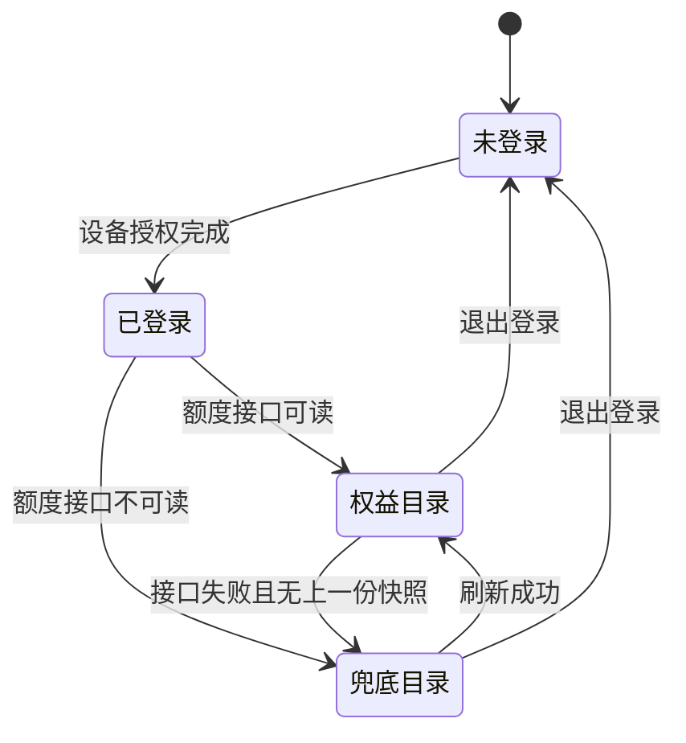
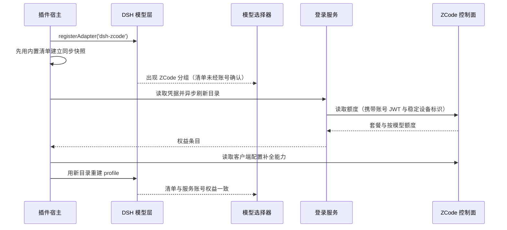
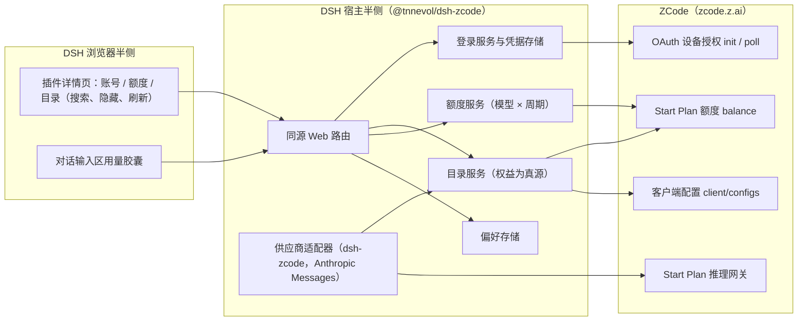
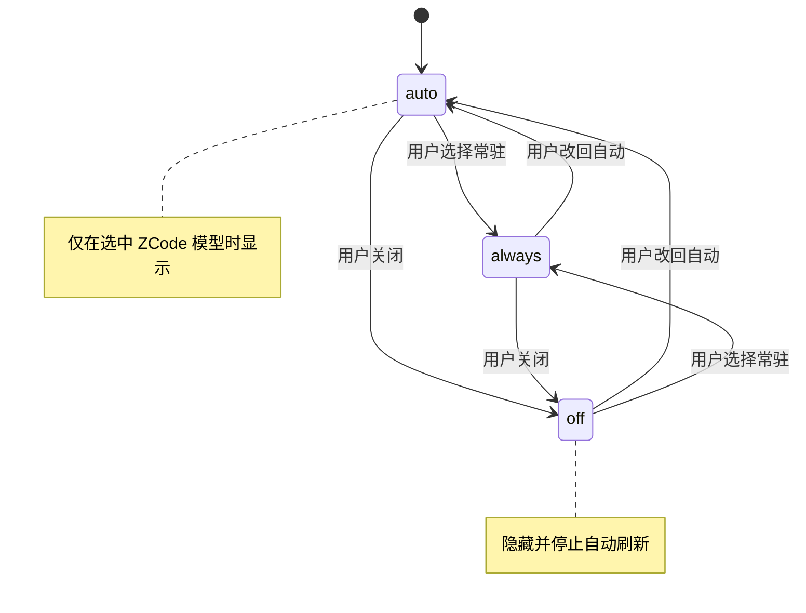

# PLAN-FNOS-027 ZCode Start Plan 模型接入与账号额度

| 字段 | 内容 |
| --- | --- |
| 计划编号 | PLAN-FNOS-027 |
| 计划日期 | 2026-10-24 |
| 对应需求 | [FNOS-027 ZCode Start Plan 模型接入与账号额度](/requirements/FNOS-027-dsh-zcode-plugin) |
| 本轮功能 | FNOS-027-01、FNOS-027-02、FNOS-027-03、FNOS-027-04、FNOS-027-05、FNOS-027-06、FNOS-027-07、FNOS-027-08 |
| 计划状态 | <Badge type="warning" text="实施中（登录、目录、能力与额度读取已通过真实账号接口实测；FNOS-027-04 受上游风控 3012 阻塞，发布相关任务待 npm 发布）" /> |

## 计划目标

按 FNOS-027 的功能编号实现一个不依赖 fnOS 宿主桥接的 DSH 插件 `@tnnevol/dsh-zcode`：

- **FNOS-027-01**：宿主侧的 ZCode 账号 OAuth 设备授权登录（BigModel 国内 / Z.ai 海外两个家族）、单飞轮询与凭据持久化；**不提供 API Key 登录**；
- **FNOS-027-02**：把账号权益（额度条目的 `capabilities`）作为模型清单真源，注册 DSH 模型供应商 `ZCode`（路由 `dsh-zcode`），并以稳定设备标识满足上游额度接口的必填头要求；
- **FNOS-027-03**：按上游客户端配置把上下文窗口、最大输出、图片输入与思考等级投影到模型，缺失时使用保守默认值；
- **FNOS-027-04**：按上游要求复现 Anthropic Messages 请求与客户端身份头，并把上游业务码（`3001` / `3006` / `3007` / `3012` / `1113`）映射成可读中文诊断；**不承诺对话成功**；
- **FNOS-027-05**：按「模型 × 周期」展示额度窗口与套餐，保留上游粒度，缺失显示未知；
- **FNOS-027-06、FNOS-027-07**：插件详情页（账号、额度、目录、设置）、对话输入区用量胶囊与登录态/偏好持久化；
- **FNOS-027-08**：文档站说明页与菜单；市场源列表登记随 npm 发布执行。

技术边界：只新增插件与本仓库文档，不改 DSH 核心、其它插件与既有需求文档。FNOS-027-08 本轮完成页面与菜单；源列表登记、市场索引重生成与应用发布清单登记依赖 npm 发布，列为待执行任务。

**本轮的关键约束**：上游网关对第三方 harness 的模型请求返回 HTTP 405 与业务码 `3012`。本计划交付的是「按契约发请求 + 把上游限制如实呈现」，不把端到端对话列为可完成项，也不引入绕过手段（签名伪造、客户端二进制托管、反向代理转发均不在范围内）。

## 当前实现与目标设计

| 领域 | 当前实现 | 目标实现 | 迁移影响 |
| --- | --- | --- | --- |
| 供应商路由 | 仓库内没有 ZCode 供应商；用户只能用内置 `llm-pi-ai` 手工声明 OpenAI 兼容路由，或直接在 ZCode 客户端里用 | 只注册一个路由 `dsh-zcode`（显示名 `ZCode`），目录由账号权益驱动 | 选择器新增一个 `ZCode` 分组；退出登录时该分组整体撤销；与手工配置的 `zcode` / `zhipu` 并存 |
| 模型清单来源 | 手工配置必须逐条维护，且无法反映账号权益变化 | 以 `billing/balance` 的 `capabilities` 为真源；`client/configs` 只补全能力；两者都不可读时回退内置清单并标记未经账号确认 | 权益变化后刷新即生效，不需要改配置或升级插件；降级时界面说明来源 |
| 账号登录 | 无 | OAuth 设备授权：客户端生成 pollToken → init 取授权地址 → 单飞轮询取令牌；两个家族只差授权页域名 | 账号卡片提供家族选择；不提供 Key 入口 |
| 模型能力投影 | 手工配置只能给一个「兼容」壳子 | 上下文窗口、最大输出、图片输入、思考等级来自 `client/configs`；思考等级按上游三档映射，中间等级向上取整 | 容量与能力随账号配置变化；缺失时用保守默认值并说明 |
| 额度口径 | 无 | 按「模型 × 周期」展示，日额度与一次性活动额度分列 | 界面不出现单一总百分比；不做金额换算 |
| 推理请求 | 无 | Anthropic Messages 协议 + 完整客户端身份头；`authorization` 与 `x-api-key` 同值 | 请求可解析、可归因；上游风控仍可能拒绝（见风险） |
| 分发与文档 | 仓库中没有该插件的页面、菜单条目与市场条目 | 说明页 + 插件总览行 + 菜单条目 + 三份 SDD 文档；发布后登记市场源列表 | 文档站与市场可见性随发布推进 |

供应商注册只有「未登录 / 已登录」两个状态，变化点在目录的来源与可信度，而不是供应商分组：

登录与首轮目录的时序：宿主在插件挂载时先同步给出一份内置清单，保证 headless 首轮对话不会落到空 provider 上；真实目录随后台刷新替换。

## 影响范围分析

| 需求功能 | 代码模块 | 配置与数据 | 测试 | 文档 | 目标环境 |
| --- | --- | --- | --- | --- | --- |
| FNOS-027-01 | `plugins/dsh-zcode-plugin/src/host/`（登录、凭据）、`src/contracts/`（状态与家族）、`src/client/`（账号卡片） | `$DSH_HOME/.dsh-zcode-auth.json`（0600） | 登录态、非登录态、两个家族、取消与过期、无 Key 入口用例 | 说明页「登录」小节 | DSH Web、DSH Desktop |
| FNOS-027-02 | 目录服务、供应商注册、路由冲突诊断 | 无新增用户配置；目录快照仅内存缓存 | 权益清单、权益变化、兜底、路由冲突回归用例 | 说明页「模型」小节 | DSH Web、DSH Desktop |
| FNOS-027-03 | 目录归一化与模型投影（容量、思考等级、图片输入） | 无 | 能力字段、思考等级映射、缺配置降级用例 | 说明页「模型能力」小节 | DSH Web、DSH Desktop |
| FNOS-027-04 | 适配器请求路径（协议、端点与请求头）与上游业务码诊断 | 会话数据格式不变 | 请求形态、`3012` 诊断、`3006`/`3007`/`1113` 分支用例 | 说明页「已知限制」与常见问题 | DSH Web、DSH Desktop |
| FNOS-027-05 | 额度服务、宿主路由、额度卡片 | 无持久化；快照带获取时间 | 套餐、按模型窗口、日额度与一次性额度分列、失败态用例 | 说明页「额度」小节 | DSH Web、DSH Desktop |
| FNOS-027-06 | 输入区插槽组件、详情页四块卡片、目录卡片 | `$DSH_HOME/.dsh-zcode-preferences.json` | 三种胶囊策略、搜索、隐藏、刷新与一致性与用例 | 说明页设置表与模型目录小节 | DSH Web、DSH Desktop |
| FNOS-027-07 | 凭据与偏好存储 | 上述两个宿主文件 | 重启后持久化与隔离用例 | 说明页已知约束 | DSH Web、DSH Desktop |
| FNOS-027-08 | `docs/plugins/`、`docs/.vitepress/config.mts`、`docs/public/plugins/market/plugins.txt` 与四处索引 | 无 | 文档构建、菜单链接与源列表核对 | 本需求的三份 SDD 文档与插件说明页 | 文档站构建环境 |

## 架构与数据流

插件分宿主与浏览器两侧：宿主侧负责凭据、账号权益目录、额度与唯一供应商适配；浏览器侧只渲染详情页卡片与输入区胶囊，两者通过插件同源 Web 路由通信。所有上游请求由宿主发出，浏览器不接触令牌。

目录与额度的刷新都走「先看缓存是否过期，再决定是否打上游」的路径；额度接口失败只降级清单来源，不清空已经可用的目录：

## 分阶段任务

### 阶段一：宿主侧登录与凭据

| 任务 ID | 对应需求/验收 | 修改内容 | 前置条件 | 验证方式 |
| --- | --- | --- | --- | --- |
| PLAN-FNOS-027-T01-01 | FNOS-027-01 / AC-01、AC-02 | 设备授权状态机：按家族生成 32 字节随机 pollToken，调用 `cli/init` 取 `flow_id` / `authorize_url` / `expires_at` / `poll_interval_sec`；把授权地址与剩余有效期交给详情页；pollToken 不落盘、不进日志 | 无 | 单测用桩控制面覆盖「授权成功」「取消」「链接过期」「上游拒绝」四条路径；状态迁移与凭据写入时机正确 |
| PLAN-FNOS-027-T01-02 | FNOS-027-01 / AC-03 | 单飞轮询：每个 flow 只有一条轮询；详情页刷新复用进行中的 flow，不替换用户已打开的授权地址；flow 失效、取消与卸载时清理定时器 | T01-01 | 重复调用登录接口后断言上游只收到一条轮询链路；授权地址在刷新前后一致；定时器不单独撑住宿主退出 |
| PLAN-FNOS-027-T01-03 | FNOS-027-01 / AC-05、AC-06；FNOS-027-07 / AC-01 | 凭据存储：宿主独占读写，文件 `0600`、目录 `0700`，原子写与文件锁，落盘文档带格式版本与字段白名单，未知字段视为格式漂移并拒绝；退出登录删除凭据 | 无 | 文件权限与格式断言；未知字段与旧版本文档被拒绝且不覆盖原文件；页面源码、网络响应与本地存储中查不到令牌明文；重启后登录态保持 |
| PLAN-FNOS-027-T01-04 | FNOS-027-01 / AC-04 | 登录入口收敛：路由只接受家族名，不提供 Key 提交分支；账号卡片已登录时只保留退出登录 | T01-01 | 向登录路由提交 Key 形态请求被拒绝；页面 DOM 中不存在 Key 输入控件与等价文案 |

### 阶段二：模型目录与供应商适配

| 任务 ID | 对应需求/验收 | 修改内容 | 前置条件 | 验证方式 |
| --- | --- | --- | --- | --- |
| PLAN-FNOS-027-T02-01 | FNOS-027-02 / AC-01、AC-02 | 额度解析：读取 `data.plans[]`（`plan_id` / `name` / `status` / `ends_at`）与 `data.balances[]`（`capabilities` / `show_name` / `total_units` / `used_units` / `remaining_units` / `period` / `period_start` / `period_end` / `expires_at`）；从 `capabilities` 的 `model:` 前缀还原模型 id 并归一为官方大小写；没有 `capability` 的条目视为账号级记录、不生成模型 | 凭据可用（T01-03） | 用响应夹具断言模型全集、大小写归一、无 capability 条目被跳过 |
| PLAN-FNOS-027-T02-02 | FNOS-027-02 / AC-03 | 清单来源与回退：额度可读时以权益为全集；不可读时回退内置清单（`GLM-5.3-Flash`、`GLM-5.2`、`GLM-5-Turbo`）并把来源标记为未经账号确认；未登录时也给一份内置清单保证选择器不是空的；任何一步失败都保留上一份可用快照并记录原因 | T02-01 | 夹具覆盖「权益可读」「权益不可读」「未登录」「权益为空」「客户端配置不可读」五种情况；失败时目录不被清空 |
| PLAN-FNOS-027-T02-03 | FNOS-027-03 / AC-01 至 AC-04 | 能力投影：从 `client/configs` 的 `providers[].models[]` 取 `contextWindow`、`maxCompletionTokens`、`reasoning.levels[].value` 与 `capabilities.inputFormat.supportsImage`；思考等级按上游 low / high / max 三档映射，中间等级向上取整，未声明思考时只保留关闭档；缺失时用 400000 上下文与 80000 最大输出的保守默认值 | T02-01 | 夹具断言 1000000 / 128000、三档思考等级、图片输入；缺配置时得到默认值并在快照里带说明 |
| PLAN-FNOS-027-T02-04 | FNOS-027-02 / AC-01、AC-04；FNOS-027-01 / AC-05；FNOS-027-04 / AC-01 | 供应商注册：只向模型层注册 `dsh-zcode` 一个路由，每次目录刷新重建 profile（新 Map 身份是适配器重建模型集合的信号）；用户手工配置的 `zcode` / `zhipu` 不冲突，同名 `dsh-zcode` 冲突给出可诊断错误且不覆盖用户配置；退出登录时撤销该路由 | T02-03 | 注册后选择器只出现一个 `ZCode`；预置手工路由时仍出现；同名冲突场景得到明确错误；退出登录后分组消失 |
| PLAN-FNOS-027-T02-05 | FNOS-027-02 / AC-01；FNOS-027-03 / AC-04 | 稳定设备标识：首次生成后缓存为进程内稳定值，并可注入已保存的值；额度、客户端配置与推理请求共用同一个标识，避免同一账号被当成新设备而要求重新授权 | T02-01 | 同一进程内多次请求断言 `x-device-mid` 一致；注入固定值后沿用该值 |
| PLAN-FNOS-027-T02-06 | FNOS-027-02 / AC-02；FNOS-027-07 / AC-02 | 目录缓存与刷新：快照在最短复用期内复用，过期才刷新；并发刷新合并为一次；强制刷新忽略复用期；刷新间隔按偏好设置，最小值 1 分钟，`0` 表示关闭自动刷新 | T02-02 | 桩计时验证复用、合并与节流；偏好为 0 时不再产生定时请求 |

### 阶段三：推理请求与上游诊断

| 任务 ID | 对应需求/验收 | 修改内容 | 前置条件 | 验证方式 |
| --- | --- | --- | --- | --- |
| PLAN-FNOS-027-T03-01 | FNOS-027-04 / AC-01 | 请求形态：协议固定 Anthropic Messages，端点前缀 `https://zcode.z.ai/api/v1/zcode-plan/anthropic`，资源 `/v1/messages`；`anthropic-version` 与 `anthropic-beta` 固定发送；模型 id 原样发出（目录中的 id 已是网关接受的大小写） | T02-04 | 桩服务断言请求路径、方法、协议头与模型 id；不出现本地前缀改写 |
| PLAN-FNOS-027-T03-02 | FNOS-027-04 / AC-01 | 凭据与身份头：适配器把账号 JWT 写成 `x-api-key`，流入口再补 `authorization: Bearer <同一 JWT>`（同步改写，保持事件的同步取流契约）；路由级头补齐 `http-referer`、`user-agent`、`x-app-id`、`x-client-language`、`x-client-timezone`、`x-client-version`、`x-os-category`、`x-os-version`、`x-platform`、`x-release-channel`、`x-title`、`x-zcode-agent`、`x-zcode-app-version`、`x-device-mid` | T03-01 | 桩服务断言两个鉴权头同值、身份头齐备；网关只认其中一个头的实现也能通过 |
| PLAN-FNOS-027-T03-03 | FNOS-027-04 / AC-02、AC-03、AC-04 | 业务码诊断：把 `3001` 参数错误、`3006` 模型未授权、`3007` 需要人机校验、`3012` 风控拦截、`1113` 额度耗尽映射为可读中文说明并保留上游原文；`3012` 的诊断指向风控与「当前无法从第三方 harness 直连」的事实，不引导改用非官方转发 | T03-01 | 用上游响应夹具逐码断言诊断文案；文案中不出现「已绕过」「稍后会自动恢复」等承诺 |
| PLAN-FNOS-027-T03-04 | FNOS-027-04 / AC-02、AC-05 | 失败路径不伪装成功：上游拒绝时不产生空白助手消息、不静默重试、不在界面显示为完成；请求日志只记录状态与业务码，不记录请求体与令牌 | T03-03 | 断言会话中出现错误而不是空回复；检查日志不含令牌与 prompt 原文 |

### 阶段四：插件详情页与用量胶囊

| 任务 ID | 对应需求/验收 | 修改内容 | 前置条件 | 验证方式 |
| --- | --- | --- | --- | --- |
| PLAN-FNOS-027-T04-01 | FNOS-027-01 / AC-01、AC-02、AC-03、AC-04 | 账号卡片：未登录（家族选择与说明）、授权中（授权地址、复制按钮、剩余有效期）、已登录（账号与家族）、错误四种状态；已登录时不渲染 Key 登录入口 | T01-02、T01-04 | DSH Web 与 DSH Desktop 上逐状态目视 + DOM 断言；授权中刷新页面后授权地址不变 |
| PLAN-FNOS-027-T04-02 | FNOS-027-05 / AC-01 至 AC-05 | 额度卡片：账号当前生效套餐、每个模型的额度窗口（已用百分比、剩余量、周期、重置倒计时）、获取时间与刷新按钮；日额度与一次性活动额度分列；失败态显示原因且不显示 0% | T02-01 | 夹具覆盖两份套餐与四类窗口；失败态不显示 0%；补零与合并百分比均判为缺陷 |
| PLAN-FNOS-027-T04-03 | FNOS-027-06 / AC-02、AC-03 | 目录卡片：固定高度、列表内部滚动，搜索框与计数固定；逐模型显隐开关写入偏好；刷新与获取时间 | T02-04 | DSH Web 与 DSH Desktop 亮暗主题走查；隐藏后选择器不再出现该模型，恢复后重新出现 |
| PLAN-FNOS-027-T04-04 | FNOS-027-06 / AC-04、AC-05 | 输入区用量胶囊：按 auto / always / off 显隐、显示已用比例与重置时间、修改策略后即时生效；auto 仅在选中 `ZCode` 模型时挂出 | T04-02 的额度数据 | 三种策略各断言一次；选中其它供应商模型时不显示、不请求额度；亮暗主题下均可读 |
| PLAN-FNOS-027-T04-05 | FNOS-027-07 / AC-02；FNOS-027-06 / AC-02 | 设置区：胶囊策略与自动刷新间隔的读写、校验与持久化；偏好损坏或字段漂移时回落默认值 | T01-03 的宿主文件约定 | 重启后偏好保持；越界值夹到合法区间；坏文件不导致详情页不可用 |

### 阶段五：文档站与发布登记

| 任务 ID | 对应需求/验收 | 修改内容 | 前置条件 | 验证方式 |
| --- | --- | --- | --- | --- |
| PLAN-FNOS-027-T05-01 | FNOS-027-08 / AC-01、AC-02 | 新增 `docs/plugins/dsh-zcode.md`；在插件总览加入一行并修正运行时插件数量表述；在 `/plugins/` 菜单加入条目 | 无 | 文档构建通过；菜单与页面可达；说明页写明端到端对话未验证 |
| PLAN-FNOS-027-T05-02 | FNOS-027-08 / AC-03 | **随 npm 发布执行**：在插件市场索引源列表加入 `@tnnevol/dsh-zcode`；不手工改写生成的索引文件 | npm 发布成功 | 源列表含该包；生成的索引文件未被手改 |
| PLAN-FNOS-027-T05-03 | 全部 | 需求、计划与测试用例文档登记：`docs/requirements/`、`docs/plans/`、`docs/tests/` 与本页，同步四个索引与四处菜单 | 无 | `pnpm run check -- --sdd` 通过；文档构建通过 |
| PLAN-FNOS-027-T05-04 | FNOS-027-08 / AC-03 | 插件发布后重新生成市场索引并核对条目，随后登记到应用发布清单 | npm 发布成功；发布前确认目标版本可用 | 索引条目与源列表一致；应用安装后插件可见 |

### 阶段六：验证与收尾

| 任务 ID | 对应需求/验收 | 修改内容 | 前置条件 | 验证方式 |
| --- | --- | --- | --- | --- |
| PLAN-FNOS-027-T06-01 | 全部 | 插件的类型检查、单测与构建 | 阶段一至四 | `pnpm --filter @tnnevol/dsh-zcode run check` 与 `build` 通过 |
| PLAN-FNOS-027-T06-02 | FNOS-027-01、FNOS-027-02、FNOS-027-03、FNOS-027-05 至 FNOS-027-07 | DSH Web 与 DSH Desktop 走查，按测试用例文档执行；包含两个家族的登录、权益目录、能力字段与按模型额度 | T06-01 | 用例结论回填 `docs/tests/FNOS-027-dsh-zcode-plugin.md` |
| PLAN-FNOS-027-T06-03 | FNOS-027-04 / AC-02 至 AC-05 | 上游诊断走查：以真实账号确认 `3012` 的呈现方式与可读性，逐项核对文案不承诺成功、不引导绕过；限制解除后重跑 | T03-04 | 会话显示风控诊断且保留上游原文；用例按「诊断通过 / 对话阻塞」分别登记 |
| PLAN-FNOS-027-T06-04 | FNOS-027-08 / AC-04 | 文档站构建与菜单链接核对 | T05-01 至 T05-03 | 构建通过、菜单目标均存在；`git diff --check` 干净 |
| PLAN-FNOS-027-T06-05 | 全部 | 版本更新：按仓库版本流程推进插件与应用版本（功能提交后独立版本提交） | T06-01 至 T06-04 | 版本串一致，发布流程可执行 |

## 交互和行为设计

### 插件详情页

入口为「插件管理 → `ZCode` → 详情页」。页面由上到下依次是账号卡片、额度卡片、模型目录卡片与设置区；所有操作只改插件自己的数据。

| 区块 | 状态 | 用户可见内容 | 可用操作 |
| --- | --- | --- | --- |
| 账号卡片 | 未登录 | 两个账号家族（BigModel 国内 / Z.ai 海外）的说明与入口；不出现 Key 入口 | 发起登录 |
| 账号卡片 | 授权中 | 授权地址、复制按钮、剩余有效期、账号家族 | 取消登录 |
| 账号卡片 | 已登录 | 账号信息、账号家族；只显示退出登录 | 退出登录 |
| 账号卡片 | 错误 | 失败原因与可执行的处置 | 重试 |
| 额度卡片 | 有数据 | 当前生效套餐；每个模型的额度窗口（已用百分比、剩余量、周期、重置倒计时）；获取时间 | 刷新 |
| 额度卡片 | 失败或未订阅 | 失败原因与最近一次获取时间，或未订阅说明；两者都不显示 0% | 刷新 |
| 目录卡片 | 有数据 | 固定高度的滚动列表；固定的搜索框与计数；每行含名称、标识、容量、能力与逐模型显隐开关；清单来源说明 | 搜索、隐藏/恢复、刷新 |
| 目录卡片 | 兜底或失败 | 说明当前清单来自内置兜底、未经账号确认，并给出失败原因 | 刷新 |
| 设置区 | 始终 | 用量胶囊策略、自动刷新间隔 | 修改并保存 |

### 模型目录卡片

目录卡片自身固定高度，只有模型列表区内部滚动；卡片头部与工具栏（搜索框、计数、刷新）不随列表滚动，长目录不会把整页撑高。

| 列表项 | 内容 |
| --- | --- |
| 名称与标识 | 模型显示名与网关模型 id（如 `GLM-5.3`）；权益清单下同时可看到对应的 capability 原文 |
| 容量 | 上下文窗口与最大输出；来自上游客户端配置或保守默认值 |
| 能力 | 思考等级、图片输入、工具调用；未声明时显示为不可用 |
| 显隐 | 逐模型开关；隐藏后该模型不再出现在选择器 |

- 搜索覆盖名称、标识与能力说明；计数显示当前搜索结果数，已隐藏数量另行标注。
- 清单来源在卡片头部说明：来自账号权益，或来自内置兜底且未经账号确认。
- 目录刷新失败时列表保留上一份快照并显示原因；未登录时展示内置兜底清单并提示登录。

### 额度卡片

Start Plan 的额度粒度是「模型 × 周期」，卡片按此组织，不合并成一个总百分比：

| 列 | 内容 |
| --- | --- |
| 模型 | 额度条目对应的模型显示名（如 `GLM-5.3`）；没有 capability 的账号级条目单独标注 |
| 周期 | 上游原样（`daily` / `one_time` 等），不翻译成自定义窗口名 |
| 用量 | 已用百分比、剩余量；总量为 0 时显示 0% 而不是无效数值 |
| 重置 | 有周期结束或到期时间时显示倒计时，并随时间递减 |

本账号的两份套餐分别提供日额度（GLM-5.3 3,000,000、GLM-5.3-Flash 5,000,000）与一次性活动额度（GLM-5.3 200,000,000、GLM-5.3-Flash 300,000,000），因此同一模型会出现两个窗口——这是预期展示，不是重复数据。

### 用量胶囊

胶囊位于对话输入区右侧，与其它状态控件同行，不遮挡输入框。三种策略的切换关系如下：

- `auto`：默认值。只在当前选中的模型属于 `ZCode` 供应商时显示；其它供应商模型不显示，也不触发额度请求。
- `always`：只要插件已登录就常驻显示，与当前选中的供应方无关；没有额度数据时显示未知或未订阅，不补 0%。
- `off`：完全不显示，并停止额度自动刷新；详情页额度卡片不受影响，仍可手动刷新。

策略变化在宿主侧持久化，下一次进入会话或下一次对话即按新策略显示，无需重启 DSH。

### 文案与命名

- 供应商名称固定为 `ZCode`，路由 id 固定为 `dsh-zcode`。
- 账号家族名称固定为 `BigModel`（国内）与 `Z.ai`（海外）；需要说明差异时写「授权页域名不同」，不写成「两套账号体系」。
- 额度窗口按上游周期名与模型名表达，例如「GLM-5.3 · 每日」「GLM-5.3 · 一次性」；不混用「日额度」「活动额度」之外的别名。
- 上游限制使用业务码与原文短语（`request has been blocked due to unusual activity.`、`model not allowed`），不翻译成模糊的「网络问题」或「权限不够」。
- 「清单来源」按可信度说明是账号权益还是内置兜底；兜底时另附「未经账号确认」，不写成「降级」以免被理解为功能受损。

## 数据、权限和错误处理

### 持久化

| 数据 | 位置 | 权限 | 读取与恢复策略 |
| --- | --- | --- | --- |
| 账号凭据（账号 JWT、家族访问令牌、账号信息与家族） | `$DSH_HOME/.dsh-zcode-auth.json` | 文件 `0600`，目录 `0700` | 只由插件宿主读写；解析失败或格式版本不符时按未登录处理并给出可诊断错误，不覆盖原文件；凭据不含过期时间时不做本地过期判定，留 30 秒提前量处理已知过期的临界情况 |
| 插件偏好（胶囊策略、刷新间隔、隐藏模型） | `$DSH_HOME/.dsh-zcode-preferences.json` | 文件 `0600` | 缺失或损坏时回落到默认值；越界值夹到合法区间；隐藏模型按模型 id 记录 |
| 目录与额度快照 | 进程内存 | — | 目录与额度分别缓存；进程重启后重建，不落盘，避免把过期数据当成事实 |

### 权限

- 不新增 DSH 权限项，也不申请 fnOS 宿主权限；插件只做宿主侧文件读写与对 `zcode.z.ai` 的出站请求。
- 同源 Web 路由只接受同源页面或回环地址发来的请求；跨站请求一律拒绝，凭据与目录响应不回显令牌。
- 凭据文件权限被放宽或属主不可读时，按共享包的既有判定给出可诊断错误，不静默忽略。

### 错误处理

| 场景 | 用户可见 | 恢复动作 |
| --- | --- | --- |
| 未登录 | 账号卡片显示两个家族的登录入口与说明 | 发起登录 |
| 授权取消或链接过期 | 回到未登录并说明原因 | 重新发起 |
| 登录接口不可达 | 账号卡片显示连接失败与账号家族 | 检查网络后重试 |
| 凭据缺失或已过期 | 账号卡片回到未登录并提示重新登录 | 重新登录 |
| 额度接口不可读 | 目录回退内置清单并标注未经账号确认；额度卡片显示未知与失败原因，不显示 0% | 刷新或稍后重试 |
| 客户端配置不可读 | 模型仍可用，容量与思考等级使用保守默认值并说明 | 刷新 |
| 账号权益里没有可用模型 | 回退内置清单并说明账号可能未订阅 Start Plan | 在 ZCode 侧确认套餐后刷新 |
| 参数错误（`3001`） | 会话或卡片显示上游原文与说明；设备标识异常时提示重新登录以恢复 | 重新登录 |
| 模型未授权（`3006`） | 会话显示 `model not allowed` 与「当前账号无该模型权益」的说明；不自动换模型 | 刷新目录确认权益 |
| 风控拦截（`3012`） | 会话显示上游原文与「当前无法从第三方客户端直连该网关」的说明；不自动重试、不伪装成功 | 等待上游策略变化；插件不提供绕过方式 |
| 需要人机校验（`3007`） | 会话显示上游原文与「需在官方客户端完成校验」的说明 | 在官方客户端完成校验后重试 |
| 额度耗尽（`1113`） | 会话显示上游原文与额度状态；额度卡片同步反映已用比例 | 等待额度周期重置 |
| 用户手工配置了同名 `dsh-zcode` | 详情页说明冲突来源与处置方式；插件不注册、不覆盖用户配置 | 用户移除同名配置后重试 |
| 网络不可直达 `zcode.z.ai` | 各卡片显示连接失败 | 检查网络后重试 |

## 依赖、风险和决策

### 依赖

| 依赖 | 版本 | 用途 |
| --- | --- | --- |
| `@earendil-works/pi-ai` | 1.1.0 | 模型对象、思考等级语义与 Anthropic Messages 实现 |
| `@deepseek-ai/dsh-llm`、`@deepseek-ai/dsh-llm-pi-ai` | 0.2.1-rc.2 | 供应商路由注册与适配器契约 |
| `@deepseek-ai/dsh-host-webserver` | 0.2.1-rc.2 | 插件同源 Web 路由 |
| `@tnnevol/dsh-plugin-kit` | workspace | 凭据文件权限判定 |
| `@tnnevol/dsh-semi-ui` | workspace | 详情页与胶囊的组件与主题 |
| ZCode OAuth、额度、客户端配置与 Start Plan 网关 | 上游在线服务 | 登录、权益目录、能力与推理 |

### 风险

| 风险 | 影响 | 缓解 |
| --- | --- | --- |
| **上游风控拦截第三方 harness（`3012`）** | 模型可选但对话无法完成，用户可能误以为是插件缺陷 | 请求按官方客户端的协议与身份头复现，并把 `3012` 映射为指向风控的可读诊断；说明页与测试文档显著登记该限制，明确「端到端对话未验证」，且不提供绕过方式 |
| 风控判据不清、可能随时变化 | 明天可能放行也可能进一步收紧 | 不做针对规则的正向适配（签名伪造、二进制托管、代理转发均不引入）；诊断按业务码分层，规则变化时只需更新文案 |
| 部分用户据此认为插件「没用」 | 需求价值被上游限制抵消 | 目录、能力与额度三块能力本身可用且无需绕过风控；说明页把可用范围写清楚，不夸大 |
| 额度接口强制要求稳定设备标识 | 标识变化会让同一账号被当成新设备，反复要求重新授权 | 首次生成后缓存为进程内稳定值，并支持注入已保存值；用例覆盖同一进程内多次请求的一致性 |
| `X-Device-Mid` 缺失返回 `3001`，易被误判为代码缺陷 | 排查成本高 | 客户端把 `3001` 单独归类为参数错误并在诊断里点明设备标识；单测用缺少该头的响应夹具固定行为 |
| 模型清单来自账号权益，字段漂移会改变可用模型 | 目录与额度解析失败 | 模型全集有内置兜底；解析层以夹具固定已知形态，失败时降级并说明，不抛错到界面 |
| 额度按「模型 × 周期」表达，与固定三窗口的直觉不同 | 用户把两个窗口看成重复数据 | 卡片按模型与周期分列并标注周期原文；说明页写明日额度与一次性额度并存的正常性 |
| 账号 JWT 不带 `exp` | 无法在本地预判过期 | 上游给出时间才判定并留 30 秒提前量；未给出时以请求失败为准并提示重新登录 |
| 思考等级映射有损（上游只有三档） | 用户选的等级与上游档位不是一一对应 | 中间等级向上取整，未声明思考时只保留关闭档；说明页写明映射关系，不暴露不存在的档位 |
| 两个家族的授权页域名不同 | 用户选错家族后拿不到令牌 | 账号卡片写明国内 / 海外差异；登录失败时提示可切换家族重试 |
| 运行环境无法直连 `zcode.z.ai` | 登录、目录与请求全部不可用 | 明确提示连接失败并停止重试；不内置代理，不静默回退到其它供应商 |
| 凭据文件格式漂移 | 旧文件导致插件无法启动 | 落盘文档带版本与字段白名单，未知字段直接拒绝而不静默忽略；失败时按未登录处理且不覆盖原文件 |
| npm 上目标版本已被占用 | 发布失败 | 发布前核对目标版本，必要时先推进版本 |

### 决策

| 决策 | 选择 | 否决方案 | 原因 |
| --- | --- | --- | --- |
| 登录形态 | 只有 OAuth 设备授权，两个家族各一个入口 | 同时提供 API Key 登录 | Start Plan 的模型请求只接受账号身份，Key 形态没有可用路径；给出入口只会让用户走进死胡同 |
| 供应商路由名 | 唯一路由 `dsh-zcode`（显示名 `ZCode`） | 用 `zcode` / `zhipu` | 这两个名字可能已被用户在内置目录里手工声明；`dsh-` 前缀避开用户配置 |
| 模型清单真源 | 账号权益（额度条目的 `capabilities`） | 内置静态清单；或客户端配置里的模型表 | 权益是唯一能反映套餐变体、活动赠送与到期的来源；静态表会立刻过期。客户端配置只用于补全能力 |
| 权益不可读时的行为 | 回退内置清单并把来源标记为未经账号确认 | 直接展示空目录；或报错阻断 | 空目录会让选择器出现空分组；内置清单至少保留结构，配合来源说明不误导用户 |
| 额度粒度 | 按「模型 × 周期」分列 | 合并成单一总百分比 | 日额度与一次性活动额度可能同时存在，合并会掩盖「日额度用完但活动额度还有」的实际情况 |
| 思考等级映射 | 上游三档（low / high / max），中间等级向上取整 | 把 pi-ai 的七个等级原样透传 | 上游只认三档，透传未支持的值会得到 400 |
| 设备标识 | 首次生成后进程内稳定，可注入已保存值 | 每次请求新生成 | 额度接口要求稳定标识，否则同一账号被当成新设备并反复要求重新授权 |
| 上游风控的处置 | 如实诊断，不绕过 | 托管官方客户端二进制做反向代理；伪造签名 | 绕过手段依赖持续逆向与第三方产物，稳定性与合规风险都不可控；插件对用户的第一责任是不把不可用的东西说成可用 |
| 失败呈现 | 区分业务码分别提示 | 统一显示「调用失败」 | `3006`、`3007`、`3012`、`1113` 的处置完全不同，笼统提示会让用户做错动作 |
| 界面承载方式 | 插件详情页自定义区块 | 设置弹框的官方配置表单 | 账号、额度与目录都是交互型区块，官方配置 schema 表达不了（按插件 UI 规范第 2 档） |
| 市场索引维护 | 只加源列表，发布后重生成 | 手工改写生成的索引文件 | 索引由官方生成器从 npm 产物读取，手改会与源列表漂移 |

## 测试、打包、发布和回滚

- **包级验证**：插件类型检查、单测与构建；SDD 文档检查与文档站构建。测试用例设计见[测试用例文档 FNOS-027](/tests/FNOS-027-dsh-zcode-plugin)，本页不展开用例表。
- **DSH Web**：`pnpm run start -- --web`（`DSH_HOME` 指向仓库 `.dsh`），用启动日志里带 token 的地址访问；覆盖两个家族的登录、权益目录、能力字段、按模型额度、胶囊策略与 `3012` 诊断呈现。
- **DSH Desktop**：使用上游检出的开发态 Desktop（`fork-pj/deepseek-harness`），通过渲染进程调试端口取证；重点核对系统浏览器打开授权页、目录卡片固定高度与滚动、胶囊位置与亮暗主题。
- **文档站**：`pnpm run build -- --docs`（或 `pnpm exec vitepress build docs`）与 `git diff --check`；逐项核对新增菜单与页面链接目标存在。
- **打包与发布**：按仓库版本流程更新版本（功能提交与版本提交分开），随后发布插件；发布后重新生成市场索引，并登记到应用发布清单。**发布前需在发布说明里写明上游风控限制**，避免用户按「可用」预期安装。
- **回滚**：停用或卸载插件即可撤销 `ZCode` 供应商注册，模型选择器回到手工配置方式；说明页、插件总览行、菜单条目与市场源列表按提交回退。插件自有的凭据与偏好文件只有用户明确要求时才删除。
- **禁止删除**：用户会话历史、其它供应商的凭据与配置；本插件不持久化目录与额度，无需清理这两类数据。

## 参考资料

| 来源 | 用途 |
| --- | --- |
| `https://zcode.z.ai/api/v1/oauth/cli/init`、`…/oauth/cli/poll/<flowId>` | 设备授权发起与轮询的请求形状、响应字段与状态机（2026-10-24 实测） |
| `https://zcode.z.ai/api/v1/zcode-plan/billing/balance` | Start Plan 套餐与按模型额度；`X-Device-Mid` 必填与 `3001` 的触发条件 |
| `https://zcode.z.ai/api/v1/client/configs` | 模型能力（上下文窗口、最大输出、思考等级、图片输入）与验证码策略 |
| `https://zcode.z.ai/api/v1/zcode-plan/anthropic/v1/messages` | Start Plan 推理端点（Anthropic Messages）与所需请求头 |
| ZCode 官方客户端行为与自身源码注释 | 请求头形态、3012 风险控制的不可复现说明 |
| `@earendil-works/pi-ai@1.1.0` | 模型对象、思考等级语义与 Anthropic Messages 实现 |
| `@deepseek-ai/dsh-llm-pi-ai@0.2.1-rc.2` | 供应商路由注册与适配器契约 |
| 仓库规范 `docs/charter/*-spec.md` | 需求、计划、测试用例与菜单的要求 |

## 完成状态

| 阶段 | 状态 | 完成条件 |
| --- | --- | --- |
| 阶段一 宿主侧登录与凭据 | <Badge type="warning" text="待完成" /> | 两个家族的设备授权、单飞轮询、凭据存储与无 Key 入口通过单测与桩验证 |
| 阶段二 模型目录与供应商适配 | <Badge type="warning" text="待完成" /> | 权益目录、回退、能力投影、单路由注册、设备标识与刷新通过单测；路由冲突回归通过 |
| 阶段三 推理请求与上游诊断 | <Badge type="warning" text="待完成" /> | 请求形态与身份头通过桩断言；五个业务码诊断逐条通过；失败路径不伪装成功 |
| 阶段四 插件详情页与用量胶囊 | <Badge type="warning" text="待完成" /> | 四块卡片、固定高度目录、按模型额度与胶囊在 DSH Web 与 DSH Desktop 渲染并通过用例 |
| 阶段五 文档站与发布登记 | <Badge type="warning" text="待完成" /> | T05-01 至 T05-03 完成；T05-04 待插件发布后执行 |
| 阶段六 验证与收尾 | <Badge type="warning" text="待完成" /> | 用例执行结论回填，构建与版本检查通过；FNOS-027-04 按「诊断通过 / 对话阻塞」登记 |

插件宿主实现在同一分支落地（登录、目录、能力、额度与单路由已实现），真实账号的接口级实测已完成；端到端对话受上游风控拦截，按 FNOS-027-04 的口径登记为受阻。各阶段完成时在本页变更记录追加说明，不提前修改完成状态。

## 变更记录

| 日期 | 变更 | 说明 |
| --- | --- | --- |
| 2026-10-24 | 建立 PLAN-FNOS-027 | 依据 FNOS-027 拆出六个阶段 28 个任务：宿主侧登录与凭据、模型目录与供应商适配、推理请求与上游诊断、详情页与用量胶囊、文档站与发布登记、验证与收尾。登记 13 条风险与 11 条决策，其中「登录只有设备授权」「模型清单以账号权益为真源」「额度按模型 × 周期分列」「上游风控如实诊断不绕过」是本轮的关键技术判断；T05-04（市场索引重生成与应用发布清单登记）以 npm 发布为前置，不在本轮完成。**阶段三与 T06-03 的验收口径为「诊断可读」，不包含「对话成功」**：上游对第三方 harness 的模型请求返回 HTTP 405 与业务码 `3012`，未授权模型返回 `3006` 证明鉴权与权益解析已通过；官方客户端从未消耗该账号额度，第三方插件作者报告同一现象。 |
