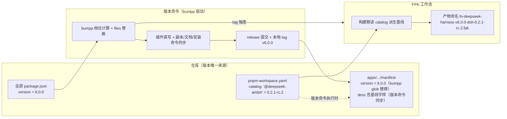
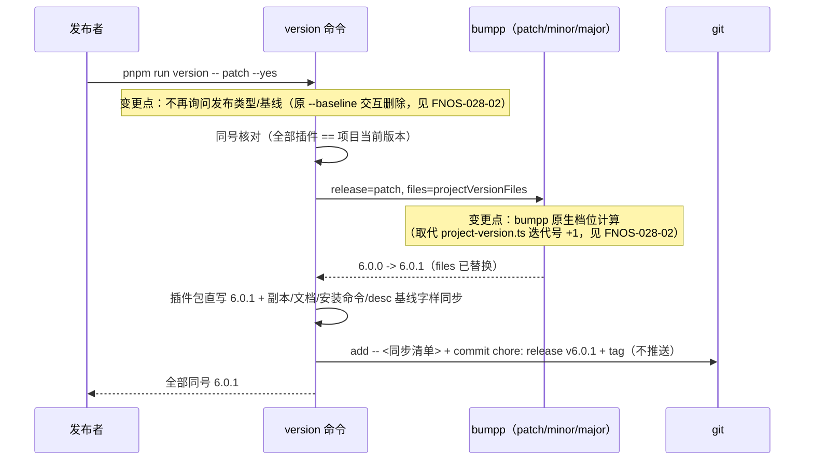
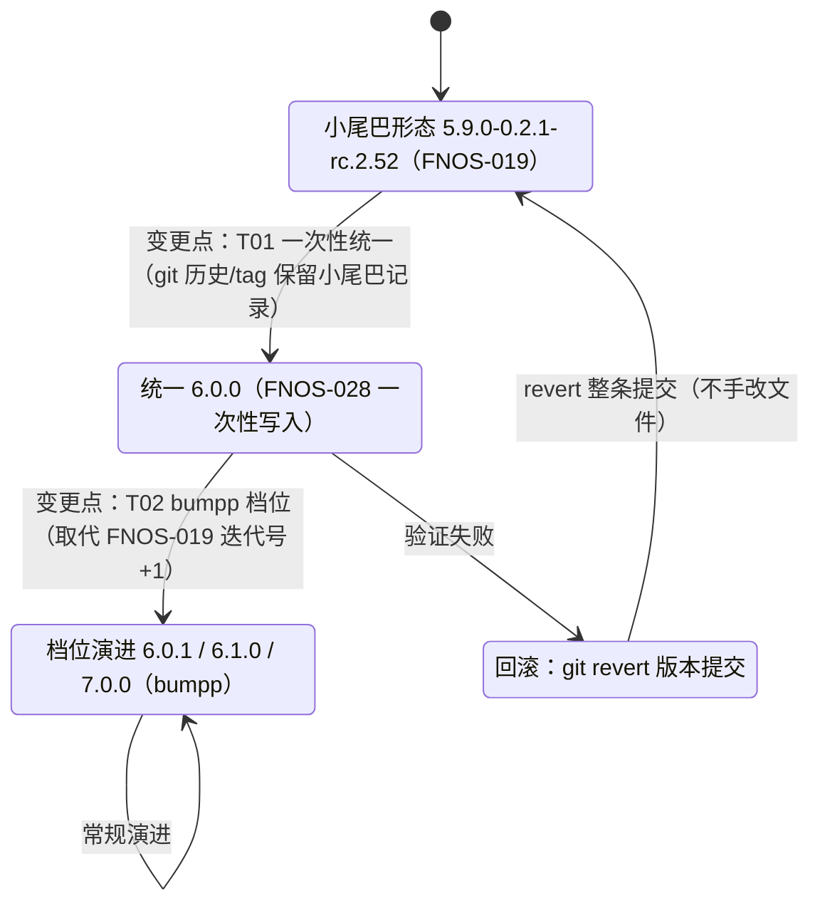

# PLAN-FNOS-028 项目与插件版本统一 6.0.0 及发布链路 dsh 基线标注

| 字段 | 内容 |
| --- | --- |
| 计划编号 | PLAN-FNOS-028 |
| 对应需求 | [FNOS-028 项目与插件版本统一 6.0.0 及发布链路 dsh 基线标注](/requirements/FNOS-028-unified-project-version-bumpp) |
| 计划状态 | <Badge type="info" text="规划中" /> |
| 前置依赖 | 无外部前置；本计划自身即变更起点 |

## 计划目标

落实 FNOS-028 的七项功能：版本统一 `6.0.0`、版本命令 bumpp 化、插件 `6.0.0` 正式版发布与 dist-tag 处置、FPK 产物组合命名、fpk 描述基线标注、基线信息独立可追溯、校验与文档同步清理。

技术边界：

- 只改版本号的**承载与维护方式**，不改 DSH 基线本身（catalog、`install_callback` 的 `DSH_VERSION`、插件 peer 解析值保持 `0.2.1-rc.2`）。
- 版本命令仍是 `pnpm run version`（`tooling/fnos-dsh-cli` 的 `version` 命令）；变化在其内核：版本计算与文件替换交给 bumpp 原生档位，删除小尾巴解析与迭代号计算，`--baseline` 收敛为 major 档位专属参数。
- FPK 内 `manifest` 的 `version` 为纯净项目版本；DSH 基线由产物命名与 `desc` 承载。

## 当前实现与目标设计

### 版本命令内核

| 领域 | 当前实现 | 目标实现 | 迁移影响 |
| --- | --- | --- | --- |
| 版本计算 | `src/core/project-version.ts`：解析 `<基础>-<基线>.<迭代号>`、消歧、`nextProjectVersion` 迭代号 +1 / 基线切换重置；插件版本 = 项目版本去基础段 | 删除整个模块；bumpp 原生档位（`patch`/`minor`/`major`/显式版本串）计算项目版本；插件直接沿用同一目标版本（同号） | `version.ts` 重写主流程；`project-version.spec.ts` 删除并重写为新行为用例 |
| 版本文件替换 | CLI 先对齐历史文件（`alignProjectVersionPackageFiles` 等）再调 `versionBump` 以显式版本串替换 | 保留「先对齐、后 bump」结构：对齐仍负责把各文件拉回当前版本，bump 改传**档位**而非显式串 | `projectVersionFiles` 清单不变；`docs/apps/fn-deepseek-harness.md` 版本行正则不变 |
| 插件版本同步 | `pluginVersionOf(parts)` 派生小尾巴，逐包 `updatePackageVersion` 直写 | 逐包直写目标版本（= bumpp 算出的项目版本）；`published-dsh-plugins.json` 副本、总览表格、安装命令替换逻辑保留，仅版本值来源变化 | `version.spec.ts` 中小尾巴 fixture（`5.9.0-0.2.1-rc.2.4` 等）全部换为纯净 semver fixture |
| 提交与 tag | bumpp `commit:false`，CLI 自己 `git add -- <paths>` + `git commit` + 本地 tag（规避无关改动卷入，local-only 插件路径过滤） | **透传 bumpp**：默认提交消息与 tag 名（`chore: release v{version}` / `v{version}`），CLI 同步产物预暂存 + bumpp `all` 模式收口为单条提交；入口新增工作区干净硬守卫（见设计决策 D1 重写） | 自研 `runGit` 编排收敛为「status 守卫 + add 暂存」两步；local-only 过滤保留在暂存侧 |
| 档位语义 | 仅 `patch`/`prerelease`/显式版本串合法，`minor`/`major` 明确拒绝 | 三档位固定语义（[FNOS-028-02](/requirements/FNOS-028-unified-project-version-bumpp) 目标 7）：`patch`=无新功能修复、`minor`=新功能且基线不变、`major`=DSH 基线变更或重大不可回退调整；每次发布对应段 +1（进位段归零，bumpp 原生行为）；**拒绝带 `-` 预发布段的目标版本**（旧小尾巴误用直接报错并指引） | `parseVersionOptions` 后新增守卫；`version.spec.ts` 覆盖三档各自增量 |
| 基线切换 | `--baseline` 改 catalog + 基线段切换 + 迭代号重置；交互询问发布类型 | `--baseline` 保留但收敛为 **major 档位专属**：`major --baseline <新基线>` 一步完成 major +1 与 catalog 改写（确认后才写 catalog 的既有顺序保留）；与其他档位搭配或基线未变时携带均报错；「基线未变的重大调整」走纯 `major`；交互询问删除（档位即语义，无需再问） | `version.ts` 参数校验重写；`ui/prompts.ts` 的 `askVersionReleaseKind`/`askTargetBaseline` 删除；versioning.md 重写为「major --baseline = 基线切换唯一入口」+ 纯 major = 重大调整 |

### 发布链路

| 领域 | 当前实现 | 目标实现 | 迁移影响 |
| --- | --- | --- | --- |
| FPK 产物命名 | `build-app.yml` Rename 步骤：`fn-deepseek-harness-${RELEASE_TAG}-dsh-${DSH_VERSION}.fpk`，`DSH_VERSION: 0.2.1-rc.2` 硬编码于 env | `fn-deepseek-harness-v6.0.0-dsh-0.2.1-rc.2.fpk` 形态；基线值构建期从 `pnpm-workspace.yaml` catalog 派生（步骤内 grep 解析），env 硬编码删除 | workflow 单步改写；`build-release.yml` 不动 |
| manifest desc 基线标注 | `desc` 含「运行基线为 DSH 0.2.1-rc.2」，纯人工维护 | 版本命令执行时把 `desc` 中「运行基线为 DSH <版本>」字样替换为当前 catalog 基线（仅动该字样，其余富文本不动） | `version.ts` 新增 `syncManifestBaseline()`；`manifest` 加入版本命令的同步清单 |
| FPK manifest version | bumpp 经 `apps/**/manifest` glob 替换 `version = <项目版本>` | 不变（值变为纯净 `6.0.0` 后自动正确） | 无 |
| 插件 npm 发布 | `--tag next` + `maintainLatestTag` 代际兜底（`generationOf` 按小尾巴形态解析） | 首次 6.0.0 发布仍可走 `--tag next` 后手动 `dist-tag add latest`，或直接 `--tag latest`；`generationOf`/`previousGenerationStable`/`revisionOf` 对纯净版本返回 `undefined` 自然跳过——**保留代码不删**（历史版本仍在 npm 上，降级场景仍需代际逻辑） | `publish-latest-maintain.spec.ts` 增补 `6.0.0` fixture 断言跳过路径；发布 runbook 在 release.md 更新 |
| 构建校验 | `build.ts` `DSH_VERSION='0.2.1-rc.2'` 常量核对 `install_callback`；`fnos-007-baseline.spec.ts` 锁 peer/catalog 基线 | 不变（基线仍三处一致；此常量属「无法从本仓库单点推导的一致性判断依据」，按 versioning.md 既定原则保留） | 无 |

### 文档与展示

| 领域 | 当前实现 | 目标实现 | 迁移影响 |
| --- | --- | --- | --- |
| `docs/build/versioning.md` | 整页围绕小尾巴方案（形态校验、`--baseline`、迭代号重置、同号推导、装机换号指引） | 重写：纯净 semver + bumpp 档位流程、同号机制、FPK 组合命名与 desc 基线承载、基线切换手工清单、升级兼容说明；保留「tag 不推送」「`--yes` 非交互」「两提交分离」「发布检查」等仍有效章节 | 全页重写，保留仍有效小节的框架 |
| 文档站版本徽标 | `docs/package.json` version → `config.mts` → `VersionBadge`（当前 `5.9.0-0.2.1-rc.2.49`） | 值随版本命令自然变为 `6.0.0`；机制不动 | 无代码改动 |
| 应用文档页 | `docs/apps/fn-deepseek-harness.md` 表格「应用版本 `5.9.0-0.2.1-rc.2.52`」+「DSH 基线 `0.2.0-rc.2`」（已过期，实为 `0.2.1-rc.2`） | 版本行由 `syncAppDocVersion` 正则同步为纯净版本；**基线行改为版本命令同步**（同一正则思路，消除人工漂移——本次发现的存量过期即为佐证） | `version.ts` 的同步函数扩展；存量基线值顺带修正 |
| 安装指南 | `docs/guide/nas-fpk-install.md`「版本号必须是可比较的」整节按小尾巴不可比较展开 | 重写为纯净 semver 下的正常比较说明；保留「版本必须与已装不同」的通用约束 | 小节改写 |
| CI 文档 | `docs/development/github-workflows.md` 图含 `DSH_VERSION` 节点；`docs/build/ci.md` 触发示例 `pnpm run version -- project patch` | 图与文案改为组合命名与 catalog 派生；触发示例修正 | 两处更新 |
| CLI 文档 | `docs/development/cli-commands.md`、`commands-and-scripts.md` 对 version 命令的描述 | 按新行为更新 | 小幅修订 |

### 一次性版本统一

全部 15 个版本文件（根、docs、5 个 packages、CLI、8 个插件）当前为 `5.9.0-0.2.1-rc.2.52` / `0.2.1-rc.2.52`，统一写为 `6.0.0`；`manifest` 的 `version`、`published-dsh-plugins.json` 副本、插件总览表格与全部安装命令、`docs/development/manifest.md` 示例、应用文档页版本行同步。npm dist-tag 处置：`latest` 指向首个发布的 `6.0.0`；`next` 上残留的旧小尾巴版本通过 `npm dist-tag rm next`（或指向 6.0.0）清头，避免「next=旧 latest=新」双头。

## 影响范围分析

| 需求功能 | 代码模块 | 配置/数据 | 测试 | 文档 | 目标环境 |
| --- | --- | --- | --- | --- | --- |
| FNOS-028-01 版本统一 | 全部 `package.json`（15 处）、`apps/fn-deepseek-harness/manifest`、`app/published-dsh-plugins.json` | 无用户数据影响（FPK 内版本字段变化） | `version.spec.ts`、`fnos-007-baseline.spec.ts` fixture 更新 | manifest.md 示例、应用文档页 | 本地 + 真实 fnOS NAS（升级链路） |
| FNOS-028-02 bumpp 化 | `tooling/fnos-dsh-cli/src/commands/version.ts`、`src/core/project-version.ts`（删）、`src/ui/prompts.ts`、`src/core/args.ts` | 无 | `project-version.spec.ts`（删）、`version.spec.ts`（重写）、`prompts.spec.ts` | versioning.md、cli-commands.md、commands-and-scripts.md | 本地 + CI（tag 链路） |
| FNOS-028-03 插件发布 | `publish.ts`（runbook 层面）、`publish-latest.ts`（零改动，验证跳过路径） | npm dist-tag（latest/next） | `publish-latest-maintain.spec.ts` 增补 | release.md 发布流程、plugins/index.md、各插件页 | npm + DSH Web/Desktop |
| FNOS-028-04 FPK 命名 | `.github/workflows/build-app.yml` | Release 附件名 | 无单测（CI 环境行为） | github-workflows.md、ci.md、app-listing-spec.md、nas-fpk-install.md | CI 发布环境 |
| FNOS-028-05 desc 基线 | `version.ts`（新增 syncManifestBaseline） | `manifest` desc | `version.spec.ts` 增补断言 | manifest.md（desc 口径说明） | 本地 + 真实 fnOS NAS（详情页可见） |
| FNOS-028-06 基线可追溯 | `version.ts`（应用文档页基线行同步） | `docs/apps/fn-deepseek-harness.md` | `version.spec.ts` 增补断言 | 应用文档页 | 文档站构建 |
| FNOS-028-07 校验与文档 | `version.ts` 档位守卫、`build.ts`（不动）、SDD 检查 | 无 | 全量 `pnpm run check` | versioning.md 重写、nas-fpk-install.md、README 说明 | 本地校验 + 文档构建 |

### 产物命名与版本信息流

说明：项目版本与 DSH 基线在仓库内是两条独立数据流——版本流经 bumpp 进 `package.json`/`manifest`/tag；基线流仅存在于 catalog，构建期被工作流读取用于产物命名，版本命令执行时用于对齐 `manifest` desc 与应用文档页的基线字样。两条流在版本号层面不再耦合。

### 版本命令行为变化（时序）

### 版本形态状态转换

## 设计决策

| # | 决策 | 被否决方案 | 理由与备用方案 |
| --- | --- | --- | --- |
| D1 | 版本计算与 release 提交/tag **透传 bumpp**（`versionBump` 单次调用：档位计算、files 清单替换、默认 `chore: release v{version}` 提交与 `v{version}` 本地 tag、push 恒关）；CLI 同步产物先 `git add` 暂存，bumpp 提交以 `all` 模式把暂存与替换收进**同一条**提交；发版前新增「工作区干净」硬守卫 | ① 保留 CLI 自管 `git add+commit+tag`（首轮实现）；② 同步文件全塞 bumpp `files` 清单靠其文本替换 | 方案①自研编排与「透传」目标相悖且重复实现 bumpp 已有能力；方案②不可行——bumpp 对文本文件是全量版本串替换，插件 `package.json`（`updateManifestFile` 只认顶层 version，但插件版本串与项目当前版本不同名不命中）、安装命令里的 `@包名@版本` 都不会被替换，且 manifest 的 changelog 文案中版本字样会被误替换。`all` 模式「卷无关改动」的风险由干净守卫在命令入口硬性排除（点名脏文件拒绝发版），实测 v6.0.1 发布 32 文件单条提交、local-only 插件正确排除 |
| D2 | 插件版本仍由 CLI 直写（值 = 项目目标版本），不交给 bumpp 逐包 bump | 对每个插件分别调 bumpp | 8 个插件逐包调 bumpp 引入 8 次确认/8 次 tag 风险；直写同号更简单，且保留「不同号报错点名」守卫 |
| D3 | 拒绝带 `-` 的目标版本串（守卫放 CLI 层） | 允许 semver 预发布（如 `6.1.0-rc.1`） | 本仓库不发布预发布版本；旧习惯传小尾巴串时（如 `6.0.1-0.2.1-rc.2.1`）需要明确报错指引而不是被 bumpp 静默当作 prerelease 处理。未来确需预发布时再放开并补规范 |
| D3b | `--baseline` 收敛为 major 专属参数：`major --baseline <新基线>` 合法（major +1 与 catalog 改写一步完成），`patch --baseline`/`minor --baseline` 报错，纯 `major`（基线未变的重大调整）合法；交互询问（发布类型/目标基线）删除 | 完全删除 `--baseline`（基线变更回归全手工） | 档位语义规范化后「基线变更 = major」成为硬规则，参数必须与档位一致以防基线变更被小档位掩盖；保留参数则沿用既有「确认后才写 catalog」顺序，避免取消后留下不一致状态（versioning.md 已记录的实测坑）。手工方案的问题：catalog 先改会导致 `pnpm run` 依赖校验失败，正是原 `--baseline` 要解决的 |
| D4 | FPK 命名的基线值由 workflow 步骤内从 `pnpm-workspace.yaml` 解析（grep catalog 行），删除 env 硬编码 | 新增 CLI 子命令输出基线（如 `fnos-dsh-cli baseline`） | 解析只需一行 grep/sed；为一步 shell 引入 CLI 安装依赖（workflow 目前只装 gateway+CLI，可用但增加耦合）。备用方案：若正则在 rc 版本形态上不稳，改为 `node -e` 调 CLI 已有 `readDshBaselineFromCatalog`（该函数保留，仅 project-version 其余部分删除） |
| D5 | `desc` 基线字样由版本命令同步（正则替换「运行基线为 DSH <版本>」），不引入 manifest 模板 | 构建期改写 FPK 内 desc | desc 是富文本人工内容，版本命令做**点替换**侵入最小；构建期改写会让仓库 manifest 与产物 manifest 漂移，违背「版本只有一份事实来源」原则 |
| D6 | `generationOf` 等代际函数保留不删 | 连同小尾巴逻辑一起删除 | npm 上历史版本永远存在；若需把 latest 回指旧代际（如 6.x 全线回滚），代际逻辑仍要能解析旧版本。纯净版本自然走 skip 路径，零维护成本 |
| D7 | `build.ts` 的 `DSH_VERSION` 常量与 `fnos-007-baseline.spec.ts` 保留 | 改为动态读取 | 该常量的职责是核对 `install_callback` 与 catalog 三方一致（一致性判断依据，非版本副本），符合 versioning.md「只有无法从本仓库推导的值才作为常量」的既定原则。基线切换时仍需人工同步三处，由重写后的 versioning.md 基线清单承载 |

## 分阶段任务

### 阶段一：版本命令 bumpp 化（FNOS-028-02、-07）

| 任务 ID | 对应需求/验收 | 修改内容 | 前置条件 | 验证方式 |
| --- | --- | --- | --- | --- |
| PLAN-FNOS-028-T01-01 | FNOS-028-02 / AC-01～AC-05 | 重写 `version.ts`：删除 `project-version.ts` 导入与基线交互（`prompts.ts` 相关函数）；档位直接传 bumpp `versionBump`（`release: patch/minor/major/显式串`），档位语义按需求目标 7；`--baseline` 收敛为 major 专属（其他档位搭配报错、确认后才写 catalog，`writeDshBaselineToCatalog` 保留）；新增守卫拒绝含 `-` 的目标版本并报错指引；插件直写目标版本；保留同号核对、副本/文档/安装命令同步、自定义提交与本地 tag、local-only 过滤 | 无 | `version.spec.ts` 重写后全绿；本地 `--no-commit` 演练：`6.0.0 --patch → 6.0.1`、`--minor → 6.1.0`、`--major → 7.0.0`、`minor --baseline x` 被拒、传 `6.0.1-0.2.1-rc.2.1` 被拒 |
| PLAN-FNOS-028-T01-02 | FNOS-028-02 / AC-01 | 删除 `src/core/project-version.ts` 与 `tests/project-version.spec.ts`；`readDshBaselineFromCatalog` 若被 D4 备用方案或 desc 同步引用则保留该单函数（迁移至 version.ts 或独立小模块） | T01-01 | `pnpm run check`（typecheck + 全部单测）通过；`grep -r "project-version\|parseProjectVersion"` 无残留引用 |
| PLAN-FNOS-028-T01-03 | FNOS-028-05 / AC-01 | `version.ts` 新增 `syncManifestBaseline()`：正则替换 `manifest` desc 中「运行基线为 DSH <版本>」为当前 catalog 基线；`manifest` 保持已在 `projectVersionFiles`（version 行由 bumpp 替换） | T01-01 | 单测：desc 含旧基线字样时被替换为新基线，其余富文本字节不变 |
| PLAN-FNOS-028-T01-04 | FNOS-028-06 / AC-01 | `syncAppDocVersion` 扩展：应用文档页「应用版本」行（已有）之外，新增「DSH 基线」行同步为当前 catalog 基线；两行路径均已在 `projectVersionFiles` | T01-01 | 单测 + 本地演练后 `git diff` 核对文档页两行更新 |

### 阶段二：一次性版本统一（FNOS-028-01、-03）

| 任务 ID | 对应需求/验收 | 修改内容 | 前置条件 | 验证方式 |
| --- | --- | --- | --- | --- |
| PLAN-FNOS-028-T02-01 | FNOS-028-01 / AC-01 | 用新版本命令显式版本串 `pnpm run version -- 6.0.0 --yes`（或等价一次性写入）统一全部 15 个版本文件、manifest version、published 副本、总览表格与安装命令、manifest.md 示例、应用文档页版本行；作为**第一条 6.0.0 版本提交**（`chore: release v6.0.0` + 本地 tag） | T01 全部完成 | `git grep "5\.9\.0-0\.2\.1\|0\.2\.1-rc\.2\.5[0-9]"` 在版本文件中零命中；15 处 version 均为 `6.0.0` |
| PLAN-FNOS-028-T02-02 | FNOS-028-07 / AC-01、AC-02 | `version.spec.ts`、`fnos-007-baseline.spec.ts`、`publish-latest-maintain.spec.ts` 等 fixture 由小尾巴换为纯净版本（`6.0.0`/`6.0.1`）；`publish-latest-maintain` 增补断言：`generationOf('6.0.0') === undefined`、`maintainLatestTag('6.0.0')` 走 skip 路径 | T02-01 | `pnpm run check` 全绿 |
| PLAN-FNOS-028-T02-03 | FNOS-028-03 / AC-01 | 插件 6.0.0 发布与 dist-tag 处置：逐插件 `pnpm pack` 核对产物清单 → `publish`（next 或直接 latest，按 release.md 更新后的 runbook）→ `npm dist-tag add <包>@6.0.0 latest`；处置 `next` 残留（指向 6.0.0 或移除） | T02-02 | `npm view <每个包> dist-tags` latest=6.0.0；照抄文档安装命令成功 |

### 阶段三：发布链路改造（FNOS-028-04、-05）

| 任务 ID | 对应需求/验收 | 修改内容 | 前置条件 | 验证方式 |
| --- | --- | --- | --- | --- |
| PLAN-FNOS-028-T03-01 | FNOS-028-04 / AC-01 | `build-app.yml` Rename 步骤改写：删除 `DSH_VERSION` env 硬编码；步骤内从 `pnpm-workspace.yaml` 解析 catalog 基线（含非空校验与解析失败即失败）；产物名 `fn-deepseek-harness-${RELEASE_TAG}-dsh-${DSH_BASELINE}.fpk`（tag 推送后即为 `fn-deepseek-harness-v6.0.0-dsh-0.2.1-rc.2.fpk`） | T02-01（tag 形态确定） | 本地等价 shell 演练解析逻辑；推送首个 v6.0.0 tag 后核对 Release 附件名（属 T04-01 的 CI 触发验证） |
| PLAN-FNOS-028-T03-02 | FNOS-028-05 / AC-01 | 核对 T01-03 的 desc 同步在 6.0.0 版本提交中生效：manifest desc 基线字样 = catalog 当前值；`docs/development/manifest.md` 的 desc 口径说明补充「基线字样由版本命令同步」 | T02-01、T01-03 | FPK 构建后解包核对 desc；应用中心详情页显示（并入 T04-02 真机验收） |

### 阶段四：文档重写与整体验证（FNOS-028-06、-07）

| 任务 ID | 对应需求/验收 | 修改内容 | 前置条件 | 验证方式 |
| --- | --- | --- | --- | --- |
| PLAN-FNOS-028-T04-01 | FNOS-028-06、-07 / AC-01、AC-02 | 重写 `docs/build/versioning.md`（纯净 semver + bumpp 流程、FPK 组合命名与 desc 基线承载、基线切换手工清单、升级兼容说明；保留 tag 不推送/`--yes`/两提交分离/发布检查）；更新 `docs/build/ci.md`、`docs/development/github-workflows.md`（命名与触发示例）、`cli-commands.md`、`commands-and-scripts.md`、`docs/guide/nas-fpk-install.md`（版本比较小节）、`docs/charter/app-listing-spec.md`（产物名与版本说明）、`README.md` 版本相关说明 | T01–T03 完成 | `pnpm run build -- --docs`；`pnpm run check -- --sdd`；`git diff --check` |
| PLAN-FNOS-028-T04-02 | FNOS-028-01 / AC-02、FNOS-028-05 / AC-01 | 真实 fnOS NAS 验收：推送 v6.0.0 tag → CI 产物命名核对 → 已装 `5.9.0-0.2.1-rc.2.x` 设备升级安装 `6.0.0`：成功升级、用户数据保留、详情页版本 `6.0.0` 且 desc 含「运行基线为 DSH 0.2.1-rc.2」；结果回填 `docs/tests/FNOS-028-*.md` 与 `docs/validation/` | T04-01、T02-03（插件先就位，升级回调要装插件） | 真机操作记录 + 截图/日志证据；升级判定依据 [nas-fpk-install](/guide/nas-fpk-install)（纯净 semver 下 fnOS 正常比较 `5.9.0 < 6.0.0`，无小尾巴等价坑） |
| PLAN-FNOS-028-T04-03 | FNOS-028-02 / AC-01、FNOS-028-07 / AC-02 | 发布链路回归：再次执行 `pnpm run version -- patch --yes` 产出 v6.0.1（验证常规档位链路 + 全部同步点无遗漏），推送 tag 走完整 CI，确认第二个 Release 附件 `v6.0.1-dsh-...` 命名正确 | T04-02 | CI 运行记录 + Release 附件核对；`git status` 干净 |

任务依赖：T01（串行 01→04）→ T02（01→03）→ T03（依赖 T02-01）→ T04（01 可在 T03 后并行启动，02 依赖全部）。T02-03 插件发布建议与 T03/T04 并行推进（互不阻塞，仅 T04-02 真机升级依赖插件就位）。

## 交互和行为设计

版本命令面向发布者的交互变化（无终端用户 UI）：

- **入口不变**：`pnpm run version` / `pnpm run version -- patch --yes`。
- **档位语义固定**（发布者选档位即选语义）：`patch` = 无新功能的修复；`minor` = 新功能且 DSH 基线不变；`major` = DSH 基线变更（携带 `--baseline <新基线>`，如 `pnpm run version -- major --baseline 0.2.2-rc.1 --yes`）或基线未变的重大不可回退调整。每次发布对应段 +1，不跳号。
- **删除的交互**：原「发布类型（同基线 +1 / 切换基线）」选择与独立的 `--baseline` 用法——档位本身已表达语义，`--baseline` 仅在 major 下作为参数提供且与其他档位搭配被拒绝。
- **保留的行为**：同号核对报错点名（插件与项目不同号时拒绝）、统一发布确认（交互模式下列出项目与每个插件 from → to，major + baseline 时额外一行「DSH 基线 from → to」）、`--yes`/`--no-commit`/`--no-tag` 参数语义不变。
- **新增的报错**：目标版本含 `-` 时输出「本仓库不使用预发布版本号；请使用 patch/minor/major 或完整三段式版本（如 6.0.1）」；`--baseline` 搭配非 major 档位时输出「基线变更必须走 major 档位」。

## 数据、权限和错误处理

- **无用户数据迁移**：FPK 升级路径沿用现有 `upgrade_callback`；唯一变化是 `manifest` version 由小尾巴变纯净三段式，fnOS 判定 `5.9.0 < 6.0.0` 为正常升级（依据 [nas-fpk-install](/guide/nas-fpk-install) 版本比较说明：非数字后缀视为同一 `5.9.0`，`6.0.0` 为不同且更高的三段式）。
- **不可逆操作**：npm 发布与 dist-tag 变更不可撤回（versioning.md 既定约束）；T02-03 执行前必须完成 `pnpm pack` 产物清单核对。
- **错误路径**：版本命令任何步骤失败时工作区可能残留部分替换——恢复方式为 `git checkout -- <版本文件>` 后重试（与现状一致，重写时不引入新的中间状态）。
- **敏感数据**：不涉及。

## 依赖、风险和决策

| 项目 | 风险或决策 | 处理方式 |
| --- | --- | --- |
| 真机升级路径 | fnOS 对 `5.9.0-0.2.1-rc.2.x → 6.0.0` 的升级判定未实测（理论上等价 `5.9.0 → 6.0.0` 正常升级） | 列为 T04-02 必测项（FNOS-028-01-AC-02），不默认可用；失败时按 [nas-fpk-install](/guide/nas-fpk-install) 的升级路径处置（卸载重装保留数据）并如实记录 |
| tag 形态分界 | 推送 v6.0.0 tag 时仓库小尾巴→纯净的切换点：若 T02-01 提交与 T03-01 workflow 改写不在同一条推送里，首个 6.0.0 Release 可能用旧命名 | 任务顺序上 T03-01 先于推送 tag 完成（T04-02 才推 tag）；CI 验证含 T04-03 第二次发布兜底 |
| workflow 基线解析 | shell 正则解析 catalog 行在 rc 形态（`0.2.1-rc.2`）上的稳健性 | 步骤内含解析失败即失败（exit 1）；备用方案 D4（node -e 复用 `readDshBaselineFromCatalog`） |
| 历史 dist-tag 双头 | `latest` 切 6.0.0 后 `next` 仍指旧小尾巴版本 | T02-03 显式处置并记录；`generationOf` 代际逻辑保留（D6）覆盖回滚场景 |
| 已完成文档不可回改 | FNOS-019 等已完成需求正文记载小尾巴方案 | 按 SDD 规范只在 FNOS-028/本计划登记取代关系；versioning.md 等章程/构建文档属「现行规范」正常重写 |
| 同号守卫与 npm 历史并存 | 插件 npm 上存在小尾巴历史版本，本地 6.0.0 同号守卫不受影响 | 守卫只比对仓库内 package.json；发布命令的代际逻辑对历史版本天然兼容（D6） |
| bumpp 显式版本串路径 | bumpp `release` 接受显式串（现状已用）；6.0.0 一次性写入走该路径 | T02-01 用显式串 `6.0.0`；此后常规走档位 |
| 档位语义执行 | 「patch=修复、minor=新功能、major=基线变更/重大调整」是流程纪律，工具无法验证「本轮改动是否真的是新功能」 | versioning.md 重写时写明判断口径与举例；发布检查清单包含「按本轮变更性质核对档位」一项；选错档位只影响版本号大小，不影响功能正确性，可在下个版本纠正 |

## 测试、打包、发布和回滚

- **本地（包级）**：`pnpm run check`（typecheck + 全部单测）；`version.spec.ts` 重写覆盖：三档各自增量（`6.0.0→6.0.1`/`→6.1.0`/`→7.0.0`）、`--baseline` 仅 major 专属（搭配 patch/minor 报错）、显式串、`-` 拒绝、同号守卫、desc 基线同步、应用文档页双行同步、安装命令/副本/总览同步、local-only 插件路径过滤。
- **构建（FPK 级）**：`pnpm run build -- --fpk --app fn-deepseek-harness --skip-bundle-dsh-plugins` 后解包核对 manifest version（`6.0.0`）与 desc 基线字样。
- **CI（发布环境）**：v6.0.0 与 v6.0.1 两次 tag 触发（T04-02/T04-03），核对 Release 附件命名、changelogithub 输出。
- **npm**：逐插件 pack 核对 → 发布 → dist-tag 断言（T02-03）。
- **真机（真实 fnOS NAS）**：升级安装 + 数据保留 + 详情页展示（T04-02）；测试用例文档回填 `docs/tests/FNOS-028-*.md`，验收证据入 `docs/validation/`。
- **文档**：`pnpm run build -- --docs`、`pnpm run check -- --sdd`、`git diff --check`。
- **回滚**：统一提交（T02-01）与后续版本提交均为单条 `chore: release` 提交——验证失败时 `git revert` 整条回退，禁止手改单个版本文件（versioning.md 既定原则）；npm 侧回滚 = 用代际逻辑把 latest 指回旧版本（D6 保留的能力），已发布的 6.0.0 无法撤回只能前进；workflow 改动 revert 后恢复旧命名。

## 参考资料

- [bumpp](https://github.com/antfu-collective/bumpp) 12.3.0（catalog 依赖；`versionBump` API 与 `release` 档位/显式串语义，本仓库 `version.ts` 现有调用与 `node_modules/bumpp/dist` 实现核对）
- [FNOS-019 FPK 版本方案固定前缀与插件基线小尾巴](/requirements/FNOS-019-fpk-version-scheme)（被部分取代的原方案）
- [版本管理](/build/versioning)、[发布流程](/build/release)、[CI 构建](/build/ci)（现行规范，本计划重写/更新对象）
- [从电脑上传 FPK 到 NAS 并安装](/guide/nas-fpk-install)（fnOS 版本比较规则与升级路径依据）
- `.github/workflows/build-app.yml`、`build-release.yml`（现状链路）
- `tooling/fnos-dsh-cli/src/commands/version.ts`、`publish.ts`、`publish-latest.ts`、`build.ts`（现状实现）

## 完成状态

| 阶段 | 状态 | 完成条件 |
| --- | --- | --- |
| 阶段一 版本命令 bumpp 化 | <Badge type="tip" text="已完成" /> | T01-01～T01-04 完成（提交 fd69aa2、e0d282a），98 用例全绿 |
| 阶段二 一次性版本统一 | <Badge type="warning" text="待完成" /> | T02-01/02 完成（提交 edeb3f6、e9c6fe2，本地 tag v6.0.0）；T02-03 插件 npm 发布待执行 |
| 阶段三 发布链路改造 | <Badge type="tip" text="已完成" /> | T03-01/02 完成：workflow 基线派生（本地 sed 解析实测通过）；FPK 构建解包核对 version=6.0.0、desc 基线字样正确 |
| 阶段四 文档重写与整体验证 | <Badge type="warning" text="待完成" /> | T04-01 完成（7 处规范文档更新，SDD/文档构建/`git diff --check` 通过）；T04-02 真机升级验收与 T04-03 CI 双发布回归待推送 tag 后执行 |

## 变更记录

| 日期 | 变更 | 说明 |
| --- | --- | --- |
| 2026-10-25 | 版本命令改为透传 bumpp（D1 重写） | 按提出人要求把版本计算与 release 提交/tag 全部透传 bumpp：`versionBump` 单次调用（默认提交消息与 tag 名与仓库惯例一致，push 恒关），CLI 只留守卫（新增「工作区干净」硬守卫）、前置同步与暂存收口（`all` 模式）。实施中实证两条关键事实并否决「同步文件塞 files 清单」方案：bumpp 文本替换是全量版本串替换（会误改 manifest changelog 文案），插件版本串与项目当前版本不同名不会被替换。以真实发布 v6.0.1 完成 32 文件单条提交端到端验证（含 local-only 插件排除、工作区干净守卫）。 |
| 2026-10-25 | 阶段一至三完成，阶段二/四部分完成 | 版本命令重写（bumpp 档位、`--baseline` major 专属、desc 与应用文档页基线同步、同版本幂等返回）、`project-version.ts` 删除、98 用例全绿；全部版本文件统一 6.0.0 并生成 `chore: release v6.0.0` 提交与本地 tag；workflow 基线派生落地；7 处规范文档更新；FPK 构建解包核对通过。剩余：插件 npm 发布与 dist-tag 处置（T02-03）、真机升级验收（T04-02）、CI 双发布回归（T04-03）。实施中发现并修复一处边界：显式传与当前相同的版本号时空提交被 git 拒绝，改为幂等返回并补用例。 |
| 2026-10-25 | 档位语义规范化 | 依据提出人补充的版本维护规范，固定三档语义（`patch`=无新功能修复 / `minor`=新功能且基线不变 / `major`=DSH 基线变更或重大不可回退调整，每次发布对应段 +1）。同步调整：内核表「档位语义/基线切换」两行、T01-01 任务与验证（三档演练 + baseline 搭配拒绝）、交互设计章节、新增设计决策 D3b（`--baseline` 收敛为 major 专属而非删除）、风险表「档位语义执行」、验证矩阵补三档用例。对应需求 FNOS-028 目标 7 与 AC-03～05。 |
| 2026-10-25 | 建立 PLAN-FNOS-028 | 依据 FNOS-028 拆出四个阶段：版本命令 bumpp 化、一次性版本统一（含 npm dist-tag 处置）、发布链路改造（FPK 组合命名 + desc 基线同步）、文档重写与整体验证。登记七项设计决策（D1 保留 CLI 编排+bumpp 计算、D4 基线构建期派生、D6 代际逻辑保留等）与真机升级路径风险。 |
