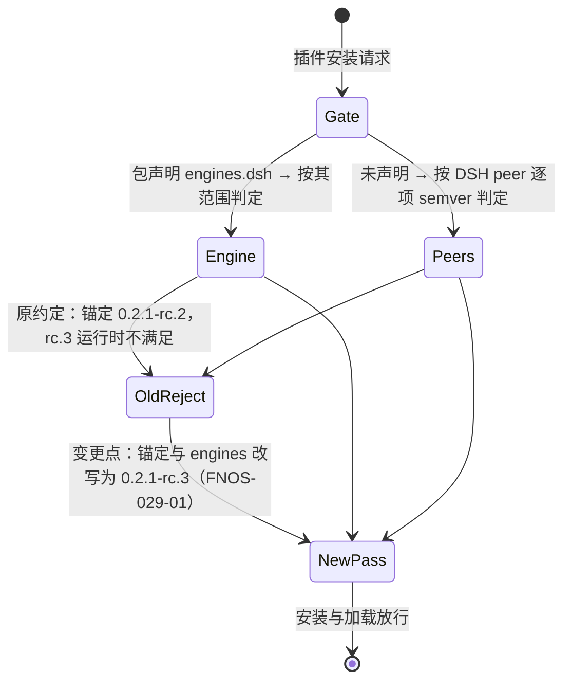
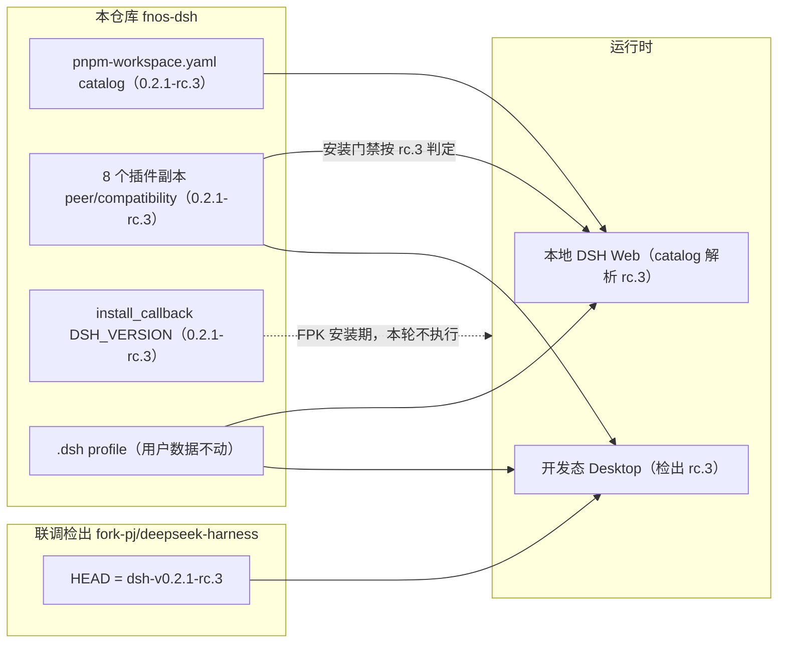

# PLAN-FNOS-029 DSH 0.2.1-rc.3 插件适配与基线迁移

| 项目 | 内容 |
| --- | --- |
| 计划编号 | PLAN-FNOS-029 |
| 计划日期 | 2026-10-25 |
| 对应需求 | [FNOS-029 DSH 0.2.1-rc.3 插件适配与基线迁移](/requirements/FNOS-029-dsh-021-rc3-adaptation) |
| 计划状态 | 待完成（T01～T04 已执行；FPK 真机验证列为后续） |

## 计划目标

按 [FNOS-029](/requirements/FNOS-029-dsh-021-rc3-adaptation) 的功能编号完成基线迁移：仓库运行/构建基线与联调检出统一到 `0.2.1-rc.3`，八个插件副本（七个入库 + CodeBuddy 本地副本）的依赖锚定与兼容声明改写，全部包级验证通过，并在 DSH Web 与 DSH Desktop 双客户端完成回归。

技术边界：只改依赖锚定、兼容声明、基线常量与文档基线字样；不改插件功能代码（除非类型检查暴露接缝差异）；不发布插件；不做 FPK 真机安装（登记为后续验证）。

## 当前实现与目标设计

| 领域 | 当前实现 | 目标实现 | 迁移影响 |
| --- | --- | --- | --- |
| catalog 基线 | `pnpm-workspace.yaml` 中 `@deepseek-ai/dsh` 与 `catalog.dsh` 全部条目为 `0.2.1-rc.2` | 全部条目改为 `0.2.1-rc.3`，`pnpm install` 重锁 | 本地运行时、全部插件 devDependencies 解析到新版本 |
| 插件依赖锚定 | 七个入库插件 `package.json` 的 `peerDependencies`（DSH 包部分）精确锚定 `0.2.1-rc.2`；fnos 插件部分 peer 使用 `catalog:dsh`（由 `engines.dsh` 声明承接，见 FNOS-014 判定规则） | 全部精确锚定改写为 `0.2.1-rc.3`；fnos 的 `catalog:dsh` peer 形态保持不变 | 安装期门禁按新版本判定；构建校验用例（FNOS-007 基线用例）同步通过 |
| 插件兼容声明 | 各插件 `compatibility.json` 的 `dshPluginApi.version` 为 `0.2.1-rc.2` | 改写为 `0.2.1-rc.3` | 插件管理页兼容判定按新版本 |
| CodeBuddy 本地副本 | `plugins/dsh-codebuddy-plugin/`（git 忽略，不入库）锚定 `0.2.1-rc.2` | 同样改写 peer 与 compatibility 到 `0.2.1-rc.3`，本地构建验证 | 不产生受版本管理的改动 |
| 安装回调常量 | `apps/fn-deepseek-harness/cmd/install_callback` 的 `DSH_VERSION="0.2.1-rc.2"` | 改为 `0.2.1-rc.3` | FPK 安装时装载的运行时版本；构建校验与 catalog 一致性由既有用例保证 |
| 三方插件 | `published-dsh-plugins.json` 中 `dshmarket@1.66.47`，peer `^0.2.1-rc.1` 含 rc.3 | 保持 `1.66.47` 不变 | 无需改动，登记判定证据 |
| 联调检出 | `fork-pj/deepseek-harness` HEAD 停在 `dsh-v0.2.1-rc.2` | fetch 后 checkout `dsh-v0.2.1-rc.3`，重装依赖 | 开发态 Desktop 运行时版本与插件锚定匹配 |
| 文档基线字样 | `docs/development/environment.md` 版本表、`docs/development/conventions.md` 示例等写 `0.2.1-rc.2` | 更新为新基线（`manifest` desc 的基线字样由版本命令自动对齐） | 文档与实际基线一致 |

迁移前后门禁判定路径（变更点标注）：

## 影响范围分析

| 需求功能 | 代码模块 | 配置/数据 | 测试 | 文档 | 目标环境 |
| --- | --- | --- | --- | --- | --- |
| FNOS-029-01 | `plugins/*-plugin/package.json`（peerDependencies）、`plugins/*-plugin/compatibility.json` | 无用户数据变化 | 各插件 `check`（typecheck+单测+build）、`tooling/fnos-dsh-cli` 基线用例 | 插件文档版本表随版本命令同步 | DSH Web、DSH Desktop |
| FNOS-029-02 | 无代码改动（契约复核确认零破坏） | 无 | 双客户端界面走查（7 类插座位置 + 亮暗主题） | 无 | DSH Web、DSH Desktop |
| FNOS-029-03 | `plugins/dsh-codebuddy-plugin/package.json`、`compatibility.json`（不入库） | 无 | 本地 `check` + 开发态运行时加载走查 | 无（FNOS-025 已下架，无文档页） | 本地开发态运行时 |
| FNOS-029-04 | `pnpm-workspace.yaml`（catalog，由版本命令改写）、`apps/fn-deepseek-harness/cmd/install_callback`（`DSH_VERSION`） | `pnpm-lock.yaml` 重锁 | `pnpm run check`（含基线一致性用例）、启动 DSH Web 核对版本 | `docs/development/environment.md`、`docs/development/conventions.md` 基线字样 | 本地构建链路、DSH Web |
| FNOS-029-05 | 无代码改动 | 既有 `.dsh` profile 数据保持 | 迁移后启动核对登录态、偏好、模型配置 | 无 | DSH Web、DSH Desktop |
| FNOS-029-06 | 联调检出（`fork-pj/deepseek-harness`，不在本仓库内） | 检出内 `node_modules` 重装 | `git describe` 核对 tag；Desktop 启动日志核对版本 | 无 | DSH Desktop |

## 架构与数据流

基线迁移只动「版本锚定层」，不动插件代码与数据：

## 分阶段任务

| 任务 ID | 对应需求/验收 | 修改内容 | 前置条件 | 验证方式 |
| --- | --- | --- | --- | --- |
| PLAN-FNOS-029-T01-01 | FNOS-029-04 / AC-01 | 联调检出 `git fetch --tags` 后 checkout `dsh-v0.2.1-rc.3`，按需 `pnpm install` | 官方 tag 已发布（已核实） | `git describe --tags` 输出 `dsh-v0.2.1-rc.3` |
| PLAN-FNOS-029-T01-02 | FNOS-029-01、FNOS-029-03、FNOS-029-07 / AC-01 | 把八个插件副本 `package.json` 的 DSH 依赖（peer/dev/deps）统一改为 `catalog:dsh`，并补 `engines.dsh` = catalog 基线；`compatibility.json` 的 `dshPluginApi.version` 同步到新基线 | 无 | 逐文件 grep 无版本字面量；`tooling/fnos-dsh-cli` 基线用例通过 |
| PLAN-FNOS-029-T01-05 | FNOS-029-07 / AC-01、AC-02 | 构建门禁 `build.ts` 取消对 DSH peer 的字面版本豁免，改为要求 catalog；基线守卫断言改为「DSH 依赖一律 `catalog:dsh` 且 `engines.dsh` 等于基线」；`build.ts` 与 `local-profile.ts` 的基线常量改从 catalog 读取，消除单向漂移 | T01-03 | 注入字面版本时构建报错；`pnpm --filter @tnnevol/fnos-dsh-cli test` 全绿 |
| PLAN-FNOS-029-T01-03 | FNOS-029-04 / AC-01 | catalog 基线改写到 `0.2.1-rc.3`（走 `pnpm run version -- major --baseline 0.2.1-rc.3`，在功能提交后执行）并 `pnpm install` 重锁；同步 `install_callback` 的 `DSH_VERSION` | T01-02 完成并提交 | `pnpm run check` 全绿；`grep` 校验 `DSH_VERSION` 与 catalog 一致 |
| PLAN-FNOS-029-T01-04 | FNOS-029-04 / AC-01 | 更新 `docs/development/environment.md` 版本表与 `docs/development/conventions.md` 等文档基线字样 | T01-03 | 文档构建通过、站内链接有效 |
| PLAN-FNOS-029-T02-01 | FNOS-029-01 / AC-01、AC-02 | 全部入库插件 `pnpm --filter <pkg> run check`（typecheck、单测、build） | T01-02、T01-03 | 命令退出码 0；单测全绿 |
| PLAN-FNOS-029-T02-02 | FNOS-029-03 / AC-01 | CodeBuddy 副本本地 `check`（同一基线依赖下构建） | T01-02、T01-03 | 命令退出码 0 |
| PLAN-FNOS-029-T02-03 | FNOS-029-04 / AC-02、AC-03 | `pnpm run start -- --web` 启动本地 DSH Web，核对运行时版本、七插件加载状态与 `dshmarket` 安装判定 | T02-01 | 启动日志版本行；插件管理页无异常（CDP 或人工走查） |
| PLAN-FNOS-029-T03-01 | FNOS-029-01、02、05 / AC-01～AC-02 | DSH Web 双客户端回归：插件管理页、各插件代表功能、界面区块位置、亮暗主题、既有数据（登录态/偏好/模型配置） | T02-03 | 按测试用例文档执行并回填 |
| PLAN-FNOS-029-T03-02 | FNOS-029-01、02、06 / AC-01～AC-02 | 开发态 Desktop 回归（项目 `.dsh` 作 `DSH_HOME`，渲染调试端口取证）：版本核对、插件加载、界面区块与主题 | T01-01、T02-01；与 Web 测试不同时持有同一会话 | 按测试用例文档执行并回填；结论写明检出与版本 |
| PLAN-FNOS-029-T04-01 | 全部 | 需求/计划/测试用例三文档登记与索引、侧栏更新；`pnpm run check -- --sdd` 与文档构建 | 无 | 命令通过 |
| PLAN-FNOS-029-T04-02 | 全部 | 功能提交后执行 `pnpm run version -- major --baseline 0.2.1-rc.3`（manifest desc 基线字样自动对齐；插件/项目统一升 major，版本提交独立） | T02、T03 完成且工作区干净 | 版本命令产物核对（catalog、manifest、文档三处同值） |
| PLAN-FNOS-029-T04-03 | FNOS-029-04 / AC-01 | 登记后续验证项：FPK 打包与真机安装升级（含 `dshmarket` 实装门禁复核）留待发布流程 | T04-02 | 在需求变更记录登记状态，不阻塞双客户端结论 |

任务依赖顺序：T01 → T02 → T03 → T04；T01-01 与 T01-02 可并行。

## 交互和行为设计

本计划无新增用户界面交互。唯一需要走查的交互面是既有插件界面在 rc.3 运行时上的回归（见 [FNOS-014](/requirements/FNOS-014-dsh-021-rc2-adaptation) 建立的走查基线）：插件详情区块、会话头部工具、输入区左右插槽、侧栏底部动作、设置动作与浮层，位置与信息展示不变；亮暗主题切换实时生效。

## 数据、权限和错误处理

- 无新增持久化；`.dsh` profile 的用户数据（`.credentials.yaml`、各插件 auth/偏好文件）在迁移前后只读核对，不清理、不改写。
- 迁移失败时的恢复：catalog 与插件锚定回退到 `0.2.1-rc.2` 重新 `pnpm install` 即可恢复原基线；联调检出 checkout 回 `dsh-v0.2.1-rc.2`。
- 版本命令按 [版本管理](/build/versioning) 硬守卫执行：工作区不干净直接拒绝，因此先提交功能改动再跑版本命令。

## 依赖、风险和决策

### 依赖

| 依赖 | 版本 | 用途 |
| --- | --- | --- |
| `@deepseek-ai/dsh` 系列 | `0.2.1-rc.3`（npm `next`） | 运行时与插件 peer |
| `@earendil-works/pi-ai` | `^1.1.0`（rc.3 未变） | opencode/zcode 插件模型底座 |
| `dshmarket` | `1.66.47`（peer `^0.2.1-rc.1` 含 rc.3） | FPK 内置三方插件，不换版本 |
| 官方仓库 tag `dsh-v0.2.1-rc.3` | — | 联调检出基线 |

### 风险

| 风险 | 影响 | 缓解 |
| --- | --- | --- |
| rc.3 客户端有未见于升级指南的行为差异（导航定制改动大） | 插件界面回归失败 | 双客户端走查覆盖 7 类插座位置与亮暗主题；调研已核对插座目录与 occupants 无破坏，风险低 |
| `latest` 标签仍指向 rc.2，CI 或安装回调若按 `latest` 拉取会装错版本 | 基线不一致 | 回调按精确版本安装（既有行为）；本地验证核对实际版本号 |
| CodeBuddy 副本依赖外部服务，登录链路可能受上游风控影响 | AC-02 走查受阻 | 验收门槛只要求插件行加载与配置区块渲染，不要求完成真实登录 |
| major 版本推进（6.0.0）与 FNOS-028 的发布待办交错 | 版本提交冲突 | 严格按「先功能提交、后版本提交」两段式；版本命令统一推进全部插件 |

### 决策

| 决策 | 选择 | 否决方案 | 原因 |
| --- | --- | --- | --- |
| 基线切换载体 | `pnpm run version -- major --baseline 0.2.1-rc.3` | 手工改 catalog | 版本管理规范强制：catalog 由命令在确认后改写，避免 `pnpm run` 前置校验失败；同时统一推进版本与 manifest 基线字样 |
| CodeBuddy 副本处理 | 同步改写锚定，保持 git 忽略 | 恢复入库或不动 | 用户明确要求副本随基线可用；FNOS-025 的下架决定针对发布与追踪，不针对本地保留 |
| 插件依赖来源 | 全部 DSH 依赖写 `catalog:dsh`，版本只在 catalog 维护 | 插件内写精确版本 | 用户要求「版本统一由 catalog 管理」。字面量会造成两处事实来源：本次实测已踩到 catalog 与 CLI 常量单向漂移（构建报 install_callback 未对齐）。DSH 在 `engines.dsh` 存在时忽略 peer，故兼容性不受影响 |
| dshmarket 版本 | 保持 `1.66.47` | 升到 `1.70.2` | 两者 peer 范围相同（`^0.2.1-rc.1`），均含 rc.3；无必要时不动三方依赖 |
| FPK 真机验证 | 列为后续验证，不阻塞本需求 | 本轮做真机升级 | 用户指定的验收口径是 dsh web 与 desktop 双客户端；真机按发布流程另行安排 |

## 测试、打包、发布和回滚

- **包级验证**：八个插件副本 `check`（typecheck+单测+build）、`pnpm run check`（仓库级，含 SDD 与基线一致性用例）。
- **DSH Web**：`pnpm run start -- --web`（`DSH_HOME` 指向仓库 `.dsh`），用启动日志带 token 地址；覆盖版本核对、七插件加载、代表功能与界面回归、亮暗主题、既有数据保持。
- **DSH Desktop**：上游检出开发态 Desktop（本计划 T01-01 已更新到 rc.3），渲染调试端口 CDP 取证；与 Web 测试不同时持有同一 profile 会话。
- **文档站**：`pnpm run build -- --docs` 与 `git diff --check`。
- **打包发布**：本轮不发布插件、不打 FPK；版本推进由 `pnpm run version -- major --baseline 0.2.1-rc.3` 完成（版本提交独立于功能提交）。
- **回滚**：catalog/锚定/回调常量回退 `0.2.1-rc.2` 并重装；联调检出 checkout 回 rc.2 tag；版本回退按版本管理规范用 `git revert` 回退整条版本提交。禁止删除 `.dsh` 用户数据。

用例设计与执行结果回填到 [FNOS-029 测试用例文档](/tests/FNOS-029-dsh-021-rc3-adaptation)，本计划不展开用例表。

## 参考资料

| 来源 | 用途 |
| --- | --- |
| npm `@deepseek-ai/dsh` dist-tags/versions | rc.3 发布事实 |
| 官方仓库 `dsh-v0.2.1-rc.2..dsh-v0.2.1-rc.3` diff（slot 目录、宿主接缝包、web 组合、upgrade-guide） | 契约差异核实 |
| `npm view dshmarket peerDependencies` + semver satisfies | 三方插件兼容判定 |
| [FNOS-014](/requirements/FNOS-014-dsh-021-rc2-adaptation) | 上一轮基线迁移先例与锚定约定 |
| [版本管理](/build/versioning) | `major --baseline` 流程 |
| [测试用例文档规范](/charter/tests-spec) | 双客户端执行与取证口径 |

## 完成状态

| 阶段 | 状态 | 说明 |
| --- | --- | --- |
| T01 基线与锚定改写 | 已完成 | 检出切 `dsh-v0.2.1-rc.3`；八插件 DSH 依赖统一 `catalog:dsh` + `engines.dsh`；catalog 347 处同步；`install_callback` 与 CLI 基线常量随 catalog |
| T02 包级验证 | 已完成 | CLI 94 条、八插件 2245 条单测、FPK 构建、门禁变异测试全部通过 |
| T03 双客户端回归 | 已完成 | DSH Web 与开发态 Desktop 各验一遍：版本、七插件 + CodeBuddy 副本加载、界面区块、亮暗主题、数据保持 |
| T04 文档与版本 | 已完成 | 三份文档与索引/侧栏登记、`check --sdd` 通过、`version -- major --baseline` 推进到 v6.0.0；FPK 真机验证登记为后续 |

## 变更记录

| 日期 | 变更 | 说明 |
| --- | --- | --- |
| 2026-10-25 | 实施与验收完成 | 四阶段任务全部执行完毕，双客户端验收通过，计划状态转「待完成」。实施中修正两处缺陷：基线常量未随 catalog 升级（BUG-02）、Desktop profile 的 ZCode 为旧实体副本（BUG-01）。FPK 真机安装与升级仍列为后续验证。 |
| 2026-10-25 | 编号更正与 catalog 统一 | 计划编号由 PLAN-FNOS-030 更正为 PLAN-FNOS-029。新增 T01-05：构建门禁取消 DSH peer 字面版本豁免、守卫改为断言 `catalog:dsh`，并把 `build.ts` / `local-profile.ts` 的基线常量改为从 catalog 读取。 |
| 2026-10-25 | 初始登记 | 建立 PLAN-FNOS-029：四阶段任务（基线改写 → 包级验证 → 双客户端回归 → 文档与版本），基线切换走 `major --baseline`，FPK 真机验证列为后续。 |
