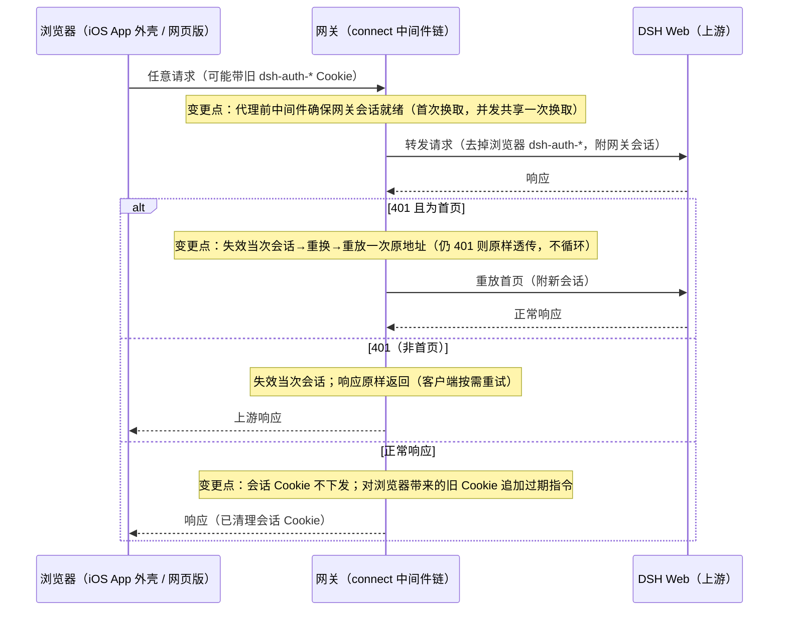
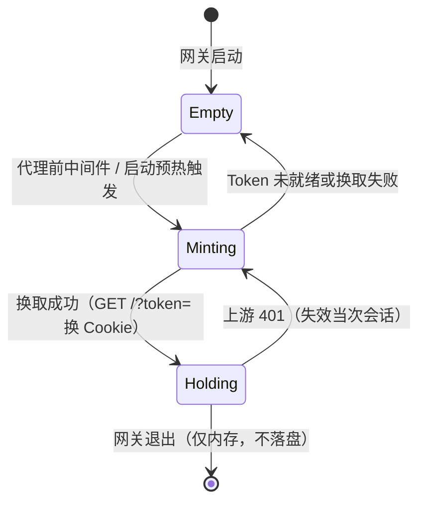
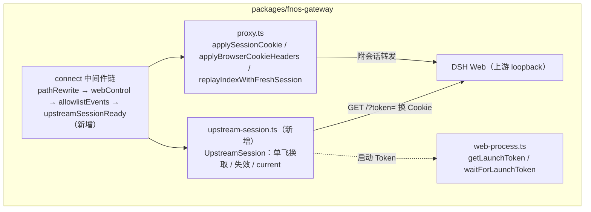

# PLAN-FNOS-030 飞牛 iOS App 打开 DSH 空白修复

| 字段 | 内容 |
| --- | --- |
| 计划编号 | PLAN-FNOS-030 |
| 计划日期 | 2026-10-26 |
| 对应需求 | [FNOS-030 飞牛 iOS App 打开 DSH 空白修复](/requirements/FNOS-030-app-shell-blank-page) |
| 计划状态 | 已完成（阶段一至四全部完成） |

## 计划目标

实现 [FNOS-030](/requirements/FNOS-030-app-shell-blank-page) 的三项功能：网关服务端持有 DSH 会话（FNOS-030-01、FNOS-030-03）、网页版行为与旧 Cookie 清理保持（FNOS-030-02）。技术基线采用外部贡献者 fork 提交 `jiaaom@9b0b27e` 中的网关会话部分，剥离其 i18n 改造后按本仓库规范合入。

技术边界：只改 `packages/fnos-gateway`；不改 DSH 核心、插件、manifest 与向导。

## 当前实现与目标设计

### 会话承担方

| 领域 | 当前实现 | 目标实现 | 迁移影响 |
| --- | --- | --- | --- |
| 会话持有 | 浏览器持有 `dsh-auth-*` Cookie；网关按「无 Cookie 首页注入启动 Token、其余请求带浏览器 Cookie」工作 | 网关启动后用启动 Token 换取一次会话，存进程内存，替每个上游 HTTP 与 WebSocket 请求附带；浏览器不再收到会话 Cookie | 跨站外壳（iOS App）不再依赖浏览器 Cookie，白屏消除；网页版用户无感 |
| 首页 Token 注入 | 无 Cookie 的首页请求在代理层拼 `?token=`（WebSocker 升级处同规则），401 首页时重放一次带 Token 的首页 | 注入逻辑整体移除；改为会话 401 时丢弃旧会话、重换新会话并重放一次原地址 | `needsLaunchToken`、`needsUpgradeLaunchToken`、`withLaunchToken` 及配套测试删除 |
| 会话失效恢复 | 401 首页 → 服务端重放带 Token 首页让浏览器重新拿 Cookie | 401 → 失效当次会话 → 换新会话 → 重放一次原地址；仍 401 则把响应原样交给浏览器，不循环 | 恢复路径由「重取浏览器 Cookie」变为「网关自取新会话」 |
| 浏览器 Cookie | DSH 下发的 `dsh-auth-*` 原样透传给浏览器 | 会话 Cookie 不再下发浏览器；浏览器带来的旧会话 Cookie 附上过期指令清理（根路径与旧版挂载路径各一条）；非 `dsh-auth-*` Cookie 原样保留 | 旧版本浏览器残留 Cookie 自动清理；旧版挂载路径 Cookie 一并清理 |
| WebSocket 升级 | 同步路径，按「无 Cookie 则注入 Token」处理（该处注入对升级实为死代码） | 升级附带网关当前会话；会话未就绪时升级被上游 401 拒绝，客户端自动重连后成功（DSH Web 客户端有重连机制） | 依赖启动预热把会话备好，缩小首次升级失败窗口 |
| 未托管模式 | `webProcess === undefined`（外部启动的 DSH）时浏览器 Cookie 原样透传 | 保持：非托管模式不做任何会话改写，行为与当前一致 | 外部启动形态零影响 |

### 交互重编排

### 会话生命周期

文字说明：会话只在 `Holding` 状态被附带；`Minting` 期间到达的请求以无会话形态转发，由上游 401 触发恢复路径；并发换取共享同一次换取（单飞），失败不缓存失败结果。

## 影响范围分析

| 需求功能 | 代码模块 | 配置/数据 | 测试 | 文档 | 目标环境 |
| --- | --- | --- | --- | --- | --- |
| FNOS-030-01 | `packages/fnos-gateway/src/server/proxy.ts`、`src/server/gateway-server.ts`、`src/cli.ts` | 无新增配置 | `tests/server.spec.ts`、`tests/websocket-upgrade.spec.ts`、`tests/proxy-forwarding.spec.ts`（回归） | 不涉及 | 真实 fnOS NAS（iOS App） |
| FNOS-030-01（新增会话模块） | `src/server/upstream-session.ts`（新增） | 无持久化（内存） | `tests/upstream-session.spec.ts`（新增） | 不涉及 | 包级测试 |
| FNOS-030-02 | `src/server/proxy.ts`（Cookie 清理）、`src/server/recovery-page.ts` 仅版本参数适配 | 无 | `tests/response-headers.spec.ts` | 不涉及 | DSH Web（浏览器）＋ 真实 fnOS NAS（升级路径） |
| FNOS-030-03 | `src/server/gateway-server.ts`（预热）、`src/types/gateway.ts` | 无 | `tests/server.spec.ts`（访问控制断言保留） | 不涉及 | 真实 fnOS NAS ＋ 包级测试 |

不涉及：`apps/fn-deepseek-harness`（manifest、向导、i18n 均不动）、`plugins/*`、DSH 核心。

## 架构与数据流

文字说明：新增 `UpstreamSession` 由 `createGateway` 创建并注入代理处理器；启动 Token 仍由 Web 进程控制器提供，但只用于网关换取会话，不再拼进任何转发请求的 URL。

## 分阶段任务

### 阶段一：网关会话模块与代理改造

| 任务 ID | 对应需求/验收 | 修改内容 | 前置条件 | 验证方式 |
| --- | --- | --- | --- | --- |
| PLAN-FNOS-030-T01-01 | FNOS-030-01 / AC-02、FNOS-030-03 / AC-03 | 新增 `src/server/upstream-session.ts`：`UpstreamSession`（单飞换取、失效比较、`current`）、Cookie 工具函数（剔除/附加/枚举浏览器 `dsh-auth-*`）；换取请求补超时（fork 原实现无超时，上游挂起会拖住首个请求，本仓库实施时补上） | 无 | 包级单测（T01-04） |
| PLAN-FNOS-030-T01-02 | FNOS-030-01 / AC-02、FNOS-030-02 / AC-02 | 改造 `proxy.ts`：删除 `needsLaunchToken` / `needsUpgradeLaunchToken` / `withLaunchToken` 与首页 Token 重放，改为 `applySessionCookie`（托管模式剔除浏览器会话 Cookie、附网关会话；未托管模式原样透传）、`applyBrowserCookieHeaders`（会话 Cookie 不下发 + 旧 Cookie 过期清理，覆盖根路径与旧版挂载路径）、401 时失效换新并重放一次（仅首页重放；`sessionUsed` WeakMap 记录每请求所用会话） | T01-01 | 包级单测（T01-04） |
| PLAN-FNOS-030-T01-03 | FNOS-030-01 / AC-03、FNOS-030-03 / AC-03 | 改造 `gateway-server.ts` 与 `cli.ts`：新增 `upstreamSessionReady` 中间件（代理前确保会话就绪，失败照常转发由 401 恢复）、`createGateway` 返回 `warmSession`、Web 进程启动/重启成功后预热；`types/gateway.ts` 的 `GatewayServer` 补 `warmSession` | T01-01 | 包级单测（T01-04） |
| PLAN-FNOS-030-T01-04 | FNOS-030-01、FNOS-030-02、FNOS-030-03 | 测试：新增 `tests/upstream-session.spec.ts`（单飞、失效比较、Cookie 剔除/附加/枚举、换取失败不缓存）；更新 `server.spec.ts`（首页不再注入 Token、401 换新重放、Cookie 不下发与清理）、`websocket-upgrade.spec.ts`（升级附会话）、`response-headers.spec.ts`（会话 Cookie 清理断言） | T01-01 至 T01-03 | `pnpm --filter @tnnevol/fnos-gateway run check` 与既有测试全绿；删除逻辑对应的旧测试同步删除 |

### 阶段二：包级验证与回归

| 任务 ID | 对应需求/验收 | 修改内容 | 前置条件 | 验证方式 |
| --- | --- | --- | --- | --- |
| PLAN-FNOS-030-T02-01 | FNOS-030-01 / AC-02 | fork 测试资产移植核对：以 fork `9b0b27e` 的 `upstream-session.spec.ts`（289 行）与 `server.spec.ts` / `websocket-upgrade.spec.ts` / `response-headers.spec.ts` 改动为参考逐条比对，补齐本仓库实现遗漏的断言 | T01-04 | 测试清单比对记录；全量测试通过 |
| PLAN-FNOS-030-T02-02 | FNOS-030-02 / AC-01 | 回归确认非托管模式与外部启动形态行为不变：`webProcess === undefined` 时浏览器 Cookie 原样透传、无会话改写 | T02-01 | 包级测试中保留并显式断言该分支 |
| PLAN-FNOS-030-T02-03 | 全部 | 包级构建与网关产物：`check` + `build` 通过，网关打包产物包含新模块 | T02-01、T02-02 | 构建产物核对 |

### 阶段三：FPK 构建与真实 NAS 验收

| 任务 ID | 对应需求/验收 | 修改内容 | 前置条件 | 验证方式 |
| --- | --- | --- | --- | --- |
| PLAN-FNOS-030-T03-01 | FNOS-030-01 / AC-01 至 AC-03 | 构建 FPK 并在真实 fnOS NAS 应用中心正常安装升级（禁止 SSH 改测试机）；iOS App 实机打开 DSH 验证页面加载、对话、WebSocket 连接与无循环首页请求 | T02-03 | 真实 NAS iOS App 验收记录（回填 `docs/validation/`），AC-01 至 AC-03 逐条核对 |
| PLAN-FNOS-030-T03-02 | FNOS-030-02 / AC-01、AC-02 | 真实 NAS 网页版验收：浏览器正常加载与对话；从修复前版本升级后旧 Cookie 自动清理、无残留影响 | T03-01 | 真实 NAS 验收记录，AC 逐条核对 |
| PLAN-FNOS-030-T03-03 | FNOS-030-03 / AC-01 至 AC-03 | 访问控制与会话生命周期验收：未登录请求被拒、非管理员控制操作被拒、DSH 跨站拒绝照常生效；网关重启后自动重新换取会话；核对会话不落盘 | T03-01 | 真实 NAS 验收记录 + 包级测试证据 |

### 阶段四：文档收尾与版本

| 任务 ID | 对应需求/验收 | 修改内容 | 前置条件 | 验证方式 |
| --- | --- | --- | --- | --- |
| PLAN-FNOS-030-T04-01 | 全部 | 建立测试用例文档 `docs/tests/FNOS-030-app-shell-blank-page.md` 并回填写例结论；`docs/validation/` 登记真机验收证据 | T03-01 至 T03-03 | `pnpm run check -- --sdd` 通过；文档构建通过 |
| PLAN-FNOS-030-T04-02 | 全部 | 需求与计划状态回写（功能状态、计划状态、变更记录） | T04-01 | 两个 index 页与需求/计划文档状态一致 |
| PLAN-FNOS-030-T04-03 | 全部 | 版本更新：`pnpm run version` 独立提交（先功能改动提交，再版本提交） | T04-02 | 版本串一致，tag 仅留本地 |

## 交互和行为设计

本需求无新增用户界面；用户可见行为只有 FNOS-030-01/02 的可观察结果（iOS App 与网页版正常打开）。网关内部交互已在「当前实现与目标设计」的时序图与状态图表达，不重复展开。

## 数据、权限和错误处理

- **数据**：网关会话只存进程内存，不落盘、不写配置；重启丢失属预期，由启动预热与按需重换覆盖。
- **权限**：网关仍只监听 Unix socket，唯一流量来源是 fnOS 层完成登录/管理员校验后的转发；会话由网关代持不改变到达面（评估结论，见需求调研结论）。
- **错误处理**：
  - 换取失败（Token 未就绪、上游不可达、超时）：不缓存失败结果，后续请求按需重试；首个请求可能以无会话形态被上游 401，恢复路径接手。
  - 上游 401：失效当次会话；首页重放一次（仍 401 原样透传，不循环）；非首页原样返回响应。
  - 上游不可达：沿用既有 Bad Gateway / 恢复页路径（恢复页本轮不改文案）。

## 依赖、风险和决策

| 类型 | 内容 | 备用方案 / 说明 |
| --- | --- | --- |
| 依赖 | DSH「`GET /?token=` 换会话 Cookie、Host 绑定 loopback 权威」契约（rc.3 下已核实不变） | 契约变化时仅 `upstream-session.ts` 的换取逻辑需调整，代理层不受影响 |
| 依赖 | DSH Web 客户端 WebSocket 断线自动重连（已观察到首次升级 401 后重连成功的行为） | 重连不成立时改为升级前强制会话就绪（增加升级路径等待），已登记为备用 |
| 决策 | 采用 fork `9b0b27e` 的网关会话实现为基线，剥离 i18n；不重写方案 | 该实现经真实 NAS 验证、配套测试完备、与本仓库网关基线仅差版本号 1 行 |
| 决策 | 会话换取补超时（fork 原实现无） | 避免上游挂起拖住首个请求；超时阈值在实现时与既有网关超时配置对齐 |
| 风险 | iOS App 各版本 WebView 表现差异（#21 空白 / #25 报错文案） | 根因同链路，验收覆盖 iOS App 实机；fork 已在真实 NAS 验证过两种表现消失 |
| 风险 | 会话失效瞬间的并发请求可能个别收到 401 响应 | 客户端按需重试；与当前浏览器 Cookie 失效时的表现同级 |
| 回滚 | 网关代码回退到修复前提交即可，无数据迁移；旧版本网关的浏览器 Cookie 模式自动恢复 | 无禁止删除的数据（会话不落盘） |

## 测试、打包、发布和回滚

- **包级**：`pnpm --filter @tnnevol/fnos-gateway run check`（typecheck + 单测）与 `build`；重点覆盖会话单飞、失效、Cookie 清理、未托管透传、WS 升级附会话。
- **应用级（FPK）**：构建 FPK，应用中心正常安装升级，确认网关进程启动、预热日志正常。
- **真实 NAS**：iOS App 打开与对话（FNOS-030-01）、网页版回归与升级 Cookie 清理（FNOS-030-02）、访问控制与重启重换（FNOS-030-03）；证据回填 `docs/validation/`。禁止通过 SSH 改动测试设备。
- **文档**：`pnpm run check -- --sdd` 与文档站构建。
- **回滚**：应用中心回装修复前 FPK 即可；无数据兼容负担。

## 参考资料

- GitHub issue #21（含根因抓包、fork 提交链接、评估与合并记录）：https://github.com/FNOSP/fnos-dsh/issues/21
- 贡献者 fork 提交：`jiaaom/fnos-dsh-fork` `9b0b27e`（本地对象库已存在，可 `git show` 引用）
- 本仓库网关基线核查记录（2026-10-26 会话）：fork 基线与 main 在 `packages/fnos-gateway` 仅差版本号 1 行；「token 换 Cookie」契约在 main 重放路径与测试中成立

## 完成状态

| 阶段 | 状态 |
| --- | --- |
| 阶段一：网关会话模块与代理改造 | 已完成（T01-01 至 T01-04） |
| 阶段二：包级验证与回归 | 已完成（T02-01 至 T02-03；132 条用例全绿、build 与 lint 通过） |
| 阶段三：FPK 构建与真实 NAS 验收 | 已完成（v6.0.1 真机装成并验证） |
| 阶段四：文档收尾与版本 | 已完成（测试用例回填、状态回写、`chore: release v6.0.1`） |

## 变更记录

| 日期 | 变更 | 说明 |
| --- | --- | --- |
| 2026-10-26 | 建立计划 | 依据 FNOS-030 与评估结论建立四阶段 12 任务；采纳 fork `9b0b27e` 网关会话部分，剥离 i18n；登记换取超时补充与 WS 重连备用方案两项本仓库实施差异 |
| 2026-10-26 | 阶段三、四完成 | 构建并安装 v6.0.1 到真实 NAS：应用中心详情页 6.0.1 / 手动安装；网关产物含 `UpstreamSession`/`withSessionCookie`/`warmSession`，旧 `needsLaunchToken` 为 0；页面首页 1 次请求即 200、无 `token=`；浏览器无 `dsh-auth-*`；日志 `upgrade_callback completed` 后正常启动。版本提交 `chore: release v6.0.1`；安装自动化经验沉淀为 `dsh.uploadFile` 节点与 `FNOS-013-nas-install-from-computer.yaml` 用例 |
| 2026-10-26 | 阶段一、二完成 | 新增 `upstream-session.ts`（含 10 秒换取超时）、改造代理与网关装配、移植并改造 4 个测试文件；包级 23 个测试文件 132 条用例全绿，build 与 lint 通过。fork 的 `upstream-session.spec.ts` 8 条用例按本仓库实现核对后采纳（编号改为 FNOS-030），`server.spec.ts` 与 `websocket-upgrade.spec.ts` 的旧 Token 注入断言按新语义改写，`recovery-page.spec.ts` 与 i18n 相关文件未取用 |
