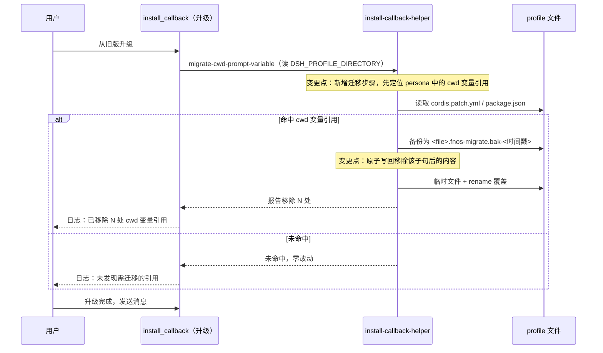
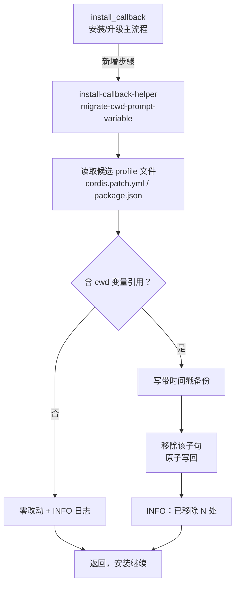

# PLAN-FNOS-031 升级迁移 cwd 提示词变量引用

| 字段 | 内容 |
| --- | --- |
| 计划编号 | PLAN-FNOS-031 |
| 计划日期 | 2026-10-26 |
| 对应需求 | [FNOS-031 升级迁移 cwd 提示词变量引用](/requirements/FNOS-031-cwd-prompt-variable-migration) |
| 计划状态 | 阶段一、二完成，待真机验收 |

## 计划目标

实现 [FNOS-031](/requirements/FNOS-031-cwd-prompt-variable-migration) 的两项功能：升级后可直接发消息（FNOS-031-01）、迁移过程可见且可回溯（FNOS-031-02）。

技术边界：只改 `apps/fn-deepseek-harness/cmd/install_callback` 与其 helper（`app/scripts/install-callback-helper.mjs` 的源）；不改 DSH 上游、不改插件、不改 profile 格式定义。

## 当前实现与目标设计

| 领域 | 当前实现 | 目标实现 | 迁移影响 |
| --- | --- | --- | --- |
| profile 的 persona 引用 | 升级过程完全不触碰；含 cwd 变量引用的 profile 升级后发消息静默失败 | 升级回调扫描 persona 字段，移除该引用后原子写回 | 旧 profile 自动修复；新装无变化 |
| 改写安全性 | 无相关机制 | 改写前写带时间戳备份，内容等于原文；原子写（临时文件 + rename） | 可回溯；写失败不留半个文件 |
| 可观测性 | 无 | 日志记录移除数量；未命中时零改动 | 用户与支持者可据此确认迁移是否发生 |
| 失败处理 | — | 迁移异常只记日志，不阻塞安装 | 升级成功率不受影响 |

### 交互重编排

## 影响范围分析

| 需求功能 | 代码模块 | 配置/数据 | 测试 | 文档 | 目标环境 |
| --- | --- | --- | --- | --- | --- |
| FNOS-031-01 | `cmd/install_callback`（新增迁移调用）、`app/scripts/install-callback-helper.mjs`（新增命令）、对应源 `src/install-callback-helper/cwd-migration.ts` | 用户 profile：`profiles/web/cordis.patch.yml`、`profiles/web/package.json` 的 persona 字段 | helper 单测（命中/未命中/幂等/失败不阻塞） | 需求、计划、测试用例 | 真实 fnOS NAS（升级路径） |
| FNOS-031-02 | 同上（备份与日志） | 备份文件 `<file>.fnos-migrate.bak-<时间戳>` | 备份内容比对、重复执行不新增备份 | 同上 | 包级测试 ＋ 真实 fnOS NAS |

不涉及：`packages/fnos-gateway` 的网关代理逻辑、插件源码、DSH 上游、`apps/fn-deepseek-harness/manifest` 之外的产物结构。

## 架构与数据流

文字说明：迁移是**独立、可失败、不影响主流程**的步骤；helper 走既有 CLI 子命令模式（与 `patch-attachment-local` 并列），便于单测与人工复跑。

## 分阶段任务

### 阶段一：迁移实现

| 任务 ID | 对应需求/验收 | 修改内容 | 前置条件 | 验证方式 |
| --- | --- | --- | --- | --- |
| PLAN-FNOS-031-T01-01 | FNOS-031-01 / AC-03；FNOS-031-02 / AC-01、AC-02 | 新增 `src/install-callback-helper/cwd-migration.ts`：定位 persona 相关字段中的 cwd 引用，按「移除含该变量的子句、保留其余文本」改写；改写前写 `<file>.fnos-migrate.bak-<时间戳>`，用原子写覆盖；返回处理条数与是否改动 | 无 | helper 单测 |
| PLAN-FNOS-031-T01-02 | FNOS-031-02 / AC-03 | 幂等：无引用时零改动、不写备份、不改 mtime；已迁移过的文件重复执行保持字节一致 | T01-01 | 单测断言二次执行内容与文件列表不变 |
| PLAN-FNOS-031-T01-03 | FNOS-031-01 / AC-02 | helper 新增 CLI 子命令 `migrate-cwd-prompt-variable`，从 `DSH_PROFILE_DIRECTORY` 取 profile 目录，输出处理摘要供 shell 侧记日志 | T01-01 | 单测 + 手工执行 |
| PLAN-FNOS-031-T01-04 | FNOS-031-01 / AC-01、AC-02 | `cmd/install_callback` 在既有 `patch-attachment-local` 之后调用迁移，失败只记 `log_info` 不 `fail_install`；成功时记 INFO | T01-03 | shell 侧走查 + 真机验证 |

### 阶段二：包级验证

| 任务 ID | 对应需求/验收 | 修改内容 | 前置条件 | 验证方式 |
| --- | --- | --- | --- | --- |
| PLAN-FNOS-031-T02-01 | 全部 | helper 单测覆盖：命中改写、未命中零改动、幂等、备份内容、写入失败不阻塞、非 UTF-8/异常文件不崩 | T01-01 至 T01-04 | 对应包 `check` 全绿 |
| PLAN-FNOS-031-T02-02 | FNOS-031-01 / AC-03 | 断言改写后其余 persona 文本逐字不变（含多行、含其它提示词变量引用） | T02-01 | 单测快照比对 |

### 阶段三：真机验收

| 任务 ID | 对应需求/验收 | 修改内容 | 前置条件 | 验证方式 |
| --- | --- | --- | --- | --- |
| PLAN-FNOS-031-T03-01 | FNOS-031-01 / AC-01、AC-02 | 在真实 NAS 构造含 cwd 变量引用的 profile（先复现「发消息无响应」），再升级到新构建，验证可直接发消息且日志有迁移记录 | T02-02 | 真机验收记录，回填 `docs/validation/` |
| PLAN-FNOS-031-T03-02 | FNOS-031-02 / AC-01、AC-02、AC-03 | 真机核对备份文件内容、未命中 profile 零改动、重复执行不新增备份 | T03-01 | 真机验收记录 |

### 阶段四：文档与版本

| 任务 ID | 对应需求/验收 | 修改内容 | 前置条件 | 验证方式 |
| --- | --- | --- | --- | --- |
| PLAN-FNOS-031-T04-01 | 全部 | 建立测试用例文档 `docs/tests/FNOS-031-cwd-prompt-variable-migration.md` 并回填结果 | T03-01、T03-02 | `pnpm run check -- --sdd` 与文档构建通过 |
| PLAN-FNOS-031-T04-02 | 全部 | 状态回写（需求/计划/两个索引） | T04-01 | 索引与文档状态一致 |
| PLAN-FNOS-031-T04-03 | 全部 | `pnpm run version -- patch` 独立提交 | T04-02 | 版本串一致，tag 只留本地（按 FNOS-030 教训：**一次只推一个 tag**） |

## 交互和行为设计

本需求无新增界面。用户可观察的行为只有两条：升级后能发消息（FNOS-031-01）、日志有迁移记录且可回溯（FNOS-031-02）。

改写规则（实现依据，来自上游 README 的官方口径「Remove the clause, preserving unrelated text」）：

- 命中 cwd 变量的**子句**整体移除，而不是只删变量名——否则会留下 `Your working directory is .` 这类残句
- 只切除句子本体，**保护 YAML 结构前缀与包裹引号**：行首的 `<key>:` 与成对引号属于容器结构，误删会让 profile 变成非法 YAML（实现中的回归用例覆盖该缺陷）
- 删除后若该字段变为空串，按上游指引清空该字段而非写入空壳
- 不解释、不重写其它提示词变量引用（即使它们也失效，也留给后续需求）

## 数据、权限和错误处理

- **权限**：profile 位于 `TRIM_PKGHOME` 下，属应用自有数据目录，应用用户可以读写；不触碰 `TRIM_APPDEST`、`TRIM_PKGVAR` 等框架目录（符合 fnnas-docs 的目录边界要求）。
- **数据**：改写前备份原文件；备份只增不改，不自动清理，避免误删用户可回溯依据。
- **错误处理**：
  - 文件不存在 → 视为未命中，零改动
  - 文件不可读 / 写入失败 → 记录告警，保持原文件不变，**不阻塞安装**
  - 解析不出 persona 结构 → 记录告警并跳过，不做猜测式改写
  - 同一文件已含备份且内容未变 → 不重复写备份

## 依赖、风险和决策

| 类型 | 内容 | 替代方案 / 说明 |
| --- | --- | --- |
| 依赖 | 上游 README 明确的迁移口径（移除子句、working-directory 服务承接上下文） | 若上游改为提供兼容开关，可退化为「只告警」 |
| 决策 | 采用**自动改写**而非仅告警 | 只告警无法让用户恢复可用；用户报告的症状正是「发消息无响应」 |
| 决策 | **不加**向导确认 | 减少升级打断；用备份 + 日志兜底 |
| 决策 | 只处理 cwd 变量 | 有上游明确指引；其它变量缺乏权威口径，不猜测处理 |
| 风险 | 改写误伤用户自定义文本 | 只匹配逐字引用且整句移除；保留备份；包级用例断言其余文本逐字不变 |
| 风险 | 用户 profile 布局与预期不同（自定义 patch 结构） | 解析失败即跳过并告警，绝不猜测式改写 |
| 风险 | `package.json` 走结构化解析后重新序列化 | 以 2 空格缩进写回，与 pnpm 生成的 profile manifest 一致；仅命中时写回，未命中零改动 |
| 回滚 | 从备份文件恢复即可；迁移不改其它文件 | 无需数据迁移 |

## 测试、打包、发布和回滚

- **包级**：helper 的 `check`（含 typecheck 与单测）；覆盖命中、未命中、幂等、备份、失败不阻塞、异常文件。
- **FPK**：构建并走应用中心正常安装/升级。
- **真实 NAS**：先在真机复现「发消息无响应」，再升级验证恢复；证据回填 `docs/validation/`。禁止通过 SSH 改动测试设备做验证——构造 profile 需走应用自身能力或应用中心安装路径。
- **文档**：`pnpm run check -- --sdd` 与文档站构建。
- **回滚**：恢复 `<file>.fnos-migrate.bak-<时间戳>` 即可；迁移不删除任何用户数据。

## 参考资料

- GitHub Discussion #15（用户报告与实测）：https://github.com/FNOSP/fnos-dsh/discussions/15
- 上游迁移指引：`packages/core/system-prompt/README.md:78`（移除该子句，working-directory 服务提供上下文）
- 上游报错实现：`packages/core/system-prompt/src/index.ts:367`
- 上游断言：`packages/core/agent-loop/tests/loop.spec.ts`（`variables` 不含 `cwd`）、`packages/core/system-prompt/tests/system-prompt.spec.ts:211`（`unknown prompt variable`）

## 完成状态

| 阶段 | 状态 |
| --- | --- |
| 阶段一：迁移实现 | 已完成 |
| 阶段二：包级验证 | 已完成 |
| 阶段三：真机验收 | 待执行 |
| 阶段四：文档与版本 | 进行中（测试用例文档已建立，版本待真机后发布） |

## 变更记录

| 日期 | 变更 | 说明 |
| --- | --- | --- |
| 2026-10-26 | 建立计划 | 依据 FNOS-031 建立四阶段 12 任务；确定自动改写、不加确认、只处理 cwd；失败不阻塞安装 |
| 2026-10-26 | 回填阶段一、二 | 记录实际落地的模块、CLI 名称与 `DSH_PROFILE_DIRECTORY` 取参方式；补充 YAML 结构保护与 `package.json` 序列化风险 |
