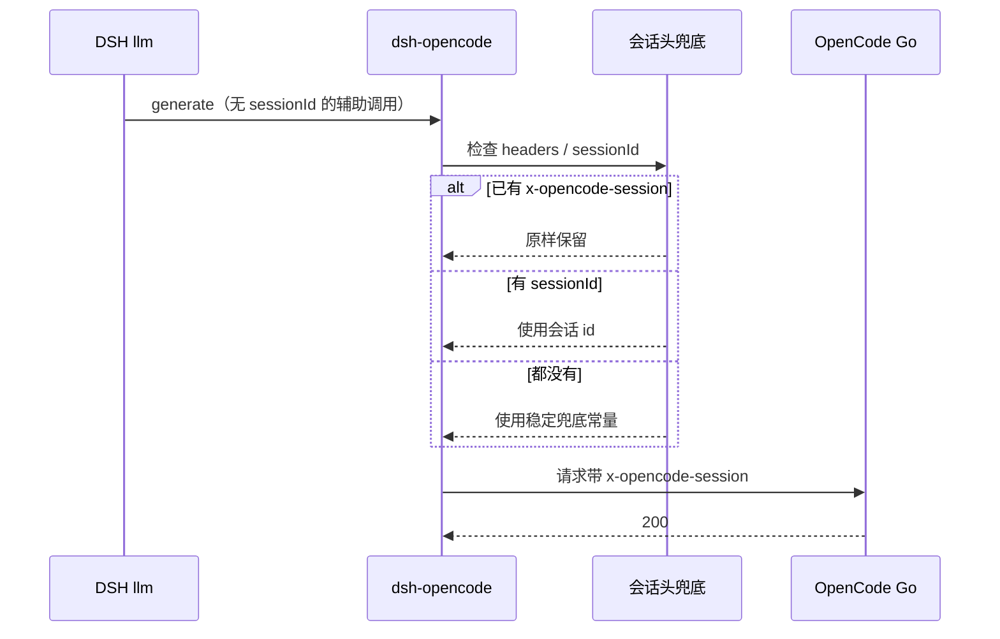

# PLAN-FNOS-032 OpenCode 辅助调用补齐会话头

| 字段 | 内容 |
| --- | --- |
| 计划编号 | PLAN-FNOS-032 |
| 计划日期 | 2026-10-26 |
| 对应需求 | [FNOS-032 OpenCode 辅助调用补齐会话头](/requirements/FNOS-032-opencode-aux-session-header) |
| 计划状态 | 阶段一、二完成，待真实会话验证 |

## 计划目标

实现 [FNOS-032](/requirements/FNOS-032-opencode-aux-session-header) 的两项功能：辅助调用不再因缺会话头中断（FNOS-032-01）、主对话会话头语义不变（FNOS-032-02）。

技术边界：只改 `plugins/dsh-opencode-plugin/src/host/provider.ts` 与其测试；不改 DSH 上游、不改自动审查插件、不改插件配置面。

## 当前实现与目标设计

| 领域 | 当前实现 | 目标实现 | 迁移影响 |
| --- | --- | --- | --- |
| 会话头注入 | pi-ai 的 `withOpenCodeSessionHeader` 仅在 `options.sessionId` 存在时注入 | 在四个协议族外再包一层兜底：无会话身份时补稳定常量 | 辅助调用不再 400；主对话仍用真实 id |
| 兜底值稳定性 | 无 | 导出常量 `OPENCODE_FALLBACK_SESSION_ID`，固定字符串 | 上游按会话路由/缓存语义不被随机值破坏 |
| 显式头 | 调用方已设置时不重复注入 | 大小写不敏感检测，已存在则不覆盖 | 保持调用方控制权 |
| 可观测性 | 无专项日志 | 依托上游错误可读性；不新增日志面 | 无新增噪声 |

### 交互重编排

## 分阶段任务

### 阶段一：实现

| 任务 | 关联验收 | 内容 | 依赖 | 验证 |
| --- | --- | --- | --- | --- |
| PLAN-FNOS-032-T01-01 | FNOS-032-01 / AC-01；FNOS-032-02 / AC-01、AC-02 | `provider.ts` 增加会话头常量与纯函数：大小写不敏感检测、`sessionId` 优先、缺失/空串用兜底值、已有头不覆盖 | 无 | 单测 |
| PLAN-FNOS-032-T01-02 | FNOS-032-02 / AC-03 | 四个协议族（openai-completions / openai-responses / anthropic-messages / google-generative-ai）统一包上兜底；保持 `withWireModelId` 与 pi-ai 现有注入顺序 | T01-01 | 单测 + 代码走查 |

### 阶段二：包级验证

| 任务 | 关联验收 | 内容 | 依赖 | 验证 |
| --- | --- | --- | --- | --- |
| PLAN-FNOS-032-T02-01 | 全部 | 单测覆盖：无 sessionId、有 sessionId、空串、已有头（大小写）、`streamSimple` 路径、原 options 不被修改 | T01-01、T01-02 | 对应包 `check` 全绿 |
| PLAN-FNOS-032-T02-02 | FNOS-032-02 / AC-04 | 跑插件既有全部测试，确认主对话/目录/用量等行为无回归 | T02-01 | 包级 `check` 全绿 |

### 阶段三：真实会话验证

| 任务 | 关联验收 | 内容 | 依赖 | 验证 |
| --- | --- | --- | --- | --- |
| PLAN-FNOS-032-T03-01 | FNOS-032-01 / AC-02 | 在 DSH Web 用 Auto 权限预设 + OpenCode 模型触发一次工具调用，确认不再出现 `MissingSessionID` | T02-02 | 会话事件/界面记录回填测试文档 |

### 阶段四：文档与版本

| 任务 | 关联验收 | 内容 | 依赖 | 验证 |
| --- | --- | --- | --- | --- |
| PLAN-FNOS-032-T04-01 | 全部 | 建立测试用例文档 `docs/tests/FNOS-032-opencode-aux-session-header.md` 并回填结果 | T03-01 | `pnpm run check -- --sdd` 与文档构建通过 |
| PLAN-FNOS-032-T04-02 | 全部 | 状态回写（需求/计划/三个索引与 sidebar）；版本按 fix 推进（待确认后执行） | T04-01 | 版本串一致；tag 只留本地 |

## 风险与回滚

| 风险 | 影响 | 缓解 |
| --- | --- | --- |
| 兜底值被所有无会话调用共用 | 上游按会话缓存/路由收益下降 | 仅用于无会话身份的辅助调用；普通对话仍用真实 id。若上游后续补 `sessionId`，本兜底自动不再生效 |
| 已有显式头被覆盖 | 调用方定制失效 | 大小写不敏感检测，存在即跳过 |
| 误把会话头用于其它供应商 | 请求带多余头 | 仅包在 `dsh-opencode` 的四个协议族内，不影响其它路由 |
| 上游 pi-ai 升级改变头名或注入逻辑 | 兜底失效 | 单测钉住行为；升级时 `check` 会暴露 |

回滚：删除 `ensureOpenCodeSessionHeader` 与四行包装即可恢复原行为，无数据迁移负担。

## 任务状态

| 阶段 | 状态 |
| --- | --- |
| 阶段一：实现 | 已完成 |
| 阶段二：包级验证 | 已完成（插件 207 条测试全绿） |
| 阶段三：真实会话验证 | 待执行 |
| 阶段四：文档与版本 | 待执行 |

## 变更记录

| 日期 | 变更 | 说明 |
| --- | --- | --- |
| 2026-10-26 | 建立计划 | 依据 FNOS-032 建立四阶段任务；确定只改插件、固定兜底常量、不覆盖显式头 |
