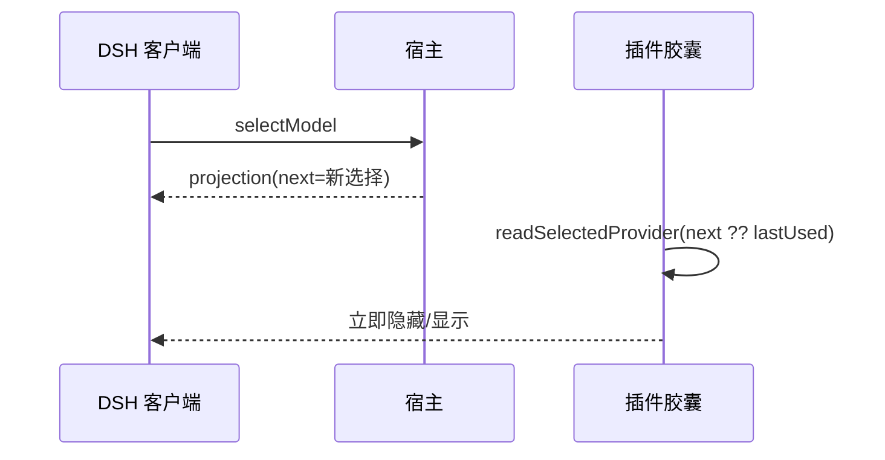

# PLAN-FNOS-033 用量胶囊按当前选择即时显隐

| 字段 | 内容 |
| --- | --- |
| 计划编号 | PLAN-FNOS-033 |
| 计划日期 | 2026-10-26 |
| 对应需求 | [FNOS-033 用量胶囊按当前选择即时显隐](/requirements/FNOS-033-usage-capsule-selection) |
| 计划状态 | 已完成（包级） |

## 计划目标

实现 [FNOS-033](/requirements/FNOS-033-usage-capsule-selection)：OpenCode 胶囊改为按 `next` 判定（FNOS-033-01），ZCode 补同类回归（FNOS-033-02）。

技术边界：只改客户端显隐判定与测试，不改 host、投影契约与用量数据请求。

## 当前实现与目标设计

| 领域 | 当前实现 | 目标实现 | 迁移影响 |
| --- | --- | --- | --- |
| OpenCode 选择来源 | `projection.pending ?? projection.lastUsed`；`pending` 不在 wire view，永远退回 `lastUsed` | `projection.next ?? projection.lastUsed` | 切走立即隐藏，切回立即显示 |
| ZCode 选择来源 | 已是 `next ?? lastUsed`，但无显隐测试 | 补回归用例钉住 | 行为不变，防回归 |
| 其它插件 | Codex Auth / CodeBuddy 已是 `next` | 不动 | 无 |

### 交互重编排

## 分阶段任务

### 阶段一：实现

| 任务 | 关联验收 | 内容 | 依赖 | 验证 |
| --- | --- | --- | --- | --- |
| PLAN-FNOS-033-T01-01 | FNOS-033-01 / AC-01、AC-02 | `usage-visibility.ts` 类型与两处读取改为 `next`，补注释说明 `pending` 不下发 | 无 | 单测 |
| PLAN-FNOS-033-T01-02 | FNOS-033-02 / AC-01 | 新增 `tests/client/capsule-visibility.spec.ts`，覆盖 zcode 的 next 优先、切走隐藏、null 回退与策略 | 无 | 单测 |

### 阶段二：包级验证

| 任务 | 关联验收 | 内容 | 依赖 | 验证 |
| --- | --- | --- | --- | --- |
| PLAN-FNOS-033-T02-01 | 全部 | `@tnnevol/dsh-opencode` 与 `@tnnevol/dsh-zcode` 的 `check` 全绿 | T01-01、T01-02 | 包级 `check` |
| PLAN-FNOS-033-T02-02 | FNOS-033-02 / AC-02 | 全仓库确认用量显隐不再读 `projection.pending` | T01-01 | `grep` 走查 |

### 阶段三：文档与版本

| 任务 | 关联验收 | 内容 | 依赖 | 验证 |
| --- | --- | --- | --- | --- |
| PLAN-FNOS-033-T03-01 | 全部 | 建立测试用例文档并回填；更新索引与 sidebar | T02-01 | `pnpm run check -- --sdd`、文档构建 |
| PLAN-FNOS-033-T03-02 | 全部 | 更新 manifest changelog；版本推进到 6.0.6 | T03-01 | 版本串一致，tag 只留本地 |

## 风险与回滚

| 风险 | 影响 | 缓解 |
| --- | --- | --- |
| 误以为改字段会影响 DSH 投影 | 无需上游配合 | 只改客户端读取名；投影契约不变 |
| `next` 为 null 时误判 | 切回时短暂不显示 | `?? lastUsed` 兜底，单测覆盖 |
| 其它插件存在同类写法未发现 | 个别插件仍滞后 | 已全仓库 grep，只有 opencode 命中 |

回滚：将两处 `next` 改回原字段即可，无数据迁移。

## 任务状态

| 阶段 | 状态 |
| --- | --- |
| 阶段一：实现 | 已完成 |
| 阶段二：包级验证 | 已完成（opencode 208 条、zcode 169 条全绿） |
| 阶段三：文档与版本 | 进行中 |

## 变更记录

| 日期 | 变更 | 说明 |
| --- | --- | --- |
| 2026-10-26 | 建立计划 | 依据 FNOS-033 建立三阶段任务；确定只改客户端显隐与测试 |
