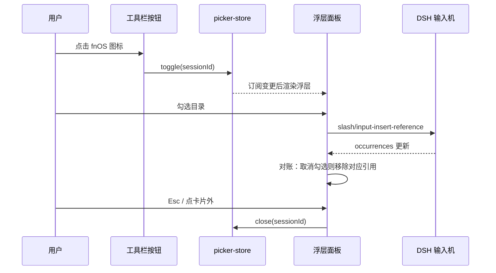

# PLAN-FNOS-034 fnOS 授权目录选择器改为输入卡片宽浮层

| 字段 | 内容 |
| --- | --- |
| 计划编号 | PLAN-FNOS-034 |
| 计划日期 | 2026-10-28 |
| 对应需求 | [FNOS-034 fnOS 授权目录选择器改为输入卡片宽浮层](/requirements/FNOS-034-fnos-input-dock-picker) |
| 计划状态 | 阶段一、二、四完成；阶段三（真实 NAS 验收）待执行 |

## 实施结果（2026-10-28）

| 项 | 结果 |
| --- | --- |
| 阶段一 实现 | 完成：新增 `picker-store.ts`、`picker-tree.ts`，面板改挂 `conversation.input.overlay`（`id: dsh-fnos-path-panel`、`order: 10`），按钮只翻转 store |
| 阶段二 包级验证 | 完成：`pnpm --filter @tnnevol/dsh-fnos run check` 35 文件 / 270 条全绿；`run build` 产出 `lib/client.js` 2.13 MB |
| 阶段三 真机验收 | **未执行**：需构建 FPK 后在真实 NAS 走应用中心安装。本地 DSH Web 不作为验收依据 |
| 阶段四 文档与版本 | 需求/计划/测试用例已回填，manifest 已更新，索引与 sidebar 已登记 |

::: warning 验收以 FPK 真机为准
`@tnnevol/dsh-fnos` 脱离 fnOS 宿主没有可提供的能力，按[本地 DSH Web](/development/local-dsh-web)的约定不进本地 profile。实现期间做过一次卡在临时 profile 上的前端几何自检（仅用于确认锚点与宽度算式成立，结果见下），**不计入验收**；浮层的实际呈现与交互一律以真实 NAS 上安装 FPK 后的表现为准。

实现了「位置相同」这件事的结构性依据是：面板 `offsetParent` 是上游输入卡片内的 `[data-composer-overlay]` 锚点，与斜杠指令面板同一个定位上下文；几何也只复用卡片宽度轴，不写像素常量。
:::

## 计划目标

实现 [FNOS-034](/requirements/FNOS-034-fnos-input-dock-picker)：把选择器从「锚在 28px 按钮上的 TreeSelect 下拉」改为 `conversation.input.overlay` 里的卡片宽浮层，交互与斜杠指令面板一致。

技术边界：只改 `plugins/dsh-fnos-plugin` 的客户端呈现层，不修改 DSH 上游、不改 Host 路由与授权目录契约。

## 调研依据

| 事实 | 出处 |
| --- | --- |
| 指令面板占用 `conversation.input.overlay`，`id: 'slash-menu'`、`order: 0` | 上游 `packages/client/ui-input-trigger/src/client/index.ts` |
| 锚点是卡片内零高定位上下文，宽度等于卡片 | 上游 `InputBar.tsx`（`overlayAnchor`）、`InputBar.module.css`（`inset: 0 0 auto; height: 0`） |
| 指令面板几何：`bottom: calc(100% + 4px); left: 0; right: 0; z-index: 100` | 上游 `MenuView.module.css` |
| 该槽现有条目：`slash-menu`(0)、`command-popup`(1)、`feedback-dialog`(2) | `cordis_inspect_query` 的 `Slots.listSubTree` 实测 |
| 槽在册 owner props 为空；标准 props 含 `useInput`、`inputActions`、`sessionId` | 同上（`ownerProps: []`） |
| 槽只在有会话时挂载 | 上游 `InputBar.tsx` 的 `sessionId !== undefined` |
| 卡片宽度轴来自 `--dsh-composer-card-max-width`，iframe 内为 `min(calc(100% - 16px), 952px)` | 上游 `ConversationRoot.module.css` 的 `.body` / `.embeddedBody` |
| Semi `Tree` 支持 `multiple`、`checkRelation="unRelated"`、`loadData` | `@douyinfe/semi-ui` 2.90.2 的 `TreeProps` |

## 当前实现与目标设计

| 领域 | 当前实现 | 目标实现 | 迁移影响 |
| --- | --- | --- | --- |
| 承载形式 | `TreeSelect` 下拉，弹层由 Semi 写内联 `top/left/transform` | 自有浮层面板 + `DshTree`，几何由 CSS 决定 | 不再依赖覆盖 Semi 内联样式 |
| 触发位置 | `conversation.input.left` 的 28px 图标按钮 | 按钮保留，但只切开关 store，不再承载弹层 | 用户点击路径不变 |
| 浮层位置 | 锚定按钮，`min(560px, 100vw - 32px)` 固定宽 | `conversation.input.overlay`，贴齐卡片、宽度自适应 | 与指令面板一致 |
| 选择语义 | 父子独立勾选、勾选即插入、取消即移除 | 原样复用（同一份 occurrence 对账逻辑） | 行为不变 |
| 关闭方式 | 点弹层外（Semi 行为） | 点卡片外 / Esc / 再点按钮 | 更明确 |
| 会话隔离 | `TreeSelect` 组件内部状态 | 会话键控的轻量 store | 不串数据 |

### 组件拆分

`FnosAuthorizedPathPicker.tsx` 现在是一个组件同时做三件事：TreeSelect 触发按钮、浮层内容、引用对账。拆成：

| 文件 | 职责 |
| --- | --- |
| `src/client/input-references/picker-store.ts` | 会话键控的开关 store（`useSyncExternalStore` 兼容），按钮与浮层共享 |
| `src/client/input-references/picker-tree.ts` | 纯函数：`AuthorizedEntry` → 树节点、`updateChildren`、`selectedPaths`，便于单测 |
| `src/components/FnosAuthorizedPathPicker.tsx` | 浮层面板本体：树、加载、勾选、引用插入与移除对账 |
| `src/components/FnosInputPickerButton.tsx` | 工具栏触发器：只负责切换 store，保留 fnOS 图标与忙碌态 |

### 交互重编排

## 分阶段任务

### 阶段一：实现

| 任务 | 关联验收 | 内容 | 依赖 | 验证 |
| --- | --- | --- | --- | --- |
| PLAN-FNOS-034-T01-01 | FNOS-034-01 / AC-01 | 新增 `conversation.input.overlay` 注册条目（自有 id、`order: 10`），仅在 fnOS 会话内挂载 | 无 | 槽位单测 |
| PLAN-FNOS-034-T01-02 | FNOS-034-01 / AC-02、AC-03 | 浮层几何：贴齐卡片、无固定宽常量、最大高度按可用空间钳制 | T01-01 | 样式契约测试 |
| PLAN-FNOS-034-T01-03 | FNOS-034-02 / AC-01、AC-02、AC-03 | 抽出 store 与树纯函数，浮层复用现有勾选与引用对账；会话隔离 | T01-01 | 单测 |
| PLAN-FNOS-034-T01-04 | FNOS-034-03 / AC-01、AC-02、AC-03 | 关闭出口：卡片外点击、Esc、再点按钮 | T01-03 | 单测 |
| PLAN-FNOS-034-T01-05 | 本地化 | 新增浮层标题、关闭、空态等文案的中英文案 | 无 | 文案单测 |
| PLAN-FNOS-034-T01-06 | FNOS-034-04 / AC-01 | 浮层 `z-index` 取 99，严格低于指令面板的 100 | T01-02 | 样式契约测试 |
| PLAN-FNOS-034-T01-07 | FNOS-034-05 / AC-01 | 移除 Tree 的 `filterTreeNode` 与搜索占位符 | 无 | 样式契约测试 |
| PLAN-FNOS-034-T01-08 | FNOS-034-06 / AC-01、AC-02 | 目录右键先弹上下文菜单（新建文件夹/新建文件）再新建；文件右键不弹菜单；不设标题栏新建入口 | 无 | 契约测试 |
| PLAN-FNOS-034-T01-09 | FNOS-034-06 / AC-03、AC-05 | 命名弹框、错误文案映射、成功后并入当前层（不整树重取） | T01-08 | 契约测试 |
| PLAN-FNOS-034-T01-10 | FNOS-034-06 / AC-04 | Host 新增 `authorized-directories/create` 路由：父目录走既有授权校验，名称单段校验，错误码分级 | 无 | 单测 + 类型检查 |
| PLAN-FNOS-034-T01-11 | FNOS-034-07 / AC-01、AC-02、AC-03 | 节点标签改用 `Typography.Text` 的 <code v-pre>ellipsis={{ showTooltip: true, rows: 1 }}</code>：省略与「溢出才提示」都由 Semi 内部 `isOverflowed` 判定；容器 `min-width` 改为 0，且不自定义 `text-overflow` 以免与 Typography 自带规则抵消 | T01-08 | 契约测试 |

### 新建条目的 Host 实现要点

| 关注点 | 处理 |
| --- | --- |
| 授权边界 | 复用 `validateReadableAuthorizedPath`（授权根包含 + 真实路径解析 + 当前 NAS 用户可读），不新增权限模型 |
| 名称合法性 | `parseCreateRequest` 只接受单段名：无分隔符、无控制字符、非 `.`/`..`、长度 ≤255、排除 `: * ? " < > \|`（SMB 兼容） |
| 二次落点校验 | 拼接后再用 `isPathWithinAuthorizedDirectory` 确认目标仍在授权根内 |
| 不覆盖数据 | 目录用 `mkdir`、文件用 `writeFile(..., { flag: 'wx' })`；`EEXIST` 映射为 409，绝不静默覆盖 |
| 错误分级 | `EEXIST→409`、`EACCES/EPERM→403`、`ENOSPC/EDQUOT→507`、`EROFS→403`，客户端逐条翻译成可操作文案 |

### 阶段二：包级验证

| 任务 | 关联验收 | 内容 | 依赖 | 验证 |
| --- | --- | --- | --- | --- |
| PLAN-FNOS-034-T02-01 | 全部 | `pnpm --filter @tnnevol/dsh-fnos run check`（typecheck + vitest） | 阶段一 | 命令输出 |
| PLAN-FNOS-034-T02-02 | 全部 | `pnpm --filter @tnnevol/dsh-fnos run build`，确认 `lib/client.js` 正常产出 | 阶段一 | 构建输出 |
| PLAN-FNOS-034-T02-03 | 契约 | 包契约测试：客户端 externals 未新增、overlay 注册形状正确 | T01-01 | 测试 |

### 阶段三：真机验收

| 任务 | 关联验收 | 内容 | 依赖 | 验证 |
| --- | --- | --- | --- | --- |
| PLAN-FNOS-034-T03-01 | FNOS-034-01 | 构建 FPK 并在真实 NAS 走应用中心安装，观察浮层位置与宽度跟随 | T02-02 | 实机截图 |
| PLAN-FNOS-034-T03-02 | FNOS-034-02/03 | 勾选父子目录、取消勾选移除引用、Esc 与点击外部收起 | T03-01 | 实机操作记录 |

### 阶段四：文档与版本

| 任务 | 关联验收 | 内容 | 依赖 | 验证 |
| --- | --- | --- | --- | --- |
| PLAN-FNOS-034-T04-01 | 全部 | 回填 `docs/tests/FNOS-034-*.md`；更新 manifest `desc` 与 `changelog` | 阶段二、三 | 文档构建 |
| PLAN-FNOS-034-T04-02 | 全部 | `pnpm run version` 升版本（独立提交，Tag 不推送） | T04-01 | git log |

## 技术方案

### 为什么不用 `conversation.input.dock`

`dock` 是在流内的卡片：宽度算式要扣掉两侧 clearance 与 dock inset（左右各内缩 16px），会挤占对话区高度，且和指令面板不在同一层。需求要的是「与指令放的位置差不多」，只有 `overlay` 满足。

### 为什么不把 `TreeSelect` 的弹层搬进来

Semi 的 `popupContainer` / `getPopupContainer` 只改挂载点，弹层仍由 popper 写内联 `top/left/transform`；要贴齐卡片只能靠 `!important` 压掉这些内联值，属于跟上游实现细节对赌，升级易碎。改用 `DshTree` 直接渲染在自有容器里，几何完全由本插件 CSS 决定。

### 关闭与焦点

- 点击卡片外：在 `pointerdown` 捕获阶段判断事件目标是否落在 `[data-composer-card]` 内，不在则关闭（与上游 `MenuView` 同一策略）。
- Esc：浮层根节点监听 `keydown`。
- 再点按钮：store 的 `toggle`。

### 会话隔离

store 内部是 `Map<SessionId, boolean>`，快照按「当前是否有展开会话」投影；会话销毁时不需要额外清理，因为面板随会话槽位卸载，再次打开时由 `visible` 变化重置。

## 风险与回滚

| 风险 | 影响 | 应对 |
| --- | --- | --- |
| 浮层与指令面板同时打开时重叠 | 视觉遮挡 | 打开浮层时先 `dismiss` 当前输入触发菜单（若可解析）；否则按 z-index 顺序接受，两者不会同时由用户触发 |
| 上游调整 `overlayAnchor` 或槽位语义 | 几何失效 | 几何只用卡片宽度轴，不写死像素；契约测试钉住注册形状 |
| 大目录树渲染卡顿 | 交互迟滞 | 沿用现有 `loadData` 懒加载；不引入 `virtualize` 以免与 `loadData` 组合出边界问题 |
| 回滚 | — | 恢复 `FnosInputPickerButton` 内的 `TreeSelect` 渲染并删除 overlay 注册即可，Host 与数据层无改动 |

## 完成定义

- [ ] FNOS-034-01/02/03 的验收条件全部有测试或实机证据
- [ ] `pnpm --filter @tnnevol/dsh-fnos run check` 全绿
- [ ] `pnpm --filter @tnnevol/dsh-fnos run build` 产出 `lib/client.js`
- [ ] `docs/tests/FNOS-034-*.md` 已回填
- [ ] manifest `desc` 与 `changelog` 已更新
- [ ] 版本已用 `pnpm run version` 提升（独立提交）
