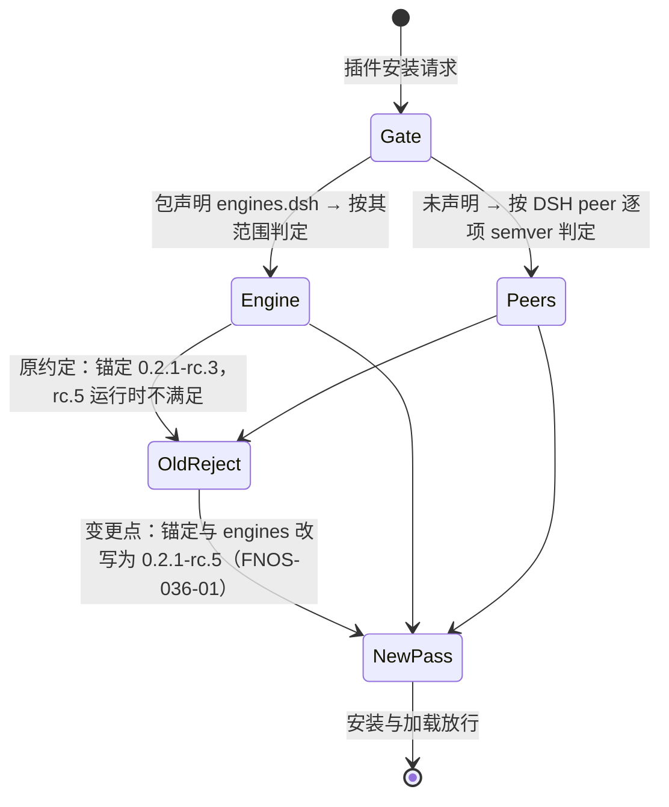
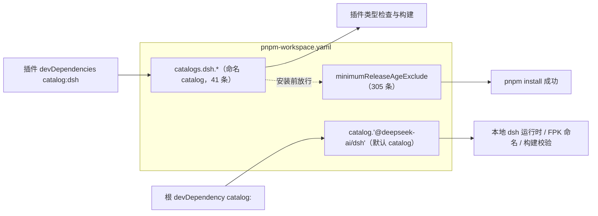
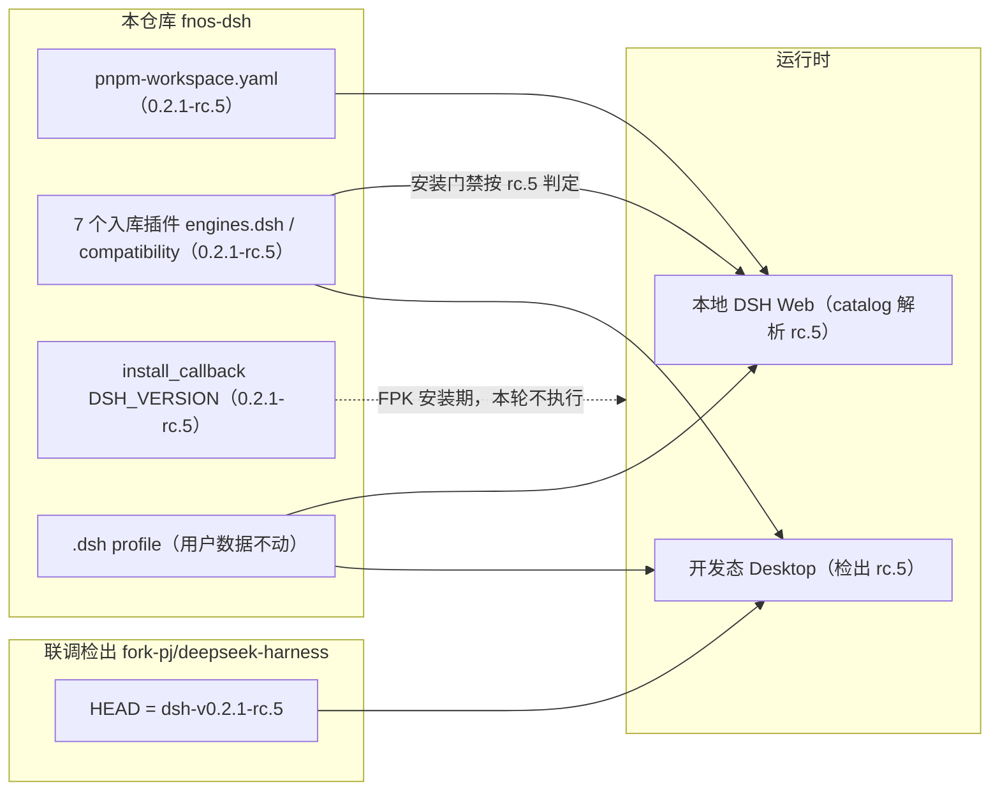
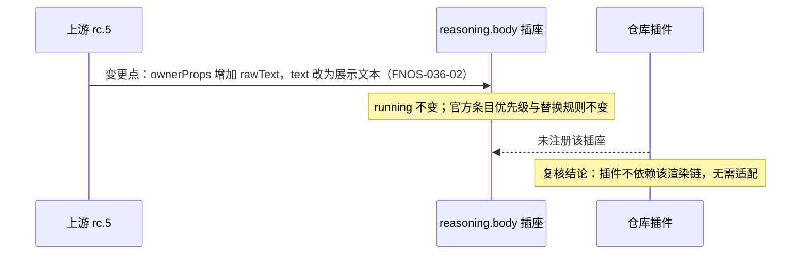

# PLAN-FNOS-036 DSH 0.2.1-rc.5 插件适配与基线迁移

| 项目 | 内容 |
| --- | --- |
| 计划编号 | PLAN-FNOS-036 |
| 计划日期 | 2026-10-30 |
| 对应需求 | [FNOS-036 DSH 0.2.1-rc.5 插件适配与基线迁移](/requirements/FNOS-036-dsh-021-rc5-adaptation) |
| 计划状态 | 待完成（T01、T02 已完成；T03 的 DSH Web 部分已完成、Desktop 部分受阻；T04 待版本推进） |

## 计划目标

按 [FNOS-036](/requirements/FNOS-036-dsh-021-rc5-adaptation) 的功能编号完成基线迁移：仓库运行/构建基线与联调检出统一到 `0.2.1-rc.5`，七个入库插件的依赖锚定与兼容声明改写，全部包级验证通过，并在 DSH Web 与 DSH Desktop 双客户端完成回归。

技术边界：只改依赖锚定、兼容声明、基线常量与文档基线字样；不改插件功能代码（除非类型检查暴露接缝差异）；不发布插件；不做 FPK 真机安装（登记为后续验证）；不处理 CodeBuddy 本地副本。

## 当前实现与目标设计

| 领域 | 当前实现 | 目标实现 | 迁移影响 |
| --- | --- | --- | --- |
| 默认 catalog 基线 | `pnpm-workspace.yaml` 的 `'@deepseek-ai/dsh'` 为 `0.2.1-rc.3`，是 `requireDshBaseline()` 与构建校验的唯一读取源 | 改为 `0.2.1-rc.5` | 本地 `dsh` 运行时、FPK 命名与构建校验读同一份值 |
| 命名 catalog `dsh` | `catalogs.dsh.*` 共 41 条为 `0.2.1-rc.3`，是插件 `catalog:dsh` 的实际解析来源 | 全部改为 `0.2.1-rc.5` | 插件 devDependencies 解析到 rc.5，类型检查才真正对着新契约 |
| 发布龄期豁免清单 | `minimumReleaseAgeExclude` 共 305 条钉住 `@0.2.1-rc.3` | 改为 `@0.2.1-rc.5` | 不更新则 pnpm 因发布龄期门禁拒绝安装刚发布的 rc.5 |
| 插件兼容声明 | 七个入库插件 `package.json` 的 `engines.dsh` 为 `0.2.1-rc.3`；`compatibility.json` 的 `dshPluginApi.version` 同为该值 | 两者改为 `0.2.1-rc.5` | 安装期门禁按新版本判定；构建校验断言 `engines.dsh` 等于 catalog |
| 安装回调常量 | `apps/fn-deepseek-harness/cmd/install_callback` 的 `DSH_VERSION="0.2.1-rc.3"` | 改为 `0.2.1-rc.5` | FPK 安装期装载的运行时版本；构建校验比对 catalog，不一致直接失败 |
| 联调检出 | `fork-pj/deepseek-harness` HEAD 停在 `dsh-v0.2.1-rc.3` | fetch 后 checkout `dsh-v0.2.1-rc.5`，重装依赖 | 开发态 Desktop 运行时版本与插件锚定匹配 |
| CodeBuddy 副本 | 本地副本锚定 `0.2.1-rc.3`（不入库） | **不动** | 按 FNOS-036 范围约束排除；不产生受版本管理的改动 |
| 文档基线字样 | `docs/development/conventions.md` 的 `engines` 示例写 `0.2.1-rc.3`；`manifest` 与应用文档页的基线字样由版本命令同步 | 示例改写为新基线；`manifest` 与应用文档页由版本命令在 release 提交里对齐 | 文档与实际基线一致 |
| 市场索引 | `docs/public/plugins/market/index.json` 记录**已发布版本**的 `dsh` 字段（当前 rc.3） | **不动** | 索引跟随 npm 发布快照；本轮不发布，重新生成反而会记录不存在的版本 |

迁移前后门禁判定路径（变更点标注）：

DevDependency 的实际解析路径同步变化：`catalog:dsh` 读 `catalogs.dsh`，若只有默认 catalog 前进，插件仍按 rc.3 安装，类型检查就检查不到新契约。

三处必须同步前进：只改默认 catalog 会让插件仍按旧版本安装，只改命名 catalog 会让构建校验报安装回调不一致。

## 影响范围分析

| 需求功能 | 代码模块 | 配置/数据 | 测试 | 文档 | 目标环境 |
| --- | --- | --- | --- | --- | --- |
| FNOS-036-01 | `plugins/*-plugin/package.json`（`engines.dsh`）、`plugins/*-plugin/compatibility.json` | 无用户数据变化 | 七个插件 `check`（typecheck+单测+build）、`tooling/fnos-dsh-cli` 基线用例 | 插件文档版本表随版本命令同步 | DSH Web、DSH Desktop |
| FNOS-036-02 | 无代码改动（契约复核确认 rc.5 的唯一插座变化不落在插件能力面上） | 无 | 双客户端界面走查（8 类插座位置 + 亮暗主题） | 无 | DSH Web、DSH Desktop |
| FNOS-036-03 | `pnpm-workspace.yaml`（默认 catalog、命名 catalog、发布龄期豁免）、`apps/fn-deepseek-harness/cmd/install_callback`（`DSH_VERSION`） | `pnpm-lock.yaml` 重锁 | `pnpm run check`（含基线一致性用例）、启动 DSH Web 核对版本 | `docs/development/conventions.md` 示例 | 本地构建链路、DSH Web |
| FNOS-036-04 | 无代码改动 | 既有 `.dsh` profile 数据保持 | 迁移后启动核对登录态、偏好、模型配置 | 无 | DSH Web、DSH Desktop |
| FNOS-036-05 | 联调检出（`fork-pj/deepseek-harness`，不在本仓库内） | 检出内 `node_modules` 重装 | `git describe` 核对 tag；Desktop 启动日志核对版本 | 无 | DSH Desktop |
| FNOS-036-07 | 构建门禁 `tooling/fnos-dsh-cli/src/commands/build.ts`、基线守卫用例 | 无 | 门禁变异测试（注入字面版本应报错） | 无 | 本地构建链路 |

## 架构与数据流

迁移只动「版本锚定层」，不动插件代码与数据：

## 分阶段任务

| 任务 ID | 对应需求/验收 | 修改内容 | 前置条件 | 验证方式 |
| --- | --- | --- | --- | --- |
| PLAN-FNOS-036-T01-01 | FNOS-036-05 / AC-01 | 联调检出 `git fetch --tags` 后 checkout `dsh-v0.2.1-rc.5`，按需 `pnpm install` | 官方 tag 已发布（已核实） | `git describe --tags` 输出 `dsh-v0.2.1-rc.5` |
| PLAN-FNOS-036-T01-02 | FNOS-036-01、FNOS-036-07 / AC-01 | 七个入库插件 `package.json` 的 `engines.dsh` 与 `compatibility.json` 的 `dshPluginApi.version` 改为 `0.2.1-rc.5`；`peerDependencies`/`devDependencies` 保持 `catalog:dsh` 不引入字面量 | 无 | 逐文件 grep 无版本字面量；CLI 基线用例通过 |
| PLAN-FNOS-036-T01-03 | FNOS-036-03 / AC-01 | `pnpm-workspace.yaml` 三处基线同步到 `0.2.1-rc.5`（默认 catalog 1 条、命名 catalog 41 条、发布龄期豁免 305 条）；`install_callback` 的 `DSH_VERSION` 同步 | T01-02 | `grep -c '0.2.1-rc.3'` 为 0；`DSH_VERSION` 与 catalog 一致 |
| PLAN-FNOS-036-T01-04 | FNOS-036-03 / AC-01 | `pnpm install` 重锁并安装 rc.5 依赖 | T01-03 | 命令退出码 0；`pnpm ls @deepseek-ai/dsh` 报 rc.5 |
| PLAN-FNOS-036-T02-01 | FNOS-036-03 / AC-01 | `pnpm run check`（含 SDD 校验、基线一致性、lint 与单测） | T01-04 | 命令退出码 0，全绿 |
| PLAN-FNOS-036-T02-02 | FNOS-036-01 / AC-01 | 七个入库插件逐个 `pnpm --filter <pkg> run check`（typecheck、单测、build） | T01-04 | 命令退出码 0；单测全绿 |
| PLAN-FNOS-036-T02-03 | FNOS-036-07 / AC-02 | 门禁变异测试：往一个插件 manifest 注入 DSH 版本字面量，确认构建报错并指出该依赖，随后还原 | T01-02 | 注入时报错、还原后通过 |
| PLAN-FNOS-036-T03-01 | FNOS-036-01、02、04 / AC-01～AC-03 | DSH Web 回归：插件管理页、各插件代表功能、界面区块位置、亮暗主题、既有数据（登录态/偏好/模型配置） | T02-01 | 按测试用例文档执行并回填 |
| PLAN-FNOS-036-T03-02 | FNOS-036-01、02、05 / AC-01～AC-02 | 开发态 Desktop 回归（项目 `.dsh` 作 `DSH_HOME`，渲染调试端口取证）：版本核对、插件加载、界面区块与主题 | T01-01、T02-01；与 Web 测试不同时持有同一会话 | 按测试用例文档执行并回填；结论写明检出与版本 |
| PLAN-FNOS-036-T04-01 | 全部 | 需求/计划/测试用例三文档登记与索引、侧栏更新；`pnpm run check -- --sdd` 与文档构建 | 无 | 命令通过 |
| PLAN-FNOS-036-T04-02 | 全部 | 功能提交后执行 `pnpm run version -- major --yes` 推进到 7.0.0（版本提交独立于功能提交，tag 只留本地） | T02、T03 完成且工作区干净 | 版本命令产物核对（根 `package.json`、插件、`manifest`、应用文档页同值 7.0.0，基线字样 rc.5） |
| PLAN-FNOS-036-T04-03 | FNOS-036-03 / AC-01 | 登记后续验证项：FPK 打包与真机安装升级（含 `dshmarket` 实装门禁复核）留待发布流程 | T04-02 | 在需求变更记录登记状态，不阻塞双客户端结论 |

任务依赖顺序：T01 → T02 → T03 → T04；T01-01 与 T01-02 可并行。

## 交互和行为设计

本计划无新增用户界面交互。需要走查的交互面是既有插件界面在 rc.5 运行时上的回归（沿用 [FNOS-014](/requirements/FNOS-014-dsh-021-rc2-adaptation) 建立的走查基线）：插件详情区块、会话头部工具、输入区左右与浮层插槽、侧栏底部动作、设置动作与浮层，位置与信息展示不变；亮暗主题切换实时生效。

rc.5 唯一面向插件作者的契约变化落在 `conversation.chat.reasoning.body` 插座，插件侧不需要动作，但必须留下复核证据：

## 数据、权限和错误处理

- 无新增持久化；`.dsh` profile 的用户数据（`.credentials.yaml`、各插件 auth 与偏好文件）在迁移前后只读核对，不清理、不改写。
- 迁移失败时的恢复：`pnpm-workspace.yaml`、`engines.dsh`、`compatibility.json`、`install_callback` 全部回退到 `0.2.1-rc.3` 并重新 `pnpm install`；联调检出 checkout 回 `dsh-v0.2.1-rc.3`。
- 版本命令按 [版本管理](/build/versioning) 硬守卫执行：工作区不干净直接拒绝，因此先提交功能改动再跑版本命令。
- 安装期风险：rc.5 是刚发布的版本，发布龄期门禁会拦截未列入豁免清单的精确版本；这正是 T01-03 必须同步 `minimumReleaseAgeExclude` 的原因。

## 依赖、风险和决策

### 依赖

| 依赖 | 版本 | 用途 |
| --- | --- | --- |
| `@deepseek-ai/dsh` 系列 | `0.2.1-rc.5`（npm `next` 与 `latest`） | 运行时与插件 peer |
| `@earendil-works/pi-ai` | `^1.1.0`（rc.5 未变） | opencode/zcode/midscene 插件模型底座 |
| `dshmarket` | `1.66.47`（peer `^0.2.1-rc.1` 含 rc.5） | FPK 内置三方插件，不换版本 |
| 官方仓库 tag `dsh-v0.2.1-rc.5` | — | 联调检出基线 |

### 风险

| 风险 | 影响 | 缓解 |
| --- | --- | --- |
| 思考内容插座契约变化存在，若插件间接受影响（例如通过第三方插件在同一插座注册） | 界面回归失败 | 已核实仓库插件不注册该插座、不依赖 `dsh-client-ui-chat`；双客户端走查覆盖会话区渲染 |
| rc.5 刚发布，发布龄期门禁拦截精确版本 | `pnpm install` 失败，迁移中断 | T01-03 同步 `minimumReleaseAgeExclude`；安装失败时先核对豁免清单再重试 |
| 只改默认 catalog 就以为完成迁移 | 插件仍按 rc.3 安装，类型检查对着旧契约通过，属于假绿 | 计划明确三处同步（默认 catalog / 命名 catalog / 豁免清单），T01-03 以 `grep -c` 断言零残留 |
| `latest` 标签已从 rc.2 变为 rc.5，仍按 `latest` 拉取的历史脚本行为改变 | 安装到与预期不同的版本 | 安装回调按精确版本安装（既有行为）；本地验证核对实际版本号 |
| 版本推进（7.0.0）与 FNOS-032 等仍在实施中的需求交错 | 版本提交冲突 | 严格按「先功能提交、后版本提交」两段式；版本命令统一推进全部插件 |

### 决策

| 决策 | 选择 | 否决方案 | 原因 |
| --- | --- | --- | --- |
| 基线改写时机与版本档位 | 在功能提交里手工同步三处基线（`pnpm install` 后验证），再执行 `pnpm run version -- major --yes`（纯 major，不带 `--baseline`） | 在 release 提交里执行 `major --baseline 0.2.1-rc.5` | `--baseline` 只改写默认 catalog 那一行；本仓库插件已全部改为 `catalog:dsh`（FNOS-029-07），命名 catalog 与豁免清单若留旧值，功能提交就无法真正按 rc.5 安装与验证。先把三处改齐再装，`pnpm run` 的前置依赖校验看到的是已安装状态，不会失败；纯 major 是工具在「基线与当前相同」时明确指向的路径 |
| CodeBuddy 副本处理 | 保持不动，不纳入验收 | 同步迁移到 rc.5 | 提出人明确「除 CodeBuddy」；FNOS-025 已下架，适配它没有交付价值 |
| 市场索引 | 本轮不重新生成 | 随迁移一起生成 | 索引记录的是**已发布版本**的 tarball 快照；本轮不发布，生成只会把未发布的本地状态写进快照 |
| 插件依赖来源 | 继续全部 `catalog:dsh`，不引入字面量 | 在插件内写精确版本 | FNOS-029-07 已确立单一事实来源；本轮以门禁变异测试守住该不变量 |
| dshmarket 版本 | 保持 `1.66.47` | 升级到最新 | peer 范围未变，rc.5 已在范围内；无必要时不动三方依赖 |
| FPK 真机验证 | 列为后续验证，不阻塞本需求 | 本轮做真机升级 | 提出人的验收口径是 DSH Web 与 DSH Desktop 双客户端；真机按发布流程另行安排 |

## 测试、打包、发布和回滚

- **包级验证**：七个入库插件逐个 `check`（typecheck+单测+build）、`pnpm run check`（仓库级，含 SDD 与基线一致性用例）、门禁变异测试。
- **DSH Web**：`pnpm run start -- --web`（`DSH_HOME` 指向仓库 `.dsh`），用启动日志带 token 地址；覆盖版本核对、七插件加载、代表功能与界面回归、亮暗主题、既有数据保持。
- **DSH Desktop**：上游检出开发态 Desktop（T01-01 已更新到 rc.5），渲染调试端口 CDP 取证；与 Web 测试不同时持有同一 profile 会话。
- **文档站**：`pnpm run build -- --docs` 与 `git diff --check`。
- **打包发布**：本轮不发布插件、不打 FPK；版本推进由 `pnpm run version -- major --yes` 完成（版本提交独立于功能提交），tag 只留本地由发布者手动推送。
- **回滚**：三处基线、`engines.dsh`、`compatibility.json`、`install_callback` 回退 `0.2.1-rc.3` 并重装；联调检出 checkout 回 rc.3 tag；版本回退按版本管理规范用 `git revert` 回退整条版本提交。禁止删除 `.dsh` 用户数据。

用例设计与执行结果回填到 [FNOS-036 测试用例文档](/tests/FNOS-036-dsh-021-rc5-adaptation)，本计划不展开用例表。

## 参考资料

| 来源 | 用途 |
| --- | --- |
| npm `@deepseek-ai/dsh` dist-tags/versions | rc.5 发布事实（`next` 与 `latest` 同指） |
| 官方仓库 `dsh-v0.2.1-rc.3..dsh-v0.2.1-rc.5` diff（slot 目录、宿主接缝包、web 组合、upgrade-guide） | 契约差异核实 |
| `docs/upgrade-guide/v0.2.1-rc.4/reasoning-body-props/guide.md`（官方） | 思考内容插座 props 变化的权威说明 |
| `npm view dshmarket@1.66.47 peerDependencies` + semver 判定 | 三方插件兼容判定 |
| [FNOS-029](/requirements/FNOS-029-dsh-021-rc3-adaptation) | 上一轮基线迁移先例与锚定约定 |
| [版本管理](/build/versioning) | 档位规则、`--baseline` 语义与发布批次 |
| [测试用例文档规范](/charter/tests-spec) | 双客户端执行与取证口径 |

## 完成状态

| 阶段 | 状态 | 说明 |
| --- | --- | --- |
| T01 基线与锚定改写 | 已完成 | 检出切 `dsh-v0.2.1-rc.5`（commit `b830ec950f`）；catalog 三处同步 348 条、`0.2.1-rc.3` 残留 0 处；七插件 `engines.dsh` 与 compatibility 改写；回调常量同步；`pnpm install` 重锁，安装版本 rc.5 |
| T02 包级验证 | 已完成 | 29 个 turbo 任务全绿（七插件 1366 条单测 + CLI 100 条 + gateway 147 条等）；catalog 单一事实来源守卫与变异测试通过 |
| T03 双客户端回归 | 已完成（界面与加载面） | DSH Web：运行时 `0.2.1-rc.5`、80 入口含六插件、插件管理页无异常、会话头部工具区块在位。DSH Desktop：检出 `dsh-v0.2.1-rc.5`，渲染进程 `0.2.1-rc.5`（commit `b830ec9`）、78 入口含六插件、插件管理页无异常、界面可交互。代表功能逐项走查、主题切换与迁移前后数据比对列为后续补测 |
| T04 文档与版本 | 进行中 | 三份文档与索引/侧栏登记、`check --sdd` 与文档构建已通过；版本推进到 7.0.0 待执行 |

## 变更记录

| 日期 | 变更 | 说明 |
| --- | --- | --- |
| 2026-10-30 | 初始登记 | 建立 PLAN-FNOS-036：四阶段任务（基线改写 → 包级验证 → 双客户端回归 → 文档与版本）。基线改写采用「功能提交内同步三处 catalog + 纯 major 版本提交」，理由见决策章节；CodeBuddy 副本按需求范围排除；FPK 真机验证列为后续。 |
