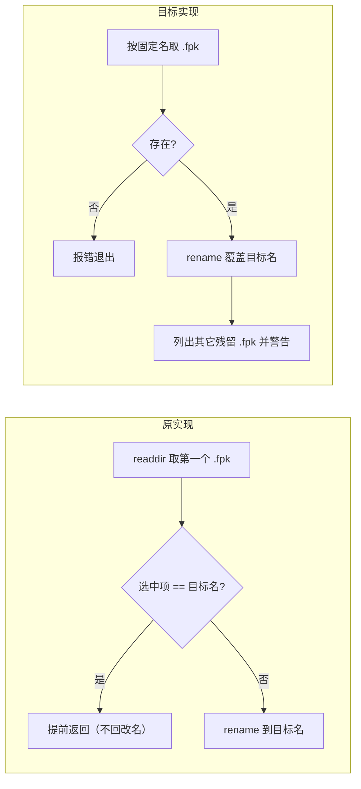

# PLAN-FNOS-037 本地构建 FPK 改名定位到错误产物

| 项目 | 内容 |
| --- | --- |
| 计划编号 | PLAN-FNOS-037 |
| 计划日期 | 2026-10-30 |
| 对应需求 | [FNOS-037 本地构建 FPK 改名定位到错误产物](/requirements/FNOS-037-local-fpk-rename-source) |
| 计划状态 | 已完成（版本提交随功能提交后执行） |

## 计划目标

按 [FNOS-037](/requirements/FNOS-037-local-fpk-rename-source) 修正本地构建的 FPK 改名：把「取哪个文件改名」从「扫目录第一个 `.fpk`」改为「`fnpack` 的固定产物名 `<app>.fpk`」，并把命名模板与改名逻辑抽到可单测的模块；补齐实现回退时立刻变红的回归用例。

技术边界：只改本地构建链路的改名实现与其测试；不动命名模板、不动 CI workflow、不删除历史产物。

## 当前实现与目标设计

| 领域 | 当前实现 | 目标实现 | 迁移影响 |
| --- | --- | --- | --- |
| 取源文件 | `(await readdir(appDir)).find(entry => entry.endsWith('.fpk'))`，取目录里第一个 `.fpk` | 固定 `join(appDir, '<app>.fpk')`；不存在即报错 | 残留旧包不再被误选 |
| 同名目标 | 源与目标同名时提前 `return`（缺陷路径） | 直接把源 rename 到目标，POSIX 原子覆盖同名旧文件 | 目录不出现同名多份，内容被本次产物顶替 |
| 残留产物 | 不感知 | rename 后列举仍有其它 `.fpk`，由构建输出警告 | 使用者能发现「装错包」的风险 |
| 代码位置 | 改名与模板内联在 `commands/build.ts` | 命名模板 + 改名逻辑移入 `core/fpk-artifacts.ts`，`build.ts` 只负责取 tag/基线并调用 | 逻辑可被单测覆盖 |
| 回归防护 | `fpk-release-naming.spec.ts` 只校验两侧模板同形 | 追加行为用例：残留同名旧产物时改动的是本次新包；并断言实现不回到扫描式取源 | 缺陷回退时用例变红 |

改名对象判定的变化：

旧的 `Pick` 分支在目录残留旧产物时恒为「是」，于是改名落在旧包路径判断上、本次产物不动；新实现不存在这个分支。

## 影响范围分析

| 需求功能 | 代码模块 | 配置/数据 | 测试 | 文档 | 目标环境 |
| --- | --- | --- | --- | --- | --- |
| FNOS-037-01 | `tooling/fnos-dsh-cli/src/core/fpk-artifacts.ts`（新增）、`src/commands/build.ts`（调用点） | 无用户数据；`apps/*/*.fpk` 为 git 忽略的构建产物 | 新增 `tests/fpk-artifacts.spec.ts`；更新 `tests/fpk-release-naming.spec.ts` | 本需求三份文档 | 本地构建链路 |
| FNOS-037-02 | `core/fpk-artifacts.ts`（leftovers 返回）、`commands/build.ts`（警告输出） | 不删除任何历史产物 | 同上（leftovers 断言） | 同上 | 本地构建链路 |

## 分阶段任务

| 任务 ID | 对应需求/验收 | 修改内容 | 前置条件 | 验证方式 |
| --- | --- | --- | --- | --- |
| PLAN-FNOS-037-T01-01 | FNOS-037-01 / AC-01、AC-02 | 新增 `core/fpk-artifacts.ts`：`fpkReleaseFileName()` 承载命名模板，`renameFpkToRelease()` 按固定名取源、覆盖目标、返回 leftovers | 无 | 单测覆盖三种目录状态 |
| PLAN-FNOS-037-T01-02 | FNOS-037-01、FNOS-037-02 | `commands/build.ts` 的 `renameFpkForRelease` 改为调用新模块，输出覆盖提示与残留警告 | T01-01 | 构建输出包含提示 |
| PLAN-FNOS-037-T02-01 | FNOS-037-02 / AC-03 | 更新 `fpk-release-naming.spec.ts`：模板改从新模块读取，追加「不扫目录第一个 .fpk」断言 | T01-01 | `--filter @tnnevol/fnos-dsh-cli test` 全绿 |
| PLAN-FNOS-037-T02-02 | FNOS-037-01 / AC-01 | 变异验证：把取源改回扫描式，确认新增行为用例变红；还原后复跑 | T02-01 | 缺陷版 `expected 'stale-build' to be 'fresh-build'`；还原后 105 条全绿 |
| PLAN-FNOS-037-T03-01 | FNOS-037-01 / AC-01、AC-02 | 本地实跑一次 FPK 构建，核对带版本名产物内 `manifest` 的 `version` 与基线来自本次构建 | T01-02 | 解包 `manifest` 比对 |
| PLAN-FNOS-037-T04-01 | 全部 | 三份文档与索引/侧栏登记；`pnpm run check -- --sdd` | 无 | 命令通过 |
| PLAN-FNOS-037-T04-02 | 全部 | 功能提交后执行 `pnpm run version -- patch --yes`（版本提交独立） | T02、T03 完成且工作区干净 | 版本命令产物核对 |

任务依赖顺序：T01 → T02 → T03 → T04。

## 数据、权限和错误处理

- 不涉及用户数据；FPK 产物在 `.gitignore` 中（`*.fpk`），不进入版本管理。
- 取不到 `<app>.fpk` 时报错并指出期望文件名，不以「目录里有别的 .fpk」兜底——兜底正是本次缺陷的来源。
- 不删除历史产物；多余文件只警告，处置权交使用者。
- 回滚：把取源改回扫描式并移除 leftovers 提示即可恢复原行为，回滚后缺陷回现。

## 依赖、风险和决策

| 决策 | 选择 | 否决方案 | 原因 |
| --- | --- | --- | --- |
| 取源方式 | 固定名 `<app>.fpk` | 继续扫描但排除「已等于目标名」的候选 | 排除法仍依赖目录内容推断「哪个是新的」；`fnpack` 产物名是确定的，按名字取没有推断成分 |
| 同名目标处置 | rename 原子覆盖 | 先删除目标再改名 | 覆盖语义本身满足需求，少一步、少一个失败窗口 |
| 历史产物 | 只警告不删除 | 构建时清理目录内全部 `.fpk` | 删除是不可逆动作，且历史包可能用于回滚对照 |
| 测试层次 | 行为用例（临时目录 + 内容断言）为主，源码形状断言为辅 | 只加源码形状断言 | 形状断言只能证明「没扫目录」，行为用例能在实现回退时给出具体错配内容 |

风险：`rename` 覆盖同名目标依赖 POSIX 语义；Windows 下 Node 的 `fs.rename` 对已存在目标同样覆盖，行为一致。CI 侧逻辑未改动，不受影响。

## 测试、打包、发布和回滚

- **包级验证**：`pnpm --filter @tnnevol/fnos-dsh-cli test`（含新增行为用例）。
- **变异验证**：临时把取源改回扫描式，确认行为用例变红，再还原复跑。
- **构建验证**：本地 `pnpm run build -- --fpk --app fn-deepseek-harness --skip-bundle-dsh-plugins`，解包产物 `manifest` 核对版本与基线。
- **文档**：`pnpm run check -- --sdd`。
- **发布**：版本按 `patch` 推进（本会话已通过 FNOS-036 推进过 `x`，高位段冻结），版本提交独立于功能提交。
- **回滚**：见「数据、权限和错误处理」。

用例与结果回填到 [FNOS-037 测试用例文档](/tests/FNOS-037-local-fpk-rename-source)。

## 完成状态

| 阶段 | 状态 | 说明 |
| --- | --- | --- |
| T01 实现改造 | 已完成 | 新增 `core/fpk-artifacts.ts`；`build.ts` 改为固定名取源并输出覆盖/残留提示 |
| T02 回归防护 | 已完成 | 新增 4 条行为用例；命名守卫改读新模块并加「不扫目录」断言；变异验证缺陷版 3 条变红 |
| T03 构建验证 | 已完成 | 实跑 FPK 构建：输出覆盖提示，构建后目录只剩一份，解包 `manifest` 为 7.0.0 / rc.5 |
| T04 文档与版本 | 已完成 | 三份文档 + 三处索引/侧栏登记，`check --sdd` 通过（37/37/29）；版本按 patch 推进为发布后动作 |

## 变更记录

| 日期 | 变更 | 说明 |
| --- | --- | --- |
| 2026-10-30 | 初始登记 | 建立 PLAN-FNOS-037：四阶段（实现改造 → 回归防护 → 构建验证 → 文档与版本）。取源改为固定名、同名覆盖、残留提示；测试以行为用例为主并做变异验证。 |
