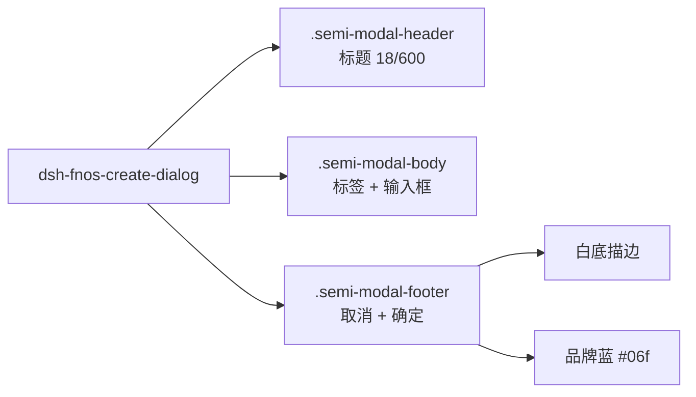

# PLAN-FNOS-039 新建条目弹框对齐 fnOS 文件管理样式

| 项目 | 内容 |
| --- | --- |
| 计划编号 | PLAN-FNOS-039 |
| 计划日期 | 2026-10-30 |
| 对应需求 | [FNOS-039 新建条目弹框对齐 fnOS 文件管理样式](/requirements/FNOS-039-create-dialog-style) |
| 计划状态 | 实施完成（包级用例、typecheck、lint 与 client 产物重建通过；真实 NAS 验收待执行，版本提交随功能提交后执行） |

## 计划目标

按 [FNOS-039](/requirements/FNOS-039-create-dialog-style) 让新建弹框与 fnOS 自带弹框一致：给 `Modal` 加隔离类名，用插件 SCSS 在该类名之下覆盖标题、输入框、底部按钮；品牌蓝以插件内 CSS 变量定义；标签与确认文案按条目类型与 fnOS 用词调整。

技术边界：只动本插件的组件、样式与文案；不改 `packages/dsh-semi-ui` 的任何主题或组件封装。

## 当前实现与目标设计

| 领域 | 当前实现 | 目标实现 | 迁移影响 |
| --- | --- | --- | --- |
| 弹框隔离 | `Modal` 无类名，样式无法安全命中 | 加 `className="dsh-fnos-create-dialog"` | 覆盖被限制在一个弹框内 |
| 主按钮色调 | 继承 DSH 主题（亮色为深底白字反色） | 品牌蓝 `#06f`，hover `#005eeb`、active `#0043b8` | 与 fnOS 一致；其它按钮不受影响 |
| 取消按钮 | 主题默认次按钮 | 白底 + `--dsw-alias-border-l2` 描边 | 与参考样式一致 |
| 标签 | 「名称」，12px 次级色 | 「文件夹名称」/「文件名称」+ 红色星号，14px 主色 | 信息更明确，随类型切换 |
| 确认文案 | 「新建」 | 「确定」（英文 `Confirm`） | 与 fnOS 用词一致 |
| 尺寸 | 宽 420，输入框主题默认高 | 宽 440、圆角 12px、标题 18px/600、输入框 40px | 视觉密度对齐参考样式 |
| 名称规则提示 | 输入框下方常驻提示 | 保留 | 功能性说明，不随视觉调整删除 |

样式作用域示意：

## 实施任务

| 阶段 | 任务 | 产物 | 状态 |
| --- | --- | --- | --- |
| 一 | 取 fnOS 品牌档位并确认作用域可行的 DOM 结构 | 调研结论见需求文档 | 已完成 |
| 二 | `Modal` 加类名、宽度、标签星号、确认文案 | `src/components/FnosAuthorizedPathPicker.tsx` | 已完成 |
| 三 | 插件内 SCSS 覆盖标题/输入框/底部按钮，品牌色用局部变量 | `src/styles/index.scss` | 已完成 |
| 四 | 新增文案键并调整中文用词 | `src/client/locales.ts` | 已完成 |
| 五 | 源码守卫用例：作用域前缀、品牌色不出现在共享包 | `tests/client/input-picker-geometry.spec.ts` | 已完成 |
| 六 | 包级验证（vitest / typecheck / lint / 产物重建） | 结果见[测试用例文档](/tests/FNOS-039-create-dialog-style) | 已完成 |
| 七 | 真实 NAS 验收（亮色/暗色主题下各看一次） | 验收证据 | 待执行 |

## 技术要点

- Semi `Modal` 经 portal 渲染到 body，插件根节点不是其祖先，样式必须靠 `className` 隔离。
- 覆盖选择器统一以 `.dsh-fnos-create-dialog` 开头并下沉到 `.semi-modal-footer` 等内层，特异性高于主题的单类选择器，无需 `!important`。
- 品牌色写成 Kent 缩写 `#06f` 仅用于变量声明处，便于阅读；hover/active 用完整六位值。
- 颜色分两类来源：DSH 语义变量（背景、边框、文字、错误色）与插件内 fnOS 品牌档位；不引入其它硬编码色。
- Semi footer 用相邻兄弟选择器加间距，这里改由 `gap` 控制并把 `margin-left` 归零，避免双重间距。

## 风险与回退

| 风险 | 影响 | 处理 |
| --- | --- | --- |
| 暗色主题下品牌蓝与背景对比不足 | 「确定」按钮在暗色下不够醒目 | 品牌蓝本身与两种主题背景都有足够对比；验收时各主题各看一次 |
| 覆盖选择器特异性变化（Semi 升级改类名） | 覆盖失效，回落到主题主按钮 | 守卫用例断言选择器文本，升级时用例会提示；真机验收兜底 |
| 插件样式注入顺序晚于主题 | 覆盖未生效 | 选择器以弹框类名开头，特异性高于主题单类规则，与顺序无关 |

回退：撤掉 `Modal` 的类名与 SCSS 中的 `.dsh-fnos-create-dialog` 块即可回到主题默认外观；文案改动独立可回退。
