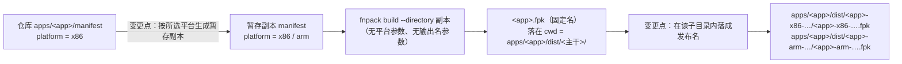
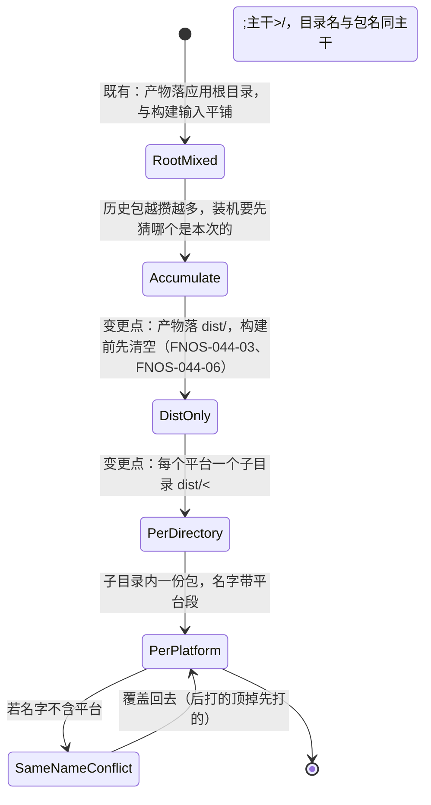

# PLAN-FNOS-044 FPK 平台产物选择与双包发布

| 项目 | 内容 |
| --- | --- |
| 计划编号 | PLAN-FNOS-044 |
| 计划日期 | 2026-11-04 |
| 对应需求 | [FNOS-044 FPK 平台产物选择与双包发布](/requirements/FNOS-044-fpk-platform-selection) |
| 计划状态 | 实施完成（七阶段：核心实现 → 交互与参数 → 构建与等价性验证 → CI 双包 → 用例与变异验证 → 文档与索引 → 产物目录 dist 化；ARM 真机验收无设备） |

## 计划目标

按 [FNOS-044](/requirements/FNOS-044-fpk-platform-selection) 给 FPK 构建链路加上平台维度：构建时可选 x86 / arm，包内平台声明随所选平台生成，产物名带平台段，CI 一次发布同时产出两份包；并把「选择构建任务」的选项顺序调整为 fnOS FPK 在前、Harness 插件在最后。

技术边界：只改 `tooling/fnos-dsh-cli` 的 FPK 构建链路、其守卫用例、CI 的 FPK 构建与改名上传步骤，以及构建交互。不改应用清单在仓库里的取值，不改 fnpack 之外的打包内容，不做 ARM 真机验证。

## 当前实现与目标设计

| 领域 | 当前实现 | 目标实现 | 迁移影响 |
| --- | --- | --- | --- |
| 平台概念 | 无。包内平台声明恒取仓库 `apps/<app>/manifest` 的 `platform = x86` | 平台成为构建入参：`FpkPlatform = 'x86' \| 'arm'`，默认取清单声明值 | 不传平台参数时行为与今天一致，仅名字多一个平台段 |
| 打包目录 | 直接在 `apps/<app>` 里执行 `fnpack build`（`runCommand` 的 cwd），产物落应用根目录 | 每个平台各建一份暂存副本、改写副本清单的 `platform` 行；`fnpack build --directory <副本>` 的 **cwd 改为该平台的产物目录 `apps/<app>/dist/<主干>/`** | 仓库清单全程不被写入；产物不再路过应用根目录 |
| 产物落点 | 应用根目录 `apps/<app>/`，与构建输入（`manifest`、`cmd/`、`app/`）平铺，历史包越攒越多 | `apps/<app>/dist/<主干>/`（一个平台一个子目录），`dist/` **每次构建先清空** | 目录内容就等于「这一次产出了什么」；路径即说明包给哪类设备；迁移前遗留根目录的历史包不删，只提示 |
| 产物命名 | `fpkReleaseFileName(app, tag, baseline)` → `<app>-<tag>-dsh-<baseline>.fpk` | 拆成两段：`fpkReleaseBaseName(...)` → `<app>-<platform>-<tag>-dsh-<baseline>`（同时作目录名），`fpkReleaseFileName(...)` = 主干 + `.fpk` | 本地与 CI 同模板，守卫用例改为比较「主干」模板 |
| 落成发布名 | `renameFpkToRelease(appDir, app, target)`：在应用目录里改名 | `finalizeFpkArtifact({ artifactDirectory, … })`：源与目标都在该平台子目录内，仍按 fnpack 固定名 `<app>.fpk` 取源 | FNOS-037 的「按固定名取源、同名原子覆盖」不变；`unexpected` 收窄为「该子目录里不属于本次的那份包」，另加 `listLegacyRootArtifacts` 报告根目录历史包 |
| 构建交互 | `askBuildSelection` 顺序为 plugins、fpk、docs；选完应用只问是否内置插件 | 顺序改为 fpk、docs、plugins；选定应用后追加 `askFpkPlatforms` 平台多选 | 取消平台选择即不产出任何包 |
| 非交互参数 | `--fpk --app <app> --skip-bundle-dsh-plugins` | 增加可重复的 `--platform <x86\|arm>`；非法值报错。三种结果必须可区分：**显式指定** / **没做选择**（按清单声明取默认）/ **取消** | CI 改为显式传两个平台；不带 `--platform` 的非交互执行不进询问（clack 在无 TTY 时不会自己失败，会画出选项永远等回车） |
| CI 产物 | 单个 FPK：`find . -maxdepth 1 -name '*.fpk' -print -quit` 取第一个改名后上传 | 按平台列表逐个核对与上传，路径为 `${PACKAGE_NAME}/${PACKAGE_NAME}.fpk`；任一缺失即失败；核对与上传两步的 `working-directory` 仍是 `apps/fn-deepseek-harness/dist` | 双包上传，`find` 取任意一个的写法必须移除，否则两份包只会传上其中一份 |

平台差异的产生方式（这是本计划的核心事实，不是推断）：



`fnpack build` 只有 `--directory`，没有平台参数；实测（2026-11-04）改暂存清单的平台值后打包，包内清单与既有 x86 包逐行比对**只有平台行和包自身校验值不同**。因此「出一个 ARM 包」= 换掉那一行再打包，不需要也不应该改动仓库里那份清单。

**产物名无法由 fnpack 直接产出**：产物名恒为清单 `appname` 派生的 `<appname>.fpk`，实测把副本目录改名成目标文件名再打包，产物名仍是 `<appname>.fpk`。唯一伪造手段是改写副本的 `appname`——不可接受：`appname` 是 fnOS 识别已安装应用的身份，两份包给出不同 `appname` 会让 x86 与 ARM 被当成两个不同应用。所以落成步骤保留，但收在**该平台自己的产物子目录**内完成——子目录名已经是最终主干，使用者在里面只会看到与目录同名的最终包，不会看到「先有个怪名字再被改名」的中间状态，应用根目录也全程不出现产物。

构建一次 FPK 的交互与执行时序：

```mermaid
sequenceDiagram
  participant U as 使用者
  participant CLI as fnos-dsh-cli build
  participant P as prompts 交互层
  participant D as 应用 dist 目录
  participant S as 暂存副本
  participant F as fnpack

  U->>CLI: pnpm run build
  CLI->>P: 变更点：选择构建任务（fpk / docs / plugins）
  P-->>U: fnOS FPK 排在第一
  U->>P: 勾选 fnOS FPK
  CLI->>P: 选择要编译的 FPK 应用
  U->>P: 勾选应用
  CLI->>P: 变更点：选择目标平台（x86 / arm，可多选）
  U->>P: 勾选 x86 + arm
  CLI->>P: 是否内置 Harness 清单插件
  CLI->>D: 变更点：先清空 dist（每个应用一次，在平台循环之外）
  loop 变更点：每个平台各打一次包
    CLI->>S: 复制打包输入（排除 tests/、node_modules/、根下 dist/、*.fpk）
    CLI->>S: 改写 platform 行
    CLI->>D: 变更点：建该平台的产物子目录 dist/&lt;主干&gt;/
    CLI->>F: fnpack build --directory 副本（cwd = dist/&lt;主干&gt;/）
    F-->>D: 固定名 fpk，落进该子目录
    CLI->>D: 在子目录内落成与目录同名的发布名
    CLI->>S: 删除暂存副本
  end
  CLI->>CLI: 变更点：报告应用根目录遗留的历史 .fpk（不删除）
```

清空动作必须在平台循环**之外**：放进循环里，第二个平台开工时会先把第一个平台刚产出的包删掉，双平台构建只剩一份而构建全程报成功。该顺序由 `tests/fpk-release-naming.spec.ts` 的「dist 的清空在平台循环之外」用例钉住。

产物状态变化：




## 影响范围分析

| 需求功能 | 代码模块 | 配置/数据 | 测试 | 文档 | 目标环境 |
| --- | --- | --- | --- | --- | --- |
| FNOS-044-01 | `src/ui/prompts.ts`（`askFpkPlatforms`）、`src/commands/build.ts`（`--platform` 解析与询问时机） | 无用户数据 | `tests/fpk-platform.spec.ts`（新增）、`tests/prompts.spec.ts` | [命令与脚本](/development/commands-and-scripts)、[CLI 命令参考](/development/cli-commands) | 本地构建链路 |
| FNOS-044-02 | `src/core/fpk-platform.ts`（新增）、`src/core/fpk-staging.ts`（新增，副本排除规则）、`src/commands/build.ts`（暂存打包）、`src/config/workspace.ts`（读清单平台值） | 仓库 `manifest` 不被写入；副本排除根下 `dist/`，产物不会被打进包里 | `tests/fpk-platform.spec.ts`（清单改写、默认平台、非法值、dist 排除与嵌套 dist 保留） | [fnpack 打包](/build/fnpack) | 本地构建链路 + 解包核对 |
| FNOS-044-03 | `src/core/fpk-artifacts.ts`（`fpkReleaseBaseName` 主干模板 + `prepareFpkDistDirectory`、`prepareFpkArtifactDirectory`、`finalizeFpkArtifact`、`listLegacyRootArtifacts`）、`src/commands/build.ts`（cwd 改为平台子目录）、`.gitignore`、`docs/charter/directory-structure.md` | 产物从 `apps/<app>/` 迁到 `apps/<app>/dist/<主干>/`；根目录历史包保留不删 | `tests/fpk-artifacts.spec.ts`、`tests/fpk-release-naming.spec.ts`（主干模板同形、cwd 与清空顺序断言） | [版本管理](/build/versioning)、[从电脑上传 FPK](/guide/nas-fpk-install)、[目录结构规范](/charter/directory-structure) | 本地 + CI |
| FNOS-044-04 | `.github/workflows/build-app.yml`（显式双平台、dist 内逐个核对与上传） | Release 附件多一份 | `tests/fpk-release-naming.spec.ts` 读 workflow 模板与工作目录比对 | [CI 构建](/build/ci)、[应用上架规范](/charter/app-listing-spec) | GitHub Actions + Release |
| FNOS-044-05 | `src/ui/prompts.ts`（`askBuildSelection` 选项顺序） | 无 | `tests/prompts.spec.ts` 断言顺序 | [命令与脚本](/development/commands-and-scripts) | 本地构建链路 |
| FNOS-044-06 | `src/core/fpk-artifacts.ts`（`prepareFpkDistDirectory`）、`src/commands/build.ts`（清空在平台循环之外） | `dist/` 为 git 忽略的产物目录，每次构建重建（含各平台子目录） | `tests/fpk-artifacts.spec.ts`（清空、只清 dist 不越界）、`tests/fpk-release-naming.spec.ts`（清空顺序） | [fnpack 打包](/build/fnpack)、[目录结构规范](/charter/directory-structure) | 本地构建链路 |

## 分阶段任务

| 任务 ID | 对应需求/验收 | 修改内容 | 前置条件 | 验证方式 |
| --- | --- | --- | --- | --- |
| PLAN-FNOS-044-T01-01 | FNOS-044-02 | 新增 `core/fpk-platform.ts`：平台常量、`parseFpkPlatform`、`withManifestPlatform`（保留 INI 对齐） | 无 | 单测：改写后只有 platform 行变化、未知值报错 |
| PLAN-FNOS-044-T01-02 | FNOS-044-03 | `core/fpk-artifacts.ts`：`fpkReleaseFileName` 增平台段；改名逻辑抽出可单测 | T01-01 | 单测更新后全绿 |
| PLAN-FNOS-044-T01-03 | FNOS-044-02 | `config/workspace.ts` 读取清单平台值并入 `FpkApp` | T01-01 | 类型检查通过 |
| PLAN-FNOS-044-T02-01 | FNOS-044-01、FNOS-044-05 | `ui/prompts.ts`：`askBuildSelection` 顺序改为 fpk、docs、plugins；新增 `askFpkPlatforms` 多选 | 无 | 交互实跑核对顺序与选项 |
| PLAN-FNOS-044-T02-02 | FNOS-044-01、FNOS-044-02 | `commands/build.ts`：`--platform` 可重复解析、缺省取清单值、按平台循环暂存打包 | T01-01~T01-03 | 本地实跑双平台构建 |
| PLAN-FNOS-044-T02-03 | FNOS-044-01 / AC-02、AC-03 | `selectFpkPlatforms` 返回三态（显式指定 / 没做选择 / 取消），非交互不进询问 | T02-01、T02-02 | `tests/fpk-platform-selection.spec.ts` 五条用例 |
| PLAN-FNOS-044-T03-01 | FNOS-044-02 / AC-03 | 等价性验证：暂存打包出的 x86 包与既有直接打包的产物做包内文件清单与清单内容比对 | T02-02 | `tar -tf` 成员集合一致、清单仅平台与校验值差异 |
| PLAN-FNOS-044-T03-02 | FNOS-044-03 | 实跑双平台构建，解包核对两份产物内平台声明与名字一致，且仓库清单未被改动 | T02-02 | `tar -xzOf … manifest` + `git status` |
| PLAN-FNOS-044-T04-01 | FNOS-044-04 | `build-app.yml`：显式传两个平台、逐个核对、逐个上传附件；移除「取第一个 .fpk」 | T02-02 | 模板比对用例通过 + Actions 实跑 |
| PLAN-FNOS-044-T04-02 | FNOS-044-04 / AC-02 | ARM 包未经真机验证的口径写入文档与上架口径 | T04-01 | 文档检查 |
| PLAN-FNOS-044-T05-01 | 全部 | 新增 `tests/fpk-platform.spec.ts`；扩展 `fpk-release-naming.spec.ts` 的平台段比对 | T01~T04 | `pnpm --filter @tnnevol/fnos-dsh-cli test` |
| PLAN-FNOS-044-T05-02 | FNOS-044-01 / AC-01 | 变异验证：去掉命名平台段、把暂存改写回直接改仓库清单、把构建任务顺序改回原样，确认对应用例变红 | T05-01 | 缺陷版用例变红，还原后全绿 |
| PLAN-FNOS-044-T06-01 | 全部 | 需求/计划/测试三份文档 + 三处索引与侧栏登记；`pnpm run check -- --sdd` 与 `pnpm run build -- --docs` | 无 | 命令通过 |
| PLAN-FNOS-044-T07-01 | FNOS-044-06 | `core/fpk-artifacts.ts`：新增 `prepareFpkDistDirectory`（每次构建先清空）、`finalizeFpkArtifact`（在 dist 内落成发布名）、`listLegacyRootArtifacts`（报告根目录历史包，不删） | T01~T06 | `tests/fpk-artifacts.spec.ts` 覆盖清空、越界保护、外来产物报告 |
| PLAN-FNOS-044-T07-02 | FNOS-044-03、FNOS-044-06 | `commands/build.ts`：fnpack 的 cwd 由应用目录改为 `dist/`；清空动作放在平台循环之外 | T07-01 | 实跑双平台 + 「清空在循环之外」守卫用例 |
| PLAN-FNOS-044-T07-03 | FNOS-044-06 | `core/fpk-staging.ts`：副本排除**应用根下**的 `dist/`（不按任意深度排除，避免静默丢掉 `app/ui/dist/` 这类运行时内容） | T07-02 | 单测：根下 dist 被排除、嵌套 dist 被保留 |
| PLAN-FNOS-044-T07-04 | FNOS-044-03 | `.gitignore` 加 `apps/*/dist/`；`docs/charter/directory-structure.md` 登记产物目录 | T07-02 | `git check-ignore` 生效、无已追踪文件被新规则遮蔽 |
| PLAN-FNOS-044-T07-05 | FNOS-044-04 | `build-app.yml`：核对与上传两步的 `working-directory` 改为 `apps/fn-deepseek-harness/dist`；移除「固定名顺手改名」的兜底 | T07-02 | 本地干跑核对脚本（缺平台时退出码 1）+ 守卫用例 |
| PLAN-FNOS-044-T07-06 | FNOS-044-03、FNOS-044-06 | 实跑验证：双平台产物落 `dist/`、只选一个平台时另一个消失、应用根目录不出现产物、失败不留半份包 | T07-01~T07-05 | `ls dist/` + 解包核对平台声明 |
| PLAN-FNOS-044-T08-01 | FNOS-044-03 | `core/fpk-artifacts.ts`：把命名拆成 `fpkReleaseBaseName`（主干，同时作目录名）与 `fpkReleaseFileName`（主干 + `.fpk`）；新增 `prepareFpkArtifactDirectory`；`finalizeFpkArtifact` 的入参由 `distDirectory + currentBuild` 收窄为单个 `artifactDirectory` | T07 | 单测：主干/文件名一致、两个平台的目录互不相同、固定名落成后目录内只剩发布名 |
| PLAN-FNOS-044-T08-02 | FNOS-044-03 | `commands/build.ts`：每个平台先建 `dist/<主干>/`，fnpack 的 cwd 由 `dist/` 改为该子目录，落成也在子目录内完成 | T08-01 | 实跑双平台：产物路径为 `dist/<主干>/<主干>.fpk` |
| PLAN-FNOS-044-T08-03 | FNOS-044-04 | `build-app.yml`：核对路径改为 `${PACKAGE_NAME}/${PACKAGE_NAME}.fpk`（变量名 `VERSIONED_FPK` → `PACKAGE_PATH`），上传沿用 basename 作为附件名 | T08-02 | 本地干跑核对脚本 + 守卫用例读 workflow |
| PLAN-FNOS-044-T08-04 | 全部 | 同步 SDD 三份文档、两处索引与外围文档（fnpack、turbo-tasks、commands-and-scripts、github-workflows、nas-fpk-install、directory-structure） | T08-02 | `pnpm run check -- --sdd` + `docs` 构建 |

任务依赖顺序：T01 → T02 → T03 → T04 → T05 → T06；T07 为提出人追加「产物落 `dist/`、不要重命名、每次清空」后的补充阶段，依赖 T01~T06 已完成；T08 为提出人进一步指定「产物落 `dist/<主干>/` 子目录、包在产出后于该目录内改名」后的阶段，依赖 T07 已完成。

## 数据、权限和错误处理

- **不写仓库清单**：平台改写只发生在暂存目录，构建结束（含失败）后暂存目录删除。若改为「就地改清单再还原」，进程被杀会把 `platform = arm` 留在仓库里，而下一次构建会把这份脏值当作「原始值」捕获、永远还原不回 x86——这个失败模式不可接受，是选择暂存方案的决定性理由。
- 这条不变量由**两层**守住：行为用例证明「副本改了、源没改」；源码形状守卫（`tests/fpk-platform.spec.ts` 的「仓库清单不被写入这一不变量」）钉住「`writeManifestPlatform` 只以副本为参数」与「`build.ts` 里没有 `writeFile`／没有清单改写函数的引用」。行为用例挡不住未来的「简化」——把副本方案改回就地改写再还原，只要还原成功，行为用例仍全绿，而崩溃留脏值的窗口已经回来了；形状守卫补的正是这一段。
- 暂存复制采用**排除清单**（`tests/`、`node_modules/`、应用根下的 `dist/`、`*.fpk`）而非「只复制 fnpack 已知的输入」：将来新增的打包输入自动被带上，不会因为白名单过少而静默打出缺内容的包。`tests/` 必须排除（该目录 2.9 GB，且 fnpack 不打包它）。
- `dist` 只排**应用根那一个**，不按任意深度排除：产物目录的位置是确定的，而任意深度排除会连 `app/ui/dist/` 这类运行时内容一起静默丢掉——那正是本阶段要避免的「按方便写规则、漏项无人发现」。两条都有用例钉住。
- `--platform` 取值不在 `x86`/`arm` 内时报错并列出允许值，不静默忽略；重复值去重后保持传入顺序。
- 交互中取消平台选择 = 取消本次 FPK 构建，不产出任何包，与既有「取消 FPK 构建」一致。
- 清单未声明 `platform`，或声明值不是 `x86`/`arm` 时，取默认平台报错并指明该改哪里；不猜。
- **产物目录每次先清空**：`dist/` 里有的就等于这一次产出的；只选一个平台时不会留着上一次的另一个平台目录。清空范围是 `dist/` 整个目录（含各平台子目录），不越界到应用目录别处内容。
- 迁移前遗留在应用根目录的历史 `.fpk` **不删除**，只提示「它们已不在产物路径上」：删除不是构建的职权，那些包可能被用于回滚对照。
- 该平台的产物子目录里出现不属于本次的那份 `.fpk` 会被报出来。子目录每次都是新建的，出现即说明构建自身有问题（例如落成步骤没跑成）。
- fnpack 校验失败时**不会留下半份产物**（实测：`Packing failed` 后 cwd 仍为空），所以「清空后构建失败」不会让子目录里出现名字与内容对不上的包。
- 回滚：把命名模板去掉平台段、把「一平台一子目录」退回 `dist/` 平铺（`prepareFpkArtifactDirectory` 的调用点去掉、cwd 与落成目标改回 `dist/`）、`fnpack` 的 cwd 从子目录改回应用目录、去掉构建开头的清空，即可回到更早的行为；CI 侧去掉 `--platform` 参数、把两步的 `working-directory` 改回 `apps/fn-deepseek-harness`。`.gitignore` 的 `apps/*/dist/` 可以留着，不影响回滚。

## 依赖、风险和决策

| 决策 | 选择 | 否决方案 | 原因 |
| --- | --- | --- | --- |
| 平台差异落地方式 | 暂存目录改写清单后打包 | ① 就地改仓库清单再还原；② 直接把清单改成 `all` | ①有上节的脏值失败模式；②与 issue #28 已回复的「双包、出问题只影响主动选 ARM 包的用户」口径相反，且发布方无 ARM 设备无法验证 |
| 打包输入复制范围 | 排除清单（tests/、node_modules/、*.fpk） | 按 fnpack 检查表列白名单 | 白名单会把「fnpack 未来打包的其它路径」静默漏掉；排除法只排除已知不需要的大目录 |
| 平台选项 | 仅 x86、arm | 增加 `all` 选项 | `all` 的官方适用条件是包内不含架构相关二进制；本应用确实满足，但发布方无法验证，提供 `all` 等于把未验证范围推给全部用户 |
| 单平台时是否带平台段 | 一律带 | 只多平台时带 | 两种命名形状并存会让 Release 对照与装机选包重新出现歧义，正是 FNOS-037 消灭的那类问题 |
| CI 取产物方式 | 按平台列表逐个核对 | 继续 `find … -print -quit` | 目录里有两份包时「取第一个」只会传上其中一份且不报错 |
| 暂存目录位置 | `os.tmpdir()` 下 `mkdtemp` | 仓库 `tmp/` | 构建中间产物不属于开发者脚本；`mkdtemp` 保证并发不冲突且用完即删 |
| 产物落点 | `apps/<app>/dist/<主干>/`（一平台一子目录），`dist/` 每次构建先清空 | 继续落应用根目录；`dist/` 根下平铺；仓库根 `dist/` | 应用根目录是构建输入的位置，产物混在里面会让历史包与本次包平铺、装机拿错；`dist/` 根下平铺则两份平台包挤在一个目录里，装了哪份只能靠文件名判断；仓库根 `dist/` 不在目录结构规范的根目录白名单里，且多应用会互相覆盖。目录名取产物主干，路径本身即说明给哪类设备 |
| 「直接产出最终文件名」 | 保留一次落成，但收在该平台产物子目录内完成 | 改写副本 `appname` 让 fnpack 直接产出目标名 | 提出人要求「不要重命名，直接产出最终名」。实测 fnpack 做不到：产物名恒为 `appname` 派生，副本目录改名不影响它。伪造手段只有改 `appname`，而 `appname` 是 fnOS 识别已安装应用的身份，两份包给出不同 `appname` 会让 x86 与 ARM 被当成两个不同应用 |
| 目录名与包名的关系 | 同主干（目录 `<主干>/`，包 `<主干>.fpk`） | 目录用短的平台名（如 `x86/`） | 提出人指定的目录名就是完整主干。同主干让目录与包一一对应，「目录里出现别的包」成为明确异常信号；短平台名会丢掉版本与基线信息，同一目录下多次构建的产物仍要靠文件名区分 |

主要风险与处置：

| 风险 | 影响 | 处置 |
| --- | --- | --- |
| 暂存打包出的包与直接打包出的包内容不一致 | 装机行为变化而无人察觉 | T03-01 用既有 7.0.16 产物做成员清单与包内清单逐行比对；不一致即不采用暂存方案 |
| fnpack 把产物写到调用目录而非 `--directory` | 找不到产物、误搬他人文件 | 已实测确认落点为 cwd；统一用 cwd = 应用目录 + `--directory` = 副本，并按固定名 `<app>.fpk` 取源，取不到即报错 |
| 排除规则按绝对路径匹配 | 检出本身位于 `tests/` 或 `node_modules/` 之下时整个应用被排除，产出**空包**且构建成功 | 排除按**相对应用目录**的路径段判断；TC-015 用嵌套路径钉住 |
| 非交互执行进入 clack 询问 | 不报错而是**挂住**（实测 exit code 13、unsettled top-level await），画完选项永远等一个不会来的回车 | `selectFpkPlatforms` 区分三态，非交互不进询问、按清单声明取默认；TC-004 钉住 |
| ARM 包被当成已验证版本安装 | 用户装机失败 | 文档、上架口径与应用页明确标注 ARM 包为社区自测（FNOS-044-04-AC-02） |
| Actions 双包上传中途失败 | Release 只有一半产物 | 逐个上传沿用既有重试；任一平台缺文件在核对步骤即失败 |

## 实施中的偏差

| 计划 | 实际 | 原因 |
| --- | --- | --- |
| 「`--platform` 缺省用清单声明值」一句话带过 | 拆成**三态**：显式指定 / 没做选择 / 取消 | 实测非交互进询问会挂住而不是报错（BUG-01）。把「没做选择」和「取消」压成同一个 `undefined` 会让取消退化成「按声明又打一份」，违背使用者意图 |
| 副本排除写成一条绝对路径正则 | 改为按**相对应用目录**的路径段判断 | 绝对路径匹配会在检出位于 `tests/`、`node_modules/` 之下时排除整个应用、产出空包（BUG-03） |
| 未提及文件模式 | 副本复制显式 `dereference` 并断言保留 0755 | fnpack 把文件模式带进包里，生命周期脚本丢执行位装到 NAS 就跑不起来（TC-016） |
| `platform = all` 未单独考虑 | 报错点名「该取值不能作为构建目标」，与「没声明平台」分开 | `all` 是 manifest 合法值；把它压成「没声明」会把人指向错的修改方向（TC-009） |
| 提出人要求「直接产出最终文件名」 | 做不到，改为「落成收在 `dist/` 内部」并登记工具边界 | 实测 fnpack 产物名恒为 `appname` 派生，副本目录改名无效；伪造只能改 `appname`，而那是 fnOS 识别应用的身份（需求文档「工具边界」） |
| 未规划产物目录 | 新增 `apps/<app>/dist/`，每次构建先清空 | 提出人复核后追加；同时要求把 FNOS-037 的「历史产物只告警不删除」收窄为「`dist/` 内清空、根目录历史包仍不代删」 |
| `dist/` 根下平铺两份平台包 | 改为**一平台一子目录** `dist/<主干>/`，目录名与包名同主干 | 提出人指定产物落 `dist/fn-deepseek-harness-<平台>-<版本>-dsh-<基线>/` 目录、包在产出后于该目录内改名。顺带把「本次构建产出哪些名字」这个跨平台上下文从 `finalizeFpkArtifact` 的入参里去掉——一个目录只服务一个平台后，`currentBuild` 这套排除逻辑不再需要 |

## 测试、打包、发布和回滚

- **包级验证**：`pnpm --filter @tnnevol/fnos-dsh-cli test`、`pnpm run typecheck`、`pnpm run lint`。
- **变异验证**：去掉命名平台段、把暂存改写换成直接改仓库清单，确认相应用例变红（T05-02）。
- **构建验证**：本地 `pnpm run build -- --fpk --app fn-deepseek-harness --skip-bundle-dsh-plugins --platform x86 --platform arm`，解包核对两份产物的平台声明、名字与仓库清单未被改动。
- **等价性验证**：暂存产物与既有直接打包产物比对（T03-01）。
- **CI 验证**：Actions 上跑一次构建，确认 Release 附件同时出现 x86 与 arm 两份。
- **文档**：`pnpm run check -- --sdd` 与 `pnpm run build -- --docs`。
- **目标环境**：ARM 真机验收不在本计划能力范围内（无 ARM 设备），按需求登记为待社区反馈。issue #28 列的三个待验证点已核实两项：`node-pty` 带 `linux-arm64` 预编译产物、`koffi` 带 `@koromix/koffi-linux-arm64` 可选依赖，且网关自身纯 JS、产物内无 `.node` 二进制——原生依赖不构成障碍，运行时能否加载仍需设备反馈。剩余硬前置是 fnOS ARM64 是否提供 `nodejs_v24` 系统包。x86 侧装机验证沿用[从电脑上传 FPK 到 NAS 并安装](/guide/nas-fpk-install)的流程。
- **发布**：功能改动与版本提交分两条；版本按 `minor` 推进（本会话首次交付新功能），由发布者执行。发布前按[版本管理](/build/versioning)确认 `manifest` 的 `desc` 与 `changelog` 补齐本轮可感知改动。
- **回滚**：见「数据、权限和错误处理」末条。

用例与结果回填到 [FNOS-044 测试用例文档](/tests/FNOS-044-fpk-platform-selection)。

## 完成状态

| 阶段 | 状态 | 说明 |
| --- | --- | --- |
| T01 核心实现 | 已完成 | `core/fpk-platform.ts`、`core/fpk-artifacts.ts` 平台段与源/发布目录分离、`config/workspace.ts` 读平台值 |
| T02 交互与参数 | 已完成 | `askBuildSelection` 顺序调整、`askFpkPlatforms` 多选、`--platform` 重复解析与按平台循环暂存打包 |
| T03 构建与等价性验证 | 已完成 | 双平台实跑 + 暂存产物与既有直接打包产物比对 |
| T04 CI 双包 | 已完成 | `build-app.yml` 显式双平台、逐个核对与上传，ARM 未验证口径入文档 |
| T05 用例与变异验证 | 已完成 | 新增平台用例、扩展命名守卫、变异验证变红 |
| T06 文档与索引 | 已完成 | 三份文档 + 索引/侧栏 + 相关主题文档同步，SDD 检查与文档构建通过 |
| T07 产物目录 dist 化 | 已完成 | 产物落 `apps/<app>/dist/` 且每次构建先清空；fnpack 的 cwd 改到 dist、落成步骤收在 dist 内部；副本排除根下 dist；CI 核对与上传改在 dist；`.gitignore` 与目录结构规范登记 |
| T08 一平台一子目录 | 已完成 | 产物落 `apps/<app>/dist/<主干>/`，包名与目录名同主干；`fpkReleaseBaseName` 成为目录名与包名的共同来源；`finalizeFpkArtifact` 入参收窄为单个 `artifactDirectory`；CI 核对路径改为 `${PACKAGE_NAME}/${PACKAGE_NAME}.fpk` |

## 变更记录

| 日期 | 变更 | 说明 |
| --- | --- | --- |
| 2026-11-04 | 初始登记 | 建立 PLAN-FNOS-044：六阶段（核心实现 → 交互与参数 → 构建与等价性验证 → CI 双包 → 用例与变异验证 → 文档与索引）。关键技术决策是「暂存目录改写清单」而非就地改仓库清单，理由写在影响范围与决策表；CI 必须移除「取第一个 .fpk」的写法。 |
| 2026-11-04 | 追加 T07：产物落 `dist/` 且每次构建先清空 | 提出人复核后追加三点：产物不要重命名、落 `dist/` 而非应用目录根、每次构建清空。实测确认 fnpack 无法直接产出目标文件名（产物名由 `appname` 决定，把副本目录改名成目标文件名无效），故「不重命名」落地为「落成步骤收在 `dist/` 内部、应用根目录全程不出现产物」，无法做到的部分与其替代方案写进需求文档的「工具边界」。同时修正 FNOS-037 的「历史产物只告警不删除」约定：`dist/` 每次清空，应用根目录的历史包仍不代删。新增 T07 六项任务、对应用例与变异验证。 |
| 2026-11-04 | 追加 T08：一平台一产物子目录 | 提出人指定产物落 `dist/<app>-<平台>-<版本>-dsh-<基线>/` 目录，包在生产后于该目录内改名。据此把命名拆成 `fpkReleaseBaseName`（主干，同时作目录名）与 `fpkReleaseFileName`（主干 + `.fpk`），新增 `prepareFpkArtifactDirectory`，`finalizeFpkArtifact` 的入参从 `distDirectory + currentBuild` 收窄为单个 `artifactDirectory`（一个目录只服务一个平台，跨平台排除逻辑不再需要）。CI 核对路径改为 `${PACKAGE_NAME}/${PACKAGE_NAME}.fpk`。实测双平台产出 `dist/<主干>/<主干>.fpk`、只选一个平台时另一平台目录消失、仓库清单 md5 不变。 |
