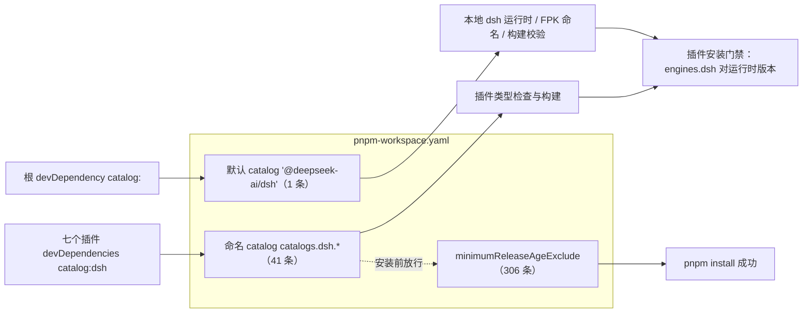
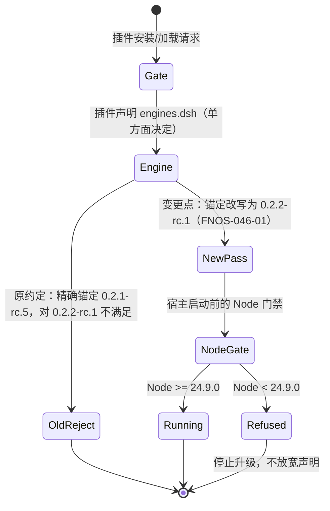
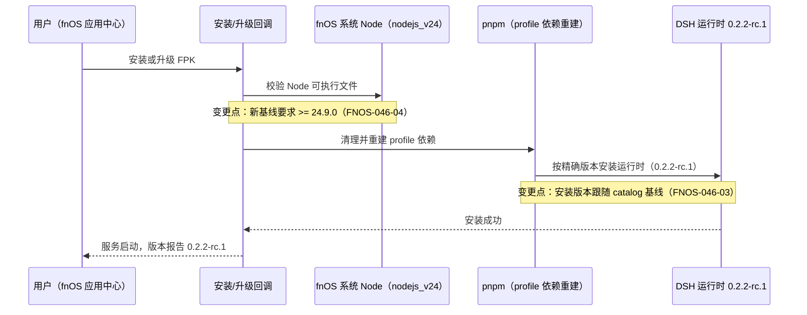
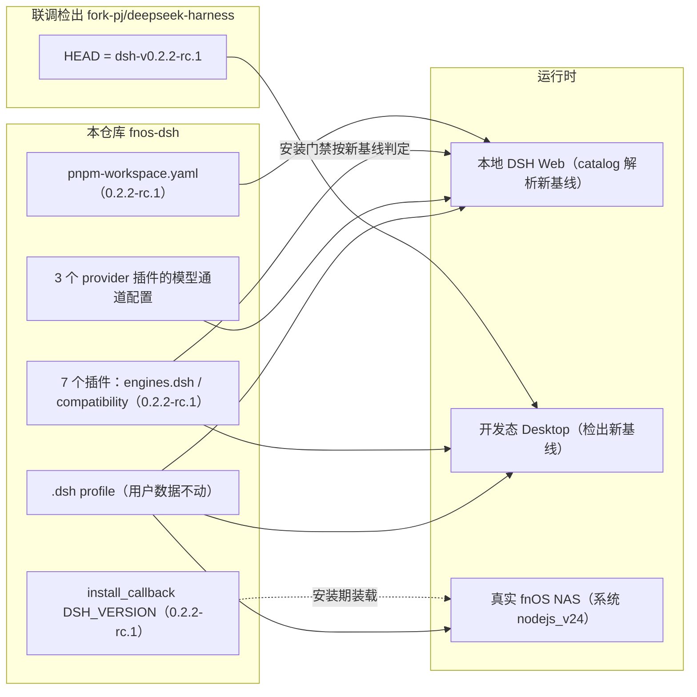
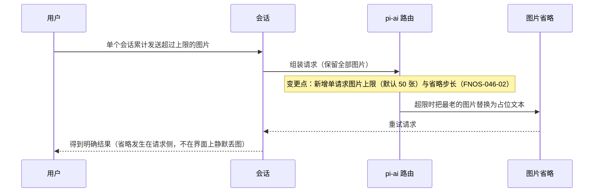

# PLAN-FNOS-046 DSH 0.2.2-rc.1 插件适配与基线升级

| 项目 | 内容 |
| --- | --- |
| 计划编号 | PLAN-FNOS-046 |
| 计划日期 | 2026-11-05 |
| 对应需求 | [FNOS-046 DSH 0.2.2-rc.1 插件适配与基线升级](/requirements/FNOS-046-dsh-022-rc1-adaptation) |
| 计划状态 | 规划中（前置取证任务未开始） |

## 计划目标

按 [FNOS-046](/requirements/FNOS-046-dsh-022-rc1-adaptation) 的功能编号完成基线升级：仓库运行/构建基线与联调检出统一到 `0.2.2-rc.1`，七个入库插件的锚定与兼容声明改写，落地的插件侧契约变化完成适配，Node 运行时门禁在真实 NAS 上取证成立，并在 DSH Web、DSH Desktop 与真实 fnOS NAS 上完成验收。

技术边界：改依赖锚定、兼容声明、基线常量、必要的契约适配与本地联调 profile；不改插件功能语义；不接入 0.2.2 新能力；不发布插件；不处理 CodeBuddy 副本与三方插件升级。

## 当前实现与目标设计

| 领域 | 当前实现 | 目标实现 | 迁移影响 |
| --- | --- | --- | --- |
| 默认 catalog 基线 | `pnpm-workspace.yaml` 的 `'@deepseek-ai/dsh'` 为 `0.2.1-rc.5`，是基线唯一读取源 | 改为 `0.2.2-rc.1` | 本地 `dsh` 运行时、FPK 命名与构建校验读同一份值 |
| 命名 catalog `dsh` | `catalogs.dsh.*` 共 41 条为 `0.2.1-rc.5`，是插件 `catalog:dsh` 的实际解析来源 | 全部改为 `0.2.2-rc.1` | 插件 devDependencies 解析到新基线，类型检查才对着新契约 |
| 发布龄期豁免 | `minimumReleaseAgeExclude` 共 306 条钉住 `0.2.1-rc.5` | 改为 `0.2.2-rc.1` | 不更新则 pnpm 因发布龄期门禁拒绝安装新发布的版本 |
| vendor 依赖锚定 | 默认 catalog `@deepseek-ai/cordis ^4.0.5`、`@deepseek-ai/schemastery 3.18.5`；命名 catalog 另有 `cordis ^4.0.1-rc.1` | 与上游 vendor 前进到 4.1.0 / 3.19.0（写法沿用各自既有形态） | 插件与共享包的宿主接缝运行在新 cordis 上 |
| 模型底座 | 默认 catalog `@earendil-works/pi-ai 1.1.0`，命名 catalog `^1.1.0`；三个模型通道插件自建 provider 配置 | 前进到 `1.3.x` | provider 配置面与图片路由行为一并变化，需回归 |
| 插件兼容声明 | 七个插件 `engines.dsh` 与 `compatibility.json` 的 `dshPluginApi.version` 均为 `0.2.1-rc.5`（精确锚定，只匹配该版本） | 改为 `0.2.2-rc.1`；`engines.node` 与 `compatibility.json` 的 node 声明对齐新下限 | 安装期门禁按新版本判定；精确锚定不前进则必然被拒 |
| 安装回调 | `cmd/install_callback` 的 `DSH_VERSION` 为 `0.2.1-rc.5` | 改为 `0.2.2-rc.1` | FPK 安装/升级期装载的运行时版本；构建校验比对 catalog，不一致直接失败 |
| Node 运行时 | 应用复用 fnOS 系统包 `nodejs_v24`，插件声明 `^22.19.0 || >=24.0.0` | 确认系统 Node ≥ 24.9.0；插件 node 声明对齐 `>=24.9.0` | 这是本轮唯一的「可能整批不可交付」项，必须先取证 |
| 模型图片路由 | 三个 provider 插件只声明图片字节上限 | 补声明单请求图片上限与省略步长，或显式采用默认并记录依据 | 默认 50 张会在超限时把最老图片替换为占位文本，属用户可观察行为 |
| 本地联调 profile | 组合清单停在 `0.2.1-rc.2` 的 experimental 依赖，且选中独立工作树组合包 | 依赖与检出随基线前进；按上游 Forge 统一入口约定调整组合包 | 该目录被 `.gitignore` 忽略，属本地环境；调整前备份 |
| 三方插件 | `dshmarket` 1.66.47 | **不动** | 其 peer 范围按门禁的含预发布语义已覆盖新基线 |
| 文档基线字样 | 应用描述的基线字样在 9 个语言文件里（清单用占位符引用语言包）；版本命令对该处的同步目标已过时，实际为空操作；应用文档页的基线行自动同步 | 语言文件与应用文档页同为新基线 | 漏改会让用户在应用详情里看到旧基线；这是本轮唯一没有自动化兜底的用户可见口径 |

三处基线必须同步前进，只改其一会造成「看起来升级了、实际仍按旧版安装」的假绿：

门禁判定路径（含本轮的预发布语义）：

安装/升级链路的编排变化（Node 取证从「构建期」移到「安装期与开工前置」）：

## 影响范围分析

| 需求功能 | 代码模块 | 配置/数据 | 测试 | 文档 | 目标环境 |
| --- | --- | --- | --- | --- | --- |
| FNOS-046-01 | 七个 `plugins/*-plugin/package.json`（`engines.dsh`、`engines.node`）、`plugins/*-plugin/compatibility.json` | 无用户数据变化 | 七个插件 `check`（typecheck+单测+build）、`tooling/fnos-dsh-cli` 基线用例 | 插件文档版本表随版本命令同步 | DSH Web、DSH Desktop |
| FNOS-046-02 | pi-ai 相关的三个插件 `src/host/{adapter,provider}.ts`；其余插件按类型检查结果适配；`packages/dsh-plugin-kit` 若封装了受影响接缝 | provider 配置（图片上限）属插件代码内常量，不落用户配置 | 三个插件的 provider 单测与图片路径用例；双客户端界面走查 | 若图片上限成为用户可感知行为，登记到插件文档 | DSH Web、DSH Desktop |
| FNOS-046-03 | `pnpm-workspace.yaml`（默认 catalog、命名 catalog、发布龄期豁免、cordis/schemastery/pi-ai 落点）、`apps/fn-deepseek-harness/cmd/install_callback`（`DSH_VERSION`）、构建门禁相关实现 | `pnpm-lock.yaml` 重锁 | `pnpm run check`（含 SDD 与基线一致性）、启动 DSH Web 核对版本、构建门禁变异验证 | `manifest` 与应用文档页由版本命令同步 | 本地构建链路、DSH Web、真实 NAS |
| FNOS-046-04 | `packages/fnos-gateway`（安装/启动前置检查）、`apps/fn-deepseek-harness/cmd/*_callback`（新增 Node 版本前置门禁） | 无 | 真实 NAS 安装/升级取证（系统 Node 版本 + 启动日志版本 + 低于下限时的拒绝行为）；门禁单测 | `docs/troubleshooting.md` 与本页补充 Node 下限 | 真实 fnOS NAS |
| FNOS-046-05 | 联调检出（仓库外）与本地联调 profile（`.dsh/`，不入库） | 本机 profile 组合清单（先备份） | 开发态 Desktop 启动取证（版本 + 插件加载） | 无（本地环境不入库） | DSH Desktop |
| FNOS-046-06 | 无代码改动（升级路径与数据读写保持不变） | 既有 `.dsh` profile 数据只读核对 | 迁移前后逐类核对会话、凭据、偏好、模型配置、授权目录 | 无 | DSH Web、DSH Desktop、真实 NAS |
| FNOS-046-07 | `bump.config.ts` 与版本命令产物（根 `package.json`、插件、`manifest`、应用文档页） | tag 只留本地 | 版本命令产物逐项核对；FPK 构建产物命名核对 | 需求/计划/测试用例三文档与索引 | 本地构建链路 |

## 架构与数据流

升级只动「版本锚定层 + 一处模型通道配置面」，不动插件业务逻辑与用户数据：

## 分阶段任务

| 任务 ID | 对应需求/验收 | 修改内容 | 前置条件 | 验证方式 |
| --- | --- | --- | --- | --- |
| PLAN-FNOS-046-T01-01 | FNOS-046-04 / AC-01 | 在真实 fnOS NAS 上只读取证系统 `nodejs_v24` 的版本（应用中心系统包信息或 `node --version`），记录到需求变更记录与测试用例文档 | NAS 可达、可只读登录 | 输出 Node 版本；`>= 24.9.0` 才继续 T02 |
| PLAN-FNOS-046-T01-02 | FNOS-046-05 / AC-01 | 联调检出 `git fetch --tags` 后 checkout `dsh-v0.2.2-rc.1`，按需 `pnpm install` | 官方 tag 已发布（已核实） | `git describe --tags` 输出 `dsh-v0.2.2-rc.1` |
| PLAN-FNOS-046-T01-03 | FNOS-046-02 / AC-04 | 逐条复核 13 条官方升级指南在本仓库的适用性（含已判定的 10 条不触及项），把结论与证据落到测试用例文档。注意指南是 `v0.2.2-alpha.2` 时点的快照，个别条目与最终 `rc.1` 源码不符，判定一律以 tag 源码为准 | T01-02 | 13 条各有结论与证据；「落在」项转为 T03 任务 |
| PLAN-FNOS-046-T01-04 | FNOS-046-01、02 | 包级契约比对（已完成）：插座目录（103 → 109，新增 6 个、无删除，本仓库 8 个注册插座的 `ownerProps`/`registerOptions` 零变化，`priority` 规则逐字未变）；命名 catalog 的 44 个依赖包（0 改名/0 删除，37 个仅版本变化，7 个实质变化，被删导出符号与本仓库导入交集为空）；语言键面（未收窄）；模型底座 `1.1.0 → 1.4.0` 类型声明比对（移除 25、新增 17，本仓库使用的 24 个根符号与 8 个子路径导出均保留，被移除符号零引用） | T01-02 | 输出比对清单；发现被删符号或改名时先更新需求再改代码 |
| PLAN-FNOS-046-T01-05 | FNOS-046-01、FNOS-046-04、FNOS-046-02 | 在**装好的新基线产物**上校核两处字面量补丁：①安装期对附件本地化包的三处目标文本（失配即安装期硬失败且无回退）；②fnOS 插件对宿主首页内联脚本的主题偏好替换目标文本（失配为静默失效，不报错）。两者都不能只在上游源码里核对——目标文本只存在于构建产物 | T01-02 | 两处目标文本在新产物中各自恰好命中一次；失配时记录并转为适配任务 |
| PLAN-FNOS-046-T02-01 | FNOS-046-03 / AC-01 | `pnpm-workspace.yaml` 三处基线同步（默认 catalog 1 条、命名 catalog 41 条、发布龄期豁免 306 条），并把 `cordis`、`schemastery`、`pi-ai` 的落点对齐上游 vendor 版本；同时把本轮被上游删除的包（`@deepseek-ai/dsh-client-ui-deepseek-model-label-1017`）从豁免清单移除，不给不存在的包留失效条目 | T01-01、T01-04 | `grep -c '0.2.1-rc.5' pnpm-workspace.yaml` 为 0；`cordis`/`schemastery`/`pi-ai` 取值与上游一致；豁免清单中每个包名在新基线仍存在 |
| PLAN-FNOS-046-T02-02 | FNOS-046-01、03 / AC-01 | 七个插件 `engines.dsh` 与 `compatibility.json` 的 `dshPluginApi.version` 改为新基线；`engines.node` 与 `compatibility.json` 的 node 声明对齐 `>=24.9.0` | T02-01 | 逐文件核对无旧基线残留；CLI 基线用例通过 |
| PLAN-FNOS-046-T02-03 | FNOS-046-03 / AC-02 | `apps/fn-deepseek-harness/cmd/install_callback` 的 `DSH_VERSION` 同步为新基线 | T02-01 | `DSH_VERSION` 与 catalog 一致；构建校验不报错 |
| PLAN-FNOS-046-T02-04 | FNOS-046-03 / AC-01 | `pnpm install` 重锁并安装新基线依赖 | T02-01 | 命令退出码 0；`pnpm ls @deepseek-ai/dsh` 报新基线 |
| PLAN-FNOS-046-T02-05 | FNOS-046-04 / AC-03 | 在安装/升级回调中新增 Node 版本前置门禁：读取系统 Node 版本并与 catalog 基线的 `engines.node` 下限比较，不足时在安装阶段失败并给出可执行提示。当前只判断可执行文件存在，Node 不足会「装成功但服务起不来」 | T01-01 | 门禁单测覆盖「满足 / 不满足 / 无法解析」三态；真实 NAS 上验证不足时安装即拒绝 |
| PLAN-FNOS-046-T02-06 | FNOS-046-03 / AC-01 | 补齐基线守卫：把 opencode、zcode 加入守卫的插件列表（当前只覆盖 5 个），并补充 vendor 补丁号与 `engines.node` 下限断言，使七个插件的锚定与 node 声明都被自动兜住 | T02-02 | 七个插件全部被守卫覆盖；变异验证：改动未覆盖插件的旧值应报错 |
| PLAN-FNOS-046-T03-01 | FNOS-046-02 / AC-03 | **必改项（不补即 `pnpm typecheck` 必红）**：解析后的模型通道配置新增两个必填字段——单请求图片上限与超限省略步长。三处构造点分别在 codex-auth `src/host/adapter.ts`、zcode `src/host/provider.ts`、opencode `src/host/provider.ts`。取值按各提供方单请求图片上限确定；无法核实时采用上游默认值并书面记录依据 | T01-04、T02-04 | 三个插件 typecheck 通过；provider 配置单测覆盖两个字段；带图对话验证超限提示可观察 |
| PLAN-FNOS-046-T03-02 | FNOS-046-01、02 | 按类型检查与单测暴露的接缝差异做最小适配（含共享包 `dsh-plugin-kit` 与 `dsh-semi-ui`）；不做功能扩展 | T02-02、T02-04 | 七个插件 `check` 全绿；改动只限接缝适配 |
| PLAN-FNOS-046-T03-03 | FNOS-046-05 / AC-02 | 本地联调 profile：先备份 `package.json` 与 `cordis.patch.yml`，再按上游 Forge 统一入口约定移除独立工作树组合包（或按需保留并禁用冲突项），依赖随检出重装 | T01-02 | 开发态 Desktop 正常启动；备份文件存在 |
| PLAN-FNOS-046-T04-01 | 全部 | 仓库级 `pnpm run check`（SDD、i18n、docs、packages、plugins、tooling）与七个插件逐个 `check` | T02、T03 | 命令退出码 0 |
| PLAN-FNOS-046-T04-02 | FNOS-046-01、02、06 / AC-01～AC-03 | DSH Web 回归：插件管理页、各插件代表功能、界面区块位置、亮暗主题、带图对话、既有数据 | T04-01 | 按测试用例文档执行并回填 |
| PLAN-FNOS-046-T04-03 | FNOS-046-01、02、05、06 | 开发态 Desktop 回归（项目 `.dsh` 作 `DSH_HOME`）：版本核对、插件加载、区块与主题、数据 | T01-02、T04-01；与 Web 测试不同时持有同一 profile 会话 | 按测试用例文档执行并回填 |
| PLAN-FNOS-046-T04-04 | FNOS-046-04 / AC-01～AC-03 | 真实 NAS：确认系统 Node ≥ 24.9.0 后，走应用中心正常安装/升级，观察服务启动与版本报告；同时记录不满足时的失败表现 | T04-01 | 安装成功并报告新基线；或记录明确失败原因（只读取证，不做破坏性改动） |
| PLAN-FNOS-046-T04-05 | FNOS-046-06 / AC-01、AC-02 | 升级前备份 `$DSH_HOME/storages`；升级后核对既有会话、提醒与定时任务仍可读；把「定时任务存储升级为单向、降级需用备份」写进排错文档 | T04-04 | 备份存在；升级后数据逐类可读；降级约束有文档落点 |
| PLAN-FNOS-046-T05-01 | 全部 | 需求/计划/测试用例三文档登记、索引与侧栏更新；`pnpm run check -- --sdd` 与文档构建 | T04 | 命令通过 |
| PLAN-FNOS-046-T05-02 | FNOS-046-07 / AC-01、AC-02 | 功能改动提交后执行 `pnpm run version -- major --yes` 推进到 `8.0.0`（版本提交独立于功能提交） | T04 完成且工作区干净 | 版本产物核对：根 `package.json`、插件、`manifest`、应用文档页同值，基线字样为新基线 |
| PLAN-FNOS-046-T05-03 | FNOS-046-07 | 构建 FPK 核对产物命名含 `dsh-0.2.2-rc.1`，并在需求变更记录登记后续验证项（插件 npm 发布、市场索引） | T05-02 | 产物路径与命名核对通过 |

任务依赖顺序：T01 → T02 → T03 → T04 → T05。其中 T01-01 是**开工门禁**：系统 Node 版本不达标时停止升级并报告，不进入 T02。

## 交互和行为设计

本计划无新增用户界面交互。需要走查的交互面是既有插件界面在新运行时上的回归（沿用 [FNOS-014](/requirements/FNOS-014-dsh-021-rc2-adaptation) 建立的走查基线），另加一条新的用户可感知行为——模型请求的图片上限：

适配结论有两种合法收口：一是为图片上限较高的提供方显式声明上限，保持与旧基线一致的请求形态；二是确认默认值可接受，并把这个默认值写进插件的文档与测试用例。两条都必须留下文字依据，不能以「没报错」作为结论。

## 数据、权限和错误处理

- 无新增持久化；`.dsh` profile 的用户数据（凭据、账号、偏好、模型配置、授权目录、会话）在升级前后只读核对，不清理、不改写。
- 升级前必须备份本地联调 profile 的 `package.json` 与 `cordis.patch.yml`（上游指南要求，改动组合包前执行）。
- 失败与回滚：`pnpm-workspace.yaml` 三处基线、七个插件的 `engines.dsh`/`compatibility.json`、`install_callback` 全部回退到 `0.2.1-rc.5` 并重新 `pnpm install`；联调检出 checkout 回 `dsh-v0.2.1-rc.5`；本地 profile 用备份文件恢复。
- Node 门禁失败按「停止并报告」处理：不放宽 `engines` 声明、不加版本豁免、不降级安装到旧运行时冒充通过。若系统包版本不足，需求状态登记为阻塞并说明所需操作。
- 发布龄期门禁：新基线刚发布时，未列入豁免清单的精确版本会被 pnpm 拒绝安装；T02-01 必须同步豁免清单，而不是临时关闭门禁。
- 版本命令有工作区干净硬守卫：先提交功能改动再执行版本命令；版本提交与功能提交分开。

## 依赖、风险和决策

### 依赖

| 依赖 | 版本 | 用途 |
| --- | --- | --- |
| `@deepseek-ai/dsh` 系列 | `0.2.2-rc.1`（npm `next` 标签） | 运行时与插件 peer；`latest` 仍为旧基线，不按 `latest` 取版本 |
| `@deepseek-ai/cordis` / `@deepseek-ai/schemastery` | 4.1.0 / 3.19.0 | 插件宿主接缝与配置校验 |
| `@earendil-works/pi-ai` | `1.3.x`（上游 `^1.3.0`） | 三个模型通道插件的模型底座 |
| `dshmarket` | `1.66.47`（peer 含预发布语义已覆盖新基线） | FPK 内置三方插件，不换版本 |
| 官方仓库 tag `dsh-v0.2.2-rc.1` | — | 联调检出基线 |
| fnOS 系统包 `nodejs_v24` | `>= 24.9.0` | 应用运行时 Node，**待真实 NAS 取证** |

### 风险

| 风险 | 影响 | 缓解 |
| --- | --- | --- |
| fnOS `nodejs_v24` 低于 24.9.0 | 新基线无法在应用环境运行，整批不可交付 | T01-01 作为开工门禁先取证；不达标即停止并报告所需操作，不修改声明绕过 |
| 13 条指南之外的 2600 余条上游改动隐藏契约变化（包改名、子路径导出删除、服务签名变化） | 插件在新基线上编译失败或运行期缺符号 | T01-04 做包级比对；T02-04 装新依赖后以全量 typecheck 与单测暴露差异；发现被删符号先更新需求再动手 |
| pi-ai 1.3 的适配层行为变化不止图片上限 | 三个模型通道插件的请求形态、重试或错误映射改变 | 三个插件各自跑 provider 单测与真实对话；变更点逐项记录 |
| 只改默认 catalog 就以为完成迁移 | 插件仍按旧基线安装，类型检查对着旧契约通过，属假绿 | 计划明确三处同步；T02-01 以 `grep -c` 断言旧基线零残留 |
| 图片上限默认值悄悄改变既有行为 | 用户带图对话在超过 50 张时被省略且不自知 | T03-01 显式声明或书面接受默认；测试用例覆盖超限场景 |
| 安装回调与 catalog 不同步 | 构建校验失败；或 FPK 装出的运行时与插件声明不匹配 | T02-03 与 T02-01 同批执行，T04-01 的基线一致性用例兜底 |
| 上游删除的客户端 UI 包仍被某个组合包间接依赖 | 安装时报模块缺失或插件加载失败 | 以 `pnpm install` 结果与插件加载日志验证；确认官方已把该能力并入其它包后按新基线调整组合包，而不是把包名补回豁免清单 |
| 本地联调 profile 组合包冲突（独立工作树包与 Forge 统一入口重复 id） | 开发态 Desktop 控件变只读，验收环境失效 | T03-03 先备份再按上游指南调整；只影响本地环境，不入库 |
| 版本档位误用（把基线变更当 `patch`/`minor`） | 用户以为是小版本升级，实际运行时大变 | 版本命令守卫强制 `--baseline` 只配 major；本计划明确 `major`、目标 `8.0.0` |
| Node 低于下限时「装成功但服务起不来」：应用侧没有版本门禁，npm 只发引擎警告 | 用户看到安装成功、随后启动超时，难以判断原因 | T02-05 新增安装期前置门禁；AC-03 以「不足时安装即拒绝」为完成标准 |
| 安装期对上游产物的字符串补丁失配 | 安装期硬失败，且两处补丁无回退 | T01-05 先在新产物上逐条核对目标文本；失配则同步适配补丁 |
| 基线守卫盲区：opencode、zcode 不在守卫插件列表中 | 这两个插件的锚定或 node 声明漏改不会被任何测试发现 | T02-06 补齐列表与断言，并用变异验证证明守卫真的会红 |
| 用户可见基线字样漏改：9 个语言文件没有自动化同步 | 应用详情里仍显示旧基线，与安装包命名不一致 | T05-01 把「语言文件基线字样」列进发版前核对项 |
| 未声明接缝（fnOS 插件用的 4 个宿主内部服务、跨插件共用的主题令牌与语言包结构）不在兼容声明与类型检查覆盖内 | 编译与门禁全绿，但主题或「用其它应用打开」等功能静默退化 | 兼容清单不能当唯一依据：T04-02/T04-03 的代表功能走查必须逐项覆盖这些接缝；T01-05 校验首页注入目标文本 |
| 首页主题注入静默失效 | 用户在 fnOS 切换主题后 DSH 不跟随，且没有任何报错可查 | T01-05 校验目标文本；走查包含亮暗主题切换（AC-02） |

### 决策

| 决策 | 选择 | 否决方案 | 原因 |
| --- | --- | --- | --- |
| 基线改写与版本命令的分工 | 功能提交内手工同步三处 catalog 与插件锚定，验证通过后执行纯 `pnpm run version -- major --yes` | 直接用 `major --baseline 0.2.2-rc.1` 一次性切换 | `--baseline` 只改写默认 catalog 那一行，且要求执行时基线与新值不同。本仓库插件已全部走命名 catalog + 发布龄期豁免，只改一行会导致插件仍按旧版安装、豁免清单拦安装；先改齐三处再装，版本命令看到基线与当前相同，走纯 major 是工具明确支持的路径（与 FNOS-036 同一取舍） |
| 开工顺序 | 先做 Node 取证（T01-01）再改锚定 | 先把锚定改完再看能不能装 | Node 下限决定整批是否可交付；先改后测会在真机阶段整批回退，代价远大于一次只读取证 |
| 图片上限处理 | 显式声明或书面接受默认，两者都要留依据 | 不处理，等用户反馈 | 默认 50 张是用户可观察行为变化，不处理的默认结果就是静默改变既有行为 |
| 发布龄期豁免清单的维护方式 | 手工同步版本号，并移除本轮被上游删除的包 | 对全文件做旧版本→新版本的字面替换 | 字面替换会给已不存在的包留下失效条目；仓库层不该制造这类条目（已安装 profile 上的失效条目由安装回调自愈，见 [FNOS-012](/requirements/FNOS-012-codebuddy-model-speed-and-client-version)） |
| 0.2.2 新能力 | 本轮不接入 | 借升级顺手接 Forge / action-cards 等 | 基线升级与功能扩展混批会让回归范围失控；新能力按需求单独立项 |
| CodeBuddy 副本 | 保持不动 | 同步迁移 | FNOS-025 已下架，适配没有交付价值 |
| `dshmarket` | 保持 1.66.47 | 升级到最新 | 现有 peer 范围在门禁语义下已覆盖新基线，无必要时不动三方依赖 |
| 市场索引 | 本轮不重新生成 | 随迁移一起生成 | 索引记录已发布版本的快照；本轮不发布，重新生成只会写入不存在的版本 |
| 联调检出 | fetch 后 checkout 官方 tag | 在旧 tag 上叠加补丁 | 上游只作为契约参考，不在本地改上游代码 |
| Node 门禁的落点 | 在安装/升级回调里新增前置版本校验 | 依赖 npm 的引擎告警或让启动阶段暴露问题 | npm 对 `engines` 只告警不阻断；启动阶段暴露问题时用户已经「装成功」，排查成本高且正是 AC-03 要避免的形态 |
| 基线守卫范围 | 补齐到七个插件并加 vendor 与 node 断言 | 维持现状，靠人工核对 | 守卫自述「漏项 = 无人守门」，而实测已漏两个插件；人工核对正是本轮最容易漏的地方 |
| 语言文件的基线字样 | 手工同步，并在发版前核对清单里显式列出 | 依赖版本命令自动同步 | 版本命令的同步目标已过时（清单里没有该字样），实测为空操作 |
| 兼容清单在核对中的角色 | 只作锚定与安装门禁的依据，不当依赖面清单使用 | 按兼容清单逐项核对新基线影响 | 实测清单不含六个插件共用的会话 UI 包、配置校验库，也不含 fnOS 插件使用的 4 个内部服务；只按它核对会正好漏掉风险最高的接缝 |

## 测试、打包、发布和回滚

- **包级验证**：七个插件逐个 `check`（typecheck、单测、build）、仓库级 `pnpm run check`（含 SDD 校验与基线一致性）、构建门禁变异验证（注入旧基线或字面版本应报错）。
- **DSH Web**：`pnpm run start -- --web`（`DSH_HOME` 指向仓库 `.dsh`），覆盖版本核对、七插件加载、代表功能、界面回归、带图对话、亮暗主题与既有数据。
- **DSH Desktop**：上游检出开发态 Desktop（T01-02 已切到新 tag），渲染调试端口取证；与 Web 测试不同时持有同一 profile 会话。
- **真实 fnOS NAS**：先只读取证系统 Node 版本，再走应用中心正常安装/升级并观察启动与版本报告；只读 SSH 仅用于取证，不做破坏性调试。
- **文档站**：`pnpm run build -- --docs` 与 `git diff --check`。
- **打包发布**：FPK 按 [FNOS-044](/requirements/FNOS-044-fpk-platform-selection) 的双平台流程构建，产物命名应含 `dsh-0.2.2-rc.1`；版本推进由 `pnpm run version -- major --yes` 完成，tag 只留本地由发布者手动推送。
- **回滚**：三处基线、插件锚定与兼容声明、`install_callback` 回退旧基线并重装；联调检出 checkout 回旧 tag；本地 profile 用备份恢复；版本按版本管理规范用 `git revert` 回退整条版本提交。禁止删除 `.dsh` 用户数据。

用例设计与执行结果回填到 `docs/tests/FNOS-046-dsh-022-rc1-adaptation.md`，本计划不展开用例表。

## 参考资料

| 来源 | 用途 |
| --- | --- |
| npm `@deepseek-ai/dsh` dist-tags/versions（2026-11-05） | 新基线发布事实与 `next`/`latest` 标签位置 |
| 上游 `dsh-v0.2.1-rc.5..dsh-v0.2.2-rc.1` 提交与文件差异 | 变更规模（2623 提交 / 8120 文件）、包数量与 experimental 包增减 |
| 上游 `docs/upgrade-guide/v0.2.2-alpha.2/*/guide.zh.md`（13 篇） | 破坏性变化的权威说明 |
| 上游 `packages/boot/app-boot/src/plugin-compatibility.ts` | 安装门禁的判定实现（`engines.dsh` 单方面决定、含预发布判定） |
| 上游 `packages/llm/llm-pi-ai`（配置 schema 与 README） | 图片上限与省略步长字段、默认值 |
| 上游 `packages/llm/llm/src/types.ts` | 请求用途声明的类型面变化 |
| [FNOS-036](/requirements/FNOS-036-dsh-021-rc5-adaptation) 与 [PLAN-FNOS-036](/plans/PLAN-FNOS-036-dsh-021-rc5-adaptation) | 上一轮基线迁移先例与锚定约定 |
| [版本管理](/build/versioning) | 档位规则、`--baseline` 语义与发布批次 |
| [测试用例文档规范](/charter/tests-spec) | 双客户端与真实 NAS 执行与取证口径 |

## 完成状态

| 阶段 | 状态 | 说明 |
| --- | --- | --- |
| T01 前置取证与契约比对 | 未开始 | Node 版本复核、联调检出、13 条指南逐条复核、包级契约比对、安装期字符串补丁校核 |
| T02 基线锚定改写 | 未开始 | 三处 catalog、vendor 与 pi-ai 落点、七插件锚定与 node 声明、安装回调、Node 前置门禁、基线守卫补齐、重锁 |
| T03 契约适配 | 未开始 | pi-ai 图片上限、类型检查驱动适配、本地联调 profile 调整 |
| T04 验证 | 未开始 | 包级、DSH Web、DSH Desktop、真实 NAS |
| T05 文档与版本 | 未开始 | 三文档与索引、版本推进到 `8.0.0`、产物命名核对 |

## 变更记录

| 日期 | 变更 | 说明 |
| --- | --- | --- |
| 2026-11-05 | 初始登记 | 建立 PLAN-FNOS-046：五阶段任务（前置取证与契约比对 → 锚定改写 → 契约适配 → 验证 → 文档与版本）。基线改写采用「功能提交内同步三处 catalog + 纯 major 版本提交」，理由见决策章节；Node 取证列为开工门禁；图片上限适配与 0.2.2 新能力分离处理。 |
| 2026-11-05 | 调研收口后修订 | 依据上游逐包比对与平台链路清点补充：三个模型通道插件的 provider 配置新增两个必填字段，属编译期必改；定时任务存储域单向升级纳入数据验收（T04-05）；安装期对上游产物的字符串补丁（T01-05）、Node 前置门禁（T02-05）、基线守卫盲区（T02-06）新增任务；语言文件基线字样改为手工同步并列入发版核对。 |
