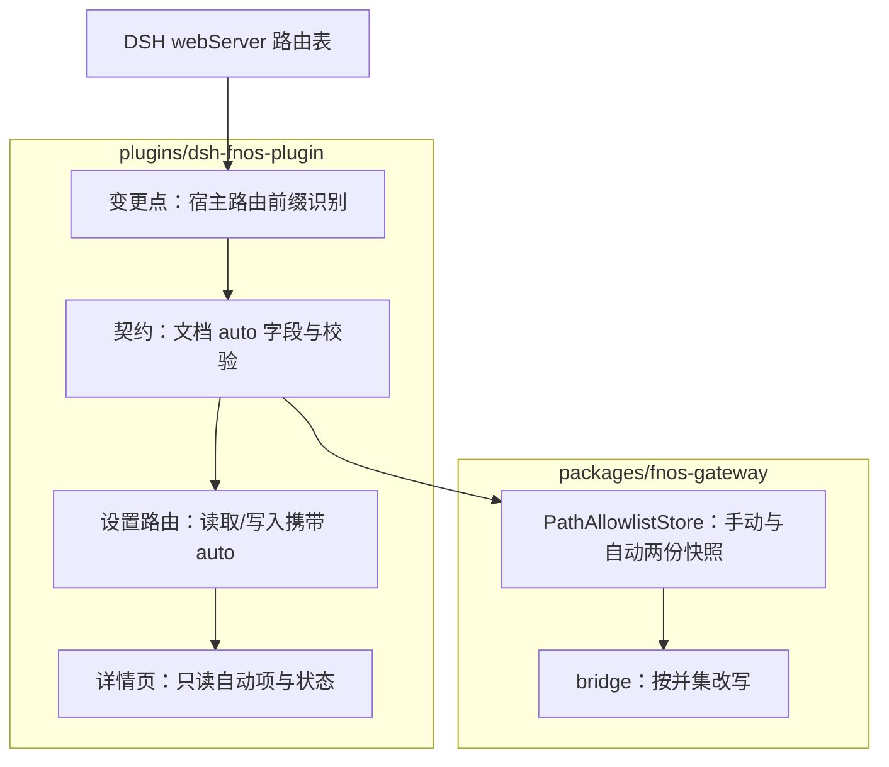
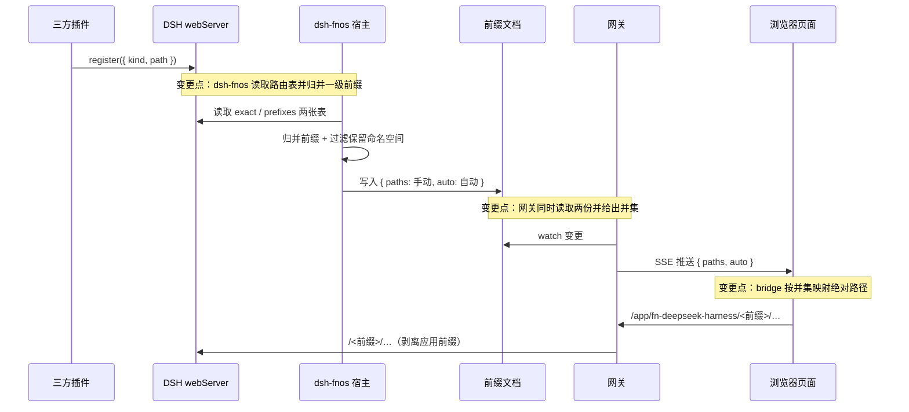
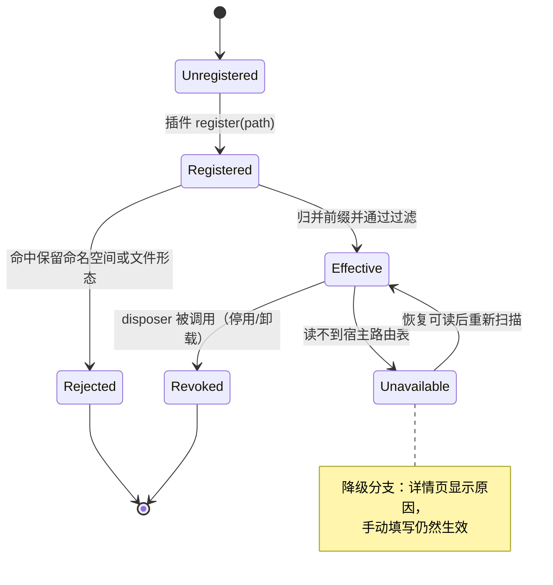

# PLAN-FNOS-052 三方插件绝对路径经应用网关自动代理

| 项目 | 内容 |
| --- | --- |
| 计划编号 | PLAN-FNOS-052 |
| 计划日期 | 2026-11-09 |
| 对应需求 | [FNOS-052 三方插件绝对路径经应用网关自动代理](/requirements/FNOS-052-gateway-auto-proxy) |
| 计划状态 | 规划中 |

## 计划目标

按 [FNOS-052](/requirements/FNOS-052-gateway-auto-proxy) 的五个功能编号，把「插件注册了哪些绝对路径前缀」这份知识从用户手里收回到应用内：`dsh-fnos` 宿主读取 DSH web 服务的路由表，归并出一级前缀写入网关的前缀文档；网关把它与手动项一并下发给页面 bridge，浏览器照既有规则完成改写。

技术边界：

- 只改 `plugins/dsh-fnos-plugin`（宿主识别、路由、详情页呈现）与 `packages/fnos-gateway`（文档字段、快照、bridge 合并）；
- 不修改 DSH 上游，对宿主路由表的读取只发生在插件进程内，且**读不到时必须正常降级**；
- 不改飞牛网关的入口前缀（仍只有 `/app/fn-deepseek-harness`），不新增对外暴露的路由。

## 当前实现与目标设计

| 领域 | 当前实现 | 目标实现 | 迁移影响 |
| --- | --- | --- | --- |
| 前缀来源 | 只有用户手填（`gatewayProxyPaths` 设置项） | 自动识别 + 用户手填两路并存 | 设置项语义由「必填」变为「补充」，旧值原样保留 |
| 前缀文档 | `{ version: 1, paths: string[] }` | `{ version: 1, paths: string[], auto?: string[] }` | 新增字段可选；旧网关忽略 `auto`，行为回到纯手动 |
| 网关快照 | `PathAllowlistStore` 只有一份 `paths` | 保留手动 `paths` 与自动 `auto` 两份，另给 `effective()` 并集 | 快照结构与 SSE 载荷增加 `auto`，客户端按并集消费 |
| 页面 bridge | `customPaths` 取 `snapshot().paths` | 取 `paths ∪ auto` | 旧页面不涉及跨版本共存（bridge 由网关随页注入） |
| 详情页配置区 | 可编辑文本框 | 可编辑手动项 + 只读自动项 + 识别状态 | 只读区沿用「系统内置」的呈现口径 |
| 宿主耦合 | 无 | 读 `webServer` 的 `exact` / `prefixes` 两张路由表，并包装 `register` 捕获后注册 | 属于内部字段依赖，需按基线做契约测试与降级分支 |
| 生命周期 | 无自动项 | 路由注销即前缀撤销，前缀集合按需重算 | 插件停用后不留残影 |

## 影响范围分析

| 需求功能 | 代码模块 | 配置/数据 | 测试 | 文档 | 目标环境 |
| --- | --- | --- | --- | --- | --- |
| FNOS-052-01 | `plugins/dsh-fnos-plugin` 新增宿主识别模块 | 前缀文档 `auto` 字段 | 宿主识别单元测试（含读不到路由表的降级） | `docs/plugins/dsh-fnos.md` | DSH Web |
| FNOS-052-02 | `packages/fnos-gateway` 的 `path-allowlist.ts`、`client/bridge.ts`、`server/proxy.ts` | SSE 载荷与浏览器路径集合 | 快照并集、bridge 映射（含 EventSource 与 WebSocket） | 同上 | DSH Web |
| FNOS-052-03 | `plugins/dsh-fnos-plugin` 契约、设置路由、详情页 | `gatewayProxyPaths` 保持手动语义 | 契约一致性 + 界面用例 | `docs/plugins/dsh-fnos.md` | DSH Web |
| FNOS-052-04 | 宿主识别的过滤规则与注销链路 | 无 | 保留命名空间、文件形态、注销用例 | 同上 | 单元测试 |
| FNOS-052-05 | 详情页状态区与文案（九语言） | 无 | 界面用例 + 文案键完整性 | 同上 | DSH Web |
| 全部 | 应用 `manifest` 的 `desc` / `changelog` | 版本号 | 发布前自查 | 应用页 | 真实 fnOS NAS |

## 架构与数据流

前缀从「插件注册」到「浏览器改写」要经过四跳，任何一跳失败都必须在界面上可见。

前缀集合自身也有状态：注册、识别、生效、撤销。

## 设计决策

| 决策点 | 采用方案 | 被否决方案 | 理由 |
| --- | --- | --- | --- |
| 前缀知识来源 | 读宿主进程内路由表 | 浏览器失败重试学习；网关探测端点 | 路由表是唯一权威且零额外请求；失败重试对 SSE/WebSocket 无效（没有第二次机会），探测端点的 GET 也可能有副作用 |
| 文档字段形态 | 手动 `paths` 与自动 `auto` 分开存 | 合并成一个 `paths` | 分开存才能让「自动项只读、手动项可编辑」成立；也让旧网关自然退化为纯手动 |
| 后注册路由的捕获 | 包装 `register`，并在读取状态时重算 | 仅定时轮询 | 包装精确且零轮询；重算兜住「包装不可用」与「页面重新打开」两种情况，轮询纯属浪费 |
| 前缀粒度 | 一级路径段 | 完整路径逐条登记 | 与现有手填口径一致（`/plugin-api/get/me` → `/plugin-api`），且路由可能成百上千条（`dshmarket` 有 51 条），逐条登记既冗余又易漏 |
| 详情页呈现 | 自动项只读、手动项可编辑，附整体开关与状态 | 全部合成一个可编辑列表 | 让用户编辑自动项等于允许制造与真实路由不一致的配置，且下次重算即被覆盖，属于自相矛盾的交互 |
| 手动项去留 | 保留，语义降为「补充」 | 直接删除 | 未被本进程注册的绝对路径仍在方案覆盖之外，删掉就没有逃生口 |

### 依赖的上游事实

- DSH web 服务 0.2.2-rc.1 的 `WebServer` 实例上存在 `exact` 与 `prefixes` 两张 `Map`，`register()` 是唯一写入点。**这是内部字段，不是公开契约**，因此：识别模块必须按「字段缺失 → 报告不可用」处理，不得抛错；契约测试按基线版本固定这条假设，基线升级时该用例变红即提醒复核。
- 若上游未来提供路由枚举或注册事件，识别模块应优先使用公开接缝，本次实现不为此预留抽象层。

## 分阶段任务

| 编号 | 任务 | 对应功能 | 写入范围 | 前置 | 验证 |
| --- | --- | --- | --- | --- | --- |
| PLAN-FNOS-052-T01-01 | 契约：文档 `auto` 字段、保留命名空间、过滤规则、状态类型 | FNOS-052-04 | `plugins/dsh-fnos-plugin/src/contracts/gateway-proxy-contract.ts` | — | 契约用例：手填与自动走同一套规范化，非法项不静默混入 |
| PLAN-FNOS-052-T02-01 | 宿主前缀识别：读两张路由表、归并一级段、过滤、包装 `register`、注销重算 | FNOS-052-01、04 | `plugins/dsh-fnos-plugin/src/host/gateway-auto-prefixes.ts`（新增） | T01-01 | 单元测试：前缀归并、保留命名空间、文件形态、注销后消失、字段缺失降级 |
| PLAN-FNOS-052-T03-01 | 设置路由与镜像：写入带 `auto`，重算后防抖落盘，重装恢复只认手动项 | FNOS-052-01、03 | `plugins/dsh-fnos-plugin/src/host/gateway-proxy-routes.ts` | T02-01 | 用例：自动项不写进设置项；恢复逻辑忽略 `auto`；并发写不互相覆盖 |
| PLAN-FNOS-052-T04-01 | 网关文档解析：读 `auto`、快照保留两份、新增并集 | FNOS-052-02 | `packages/fnos-gateway/src/server/path-allowlist.ts` | T01-01 | 用例：版本严格性不变、`auto` 缺失等价空、并集去重排序、双层校验一致 |
| PLAN-FNOS-052-T05-01 | bridge 与注入：SSE 载荷含 `auto`，`customPaths` 取并集，前缀变更即时生效 | FNOS-052-02 | `packages/fnos-gateway/src/client/bridge.ts`、`src/server/proxy.ts`、`src/config/bridge-config.ts` | T04-01 | 用例：并集映射 fetch/EventSource/WebSocket/图片；旧载荷无 `auto` 时行为不变 |
| PLAN-FNOS-052-T06-01 | 详情页：只读自动项、整体开关、状态与降级说明、九语言文案 | FNOS-052-03、05 | `plugins/dsh-fnos-plugin/src/components/*`、`src/client/**` | T03-01、T05-01 | 界面用例：只读项不可编辑、开关生效、降级文案出现、九语言键齐全 |
| PLAN-FNOS-052-T07-01 | 文档与登记：插件文档、应用页、索引与菜单 | 全部 | `docs/plugins/dsh-fnos.md`、`docs/apps/fn-deepseek-harness.md`、两份索引、`docs/.vitepress/config.mts` | T06-01 | 文档构建与 `git diff --check` |
| PLAN-FNOS-052-T08-01 | Manifest `desc` / `changelog` 与版本推进 | 全部 | `apps/fn-deepseek-harness/manifest`、`apps/fn-deepseek-harness/i18n/*` | T07-01 | `pnpm run version` 两条提交 + 发布前自查 |

## 交互和行为设计

详情页配置区自上而下：

1. **三方插件 proxy**（保持现有标题与 tip 说明，文案把「必填」改为「一般无需填写」）；
2. **自动识别**：开关 + 状态行（已启用 / 已关闭 / 当前环境不可用 + 原因）；
3. **自动接管的前缀**：只读列表，与现有「系统内置」同一呈现口径，为空时显示「暂无」；
4. **手动补充的前缀**：现有文本框与保存行为不变。

用户在自动识别生效时不产生任何新增操作；需要排查时可以把开关关掉，行为立刻回到纯手动。

## 数据、权限和错误处理

- **数据**：前缀文档新增 `auto` 字段，手动 `paths` 与设置项 `gatewayProxyPaths` 的值与格式不变；重装恢复只从文档的 `paths` 回填设置项，`auto` 每次重算不持久化为用户配置。
- **写入串行**：文档写入沿用现有串行队列与原子改名，避免自动重算与用户保存互相覆盖；自动重算按防抖合并，短时间内多次注册只落盘一次。
- **错误**：
  - 路由表字段缺失 → 标记「不可用」，详情页显示原因，手动项照常生效，不抛错、不重试循环；
  - 文档写入失败 → 记录日志并保留上一份快照，不阻断设置读取；
  - 自动项全部被过滤 → 显示「暂无」，不是错误状态。
- **权限**：设置路由沿用现有同源校验；新增的自动项不引入任何新的对外读取入口。

## 依赖、风险和决策

| 项 | 内容 | 应对 |
| --- | --- | --- |
| 上游内部字段依赖 | 读取 `exact` / `prefixes` 与包装 `register` 都非公开契约 | 契约测试按基线固定；字段缺失走降级；基线升级时用例变红触发复核 |
| 前缀过宽 | 归并到一级段可能接管相邻命名空间 | 保留命名空间过滤 + 文件形态过滤；自动项只读，用户无法扩大范围 |
| 前缀冲突 | 两个插件使用同一一级段 | 并集天然去重；归属歧义不影响转发（都到同一上游） |
| 前缀残留 | 插件停用后仍被接管 | 注销时重算，并以「读取状态即重算」兜底 |
| 升级窗口期版本错配 | 新插件配旧网关 | 旧网关忽略 `auto`，退化为纯手动；不出现整份拒绝 |
| 覆盖边界 | 未被本进程注册的绝对路径仍不生效 | 保留手动项；文档与 tip 明确说明这条边界 |

## 测试、打包、发布和回滚

- **包级**：`plugins/dsh-fnos-plugin` 与 `packages/fnos-gateway` 的既有用例必须全绿；新增用例覆盖 T01–T06 的验证列；bridge 用例逐条做反转验证（去掉并集逻辑应立刻变红）。
- **应用级**：构建 FPK 后在 DSH Web 走查——空手动清单下插件市场与任务看板可用、事件流首连即通、关闭自动识别后行为回到手动。
- **真实 NAS**：正常安装升级，确认已有手动前缀与落盘数据不变、插件可用；验收结论回填到 `docs/tests/`（与需求同编号）。
- **回滚**：把自动识别开关关掉即回到纯手动（无需回滚版本）；需要彻底回退时回装上一版 FPK，前缀文档多出的 `auto` 字段被旧网关忽略。
- **发布**：按[版本文档](/build/versioning)推进，功能提交与版本提交分开；发版前用 `git log <上一个 tag>..HEAD --no-merges` 自查全部业务提交同属 FNOS-052。

## 参考资料

- [fnnas-docs 统一网关](https://developer.fnnas.com/docs/core-concepts/gateway-registration)（`gatewayPrefix` 与 `gatewaySocket` 约束、WebSocket 同前缀要求）
- `@deepseek-ai/dsh-host-webserver@0.2.2-rc.1`：`lib/types/index.d.ts` 的路由接缝与 `lib/index.js` 的 `register` / `match` 实现
- 已安装 profile 内 `dshmarket@1.73.12`（51 条 `exact` 路由）与 `dsh-taskboard`（`prefix` + `exact`）的真实注册形态
- 本仓库既有实现：`packages/fnos-gateway/src/server/path-allowlist.ts`、`src/client/bridge.ts`、`plugins/dsh-fnos-plugin/src/host/gateway-proxy-routes.ts`

## 完成状态

| 阶段 | 状态 |
| --- | --- |
| T01 契约 | 未开始 |
| T02 宿主识别 | 未开始 |
| T03 设置路由与镜像 | 未开始 |
| T04 网关文档解析 | 未开始 |
| T05 bridge 与注入 | 未开始 |
| T06 详情页与文案 | 未开始 |
| T07 文档与登记 | 未开始 |
| T08 Manifest 与版本 | 未开始 |

## 变更记录

| 日期 | 变更 |
| --- | --- |
| 2026-11-09 | 建立计划：确定「读宿主路由表」为主方案、失败重试为被否决项；前缀文档采用手动与自动分开存的双字段形态；记录上游内部字段依赖与降级分支。 |
