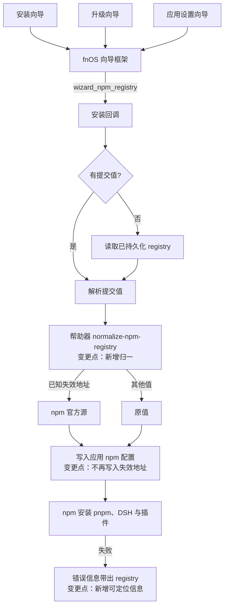
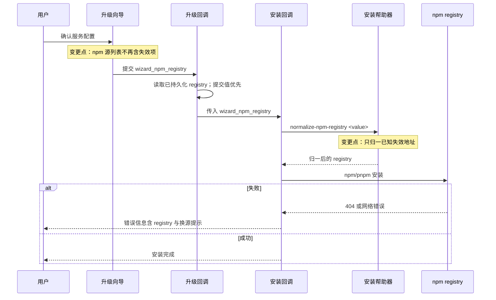

# PLAN-FNOS-055 安装向导移除失效的 npm 镜像源

| 项目 | 内容 |
| --- | --- |
| 计划编号 | PLAN-FNOS-055 |
| 计划日期 | 2026-11-18 |
| 对应需求 | [FNOS-055 安装向导移除失效的 npm 镜像源](/requirements/FNOS-055-invalid-npm-mirror-removal) |
| 计划状态 | <Badge type="warn" text="待完成" /> |
| 关联发布 | 8.2.2（8.2 发布线的下一个补丁；若合入顺序变化导致实际承载版本不同，按版本通道规则同步 `targetVersion`） |

## 计划目标

按 [FNOS-055](/requirements/FNOS-055-invalid-npm-mirror-removal) 完成四件事：

1. 三份向导的 npm 镜像源清单移除失效项，保留其余五个源；全新安装与应用设置默认 npm 官方源，升级向导默认空值（FNOS-055-01）。
2. 解析规则按场景统一：向导留空或提交已移除源 → npm 官方源；字段缺失（旧版本升级/无向导）→ 本地持久化源；用户显式选择其他源 → 该源（FNOS-055-02）。
3. pnpm 安装失败信息带出实际使用的 registry 与换源提示（FNOS-055-03）。
4. 守卫用例与九语言发布说明跟随，三份向导的字段与选项保持一致（FNOS-055-04）。

技术边界：只改向导 JSON、安装回调、安装帮助器、守卫用例与 i18n 描述；不改 nrm 镜像卡，不改应用设置页的生效时机，不改 DSH 运行时基线。

## 当前实现与目标设计

| 领域 | 当前实现 | 目标实现 | 迁移影响 |
| --- | --- | --- | --- |
| 向导源清单 | `wizard/install`、`wizard/upgrade`、`wizard/config` 各含 7 个选项，其中 `npmMirror` 指向 `https://skimdb.npmjs.com/registry/`；三份 `initValue` 都是 npm 官方源 | 三份各含 6 个选项；`install` / `config` 默认 npm 官方源，`upgrade` 默认空值 | 失效值不再由新界面产生；升级默认空值由回调解释为 npm 官方源 |
| 旧值处理 | 安装回调优先用向导提交值，否则读已持久化 registry；空值也会回落到本地持久化源 | 用「字段存在 vs 缺失」区分：字段存在（含空值）时以提交值为准，空值→npm 官方源；字段缺失才读本地持久化源；之后统一归一经移除地址 | 升级留空不再继承旧镜像；仅老版本无字段时沿用本地配置 |
| 失败诊断 | pnpm 安装失败只报 `Unable to install pnpm@<version>` | 追加 `from <registry>` 与换源提示 | 用户能判断是源失效而非依赖缺失 |
| 面向用户文案 | `changelog` 尚未记录本次修复；`desc` 里的源列举属于工具箱 nrm 清单（本次不改） | 九语言 `changelog` 记录移除与升级默认值规则；`desc` 保持原样 | 应用中心展示只多一条修复说明，nrm 清单描述不变 |
| 守卫 | CLI 基线用例断言向导包含 `npmMirror` | 断言三份向导都不含该地址，其余六个源仍在 | 防止选项被误加回 |

## 影响范围分析

| 需求功能 | 代码模块 | 配置/数据 | 测试 | 文档 | 目标环境 |
| --- | --- | --- | --- | --- | --- |
| FNOS-055-01 | `apps/fn-deepseek-harness/wizard/install`、`upgrade`、`config` | 向导选项清单；`upgrade` 的 `initValue` 改为空值，其余字段与顺序不变 | `tooling/fnos-dsh-cli/tests/fnos-007-baseline.spec.ts` | 本需求与计划；向导字段契约文档无需改字段说明 | 包级 ＋ 真实 NAS 安装 |
| FNOS-055-02 | `apps/fn-deepseek-harness/cmd/install_callback`；`packages/fnos-gateway/src/install-callback-helper/index.ts` 与新增 `npm-registry.ts` | 应用共享目录 `.npmrc`；旧版 `npm-registry` 持久化文件 | 新增 `packages/fnos-gateway/tests/npm-registry.spec.ts`；回调日志检查 | 本计划 | 包级 ＋ 真实 NAS 升级 |
| FNOS-055-03 | `apps/fn-deepseek-harness/cmd/install_callback` | 安装日志与失败提示 | 回调失败路径；真机日志 | 本计划 | 真实 NAS |
| FNOS-055-04 | `apps/fn-deepseek-harness/i18n/` 九种语言；CLI 守卫用例 | Manifest 渲染的更新说明（`desc` 中 nrm 列举不变） | CLI 用例；文档站构建 | `docs/requirements/index.md`、`docs/plans/index.md`、`docs/.vitepress/config.mts` | 包级 ＋ 文档构建 |

## 架构与数据流

安装与升级共用同一个持久化入口：升级回调把解析结果作为 `wizard_npm_registry` 传给安装回调，只有安装回调写应用 npm 配置。因此归一逻辑只放在安装回调一处，避免两套规则漂移。



升级时的调用顺序与变更点：



## 分阶段任务

### 阶段一：向导清单与守卫

| 任务 ID | 对应需求/验收 | 修改内容 | 前置条件 | 验证方式 | 状态 |
| --- | --- | --- | --- | --- | --- |
| PLAN-FNOS-055-T01-01 | FNOS-055-01 / AC-01、AC-02 | 从 `wizard/install`、`wizard/upgrade`、`wizard/config` 删除 `npmMirror` 选项；`upgrade` 的 `initValue` 改为空值，`install` / `config` 保持 npm 官方源；其余选项与字段顺序不动 | 无 | 三份 JSON 可解析；字段与选项集合一致；`upgrade` 默认空、其余默认官方 | 已完成 |
| PLAN-FNOS-055-T01-02 | FNOS-055-04 / AC-01 | 更新 CLI 基线守卫：断言三份向导都不含 `npmMirror` 与失效地址，其余六个源仍在，九语言标签检查继续通过 | T01-01 | `pnpm --filter @tnnevol/fnos-dsh-cli test` | 已完成 |

### 阶段二：旧值归一与失败诊断

| 任务 ID | 对应需求/验收 | 修改内容 | 前置条件 | 验证方式 | 状态 |
| --- | --- | --- | --- | --- | --- |
| PLAN-FNOS-055-T02-01 | FNOS-055-02 / AC-01、AC-02 | 新增 `npm-registry.ts`：`normalizeNpmRegistry()` 识别已知失效地址（含带/不带结尾斜杠与跳转后的同源地址），返回 npm 官方源；其他值原样返回。帮助器新增 `normalize-npm-registry` 子命令，stdout 只输出结果 | 无 | `pnpm --filter @tnnevol/fnos-gateway test`；矩阵覆盖失效变体、自定义源、空白与幂等 | 已完成 |
| PLAN-FNOS-055-T02-02 | FNOS-055-02 / AC-01、AC-02、AC-03、AC-04 | `install_callback` 新增 `resolve_npm_registry`：字段存在（含空值）→ 提交值/空值取 npm 官方源；字段缺失 → 本地持久化源。解析后、写入配置之前调用归一；值变化时记录原值与新值。`upgrade_callback` 保留「字段是否存在」并原样透传，不把空值替换成本地源 | T02-01 | 帮助器样本直跑；接线用例断言字段存在/缺失分支与归一位于写入之前；真机升级验证 | 已完成 |
| PLAN-FNOS-055-T02-03 | FNOS-055-03 / AC-01、AC-02 | pnpm 安装失败信息追加实际 registry 与「在向导中更换镜像源后重试」；保留原有步骤与包版本信息 | T02-02 | 失败分支日志检查；真机或受控失败场景 | 已完成 |

### 阶段三：文案与文档

| 任务 ID | 对应需求/验收 | 修改内容 | 前置条件 | 验证方式 | 状态 |
| --- | --- | --- | --- | --- | --- |
| PLAN-FNOS-055-T03-01 | FNOS-055-04 / AC-02 | 九种语言的 `changelog` 增加本次修复说明；`desc` 中属于 nrm 工具箱的源列举保持不变 | T01-01、T02-02 | `pnpm run check -- --i18n`；逐语言核对 | 已完成 |
| PLAN-FNOS-055-T03-02 | FNOS-055-04 / AC-01 | 实现完成后回填 `docs/tests/FNOS-055-invalid-npm-mirror-removal.md`，同步 `docs/tests/index.md` 与 `testsSidebar` | 实现与包级验证完成 | `pnpm run check -- --sdd`；文档站构建 | 已完成 |

### 阶段四：构建与真实环境验收

| 任务 ID | 对应需求/验收 | 修改内容 | 前置条件 | 验证方式 | 状态 |
| --- | --- | --- | --- | --- | --- |
| PLAN-FNOS-055-T04-01 | FNOS-055-01～04 / 全部验收 | 包级检查：typecheck、单元测试、lint、文档站构建 | T01–T03 | `pnpm run check -- --all`；`pnpm --filter @tnnevol/fn-os-apps-docs build` | 已完成 |
| PLAN-FNOS-055-T04-02 | FNOS-055-01、FNOS-055-03 | 构建 FPK 并走应用中心安装：全新安装分别选择 taobao 与 npm 官方源，确认安装完成、DSH Web 可打开；保留 8.1.155 下选择 `npmMirror` 的失败复现证据，确认修复版不再提供该项 | T04-01 | 真实 fnOS NAS；应用中心日志与 `/var/log/apps/fn-deepseek-harness.log` 只读取证 | 构建通过，安装待执行 |
| PLAN-FNOS-055-T04-03 | FNOS-055-02 | 构造旧值并验证自愈：用仅改版本号的中间构建在升级向导中选择失效源，使设备上的 `.npmrc` 指向该地址；再升级到修复版，确认日志记录旧值→官方源、`.npmrc` 已更新、应用正常启动 | T04-02 | 真实 fnOS NAS；只读日志与配置取证；中间构建不入库、不发布 | 规划中 |
| PLAN-FNOS-055-T04-04 | FNOS-055-01～04 / 发布 | 功能提交通过后执行 `pnpm run version -- patch --yes`；确认发布批次同属 FNOS-055，tag 只留本地 | T04-02、T04-03 | `git log <上个 tag>..HEAD --no-merges` 业务提交同需求；版本与 `targetVersion` 一致 | 规划中 |

## 交互和行为设计

### 向导

- 「npm 镜像源」仍是 `select`，选项为 npm、yarn、tencent、cnpm、taobao、huawei 六项。安装与应用设置 `initValue` 为 npm 官方源；升级 `initValue` 为空值（默认不预选），留空由回调解释为 npm 官方源。
- 字段名 `wizard_npm_registry` 不变，安装、升级、应用设置三份向导继续共用同一字段与同一顺序（字段列表最后一项）。
- 不新增 `required` 规则；升级平台若把历史值回填成空值、默认值或已移除源，提交路径分别按「空值→npm」「已移除源→npm」处理。
- `helpText` 保持现有「安装失败不会自动换源，请按当前网络选一个后重试」，不写入内部地址或凭据。

### 安装与升级回调

- 解析规则：向导字段存在（含空值）时以提交值为准，空值→npm 官方源；字段缺失（旧版本升级、无向导）才读设备上已持久化的源。显式选择其他源时用所选值。
- 解析完成后统一归一经移除地址（`skimdb.npmjs.com/registry` 与跳转后的 `replicate.npmjs.com/registry`，忽略结尾斜杠与大小写差异）；不按域名后缀或关键词模糊匹配。
- 归一发生且值变化时输出一条 INFO 日志，包含原值与新值；未变化时不打日志，避免正常安装刷噪声。
- 写入应用 npm 配置的方式与位置不变，仍由 npm 命令完成；失败时沿用现有失败路径。
- 失败提示示例（实际文案以实现为准）：

```text
[install_callback] [ERROR] Unable to install pnpm@11.7.0 from https://skimdb.npmjs.com/registry/; choose another npm mirror in the wizard and retry
```

### 应用中心文案

- `changelog` 的更新说明记录该失效源已从向导移除，以及旧配置会在下次安装或升级时恢复。
- `desc` 中关于工具箱 npm 镜像管理的源列举对应 nrm 清单，本次保持不变；九种语言只改发布说明，不改其余功能描述结构。

## 数据、权限和错误处理

- 只写应用自己的 npm 配置（`HOME/.npmrc`），不触碰用户主目录或系统级 npm 配置；应用设置页与安装向导的既有边界不变。
- 「字段存在 vs 缺失」用 shell 的 `${wizard_npm_registry+x}` 判定：空字符串仍是「存在」，按空值→npm 处理；只有变量未设置才读本地持久化源。升级回调透传时保留这一区别。
- registry URL 不属于凭据，可以出现在日志与错误提示中；仍不输出 token、认证头或用户信息。
- 归一是幂等操作：同一失效地址重复安装或升级只发生一次可见改写，之后值已是官方源，不再触发日志。
- 帮助器调用失败按现有安装失败路径处理，错误信息说明是 registry 归一失败，避免把配置损坏留到后续步骤。
- 旧版持久化文件保持只读兼容：读取到失效值时同样归一；不删除文件，不改变其位置。
- 归一逻辑不依赖网络探测，不引入超时与外部请求；判定是纯字符串匹配，避免安装期额外失败面。

## 依赖、风险和决策

### 设计决策

| 决策点 | 选择 | 被否决方案 | 原因 |
| --- | --- | --- | --- |
| 失效项处理 | 直接从三份向导移除 | 改为指向 `https://registry.npmmirror.com/` | 会与现有 taobao 项完全重复，继续制造「两个名字、一个源」的混淆；issue 回复已承诺移除 |
| 旧值处理 | 归一到 npm 官方源 | 保留旧值，依赖用户在向导里重选 | 不保证平台在选项被移除后强制重选；已持久化的坏值会让后续升级反复失败 |
| 归一位置 | 安装回调统一归一 | 升级回调与安装回调各写一份 | 只有安装回调负责写入配置，单点避免规则漂移 |
| 判定实现 | 安装帮助器 Node 模块 | Shell 内联 `case` 匹配 | 便于矩阵测试与复用，符合安装帮助器既有结构 |
| 归一目标 | npm 官方源 | taobao/npmmirror | 官方源是可预期的安全默认；替用户挑第三方镜像属于另一个产品决策 |
| nrm 卡片 | 不在本次范围 | 过滤或禁用该源 | 源列表由 nrm 与用户维护，改动面、文案与测试成本高，另立需求 |

### 风险

| 风险 | 影响 | 处理 |
| --- | --- | --- |
| 平台移除选项后的回填行为未写入官方文档 | 升级向导可能显示空值、默认值或历史值 | 空值、默认值与已移除源都收敛到 npm 官方源；真机验证三种表现，不依赖界面行为 |
| 升级向导 `initValue` 为空时平台可能显示空白或自动选中第一项 | 用户看到的默认状态与预期不同 | 两种显示都落到 npm 官方源；真机确认实际表现，不把空白/预选当失败 |
| 归一匹配过宽，误改用户自定义源 | 用户被静默换源 | 只匹配固定 host＋path；用例覆盖自定义源、相似域名（如 `npmmirror.com`）与带路径的自建源 |
| 用户此前从未提交该字段 | 升级路径只会读到持久化值 | 归一放在解析之后，覆盖提交值与持久化值两条路径 |
| 失败安装已在设备上留下失效地址 | 重装或升级再次读取它 | 归一无条件执行，不依赖上一次安装是否成功；真机按失败后再升级的路径复验 |
| 九语言文案遗漏 | 部分语言仍宣传失效源 | `check -- --i18n` 与守卫用例；逐语言对照 |
| 真实 NAS 上无法直接构造坏配置（禁止 SSH 写入） | FNOS-055-02 的真机证据不足 | 用仅改版本号的中间构建走应用中心升级构造旧值；只读日志与配置取证；中间构建不发布 |
| yarn 源在探测环境不可达 | 不能断言六个保留源全部可用 | 需求与计划只承诺「未移除」，可用性以各自网络为准；不为来源不明的网络失败改清单 |

## 测试、打包、发布和回滚

### 包级验证

- `pnpm --filter @tnnevol/fnos-gateway test`：新增归一矩阵与既有安装帮助器用例。
- `pnpm --filter @tnnevol/fnos-dsh-cli test`：三份向导清单守卫与九语言标签用例。
- `pnpm run check -- --all`：SDD、i18n、文档构建、包与工具链检查。
- `pnpm --filter @tnnevol/fn-os-apps-docs build`：本需求与计划页面、索引和菜单可达。

### FPK 与真实 NAS

- `pnpm run build` 产出对应平台的 FPK；安装包名称与平台段遵循 FNOS-044。
- 全新安装：分别选择 taobao 与 npm 官方源，确认安装完成、服务启动、DSH Web 可访问。
- 问题复现对照：在 8.1.155 上按 issue 步骤选择 `npmMirror`，确认失败信息与 404；修复版向导中不再出现该项。
- 旧值自愈：按「依赖、风险和决策」中的中间构建路径构造失效配置，再升级到修复版；确认日志含原值→官方源、`.npmrc` 已更新、插件安装可用。
- 取证只读：应用中心日志与 `/var/log/apps/fn-deepseek-harness.log`，不通过 SSH 替换产物、改配置或手工灌数据。

### 发布

- 按发布批次收口：功能提交与版本提交分开；`pnpm run version -- patch --yes` 生成的 tag 只留本地。
- 发布前自查业务提交同属 FNOS-055，版本落在 `targetVersion` 上；更新 Manifest 的 `changelog`（`desc` 中 nrm 列举不变）。

### 回滚

- 回滚方式为重新安装上一版 FPK；不删除用户数据、会话、凭据与授权目录。
- 若归一逻辑需要回退，移除安装回调中的帮助器调用与失败提示即可恢复旧行为；已写入的官方源仍可用，无需回写失效地址。
- 中间验证构建只在测试设备使用，不进入发布产物。

## 参考资料

- issue #36：<https://github.com/FNOSP/fnos-dsh/issues/36>
- fnOS 向导文档：<https://developer.fnnas.com/docs/core-concepts/wizard>
- 现有向导与回调：`apps/fn-deepseek-harness/wizard/{install,upgrade,config}`、`apps/fn-deepseek-harness/cmd/install_callback`、`apps/fn-deepseek-harness/cmd/upgrade_callback`
- 安装帮助器：`packages/fnos-gateway/src/install-callback-helper/index.ts`、`packages/fnos-gateway/tsdown.app.config.ts`
- 守卫用例：`tooling/fnos-dsh-cli/tests/fnos-007-baseline.spec.ts`
- 2026-11-18 探测结论：`https://skimdb.npmjs.com/registry/pnpm` 经 301 到 `https://replicate.npmjs.com/registry/pnpm` 后返回 404；npm、tencent、cnpm、taobao、huawei 的 `/pnpm` 元数据含 11.7.0
- 关联验收：FNOS-007 的 FNOS-007-23、FNOS-007-27、FNOS-007-28（[需求文档](/requirements/FNOS-007-dsh-017-rc2-adaptation)）

## 完成状态

| 阶段 | 任务 | 状态 |
| --- | --- | --- |
| 一、向导清单与守卫 | T01-01、T01-02 | <Badge type="tip" text="已完成" /> |
| 二、旧值归一与失败诊断 | T02-01、T02-02、T02-03 | <Badge type="tip" text="已完成" /> |
| 三、文案与文档 | T03-01、T03-02 | <Badge type="tip" text="已完成" /> |
| 四、构建与真实环境验收 | T04-01 已完成；T04-02 构建通过、安装待执行；T04-03、T04-04 待执行 | <Badge type="warn" text="待完成" /> |

## 变更记录

| 日期 | 变更 | 说明 |
| --- | --- | --- |
| 2026-11-18 | 初始登记 | 建立四阶段实施方案与真实 NAS 验收路径；确定「移除而非改指向」「回调单点归一」「官方源兜底」三项决策；明确 nrm 卡片与应用设置页生效时机不在本次范围。 |
| 2026-11-18 | 实施与包级验证 | T01-01～T04-01 完成：向导移除、归一模块与接线、失败诊断、九语言 changelog、测试文档回填；网关 188 条、CLI 163 条与 `check --all` 27 个任务通过；x86 FPK 构建通过并核对包内向导与帮助器。真实 NAS 安装/升级与版本提交保留为待执行。 |
| 2026-11-18 | 按场景细化默认与回退 | 按提出人口径调整：全新安装默认 npm；升级向导默认空值，留空即 npm；提交已移除源→npm；其他情况以用户本地为准（字段缺失才回落本地持久化源）。`upgrade_callback` 保留字段存在性透传，`install_callback` 新增 `resolve_npm_registry` 并补场景用例。 |
