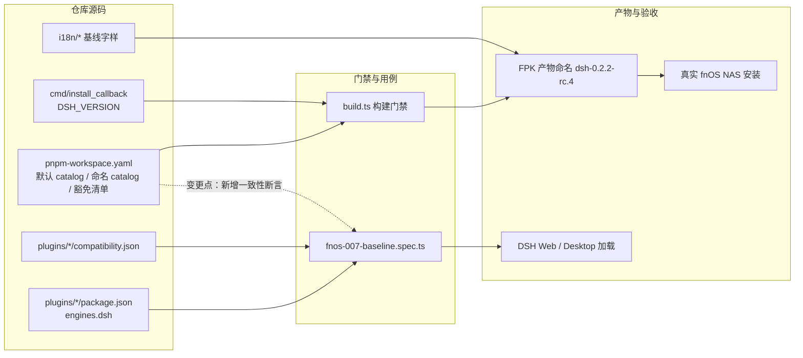
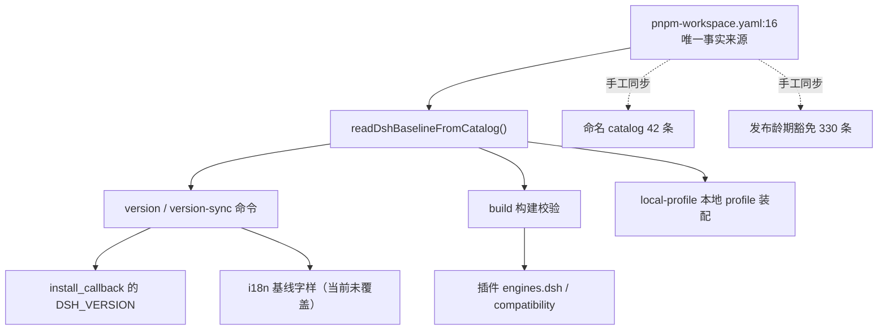
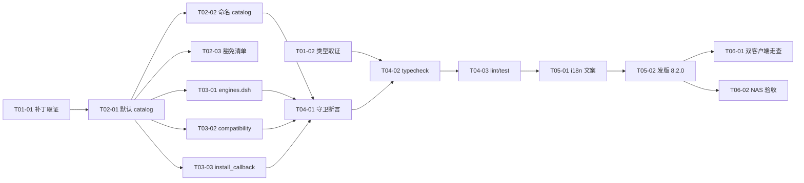

# PLAN-FNOS-056 DSH 0.2.2-rc.4 插件适配与基线升级

| 项目 | 内容 |
| --- | --- |
| 计划编号 | PLAN-FNOS-056 |
| 计划日期 | 2026-11-18 |
| 对应需求 | [FNOS-056](/requirements/FNOS-056-dsh-022-rc4-adaptation) |
| 计划状态 | 实施中 |

## 计划目标

把仓库运行基线从 DSH `0.2.2-rc.1` 迁移到 `0.2.2-rc.4`，实现 FNOS-056-01～08 八项功能。技术边界：

- 只改依赖锚定、兼容声明、基线常量、守卫覆盖面与必要文案；不改插件功能语义。
- 不接入 0.2.2 新增能力。
- 不扩大改动面去修本轮登记的两个既有缺陷（安装期补丁不可达兜底、守卫插件列表非自动发现）。

## 当前实现与目标设计

| 领域 | 当前实现 | 目标实现 | 迁移影响 |
| --- | --- | --- | --- |
| 默认 catalog | `pnpm-workspace.yaml:16` 为 `0.2.2-rc.1` | `0.2.2-rc.4` | `version -- major --baseline` 可自动改写；`readDshBaselineFromCatalog()` 是全仓基线的唯一读取入口 |
| 命名 catalog（42 条） | `pnpm-workspace.yaml:75-116` 全为 `0.2.2-rc.1` | `0.2.2-rc.4` | 命令不碰，必须显式同步；否则插件依赖仍按 rc.1 解析 |
| 发布龄期豁免清单（330 条） | `pnpm-workspace.yaml:140-482` 全为 `0.2.2-rc.1` | `0.2.2-rc.4` | 命令不碰，必须显式同步；漏改会让新发版被 pnpm 发布龄期冷却挡住 |
| 安装回调常量 | `cmd/install_callback:13` `DSH_VERSION="0.2.2-rc.1"` | `0.2.2-rc.4` | 构建门禁 `build.ts:213-216` 只拦不改，必须人工改 |
| Node 下限 | `cmd/install_callback:18` `DSH_MIN_NODE_VERSION="24.9.0"` | 保持 `24.9.0` | 新基线 `engines.node` 未变，此项降为一致性核对 |
| 插件元数据 | 7 个 `package.json` 的 `engines.dsh` + 7 个 `compatibility.json` 的版本，均 `0.2.2-rc.1` | `0.2.2-rc.4` | 14 处，命令不碰；漏改则插件在新运行时被判不兼容 |
| 用户可见文案 | `manifest` 用 `${common.desc}` 占位；基线字样在 9 个 i18n 文件共 18 处 | 同步为 `0.2.2-rc.4` | 版本命令对 manifest 是空操作、对 i18n 完全不碰，18 处全人工 |
| 守卫覆盖面 | 只断言 canon 与插件元数据一致；命名 catalog 与豁免清单无守卫 | 新增「四处承载处取值一致」的断言 | 这是本轮唯一新增的守卫，直接封堵最大的静默漂移面 |

## 影响范围分析

| 需求功能 | 代码模块 | 配置/数据 | 测试 | 文档 | 目标环境 |
| --- | --- | --- | --- | --- | --- |
| FNOS-056-01 | `plugins/*/package.json`、`plugins/*/compatibility.json` | 插件安装元数据 | 现有插件用例 | 插件文档基线行 | DSH Web + Desktop |
| FNOS-056-02 | `plugins/dsh-{codex-auth,opencode,zcode,midscene,fnos,failover-search,semi-ui-showcase}-plugin/src` | 无 | typecheck 为主要闸门 | 契约复核记录 | DSH Web + Desktop |
| FNOS-056-03 | `pnpm-workspace.yaml`、`cmd/install_callback` | 基线四处承载 | `fnos-007-baseline.spec.ts`、`build.ts` 门禁 | 版本管理文档取值 | 本地仓库状态 + 本地运行时 |
| FNOS-056-04 | `packages/fnos-gateway/src/install-callback-helper/attachment-patch.ts`（只读取证） | 安装期产物补丁 | 安装链路用例 | 安装说明 | 真实 fnOS NAS |
| FNOS-056-05 | 无代码改动 | 本地检出状态 | — | 联调说明 | Desktop 联调环境 |
| FNOS-056-06 | `tooling/fnos-dsh-cli/tests/fnos-007-baseline.spec.ts` | 守卫断言 | 新增断言 | — | 仓库用例 |
| FNOS-056-07 | `apps/fn-deepseek-harness/i18n/*`、`docs/apps/*` | 用户可见文案 | 文案一致性用例 | 应用文档页 | 版本命令产物 + 构建命名 |
| FNOS-056-08 | 无代码改动 | 用户数据只读核对 | — | 验收证据 | DSH Web + Desktop + NAS |

影响范围示意：

图中 `yaml` 有三条并列的取值线（默认 catalog、命名 catalog、豁免清单），当前只有默认 catalog 被 `build` 与 `spec` 间接覆盖；变更点是给 `spec` 增加对三者一致性的断言，使「只改默认 catalog」在用例层就被拒绝。

## 架构与数据流

基线值在仓库内是**单源多处派生**结构：

关键约束：`version -- major --baseline` 只写 `pnpm-workspace.yaml:16`，其余全部依赖人工或脚本。本计划把「其余」收敛为可验证的状态，而不是继续依赖记忆。

## 分阶段任务

| 任务 ID | 对应需求/验收 | 修改内容 | 前置条件 | 验证方式 |
| --- | --- | --- | --- | --- |
| PLAN-FNOS-056-T01-01 | FNOS-056-04 / AC-03 | 下载 `@deepseek-ai/dsh-attachment-local@0.2.2-rc.4` 已发布 tarball，对三处补丁目标逐字节计数 | 网络可用 | 三个锚点各命中 1 次；与 rc.1 产物比对字节一致性 |
| PLAN-FNOS-056-T01-02 | FNOS-056-02 / AC-01 | 比对 `dsh-llm` 已发布 `.d.ts` 的 `LlmError` 签名，确认插件抛出的两个错误码在联合类型内 | T01-01 无依赖，可并行 | 类型声明比对记录；插件源码 4 处抛出点逐一核对 |
| PLAN-FNOS-056-T02-01 | FNOS-056-03 / AC-01 | 改写默认 catalog 的 `@deepseek-ai/dsh` 一行 | T01 完成 | `readDshBaselineFromCatalog()` 读到 rc.4 |
| PLAN-FNOS-056-T02-02 | FNOS-056-03 / AC-01 | 同步命名 catalog 的 42 条 | T02-01 | 全段无 rc.1 残留 |
| PLAN-FNOS-056-T02-03 | FNOS-056-03 / AC-01 | 同步发布龄期豁免清单的 330 条 | T02-01 | 全段无 rc.1 残留 |
| PLAN-FNOS-056-T03-01 | FNOS-056-01 / AC-01 | 7 个插件 `package.json` 的 `engines.dsh` 改为 rc.4 | T02-01 | 用例断言等于 catalog |
| PLAN-FNOS-056-T03-02 | FNOS-056-01 / AC-01 | 7 个插件 `compatibility.json` 的 `dshPluginApi.version` 改为 rc.4 | T02-01 | 用例断言等于 catalog |
| PLAN-FNOS-056-T03-03 | FNOS-056-04 / AC-01 | `cmd/install_callback` 的 `DSH_VERSION` 改为 rc.4 | T02-01 | 构建门禁通过 |
| PLAN-FNOS-056-T04-01 | FNOS-056-06 / AC-01 | 在基线守卫用例中新增「默认 catalog = 命名 catalog = 豁免清单片头 = install_callback 常量」一致性断言 | T02、T03 完成 | 变异验证：故意漏改一处应转红 |
| PLAN-FNOS-056-T04-02 | FNOS-056-02 / AC-01 | 全仓 typecheck，重点看 7 个插件对上游类型的引用 | T02、T03 完成 | `pnpm run typecheck` 通过 |
| PLAN-FNOS-056-T04-03 | FNOS-056-01 / AC-01 | 全仓 lint 与单元测试 | T04-02 | `pnpm run lint`、`pnpm run test` 通过 |
| PLAN-FNOS-056-T04-04 | FNOS-056-02 / AC-02 | 处置头部遮蔽失效：两个 seat 的 `priority` 由 -1 改回 0，重写守卫用例断言「官方已迁出本插槽」 | T02-01（依赖新基线产物已安装） | 两个 spec 全绿；断言不再假设遮蔽存在 |
| PLAN-FNOS-056-T05-01 | FNOS-056-07 / AC-01 | 同步 9 个 i18n 文件的 18 处基线字样与应用文档页基线行 | T02-01 | 全仓检索无 rc.1 残留（历史文档除外） |
| PLAN-FNOS-056-T05-02 | FNOS-056-07 / AC-01 | `pnpm run version -- major --baseline 0.2.2-rc.4` 发版至 8.2.0 | T04 全绿、工作区干净 | 版本提交与 tag 生成；FPK 命名含 rc.4 |
| PLAN-FNOS-056-T06-01 | FNOS-056-01、02、08 / AC-01 | DSH Web 与 DSH Desktop 双客户端走查 | T05-02 | 七插件加载、插座位置、模型通道对话、既有数据可用 |
| PLAN-FNOS-056-T06-02 | FNOS-056-04 / AC-02 | 真实 fnOS NAS 走应用中心安装/升级 | T05-02 | 服务启动、版本报告 rc.4、补丁未失败、数据保留 |
| PLAN-FNOS-056-T06-03 | FNOS-056-05 / AC-01 | Desktop 联调检出核对 | 已完成（rc.4 检出就绪） | 检出 tag = rc.4，CLI 报告 rc.4 |

依赖关系：

## 交互和行为设计

本计划不改变用户交互。唯一的用户可观察行为变化是**版本号与基线字样**，以及插件在新运行时上从「不兼容」恢复为「可加载」。

安装期的错误行为保持不变，且必须保持：

- 补丁目标文本匹配次数不等于 1 时，安装**整体失败**并给出可定位的错误，不允许改为「警告后继续」。
- Node 版本低于下限时，安装阶段失败并给出指向系统包的提示。

## 数据、权限和错误处理

- 用户数据（会话、凭据、账号、偏好、模型配置、授权目录）在迁移中**只读核对**，不清理、不改写。
- 兼容门禁的错误语义不变：插件 `engines.dsh` 与运行时不符时，插件管理页显示不兼容原因。
- 模型通道的错误码语义因 `LlmError` 类型收紧而**不变**：插件抛出的两个码仍在联合类型内，运行时行为无差异。若未来新增自定义码，必须先确认其在联合类型内。
- 发布龄期豁免清单若漏改，症状是安装或构建期被 pnpm 冷却策略挡住，表现为「依赖解析不到新版本」而非明确报错——这是本计划把它与命名 catalog 一同纳入守卫断言的原因。

## 依赖、风险和决策

| 项 | 内容 |
| --- | --- |
| 上游事实 | rc.4 已发布且 `next` 指向它；43 个 catalog 包均有同名 rc.4 版本；`engines.node` 未变 |
| 关键上游事实 | `attachment-local` 的 rc.1 与 rc.4 已发布产物 `lib/index.js` 字节一致，安装期补丁不会失配 |
| 关键上游事实 | `LlmError` 的 `code` 参数已收窄为联合类型，且**无对应升级指南** |
| 风险 1 | 命名 catalog 与豁免清单共 372 条如果漏改，会得到错位安装且无任何用例报警 |
| 风险 1 缓解 | T02-02、T02-03 显式同步 + T04-01 新增一致性断言 + 变异验证 |
| 风险 2 | 上游发布包新增 `src`/sourcemap 可能改变将来版本的压缩产物形态，使补丁再次失配 |
| 风险 2 缓解 | T01-01 每次升级前重新计数；本轮已实测字节一致 |
| 风险 3 | 若 rc.4 之后上游再收紧 `LlmError` 联合类型，插件自定义码会编译失败 |
| 风险 3 缓解 | T04-02 typecheck 是硬闸门；本轮 4 处抛出点已逐一核对 |
| 已登记不修 | 安装期补丁第四段回退分支在两个版本产物上均命中 0 次，属不可达兜底 |
| 已登记不修 | 基线守卫的插件列表为手写常量，新增插件漏登记不会被发现 |
| 决策 | 不接入 0.2.2 新增能力（Forge、Office、团队改造等），避免把基线升级与功能接入混在一批 |

## 测试、打包、发布和回滚

**验证层次**（按仓库规范分层，不互相替代）：

| 层次 | 范围 | 判据 |
| --- | --- | --- |
| 类型层 | `pnpm run typecheck` | 7 个插件对 `dsh-llm`、`dsh-web`、`dsh-client-ui-*` 等上游类型的引用全部通过 |
| 用例层 | `pnpm run test`、新增一致性断言与变异验证 | 全绿；故意漏改一处必须转红 |
| 规范层 | `pnpm run lint`、`git diff --check` | 通过 |
| 构建层 | 构建门禁 `build.ts` 的基线断言 | 通过；FPK 命名含 `dsh-0.2.2-rc.4` |
| 客户端层 | DSH Web 与 DSH Desktop | 七插件加载、界面区块位置不变、模型通道对话可用、既有数据可用 |
| 真机层 | 真实 fnOS NAS | 应用中心安装/升级成功、服务启动、版本报告 rc.4、补丁未失败、数据保留 |

具体用例在任务完成后回填至 `docs/tests/FNOS-056-dsh-022-rc4-adaptation.md`（按[测试用例文档规范](/charter/tests-spec)与需求同编号）。该文档尚未建立，待 T06 验收执行后一并回填。

**打包与发布**：

- 档位：基线变更必须走 `major --baseline 0.2.2-rc.4`，`patch`/`minor` 会被命令拒绝。
- 目标版本：`8.1.155 → 8.2.0`，与需求 `targetVersion` 一致。
- 发版粒度：本次为一次完整交付；若发版后仅为装机验证换号，档位固定为 `patch`，不按改动性质重算。
- 高位段冻结：本会话内 `x` 与 `y` 各只前进一次，此后所有改动只升 `z`。
- tag 只留本地，推送由发布者手动执行。

**回滚方式**：

| 失败点 | 允许的回滚 | 禁止 |
| --- | --- | --- |
| 锚定改写后构建/用例失败 | 回退本轮提交，基线回到 rc.1 | 通过放宽门禁或加版本豁免「修绿」 |
| 发版后发现插件在新运行时不可加载 | 重新发版并回到 rc.1 基线，按 major 档位重新出具 | 删改用户 profile 或清空数据来「恢复」 |
| NAS 安装期补丁失配 | 停止发布，按实际产物重新取证后决定改补丁 | 放宽 `replaceOnce` 的匹配次数或改成警告后继续 |
| NAS 安装后服务无法启动 | 回退到上一已发布 FPK；保留用户数据与凭据 | 通过 SSH 直接替换设备上的产物或改配置 |

## 参考资料

- 上游标签：`dsh-v0.2.2-rc.1`、`dsh-v0.2.2-rc.2`、`dsh-v0.2.2-rc.3`、`dsh-v0.2.2-rc.4`
- 上游升级指南：`docs/upgrade-guide/v0.2.2-rc.3/deepseek-refusal-code/guide.zh.md`（本轮唯一新增条目）
- npm 包：`@deepseek-ai/dsh@0.2.2-rc.4`、`@deepseek-ai/dsh-llm@0.2.2-rc.4`、`@deepseek-ai/dsh-attachment-local@0.2.2-rc.4`
- 仓库说明：[版本管理](/build/versioning)、[发布流程](/build/release)、[SDD 规范](/charter/sdd-workflow)
- 前序需求：[FNOS-046](/requirements/FNOS-046-dsh-022-rc1-adaptation)（`0.2.1-rc.5 → 0.2.2-rc.1`）
- 外部诉求：GitHub issue #38（FNOSP/fnos-dsh）

## 完成状态

| 任务 | 状态 |
| --- | --- |
| T01-01 补丁取证 | 已完成（rc.1 与 rc.4 产物 `lib/index.js` 字节一致，三锚点各命中 1 次） |
| T01-02 类型取证 | 已完成（`LlmError` 签名收窄；两个错误码均在联合类型内） |
| T02-01～T02-03 | 已完成（`pnpm-workspace.yaml` 373 处同步为 rc.4，默认 catalog、命名 catalog、豁免清单三处一致） |
| T03-01～T03-03 | 已完成（7 插件 `engines.dsh` 与 `compatibility.json` 共 14 处、`install_callback` 的 `DSH_VERSION` 同步为 rc.4） |
| T04-01 | 待执行 |
| T04-02 | 已完成（`pnpm run typecheck` 12/12 包通过，含 7 个插件） |
| T04-03 | 部分完成（`pnpm run test` 逐文件对照基线一致；`bundled-plugin-install` 3 条在基线上同样失败，为既有问题；lint 报错全部落在既有历史文档，与本次改动文件无交集） |
| T04-04 | 已完成（两个 seat 改回 `priority: 0`，守卫用例重写并全绿：8 passed） |
| T05-01～T05-02 | 待执行 |
| T06-01～T06-03 | T06-03 已完成（检出已切 rc.4 并实测 `--version`）；其余待执行 |

## 变更记录

| 日期 | 变化 |
| --- | --- |
| 2026-11-18 | 建立计划；T01 两项前置取证已完成，确认补丁不失配、类型收紧不构成编译失败 |
