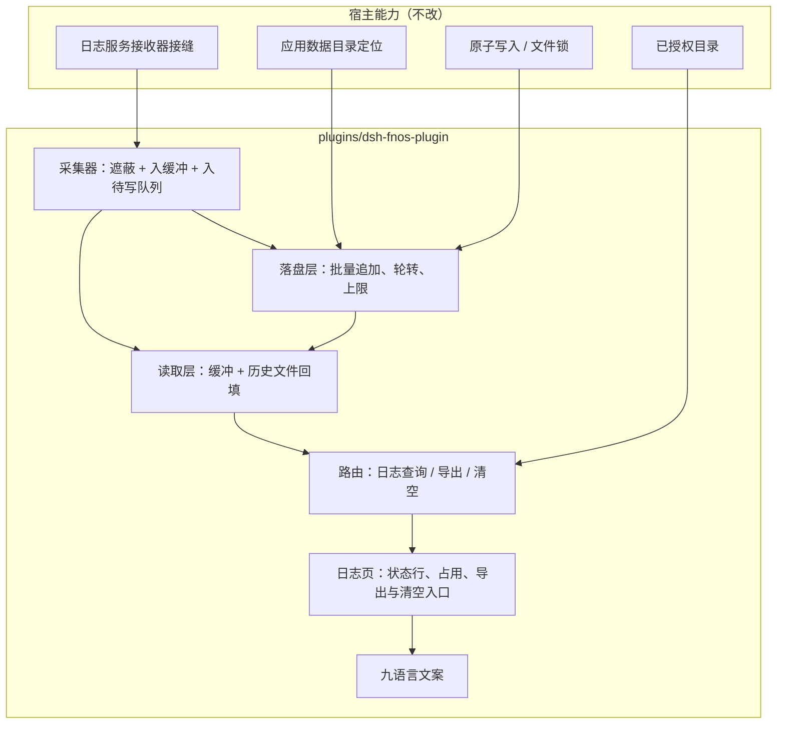
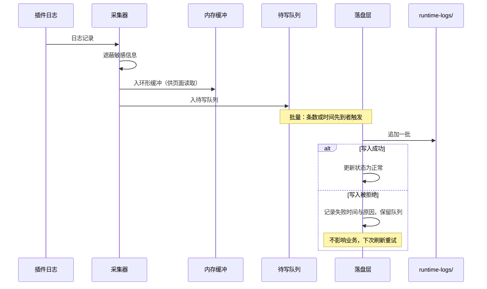

# PLAN-FNOS-058 运行日志持久化与导出

| 项目 | 内容 |
| --- | --- |
| 计划编号 | PLAN-FNOS-058 |
| 计划日期 | 2026-11-19 |
| 对应需求 | [FNOS-058 运行日志持久化与导出](/requirements/FNOS-058-runtime-log-persistence) |
| 计划状态 | 规划中 |

## 计划目标

按 [FNOS-058](/requirements/FNOS-058-runtime-log-persistence) 的六个功能编号，把「日志」页从「只能看本次运行」升级为「有历史、有上限、能拿出、能清空、不泄漏凭据、状态可见」。

技术边界：

- 只改 `plugins/dsh-fnos-plugin`（采集器、落盘层、路由、日志页与文案）；
- 不向上游 DSH 提交文件型日志接收器，不改宿主日志服务；
- 不复用持久 KV 存储（形态是记录而非追加流，写放大明显）；
- 不接管会话日志与插件安装日志。

## 当前实现与目标设计

| 领域 | 当前实现 | 目标实现 | 迁移影响 |
| --- | --- | --- | --- |
| 日志存储 | 模块级数组，环形缓冲（上限 2000 条） | 内存环形缓冲 + 磁盘追加文件（多份轮转） | 缓冲仍是页面读取来源；磁盘只是持久投影，读路径的排序与去重逻辑不变 |
| 重启行为 | 缓冲清空，页面为空 | 启动时读回最近一段铺进缓冲 | 页面在首次渲染就有内容，不出现「先空后满」的跳动 |
| 占用控制 | 只有条数上限 | 条数上限 + 磁盘总量上限 + 轮转份数 | 两套上限独立：条数管显示，字节管磁盘 |
| 导出 | 无 | 下载到电脑 / 写入已授权目录 | 复用 [FNOS-042](/requirements/FNOS-042-session-log-menu) 的两条出口形态 |
| 清空 | 无 | 二次确认后删除全部轮转文件并清空缓冲 | 新增写操作，需同源校验 |
| 敏感信息 | 原样采集 | 采集入口统一遮蔽后写入缓冲与磁盘 | 遮蔽点只有一个，页面与导出一致 |
| 状态呈现 | 无 | 工具条显示持久化状态、占用与最近失败 | 新增只读区域 |

### 为什么不用持久 KV 存储

上游基础组合默认挂载了持久 KV（枢纽 + json 后端 + 领域层），形态上确实能存记录。但它不适合这里：

| 维度 | 领域 KV | 本需求的追加文件 |
| --- | --- | --- |
| 写入模型 | 每次写入等待后端确认已持久 | 批量追加，刷新节奏由自己定 |
| 并发 | 每个领域一条写链，逐条排队 | 单写者批量写 |
| 形态 | 记录集合（表 + 键） | 追加流（行） |
| 轮转淘汰 | 需自己按条数裁剪并逐条删除 | 按文件轮转，整份丢弃 |
| 适配度 | 高频日志下写放大明显，最后仍需自己攒批 | 直接对应「日志文件」这一人类可读形态 |

结论：用 KV 会把「批量落盘」这件事推迟到应用层再做一遍，还多一层 schema 校验开销。选择自有文件。

### 为什么不用上游日志缓冲

上游日志服务内部有一个内存缓冲（默认 1000 条），字段公开可写。但它：

- 官方文档未说明，属于未文档化字段，随版本变化的风险由使用方承担；
- 与插件自己的缓冲是两份数据，读页面时仍需合并或择一；
- 只解决「多留几条」，不解决持久化。

因此不依赖它，保持现有采集方式。

## 影响范围分析



影响矩阵：

| 需求功能 | 代码模块 | 配置/数据 | 测试 | 文档 | 目标环境 |
| --- | --- | --- | --- | --- | --- |
| FNOS-058-01 | 采集器、落盘层、读取层 | 新增应用数据区日志文件 | 单元 + 重启回填 | 插件文档「日志」段 | DSH Web、真实 NAS |
| FNOS-058-02 | 落盘层 | 上限与轮转份数常量 | 单元（超限淘汰） | 插件文档 | DSH Web、真实 NAS |
| FNOS-058-03 | 路由、客户端 | 导出文件 | 单元 + 真机落盘 | 插件文档 | DSH Web、真实 NAS |
| FNOS-058-04 | 路由、客户端 | 删除日志文件 | 单元 + 界面确认 | 插件文档 | DSH Web、真实 NAS |
| FNOS-058-05 | 采集器 | 无 | 单元（固定样例） | 插件文档「敏感信息」 | 包级 |
| FNOS-058-06 | 落盘层、客户端 | 无 | 单元（故障注入） | 插件文档 | DSH Web、真实 NAS |

## 架构与数据流

### 存储布局

日志落在应用自己的数据区，与现有插件安装日志同级但独立目录，避免互相影响：

```text
<应用数据目录>/
  gateway/
    install-log.txt        # 插件安装日志（现有，不动）
  runtime-logs/
    runtime.log            # 当前写入
    runtime.1.log          # 轮转文件（较旧）
    runtime.2.log
```

- 目录权限沿用仓库既有写法：目录 `0o700`、文件 `0o600`；
- 轮转按大小触发：当前文件超过单份上限即更名为下一份，超出保留份数的整份删除；
- 总量上限 = 单份上限 × 保留份数，作为常量成对声明，避免两处漂移。

### 写入链路



关键点：

- **批量而非逐条**：逐条追加在热日志下会把磁盘打成随机写。按「条数满 N 或距上次刷新超过 T」两个条件任一满足即刷新。
- **队列有界**：待写队列同样设上限，磁盘长期不可写时丢最旧而不是无限涨——这和内存缓冲上限的理由一致。
- **写失败保留队列**：可恢复的失败不该丢数据；但如果队列先满，淘汰策略与内存缓冲保持一致（丢最旧）。
- **卸载时冲刷**：插件卸载、进程正常退出时做一次同步冲刷，把队列排空。这是「正常退出不丢」与「异常退出会丢」的分界线。

### 读取与回填

页面读取仍以内存缓冲为主，语义与现在一致（从新到旧、按级别与子串过滤、`limit` 上限）。差异只在启动时：

- 启动时读回最近一段历史（约等于缓冲容量对应条数）铺进缓冲，`seq` 从历史续上，避免与本次运行的新记录冲突；
- 回填失败（文件不存在、格式不识别、权限不足）不算错误：按空历史启动，状态标为「历史不可读」，页面照常工作；
- 单行格式异常时跳过该行而不是整份放弃——一行坏掉不该毁掉整个历史。

## 交互和行为设计

### 日志页工具条

现有工具条（级别下拉 + 搜索 + 条数）保持不动，新增右侧状态区，按可用宽度折叠：

| 元素 | 内容 | 何时显示 |
| --- | --- | --- |
| 占用 | `2.1 MiB / 8 MiB` | 持久化正常时 |
| 状态点 | 正常 / 失败 | 常驻（失败时有文字） |
| 失败说明 | `写入失败（12:04:31，原因）` | 最近一次写入失败后 |
| 导出 | 下拉两项：下载到电脑 / 保存到已授权目录 | 有可导出内容时 |
| 清空 | 按钮 | 有历史内容时 |

失败状态**不自动消失**：只有当之后一次写入成功才回到正常。这与「用户以为日志留着、重启才发现是空的」这类误判直接相关。

### 导出交互

- 「下载到电脑」直接触发浏览器下载，不需要选择目录；
- 「保存到已授权目录」走会话日志同一套目录选择交互（复用现有路径选择器），默认目录取用户上次选择；
- 无已授权目录时该项置灰并说明原因，不弹出注定失败的选择器；
- 导出期间按钮进入加载态，不可重复触发；
- 完成后给出结果提示：成功给出文件名或保存路径，失败给出可读原因。

### 清空交互

二次确认弹窗，文案必须同时说清两件事：

1. 会删除哪些内容——「已保存的全部运行日志」；
2. 不会动哪些内容——「DSH 会话日志、插件安装日志和应用中心日志不受影响」。

确认后执行清空，结果出现在状态区。清空失败（文件被占用、权限不足）要报出来，不能显示「已清空」但其实没删掉。

### 敏感信息遮蔽规则

在采集器入口、入缓冲之前统一处理，规则按形态匹配而非按字段名猜测：

| 形态 | 处理 |
| --- | --- |
| 常见密钥前缀（`sk-`、`ghp_`、`xoxb-` 等） | 保留前缀若干字符，其余替换为占位符 |
| `Bearer <token>` | 保留 `Bearer`，令牌替换 |
| 键值对里的 `password` / `token` / `secret` / `apiKey` | 保留键名与分隔符，值替换 |
| 私钥块 | 整块替换为一行占位说明，保留块首尾标记 |

约束：

- 遮蔽在**唯一入口**做，页面与导出共用同一份文本，不存在「页面明文、导出遮蔽」或反之；
- 替换后长度显著缩短，避免占位符本身把日志撑长；
- 不做过度遮蔽：普通路径、URL、模型名、端口号不动——把整行吞掉等于删掉诊断信息；
- 已知边界：自由文本里的业务数据（用户贴进对话的身份证号等）无法可靠识别，不在承诺范围。

## 数据、权限和错误处理

| 场景 | 处理 |
| --- | --- |
| 应用数据目录不可定位 | 不启用持久化，状态显示「未启用（原因）」，本次运行日志照常可看；不重试探测，等下次启动 |
| 目录存在但不可写 | 同上，并在状态里给出具体原因（权限 / 只读文件系统） |
| 单次刷新失败 | 记录失败状态与原因，保留队列，下次刷新重试；不影响采集与页面读取 |
| 队列满 | 淘汰最旧，与内存缓冲上限保持同一策略与文案 |
| 日志文件损坏 | 跳过无法解析的行，其余照常读回；状态标注「历史部分不可读」 |
| 清空时文件被占用 | 返回失败原因，不假装成功；已删除的部分不恢复 |
| 导出的目标目录不可写 | 返回失败原因；不生成半份文件（写入走原子替换或临时文件改名） |
| 跨站请求 | 清空属写操作，必须同源校验；导出与查询沿用现有同源判定口径 |

**权限**：日志目录只允许插件进程写入，不对外暴露静态文件路由。导出接口返回内容但**不接受路径参数**（保存目录由服务端按已授权目录解析），避免把「导出」变成任意路径写。

## 分阶段任务

| 任务 ID | 对应需求/验收 | 修改内容 | 前置条件 | 验证方式 |
| --- | --- | --- | --- | --- |
| PLAN-FNOS-058-T01-01 | FNOS-058-02 | 声明上限常量（单份大小、保留份数）与存储布局，写契约文件 | 无 | typecheck |
| PLAN-FNOS-058-T02-01 | FNOS-058-01、02 | 落盘层：批量追加、按大小轮转、超限淘汰、卸载冲刷 | T01-01 | 单元（临时目录） |
| PLAN-FNOS-058-T02-02 | FNOS-058-01 | 启动回填：读最近一段历史铺进缓冲，`seq` 续号；坏行跳过 | T02-01 | 单元（构造历史文件） |
| PLAN-FNOS-058-T03-01 | FNOS-058-05 | 遮蔽器：密钥形态、Bearer、键值对、私钥块；单一入口接入 | T01-01 | 单元（固定样例，含正例与反例） |
| PLAN-FNOS-058-T04-01 | FNOS-058-06 | 状态模型：探测、正常、写入失败、历史不可读；失败原因归类 | T02-01 | 单元（故障注入） |
| PLAN-FNOS-058-T04-02 | FNOS-058-02、06 | 日志查询路由返回占用与状态 | T04-01 | 单元 |
| PLAN-FNOS-058-T05-01 | FNOS-058-03 | 导出路由：下载形态 + 已授权目录形态；文件头说明；原子写入 | T04-01 | 单元 + 接口手工核验 |
| PLAN-FNOS-058-T05-02 | FNOS-058-04 | 清空路由：同源校验 + 删除全部轮转文件 + 清缓冲 | T04-01 | 单元 + 界面走查 |
| PLAN-FNOS-058-T06-01 | FNOS-058-03、04、06 | 日志页：状态行、占用、导出下拉、清空确认、失败提示 | T04-02、T05-01、T05-02 | 界面走查 |
| PLAN-FNOS-058-T06-02 | 全部 | 九语言文案补齐，键数一致 | T06-01 | 键数比对 |
| PLAN-FNOS-058-T07-01 | FNOS-058-01～06 | 用例补齐与现有行为回归（筛选/搜索/条数/换行/自动跟随不变） | T06-02 | 包级用例全绿 |
| PLAN-FNOS-058-T07-02 | 全部 | 插件文档「日志」段重写：跨重启保留、占用上限、导出、清空、敏感信息边界与「异常退出会丢最后一段」 | T07-01 | 文档构建 |
| PLAN-FNOS-058-T08-01 | AC-01、03、06 | 真实 NAS：跨重启保留、两条导出出口、磁盘不可写降级 | T07-01 | 真机走查（构建 FPK → 应用中心安装） |
| PLAN-FNOS-058-T08-02 | 全部 | 需求回填、测试用例文档与版本提交 | T08-01 | SDD 检查 |

## 依赖、风险和决策

### 上游事实依赖

| 事实 | 来源 | 不成立时的应对 |
| --- | --- | --- |
| 日志接收器可拿到全部日志记录 | DSH 0.2.2-rc.5 | 现有实现已依赖此项，不新增风险 |
| 应用数据目录可定位且可写 | 现有依赖修复已用同一推导 | 降级为「未启用持久化」并说明原因 |
| 原子写入与文件锁可用 | `@deepseek-ai/dsh-atomic-write` | 退回普通追加写 + 临时文件改名，仍保证不产生半份文件 |

### 风险

| 风险 | 影响 | 应对 |
| --- | --- | --- |
| 热日志下写放大 | 磁盘持续写、机器负载上升 | 批量刷新（条数/时间双阈值）+ 队列有界；用例覆盖「高频写入不逐条落盘」 |
| 遮蔽漏掉某种凭据形态 | 凭据留在磁盘上 | 用例同时钉住「必须遮蔽」与「不得过度遮蔽」；新增形态先补用例再改规则 |
| 遮蔽误伤诊断信息 | 日志失去可用性 | 保留键名、前缀与行结构，只替换值；反例用例钉住普通路径与 URL 不被改写 |
| 回填后与本次运行记录重复 | 页面出现重复行 | `seq` 续号 + 按 `seq` 去重；用例覆盖「回填后立即产生新日志」 |
| 清空误删其它日志 | 用户数据损失 | 清空只作用于独立的 `runtime-logs/` 目录；用例钉住目录边界，并验证安装日志哈希不变 |
| 导出成为任意路径写 | 安全问题 | 导出接口不接受路径参数，保存目录由服务端解析 |
| 磁盘不可写时影响业务 | 应用异常 | 写入失败只记录状态；用例做故障注入，断言采集与读取均不受影响 |

### 已决定事项

- **不做配置项**：上限、保留份数、轮转策略都是固定默认值。理由见需求 FNOS-058-02——排障工具多一个设置项只增加犹豫。
- **不复用持久 KV**：见上文对比表。
- **不依赖上游日志内部缓冲**：未文档化字段。
- **遮蔽放在采集入口而非导出**：否则页面仍是明文，等于没保护。
- **异常退出丢最后一段**：显式接受并写入文档，不用额外的同步写在每条日志上补偿（那会把每次日志变成一次磁盘往返）。

## 测试、打包、发布和回滚

| 层次 | 方式 |
| --- | --- |
| 单元 | 临时目录下的落盘、轮转、淘汰、回填、遮蔽、故障注入；不写真实应用目录 |
| 类型与构建 | `pnpm run typecheck`、`pnpm run build -- --plugin fnos` |
| 文案一致性 | 九语言键数一致 |
| 界面 | DSH Web 走查：状态行、占用、导出两条出口、清空确认、失败提示 |
| 真机 | 构建 FPK → 应用中心正常安装 → 重启应用后日志仍在；导出到已授权目录后确认落盘；构造不可写场景确认降级 |
| 文档 | 插件文档「日志」段更新；`pnpm exec fnos-dsh-cli check --docs` |

用例回填到 `docs/tests/` 对应文档，不在本计划展开用例表。

### 回滚

移除落盘层注册与新增路由、恢复日志页原状即可；`runtime-logs/` 目录删除不影响任何其它数据。历史文件不参与配置、会话或凭据，回滚无数据迁移。若遮蔽规则出问题，可先停用落盘（保留纯内存），遮蔽随采集入口一起回退。

## 参考资料

- DSH 0.2.2-rc.5 Cordis 日志服务：`ctx.logger.exporter()` 接缝与记录结构
- `@deepseek-ai/dsh-home-paths` 0.2.2-rc.5：应用数据目录解析
- `@deepseek-ai/dsh-atomic-write` 0.2.2-rc.5：原子替换与跨进程写锁
- `@deepseek-ai/dsh-storage-domain` 0.2.2-rc.5：持久 KV 的写入语义（用于对比与排除）
- [FNOS-042](/requirements/FNOS-042-session-log-menu)：会话日志两条出口的既有交互
- [FNOS-050](/requirements/FNOS-050-dependency-repair)：应用环境推导与目录权限的既有写法

## 完成状态

| 阶段 | 状态 |
| --- | --- |
| T01 契约与常量 | 未开始 |
| T02 落盘与回填 | 未开始 |
| T03 敏感信息遮蔽 | 未开始 |
| T04 状态模型与查询 | 未开始 |
| T05 导出与清空路由 | 未开始 |
| T06 日志页与文案 | 未开始 |
| T07 用例与文档 | 未开始 |
| T08 真机验收与回填 | 未开始 |

## 变更记录

| 日期 | 变更 |
| --- | --- |
| 2026-11-19 | 建立计划：确定自有文件追加 + 大小轮转方案（否决持久 KV 与上游内部缓冲）；写入走批量刷新 + 有界队列；遮蔽放在采集入口；明确「异常退出丢最后一段」为显式接受的代价；导出接口不接受路径参数。 |
