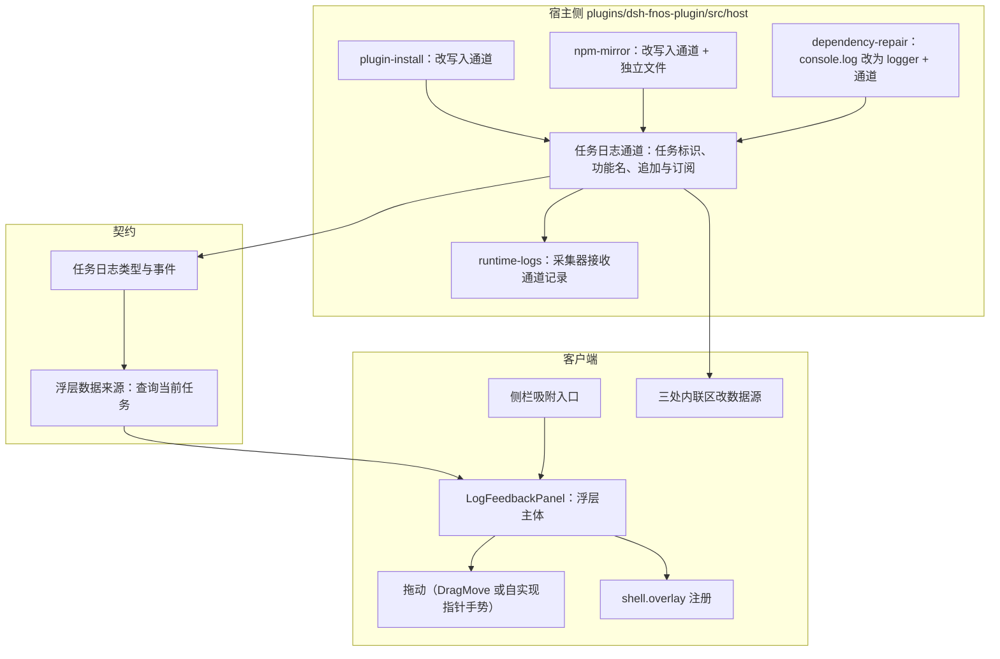
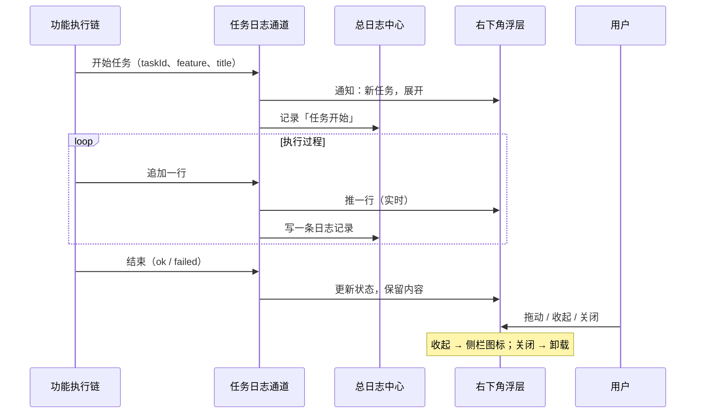

# PLAN-FNOS-059 功能执行日志汇入总日志与右下角浮层

| 项目 | 内容 |
| --- | --- |
| 计划编号 | PLAN-FNOS-059 |
| 计划日期 | 2026-11-20 |
| 对应需求 | [FNOS-059 功能执行日志汇入总日志与右下角浮层](/requirements/FNOS-059-feature-log-feedback-panel) |
| 计划状态 | 规划中 |
| 前置依赖 | [PLAN-FNOS-058 运行日志持久化与导出](/plans/PLAN-FNOS-058-runtime-log-persistence) |

## 计划目标

按 [FNOS-059](/requirements/FNOS-059-feature-log-feedback-panel) 的六个功能编号，把三条长任务执行链的日志汇入运行日志中心，并新增一个可拖动、可收起、可关闭的右下角浮层作为当次任务的实时视图。

技术边界：

- 只改 `plugins/dsh-fnos-plugin`；若拖动需要复用 Semi 的 `DragMove`，在共享包 `@tnnevol/dsh-semi-ui` 增加一条导出；
- 不改 DSH 上游，不向宿主申请新的日志接缝；
- 不替换现有内联日志区，只改变其数据来源；
- 浮层不是通用组件，只服务本插件的三类任务。

### 与 FNOS-058 的顺序关系

FNOS-058 要改的正是运行日志中心的采集与读取（遮蔽、落盘、导出）。本需求把新日志源接进去，若两处并行改同一段采集逻辑会互相覆盖。因此本计划**假定 FNOS-058 的 T01～T04 已完成**（采集入口、状态模型成型），在其之上做增量：

- 若 FNOS-058 尚未实施，本需求的 T02 需要先把「统一任务通道」独立出来，接入点仍按采集入口预留；
- 本需求**不依赖** FNOS-058 的落盘与导出（T05 以后），两者可分别验收。

## 当前实现与目标设计

| 领域 | 当前实现 | 目标实现 | 迁移影响 |
| --- | --- | --- | --- |
| 插件安装日志 | 写 `gateway/install-log.txt`，前端按字节 offset 轮询 | 写入统一任务通道，同时仍能被内联区读取 | 内联区改数据源；文件保留但与 nrm 分开 |
| nrm 安装日志 | 写**同一个** `install-log.txt`，开始时清空 | 写自己的文件 + 统一任务通道 | 不再覆盖插件安装记录 |
| 依赖修复日志 | `console.log` + SSE 推给发起页面 | `ctx.logger`（进总日志）+ 统一任务通道 | 保留 SSE 供弹框实时显示 |
| 总日志可见性 | 三条链都不可见 | 全部可见，带功能与任务标识 | 日志页能筛出这三类 |
| 浮层 | 无 | 右下角可拖动小窗，只显示当前任务 | 新增根级 overlay 注册 |
| 收起入口 | 无 | 侧栏底部吸附图标 | 新增 `sidebar.footer.action` 条目 |

### 为什么是「先合并链路」而不是「浮层直连各功能」

浮层若各自订阅三个来源（轮询文件 + 解析 SSE + 另接通道），就要在浮层里维护三套适配，且每次新增一个长任务功能都要再改浮层。改为**单一任务通道**后：

- 浮层只认「当前任务 + 日志行」这一种形状；
- 总日志与浮层从同一处取值，不会出现两处不一致；
- 新增功能只需往通道里发，不必碰界面。

## 影响范围分析



影响矩阵：

| 需求功能 | 代码模块 | 配置/数据 | 测试 | 文档 | 目标环境 |
| --- | --- | --- | --- | --- | --- |
| FNOS-059-01 | 任务通道、三条执行链、采集器 | 日志文件布局 | 单元 + 日志页走查 | 插件文档「日志」段 | DSH Web、真实 NAS |
| FNOS-059-02 | 浮层组件、路由 | 无 | 单元 + 界面走查 | 插件文档 | DSH Web、真实 NAS |
| FNOS-059-03 | 拖动、位置保持 | 会话内位置 | 界面走查 | 插件文档 | DSH Web、真实 NAS |
| FNOS-059-04 | 浮层状态、侧栏入口 | 无 | 单元 + 界面走查 | 插件文档 | DSH Web、真实 NAS |
| FNOS-059-05 | 浮层状态机 | 无 | 单元（状态机） | 插件文档 | DSH Web |
| FNOS-059-06 | 安装与 nrm 的落盘路径 | 新增独立文件 | 单元 | 插件文档 | 包级 |

## 架构与数据流

### 统一任务通道

一个模块级单例，形状固定为「当前任务 + 该任务的日志行」：

```text
TaskLogState
  taskId      一次任务的身份（每次开始新生成）
  feature     功能标识：install | mirror | repair
  title       给用户看的任务名（如「安装 dsh-taskboard」）
  status      running | ok | failed
  lines       该任务累计的日志行（有上限，避免内存膨胀）
  startedAt   开始时刻
```

写入方只有三个功能，读取方有两类：实时订阅（浮层、内联区）与快照查询（页面初次挂载补历史）。

- **任务开始**：生成新 `taskId`，整体替换当前任务。这直接实现 FNOS-059-05 的「覆盖」——不是清空，是换掉引用，旧任务的日志已随行写入总日志。
- **追加日志**：写 `lines` 的同时把同一行交给采集器，进入总日志。两处同源。
- **任务结束**：更新 `status`，不清理 `lines`——失败时要保留现场供用户翻看。

### 日志进入总日志的三条改造

| 功能 | 改造 |
| --- | --- |
| 插件安装 | `appendLog` 追加一行后，同时 `ctx.logger.info`/`error` 发一条带功能前缀的记录。日志行本身不带时间戳（现在带），时间戳由日志服务的 `ts` 提供，避免双重时间 |
| nrm | 同上，且 `installLogPath` 拆成两个路径：插件安装与 nrm 各一份 |
| 依赖修复 | `log()` 内部把 `console.log` 换成 `ctx.logger`，保留 `logSink` 推送（SSE 与任务通道都用它） |

:::warning 为什么保留 console.log 不行
宿主日志服务不拦截 `console.log`——它是 Node 进程的标准输出，跟 Cordis 的日志服务是两条路。所以依赖修复的日志今天在日志页完全不可见，不是「采了但没显示」，是**根本没进来**。
:::

### 浮层数据流



## 交互和行为设计

### 浮层外观与位置

- 默认出现在右下角，距视口边缘留出固定间距；
- 宽高有上下限：宽度随视口自适应（窄屏占满减边距），高度随内容增长到上限后内部滚动；
- 头部一行：功能图标 + 任务名 + 状态标识 + 收起 / 关闭两个控件；主体是日志滚动区；
- 视觉沿用 Semi 的浮层口径（半透明背景 + 背景模糊），与仓库现有气泡类浮层一致。

### 拖动实现选择

| 方案 | 说明 | 取舍 |
| --- | --- | --- |
| **A. 共享包导出 Semi `DragMove`** | Semi 自带，支持约束容器与自定义移动回调 | 需要改共享包并重建全部消费插件；行为由上游维护 |
| **B. 自实现指针手势** | 用 `pointerdown`/`pointermove`/`pointerup` 自行计算位移与边界 | 无新增依赖、完全可控；需自己处理触摸、边界与失焦 |

**选择 B**，理由：

1. `DragMove` 依赖 Semi 的 DOM 结构约定（`handler` 返回节点、`constrainer` 定位），套在自定义浮层上要先迁就它的布局假设；
2. 本浮层只需要「按住头部 → 平移整体 → 限制在视口内」这一种手势，自实现约百余行，而引入共享包导出会把改动面扩散到六个消费插件；
3. 触摸与鼠标统一走指针事件即可，无需分别处理。

若后续其它插件也需要拖动浮层，再把实现下沉到共享包——那时有第二个消费方，才值得迁移。

### 拖动与边界的交互细则

- 拖动只认头部区域，主体滚动区不触发拖动（否则无法选中日志文本）；
- 指针按下时记录起点偏移，移动时按差值更新 `left`/`top`，用 transform 或直接定位均可，取性能更好的定位方式；
- 松手时把最终位置夹到「浮层完全在视口内」的合法区间；
- 窗口尺寸变化时重新夹一次，避免残留到屏幕外；
- 位置只在内存里保持，页面刷新后回到右下角默认位（不做持久化，避免为用户带来「上次放哪了」的额外概念）。

### 状态机实现

按需求中的状态图落地为三态：

| 状态 | 渲染 |
| --- | --- |
| `hidden` | 不渲染浮层，不渲染吸附图标 |
| `expanded` | 渲染浮层 |
| `collapsed` | 不渲染浮层，渲染侧栏吸附图标 |

转换规则：

- 任务开始：无论当前何态，一律转 `expanded`（关闭态也重新出现，见需求说明）；
- 用户收起：`expanded → collapsed`；
- 用户关闭：`expanded | collapsed → hidden`；
- 点吸附图标：`collapsed → expanded`。

### 吸附入口位置

放在 `sidebar.footer.action`，与现有「飞牛 OS」入口同座位（list，可叠加），`order` 排在它之前或之后按视觉重量决定：日志入口是临时性的，排在「飞牛 OS」之后，避免长期占用最显眼位置。**仅在 `collapsed` 态存在**——`expanded` 与 `hidden` 都不显示，避免多一个常驻却无意义的按钮。

### 内联区改造

三处内联区（插件卡片、nrm 卡片、依赖修复弹框）改为从任务通道取数，但**保持各自原有行为**：

- 插件卡片内联区：仍显示本次安装，失败常显；
- nrm 卡片：仍显示本次安装；
- 依赖修复弹框：仍走 SSE 实时日志（它需要独立的请求生命周期），同时把 SSE 收到的行也喂进任务通道——即「弹框看它自己的流，浮层与总日志看通道」，两者不同源但内容一致。

:::warning 依赖修复的双通道要防重复计数
弹框的 SSE 与任务通道各写一次会导致总日志里同一行出现两遍。做法：**依赖修复的 `log()` 只写任务通道**，SSE 由 `logSink` 从通道订阅取得。这样日志只产生一次，两个消费者各自读。
:::

## 数据、权限和错误处理

| 场景 | 处理 |
| --- | --- |
| 任务通道无当前任务 | 浮层不渲染；吸附图标仅在 `collapsed` 且有历史任务时考虑（本次不做，简单起见 `collapsed` 必然对应有任务） |
| 日志行数超过上限 | 丢弃最旧行，与总日志的环形缓冲策略一致；界面提示「已省略早期行」 |
| 任务异常中断（未收到结束） | 状态保持 `running`，但下一次任务开始时被整体替换；界面在长时间无新行时可加「可能已中断」提示（计划内可选） |
| 写日志失败 | 不影响任务执行：日志只是旁路。失败时静默降级，总日志中心不可用时浮层仍工作 |
| 浮层拖动到视口外 | 松手与窗口缩放时夹回合法区间 |
| SSR 或非浏览器环境 | 浮层与吸附入口都在浏览器侧注册，不涉及宿主渲染 |
| 跨站 | 浮层数据来自本地通道或同源接口，不引入新的跨站面 |

**权限**：不新增对外路由时无需权限变更；若浮层初次挂载需要从服务端补历史，复用现有同源判定。

## 分阶段任务

| 任务 ID | 对应需求/验收 | 修改内容 | 前置条件 | 验证方式 |
| --- | --- | --- | --- | --- |
| PLAN-FNOS-059-T01-01 | FNOS-059-01 | 契约：任务日志类型、功能标识、状态枚举、行上限常量 | FNOS-058 T01 | typecheck |
| PLAN-FNOS-059-T02-01 | FNOS-059-01、05 | 任务通道：开始/追加/结束、订阅与快照、新任务整体替换 | T01-01 | 单元（状态机、替换语义） |
| PLAN-FNOS-059-T02-02 | FNOS-059-06 | 拆分日志文件路径：插件安装与 nrm 各一份，互不清空 | T01-01 | 单元（两次操作后两份文件都在） |
| PLAN-FNOS-059-T03-01 | FNOS-059-01 | 插件安装接入通道；`appendLog` 同步发宿主日志 | T02-01、T02-02 | 单元 |
| PLAN-FNOS-059-T03-02 | FNOS-059-01 | nrm 接入通道；改用独立日志文件 | T03-01 | 单元 |
| PLAN-FNOS-059-T03-03 | FNOS-059-01 | 依赖修复 `console.log` 改为宿主日志，并接入通道；SSE 从通道订阅 | T02-01 | 单元 + SSE 内容核对 |
| PLAN-FNOS-059-T04-01 | FNOS-059-02 | 浮层主体：头部、状态、日志滚动、跟随最新与「用户上翻时暂停跟随」 | T03-03 | 界面走查 |
| PLAN-FNOS-059-T04-02 | FNOS-059-03 | 拖动：指针手势、边界夹取、窗口尺寸变化重夹 | T04-01 | 界面走查（含触摸） |
| PLAN-FNOS-059-T04-03 | FNOS-059-04 | 三态状态机、收起 / 关闭 / 展开、`shell.overlay` 注册 | T04-01 | 单元（状态机）+ 走查 |
| PLAN-FNOS-059-T04-04 | FNOS-059-04 | 侧栏吸附入口注册，仅 `collapsed` 显示 | T04-03 | 走查 |
| PLAN-FNOS-059-T05-01 | FNOS-059-02、07 | 三处内联区改数据源，保持原有行为 | T03-03 | 单元 + 走查 |
| PLAN-FNOS-059-T06-01 | 全部 | 九语言文案补齐，键数一致 | T04-04 | 键数比对 |
| PLAN-FNOS-059-T07-01 | 全部 | 用例：通道、状态机、文件不互踩、日志不重复 | T05-01 | 包级用例全绿 |
| PLAN-FNOS-059-T07-02 | 全部 | 插件文档更新：三类任务的日志去处、浮层用法、收起与关闭的区别 | T07-01 | 文档构建 |
| PLAN-FNOS-059-T08-01 | AC-03、04、08 | 真实 NAS：浮层在 iframe 内的定位、拖动与窄屏表现 | T07-01 | 真机走查（构建 FPK → 应用中心安装） |
| PLAN-FNOS-059-T08-02 | 全部 | 需求回填、测试用例文档与版本提交 | T08-01 | SDD 检查 |

## 依赖、风险和决策

### 上游事实依赖

| 事实 | 来源 | 不成立时的应对 |
| --- | --- | --- |
| Semi `Feedback` 支持 `type: 'custom'` 直接渲染 children | `feedback/index.js` 的 `getRealChildren` | 不用 Feedback 外壳，改用共享包已导出的 `DshCard` + 自绘浮层容器 |
| Semi `DragMove` 可受控拖动 | `dragMove/index.d.ts` | 已选择自实现方案，此依赖不进实现路径 |
| `shell.overlay` 为根级 list 座位 | DSH 布局包 | 退到 `sidebar.right` 或页面内定位（会牺牲跨会话稳定性） |
| `sidebar.footer.action` 为可叠加 list 座位 | DSH 侧栏包 | 改挂会话头部菜单 |

### 关于 Semi 组件选型的说明

需求方最初提到「基于 Semi `feedback` 组件定制」。核实后：

- `@douyinfe/semi-ui` 的 `Feedback` 组件确实支持 `type: 'custom'`——此时它只提供外壳（Modal 或 SideSheet）与页脚按钮，主体完全由调用方渲染，因此**技术上可用于承载日志**；
- 但它的两种外壳是**模态弹框**与**底部抽屉**：前者带遮罩会挡住页面，后者从底部升起横跨宽度，都与「右下角可拖动小窗」的产品要求不符；
- 强行用 `mode: 'modal'` 再靠 CSS 改造成右下角小窗，等于与组件的定位与遮罩机制对抗，且 Modal 的 `centered` 与动画方向都按居中设计。

因此实现采用**共享包的 Semi 基础组件自绘浮层**：`DshCard` 承担容器与视觉、`DshButton` / `DshIconButton` 承担头部控件、`DshSpin` 承担进行中状态、`DshTag` 承担结果标识，浮层定位与拖动由插件自绘。这样既满足「用 Semi 组件」的规范要求，也不必迁就 `Feedback` 的外壳假设。

若评审坚持使用 `Feedback`，可改用其 `mode: 'modal'` + 去掉遮罩的自定义，但需接受：失去右下角定位能力，或需要覆盖 Modal 的定位样式。

### 风险

| 风险 | 影响 | 应对 |
| --- | --- | --- |
| 总日志被三类操作刷屏 | 其它日志被淹没 | 日志行带功能标识且可分功能筛选；单任务行数有上限 |
| 同一行被写入两次 | 总日志重复 | 依赖修复的双通道改为「只写通道，SSE 从通道订阅」；用例钉住行数 |
| 浮层遮挡页面关键操作 | 用户反感 | 可拖动 + 可收起 + 可关闭；不覆盖整页遮罩 |
| 拖动与文本选择冲突 | 无法复制日志 | 只认头部拖动；主体不触发 |
| iframe 内定位偏差 | 真机位置错乱 | 位置按可视区域计算，真机专门验收；必要时改用 fixed 定位 |
| 与 FNOS-058 并行改动同一采集入口 | 冲突或重复采集 | 本计划以其 T01～T04 为前置，串行实施 |
| 内联区改造引入回归 | 现有安装体验退化 | 内联区仅换数据源、不改交互；用例覆盖原有行为 |

### 已决定事项

- **拖动自实现，不引入共享包新导出**：只有一个消费方，下沉共享包为时过早。
- **位置不做持久化**：避免为用户引入「上次放哪了」的额外概念；刷新回默认位。
- **吸附图标仅收起态出现**：常驻按钮在多数时候无意义。
- **关闭态下新任务仍会弹出**：关闭表达「这一轮不看了」，不是永久静音。
- **依赖修复保留 SSE**：弹框需要独立于页面的请求生命周期，不能只靠通道订阅。
- **内联区保留**：浮层是新增观察入口，不是替换。

## 测试、打包、发布和回滚

| 层次 | 方式 |
| --- | --- |
| 单元 | 任务通道状态机、新任务替换、行上限、文件不互踩、日志不重复、浮层三态 |
| 类型与构建 | `pnpm run typecheck`、`pnpm run build -- --plugin fnos` |
| 文案一致性 | 九语言键数一致 |
| 界面 | DSH Web 走查：浮层出现与滚动、拖动、收起与吸附、关闭、覆盖切换、窄屏 |
| 真机 | 构建 FPK → 应用中心安装 → 在 iframe 内验证浮层定位与拖动 |
| 文档 | 插件文档更新；`pnpm exec fnos-dsh-cli check --docs` |

用例回填到 `docs/tests/` 对应文档。

### 回滚

移除浮层与吸附入口的注册、把三处执行链的日志写回原路径即可；任务通道可整块删除。日志文件拆分保留也无害（旧文件不再被读取即可）。无数据迁移、无配置变更。

## 参考资料

- `@douyinfe/semi-ui` 的 `feedback`（`type: 'custom'`、`mode: 'modal' | 'popup'`）与 `dragMove` 实现
- `@tnnevol/dsh-semi-ui` 导出清单（`DshCard`、`DshButton`、`DshIconButton`、`DshSpin`、`DshTag`、`DshSideSheet`）
- DSH 0.2.2-rc.5 的 `shell.overlay` 与 `sidebar.footer.action` 座位声明
- [FNOS-058 运行日志持久化与导出](/requirements/FNOS-058-runtime-log-persistence)
- [FNOS-050 fnOS 插件「依赖修复」](/requirements/FNOS-050-dependency-repair)
- 插件现有实现：`host/plugin-install.ts`、`host/npm-mirror.ts`、`host/dependency-repair.ts`、`host/dependency-repair-routes.ts`

## 完成状态

| 阶段 | 状态 |
| --- | --- |
| T01 契约 | 未开始 |
| T02 任务通道与文件拆分 | 未开始 |
| T03 三条执行链接入 | 未开始 |
| T04 浮层、拖动、状态机、吸附入口 | 未开始 |
| T05 内联区改造 | 未开始 |
| T06 文案 | 未开始 |
| T07 用例与文档 | 未开始 |
| T08 真机验收与回填 | 未开始 |

## 变更记录

| 日期 | 变更 |
| --- | --- |
| 2026-11-20 | 建立计划：确定「先合并链路、浮层只是视图」的实施顺序；拖动选自实现而非共享包导出 Semi `DragMove`；说明为何不用 Semi `Feedback` 外壳（Modal 带遮罩、SideSheet 从底部横跨，均与右下角可拖动小窗不符），改为 Semi 基础组件自绘浮层；记录依赖修复双通道的防重复方案；标注与 FNOS-058 的串行前置关系。 |
