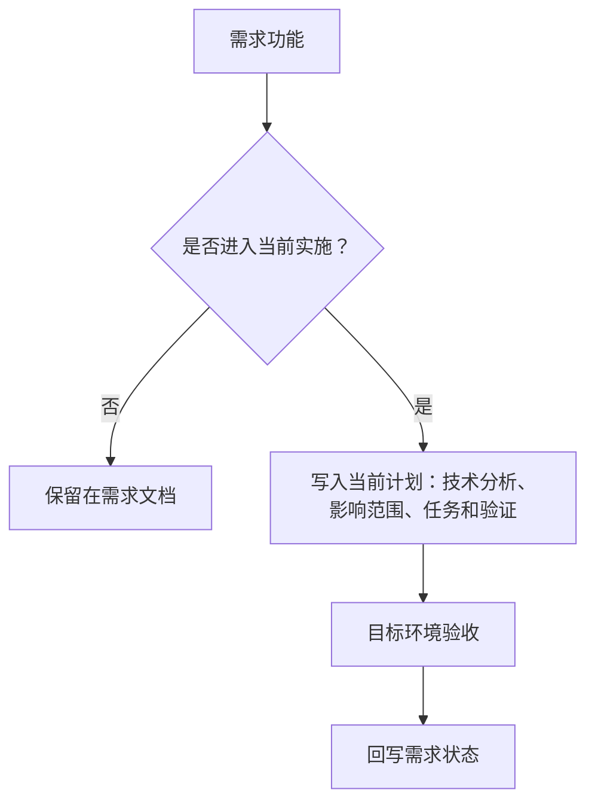

# 详细计划

这里记录已经进入当前实施阶段的技术计划。计划文档负责说明如何实现、影响哪些模块、如何迁移、如何验证和如何回滚；计划规范统一维护在[开发指南 → 章程规范 → 计划文档规范](/charter/plans-spec)。

## 计划与需求的关系

规则摘要：

- 一篇计划对应一篇需求，编号使用 `PLAN-FNOS-###`，并链接到对应 `FNOS-###`。
- 计划只展开已经进入当前实施阶段的功能。
- 每个任务必须关联需求功能和验收条件。
- 计划需要分析当前实现、目标实现、影响范围、迁移方式、风险、验证和回滚。
- 计划状态只表示实施进度，功能是否完成以需求文档中的目标环境验收为准。
- 已完成计划作为历史记录，不回改正文；后续变更写入当前开发中的计划。

完整规则见：[计划文档规范](/charter/plans-spec) 和 [SDD 维护规范](/charter/sdd-workflow)。

## 当前计划文档

| 编号 | 计划文档 | 状态 |
| --- | --- | --- |
| PLAN-FNOS-001 | [DSH 飞牛 NAS 适配](/plans/PLAN-FNOS-001-dsh-fnos-adaptation) | 已完成 |
| PLAN-FNOS-002 | [DSH 应用与插件优化](/plans/PLAN-FNOS-002-dsh-app-plugin-optimization) | 已完成 |
| PLAN-FNOS-003 | [FPK 应用运行设置统一](/plans/PLAN-FNOS-003-fpk-runtime-settings) | 已完成 |
| PLAN-FNOS-004 | [DSH 0.1.5-rc.2 适配与 FPK 运行修复](/plans/PLAN-FNOS-004-dsh-015-rc2-adaptation) | 已完成 |
| PLAN-FNOS-005 | [CodeBuddy 成长任务与本地 DSH](/plans/PLAN-FNOS-005-codebuddy-and-local-dsh) | 已完成 |
| PLAN-FNOS-006 | [安装脚本与安装流程优化](/plans/PLAN-FNOS-006-installation-script-optimization) | 规划中 |
| PLAN-FNOS-007 | [DSH 0.1.7-rc.2 适配与插件错误修复](/plans/PLAN-FNOS-007-dsh-017-rc2-adaptation) | 已完成 |
| PLAN-FNOS-008 | [插件配置统一迁入插件管理页](/plans/PLAN-FNOS-008-plugin-config-in-plugin-manager) | 已完成 |
| PLAN-FNOS-009 | [DSH 0.2.0-rc.2 插件适配](/plans/PLAN-FNOS-009-dsh-020-rc2-adaptation) | 规划中（含授权目录持久化阶段五） |
| PLAN-FNOS-010 | [三方搜索接入与官方兜底](/plans/PLAN-FNOS-010-thirdparty-web-search-failover) | 已完成（T01–T16 全部完成：三方搜索与故障转移、官方兜底、配置管理、用量展示与探测、抓取兜底、会话级开关；端到端验收通过） |
| PLAN-FNOS-011 | [凭据文件权限异常的可诊断性](/plans/PLAN-FNOS-011-credential-permission-diagnostics) | 已完成（随 0.2.0-rc.2.6 发布） |
| PLAN-FNOS-012 | [CodeBuddy 模型倍速展示与客户端版本更新](/plans/PLAN-FNOS-012-codebuddy-model-speed-and-client-version) | 已完成（随 0.2.0-rc.2.6 发布） |
| PLAN-FNOS-013 | [Midscene 浏览器自动化桥接插件](/plans/PLAN-FNOS-013-midscene-browser-automation-bridge) | 已完成（随 0.2.0-rc.2.6 发布） |
| PLAN-FNOS-014 | [DSH 0.2.1-rc.2 插件适配与新能力支持](/plans/PLAN-FNOS-014-dsh-021-rc2-adaptation) | 已完成 |
| PLAN-FNOS-015 | [主题缓存写入死循环修复](/plans/PLAN-FNOS-015-theme-cache-write-loop) | 阶段一完成；目标环境验收待执行 |
| PLAN-FNOS-016 | [插件市场索引与插件元数据](/plans/PLAN-FNOS-016-plugin-market-index) | 已完成 |
| PLAN-FNOS-017 | [fnOS 插件路由 403 误拒修复](/plans/PLAN-FNOS-017-fnos-route-403) | 阶段一完成；真机验收待执行 |
| PLAN-FNOS-018 | [Midscene 桥接使用说明准确性修正](/plans/PLAN-FNOS-018-midscene-skill-accuracy) | 已完成（单阶段 4 个任务） |
| PLAN-FNOS-019 | [FPK 版本方案固定前缀与插件基线小尾巴](/plans/PLAN-FNOS-019-fpk-version-scheme) | 已完成（三阶段全部完成） |
| PLAN-FNOS-020 | [CodeBuddy 瞬时 400 终止整轮修复](/plans/PLAN-FNOS-020-codebuddy-transient-400) | 已完成（两个阶段均完成，双客户端已验） |
| PLAN-FNOS-021 | [Midscene 库能力对齐与接入简化](/plans/PLAN-FNOS-021-midscene-library-integration) | 已完成（四阶段实施任务完成，2026-10-23 整体验收通过） |
| PLAN-FNOS-024 | [CodeBuddy 403 纳入账号切换](/plans/PLAN-FNOS-024-codebuddy-403-failover) | 已完成（阶段一完成；阶段二以适配器级集成验证执行） |
| PLAN-FNOS-023 | [CodeBuddy 受限账号触发自动切换](/plans/PLAN-FNOS-023-codebuddy-restricted-account-failover) | 已完成（阶段一完成；阶段二 Web 已验、Desktop 待补） |
| PLAN-FNOS-022 | [CodeBuddy 模型调用被内容审核拦截修复](/plans/PLAN-FNOS-022-codebuddy-content-block-fix) | 已完成（两阶段 10 个任务，双客户端已验） |
| PLAN-FNOS-025 | [CodeBuddy 插件下架](/plans/PLAN-FNOS-025-codebuddy-plugin-delisting) | 已完成（三阶段全部完成；真实 NAS 验收不在本轮范围） |
| PLAN-FNOS-026 | [OpenCode Zen 与 OpenCode Go 模型接入及套餐用量](/plans/PLAN-FNOS-026-dsh-opencode-plugin) | 已完成（插件已发布到 npm，任务全部完成并通过验收） |
| PLAN-FNOS-027 | [ZCode Start Plan 模型接入与账号额度](/plans/PLAN-FNOS-027-dsh-zcode-plugin) | 已完成（自研 HTTP 通道在 DSH Web 与 DSH Desktop 均验证通过；发布相关任务按插件未发布单列） |
| PLAN-FNOS-028 | [项目与插件版本统一 5.10.0 及发布链路 dsh 基线标注](/plans/PLAN-FNOS-028-unified-project-version-bumpp) | 已完成（四阶段收尾；测试证据见 /tests/FNOS-028-unified-project-version-bumpp） |
| PLAN-FNOS-029 | [DSH 0.2.1-rc.3 插件适配与基线迁移](/plans/PLAN-FNOS-029-dsh-021-rc3-adaptation) | 规划中（四阶段：基线改写 → 包级验证 → 双客户端回归 → 文档与版本） |
| PLAN-FNOS-030 | [飞牛 iOS App 打开 DSH 空白修复](/plans/PLAN-FNOS-030-app-shell-blank-page) | 已完成（四阶段；132 条包级测试全绿；v6.0.1 真机装成并验证网关会话行为） |
| PLAN-FNOS-031 | [升级迁移 cwd 提示词变量引用](/plans/PLAN-FNOS-031-cwd-prompt-variable-migration) | 已完成（四阶段：迁移实现 → 包级验证 → 真机验收 → 文档与版本） |
| PLAN-FNOS-032 | [OpenCode 辅助调用补齐会话头](/plans/PLAN-FNOS-032-opencode-aux-session-header) | 实施中（四阶段：兜底实现 → 包级验证 → 真实会话验证 → 文档与版本） |

只有进入当前实施阶段的需求功能才应在本页建立计划。未排期的 P2、后续计划和待确认功能保留在需求清单中。
