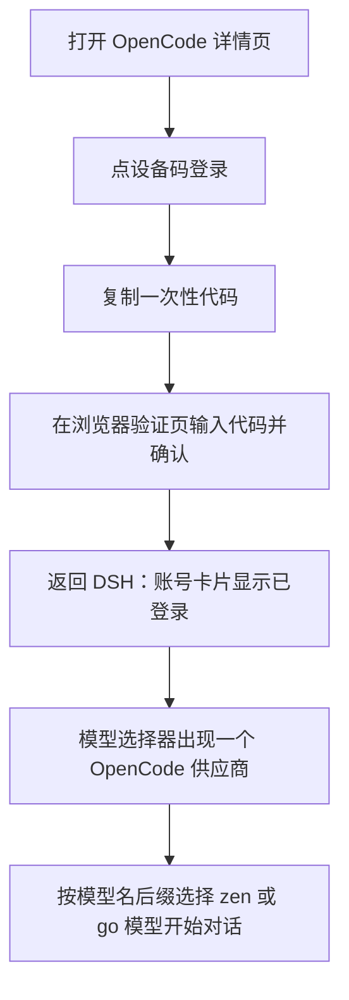

# OpenCode

`@tnnevol/dsh-opencode` 把 **OpenCode Zen（按量）** 与 **OpenCode Go（套餐）** 的模型接入 DSH：用 OpenCode Console 账号登录后，模型选择器出现一个 **`OpenCode`** 供应商，Zen 与 Go 两类模型合并成一个列表（2026-10-24 为 122 个：zen 85 / go 37），模型名用 `· zen` 或 `· go` 后缀标明来源与计费口径；目录叠加 Console 账号下发的增补、停用、能力与容量覆盖以及推理路由头，Go 套餐额度也随账号实时读取。

> 该插件暂未随 fnOS 应用内置分发，请在目标 DSH 环境中按下面的命令安装。

## 安装

```sh
dsh plugin --profile web add @tnnevol/dsh-opencode@0.2.1-rc.2.26
```

安装后重启 DSH Web profile。插件版本信息见[插件总览](/plugins/)。

## 登录

1. 在 DSH 左侧打开「插件」，进入 `OpenCode` 详情页。
2. 账号卡片点「设备码登录」，页面会显示一次性代码、复制按钮与验证地址。
3. 在浏览器打开验证地址，输入一次性代码并确认；授权完成后返回 DSH，账号卡片变为已登录，显示账号与组织。
4. 设备码不可用时，可在同一卡片改用 **Console 服务账号 API Key** 登录。



同一时间只保留一个 Console 账号；账号卡片提供「退出登录」，退出后 `OpenCode` 供应商不再出现在模型选择器。**已登录时账号卡片不再显示「使用 API Key 登录」入口**，需要切换登录方式时先退出登录。

## 模型

登录后，模型选择器只新增一个供应商：

| 供应商 | 路由 | 模型来源 | 计费与限制 |
| --- | --- | --- | --- |
| `OpenCode` | `dsh-opencode` | OpenCode Zen（按量）与 OpenCode Go（套餐）合并列表：Zen 来自 `https://opencode.ai/inference/v1/models` 与公开目录 `opencode` 段，Go 来自 `https://opencode.ai/inference/go/v1/models` 与公开目录 `opencode-go` 段；2026-10-24 合计 122 个（zen 85 / go 37） | `· zen` 模型按 token 计费，需要 Console 余额，部分免费模型只允许在 OpenCode 客户端使用；`· go` 模型受 Go 或 Go Plus 套餐额度约束，OAuth 与 API Key 均可调用 |

两类来源分别以自己的**实时模型清单（活 roster）**为全集；清单不可用时回退公开目录对应段，再失败时使用内置目录或保留上一份可用目录。详情页会说明当前目录来源。

### 后缀与计费

| 显示名后缀 | 内部模型 id | 含义 | 计费口径 |
| --- | --- | --- | --- |
| `· zen` | `zen:<真实 id>`（例如 `zen:glm-5`） | 来自 OpenCode Zen 的按量模型 | 按 token 计费，需要 Console 余额；套餐额度不适用 |
| `· go` | `go:<真实 id>`（例如 `go:mimo-v2.6-flash`） | 来自 OpenCode Go 的套餐模型 | 受 Go 或 Go Plus 套餐额度约束 |

- 后缀只用于在合并列表里区分来源与计费；**供应商始终是一个 `OpenCode`**。
- 内部模型 id 带 `zen:` / `go:` 前缀，保证同名模型在合并列表内唯一；插件在发请求前会剥掉前缀，**网关收到的仍是原始模型 id**。
- 同名模型可能在两类来源中各有一条，按后缀分辨；目录里的显隐开关也按 `plan:id` 分别记录，可以只隐藏其中之一。

### 路由与冲突

- 路由 id 使用 `dsh-opencode`，而不是 pi-ai 内置的 `opencode` / `opencode-go`。`dsh-` 前缀是为了避免与用户手工配置的同名路由冲突——此前的同名冲突曾导致**登录后模型完全不出现在选择器**，改用前缀后已消除。
- 如果此前已在模型设置里手工配置过 `opencode` 或 `opencode-go`，它和插件的 `dsh-opencode` 可以并存，插件不会覆盖它。
- 若用户手工配置了同名 `dsh-opencode`，插件会给出可诊断提示且不覆盖用户配置；移除该配置后重试即可。

### 账号配置只做覆盖

- Console 下发的停用标记、能力与容量覆盖会按来源应用到合并目录，推理请求也会带上工作空间路由头。
- Console 里没有额外的覆盖条目（`models` 为空）是正常状态，不代表没有可用模型；Console 也可以增补 roster 之外的条目。
- 读取不到账号配置时，合并后的模型仍然可用，详情页会说明未应用账号覆盖的原因。

### 模型能力

每个模型的协议族、推理、工具调用、图片输入、文本输入、免费标记、上下文窗口与最大输出都按上游目录投影到 DSH，不需要手工配置：

- **协议族**按 Console 的 `aisdk:` 包名或公开目录的 npm 包名识别，模型分属 OpenAI Chat Completions、OpenAI Responses、Anthropic Messages、Google Generative AI 四种上游协议，插件按模型自动选择。
- **能力图标**：目录每行以「推理 / 工具 / 图片 / 文本 / 免费」五个图标表示能力；悬浮时显示气泡，逐项标记勾选或未勾选。
- **上下文与最大输出**以文本显示在模型行内；上游未声明时使用保守默认值并说明。
- **图片生成模型不纳入适配**，不会出现在可对话模型列表里。

### 模型列表

详情页的模型目录卡片是**一个合并列表**，不再按来源分组筛选：

- **固定高度、内部滚动**：只有模型列表区滚动，搜索框与计数固定在工具栏，长目录不会把整页撑高。
- **来源标识**：每行模型名带 `· zen` 或 `· go` 后缀；同名模型会各占一行，后缀不同。
- **搜索**：按模型名称、标识、家族、描述或协议族过滤，结果即时更新。
- **计数**：显示当前搜索结果数；已隐藏的模型数量单独标注。
- **隐藏**：逐个模型开关，按 `plan:id` 记录，隐藏后该模型不再出现在模型选择器；同名 zen/go 条目可分别隐藏，重新打开后恢复。
- **刷新**：立即重新读取两类来源的目录，并显示获取时间。

目录刷新失败时保留上一份可用目录，不把已经能用的模型清空；某类来源失败不影响另一类。

## 套餐额度与用量胶囊

套餐额度**只对 OpenCode Go（`· go` 后缀模型）生效**。详情页的额度卡片显示 OpenCode Go 三个额度窗口的**已用百分比**与**重置倒计时**：

| 窗口 | 含义 |
| --- | --- |
| 5 小时 | 滚动 5 小时窗口，约占月度额度的 20% |
| 每周 | 每周窗口，约占月度额度的 50% |
| 每月 | 月度窗口，即该模型的月度上限 |

额度接口读取失败时，卡片显示失败原因与最近一次获取时间，**不会把没读到的窗口显示成 0%**。账号没有 Go 订阅时，卡片显示未订阅说明，不显示 0%，也不显示按量费用。

对话输入区右侧会显示 **OpenCode Go 用量胶囊**，用于在对话过程中随时查看已用比例与重置时间。胶囊有三种策略：

| 策略 | 表现 |
| --- | --- |
| `auto`（默认） | 仅在选中带 `· go` 后缀的模型时显示；选中带 `· zen` 后缀的模型或其它供应商模型时不显示 |
| `always` | 插件已登录时常驻显示；没有 Go 数据时显示未知或未订阅，不补 0% |
| `off` | 隐藏，并停止额度自动刷新（详情页仍可手动刷新） |

带 `· zen` 后缀的按量模型不显示套餐额度；插件也不提供按量余额、费用或账单展示。策略在详情页设置区修改，下一次进入会话或下一次对话即生效，无需重启 DSH。

## 设置项说明

全部设置位于**插件管理页 → `OpenCode` 详情页**，修改后立即生效，不需要重启。设置弹框中没有本插件的配置入口。

| 设置项 | 说明 | 取值范围 | 默认值 |
| --- | --- | --- | --- |
| 用量胶囊 | 输入区右侧胶囊的显隐策略；`auto` 仅对带 `· go` 后缀的模型生效 | `auto` / `always` / `off` | `auto` |
| 自动刷新间隔 | 目录与额度的后台刷新周期（分钟）；`0` 表示关闭自动刷新 | 0–240 | 15 |
| 隐藏的模型 | 在模型选择器中隐藏的模型，按 `plan:id` 记录（如 `zen:big-pickle`、`go:mimo-v2.6-flash`） | 逐模型开关 | 空 |

## 已知约束

- **需要能直连 `opencode.ai`**：登录、模型目录、套餐额度与模型调用都发往该域名（公开目录在 `models.opencode.ai`）。运行环境无法访问时，登录与目录会给出连接失败提示。
- **OpenCode Zen 按量模型需要 Console 余额**：余额不足时上游返回 402 `Insufficient account funds`，模型目录仍可读取，但对话无法完成；插件不自动重试，充值后重试即可。
- **OpenCode Zen 免费模型只允许在 OpenCode 客户端使用**：`big-pickle`、`*-free` 等模型的上游调用返回 403 `FreeTierError`；DSH 可能把该上游 403 显示为「API 密钥无效 AUTH」，这不是插件凭据错误，而是上游限制。插件不提供绕过方式。
- **OpenCode Go 套餐按模型月度上限计算额度**：额度由 OpenCode 按套餐与模型的月度上限计算，插件只做展示，不参与计费或换算金额；OAuth 与 Console 服务账号 API Key 均可调用 Go 模型。
- **路由使用 `dsh-` 前缀**：插件只注册 `dsh-opencode`，与手工配置的 `opencode` / `opencode-go` 并存；不要为同一用途再手工创建同名 `dsh-opencode` 路由。
- **图片生成、视频生成模型不参与对话**：它们与 DSH 对话所需的文本输入协议不同，不在本插件范围内。
- **部分模型受地区限制**：`gpt-6-luna`、`muse-spark-*`、`beam-free` 等模型在部分国家/地区返回 403（`unsupported_country_region_territory` / `RegionError`）；目录仍会展示，调用失败时按上游错误提示，插件不提供绕过方式。
- **Google Generative AI 需要工作空间隐私设置**：Gemini 模型要求 Console 工作空间允许「会用于训练的付费端点」，否则上游返回 400；这是工作空间级设置，插件无法代为开启。

## 常见问题

### 模型名后面的 `· zen` / `· go` 是什么意思

分别表示模型来自 OpenCode Zen（按量）与 OpenCode Go（套餐）。供应商只有一个 `OpenCode`，后缀只用于区分来源与计费口径：`· zen` 模型需要 Console 余额，`· go` 模型受套餐额度约束。同名模型可能同时出现两条，按后缀分辨。

### 登录后看不到模型

先确认插件正常加载并且账号已登录。模型来自公开的实时模型清单，不需要在 Console 里逐项启用。如果详情页提示目录读取失败，可以点目录卡片上的「刷新」重试；如果提示同名 `dsh-opencode` 路由冲突，按提示移除该配置后再登录。

### 模型列表和 Console 里不一致

目录以两类来源的实时模型清单为全集，Console 配置只做增补、停用与能力/容量覆盖。上游新增模型需要等下一次刷新（默认 15 分钟）或在详情页手动刷新后出现。若详情页提示未应用账号覆盖，说明账号配置暂时不可读，恢复后刷新即可。

### 选择带 `· zen` 后缀的模型后没有用量胶囊或套餐额度

这是预期行为。套餐额度与胶囊只对 `· go` 后缀的模型生效；`· zen` 按量模型不占用套餐额度，插件也不展示按量余额或费用。胶囊策略为 `always` 时会常驻显示，但展示的仍是账号的 Go 套餐数据。

### 调用 Zen 模型报 402 或 403，免费模型显示 AUTH

- **402 `Insufficient account funds`**：Console 余额不足，需要在 OpenCode Console 充值后重试。
- **403 `FreeTierError`**：该模型是免费模型，只允许在 OpenCode 客户端内使用，DSH 无法调用；DSH 可能把该上游 403 显示为「API 密钥无效 AUTH」，这不是凭据失效。请改用付费 Zen 模型或 `· go` 模型。

两类都是上游策略，不是插件缺陷；插件不会自动重试或绕过限制。

### 用量胶囊不显示

检查胶囊策略：`auto` 只在选中带 `· go` 后缀的模型时显示，`off` 则完全不显示。带 `· zen` 后缀的模型与其它供应商模型不会显示套餐胶囊。

### 额度卡片显示读取失败或未订阅

额度接口可能暂时不可用或被网络阻断。卡片会保留最近一次获取时间与失败原因，稍后点「刷新」重试即可，不影响已经可用的模型。账号没有 Go 订阅时显示未订阅说明，而不是 0%。

### 对话报认证失败

账号凭据可能已失效。打开详情页的账号卡片重新登录即可；模型选择器会随登录状态更新。

### 登录后为什么找不到「使用 API Key 登录」

这是预期行为：账号已登录时只保留退出登录入口，避免误触切换账号。需要改用 API Key 登录时，先退出登录，入口会重新出现。

### 同名模型怎么分别隐藏

目录卡片里的显隐开关按 `plan:id` 保存：隐藏 `zen:xxx` 不会同时隐藏 `go:xxx`，反之亦然。按模型名后缀确认要隐藏的条目即可。

### 与手工配置的供应商冲突

插件使用 `dsh-opencode`，不会与手工配置的 `opencode` / `opencode-go` 冲突。只有手工配置了同名 `dsh-opencode` 时才会冲突；按详情页提示移除对应配置后重试即可。
