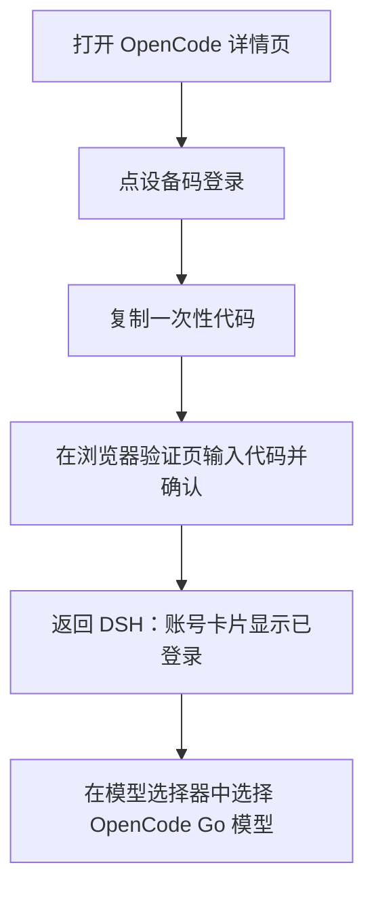

# OpenCode

`@tnnevol/dsh-opencode` 把 **OpenCode Go** 接入 DSH：用 OpenCode Console 账号登录后，模型选择器里出现 `OpenCode Go` 供应商，模型清单来自 OpenCode Go 的公开目录，并叠加 Console 账号下发的覆盖（停用、能力与容量、推理路由头），套餐额度也随账号实时读取。

> 该插件暂未随 fnOS 应用内置分发，请在目标 DSH 环境中按下面的命令安装。

## 安装

```sh
dsh plugin --profile web add @tnnevol/dsh-opencode@0.2.1-rc.2.20
```

安装后重启 DSH Web profile。插件版本信息见[插件总览](/plugins/)。

## 登录

1. 在 DSH 左侧打开「插件」，进入 `OpenCode` 详情页。
2. 账号卡片点「设备码登录」，页面会显示一次性代码、复制按钮与验证地址。
3. 在浏览器打开验证地址，输入一次性代码并确认；授权完成后返回 DSH，账号卡片变为已登录，显示账号与组织。
4. 设备码不可用时，可在同一卡片改用 **Console 服务账号 API Key** 登录。



同一时间只保留一个 Console 账号；账号卡片提供「退出登录」，退出后模型选择器不再出现该供应商。

## 模型

登录后，模型选择器新增 `OpenCode Go` 供应商：

- **模型全集来自 OpenCode Go 的公开模型清单**；清单不可用时回退公开模型目录，再失败时使用内置目录或保留上一份可用目录，详情页会说明当前目录来源。
- **账号配置可读时只做叠加**：Console 下发的停用标记、能力与容量覆盖会应用到目录，推理请求也会带上工作空间路由头。Console 里没有额外的覆盖条目（`models` 为空）是正常状态，不代表没有可用模型。
- 读取不到账号配置时，公开模型仍然可用，详情页会说明未应用账号覆盖的原因。
- 每个模型的协议族、上下文窗口、最大输出、图片输入与思考等级都按上游目录投影到 DSH，不需要手工配置；协议族按 Console 的 `aisdk:` 包名或公开目录的 npm 包名识别。
- 模型分属四种上游协议（OpenAI Chat Completions、OpenAI Responses、Anthropic Messages、Google Generative AI），插件按模型自动选择，用户无需关心。
- **图片生成模型不纳入适配**，不会出现在可对话模型列表里。

### 模型目录管理

详情页的模型目录卡片提供：

- **搜索**：按模型名称或标识过滤；
- **隐藏**：逐个模型开关，隐藏后该模型不再出现在模型选择器；
- **刷新**：立即重新读取目录，并显示获取时间。

目录刷新失败时保留上一份可用目录，不把已经能用的模型清空。

## 套餐额度与用量胶囊

详情页的额度卡片显示 OpenCode Go 三个额度窗口的**已用百分比**与**重置倒计时**：

| 窗口 | 含义 |
| --- | --- |
| 5 小时 | 滚动 5 小时窗口，约占月度额度的 20% |
| 每周 | 每周窗口，约占月度额度的 50% |
| 每月 | 月度窗口，即该模型的月度上限 |

额度接口读取失败时，卡片显示失败原因与最近一次获取时间，**不会把没读到的窗口显示成 0%**。

对话输入区右侧会显示**用量胶囊**，用于在对话过程中随时查看已用比例与重置时间。胶囊有三种策略：

| 策略 | 表现 |
| --- | --- |
| `auto`（默认） | 仅在选中 OpenCode Go 模型时显示 |
| `always` | 插件已登录时常驻显示 |
| `off` | 隐藏，并停止额度自动刷新（详情页仍可手动刷新） |

策略在详情页设置区修改，下一次进入会话或下一次对话即生效，无需重启 DSH。

## 设置项说明

全部设置位于**插件管理页 → `OpenCode` 详情页**，修改后立即生效，不需要重启。设置弹框中没有本插件的配置入口。

| 设置项 | 说明 | 取值范围 | 默认值 |
| --- | --- | --- | --- |
| 用量胶囊 | 输入区右侧胶囊的显隐策略 | `auto` / `always` / `off` | `auto` |
| 自动刷新间隔 | 目录与额度的后台刷新周期（分钟）；`0` 表示关闭自动刷新 | 0–240 | 15 |
| 隐藏的模型 | 在模型选择器中隐藏的模型标识列表 | 逐模型开关 | 空 |

## 已知约束

- **需要能直连 `opencode.ai`**：登录、模型目录与模型调用都发往该域名。运行环境无法访问时，登录与目录会给出连接失败提示。
- **OpenCode Go 按供应商计费**：额度由 OpenCode 按套餐与模型的月度上限计算，插件只做展示，不参与计费或换算金额。
- **OpenCode Zen 的按量模型暂不纳入**：本插件只适配 OpenCode Go 订阅内的模型。
- **同名供应商冲突**：如果此前已经在模型设置里手工配置过 `opencode-go` 供应商，插件会给出可诊断的冲突提示而不是静默覆盖。按提示移除手工配置后再刷新即可。
- **图片生成、视频生成模型不参与对话**：它们与 DSH 对话所需的文本输入协议不同，不在本插件范围内。

## 常见问题

### 登录后看不到模型

确认账号已订阅 OpenCode Go。模型清单来自 Go 的公开模型清单（清单不可用时用公开模型目录），无需在 Console 里逐项启用；如果详情页提示「未应用账号覆盖」或目录读取失败，可以点目录卡片上的「刷新」重试。

### 模型列表和 Console 里不一致

目录以 OpenCode Go 的公开模型清单为准，账号配置只叠加停用与能力覆盖；上游新增模型需要等下一次刷新（默认 15 分钟）或在详情页手动刷新后出现。若详情页提示未应用账号覆盖，说明账号配置暂时不可读，恢复后刷新即可。

### 用量胶囊不显示

检查胶囊策略：`auto` 只在选中 OpenCode Go 模型时显示，`off` 则完全不显示。用量胶囊只在插件已登录时才有数据。

### 额度卡片显示读取失败

额度接口可能暂时不可用或被网络阻断。卡片会保留最近一次获取时间与失败原因，稍后点「刷新」重试即可，不影响已经可用的模型。

### 对话报认证失败

账号凭据可能已失效。打开详情页的账号卡片重新登录即可；模型选择器会随登录状态更新。

### 与手工配置的供应商冲突

移除模型设置里手工创建的 `opencode-go` 供应商后重试。插件注册的是同名路由，冲突时以错误提示结束，不会覆盖已有配置。
