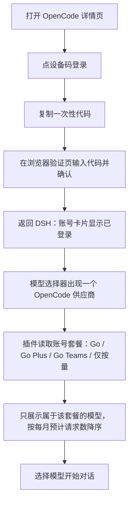

# OpenCode

`@tnnevol/dsh-opencode` 把 **OpenCode Console（按量）** 与 **OpenCode Go（套餐）** 的模型接入 DSH：用 OpenCode Console 账号登录后，模型选择器出现一个 **`OpenCode`** 供应商，模型名用 `· zen` 或 `· go` 后缀标明来源与计费口径；插件读取账号当前套餐（Go / Go Plus / Go Teams / 仅按量），**只展示属于该套餐的模型**，并按官方额度表的每月预计请求数降序排列；目录叠加 Console 账号下发的增补、停用、能力与容量覆盖以及推理路由头，套餐额度也随账号实时读取。

> **上游更名（2026-11-05）**：OpenCode 已取消独立的 Zen 站点，`opencode.ai/zen` 与 `opencode.ai/docs/zen` 均跳转到 [Console 模型页](https://opencode.ai/console/models)，官方文档把按量口径统一称为 **OpenCode Console（pay-as-you-go）**。插件面向用户的文案随之改为「Console（按量）」；内部模型 id 前缀 `zen:` 与显示后缀 `· zen` 保持不变，因为存量的隐藏设置与历史会话都按它记录。

> 该插件暂未随 fnOS 应用内置分发，请在目标 DSH 环境中按下面的命令安装。

## 安装

```sh
dsh plugin --profile web add @tnnevol/dsh-opencode@8.1.12
```

安装后重启 DSH Web profile。插件版本信息见[插件总览](/plugins/)。

## 登录

1. 在 DSH 左侧打开「插件」，进入 `OpenCode` 详情页。
2. 账号卡片点「设备码登录」，页面会显示一次性代码、复制按钮与验证地址。
3. 在浏览器打开验证地址，输入一次性代码并确认；授权完成后返回 DSH，账号卡片变为已登录，显示账号与组织。
4. 设备码不可用时，可在同一卡片改用 **Console 服务账号 API Key** 登录。



同一时间只保留一个 Console 账号；账号卡片提供「退出登录」，退出后 `OpenCode` 供应商不再出现在模型选择器。**已登录时账号卡片不再显示「使用 API Key 登录」入口**，需要切换登录方式时先退出登录。

## 模型

登录后，模型选择器只新增一个供应商：

| 供应商 | 路由 | 模型来源 | 计费与限制 |
| --- | --- | --- | --- |
| `OpenCode` | `dsh-opencode` | 按量侧来自 `https://opencode.ai/inference/v1/models` 与公开目录 `opencode` 段，套餐侧来自 `https://opencode.ai/inference/go/v1/models` 与公开目录 `opencode-go` 段；2026-11-05 实测合计 109 个（按量 80 / Go 29） | **只展示当前账号套餐所属的一侧**：有 Go 订阅（Go / Go Plus / Go Teams）时只出现 `· go` 模型，仅按量的账号只出现 `· zen` 模型。`· zen` 按 token 计费需 Console 余额；`· go` 受套餐额度约束，OAuth 与 API Key 均可调用 |

两类来源分别以自己的**实时模型清单（活 roster）**为全集；清单不可用时回退公开目录对应段，再失败时使用内置目录或保留上一份可用目录。详情页会说明当前目录来源。

### 套餐识别与归属过滤

插件按下面的顺序判定账号套餐，判定结果决定展示哪一侧模型：

| 顺序 | 来源 | 判定 |
| --- | --- | --- |
| 1 | `GET https://opencode.ai/console/api/go/status` | `product` 字段即套餐：`go` / `go-plus` / `go-teams`；响应里的 `access.meters` 同时给出 5 小时 / 每周 / 每月三个窗口的额度上限与已用量 |
| 2 | `GET https://opencode.ai/inference/go/v1/usage` | Console 套餐接口不可用时兜底：能读到 Go 额度即按 `go` 处理 |
| 3 | 都不可用 | 套餐未知：**按 OpenCode Go 口径处理**——只列 `· go` 条目、用 Go 档额度排序、`auto` 走 Go 端点，详情页说明「未识别到套餐，暂按 OpenCode Go 套餐展示模型」并保留失败原因 |

过滤是**整侧**的，不只是同名去重：

- Go 账号：目录与选择器里只有 `· go` 条目；只在按量侧存在的模型（如 `big-pickle`、`claude-opus-5-5`）同样不出现。
- 仅按量账号：只有 `· zen` 条目，`· go` 一侧整体不出现。
- 套餐未知：按 Go 订阅处理，只列 `· go` 条目。OpenCode 的主力付费形态是 Go 订阅，按 Go 口径比两侧混列更接近用户真实可用的集合；确实只有按量余额的用户可把「推理端点」显式设为 Zen 端点。

这条规则来自「不该让用户从名字猜哪条能用」：非本套餐的模型要么需要额外充值（按量），要么根本没有订阅（Go），列出来只会制造试错。

### 额度排序

Go 侧模型的排列顺序按**官方 Go 文档的 Estimated requests 表**降序——即该模型在套餐额度内每月大约能发多少次请求，而不是按 token 单价。额度大的模型排前面，用户第一眼看到的就是「最经用」的那几个。

- 表按套餐档位区分：Go（$10/月）、Go Plus（$40/月）、Go Teams（$20/成员/月）三份数值各不相同，插件按账号实际档位取对应的一份。
- 文档标为 `Unlimited` 的限时免费模型排在最前；**上游新上架的免费模型同样置顶**——官方额度表里标 `Unlimited` 的恰好只有免费模型，FAQ 也写明「达到 Go 限制后可以继续使用免费模型」，所以快照还没收录它时按不限量处理，不会被当成「额度未知」沉到末尾。
- 表里没有的**付费**模型排在最后（没有数据就不编造额度），同一档内以模型 id 兜底，刷新后不抖动。
- 仅按量账号没有「每月预计请求数」这一口径（按 token 计费），保持原来的「免费优先、单价升序」排列。
- 数据是**内置快照**（抓取日期与来源地址见 `src/contracts/estimates.ts`），不依赖运行时抓取文档页；上游改额度后随插件版本更新。

### 后缀与计费

| 显示名后缀 | 内部模型 id | 含义 | 计费口径 |
| --- | --- | --- | --- |
| `· zen` | `zen:<真实 id>`（例如 `zen:glm-5`） | 来自 OpenCode Console 的按量模型 | 按 token 计费，需要 Console 余额；套餐额度不适用 |
| `· go` | `go:<真实 id>`（例如 `go:mimo-v2.6-flash`） | 来自 OpenCode Go 的套餐模型 | 受 Go / Go Plus / Go Teams 套餐额度约束 |

- 后缀只用于在合并列表里区分来源与计费；**供应商始终是一个 `OpenCode`**。
- 内部模型 id 带 `zen:` / `go:` 前缀，保证同名模型在合并列表内唯一；插件在发请求前会剥掉前缀，**网关收到的仍是原始模型 id**。
- 同名模型可能在两类来源中各有一条，按后缀分辨；目录里的显隐开关也按 `plan:id` 分别记录，可以只隐藏其中之一。

### 路由与冲突

- 路由 id 使用 `dsh-opencode`，而不是 pi-ai 内置的 `opencode` / `opencode-go`。`dsh-` 前缀是为了避免与用户手工配置的同名路由冲突——此前的同名冲突曾导致**登录后模型完全不出现在选择器**，改用前缀后已消除。
- 如果此前已在模型设置里手工配置过 `opencode` 或 `opencode-go`，它和插件的 `dsh-opencode` 可以并存，插件不会覆盖它。
- 若用户手工配置了同名 `dsh-opencode`，插件会给出可诊断提示且不覆盖用户配置；移除该配置后重试即可。

### 账号配置只做覆盖

- Console 下发的停用标记、能力与容量覆盖会按来源应用到合并目录，推理请求也会带上工作空间路由头。
- Console 里没有额外的覆盖条目（`models` 为空）是正常状态，不代表没有可用模型；Console 也可以增补 roster 之外的条目。
- 读取不到账号配置时，合并后的模型仍然可用，详情页会说明未应用账号覆盖的原因。

### 模型能力

每个模型的协议族、推理、工具调用、图片输入、文本输入、免费标记、上下文窗口与最大输出都按上游目录投影到 DSH，不需要手工配置：

- **协议族**逐模型独立解析，模型分属 OpenAI Chat Completions、OpenAI Responses、Anthropic Messages、Google Generative AI 四种上游协议，插件自动选择，不需要手工配置。

### 协议与端点

每个模型的协议族与端点**逐个模型**决定，不能按供应商或套餐一刀切：

| 上游声明 | 插件读取来源 | 端点 |
| --- | --- | --- |
| AI SDK 包名 | 公开目录的逐模型 `provider.npm`；缺失时用 Console 的 `aisdk:<npm>` | 按协议族固定 |
| 完整端点 | 公开目录的逐模型 `provider.api`（含 `/chat/completions`、`/responses`、`/messages`、`/google/v1beta` 等） | 由端点反推协议 |
| 两者都缺 | 本供应商的 provider 级缺省 | 按协议族固定 |

解析优先级是**本来源的逐模型声明 → 另一来源的逐模型声明（仅当本来源完全没有该模型）→ 供应商级缺省**。这条规则很重要，因为同名模型在两个来源可能是不同协议：2026-11-05 实测 `minimax-m3` 与 `qwen3.8-max` 在按量侧走 Chat Completions、在 Go 侧走 Anthropic Messages。若让另一来源覆盖本来源，DSH 会拿到 `ModelProtocolUnsupported`。

端点前缀由来源与协议共同决定：

| 来源 | Chat Completions | Responses | Anthropic Messages | Google Generative AI |
| --- | --- | --- | --- | --- |
| `· zen` | `/inference/openai/v1` | `/inference/openai/v1` | `/inference/anthropic` | `/inference/google/v1beta` |
| `· go` | `/inference/go/openai/v1` | `/inference/go/openai/v1` | `/inference/go/anthropic` | `/inference/go/google/v1beta` |

这套映射已与官方 `opencode` 1.19.4 命令行逐模型核对：两个来源共 110 个可对照模型，协议族与端点全部一致。

### 端点策略

同名模型在两类来源里都存在时（当前 21 个），请求走哪一组端点由**推理端点**设置决定：

| 取值 | 行为 |
| --- | --- |
| `auto`（默认） | 跟随账号套餐：有 Go 订阅（Go / Go Plus / Go Teams）就把共用模型统一打到 Go 端点，仅按量账号打到按量端点，**套餐未知时按 Go 端点**（与目录口径一致） |
| `go` | 共用模型统一打 Go 端点，消耗套餐额度 |
| `zen` | 共用模型统一打按量端点，消耗 Console 余额（保持该历史取值，等价于「Console 按量端点」） |

只切换**目标端点也存在**的模型：只出现在单一来源的模型（如按量侧的 `big-pickle`、Go 侧的 `beam-free`）保持原生端点。强行改到另一端点上游会直接返回 `Model is unavailable.`，实测确认。

同一模型在两个来源的协议不同时（如 `minimax-m3`）也不切换——端点按协议族固定，换过去就是错端点。

修改设置后目录卡片展示的端点与下一次请求使用的端点会同步更新，不会留下上一次的改写结果。已订阅 OpenCode Go 的账号在 `auto` 下等价于 `go`；仅按量账号等价于 `zen`；套餐无法判定时等价于 `go`——过滤、排序与端点三处口径始终一致，不会出现「列了 Go 模型却打到按量端点」。
- **能力图标**：目录每行以「推理 / 工具 / 图片 / 文本 / 免费」五个图标表示能力；悬浮时显示气泡，逐项标记勾选或未勾选。
- **上下文与最大输出**以文本显示在模型行内；上游未声明时使用保守默认值并说明。
- **图片生成模型不纳入适配**，不会出现在可对话模型列表里。

### 模型列表

详情页的模型目录卡片是**一个合并列表**，不再按来源分组筛选：

- **固定高度、内部滚动**：只有模型列表区滚动，搜索框与计数固定在工具栏，长目录不会把整页撑高。
- **来源标识**：每行模型名带 `· zen` 或 `· go` 后缀。
- **整侧归属过滤**：只保留账号套餐所属的一侧（详见上文「套餐识别与归属过滤」）。2026-11-06 实测：Go 账号只出现 30 个 `· go` 条目，仅按量账号只出现 80 个 `· zen` 条目；套餐未知时按 Go 口径处理。模型选择器与详情页目录卡片口径一致。
- **额度标注**：Go 侧每行显示该模型在本档套餐下的每月预计请求数（文档标为不限量的显示「不限量」）。
- **排序**：Go 侧按套餐档位的每月预计请求数降序（不限量与免费模型置顶、无额度数据的付费模型沉底）；仅按量侧仍为「免费优先、上架时间降序 → 付费按单价升序」；被禁用的条目（含仅官方客户端可用的免费模型）统一排到最后。模型选择器与目录卡片顺序一致，同一档内以模型 id 兜底，刷新后不抖动。
- **搜索**：按模型名称、标识、家族、描述或协议族过滤，结果即时更新。
- **计数**：显示当前搜索结果数；已隐藏的模型数量单独标注。
- **隐藏**：逐个模型开关，按 `plan:id` 记录，隐藏后该模型不再出现在模型选择器；重新打开后恢复。
- **仅官方客户端可用的免费模型按停用展示**：Console 按量侧的免费模型（`big-pickle`、`*-free` 等）只能由官方 OpenCode 客户端调用，插件在目录里保留条目并标记「已停用 + 仅 OpenCode 客户端可用」，开关不可操作，也**不进入模型选择器**；卡片顶部有统一提示说明原因。Go 套餐内含的免费模型（`beam-free · go`）不受影响，正常可选。
- **工具数量上限只提示、不裁剪**：`beam-free` 限制单次请求最多 128 个工具，启用较多插件或 MCP 后请求会超限并返回 HTTP 400（`Invalid value for 'tools': maximum number of items is 128`）。插件不对工具做裁剪——裁剪会让模型在不知情的情况下少看见能力，排错更难；目录卡片顶部会给出这条提示，需要时可减少启用的插件/MCP 或改用其它模型。
- **地区受限模型不禁用**：如 `beam-free`、`cat-jam-free` 在部分地区不可用，插件照常列出，选中后按上游返回的地区错误提示。
- **刷新**：立即重新读取两类来源的目录与账号套餐，并显示获取时间。

目录刷新失败时保留上一份可用目录，不把已经能用的模型清空；某类来源失败不影响另一类。

## 账号

详情页「账号」卡片支持两种登录方式：**设备码**（推荐）与 **Console API Key**（兜底）。

- 未登录时显示「登录 OpenCode」与「使用 API Key 登录」两个入口。
- **设备码授权进行中不显示 API Key 入口**：此时只保留设备码与该授权页，避免同时摆两条登录路径让人以为设备码流程卡住。
- 已登录后只保留账号信息与「退出登录」，不再显示任何登录入口。

## 套餐额度与用量胶囊

套餐额度**只对 OpenCode Go（`· go` 后缀模型）生效**。详情页的额度卡片显示三个额度窗口的**已用百分比**与**重置倒计时**，额度上限来自 Console 套餐接口的 `access.meters`（Go $60 / Go Plus $240 / Go Teams 按成员计算，具体以账号返回值与官方文档为准）：

| 窗口 | 含义 |
| --- | --- |
| 5 小时 | 滚动 5 小时窗口，约占月度额度的 20% |
| 每周 | 每周窗口，约占月度额度的 50% |
| 每月 | 月度窗口，即该模型的月度上限 |

额度接口读取失败时，卡片显示失败原因与最近一次获取时间，**不会把没读到的窗口显示成 0%**。账号没有 Go 订阅时，卡片显示未订阅说明，不显示 0%，也不显示按量费用。

对话输入区右侧会显示 **OpenCode Go 用量胶囊**，用于在对话过程中随时查看已用比例与重置时间。胶囊与悬浮摘要固定采用**重置周期最短**的窗口（5 小时 → 每周 → 每月，前一个读不到才退到下一个），因为短周期窗口最先重置、也最能反映「现在还能用多久」。胶囊由环形进度与 OpenCode 官方标识组成：外框加内嵌深浅两段色块，几何按官方 512×512 图标实测像素折算（外框 256×320、内孔上 1/3 深色、下 2/3 浅一档）。标识取主文字色 `--dsw-alias-label-primary`（浅色主题近黑、深色主题近白，即官方黑白观感），并以块级元素居中与圆环同心；进度弧仍用次要文字色。胶囊有三种策略：

| 策略 | 表现 |
| --- | --- |
| `auto`（默认） | 只要当前会话选中的是 `OpenCode` 模型就显示，`· go` 与 `· zen` 后缀不区分；选中其它供应商模型时不显示 |
| `always` | 插件已登录时常驻显示；没有 Go 数据时显示未知或未订阅，不补 0% |
| `off` | 隐藏，并停止额度自动刷新（详情页仍可手动刷新） |

胶囊展示的始终是账号的 **Go 套餐**窗口。仅有按量账号（没有 Go 订阅）时胶囊不显示额度数据——按量是按 token 计费，没有「窗口内还能用多少」的口径，插件也不展示余额与账单。策略在详情页设置区修改，下一次进入会话或下一次对话即生效，无需重启 DSH。

## 设置项说明

全部设置位于**插件管理页 → `OpenCode` 详情页**，修改后立即生效，不需要重启。设置弹框中没有本插件的配置入口。

| 设置项 | 说明 | 取值范围 | 默认值 |
| --- | --- | --- | --- |
| 用量胶囊 | 输入区右侧胶囊的显隐策略；`auto` 在选中任意 `OpenCode` 模型（`· go` 或 `· zen`）时生效 | `auto` / `always` / `off` | `auto` |
| 推理端点 | 共用模型使用哪一组上游端点：`auto` 跟随账号套餐（有 Go 订阅用 Go 端点、仅按量用按量端点、未知按 Go 端点），也可固定为 Go 或按量端点 | `auto` / `go` / `zen` | `auto` |
| 自动刷新间隔 | 目录与额度的后台刷新周期（分钟）；`0` 表示关闭自动刷新 | 0–240 | 15 |
| 隐藏的模型 | 在模型选择器中隐藏的模型，按 `plan:id` 记录（如 `zen:big-pickle`、`go:mimo-v2.6-flash`）。记录格式不随套餐切换改变：退订/续订后同一模型的隐藏设置仍然有效 | 逐模型开关 | 空 |

## 已知约束

- **需要能直连 `opencode.ai`**：登录、模型目录、套餐额度与模型调用都发往该域名（公开目录在 `models.opencode.ai`）。运行环境无法访问时，登录与目录会给出连接失败提示。
- **Console 按量模型需要余额**：余额不足时上游返回 402 `Insufficient account funds`，模型目录仍可读取，但对话无法完成；插件不自动重试，充值后重试即可。
- **Console 免费模型只允许在 OpenCode 客户端使用**：`big-pickle`、`*-free` 等按量免费模型的上游调用返回 403 `FreeTierError`，因此插件在目录卡片中把它们按「已停用 + 仅 OpenCode 客户端可用」展示，并**不放进模型选择器**；卡片顶部有统一提示说明原因。Go 套餐内含的免费模型不受此限制（`beam-free · go` 可正常选择）。
- **地区受限模型按上游限制处理**：如 `beam-free`、`cat-jam-free` 在部分地区返回 403 `RegionError`。插件不在后台禁用这类模型，选中后按上游返回的错误提示用户。
- **OpenCode Go 套餐按模型月度上限计算额度**：额度由 OpenCode 按套餐与模型的月度上限计算，插件只做展示，不参与计费或换算金额；OAuth 与 Console 服务账号 API Key 均可调用 Go 模型。
- **路由使用 `dsh-` 前缀**：插件只注册 `dsh-opencode`，与手工配置的 `opencode` / `opencode-go` 并存；不要为同一用途再手工创建同名 `dsh-opencode` 路由。
- **图片生成、视频生成模型不参与对话**：它们与 DSH 对话所需的文本输入协议不同，不在本插件范围内。
- **部分模型受地区限制**：`gpt-6-luna`、`muse-spark-*`、`beam-free` 等模型在部分国家/地区返回 403（`unsupported_country_region_territory` / `RegionError`）；目录仍会展示，调用失败时按上游错误提示，插件不提供绕过方式。
- **Google Generative AI 需要工作空间隐私设置**：Gemini 模型要求 Console 工作空间允许「会用于训练的付费端点」，否则上游返回 400；这是工作空间级设置，插件无法代为开启。

## 常见问题

### 模型名后面的 `· zen` / `· go` 是什么意思

分别表示模型来自 OpenCode Console（按量）与 OpenCode Go（套餐）。供应商只有一个 `OpenCode`，后缀只用于区分来源与计费口径：`· zen` 模型需要 Console 余额，`· go` 模型受套餐额度约束。

正常情况下只会有其中一侧：插件已按账号套餐整侧过滤，Go 账号看到 `· go`，仅按量账号看到 `· zen`；套餐暂时无法判定时按 Go 口径只列 `· go`，并在详情页说明原因。

> 后缀名沿用历史上的 `zen`：上游虽已把按量口径改称 Console，但内部模型 id 前缀与后缀是存量设置与历史会话的记录格式，改名会让已有的隐藏设置与历史选择失效。

### 登录后看不到模型

先确认插件正常加载并且账号已登录。模型来自公开的实时模型清单，不需要在 Console 里逐项启用。如果详情页提示目录读取失败，可以点目录卡片上的「刷新」重试；如果提示同名 `dsh-opencode` 路由冲突，按提示移除该配置后再登录。

### 模型列表和 Console 里不一致

目录以两类来源的实时模型清单为全集，Console 配置只做增补、停用与能力/容量覆盖。上游新增模型需要等下一次刷新（默认 15 分钟）或在详情页手动刷新后出现。若详情页提示未应用账号覆盖，说明账号配置暂时不可读，恢复后刷新即可。

### 选择带 `· zen` 后缀的模型后没有套餐额度

这是预期行为。套餐额度与胶囊只对 `· go` 后缀的模型生效；`· zen` 按量模型不占用套餐额度，插件也不展示按量余额或费用。胶囊策略为 `always` 时会常驻显示，但展示的仍是账号的 Go 套餐数据。

### 调用按量模型报 402、403 或地区错误

- **402 `Insufficient account funds`**：Console 余额不足，需要在 OpenCode Console 充值后重试。
- **403 `FreeTierError`**：只出现在按量免费模型上，只允许在 OpenCode 客户端内使用，DSH 无法调用。这类模型已在目录卡片中按「已停用」展示且不进入选择器，正常流程下不会触发；若通过历史会话残留选择到它，改用付费按量模型或 `· go` 模型即可。
- **403 `RegionError`**：该模型不在当前地区可用（如 `beam-free`、`cat-jam-free`），换用其它模型即可。

这些都是上游策略，不是插件缺陷；插件不会自动重试或绕过限制。

### 登录后或目录刷新后模型没出现在会话里

正常情况下不需要重启：插件在模型集合发生变化时会主动广播 `llm/adapters-updated`，客户端的模型选择器随即重新拉取目录。

若仍看到旧列表，按下面顺序排查：

1. **选择器里少了某个刚被隐藏/移除的模型，或残留了已移除的条目**：客户端把广播当作重新拉取的信号，但被移除的条目可能要等一次页面刷新才消失。刷新页面即可。
2. **刚登录后选择器为空**：确认详情页「账号」显示已登录；插件的模型列表依赖访问令牌，令牌可读时会自动出现，无需禁用/启用插件。
3. **长时间仍是旧目录**：看详情页「模型目录」的「更新于」时间，必要时点「刷新」。

### 用量胶囊不显示

检查胶囊策略：`auto` 在选中任意 `OpenCode` 模型（`· go` 或 `· zen` 后缀）时显示，选中其它供应商模型或设为 `off` 时完全不显示。

### 额度卡片显示读取失败或未订阅

额度接口可能暂时不可用或被网络阻断。卡片会保留最近一次获取时间与失败原因，稍后点「刷新」重试即可，不影响已经可用的模型。账号没有 Go 订阅时显示未订阅说明，而不是 0%。

### 对话报认证失败

账号凭据可能已失效。打开详情页的账号卡片重新登录即可；模型选择器会随登录状态更新。

### 登录后为什么找不到「使用 API Key 登录」

这是预期行为：账号已登录时只保留退出登录入口，避免误触切换账号。需要改用 API Key 登录时，先退出登录，入口会重新出现。

### 同名模型怎么分别隐藏

目录卡片里的显隐开关按 `plan:id` 保存：隐藏 `zen:xxx` 不会同时隐藏 `go:xxx`，反之亦然。按模型名后缀确认要隐藏的条目即可。

### 与手工配置的供应商冲突

插件使用 `dsh-opencode`，不会与手工配置的 `opencode` / `opencode-go` 冲突。只有手工配置了同名 `dsh-opencode` 时才会冲突；按详情页提示移除对应配置后重试即可。
