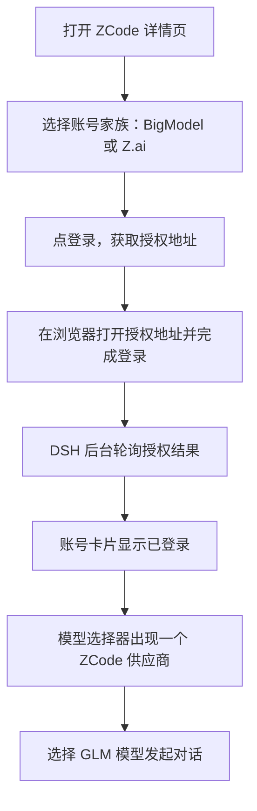

# ZCode

`@tnnevol/dsh-zcode` 把 **ZCode Start Plan** 的模型接入 DSH：用 ZCode 账号登录后，模型选择器出现一个 **`ZCode`** 供应商，模型清单以账号权益为准动态下发（2026-10-24 该账号为 GLM-5.3 与 GLM-5.3-Flash），上下文窗口、最大输出、图片输入与思考等级按上游客户端配置补全，额度按「每个模型 × 周期」在详情页与输入区胶囊展示。

模型回合由 **ZCode 客户端自带的 agent 运行时**执行：插件托管官方 `zcode app-server` 子进程，由它自己构造并签名请求。**因此 Start Plan 通道需要目标环境安装 ZCode 客户端**；插件不复刻签名、不伪造客户端身份，也不读写用户 `~/.zcode`。

> 该插件暂未随 fnOS 应用内置分发，请在目标 DSH 环境中按下面的命令安装。

:::tip 对话可用范围
Start Plan 通道已在 **DSH Web** 实测可用：纯文本、图文与思考等级都能完成回合并回显用量（实测纯文本 18 秒；图文 + High 15 秒、缓存命中 28%；用量胶囊由剩余 100% 变为剩余 93%）。**DSH Desktop 尚未验证**；没有安装 ZCode 客户端的环境无法使用该通道。详见[执行通道](#执行通道)与[已知限制](#已知限制)。
:::

## 安装

```sh
dsh plugin --profile web add @tnnevol/dsh-zcode@0.2.1-rc.2.48
```

安装后重启 DSH Web profile。插件版本信息见[插件总览](/plugins/)。

Start Plan 通道还需要 **ZCode 客户端**（发行包内含 `zcode.cjs` agent 运行时与 `provider/zcode-builtin.json`）。插件会按常见安装位置探测，也可以用环境变量显式指定：

| 环境变量 | 用途 |
| --- | --- |
| `DSH_ZCODE_CLI` | `zcode.cjs` 的绝对路径；探测失败或客户端装在非标准位置时使用 |
| `DSH_ZCODE_DATA_DIR` | 桥接通道的数据目录；默认 `<DSH_HOME>/zcode-bridge`，必须是可写目录 |

## 登录

登录只提供 **OAuth 设备授权**，没有 API Key 登录：Start Plan 的模型请求只认账号身份，Key 形态在本插件里没有可用路径，因此页面不会出现 Key 输入入口。

1. 在 DSH 左侧打开「插件」，进入 `ZCode` 详情页。
2. 账号卡片选择账号家族：**BigModel**（国内）或 **Z.ai**（海外）。两者的授权页域名不同，令牌、额度与模型端点相同。
3. 点「登录」，页面显示可在浏览器打开的授权地址与剩余有效期。
4. 在浏览器完成登录；DSH 在后台按上游给出的间隔轮询，完成后账号卡片自动变为已登录，显示账号与账号家族。



同一时间只保留一个 ZCode 账号；账号卡片提供「退出登录」，退出后 `ZCode` 供应商不再出现在模型选择器。授权中刷新详情页不会新建第二条轮询，也不会把你已经打开的授权地址换掉。

## 执行通道

选中 `ZCode` 模型发送消息后，插件在后台准备一条托管通道：

| 关注点 | 行为 |
| --- | --- |
| 依赖 | ZCode 客户端发行包内的 agent 运行时；未安装或找不到内置 provider 配置时，会话显示可读诊断 |
| 数据目录 | `<DSH_HOME>/zcode-bridge/`（可用 `DSH_ZCODE_DATA_DIR` 覆盖）；插件每次启动对账，不读写用户 `~/.zcode` |
| 凭据 | 用插件自己的 OAuth 令牌，按客户端同款 AES-256-GCM 格式写入桥接目录，不复制桌面端登录态 |
| 请求 | 由 agent 运行时自己构造并签名；插件只做 stdio 协议、账号注入与流式事件转写 |
| 工具 | 该回合的工具由 **ZCode agent 原生执行**；DSH 侧工具与 DSH 的批准流程不参与 |
| 标题 | 会话标题在本地生成，取不到可用文本时保留默认标题，不调用模型、不消耗额度 |
| 回合 | 同一会话同一时刻只执行一个回合；撞上未释放的回合锁时自动恢复一次 |
| 收尾 | 回合失败、超时（默认 15 分钟）、中止或子进程退出时以可读诊断结束，不产生空白回复 |

图片会以本地文件的副本交给 agent 读取（带正确扩展名，回合结束后删除）；思考等级会随模型一起注入，换模型或换等级后在下一次回合生效。

## 模型

登录后，模型选择器只新增一个供应商：

| 供应商 | 路由 | 模型来源 | 计费与限制 |
| --- | --- | --- | --- |
| `ZCode` | `dsh-zcode` | 账号权益：`GET /api/v1/zcode-plan/billing/balance` 的额度条目中 `capabilities`（形如 `model:glm-5.3`）决定可用模型；2026-10-24 该账号为 GLM-5.3 与 GLM-5.3-Flash | 受 Start Plan 套餐额度约束；Start Plan 回合由托管通道执行，Ultra 端点按量计费 |

思考等级用上游的 `output_config.effort` 表达。上游只有 low / high / max 三档、没有「不思考」档，DSH 的七档会这样归并：

| DSH 思考等级 | 上游 `effort` |
| --- | --- |
| Default / Minimal / Low | `low` |
| Medium / High | `high` |
| Xhigh / Max | `max` |

图片输入按上游 `capabilities.vision` 声明：GLM-5.3-Flash 支持，GLM-5.3 不支持，目录行的 `V` 标记即此项。

输入区右侧的用量图标与 Codex 插件一致：环形进度显示**当前选中模型**的额度剩余比例，环心是 ZCode 标记；悬停看摘要，点击展开每一份额度的剩余与重置时间。选中别的供应商的模型时该图标不显示。

模型清单**不在插件里写死**，而是跟着账号权益走：新增套餐、活动赠送或到期都会改变清单，刷新目录即可看到变化，不需要升级插件。额度接口不可读时，插件回退到内置清单（`GLM-5.3-Flash`、`GLM-5.2`、`GLM-5-Turbo`），并在详情页说明「当前清单未经账号确认」。

### 模型能力

每个模型的上下文窗口、最大输出、图片输入与思考等级按上游客户端配置（`GET /api/v1/client/configs`）投影到 DSH；该接口是公开的，插件只用它补全能力，不用它判断登录态：

| 能力 | 来源 | 上游未声明时 |
| --- | --- | --- |
| 上下文窗口 | `data.builtinModels[].contextWindow`（GLM-5.3 与 GLM-5.3-Flash 为 1000000） | 使用保守默认值并说明 |
| 最大输出 | `data.builtinModels[].maxCompletionTokens`（128000） | 使用保守默认值并说明 |
| 思考等级 | `reasoning.levels` 对象映射（low / high / max） | 只保留关闭档 |
| 图片输入 | `capabilities.vision` | 不提供图片入口 |
| 工具调用 | 所有 Start Plan 模型支持 | — |

### 模型列表

详情页的模型目录卡片：

- **固定高度、内部滚动**：只有模型列表区滚动，搜索框与计数固定在工具栏，长目录不会把整页撑高。
- **搜索**：按模型名称、标识与能力说明过滤，结果即时更新。
- **计数**：显示当前搜索结果数；已隐藏的模型数量单独标注。
- **隐藏**：逐个模型开关，隐藏后该模型不再出现在模型选择器；重新打开后恢复。
- **刷新**：立即重新读取账号权益，并显示获取时间。

目录刷新失败时保留上一份可用目录，不把已经能用的模型清空。

## 额度

Start Plan 的额度按 **「每个模型 × 周期」** 表达：同一个模型可能既有**日额度**，又有**一次性活动额度**。插件保留这个粒度，分别展示，不合并成一个总百分比——合并会掩盖「日额度用完但活动额度还有」这类实际状态。

| 列 | 含义 |
| --- | --- |
| 模型 | 额度条目对应的模型（如 `GLM-5.3`）；账号级记录会单独标注 |
| 周期 | 上游原样（`daily` / `one_time` 等），不翻译成自定义窗口名 |
| 用量 | 已用百分比与剩余量；总量为 0 时显示 0%，不产生无效数值 |
| 重置 | 有周期结束或到期时间时显示倒计时，并随时间递减 |

2026-10-24 该账号同时生效两份套餐，所以同一个模型会出现两个窗口，这是正常展示而不是重复数据：

| 套餐 | 模型 | 额度 |
| --- | --- | --- |
| `zcode-v3-start-plan-0817` | GLM-5.3 | 每日 3,000,000 |
| `zcode-v3-start-plan-0817` | GLM-5.3-Flash | 每日 5,000,000 |
| `zcode-v3-start-plan-1024`（ZCode 1024 Dev Day） | GLM-5.3 | 一次性 200,000,000 |
| `zcode-v3-start-plan-1024`（ZCode 1024 Dev Day） | GLM-5.3-Flash | 一次性 300,000,000 |

额度接口读取失败时，卡片显示失败原因与最近一次获取时间，**不会把没读到的窗口显示成 0%**。

对话输入区右侧会显示 **ZCode 用量胶囊**，用于在对话过程中随时查看已用比例与重置时间。胶囊有三种策略：

| 策略 | 表现 |
| --- | --- |
| `auto`（默认） | 仅在选中 `ZCode` 供应商的模型时显示；选中其它供应商模型时不显示，也不触发额度请求 |
| `always` | 插件已登录时常驻显示；没有数据时显示未知，不补 0% |
| `off` | 隐藏，并停止额度自动刷新（详情页仍可手动刷新） |

策略在详情页设置区修改，下一次进入会话或下一次对话即生效，无需重启 DSH。

## 设置项说明

全部设置位于**插件管理页 → `ZCode` 详情页 → 设置区**，修改后点「保存」立即生效，不需要重启。设置弹框中没有本插件的配置入口。

| 设置项 | 说明 | 取值范围 | 默认值 |
| --- | --- | --- | --- |
| 用量胶囊 | 输入区右侧胶囊的显隐策略 | `auto` / `always` / `off` | `auto` |
| 自动刷新间隔 | 目录与额度的后台刷新周期（分钟）；`0` 表示关闭自动刷新 | 0–240 | 15 |
| 推理端点 | Start Plan（托管通道，消耗套餐额度）或 Ultra（HTTP 通道，消耗按量余额） | `start-plan` / `ultra` | `start-plan` |
| 隐藏的模型 | 在模型选择器中隐藏的模型 | 逐模型开关 | 空 |

## 推理端点

插件支持两个推理端点，在**设置区 → 推理端点**切换：

| 端点 | 路径 | 凭据 | 计费 | 可用性 |
| --- | --- | --- | --- | --- |
| `Start Plan`（默认） | `/api/v1/zcode-plan/anthropic` | ZCode 账号 JWT | 消耗 Start Plan 套餐额度 | **可用**：由托管的 ZCode agent 运行时执行，DSH Web 已实测 |
| `Ultra` | `/api/v1/ultra/anthropic` | 家族 MaaS 令牌 | 消耗个人按量余额 | 由插件直接发 HTTP，不被风控拦截；余额为 0 时返回 HTTP 429 + 业务码 `1113` |

`Ultra` 是官方客户端另一条实际使用的路径（官方把 `open.bigmodel.cn/api/anthropic` 改写成 `…/ultra/anthropic`）。只订了 Start Plan、没有按量余额的账号切到 `Ultra` 会得到 `1113`；有余额的账号切到 `Ultra` 可直接对话。日常使用建议保持默认的 Start Plan。

## 已知限制

- **Start Plan 通道需要 ZCode 客户端**：回合由客户端发行包内的 agent 运行时执行；未安装或找不到内置 provider 配置时会话会显示诊断，不会退回插件自己构造的 HTTP 直连。客户端大版本升级后建议先发一条消息确认通道仍可用。
- **工具由 ZCode agent 原生执行**：该回合里 DSH 的工具与批准流程不参与，需要文件、命令或检索时由 ZCode agent 用自己的原生工具完成；请求 DSH 专属工具不会生效，这不是工具故障。
- **同一会话同时只有一个在途回合**：上一回合未结束时的发送会排队；异常中断后插件会补发停止并重试一次，仍失败时按提示稍后再发。
- **会话标题在本地生成**：标题从你的消息生成，取不到可用文本时保留「新会话」，不调用模型、不消耗额度。
- **插件自己构造的 Start Plan HTTP 请求会被风控拦截**：网关返回 HTTP 405 与业务码 `3012`（`request has been blocked due to unusual activity.`）。插件不再用该路径执行回合；如果看到 `3012`，说明本次回合没有经过托管通道（例如客户端不可用或端点配置异常）。
- **需要能直连 `zcode.z.ai`**：登录、模型目录、额度与模型请求都发往该域名。运行环境无法访问时，登录与目录会给出连接失败提示。
- **只有 OAuth 登录**：Start Plan 的模型请求只接受账号身份，插件不提供 API Key 登录入口。给 Key 也没有可用路径。
- **两个账号家族的授权页不同**：BigModel（国内）走 `bigmodel.cn`，Z.ai（海外）走 `chat.z.ai`；选错家族会拿不到令牌，换一个家族重试即可。
- **额度接口要求稳定的设备标识**：缺少设备标识时上游返回 `3001`（`parameter error`），且标识变化会让同一账号被当成新设备。插件在进程内保持标识稳定；如果被要求重新授权，重新登录即可。
- **额度不是单一百分比**：日额度与一次性活动额度并存属于正常状态；插件不做金额换算，也不展示账单。
- **路由使用 `dsh-` 前缀**：插件只注册 `dsh-zcode`，与手工配置的 `zcode` / `zhipu` 并存；不要为同一用途再手工创建同名 `dsh-zcode` 路由。

## 常见问题

### 对话提示找不到 ZCode 客户端

Start Plan 通道需要客户端发行包里的 `zcode.cjs`。先确认已安装 ZCode 客户端；装在非标准位置时，用 `DSH_ZCODE_CLI` 指向该文件后重启 DSH。提示「安装不完整」时检查发行包内是否有 `provider/zcode-builtin.json`，必要时重新安装客户端。

### 对话一直没有回复，或提示回合超时

先看是否有「账号已注入」「新建 agent 会话」类日志。常见原因是桥接数据目录不可写（换一个可写目录或修正权限）、客户端版本与内置 provider 配置不匹配，或上一回合没有正常结束。插件会对超时与异常收尾并补发停止；仍无响应时可换一个新会话重试。

### 对话报「风控拦截 3012」

这说明本次回合没有经过托管通道：检查是否把推理端点切到了异常状态、ZCode 客户端是否可用。插件不会自动重试、不会伪装成功，也不提供绕过方式；确认客户端可用后重新发送即可。

### 工具没有按预期执行

这个通道的执行者是 ZCode agent：它使用自己运行时自带的 Bash、Read、Write 等工具，不使用 DSH 工具，也不经过 DSH 的批准流程。需要操作文件时直接描述目标，由 agent 用自己的工具完成。

### 会话标题为什么是「新会话」

标题在本地从你的消息生成；当消息里没有可用文本（例如纯图片）时保留默认标题，避免把英文指令或占位文本当成标题。这是预期行为，不影响对话。

### 登录后看不到模型

先确认插件正常加载并且账号已登录。模型清单来自账号权益，不需要在 ZCode 里逐项启用。如果详情页提示「当前清单未经账号确认」，说明额度接口暂时不可读，点目录卡片上的「刷新」重试；如果提示同名 `dsh-zcode` 路由冲突，按提示移除该配置后再登录。

### 模型列表和 ZCode 客户端里不一致

目录以账号权益（额度条目的 `capabilities`）为准，客户端配置只用于补全能力。权益变化需要等下一次刷新（默认 15 分钟）或手动刷新后才会出现。若详情页显示当前用的是内置兜底清单，说明额度接口没读到，恢复后刷新即可。

### 同一个模型为什么有两个额度窗口

一个是日额度，一个是一次性活动额度（例如「ZCode 1024 Dev Day」这类活动赠送）。两者周期不同、互相独立，所以分开显示；插件不会把它们合并成一个百分比。

### 对话报「模型未授权」

业务码 `3006`（`model not allowed`）表示当前账号没有该模型的权益。刷新目录核对可用模型；如果刚买了新套餐，稍等权益下发后再刷新。

### 对话报「额度耗尽」或「需要校验」

- **额度耗尽**：对应业务码 `1113`，在额度卡片查看是哪个窗口用完了，等周期重置。
- **需要人机校验**：对应业务码 `3007`，按提示在 ZCode 官方客户端完成校验后再试。

### 授权页面打不开或扫码后没反应

允许浏览器打开新标签页后重试。使用 DSH Desktop 时，授权页面会在系统默认浏览器中打开。授权链接有有效期，过期后详情页会回到未登录，重新发起即可。

### 为什么没有「使用 API Key 登录」

这是产品决策而不是未完成的功能：Start Plan 的模型请求只认账号身份，Key 形态没有可用路径，提供入口只会让人走进死胡同。

### 额度卡片显示读取失败

额度接口可能暂时不可用或被网络阻断。卡片会保留最近一次获取时间与失败原因，稍后点「刷新」重试即可，不影响已经可用的模型目录。

### 与手工配置的供应商冲突

插件使用 `dsh-zcode`，不会与手工配置的 `zcode` / `zhipu` 冲突。只有手工配置了同名 `dsh-zcode` 时才会冲突；按详情页提示移除对应配置后重试即可。
