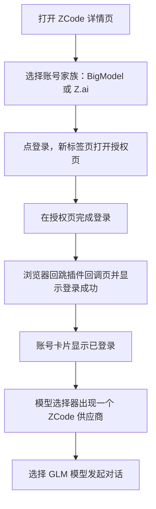

# ZCode

`@tnnevol/dsh-zcode` 把 **ZCode Start Plan** 的模型接入 DSH：用 ZCode 账号登录后，模型选择器出现一个 **`ZCode`** 供应商，模型清单以账号权益为准动态下发（2026-10-24 该账号为 GLM-5.3 与 GLM-5.3-Flash），上下文窗口、最大输出、图片输入与思考等级按上游客户端配置补全，额度按「每个模型 × 周期」在详情页与输入区胶囊展示。

模型回合由**插件自己收发 Anthropic Messages 请求**执行：插件直接向 ZCode 网关发起请求，并按上游要求把系统提示词组织成两段独立的文本块。**不需要安装 ZCode 客户端**，也不读写用户 `~/.zcode`。

> 该插件暂未随 fnOS 应用内置分发，请在目标 DSH 环境中按下面的命令安装。

:::tip 对话可用范围
已在 **DSH Web** 实测可用：纯文本回合 4 秒完成；工具调用会正确发起并按 DSH 的批准流程弹出审批；多轮工具结果能正确续答；附带图片时可读出图中文字（7 秒）。全过程不再出现 `3012`。**DSH Desktop 尚未验证**。详见[执行通道](#执行通道)与[已知限制](#已知限制)。
:::

## 安装

```sh
dsh plugin --profile web add @tnnevol/dsh-zcode@6.1.9
```

安装后重启 DSH Web profile。插件版本信息见[插件总览](/plugins/)。

不需要安装 ZCode 客户端，也不需要配置环境变量：登录与模型请求全部由插件自身完成。只有部署在反向代理之后、需要自定义登录回调地址时，才需要设置 `DSH_ZCODE_CALLBACK_URL` 指向对外可访问的回调地址。

## 登录

登录使用 **ZCode 账号授权（授权码 + 同源回调）**，没有 API Key 登录：Start Plan 的模型请求只认账号身份，Key 形态在本插件里没有可用路径，因此页面不会出现 Key 输入入口。

1. 在 DSH 左侧打开「插件」，进入 `ZCode` 详情页。
2. 账号卡片选择账号家族：**BigModel**（国内）或 **Z.ai**（海外）。两者的授权页域名不同，令牌、额度与模型端点相同。
3. 点「登录」。DSH 会在新标签页打开上游授权页（在点击的同一瞬间打开，避免被浏览器当成弹窗拦截）。
4. 在授权页完成登录，浏览器回跳到插件的回调地址 `/plugins/dsh-zcode/auth/callback`，页面显示「登录成功，可以关闭此页并回到 DSH」。
5. 回到详情页，账号卡片已变为已登录，显示账号与账号家族。



两个家族共用同一个登录入口，区别只在上游授权页域名与账号家族标识。同一时间只保留一个 ZCode 账号；账号卡片提供「退出登录」，退出后 `ZCode` 供应商不再出现在模型选择器。

授权链接有有效期，授权中刷新详情页不会把你已经打开的授权地址换掉。回调必须带上与发起时一致的 `state`，否则会被拒绝；同一个授权码只能用一次，重复提交会提示重新登录。

## 执行通道

选中 `ZCode` 模型发送消息后，插件直接向上游发起 Anthropic Messages 请求：

| 关注点 | 行为 |
| --- | --- |
| 请求发起者 | 插件自己，不经第三方 SDK，也不拉起任何子进程 |
| 协议 | Anthropic Messages（`/v1/messages`，SSE 流式） |
| 系统提示词 | 必须以上游官方的**两段独立文本块**发出：第一段是身份行原文，第二段以官方行为提示词开头，DSH 自己的指令接在其后 |
| 附加字段 | 与官方客户端一致地带上 `metadata`、`tool_choice`、`thinking`、`output_config` 四项 |
| 工具 | 由 DSH 侧执行，**DSH 的权限审批正常生效** |
| 流式 | 文本、思考与工具参数都按增量转成 DSH 的流事件；用量在回合结束时回显 |
| 思考签名 | 思考块的签名随消息跨轮带回，不混进可见正文 |
| 多会话 | 子代理（智能体团队）是独立的模型会话，复用同一条取流与工具调用路径，因此可正常工作；需先在测试 profile 安装 `dsh-experimental-agent-team`、`dsh-experimental-tool-agent-team`、`dsh-experimental-client-ui-agent-team`、`dsh-experimental-agent-team-profile` 四个包（默认不装） |
| 失败 | 以可读诊断结束，不产生空白回复、不静默重试、不伪装成功 |

图片会读成字节后以 base64 随请求发出；读取失败时只跳过该图并记一条警告，不影响同一条消息里的文字。思考等级随请求的 `output_config.effort` 发出，换模型或换等级后在下一次请求生效。

## 模型

登录后，模型选择器只新增一个供应商：

| 供应商 | 路由 | 模型来源 | 计费与限制 |
| --- | --- | --- | --- |
| `ZCode` | `dsh-zcode` | 账号权益：`GET /api/v1/zcode-plan/billing/balance` 的额度条目中 `capabilities`（形如 `model:glm-5.3`）决定可用模型；2026-10-24 该账号为 GLM-5.3 与 GLM-5.3-Flash | 受 Start Plan 套餐额度约束；切到 Ultra 端点时按量计费 |

思考等级用上游的 `output_config.effort` 表达。上游只有 low / high / max 三档、没有「不思考」档，DSH 的七档会这样归并：

| DSH 思考等级 | 上游 `effort` |
| --- | --- |
| Default / Minimal / Low | `low` |
| Medium / High | `high` |
| Xhigh / Max | `max` |

图片输入按上游 `capabilities.vision` 声明：GLM-5.3-Flash 支持，GLM-5.3 不支持，目录行的 `V` 标记即此项。

模型清单**不在插件里写死**，而是跟着账号权益走：新增套餐、活动赠送或到期都会改变清单，刷新目录即可看到变化，不需要升级插件。额度接口不可读时，插件回退到内置清单（`GLM-5.3-Flash`、`GLM-5.2`、`GLM-5-Turbo`），并在详情页说明「当前清单未经账号确认」。

### 模型能力

每个模型的上下文窗口、最大输出、图片输入与思考等级按上游客户端配置（`GET /api/v1/client/configs`）投影到 DSH；该接口是公开的，插件只用它补全能力，不用它判断登录态：

| 能力 | 来源 | 上游未声明时 |
| --- | --- | --- |
| 上下文窗口 | `data.builtinModels[].contextWindow`（GLM-5.3 与 GLM-5.3-Flash 为 1000000） | 使用保守默认值并说明 |
| 最大输出 | `data.builtinModels[].maxCompletionTokens`（128000） | 使用保守默认值并说明 |
| 思考等级 | `reasoning.levels` 对象映射（low / high / max） | 只保留关闭档 |
| 图片输入 | `capabilities.vision` | 不提供图片入口 |
| 工具调用 | 所有 Start Plan 模型支持 | — |

### 模型列表

详情页的模型目录卡片：

- **固定高度、内部滚动**：只有模型列表区滚动，搜索框与计数固定在工具栏，长目录不会把整页撑高。
- **搜索**：按模型名称、标识与能力说明过滤，结果即时更新。
- **计数**：显示当前搜索结果数；已隐藏的模型数量单独标注。
- **隐藏**：逐个模型开关，隐藏后该模型不再出现在模型选择器；重新打开后恢复。
- **刷新**：立即重新读取账号权益，并显示获取时间。

目录刷新失败时保留上一份可用目录，不把已经能用的模型清空。

## 额度

Start Plan 的额度按 **「每个模型 × 周期」** 表达：同一个模型可能既有**日额度**，又有**一次性活动额度**。插件保留这个粒度，逐条展示，不做金额换算。

| 列 | 含义 |
| --- | --- |
| 模型 | 额度条目对应的模型（如 `GLM-5.3`）；账号级记录会单独标注 |
| 周期 | 上游原样（`daily` / `one_time` 等），不翻译成自定义窗口名 |
| 用量 | 已用百分比与剩余量；总量为 0 时显示 0%，不产生无效数值 |
| 重置 | 有周期结束或到期时间时显示倒计时，并随时间递减 |

2026-10-24 该账号同时生效两份套餐，所以同一个模型会出现两个窗口，这是正常展示而不是重复数据：

| 套餐 | 模型 | 额度 |
| --- | --- | --- |
| `zcode-v3-start-plan-0817` | GLM-5.3 | 每日 3,000,000 |
| `zcode-v3-start-plan-0817` | GLM-5.3-Flash | 每日 5,000,000 |
| `zcode-v3-start-plan-1024`（ZCode 1024 Dev Day） | GLM-5.3 | 一次性 200,000,000 |
| `zcode-v3-start-plan-1024`（ZCode 1024 Dev Day） | GLM-5.3-Flash | 一次性 300,000,000 |

额度接口读取失败时，卡片显示失败原因与最近一次获取时间，**不会把没读到的窗口显示成 0%**。

### 百分比怎么算

输入区胶囊与浮层顶部的百分比是**聚合值**，按「总剩余 / 总量」把所有参与计算的窗口求和后再取比例，而不是取其中某一份：

- 同一模型有多份额度时，只看日额度会误判——日额度用尽但一次性额度仍有大量余额时，单份口径会显示「剩余 0%」，而账号实际还能正常调用。
- 聚合值反映真实可用比例；每一份额度的剩余量与重置时间仍在浮层里逐条列出，信息不丢失。
- 选中某个模型时聚合只覆盖该模型名下的窗口；选中模型匹配不到时退回全部窗口，保证环上始终有可读含义。

### 用量胶囊

对话输入区右侧会显示 **ZCode 用量胶囊**，用于在对话过程中随时查看已用比例与重置时间。胶囊有三种策略：

| 策略 | 表现 |
| --- | --- |
| `auto`（默认） | 仅在选中 `ZCode` 供应商的模型时显示；选中其它供应商模型时不显示，也不触发额度请求 |
| `always` | 插件已登录时常驻显示；没有数据时显示未知，不补 0% |
| `off` | 隐藏，并停止额度自动刷新（详情页仍可手动刷新） |

策略在详情页设置区修改，下一次进入会话或下一次对话即生效，无需重启 DSH。胶囊的样式与 Codex 插件一致：环形进度 + 环心 ZCode 标记，悬停看摘要，点击展开每一份额度的明细。

## 设置项说明

全部设置位于**插件管理页 → `ZCode` 详情页 → 设置区**，修改后点「保存」立即生效，不需要重启。设置弹框中没有本插件的配置入口。

| 设置项 | 说明 | 取值范围 | 默认值 |
| --- | --- | --- | --- |
| 用量胶囊 | 输入区右侧胶囊的显隐策略 | `auto` / `always` / `off` | `auto` |
| 自动刷新间隔 | 目录与额度的后台刷新周期（分钟）；`0` 表示关闭自动刷新 | 0–240 | 15 |
| 推理端点 | Start Plan（套餐额度）或 Ultra（按量余额） | `start-plan` / `ultra` | `start-plan` |
| 隐藏的模型 | 在模型选择器中隐藏的模型 | 逐模型开关 | 空 |

## 推理端点

插件支持两个推理端点，在**设置区 → 推理端点**切换：

| 端点 | 路径 | 凭据 | 计费 | 可用性 |
| --- | --- | --- | --- | --- |
| `Start Plan`（默认） | `/api/v1/zcode-plan/anthropic` | ZCode 账号 JWT | 消耗 Start Plan 套餐额度 | **可用**：插件按官方两段前缀发出请求，DSH Web 已实测 |
| `Ultra` | `/api/v1/ultra/anthropic` | 家族 MaaS 令牌 | 消耗个人按量余额 | 可用；该端点不校验系统提示词，因此不注入前缀。余额为 0 时返回 HTTP 429 + 业务码 `1113` |

`Ultra` 是官方客户端另一条实际使用的路径（官方把 `open.bigmodel.cn/api/anthropic` 改写成 `…/ultra/anthropic`）。只订了 Start Plan、没有按量余额的账号切到 `Ultra` 会得到 `1113`；有余额的账号切到 `Ultra` 可直接对话。日常使用建议保持默认的 Start Plan。

## 已知限制

- **系统提示词必须是上游原文**：Start Plan 端点会校验请求的 `system`。第一段必须逐字等于官方的身份行（42 字符），第二段必须以官方行为提示词（1211 字符）开头；改动一个字母或合并成一块都会被判 `3012`。这两段是上游提示词原文，**上游改动后插件会整体失效**，需要发布新版本更新常量，没有降级路径。
- **`3012` 的含义**：它不是账号风控。看到 `3012` 说明本次请求的系统提示词形态与上游版本不匹配（最常见的原因就是上游刚更新了提示词）。插件会给出指向「前缀需重新采集」的诊断，不会自动重试、不伪装成功、也不提供绕过方式。
- **工具由 DSH 执行**：该通道里模型的工具调用回到 DSH，走 DSH 的工具实现与批准流程，因此你可以审批、也可以拒绝。被拒绝时模型会收到「被拒绝」的结果并调整做法。
- **请求任务 ID 有长度要求**：上游要求 6–64 字符，过短会被判 `1214`。插件会把过短的会话标识补齐，不需要你干预。
- **需要能直连 `zcode.z.ai`**：登录、模型目录、额度与模型请求都发往该域名。运行环境无法访问时，登录与目录会给出连接失败提示。
- **只有账号授权登录**：Start Plan 的模型请求只接受账号身份，插件不提供 API Key 登录入口。给 Key 也没有可用路径。
- **两个账号家族的授权页不同**：BigModel（国内）走 `bigmodel.cn`，Z.ai（海外）走 `chat.z.ai`；选错家族会拿不到令牌，换一个家族重试即可。
- **额度接口要求稳定的设备标识**：缺少设备标识时上游返回 `3001`（`parameter error`），且标识变化会让同一账号被当成新设备。插件在进程内保持标识稳定；如果被要求重新授权，重新登录即可。
- **额度不是单一百分比**：日额度与一次性活动额度并存属于正常状态；胶囊显示的百分比是聚合值，明细在浮层里。插件不做金额换算，也不展示账单。
- **路由使用 `dsh-` 前缀**：插件只注册 `dsh-zcode`，与手工配置的 `zcode` / `zhipu` 并存；不要为同一用途再手工创建同名 `dsh-zcode` 路由。
- **尚未验证的场景**：连续长对话（超过 2 轮）、并发请求、限流退避与中断取消尚未单独取证。遇到异常请保留现象与时间点反馈。

## 常见问题

### 对话报「3012」

`3012` 表示网关拒绝了请求内容，**不是账号被封控**。最常见的原因是上游更新了官方系统提示词，插件内置的两段前缀与它不再一致。先确认插件是最新版本；升级后仍出现，说明上游提示词又一次变更，需要等插件更新前缀常量。插件不会自动重试、不会伪装成功，也不替用户去找非官方转发通道。

### 工具没有按预期执行

这个通道的工具由 DSH 执行：模型发起调用后会弹出 DSH 的权限审批，你批准后才执行。如果审批被拒绝，模型会收到「被拒绝」的结果并调整做法，不会重复发起同一个调用。

### 智能体团队（子代理）能用吗

能用，已在 DSH Web 实测：lead 用 `spawn_teammate` 创建的子代理能独立完成一次模型回合并把结果回传（实测 27 秒、1 轮 3 步、57.8K tok、缓存命中 68%，无 `3012`）。前提是测试 profile 已安装 4 个 `agent-team` 包（`dsh-experimental-agent-team`、`dsh-experimental-tool-agent-team`、`dsh-experimental-client-ui-agent-team`、`dsh-experimental-agent-team-profile`）——这些包默认不装，属于前置条件，不是插件缺陷。

### 图片发出去但模型没看图

先确认当前模型声明支持图片输入（目录行的 `V` 标记，GLM-5.3-Flash 支持、GLM-5.3 不支持）。支持的模型仍读不出内容时，检查图片是否损坏；插件在读取失败时会跳过该图并记一条警告到日志，不影响同一条消息里的文字。

### 胶囊百分比和某一份额度对不上

胶囊显示的是**聚合值**（总剩余 / 总量），不是某一份额度的比例。展开浮层可以逐条看到每份额度的剩余量与重置时间；两者的差异在「日额度用尽但活动额度还有」时最明显，此时聚合值才反映账号实际还能用多少。

### 登录后看不到模型

先确认插件正常加载并且账号已登录。模型清单来自账号权益，不需要在 ZCode 里逐项启用。如果详情页提示「当前清单未经账号确认」，说明额度接口暂时不可读，点目录卡片上的「刷新」重试；如果提示同名 `dsh-zcode` 路由冲突，按提示移除该配置后再登录。

### 模型列表和 ZCode 里显示的不一致

目录以账号权益（额度条目的 `capabilities`）为准，客户端配置只用于补全能力。权益变化需要等下一次刷新（默认 15 分钟）或手动刷新后才会出现。若详情页显示当前用的是内置兜底清单，说明额度接口没读到，恢复后刷新即可。

### 同一个模型为什么有两个额度窗口

一个是日额度，一个是一次性活动额度（例如「ZCode 1024 Dev Day」这类活动赠送）。两者周期不同、互相独立，所以分开显示。

### 对话报「模型未授权」

业务码 `3006`（`model not allowed`）表示当前账号没有该模型的权益。刷新目录核对可用模型；如果刚买了新套餐，稍等权益下发后再刷新。

### 对话报「额度耗尽」或「需要校验」

- **额度耗尽**：对应业务码 `1113`，在额度卡片查看是哪个窗口用完了，等周期重置；也可以切到有余额的 Ultra 端点。
- **需要人机校验**：对应业务码 `3007`，按提示在 ZCode 官方客户端完成校验后再试。

### 授权页面打不开或登录后没反应

允许浏览器打开新标签页后重试（插件在点击时同步打开标签，仍被拦截时需要放行）。使用 DSH Desktop 时，授权页面会在系统默认浏览器中打开。授权链接有有效期，过期后详情页会回到未登录，重新发起即可。回调页提示 `state` 不匹配时，说明该链接来自更早的一次登录尝试，重新发起登录即可；提示授权码已被使用时，同理。

### 部署在反向代理后面，登录回调打不开

默认回调地址按当前访问的 origin 推导；经代理改写后如果落不到 DSH，用 `DSH_ZCODE_CALLBACK_URL` 指定对外可访问的回调地址，并确保该地址能回到 DSH 的同源路由。

### 为什么没有「使用 API Key 登录」

这是产品决策而不是未完成的功能：Start Plan 的模型请求只认账号身份，Key 形态没有可用路径，提供入口只会让人走进死胡同。

### 额度卡片显示读取失败

额度接口可能暂时不可用或被网络阻断。卡片会保留最近一次获取时间与失败原因，稍后点「刷新」重试即可，不影响已经可用的模型目录。

### 与手工配置的供应商冲突

插件使用 `dsh-zcode`，不会与手工配置的 `zcode` / `zhipu` 冲突。只有手工配置了同名 `dsh-zcode` 时才会冲突；按详情页提示移除对应配置后重试即可。
