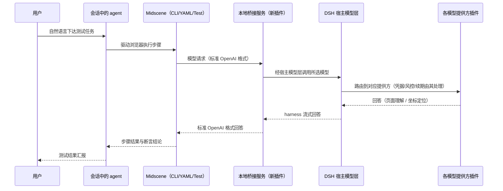

# FNOS-013 Midscene 浏览器自动化桥接插件

| 项目 | 内容 |
| --- | --- |
| 需求编号 | FNOS-013 |
| 提出日期 | 2026-10-10 |
| 需求状态 | <Badge type="info" text="规划中" /> |
| 关联计划 | [PLAN-FNOS-013 Midscene 浏览器自动化桥接插件](/plans/PLAN-FNOS-013-midscene-browser-automation-bridge) |
| 适用范围 | 新增 `@tnnevol/dsh-midscene` 插件（本地桥接服务）、会话内浏览器自动化接入配置 |

## 需求背景

DSH 会话中的 agent 目前做网页 E2E 测试依赖 chrome-devtools MCP：它面向开发者调试，逐步操作繁琐，且测试结论依赖人工编排。Midscene 提供了以自然语言驱动浏览器执行交互与断言的现成能力（Agent Skills + CLI 是官方现役接入方式），但它需要调用一个视觉模型来完成页面理解与坐标定位。

直接给 Midscene 配置模型存在两个障碍：Midscene 只接受标准 OpenAI 兼容端点，而 DSH 的各模型提供方没有对外暴露这样的端点；模型身份、凭据与请求协议由 DSH 宿主内的各提供方插件统一管理，外部工具无法直接复用。

本需求要新增一个 dsh 插件：在本地托管一个 OpenAI 兼容桥接服务，把 Midscene 的标准 OpenAI 请求接入 **DSH 宿主模型层**——凡是 DSH 里能用的模型（DeepSeek 官方路由、CodeBuddy、Codex、用户自定义的 OpenAI/Anthropic 兼容端点），Midscene 都能用；凭据、风控头、token 续期等协议细节由各提供方插件在宿主内处理，桥不接触。桥接服务就绪后，会话中的 agent 通过 Midscene 技能用自然语言完成「打开页面、执行交互、断言结果」的 E2E 测试，替代 chrome-devtools MCP 的日常用途。

同时，本项目自身的 UI 与 E2E 验收目前依赖人工走查与 CDP 脚本取证：写一条 UI 走查证据需要人工逐步操作并逐项截图登记；CDP 脚本面向单次取证，难以沉淀为可复跑的自然语言用例。桥接能力就绪后，应同步把 Midscene 登记为项目测试体系的标准执行方式之一，让后续需求的 UI/E2E 用例有明确的自动化执行路径，降低走查与取证成本。

## 交互链路

用户全程只与 agent 对话；桥接服务对 Midscene 是透明的标准 OpenAI 端点，对内是宿主模型层的一个标准客户端——**模型范围与 DSH 会话内可选的模型一致**，不限于某一家提供方。

## 调研结论

调研完整过程与实测证据见「Midscene × DeepSeek Harness 插件开发调研报告」（2026-10-10，基于 dsh 0.2.0-rc.2、Midscene CLI v1.15.0、DSH Web profile 实测环境）。

| 结论 | 出处 | 影响的功能 | 状态 |
| --- | --- | --- | --- |
| Midscene 的 MCP 接入方式已被官方退役，现役接入方式是 Agent Skills + CLI（浏览器技能包安装后自动被发现，无需重启） | [Midscene 官方文档](https://midscenejs.com/zh/)（introduction、skills 各页）；[MCP 退役公告](https://midscenejs.com/zh/mcp) | FNOS-013-05 | 已核实 |
| Midscene CLI 在本机可运行，提供连接、执行、断言、截图等完整命令集；模型配置全部走环境变量，CLI 自动加载运行目录的环境配置文件 | 本机实测（Midscene CLI v1.15.0）；[Midscene 官方文档](https://midscenejs.com/zh/)（model-common-config 页） | FNOS-013-05 | 已核实 |
| CodeBuddy 上游只接受流式请求，非流式请求被明确拒绝；该约束属提供方协议细节，接入宿主模型层后由其适配器在宿主内处理，不影响桥面行为 | 实测（2026-10-10）；dsh 适配器契约 | FNOS-013-03 | 已核实 |
| DSH 宿主模型层（`ctx.llm`）公开支持枚举全部已配置提供方与模型（`listProviders()` / `listModels()`），并发起统一流式调用（`stream()`）；已配置提供方包括内置 DeepSeek 路由、已安装插件路由（如 `codebuddy`、`openai-codex`）与用户在设置中声明的自定义 OpenAI/Anthropic 兼容端点 | dsh 0.2.0-rc.2 `@deepseek-ai/dsh-llm` 类型定义（`LlmRuntime` 公开接口）；用户 settings 实测（自定义多协议提供方并存） | FNOS-013-01～04 | 已核实 |
| harness 消息词汇原生承载文本与图片输入（`ModelModality` 含 `image`，用户消息可携带图片块），模型能力（图片输入、推理等级）由各提供方适配器声明，调用方按模型元数据路由 | dsh 0.2.0-rc.2 `@deepseek-ai/dsh-llm` 类型定义（`GenerateOptions`、`LlmModelInfo.inputModalities`、`ImageBlock`） | FNOS-013-03 | 已核实 |
| 凭据、风控头、token 续期由各提供方插件在宿主内处理（如 `dsh-codebuddy` 在 `ctx.llm` 注册 `codebuddy` 路由并内置刷新）；经宿主模型层调用不接触也不复制这些协议细节 | `dsh-codebuddy` 插件源码（`ctx.llm.registerAdapter` 用法）；`@deepseek-ai/dsh-llm-pi-ai` 通用适配器（凭据解析内聚） | FNOS-013-04 | 已核实 |
| 上游各提供方对请求形态的约束（如 CodeBuddy 仅流式）在宿主模型层之内由对应适配器处理，桥面向客户端呈现统一的标准 OpenAI 行为 | `dsh-codebuddy` 插件源码 + 实测；dsh 适配器契约（传输细节归适配器） | FNOS-013-03 | 已核实 |
| CodeBuddy 的 glm 主流模型具备真实可用的视觉识别与 UI 坐标定位能力：对程序生成的受控 UI 截图，坐标定位误差不超过 1px——作为 DSH 可用视觉模型的首个实测样本 | 实测（2026-10-10，受控图片场景） | FNOS-013-05 | 已核实（受控场景，单一样本） |
| 真实网页（密集文本、小控件）上的坐标定位精度尚未验证——受控图片结论不能直接外推 | 调研报告风险登记（R1） | FNOS-013-05 | 待核实 |
| Midscene 的模型家族参数决定提示词模板与坐标解析协议；DSH 可用模型是否兼容官方视觉模型家族协议尚未实测 | 调研报告风险登记（R2）；Midscene 官方模型家族说明 | FNOS-013-05 | 待核实 |
| Midscene **不按模型名推断家族**：其适配器表（`MODEL_ADAPTER_CONFIGS`）是纯家族名索引，模型名不参与选择。家族另有两条硬约束：缺失时报 `Default model family is required for locate`，取值不在名单内时报 `Invalid MIDSCENE_MODEL_FAMILY value` | 读 `@midscene/core` 适配器实现（registry 与各 adapter）；两条错误在 v1.15.0 实测复现 | FNOS-013-05 | 已核实 |
| 各家族声明的坐标协议**确实不同**：`gemini` 为 yx 顺序（其余为 xy）；`gpt-5`/`gpt-6` 与 `kimi`/`kimi3` 不做归一化；`deepseek` 使用 point 形状并自带标记式协议与解析器。因此家族与模型错配在原理上会导致坐标误读 | 读 `@midscene/core` 各 adapter 的 `locate.element.resultFormat` | FNOS-013-05 | 已核实 |
| 但强视觉模型对家族错配有较强容忍：同一模型（`deepseek-v4.1-flash`）分别以 `deepseek` 与 `glm-v` 各做 3 次定位，**两组均 3/3 命中**目标按钮区域——错配是真实隐患，但不必然立即发作 | 实测（2026-10-12，DSH Web 侧边栏 36px 按钮，Bridge Mode） | FNOS-013-05 | 已核实（样本有限，不外推为「错配无影响」） |
| 通用协议可驱动 Midscene 未适配的识图模型：`codebuddy/hy3`（不在适配器名单内）以 `glm-v` 与 `qwen3`（同为 `bbox/xy/1000` 系）定位**均 3/3 命中**，并经桥完成真实文本推理 | 实测（2026-10-13，Bridge Mode + 桥 /v1/chat/completions） | FNOS-013-05 | 已核实 |
| Midscene 支持双模型分工（规划模型与页面理解/断言模型可独立配置）；桥接后模型命名空间采用「提供方/模型」形式，Midscene 的模型名参数可承载该形式，是否需要名称映射以实测为准 | [Midscene 官方文档](https://midscenejs.com/zh/)（模型策略与多模型配置）；桥接模型命名设计 | FNOS-013-02、FNOS-013-03 | 待核实 |
| YAML 脚本运行器（`@midscene/cli`，`tasks/flow` 格式）与 Midscene Test 测试框架（`@midscene/test`）读取同一套模型环境变量约定（模型地址/密钥/名称/家族，`.env` 放工具运行目录），与即席 CLI 的接入方式一致——桥接服务就绪后三种运行方式共用同一份接入配置 | [YAML 脚本运行器](https://midscenejs.com/zh/yaml-script-runner)；[Midscene Test 概览](https://midscenejs.com/zh/midscene-test/overview)（模型配置约定与 dotenv 加载说明） | FNOS-013-11、FNOS-013-12 | 已核实 |
| Midscene Test 是官方推荐的 YAML 自动化替代方案（声明式 YAML 用例 + TypeScript 自定义 Node 分离，提供生命周期、并发与报告），目前处于 Beta，测试协议与 API 持续演进；旧 `tasks/flow` YAML 链路进入维护状态（保持兼容、不再新增能力） | [Midscene Test 概览](https://midscenejs.com/zh/midscene-test/overview)（Beta 声明与替代关系） | FNOS-013-12 | 已核实（Beta 风险见行为约束） |
| YAML 脚本运行器与 Midscene Test 要求 Node.js 20.19+/22.12+/24+；与本仓库插件 engines（`^22.19.0 \|\| >=24.0.0`）兼容 | [YAML 脚本运行器](https://midscenejs.com/zh/yaml-script-runner)（安装要求）；仓库 `package.json` engines | FNOS-013-11、FNOS-013-12 | 已核实 |
| CodeBuddy 的 token 刷新协议与凭据存储结构已从 `dsh-codebuddy` 插件源码核实（原直连方案的调研基础）；架构修订后该协议由其插件在宿主内继续使用，桥不复制 | `dsh-codebuddy` 插件源码（凭据存储与刷新实现） | FNOS-013-04 | 已核实 |
| CodeBuddy 模型目录接口返回完整模型清单，主流模型均声明支持图片输入（21 个模型）——作为宿主内一个提供方的目录样本 | `dsh-codebuddy` 插件源码 + 实测 | FNOS-013-02 | 已核实（单提供方样本） |
| dsh 插件可托管外部资源（HTTP 服务、文件监听），配置变更触发热重载时必须完整清理；打包、兼容声明与安装方式有成熟先例（四个已发布插件） | [插件开发指南](/development/plugin-development)；`@tnnevol/dsh-codebuddy` 等插件实现 | FNOS-013-01 | 已核实 |
| 提供方插件与通用模型接入的实现参考：适配器经 `ctx.llm.registerAdapter` 注册路由、凭据与续期内聚于插件；自定义提供方在设置中声明协议/端点/密钥即可用（OpenAI/Anthropic 兼容协议） | `dsh-codebuddy` 插件源码；[dsh 命令行与 profile 参考](https://deepseek-harness.github.io/deepseek-harness/)（模型配置章节，0.2.0-rc.2） | FNOS-013-02～04 | 已核实 |
| dsh 的技能体系（`ctx.skills` 注册表 + `dsh-skill-filesystem` 本地发现 + `dsh-tool-skill` 模型工具）公开支持插件注册技能提供方：插件在 `apply()` 同步注册 SkillProvider 即可贡献技能候选，随插件启停自动挂载/卸载；技能加载不走本地文件路径的技能仍可正常被模型调用 | dsh 0.2.0-rc.2 上游文档 [Skills 子系统](https://github.com/deepseek-ai/deepseek-harness/blob/master/docs/subsystems/skills.md)（SkillProvider/SkillCandidate 契约与 provider registry 章节） | FNOS-013-13 | 已核实 |
| 官方已有「技能随包分发」先例：web profile 组合配置实测到 `dsh-skill-filesystem` 的 `customSkillDirs` 指向 `@deepseek-ai/dsh-agent-preset` 包内 `skills/` 目录——技能文件随 npm 包分发、随插件安装即被发现是官方在用形态 | 项目 `.dsh` web profile `dsh --dump-config` 实测（2026-10-10，`skill-filesystem` 行的 `customSkillDirs` `!!js` 表达式） | FNOS-013-13 | 已核实 |
| Midscene 官方技能仓库（`web-infra-dev/midscene-skills`）的技能内容为 Markdown 指令集（SKILL.md + 参考文件），不依赖仓库外的私有运行时；技能本体可随包重分发，运行时（`npx @midscene/web`）由使用时按需执行 | [Midscene 技能仓库](https://github.com/web-infra-dev/midscene-skills)；[Midscene Skills 文档](https://midscenejs.com/zh/skills.html) | FNOS-013-13 | 已核实（分发许可与更新跟随在计划中核实） |
| dsh 插件支持自带图标：`package.json` 顶层 `icon` 字段声明相对包根的图片文件（SVG/PNG/JPEG/WebP，≤256 KiB，realpath 后必须仍在包内），宿主读取为 base64 data URL 供插件管理界面渲染 | dsh 0.2.0-rc.2 `@deepseek-ai/dsh-package-manifest` 类型定义（`DshPackageManifest.icon`、`PluginLocalizedMeta.icon`）+ `dsh-app-boot` 实现（`MAX_ICON_BYTES = 256 * 1024` 与格式/路径校验源码） | FNOS-013-14 | 已核实 |
| Midscene 官方站点图标资产可公开获取：站点 favicon（600×600 PNG）即 Midscene 眼罩吉祥物图，无登录与签名要求；用户提供的 GitHub 私有用户图片链接为 JWT 签名临时 URL（约 5 分钟过期），不能作为可追溯来源 | 站点 `https://midscenejs.com/favicon.png` 实测下载（600×600，99 KiB）；JWT 链接实测过期（HTTP 404） | FNOS-013-14 | 已核实（来源候选） |
| 项目测试环境已有固定先例：本地 Web 固定端口 8070、Desktop 渲染进程 CDP 端口 9333、NAS 桌面网页可由 CDP 驱动取证 | [测试用例文档规范](/charter/tests-spec)（DSH Web 本地测试、DSH Desktop 测试、真实 NAS 测试章节）；`docs/validation/` 既有记录 | FNOS-013-08、FNOS-013-09 | 已核实 |
| Midscene 对项目自身页面（插件管理页等密集控件界面）的定位精度与用例可维护性未实测——受控场景与普通网页结论不能外推 | 本需求调研（真实页面精度待核实项在项目测试场景下的延伸） | FNOS-013-09 | 待核实 |
| Midscene 以 CDP 端点方式附加 DSH Desktop（自定义协议渲染进程）的兼容性未实测 | Midscene 官方 CDP 接入说明 + [测试用例文档规范](/charter/tests-spec#dsh-desktop-测试)调试端口约定；两者组合未验证 | FNOS-013-09（Desktop 部分） | 待核实 |

「待核实」两条（真实页面精度、家族协议兼容性）不阻塞插件侧功能立项：桥接服务本身（FNOS-013-01～04）不依赖这两条；依赖它们的 FNOS-013-05 标记为待验证，以计划中的预研任务先行确认，不成立时启用桥内坐标适配层的备用方案。

## 需求目标

- 用户安装插件并重启 DSH Web 后，无需额外手工步骤，本地即有一个随 DSH 启停的 OpenAI 兼容桥接服务；Midscene 接入无需准备任何模型密钥——拉一次 `/v1/midscene-env` 即得到可用配置。
- Midscene 及任何标准 OpenAI 客户端通过桥接服务使用 **DSH 已配置的全部模型**：模型目录反映宿主内所有可用提供方与模型；对话补全可用（流式与非流式）、图片输入按模型能力可用；凭据与续期由各提供方插件处理，桥不接触。
- 安装 Midscene 浏览器技能并完成一次性接入配置后，会话中的 agent 能用自然语言完成真实网页上的交互与断言，形成可替代 chrome-devtools MCP 的日常 E2E 测试方式。
- 浏览器自动化技能随插件内置分发：用户安装插件即可在会话中直接使用 Midscene 技能，无需另行执行技能安装命令。
- 测试用例文档规范明确 Midscene 浏览器自动化的适用场景、执行方式、证据登记与清理要求；项目测试环境具备开箱可用的接入条件，并至少完成一轮真实项目用例示范，为后续需求的 UI/E2E 用例提供可复制样例。

## 功能列表

| 编号 | 优先级 | 功能 | 用户可观察结果 | 状态 |
| --- | --- | --- | --- | --- |
| FNOS-013-01 | P1 | 桥接服务随 DSH 托管运行 | 安装插件并重启 DSH Web 后，桥接服务在本地端口自动可用；DSH 停止或重启后端口不残留；端口被占用时**自动改用下一个可用端口**（首选端口起连续尝试，上限 20 个），并把实际端口写回配置、通过健康端点与接入配置如实呈现；整段端口都不可用时明确报错 | <Badge type="tip" text="已实现（本地）" /> |
| FNOS-013-02 | P1 | 标准模型目录查询 | 通过标准模型列表接口得到 **DSH 当前全部可用模型**（内置 DeepSeek 路由、已安装插件路由、用户自定义提供方；标准 OpenAI 列表格式，模型标识用「提供方/模型」形式）；各模型的能力标注（图片输入等）与宿主模型层元数据一致 | <Badge type="tip" text="已实现（本地）" /> |
| FNOS-013-03 | P1 | 对话补全桥接 | 标准客户端以流式或非流式调用对话补全都得到完整回答；携带图片的请求按所选模型能力正确处理；提供方错误以标准错误格式透出并可定位到「提供方/模型」 | <Badge type="tip" text="已实现（本地）" /> |
| FNOS-013-04 | P1 | 模型身份与凭据由宿主处理 | 桥接调用经宿主模型层路由，凭据、请求协议与续期由对应提供方插件处理：CodeBuddy 账号登录态续期行为不变，DeepSeek/自定义提供方的密钥使用其既有配置；桥不读取、不存储、不转发任何凭据 | <Badge type="tip" text="已实现（本地）" /> |
| FNOS-013-05 | P1 | 会话内自然语言浏览器自动化 | 安装 Midscene 浏览器技能并完成接入配置后，会话中的 agent 用自然语言完成「打开页面 → 执行交互 → 断言结果」全链路；既有 chrome-devtools MCP 不受影响可继续使用 | <Badge type="warning" text="待验证" /> |
| FNOS-013-06 | P2 | 插件文档与故障排查指引 | 文档站新增插件说明页：安装命令、Midscene 接入配置模板、常见故障排查（npm 权限、登录态失效、模型家族不匹配等）；插件总览收录 | <Badge type="tip" text="已实现（本地）" /> |
| FNOS-013-07 | P1 | 测试规范登记 Midscene 执行方式 | [测试用例文档规范](/charter/tests-spec)新增「Midscene 浏览器自动化测试」章节：适用用例类型（UI 走查、E2E 交互断言）、三类被测环境（本地 Web 页面、Desktop 调试端口、NAS 桌面网页）的接入方式、与人工走查/CDP 取证的分工、证据登记与测试数据清理要求；章节内容可照做执行 | <Badge type="tip" text="已实现（本地）" /> |
| FNOS-013-08 | P1 | 项目测试环境接入基线 | 项目 `.dsh` 测试环境内完成一次 Midscene 冒烟：本地 DSH Web 页面可被自然语言驱动；桥接插件、全局技能与接入配置就绪；接入配置文件不入仓库且不含真实凭据 | <Badge type="warning" text="待验证" /> |
| FNOS-013-09 | P1 | 真实用例示范与证据登记 | 对项目自身页面完成至少一轮 Midscene E2E（交互 + 视觉断言，含亮/暗主题核对），证据按[验收证据规范](/validation/README)登记 `docs/validation/`；同一需求的测试用例文档按规范回填执行结果；人工走查与 CDP 取证方式不受影响 | <Badge type="warning" text="待验证" /> |
| FNOS-013-10 | P2 | 测试文档交叉引用同步 | 测试规范、验收证据说明与插件说明页之间的交叉引用更新（Midscene 执行方式 ↔ 桥接插件接入），文档构建与检查通过 | <Badge type="tip" text="已实现（本地）" /> |
| FNOS-013-11 | P1 | YAML 脚本运行器接入 | 接入配置就绪后，`@midscene/cli` 的 YAML 脚本（`tasks/flow` 格式，`midscene` 命令执行）可直接经桥接服务运行：模型环境变量与即席 CLI 共用同一份接入配置；Web 场景 YAML 脚本（打开页面 → AI 操作 → AI 断言）可跑通并生成可视化报告；其它平台（Android/iOS/HarmonyOS 等）不在承诺范围 | <Badge type="warning" text="待验证" /> |
| FNOS-013-12 | P2 | Midscene Test 测试框架接入（Beta） | `@midscene/test` 测试项目（声明式 YAML 用例 + TypeScript 自定义 Node，`midscene-test` 命令执行）可经桥接服务运行：模型环境变量共用接入配置；官方脚手架生成的 Web 场景用例可跑通；Beta 期间以实测通过的包版本为基线并在文档标注，协议不兼容时登记并暂缓（不阻塞本需求其它功能） | <Badge type="warning" text="待验证" /> |
| FNOS-013-13 | P1 | 浏览器自动化技能随插件内置 | 安装插件后，Midscene 浏览器自动化技能在会话技能目录中直接可见、可被模型调用，无需用户另行执行技能安装命令；技能内容与官方技能仓库一致并注明来源与版本；插件卸载后技能同步消失；用户若已自行安装同源技能，以用户安装版本优先，不冲突不重复提示 | <Badge type="tip" text="已实现（本地）" /> |
| FNOS-013-14 | P2 | 插件图标 | 插件在插件管理页与安装流程中显示 Midscene 图标（打包进 npm 包的图片文件，非外链）；图标与 Midscene 官方视觉一致并注明来源；亮暗主题下可见 | <Badge type="tip" text="已实现（本地）" /> |

## 行为约束

- 不修改 DSH 官方源码；不修改任何既有提供方插件（含 `dsh-codebuddy`）的代码与行为——模型调用全部经宿主模型层，凭据与续期归各提供方插件，桥不读取凭据文件、不复刻请求协议。
- 模型范围以宿主模型层为准：桥不得硬编码任何特定提供方；新增提供方插件或用户新增自定义端点后，桥接模型目录与调用无需改桥即可使用。
- 与 chrome-devtools MCP 共存：本插件不移除、不改动既有 MCP 配置，替代与否由用户自行决定。
- 桥接服务只监听本机回环地址，不向局域网暴露。**端口自动跳号**：从配置的首选端口起连续尝试（上限 20 个），实际端口写回配置并由健康端点、`/v1/midscene-env` 与插件设置页如实呈现——自动换端口**必须**做成"可见且可恢复"，即用户能知道端口变了、并能据此更新接入配置；不这样做就退化为静默失配（原 fail-fast 设计要防的正是这一点）。整段端口都不可用时给出尝试区间与处理建议。
- 提供方的请求形态约束（如某提供方仅接受流式）属于宿主内适配器职责；桥面向任何标准客户端呈现统一的标准 OpenAI 行为。
- Midscene 每一步都调用视觉模型，按所选提供方计费；文档必须明确提示额度消耗与技能自带的缓存能力，并说明 Midscene 建议使用具备图片输入的模型。
- 第一版不做客户端设置界面，配置使用插件配置默认值；不做 Midscene 的 JS SDK 测试项目（那是用户自己的沉淀）。
- 测试体系适配（FNOS-013-07～10）只承接 UI 走查与 E2E 交互断言类用例的执行方式补充：单元测试、类型检查、构建验证、FNOS 桥接类功能验收（真实 NAS 安装/升级链路）的既有执行方式不变；不为测试目的修改被测应用代码。
- 人工走查与 CDP 取证保留为既有测试方式，不因引入 Midscene 而移除；「待核实」结论不成立的环境（如 Desktop 附加失败）按既有方式执行并在测试用例文档如实标注。
- 测试用例中经 Midscene 执行同样遵守[测试用例文档规范](/charter/tests-spec)的既有要求：执行环境取值、版本三元组记录、测试数据清理与 auth 备份红线不变；NAS 环境一律只读走查，写操作（安装/卸载/设置变更）继续走既有流程。
- YAML 运行器与 Midscene Test 的接入不做模型或协议改造：两者与即席 CLI 共用同一份接入配置与同一桥接服务；桥接侧不为 YAML/Test 增加专用端点。
- Midscene Test 处于 Beta：以实测通过的包版本为基线，不把 Beta 期 API 变化当作桥接缺陷；协议不兼容时该功能暂缓并登记，不影响其余功能验收。
- 内置技能**只改「模型从哪来」，不改操作指令**：技能的操作指令（命令用法、连接模式、workflow、最佳实践）与官方技能仓库保持一致（允许随上游更新同步）；「模型来源」部分必须改写为桥接服务路径——插件存在的意义就是让 Midscene 用 DSH 已有的模型，技能不得引导用户准备第三方 API key 或配置外部模型提供方。改动点必须逐项登记在包内 `SOURCE.md`（含上游同步后重新施加的步骤），避免上游更新把第三方配置带回来。
- **用户零密钥接入是产品契约**：Midscene 强制要求的四个模型环境变量由插件计算生成（`/v1/midscene-env`），其中 `MIDSCENE_MODEL_FAMILY` 按模型推断；`MIDSCENE_MODEL_API_KEY` 恒为占位值（桥不做鉴权、不转发凭据）。推断不出家族时**不写该变量并如实告知**，不得猜测——错的家族会让视觉定位静默失准，比缺值更难排查。
- 内置技能经插件注册提供（随插件启停挂载/卸载），不写入用户的技能目录（`~/.agents/skills/` 等）；用户自行安装的同名技能按 dsh 技能发现的既有优先级胜出，插件不得覆盖。
- 插件图标是打包进 npm 包的本地图片文件（走 `package.json` 的 `icon` 字段声明），不使用外链或签名临时 URL；图标资产遵守 Midscene 官方的商标与视觉使用约定，来源与版本在仓库内注明；图片体积不超过宿主校验上限，路径不逃逸包目录。

## 不在本次范围内

- 不做插件管理页内的设置卡片 UI（作为后续扩展，配置先走默认值）。
- 不移除或改造 chrome-devtools MCP。
- 不实现 Midscene JS SDK 测试项目。
- 不引入 CI 化的 Midscene 自动化流水线（定时回归、报告门禁），后续视需要另立需求。
- 不把 Midscene 设为所有 UI 用例的强制执行方式；执行方式按用例类型选择。
- 不承诺 YAML 运行器的非 Web 平台场景（Android/iOS/HarmonyOS/Computer 等）；只承诺 Web 场景。
- 不承诺 Midscene Test 的 Beta 协议稳定性；Beta 期 API 变化不作为本需求缺陷处理。
- 不为桥接服务增加鉴权体系（回环绑定 + 本机使用场景；若后续需要再立项）。
- 不承诺任何非官方支持家族的模型在 Midscene 下的定位质量；模型家族兼容性按「具备图片输入的模型优先」引导，具体定位质量留待用户自测或后续需求。

## 验收条件与完成状态

### FNOS-013-01

- `FNOS-013-01-AC-01`：插件安装并重启 DSH Web 后，桥接服务在本地端口可用（首选端口可用时即用它，否则自动跳号），健康检查能反映宿主模型层可用性、模型目录状态与**实际监听端口**。
- `FNOS-013-01-AC-02`：DSH Web 停止或重启后，桥接端口无遗留监听进程；插件配置热重载后旧服务完整停止、新配置生效。
- `FNOS-013-01-AC-03`：首选端口被其它进程占用时，桥接服务自动改用下一个可用端口并继续可用；实际端口写回配置（重启后直接复用、不重复扫描），健康端点与 `/v1/midscene-env` 返回实际端口，启动日志提示端口已变化并需重拉接入配置。连续 20 个端口均被占用时报错并列出尝试区间与处理建议。

### FNOS-013-02

- `FNOS-013-02-AC-01`：标准模型列表请求返回 DSH 当前全部可用模型（标准 OpenAI 列表格式，「提供方/模型」标识），与宿主模型层的提供方与模型一致——含内置路由、已安装插件路由与用户自定义提供方。
- `FNOS-013-02-AC-02`：具备图片输入能力的模型在列表中可识别（能力标注与宿主模型层元数据一致）。
- `FNOS-013-02-AC-03`：新增提供方（安装新插件或配置新自定义端点）后，模型目录随之更新，无需改动桥接插件。

### FNOS-013-03

- `FNOS-013-03-AC-01`：非流式调用返回完整 JSON 回答，内容与在 DSH 会话内直接使用该模型一致。
- `FNOS-013-03-AC-02`：流式调用返回标准 OpenAI 流式格式（分片 + 结束标记）。
- `FNOS-013-03-AC-03`：携带图片（数据 URI）的请求路由到具备图片能力的模型时返回正确的视觉回答。
- `FNOS-013-03-AC-04`：提供方错误以标准错误格式返回，错误信息可定位到「提供方/模型」，便于排查。
- `FNOS-013-03-AC-05`：多提供方并存时，指定不同「提供方/模型」的请求各自正确路由（如 CodeBuddy 模型与自定义端点模型各得到各自回答）。

### FNOS-013-04

- `FNOS-013-04-AC-01`：桥接调用经宿主模型层路由，凭据与请求协议由对应提供方插件处理；桥接进程不读取、不存储任何凭据文件或密钥。
- `FNOS-013-04-AC-02`：CodeBuddy 路由的登录态续期行为与 DSH 会话内使用一致（由其插件在宿主内处理）；桥接调用不影响 DSH 内 CodeBuddy 功能与账号管理。
- `FNOS-013-04-AC-03`：DeepSeek 官方路由与用户自定义提供方经桥接调用使用其既有配置（密钥/登录态），无需在桥内重复配置。
- `FNOS-013-04-AC-04`：调用未配置或不可用的「提供方/模型」时，返回明确错误（含提供方状态指引，如「在 Web 设置中登录」），不影响其它路由。

### FNOS-013-05

- `FNOS-013-05-AC-01`：完成技能安装与接入配置后，agent 在会话中用自然语言完成真实网页上的「打开页面 → 交互 → 断言」全链路。
- `FNOS-013-05-AC-02`：真实网页上的元素定位与交互结果稳定可复现（以预研确认的精度基线复核）。
- `FNOS-013-05-AC-03`：chrome-devtools MCP 在同一环境继续可用，行为不受本插件影响。
- `FNOS-013-05-AC-04`：**协议家族对用户不可见**——它是 Midscene 的内部协议细节（决定提示词模板与坐标解析），由插件按实际使用的模型自动推导，设置页不呈现、也不作为配置项接受用户输入。理由是家族与模型必须匹配，而错配表现为**静默错位**（点击偏几像素、不报错），不适合交由用户判断。
- `FNOS-013-05-AC-05`：**Midscene 适配器名单外的识图模型同样可用**——识别不出家族的模型（如自研系列）回落到通用协议（`bbox/xy/1000`，20 个家族中 10 个共用的主导格式），实测在其下可正常定位。因此「不在名单内」不等于「不可用」，用户无需因此被拒绝。
- `FNOS-013-05-AC-06`：设置页的模型字段**只列出具备识图能力的模型**（Midscene 靠截图理解页面），不提供冗余的「只看识图模型」开关；DSH 中一个识图模型都没有时给出可操作提示而非空下拉。跟随会话模型时，若会话模型不具备识图能力则跳过它并改用具识图能力的模型。
- `FNOS-013-05-AC-07`：模型为**单选**（不是列表）。依据：Midscene 的协议家族在启动期从 `.env` 读取且只有一个，多选若含不同系列的模型，回退到备用时家族仍是旧值，反而制造静默错位。指定的模型在目录中不存在时如实提示并保留原选择，不静默改选。

### FNOS-013-06

- `FNOS-013-06-AC-01`：文档站新增插件说明页，包含安装命令、Midscene 接入配置模板与故障排查表，链接可达。
- `FNOS-013-06-AC-02`：插件总览页收录新插件。

### FNOS-013-07

- `FNOS-013-07-AC-01`：测试用例文档规范含「Midscene 浏览器自动化测试」章节，明确适用用例类型、三类被测环境的接入方式、与人工走查/CDP 取证的分工。
- `FNOS-013-07-AC-02`：章节含证据登记与测试数据清理要求，且不与规范既有章节（执行环境、版本记录、auth 备份红线）冲突；文档构建与 SDD 检查通过。

### FNOS-013-08

- `FNOS-013-08-AC-01`：在项目测试环境执行一次 Midscene 冒烟（自然语言驱动本地 DSH Web 页面完成一个交互步骤）成功。
- `FNOS-013-08-AC-02`：接入配置文件位于不入仓库路径且不含真实凭据（桥接使用占位密钥）；`git status` 确认无配置文件混入。
- `FNOS-013-08-AC-03`：接入步骤可按规范章节复现，不依赖未登记的个人环境状态。

### FNOS-013-09

- `FNOS-013-09-AC-01`：对项目自身页面完成一轮 Midscene E2E：自然语言完成交互（如打开插件页）并给出视觉断言结论，亮色与暗色主题各核对一遍。
- `FNOS-013-09-AC-02`：证据按[验收证据规范](/validation/README)登记 `docs/validation/`，含版本三元组与执行环境标识。
- `FNOS-013-09-AC-03`：既有 CDP 取证与人工走查在同一需求内仍可执行（规范未废弃既有方式）。

### FNOS-013-10

- `FNOS-013-10-AC-01`：测试规范、验收证据说明与插件说明页的交叉引用可达，无死链；`pnpm run check -- --sdd --docs` 与文档构建通过。

### FNOS-013-11

- `FNOS-013-11-AC-01`：YAML 脚本运行器与即席 CLI 共用同一份接入配置（同一 `.env` 约定、同一桥接端口），无需为 YAML 场景单独配置模型。
- `FNOS-013-11-AC-02`：一个 Web 场景 YAML 脚本（`tasks/flow` 格式：打开页面 → AI 操作 → AI 断言）经 `midscene` 命令跑通，并生成可视化报告。
- `FNOS-013-11-AC-03`：YAML 脚本执行期间桥接服务的流式/非流式与错误行为与即席 CLI 场景一致（同一桥，无场景特判）。

### FNOS-013-12

- `FNOS-013-12-AC-01`：Midscene Test 测试项目（官方脚手架生成的 Web 场景用例）经 `midscene-test` 命令跑通，模型请求走桥接服务。
- `FNOS-013-12-AC-02`：实测通过的 `@midscene/test` 包版本登记在文档中；Beta 协议变化导致的兼容问题按行为约束暂缓并登记，不阻塞其它功能。

### FNOS-013-13

- `FNOS-013-13-AC-01`：安装插件并重启 DSH Web 后，未自行安装 Midscene 技能的环境里，会话技能目录中可见 Midscene 浏览器自动化技能且模型可正常调用（`skill` 工具加载成功）。
- `FNOS-013-13-AC-02`：技能指令内容与官方技能仓库一致，来源与版本在插件说明页注明。
- `FNOS-013-13-AC-03`：卸载插件后，内置技能同步从会话技能目录消失，无残留。
- `FNOS-013-13-AC-04`：用户已自行安装同源技能时，以用户安装版本优先（dsh 技能发现既有优先级），两者不冲突、技能目录不重复提示。

### FNOS-013-14

- `FNOS-013-14-AC-01`：插件安装后，插件管理页列表与详情页显示 Midscene 图标（随 npm 包分发的本地图片，无外部请求）。
- `FNOS-013-14-AC-02`：图标与 Midscene 官方视觉一致，来源在仓库内注明；亮色与暗色主题下均清晰可见。
- `FNOS-013-14-AC-03`：图标文件符合宿主校验（SVG/PNG/JPEG/WebP、≤256 KiB、位于包目录内），插件加载无 icon 相关诊断错误。

### 验收环境范围

- FNOS-013-01～04：DSH Web 与 DSH Desktop 验收（插件不依赖 fnOS 专属能力，不要求 NAS 验收）。
- FNOS-013-05：DSH Web 会话内验收（真实浏览器自动化全链路）；DSH Desktop 上按同一接入方式走查。
- FNOS-013-06、FNOS-013-07、FNOS-013-10：文档站构建与链接检查验收。
- FNOS-013-08、FNOS-013-09：DSH Web（本地）为主；DSH Desktop 按[测试用例文档规范](/charter/tests-spec#dsh-desktop-测试)以项目 `.dsh/profiles/desktop` 走查（Desktop 附加兼容性以实测为准，失败时按行为约束降级并登记）。
- FNOS-013-11、FNOS-013-12：DSH Web（本地）验收——YAML 脚本与 Test 项目均为本机 Node 进程驱动 Web 浏览器，经本地桥接服务完成模型请求；不涉及 fnOS 专属能力。
- FNOS-013-13：DSH Web 与 DSH Desktop 验收（技能目录可见性、模型调用、卸载清理与同名共存）。
- FNOS-013-14：DSH Web 与 DSH Desktop 验收（图标显示、主题可见性）。

## 变更记录

| 日期 | 变更 | 说明 |
| --- | --- | --- |
| 2026-10-13 | FNOS-013-05-AC-07：测试模型改为单选 | 原「多选」实为有序备用链（任何时刻只有一个生效），且因协议家族在启动期从 `.env` 读取且只有一个，混入不同系列的备用模型会在回退时造成静默错位；同族备用能救的场景极少。既然任何时刻只可能有一个模型生效，界面就如实只让选一个。配置字段由 `models: string[]` 改为 `model: string`（插件尚未发布，无兼容负担）；指定模型不存在时如实提示并保留原选择。 |
| 2026-10-13 | FNOS-013-05-AC-04/05/06 修订为「协议家族自动推导」 | 上一轮把家族做成了用户选项（并要求用户先选家族才能选模型），偏离产品定位：Env Config 的作用只是让 Midscene 侧连通桥，家族是 Midscene 的内部协议细节。改为由桥按实际使用的模型自动推导——识别得出就用对应家族，识别不出但具识图能力则回落通用协议（经实测可驱动未适配模型），用户界面不再出现该字段。模型字段简化为「只列识图模型」，移除冗余勾选框；跟随会话模型时若会话模型无识图能力则跳过。 |
| 2026-10-13 | FNOS-013-05-AC-04/05 新增「协议家族与测试模型联动」 | 家族改为必选（取消默认值）、未选家族时隐藏模型字段、选定家族后按家族过滤模型；换家族时一并移除不兼容的已选模型。判断依据由插件按 Midscene 适配器事实给出，无法判断的模型标注为未知而不猜。背景知识表补三条已核实结论（Midscene 不按模型名推断家族、各家族坐标协议确有差异、强视觉模型对错配有较强容忍）。 |
| 2026-10-10 | 初始登记 | 建立 FNOS-013：新增 `@tnnevol/dsh-midscene` 插件托管本地 OpenAI 兼容桥接服务，复用 CodeBuddy 已登录身份支撑 Midscene 浏览器自动化。依据 2026-10-10 调研报告（协议与能力实测通过；真实页面精度与家族协议兼容性待核实，FNOS-013-05 标记待验证）。关联 PLAN-FNOS-013。 |
| 2026-10-10 | 并入测试体系适配（原 FNOS-014） | 范围扩展：项目测试体系适配 Midscene 并入本需求，新增 FNOS-013-07（测试规范登记执行方式）、08（项目测试环境接入基线）、09（真实用例示范与证据登记）、10（测试文档交叉引用）；07～10 标记待验证的部分沿用 05 的预研结论。原独立登记的 FNOS-014 及其计划撤销（文档未发布，直接移除）；08/09 以 05 的接入完成为前置。背景补充：项目 UI/E2E 验收目前依赖人工走查与 CDP 取证，桥接能力应同步反哺测试体系。 |
| 2026-10-10 | 新增 FNOS-013-11/12 | 范围扩展：YAML 脚本运行器（`@midscene/cli`）与 Midscene Test 测试框架（`@midscene/test`，Beta）接入。两者与即席 CLI 读取同一套模型环境变量约定，桥接就绪后自动可用，无需为场景单独建端点；官方已声明 Test 替代旧 YAML 链路（旧链路维护态），两个功能均登记；11 标 P1（YAML 是现行稳定能力），12 标 P2（Beta 协议演进，兼容问题不作为桥接缺陷）。依据：Midscene 官方文档（YAML 脚本运行器、Midscene Test 概览、模型配置）。 |
| 2026-10-10 | 新增 FNOS-013-13 | 范围扩展：浏览器自动化技能随插件内置分发——用户装完插件即可用，免去 `npx skills add` 步骤。依据：dsh 0.2.0-rc.2 Skills 子系统文档（插件可注册 SkillProvider，随插件启停挂载/卸载）；web profile `--dump-config` 实测到官方 `@deepseek-ai/dsh-agent-preset` 以包内 `skills/` 目录随包分发技能的先例；Midscene 技能本体为 Markdown 指令集，可随包重分发（分发许可与上游跟随在计划中核实）。行为约束：只分发不改写、不写入用户技能目录、用户自装版本优先。 |
| 2026-10-10 | 模型来源改为宿主模型层（架构修订） | 桥接模型来源由「直连 CodeBuddy 凭据（读凭据文件 + 复刻风控头与刷新协议）」修订为「接入 DSH 宿主模型层（`ctx.llm`）」——Midscene 可使用 DSH 已配置的**全部模型**（DeepSeek 官方、CodeBuddy、Codex、用户自定义 OpenAI/Anthropic 兼容端点），不再硬编码任何提供方。依据：dsh 0.2.0-rc.2 `@deepseek-ai/dsh-llm` 类型定义（`listProviders`/`listModels`/`stream` 公开接口，harness 消息词汇原生支持 text+image 模态）；`dsh-codebuddy` 插件源码（适配器经 `ctx.llm.registerAdapter` 注册，凭据与续期内聚于提供方插件）。影响：FNOS-013-02 改为目录全量映射（「提供方/模型」命名空间，新增 AC-03 随提供方更新）、03 增多提供方路由验证（AC-05）、04 由「凭据复刻」改为「凭据归宿主」（AC-01～04 重写）；调研结论表替换 CodeBuddy 专有协议行为宿主模型层事实行；凭据共享写、风控头同步等原专有风险随之消解。修订理由：用户明确要求不限于 CodeBuddy——凡是 harness 能用的模型，Midscene 都能用。 |
| 2026-10-10 | 新增 FNOS-013-14 | 范围扩展：插件图标——插件管理页显示 Midscene 图标。依据：dsh 0.2.0-rc.2 `dsh-package-manifest` 类型（`package.json` 顶层 `icon` 字段：相对路径、SVG/PNG/JPEG/WebP、≤256 KiB、不得逃逸包目录）+ `dsh-app-boot` 校验实现源码；本仓库四个既有插件均未用过该字段，本插件为首例。图标来源：用户提供的 GitHub 签名临时 URL 已过期不可用（实测 404），改以官方站点 favicon（600×600 Midscene 吉祥物，99 KiB）为候选；用户提供原图后可替换，来源与许可登记在仓库内。 |
| 2026-10-12 | 图标资产定案 | 用户确认采用 Midscene 官方站点 favicon 作为插件图标（600×600 PNG 99 KiB，Midscene 主仓库 MIT 许可）；来源 URL 与取用日期随包内附注登记，上游后续提出商标约束时替换（图标独立于功能，零成本）。 |
| 2026-10-12 | 桥接本体与配套交付完成（01～04、06、07、10、13、14） | 实现并本地验证：`plugins/dsh-midscene-plugin` 新建 workspace（`@tnnevol/dsh-midscene` 0.2.0-rc.2.0），托管 `127.0.0.1:8787` OpenAI 兼容桥（`/v1/models`、`/v1/chat/completions`、`/v1/health`），经 `ctx.llm` 路由到宿主全部已配置提供方；实测 4 个提供方 24 个模型、CodeBuddy 与 Codex 真实调用通过（流式与非流式）、未配置凭据的提供方返回可诊断错误。内置技能经 SkillProvider 分发（实测：会话目录可见、禁用后消失、只内置 Web 场景）；插件图标随包显示（亮暗主题实测）。测试规范新增「Midscene 浏览器自动化测试」章节，插件说明页与三处交叉引用就绪。实测发现并修复两个缺陷：提供方流内失败被当作空回答（真实原因丢失）、缺 `dsh.bundle` 声明致插件管理页不收录。FNOS-013-05/08/09/11/12 仍待验证——需安装 Midscene 侧包（本轮受本机 npm 缓存权限限制未执行），三项「待核实」结论（真实页面精度、家族协议兼容、Desktop 附加）仍待实测。 |
| 2026-10-12 | 技能提示词改为桥接原生 + 零密钥接入定为产品契约 | 用户指出官方技能的 Prerequisites 会让 agent 去索要 Gemini/豆包等第三方 API key、并配置外部模型提供方，与本插件定位（**Midscene 通过 DSH 的模型工作**）直接冲突。修订：① 技能「模型来源」部分重写为桥接三步走（探测健康检查 → 拉生成配置 → 挑 vision 模型），并明确「不要向用户索要模型 API key、不要配置第三方提供方」；② 操作指令保持官方原文不改，改动点逐项登记在包内 `SOURCE.md`（含上游同步后重新施加的步骤）；③ 新增 `/v1/midscene-env` 端点，由插件计算 Midscene 强制要求的四个变量，其中 `MIDSCENE_MODEL_FAMILY` 按模型推断、推断不出时如实告知而不猜测；④ 原「只做分发不做改写」约束相应修订（改写范围严格限定于「模型从哪来」）。依据：真实目录实测（22 个 vision 模型中 15 个可推断出家族，7 个内部代号模型如实返回警告）。 |
| 2026-10-12 | 端口策略由「固定 + 占用即失败」改为「自动向上跳号 + 写回实际端口」 | 用户反馈端口冲突会导致插件不可用，要求自动跳下一个端口并让 `MIDSCENE_MODEL_BASE_URL` 同步。原设计（决策 D4）选 fail-fast 的理由是「静默换端口会让 `.env` 失配」；该顾虑由三条措施承接而非放弃：① 实际端口**写回插件配置**（重启后直接用，不重复扫描）；② 启动日志明确提示端口已变化并要求重拉 `.env`；③ 健康端点、`/v1/midscene-env` 与设置页一律返回**实际端口**，不返回首选值。跳号范围为首选端口起连续 20 个；全部被占用时报错并列出尝试区间与处理建议（不无限扫描）。实测：占用 8787 后桥自动启用 8788，健康端点报 8788、`.env` 同步为 8788、配置写回 8788，重启保持不重复扫描。 |
