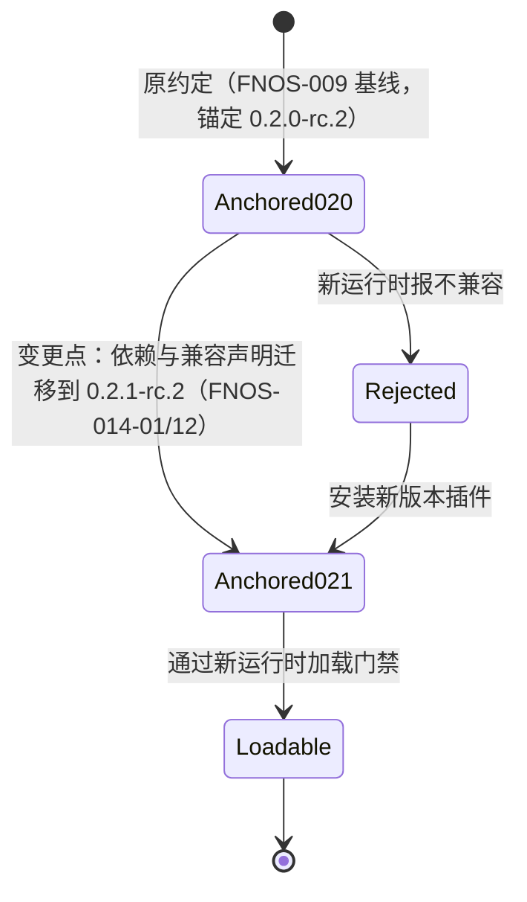
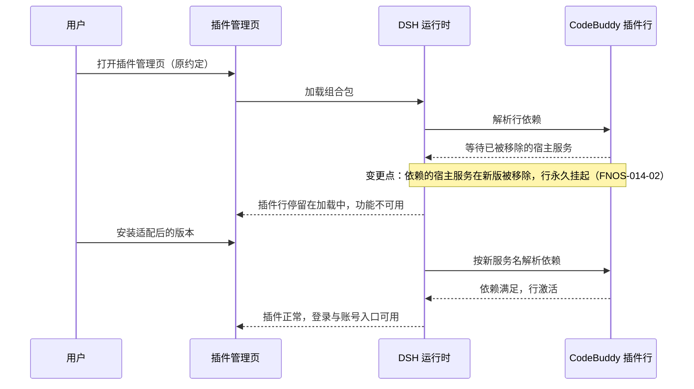

# FNOS-014 DSH 0.2.1-rc.2 插件适配与新能力支持

| 项目 | 内容 |
| --- | --- |
| 需求编号 | FNOS-014 |
| 提出日期 | 2026-10-18 |
| 需求状态 | <Badge type="warning" text="待完成（本地双客户端已验，真机待补）" /> |
| 关联计划 | [PLAN-FNOS-014 DSH 0.2.1-rc.2 插件适配与新能力支持](/plans/PLAN-FNOS-014-dsh-021-rc2-adaptation) |
| 适用范围 | 六个 DSH 插件（dsh-fnos、dsh-codex-auth、dsh-codebuddy、dsh-failover-search、dsh-midscene、dsh-semi-ui-showcase）、仓库运行与构建基线、插件文档站 |

## 需求背景

DSH 官方已把预发布线推进到 `0.2.1-rc.2`。本仓库的应用侧、插件依赖与全部插件兼容声明当前仍锚定 `0.2.0-rc.2`。

`0.2.1` 是一条跨度很大的预发布线：从 `0.2.0-rc.2` 到 `0.2.1-rc.2` 之间经过 `alpha.1`～`alpha.5`、`rc.1`、`rc.2` 共 7 个发布点，累计 1482 条非合并提交，其中新增功能 143 条。上游对**第三方插件作者**的契约改动集中在这条线上，且多数没有用破坏性标记标注，而是以升级指南承载：本次核实到的破坏点包括宿主服务改名、底层模型库跨大版本升级、客户端组件公共导出移除、插件兼容性判定规则改变、插件管理接口行为改变等。

其中有一条会**直接让插件无法加载**：CodeBuddy 插件的组合声明依赖了 `0.2.1` 已删除的宿主服务。这类依赖在新运行时上会永久等待一个永不出现的服务，表现为插件行挂起，而不是给出可读的错误。因此本次不是单纯的版本号重锚定，而是「按契约逐项适配 + 按能力逐项评测」。

同时用户明确要求：适配后要**支持到最新版本的完整功能**，若存在无法支持的能力需要如实汇报。因此本次除了恢复既有功能，还要把上游新增能力逐项过一遍，给出「已支持 / 不适用 / 无法支持」的结论，而不是默认忽略。

## 调研结论

| 结论 | 出处 | 影响的功能 | 状态 |
| --- | --- | --- | --- |
| 上游 `0.2.1-rc.2` 已发布到 npm，`@deepseek-ai/dsh` 的 `next` 标签指向它；仓库依赖的全部 42 个 `@deepseek-ai/*` catalog 包在该版本均有发布，仅 `dsh-invariants` 与新引入的 `dsh-scope`、`dsh-fs`、`dsh-timeout` 属特殊情况（前者被删除，后三者仍存在） | `npm view @deepseek-ai/dsh dist-tags`、逐包 `npm view <包名>@0.2.1-rc.2 version` | FNOS-014-12 | 已核实 |
| 上游删除了 `@deepseek-ai/dsh-invariants` 包与 38 个包的 `./invariant` 子路径导出；引用它们的插件/patch 会加载失败或编译失败 | 上游 `docs/upgrade-guide/v0.2.0-rc.2/remove-runtime-invariants/`；两 tag 间 `packages/runtime-diagnostics/invariants/` 目录消失 | FNOS-014-01、FNOS-014-12 | 已核实 |
| 上游把 Web 组合的信任配置服务从 `webRuntime` 换成 `webStartup`，`web-runtime` 行不再声明 `trustedHosts`；仍注入 `webRuntime` 的行会永久 pending，导致必需的 Connection 无法启动 | 上游 `docs/upgrade-guide/v0.2.1-alpha.1/web-listener-trust-config/`；`packages/bundle/web-app/src/startup.ts`（`WEB_STARTUP_SERVICE = 'webStartup'`） | FNOS-014-02 | 已核实 |
| 本仓库 CodeBuddy 插件的组合声明仍在注入 `webRuntime`，在新运行时上命中上述 pending 规则 | `plugins/dsh-codebuddy-plugin/cordis.patch.yml` 的 `connection` 行 | FNOS-014-02 | 已核实 |
| 上游 `llm-pi-ai` 的底层模型库从 `0.87.1` 跨大版本升到 `1.1.0`；Azure 路由标识改名，`createModels`、`openaiCodexProvider`、`getAuth` 等本插件实际使用的导出仍在，`Provider`/`ProviderAuth`/`ApiKeyAuth`/`AuthResult` 形状未变；Codex 模型表新增 `gpt-6.1-sol` | 下载 `@earendil-works/pi-ai@1.1.0` 产物与本仓库已安装的 `0.87.1` 逐文件比对；上游 `d79f13a4d4` | FNOS-014-03 | 已核实 |
| 上游 `llm-pi-ai` 新增「路由命名了凭据但未解析到时不提供任何模型」的行为，缺失凭据的模型组在模型选择器里隐藏 | 上游 `packages/llm/llm-pi-ai/src/adapter.ts`（`MISSING_CREDENTIAL` 分支）与 `docs/upgrade-guide/v0.2.1-alpha.2/pi-ai-model-discovery/` | FNOS-014-03 | 已核实 |
| 上游 `ui-primitives` 删除了 `projectUserText` 与 `UserTextReferences` 两个公共导出，新增 `UserTextRun`、`ReferenceChip`、`InlineEditor`、`HoverCardGroup`、`CommandText`；本仓库当前**未使用**被删除的导出，实际使用的 `Menu`/`MenuItem`/`Tooltip`/`SettingsForm`/`SettingsFormModel`/`SettingsValueField`/`settingsNumberField` 与全部图标导出仍在 | 两 tag 间 `ui-primitives` 公共索引导出差集 + 本仓库全量引用扫描 | FNOS-014-08 | 已核实 |
| 上游 Web 客户端插座的差集为新增 11 个、删除 1 个（`conversation.message.images`）；本仓库注册的全部 7 个插座（`plugins.detail.section`、`conversation.session.header.utilities`、`conversation.input.left`、`conversation.input.right`、`sidebar.footer.action`、`shell.overlay`、`settings.action`）在两 tag 间均未改动，`plugins.detail.section` 的 owner props 形状一致 | 两 tag 间 `cordis-client-runner` 插座目录与 `ui-plugin-manager` 渲染点比对 | FNOS-014-07、FNOS-014-08 | 已核实 |
| 上游主题契约把单一正文字号扩展为「正文 / 代码 / 终端」三个角色的字号与字体族；`ThemeSnapshot` 的 `fontSize` 字段被 `fontSizes` + `fontFamilies` 取代。本仓库 Semi UI Showcase 以 `ThemeSnapshot` 类型持有快照但不读取 `fontSize`，不构成编译破坏，但需按新契约复核 | 上游 `packages/client/ui-theme/src/client/index.ts` 的 `ThemeSnapshot`；本仓库 `plugins/dsh-semi-ui-showcase-plugin/src/client/theme-preview.ts` | FNOS-014-07、FNOS-014-08 | 已核实 |
| 上游插件兼容性判定改为「包自身声明 `engines.dsh` 时由它单独决定，忽略 DSH 同行依赖范围；未声明时才回退到同行依赖规则」；`engines.dsh` 内不接受 `workspace:` 值 | 上游 `packages/boot/app-boot/src/plugin-compatibility.ts`；`docs/upgrade-guide/v0.2.1-alpha.3/plugin-engines-dsh/` | FNOS-014-10 | 已核实 |
| 上游插件管理接口在启用热更新时拒绝在已安装包上再次安装，返回 `already-installed`；`IncompatiblePlugin.peers` 改名 `requirements`，`BundleInfo` 新增 `official`、`availability` 两个必填字段 | 上游 `packages/boot/plugin-manager/src/types.ts` 两 tag 比对；`docs/upgrade-guide/v0.2.1-alpha.2/plugin-install-over-installed/` | FNOS-014-10 | 已核实 |
| 上游工具呈现模式移除 `both` 取值，只接受 `native` 或 `ptc`；本仓库未使用该模式，也未设置对应环境变量 | 上游 `packages/core/tools/src/index.ts`；本仓库全量扫描 | FNOS-014-08 | 已核实 |
| 上游实验性包分类重构把 9 个包从 `dsh-*` 改名为 `dsh-experimental-*`；本仓库未依赖其中任何一个 | 上游 `b48384223a`；本仓库全量依赖扫描 | FNOS-014-12 | 已核实 |
| 上游移除「自动化任务」可选组合包，改由 Web 组合自行挂载；加载 profile 时会自动从 `dsh.profile.bundles` 删除该条目 | 上游 `docs/upgrade-guide/v0.2.0-rc.2/schedule-bundle-retired/` | FNOS-014-12 | 已核实 |
| 三方插件 `dshmarket` 的 `peerDependencies` 从 `1.66.37` 起才覆盖 `0.2.1-rc.1`；清单当前锁定 `1.66.27`，其范围不含 `0.2.1` | `npm view dshmarket@<版本> peerDependencies` | FNOS-014-11 | 已核实 |
| 仓库内 6 个插件的 DSH 依赖与兼容声明全部精确锚定 `0.2.0-rc.2`，在新运行时上会被兼容门禁拒绝安装 | `plugins/*/package.json`、`plugins/*/compatibility.json` | FNOS-014-01、FNOS-014-10 | 已核实 |

## 需求目标

- 六个插件以新版本安装在 DSH `0.2.1-rc.2` 上后，插件管理页不再显示「异常」，插件随运行时正常加载。
- 各插件在新运行时上的既有功能可用，行为与 `0.2.0-rc.2` 上一致。
- 升级安装不丢失、不改写用户的既有数据。
- 上游 `0.2.1` 线新增的能力逐项给出「已支持 / 不适用 / 无法支持」结论；无法支持的能力明确报告原因与影响。
- 仓库自身的运行、构建与安装基线同步到新版本，使 FPK 装出的运行时与插件声明一致。

## 功能列表

| 编号 | 优先级 | 功能 | 用户可观察结果 | 状态 |
| --- | --- | --- | --- | --- |
| FNOS-014-01 | P0 | 六个插件在新运行时正常加载 | 六个插件的新版本在 DSH `0.2.1-rc.2` 上安装后，插件管理页不再显示「异常」与不兼容原因，组合包显示为已启用 | <Badge type="tip" text="本地双客户端已验（2026-10-18）" /> |
| FNOS-014-02 | P0 | CodeBuddy 的宿主依赖适配 | CodeBuddy 插件不因依赖了新版已删除的宿主能力而在加载阶段挂起；登录、账号、额度与统计入口可见可用 | <Badge type="tip" text="本地双客户端已验（2026-10-18）" /> |
| FNOS-014-03 | P0 | Codex Auth 在新模型底座上功能保持 | 登录、授权回流、模型目录同步、模型与全局模型选择、用量显示可用；登录后模型列表随账号刷新 | <Badge type="tip" text="登录态已验；未登录态与用量待补（2026-10-18）" /> |
| FNOS-014-04 | P0 | CodeBuddy 功能保持 | 浏览器授权登录、账号管理、自动切换、额度显示与 Token 统计可用 | <Badge type="tip" text="已验（沿用既有登录账号）" /> |
| FNOS-014-05 | P0 | Failover Search 功能保持 | 三方搜索按 TinyFish → Tavily → 官方顺序故障转移，抓取按本地 → 三方兜底；同平台多账号均摊、用量展示与会话级开关可用 | <Badge type="tip" text="配置与界面已验；真实转移待补（2026-10-18）" /> |
| FNOS-014-06 | P1 | Midscene 桥接功能保持 | 桥接服务随 DSH 托管运行，模型目录映射宿主全部提供方，会话内浏览器自动化可执行 | <Badge type="tip" text="本地已验（桥接 5 提供方 / 23 模型）" /> |
| FNOS-014-07 | P1 | Semi UI Showcase 功能保持 | 组件展示插件在新运行时正常加载，各展示区块按新主题契约正确渲染 | <Badge type="tip" text="本地双客户端已验（含暗色主题）" /> |
| FNOS-014-08 | P1 | 插件界面契约适配 | 插件在插件详情页、会话区、设置区与输入区注册的界面区块位置与信息展示与升级前一致 | <Badge type="tip" text="本地双客户端已验（2026-10-18）" /> |
| FNOS-014-09 | P0 | 用户数据兼容 | 升级安装后授权目录、账号凭据、偏好、模型配置、搜索用量记录继续生效，无需手动迁移 | <Badge type="tip" text="已验（升级未改动用户数据）" /> |
| FNOS-014-10 | P1 | 兼容声明与文档基线更新 | 插件文档、总览表格与安装命令指向新版本；插件的兼容声明按新判定规则表达，安装时不再被门禁误拒 | <Badge type="tip" text="已验（版本、声明与文档一致）" /> |
| FNOS-014-11 | P0 | 三方插件版本随基线同步 | 更新运行时基线后，清单内三方插件同步到已声明支持新基线的版本，应用安装不再因兼容门禁拒绝而中断 | <Badge type="tip" text="构建侧已验；真机安装待补" /> |
| FNOS-014-12 | P0 | 仓库运行与构建基线同步 | 仓库内开发用运行时、构建校验常量与安装回调指向同一新版本；本地 DSH Web 与 FPK 装出的运行时版本一致 | <Badge type="tip" text="已验（四处同源，23 个测试任务全绿）" /> |
| FNOS-014-13 | P1 | 上游新增能力支持结论 | 上游 `0.2.1` 线新增的、与插件相关的能力逐项给出支持结论；无法支持的项列明原因与替代方案 | <Badge type="tip" text="已完成（结论页已落地）" /> |
| FNOS-014-14 | P1 | fnOS 插件新版本可用 | fnOS 插件新版本在真实 fnOS NAS 上安装后，主题跟随、授权目录、NAS 文件访问与会话日志导出可用 | <Badge type="tip" text="待真机验收" /> |
| FNOS-014-15 | P0 | 主题缓存写入门槛适配 | fnOS 插件的主题缓存写入在新运行时上恢复生效（门槛改按 `status === 'ready'` 且 `writable` 表达，不再依赖已移除的 `mode`）；「跟随系统」下首屏按 fnOS 主题渲染、无闪烁回归；适配不得把 [issue #13](https://github.com/FNOSP/fnos-dsh/issues/13) 的写入循环带入发布版本 | <Badge type="tip" text="代码已落地（编译通过）；真机首屏防闪待验" /> |

### 验收环境范围

- FNOS-014-01、02、03、04、05、06、07、08、09 在 **DSH Web 与 DSH Desktop** 双客户端验收；Codex Auth 与 CodeBuddy 涉及外部登录的环节另需真实网络/账号条件。
- FNOS-014-10 在文档站构建环境与 DSH Web 插件安装链路验收。
- FNOS-014-11、FNOS-014-12 在本地构建链路口径验收；涉及 FPK 安装与升级的部分在**真实 fnOS NAS** 验收。
- FNOS-014-13 为结论型功能，在 DSH Web 与文档落点验收。
- FNOS-014-14 在**真实 fnOS NAS** 验收。该插件不要求 DSH Web 或 DSH Desktop 复验，理由见[测试用例文档规范](/charter/tests-spec#测试环境执行方式)。

## 行为约束

- 适配只改变插件对新运行时的声明与必要的接缝调整；不改变插件的功能语义、交互流程和数据格式。
- 用户数据（凭据、账号、偏好、授权目录、模型配置、搜索用量）的存储位置和读写行为不变；升级过程不得删除或改写既有数据。
- 插件新版本必须与官方版本号规则一致：依赖锚定与运行时版本精确对应，不得使用范围版本。
- 插件不得依赖官方标为实验性或可选的能力来提供核心功能；确需依赖时须在该功能验收条件中显式登记。
- 仓库基线同步不得放宽兼容门禁：插件是否兼容仍由插件声明决定，不通过精确版本豁免绕过。
- 三方插件的选择以「已声明支持新基线」为准，不默认授予精确版本豁免。
- 上游新增能力的引入必须逐项登记结论后才能进入实现；「不适用」与「无法支持」同样需要在文档中留痕，不得静默跳过。
- 本次不为追求新能力而改变插件已有的界面结构与用户习惯。

## 不在本次范围内

- 官方 DSH 上游源码的修改或提交。
- 上游标为实验性、且与本仓库插件职责无关的能力（桌面操作原生扩展、Claude Code 模组桥、会话检查器、翻译模块、插件市场 Discover 页等）。
- 为插件新增本需求未登记的功能。
- 网关路由结构变更、FPK 打包格式变更。
- 旧版本插件在新运行时上的兼容豁免支持。
- 迁移到 React 19 或其他上游未采用的大版本依赖（上游本线仍为 React 18）。
- 把 `0.2.1` 线的新能力反向移植到 `0.2.0-rc.2` 基线。

## 既有功能变更关系

本次变更覆盖 [FNOS-009](/requirements/FNOS-009-dsh-020-rc2-adaptation) 建立的插件依赖基线：插件依赖锚定从 `0.2.0-rc.2` 迁移到 `0.2.1-rc.2`。FNOS-009 的验收结论在其原验证环境内继续有效，不回改其正文。

同时覆盖 FNOS-009-12 之后的安装链路约定：基线更新时同步核对三方插件版本（[FNOS-009-14](/requirements/FNOS-009-dsh-020-rc2-adaptation)）。本次沿用该约定，只更新版本选择，不改变放行逻辑本身。

原约定下六个插件的 DSH 包依赖与兼容声明锚定 `0.2.0-rc.2`，在 `0.2.1-rc.2` 运行时上会被兼容门禁判为不兼容；新约定下全部锚定 `0.2.1-rc.2`。用户可观察结果：插件管理页从「异常」恢复为正常状态。

CodeBuddy 的加载路径同时发生变化，覆盖其现有组合声明所依赖的宿主服务。

变更原因：上游把浏览器信任配置的提供方从旧服务迁到新服务，旧服务不再存在；插件行若继续声明旧依赖，会永久等待一个永不出现的服务，而不是报错。用户可观察结果：插件不再卡在加载中，CodeBuddy 的配置区块正常渲染。

## 验收条件与完成状态

### FNOS-014-01

- `FNOS-014-01-AC-01`：六个插件新版本在 DSH `0.2.1-rc.2` 上安装后，插件管理页详情不再显示「异常」与不兼容原因，组合包显示为已启用。
- `FNOS-014-01-AC-02`：DSH 运行日志中不出现插件模块未找到、插座未声明或行挂起的错误。
- `FNOS-014-01-AC-03`：六个插件在 DSH Web 与 DSH Desktop 上分别验证通过。

### FNOS-014-02

- `FNOS-014-02-AC-01`：CodeBuddy 插件在 DSH `0.2.1-rc.2` 上加载完成，不出现行挂起。
- `FNOS-014-02-AC-02`：CodeBuddy 的插件详情配置区块正常渲染，浏览器授权登录入口可用。

### FNOS-014-03

- `FNOS-014-03-AC-01`：Codex Auth 在新模型底座上可完成登录与授权回流。
- `FNOS-014-03-AC-02`：登录后账号模型目录可同步，模型选择与全局模型设置可用。
- `FNOS-014-03-AC-03`：未登录或凭据缺失时，插件不因新版的「缺失凭据不提供模型」行为而出现异常，界面给出可理解的未登录状态。
- `FNOS-014-03-AC-04`：对话区用量状态显示剩余额度与重置时间。

### FNOS-014-04

- `FNOS-014-04-AC-01`：CodeBuddy 可完成浏览器授权登录，账号出现在账号列表。
- `FNOS-014-04-AC-02`：账号管理、自动切换、额度显示与 Token 统计可用，行为与升级前一致。

### FNOS-014-05

- `FNOS-014-05-AC-01`：搜索按 TinyFish → Tavily → 官方顺序故障转移，前一来源不可用时自动降级。
- `FNOS-014-05-AC-02`：抓取按本地 → 三方兜底顺序执行。
- `FNOS-014-05-AC-03`：同平台多账号均摊、用量展示与会话级开关可用。

### FNOS-014-06

- `FNOS-014-06-AC-01`：桥接服务随 DSH 托管启动，健康检查可用。
- `FNOS-014-06-AC-02`：模型目录映射宿主全部已配置提供方，新增提供方后目录随之更新。

### FNOS-014-07

- `FNOS-014-07-AC-01`：Semi UI Showcase 插件正常加载，组件渲染无异常。
- `FNOS-014-07-AC-02`：亮色与暗色主题下展示区块渲染正常，主题切换实时生效。

### FNOS-014-08

- `FNOS-014-08-AC-01`：四个插件在插件详情页注册的区块位置与升级前一致，不与他人区块冲突。
- `FNOS-014-08-AC-02`：会话区、输入区、设置区与侧栏注册的界面元素在 DSH Web 与 DSH Desktop 上均正常显示。

### FNOS-014-09

- `FNOS-014-09-AC-01`：升级安装后，升级前已有的授权目录、账号凭据、偏好、模型配置与搜索用量继续生效。
- `FNOS-014-09-AC-02`：升级过程与升级后均不出现数据丢失或被改写的用户反馈。

### FNOS-014-10

- `FNOS-014-10-AC-01`：插件总览与各插件文档的版本号、安装命令与兼容基线说明指向新版本。
- `FNOS-014-10-AC-02`：插件的兼容声明在新判定规则下不被误拒，安装链路可按文档命令完成。
- `FNOS-014-10-AC-03`：文档构建通过，站内链接有效。

### FNOS-014-11

- `FNOS-014-11-AC-01`：更新运行时基线时，清单内三方插件版本同步更新到已声明支持新基线的版本。
- `FNOS-014-11-AC-02`：应用安装最后一步不再因三方插件被兼容门禁拒绝而失败。

### FNOS-014-12

- `FNOS-014-12-AC-01`：仓库开发用运行时、构建校验常量与安装回调指向同一新版本，构建校验不因版本不一致失败。
- `FNOS-014-12-AC-02`：本地启动的 DSH Web 报告版本与插件兼容声明一致。

### FNOS-014-13

- `FNOS-014-13-AC-01`：与插件相关的新增能力形成「已支持 / 不适用 / 无法支持」逐项结论表，每项附依据。
- `FNOS-014-13-AC-02`：「无法支持」的项写明原因、对用户的影响与替代方案。
- `FNOS-014-13-AC-03`：结论表落在受版本管理的文档中，可从需求或计划追踪到。

### FNOS-014-14

- `FNOS-014-14-AC-01`：fnOS 插件新版本在真实 fnOS NAS 安装成功，插件管理页无异常。
- `FNOS-014-14-AC-02`：主题跟随、授权目录管理、NAS 文件引用与打开、会话日志导出可用，行为与升级前一致。

### FNOS-014-15

- `FNOS-014-15-AC-01`：在 DSH `0.2.1-rc.2` 上，主题缓存写入不再被已移除的快照字段拦掉，fnOS 主题变化后缓存被正确更新。
- `FNOS-014-15-AC-02`：DSH 偏好为「跟随系统」时首屏按 fnOS 主题渲染、无 light/dark 闪烁回归。
- `FNOS-014-15-AC-03`：该适配的发布版本不携带 [issue #13](https://github.com/FNOSP/fnos-dsh/issues/13) 的写入循环——若门槛适配先于 [FNOS-015](/requirements/FNOS-015-theme-cache-write-loop) 落地，必须同时携带其最小守卫。

## 变更记录

| 日期 | 变更 | 说明 |
| --- | --- | --- |
| 2026-10-18 | 初始登记 | 建立 FNOS-014，范围覆盖六个插件从 `0.2.0-rc.2` 迁移到 `0.2.1-rc.2`、仓库基线同步、上游新增能力逐项评测与双客户端验收。根因（兼容门禁 + 宿主服务改名）与两版本破坏点已在官方源码核实，登记为 16 条调研结论。关联 PLAN-FNOS-014。 |
| 2026-10-18 | 新增 FNOS-014-15 | 范围扩展：`0.2.1-rc.2` 移除了 `ConfigFormSnapshot.mode`（host/memory 概念从表单 API 移除，`writable` 成为唯一门槛），fnOS 插件的主题缓存写入门槛 `snapshot.mode !== 'host'` 因此恒真、写入被永久跳过 —— 循环不复现但主题缓存静默失效（首屏防闪回归）。该适配属既有功能恢复，故登记在本需求；与 [FNOS-015](/requirements/FNOS-015-theme-cache-write-loop) 存在交付耦合（恢复写入会重新暴露 issue #13 的循环），验收条件已写明同批次守卫要求。 |
| 2026-10-18 | 实现与本地验收登记 | 完成 catalog 与六插件基线迁移、CodeBuddy 组合声明改为注入新版信任服务、`pi-ai 1.1.0` 适配复核、客户端插座与主题契约复核、仓库基线四处同源（catalog、构建校验、本地 profile、安装回调）、三方插件升到 `dshmarket@1.66.37`。本地 DSH Web 与 DSH Desktop 双客户端走查通过 FNOS-014-01/02/07/08/09/12/13；03/04/05/06/10 的界面与声明侧成立，交互实测项待补。新增结论页 [DSH 0.2.1 新增能力支持结论](/plugins/dsh-021-capabilities)，本次无「无法支持」项。证据见[双客户端验收记录](/validation/FNOS-014-web-desktop-2026-10-18)。FNOS-014-11/14 需真实 fnOS NAS，需求状态转「待完成」。 |
