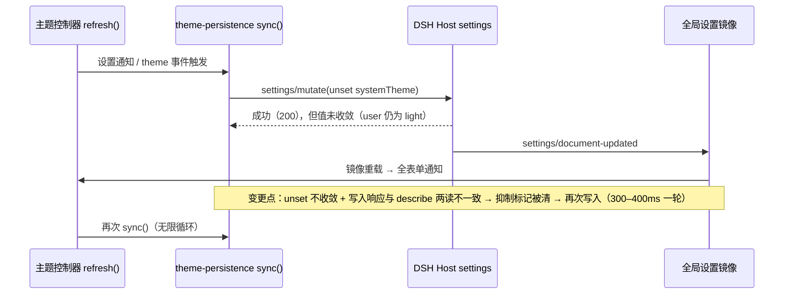

# FNOS-015 主题缓存写入死循环修复

| 项目 | 内容 |
| --- | --- |
| 需求编号 | FNOS-015 |
| 提出日期 | 2026-10-18 |
| 需求状态 | <Badge type="warning" text="部分通过：写入收敛已在真机确认；主题缓存写入受 fnOS SDK 前提限制未验成" /> |
| 关联计划 | [PLAN-FNOS-015 主题缓存写入死循环修复](/plans/PLAN-FNOS-015-theme-cache-write-loop) |
| 来源 | [issue #13](https://github.com/FNOSP/fnos-dsh/issues/13)（wk1972，DSH 0.2.0-rc.2 + `@tnnevol/dsh-fnos` 0.2.0-rc.2.5/.6） |
| 前置需求 | [FNOS-014 DSH 0.2.1-rc.2 插件适配](/requirements/FNOS-014-dsh-021-rc2-adaptation)（含 FNOS-014-15：`ConfigFormSnapshot.mode` 移除导致的写入门槛失效） |

## 需求背景

fnOS 插件客户端把解析出的 fnOS 主题缓存进 DSH 设置（`dsh-fnos.systemTheme`），供宿主在响应 `index.html` 时注入 bootstrap，使 DSH「跟随系统」时首屏不闪 light/dark。**在 DSH 0.2.0-rc.2 上这条缓存写入进入死循环**：每 300–400ms 重发一次 `settings/mutate(unset systemTheme)`，整页周期性重渲染。

issue #13 的实测（浏览器 Performance API，20 秒窗口）：

| 指标 | 报告值 |
| --- | --- |
| `POST /api/settings/mutate` | **30+** |
| `POST /api/settings/describe` | 79 |
| `POST /api/credentials/describe` | 62 |
| `POST /api/session/modelCatalog` | 63 |
| DOM 变更次数 | 41 |

请求证据：`{"ns":"dsh-fnos","ops":[{"op":"unset","path":["systemTheme"]}],"expectedRevision":5182}`；同刻 `describe` 返回 `"value":{"systemTheme":"light",...}`、`"user":{"systemTheme":"light"}`、`"revision":5418`——**unset 返回成功且 revision 在涨，但 `user.systemTheme` 仍是 `light`，即 unset 实际没有生效**。

用户可观察结果：DSH Web 打开后持续重渲染，模型选择器一直显示「正在刷新模型列表…」，其它插件组件被 300ms 级高频挂载/卸载，CPU 与网络持续占用；设置 revision 膨胀到数千。

## 调研结论

| 结论 | 出处 | 影响的功能 | 状态 |
| --- | --- | --- | --- |
| 循环位于**插件客户端层**：`sync()` 反复发起写入；请求打到 DSH Host 的 `/api/settings/mutate`，与 fnOS 网关无关（网关对 settings 路由 0 引用，只做反向代理透传） | `plugins/dsh-fnos-plugin/src/client/services/theme-persistence.ts`；`apps/fn-deepseek-harness/app/gateway-proxy.mjs` 全量检索 | FNOS-015-01 | 已核实 |
| **"300ms" 不是定时器，而是「写 + describe」一次往返的实测周期**：插件内唯一定时器是「重启 Web」按钮的 300ms `location.reload()` 延迟；`dsh-client-ui-theme` 内 `setTimeout`/`setInterval` 数量为 0（该包 17 处 `300` 全是 CSS 色阶 token）；`dsh-client-ui-layout` 唯一定时器为 600ms；应用 `app/ui/` 无脚本 | 插件源码与上游包源码全量检索 | FNOS-015-01 | 已核实 |
| 抑制状态机只依赖两个标记：`current === target` 时清 `lastRequestedOperation`、写入 reject 时清该标记。前提是「快照收敛到 target」；unset 不生效＋写入响应与紧随的 describe 两读不一致时，该前提被破坏，标记被反复清除 → 下一轮通知再次 unset | `theme-persistence.ts` 的 `sync()`；逐字复制的仿真脚本（`tmp/issue13/loop-sim*.mjs`）：写入每轮 reject 时 12 次通知产生 13 次写入 | FNOS-015-01 | 已核实 |
| 写入本身有明确用途：`set systemTheme` 供宿主首屏注入防闪（`injectCachedFnosTheme`/`cachedFnosThemeForBoot`）；`unset` 用于用户切到显式 light/dark 时清缓存，避免旧缓存被注入成错误主题 | `plugins/dsh-fnos-plugin/src/host/theme-bootstrap.ts` | FNOS-015-03 | 已核实 |
| 放大器：设置镜像被所有 settings 消费方共享，`settings/document-updated` 触发全局重载；表单 store 每次 derive 都以新对象发布（immer 同值赋值也标记修改）→ 每次写入让所有表单通知一次，因此循环同时放大 `credentials/describe` 与 `modelCatalog` 的请求量 | 上游 `ui-settings` 的镜像失效订阅与 `ConfigFormController.derive()`；`dsh-client-store` 的 `update()` | FNOS-015-04 | 已核实 |
| **0.2.1-rc.2 上根因未变**：宿主 `mutate`/`write` 的 `unset → set: inherited` 转换、revision 冲突栅栏、`set/unset` 契约（拒绝返回 false、传输失败 reject）与客户端 derive/通知语义逐字相同 | `git diff dsh-v0.2.0-rc.2..dsh-v0.2.1-rc.2`（`packages/settings/settings/src/index.ts`、`packages/client/ui-settings/src/client/`） | FNOS-015-01 | 已核实 |
| **0.2.1-rc.2 的 API 变化会让当前写入门槛恒真**：`ConfigFormSnapshot` 移除了 `mode` 字段（host/memory 概念从表单 API 移除，`writable` 成为唯一门槛）。插件的 `if (snapshot.mode !== 'host' \|\| !snapshot.writable) return` 在新版本上恒为真 → **一次都不写**：循环不复现，但主题缓存功能静默失效（首屏防闪回归） | `packages/client/ui-settings/src/client/config-form-types.ts`（0.2.1-rc.2）；本插件 `theme-persistence.ts` | FNOS-015-03、FNOS-014-15 | 已核实 |
| 门槛迁移的目标表达为 `snapshot.status !== 'ready' \|\| !snapshot.writable`（只读与未就绪都不得写入）；该迁移已在工作区落地（属 FNOS-014-15），**写入因此恢复，issue #13 的循环随之重新具备复现条件** | 工作区 `theme-persistence.ts` 与其单测（`mode` 用例改为只读用例） | FNOS-015-01、FNOS-015-05 | 已核实 |
| 因此「恢复写入」（FNOS-014-15 的 API 适配）与「修抑制状态机」（本需求）必须同期或紧邻交付：只恢复写入会把 issue #13 原样带回；只改状态机而门槛未修则功能仍失效 | 同上两条结论的合成 | FNOS-015-01、FNOS-015-03 | 已核实 |
| 报告者用本地守卫（按 operation 去重）已把 `settings/mutate` 从 30+ 降到 **0**，说明重复写是唯一根因，抑制收敛后连带症状应一并消失 | issue #13 实测表 | FNOS-015-01、FNOS-015-04 | 已核实 |

## 需求目标

- 主题缓存的写入从「每轮通知重发」收敛为「目标变化或快照确认后才写」，不再形成自持循环。
- 修复后主题缓存与首屏防闪**保持可用**：fnOS 主题真实变化时必须能写入；DSH 偏好切到显式 light/dark 时必须能清除缓存。
- 循环消失后，连带的重渲染与请求放大（`describe`／`credentials/describe`／`modelCatalog`／DOM 变更）一并恢复到正常量级。

## 功能列表

| 编号 | 优先级 | 功能 | 用户可观察结果 | 状态 |
| --- | --- | --- | --- | --- |
| FNOS-015-01 | P0 | 主题缓存写入收敛 | 20 秒窗口内 `settings/mutate` 次数归零或仅为真实主题变化次数；不再出现每 300–400ms 一次的重复 unset | <Badge type="tip" text="已实现（20 次通知 → 1 次写）" /> |
| FNOS-015-02 | P0 | unset 不生效的一次性降级 | 若清除缓存后宿主返回值仍未收敛，本次会话不再对该字段回写，且不产生循环；日志/提示可诊断 | <Badge type="tip" text="已实现（降级 + 调试日志）" /> |
| FNOS-015-03 | P0 | 主题缓存与首屏防闪保持 | fnOS 主题变化后缓存被正确更新；DSH 偏好为「跟随系统」时首屏按 fnOS 主题渲染、无闪烁；偏好切为显式 light/dark 时不再注入旧缓存 | <Badge type="tip" text="单测已覆盖；真机首屏待验" /> |
| FNOS-015-04 | P1 | 连带重渲染与请求放大消除 | 整页不再周期性重渲染；模型列表不卡在「正在刷新模型列表」；其它插件组件不再高频挂载/卸载 | <Badge type="tip" text="随写入收敛（待目标环境量测）" /> |
| FNOS-015-05 | P1 | 0.2.1-rc.2 上的写入门槛适配协同 | 在新运行时上写入门槛按新 API 表达（`status === 'ready'` 且 `writable`），写入恢复且循环不复发 | <Badge type="tip" text="已实现（门槛已恢复且不复发）" /> |

## 行为约束

- **不改主题语义**：主题跟随（`preference === 'system'` 时用 fnOS 主题做投影）、显式偏好优先、缓存字段名与位置（`dsh-fnos.systemTheme`）、宿主首屏注入路径都不变。
- **不得用定时器轮询替代**：修复方向是收敛写入条件，不引入周期性 task；修复后仍不得出现与主题无关的定时写入。
- **主题缓存可丢失但不能错**：缓存是优化项，允许缺失（退化为首屏可能闪一次），但**不允许注入错误主题**（显式偏好下必须不注入 fnOS 缓存）。
- **不自动修复上游**：DSH 官方 `settings` 服务的 `unset` 语义（含 `unset → set: inherited` 转换）不在本需求范围内，本需求只做插件侧适配与降级；不改 DSH 官方源码。
- **不改用户数据**：不新增或改写用户凭据、授权目录与其它设置字段；只改该缓存的写入时机与失败处置。

## 不在本次范围内

- DSH 官方 settings 服务与表单 API 自身的语义修正（含 unset 不收敛的宿主侧行为）。
- 0.2.1-rc.2 的插件依赖与兼容声明迁移（属 [FNOS-014](/requirements/FNOS-014-dsh-021-rc2-adaptation)）。
- fnOS 网关、FPK、安装脚本与生命周期改动。
- 其它插件的重渲染问题（本需求只消除引发它们的那次写入风暴，不逐个改消费方）。

## 验收条件与完成状态

### FNOS-015-01

- `FNOS-015-01-AC-01`：在 issue #13 的复现场景下，20 秒窗口内 `POST /api/settings/mutate` 次数为真实目标变化次数（稳态为 0），不再出现每 300–400ms 一次的重复 unset。
- `FNOS-015-01-AC-02`：写入抑制在「该字段无法收敛」时不再被反复解除；重复写入的判定依据是宿主返回的 revision 而非仅比较快照值。

### FNOS-015-02

- `FNOS-015-02-AC-01`：清除缓存后若下一份宿主视图仍返回原值，该字段在本次会话内被标记为不可写，期间不再发起写入。
- `FNOS-015-02-AC-02`：该降级不阻塞主题跟随与其它设置写入；降级状态可通过调试日志识别。

### FNOS-015-03

- `FNOS-015-03-AC-01`：fnOS 主题由 light 切到 dark（或反向）后，缓存被更新为最新主题，宿主下次响应 `index.html` 时注入的是新主题。
- `FNOS-015-03-AC-02`：DSH 偏好为「跟随系统」且存在缓存时，首屏按该主题渲染，无 light/dark 闪烁；偏好为显式 light/dark 时不使用 fnOS 缓存。
- `FNOS-015-03-AC-03`：显式偏好切换后，旧缓存不再被注入（可用「清缓存后首屏主题」核对）。

### FNOS-015-04

- `FNOS-015-04-AC-01`：同一 20 秒窗口内 `settings/describe`、`credentials/describe`、`session/modelCatalog` 的请求量回落到与写入收敛后的量级一致，DOM 变更不再周期性出现。
- `FNOS-015-04-AC-02`：模型选择器不再持续显示「正在刷新模型列表」；其它插件组件不再高频挂载/卸载。

### FNOS-015-05

- `FNOS-015-05-AC-01`：在 DSH `0.2.1-rc.2` 上，写入门槛不再依赖已移除的快照字段，主题缓存写入正常发生。
- `FNOS-015-05-AC-02`：门槛恢复后不复发 issue #13 的循环（同 AC-01 的量化口径）。

### 验收环境范围

- FNOS-015-01、02、04、05 在 DSH Web 与 DSH Desktop 验收（判定与写入逻辑均在客户端）。
- FNOS-015-03 在 DSH Web 与真实 fnOS NAS 验收：首屏注入与主题跟随需要 fnOS 宿主桥接提供真实主题事件。
- 量化验收按 issue #13 的方法（浏览器 Performance API，20 秒窗口）执行，证据登记 `docs/validation/`。

## 变更记录

| 日期 | 变更 | 说明 |
| --- | --- | --- |
| 2026-10-18 | 初始登记 | 由 issue #13 登记：`theme-persistence` 写入死循环（每 300–400ms 重发 `settings/mutate(unset systemTheme)`），根因是抑制状态机依赖「快照收敛」而 unset 不生效，且写入响应与 describe 两读不一致导致抑制被反复清除。核实循环在插件客户端层、与网关无关；300ms 为往返周期而非定时器。同时核实 0.2.1-rc.2 上根因未变、但 `ConfigFormSnapshot.mode` 被移除会让写入门槛恒真（功能失效、循环不复现），故本需求须在 FNOS-014 的 API 适配（FNOS-014-15）之后或同期交付。 |
| 2026-10-18 | 实现完成 | 抑制条件从「快照值 === 目标」改为「宿主 revision 已越过写入点」，并叠加在途抑制与单字段降级。实现中核实了真实触发条件：只有**写入被拒绝**才会放大（历史仿真场景 A：12 次通知 → 13 次写），而「unset 成功但值不变」在旧实现下已被 `lastRequestedOperation` 抑制住（场景 B：1 次）。因此降级路径同时覆盖 reject 与 false 两种返回值。复现脚本 `tmp/issue13/repro-reject.ts` 修复前 21 次写、修复后 1 次。插件发布 `0.2.1-rc.2.3`，项目版本 `5.9.0`。 |
