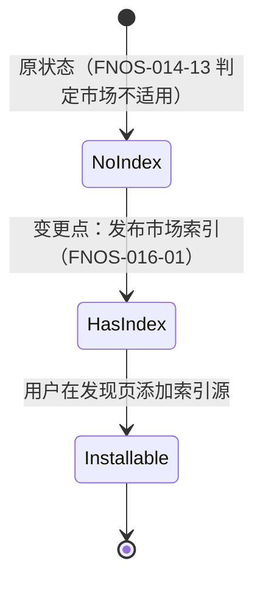

# FNOS-016 插件市场索引与插件元数据

| 项目 | 内容 |
| --- | --- |
| 需求编号 | FNOS-016 |
| 提出日期 | 2026-10-18 |
| 需求状态 | <Badge type="info" text="规划中" /> |
| 关联计划 | [PLAN-FNOS-016 插件市场索引与插件元数据](/plans/PLAN-FNOS-016-plugin-market-index) |
| 适用范围 | 六个运行时插件的 `package.json` 元数据、文档站托管的插件市场索引、插件文档站 |

## 需求背景

DSH `0.2.1` 线引入了第三方插件市场：用户可以在「发现」页浏览外部发布的组合包（bundle）目录，直接安装，而不必事先知道 npm 包名或 git 地址。市场本身不带默认源——每个项目自己发布一份**索引文件**，用户把它的 URL 添加为索引源即可。

本仓库已经把六个运行时插件发布到 npm，但**没有发布任何市场索引**，因此在 DSH 的发现页里搜不到这些插件。同时插件自身的元数据也不完整，影响被市场和搜索识别的效果：

- **六个插件都没有 `keywords`**。发现页的模糊搜索覆盖包名、作者、关键词、标题与描述，缺少关键词意味着用户用「搜索」「翻译」「登录」这类意图词找不到对应插件，只能依赖精确包名。
- **六个插件里只有 Midscene 声明了 `icon`**。其余五个在发现页会显示占位图，识别度低。

这两项都不是错误，但它们决定「插件能不能被找到、被认出来」，而这正是引入市场索引的目的。

## 调研结论

| 结论 | 出处 | 影响的功能 | 状态 |
| --- | --- | --- | --- |
| 市场索引格式由 `@deepseek-ai/dsh-plugin-market-index` 定义，`format` 固定为 `1`；顶层必填 `format`、`title`、`plugins`，每项插件必填 `name` 与至少一个 `versions` | 上游 `packages/util/plugin-market-index/src/types.ts` 与 `src/index.ts` 的 `parseMarketIndex` | FNOS-016-01 | 已核实 |
| 校验器会**丢弃**格式未定义的成员；官方格式说明中的示例含 `dist-tags`，但校验器不识别该字段 | 用 `parseMarketIndex` 实测：输入含 `dist-tags` 的条目，输出对象键为 `name`、`metadata`、`versions` | FNOS-016-01 | 已核实 |
| 本地化文本对象必须含 `en` 键，只写中文会被拒（`must contain en`） | 实测 `{"title": {"zh": "中文"}}` → `$.title must contain en` | FNOS-016-01 | 已核实 |
| 图标可为内联 `data:`（≤32 KiB，SVG/PNG/JPEG/WebP）或 URL；相对路径按索引 URL 解析，跨源必须 https | `src/index.ts` 的 `icon()`；实测 `http:` 跨源图标被拒 | FNOS-016-02 | 已核实 |
| `engines.dsh` 不接受 `workspace:` 前缀，必须是 SemVer 范围 | 实测 `workspace:*` → `must not be a workspace: range` | FNOS-016-01 | 已核实 |
| 上游官方生成器 `apps/plugin-market-generator` 可从 npm 包名列表生成合法索引，并在本地可运行 | 本地执行 `pnpm --filter @deepseek-ai/dsh-plugin-market-generator start --help` 成功输出用法 | FNOS-016-01 | 已核实 |
| **生成器从 npm 已发布版本的 tarball 读取展示元数据**（标题、描述、图标、关键词、作者、仓库），而不是从本地源码读取 | `apps/plugin-market-generator/src/metadata.ts` 的 `readDisplayMetadata`；README 说明「只下载最高列出版本的 tarball」 | FNOS-016-02、FNOS-016-03 | 已核实 |
| 生成器的收录前提是版本的 `package.json` 声明 `dsh.bundle`，且其 `patch` 是文件路径或路径列表；本仓库六个插件均满足 | 逐包检查 `dsh.bundle.patch`，六项全部为 `./cordis.patch.yml` | FNOS-016-01 | 已核实 |
| 图标来源须是包内相对路径文件（SVG/PNG/JPEG/WebP，≤256 KiB），manifest 的 `icon` 优先于 `./icon` 导出 | `src/metadata.ts` 的 `readIcon` | FNOS-016-02 | 已核实 |
| 文档站 `docs/public/` 下的文件会原样发布到站点根，站点域名为 `fndsh-doc.tnnevol.cn` | `docs/public/CNAME`；`.github/workflows/deploy-docs.yml` 发布的产物目录 | FNOS-016-04 | 已核实 |
| 各插件对应服务商的官方品牌素材可获取性不一致：fnOS 官方 favicon（ICO）与 CodeBuddy 官方图标（SVG）可用；OpenAI/Codex 官方站点与图标库均无可直接使用的素材，Semi Design 官方 logo 地址返回 HTML 而非图片，Tavily favicon 为通用箭头图形而非品牌标识 | 逐个探测各供应商站点与图标库，并按文件类型识别返回值 | FNOS-016-02 | 已核实 |

## 需求目标

- 六个插件带上能表达其用途的关键词，使用户用意图词可以在发现页搜到对应插件。
- 有可信官方品牌素材的插件显示真实图标；没有的如实省略，不用自制图或来路不明的图片充数。
- 产出并托管一份符合格式的市场索引，DSH 用户添加该 URL 后可以浏览全部六个插件并直接安装。
- 索引内容与 npm 上实际发布的版本一致，不出现「索引里有、装不上」或「索引版本落后」的情况。

## 功能列表

| 编号 | 优先级 | 功能 | 用户可观察结果 | 状态 |
| --- | --- | --- | --- | --- |
| FNOS-016-01 | P0 | 市场索引可用 | 在 DSH「发现」页添加本项目的索引 URL 后，能看到六个插件条目、分类与描述，可进入详情并安装 | <Badge type="info" text="规划中" /> |
| FNOS-016-02 | P0 | 插件图标 | 有官方品牌素材的插件在发现页显示其官方图标；无素材的显示占位图，且不出现自制或来源不明的图 | <Badge type="info" text="规划中" /> |
| FNOS-016-03 | P1 | 插件关键词 | 用「搜索」「登录」「浏览器自动化」等意图词在发现页搜索，能命中对应插件 | <Badge type="info" text="规划中" /> |
| FNOS-016-04 | P1 | 索引与发布同步 | 索引中的最高版本等于 npm 上该插件 `next` 标签指向的版本；发布新版本后索引不落后 | <Badge type="info" text="规划中" /> |
| FNOS-016-05 | P1 | 索引格式与托管合规 | 索引通过格式校验；图标与索引同源或为 https；文件托管在文档站可公开访问的地址 | <Badge type="info" text="规划中" /> |
| FNOS-016-06 | P2 | 索引生成可复现 | 任何人按文档步骤可从源列表重新生成同一份索引，输出确定、可直接对比差异 | <Badge type="info" text="规划中" /> |

### 验收环境范围

- FNOS-016-01、FNOS-016-02、FNOS-016-03 在 **DSH Web 与 DSH Desktop** 的「发现」页验收（需要先启用实验性自定义插件市场组合包）。
- FNOS-016-04 在本地构建环境验收索引与 npm 版本的一致性；涉及真实安装的部分在 DSH Web 验收。
- FNOS-016-05、FNOS-016-06 在文档站构建环境与本地命令行验收。
- 本需求不涉及 fnOS 宿主专属能力，不要求真实 fnOS NAS 验收。

## 行为约束

- 图标只使用**插件所集成服务商的官方品牌素材**，或本仓库自有且可商用分发的素材；不确定来源或授权的一律不用。
- 取不到可信素材时**必须省略** `icon`，不得自制近似图标冒用品牌，也不得引用第三方站点上无法确认归属的图片。
- 关键词必须描述插件的实际能力，不使用与本插件无关的热门词堆砌。
- 索引由上游官方生成器产出，不手写维护版本号、发布时间与兼容范围，避免与 npm 实际状态脱节。
- 插件元数据变更不改变插件运行时行为；`files` 白名单新增图标文件后，安装体积变化需在文档中说明。
- 索引是静态快照，不承诺实时跟随 npm；同步责任写在发布流程中，并在变更时更新。
- 索引中列出的版本必须能被当前 DSH 基线安装；不列出会被兼容门禁拒绝的版本组合。

## 不在本次范围内

- 自建插件市场服务器或动态查询接口（格式明确支持静态文件，无此需求）。
- 修改 DSH 上游的索引格式、校验器或发现页。
- 为插件制作营销素材、截图或视频。
- 替三个缺乏素材的服务商（OpenAI、Semi Design、Tavily）设计或伪造品牌图标。
- 把索引做成官方市场，或申请进入第三方收录列表。
- 变更插件的功能、依赖或运行时行为。

## 既有功能变更关系

本次不改变任何既有功能的行为，只补充插件元数据并新增一份索引文件。它延续 [FNOS-014](/requirements/FNOS-014-dsh-021-rc2-adaptation) 建立的发布基线：索引中列出的版本取自该轮已发布的 `0.2.1-rc.2.0` 及其后续补丁版本。

与已完成的 FNOS-014-13（上游新增能力支持结论）的关系是：该结论把「插件市场 Discover 页」判为 `➖ 不适用`（本仓库不分发市场内容）。本次按用户明确要求反向接入——**本仓库成为索引发布方**，但不承担插件市场本身的实现。原结论在其验证环境内继续有效，本次在其上新增能力，不回改原文。

原状态下插件只能通过精确包名安装，用户在发现页看不到它们；新状态下用户添加索引 URL 即可浏览与安装。用户可观察结果：从「知道包名才能装」变为「在发现页找到就能装」。

## 验收条件与完成状态

### FNOS-016-01

- `FNOS-016-01-AC-01`：把索引 URL 添加为索引源后，「发现」页列出六个插件，条目的标题、描述、分类与版本数量符合索引内容。
- `FNOS-016-01-AC-02`：从条目可以进入详情页，并按其给出的版本完成安装；安装后的插件在插件页正常加载。
- `FNOS-016-01-AC-03`：索引在 DSH Web 与 DSH Desktop 上均可读取。

### FNOS-016-02

- `FNOS-016-02-AC-01`：有官方素材的插件在发现页显示其官方图标，与品牌官方素材一致。
- `FNOS-016-02-AC-02`：无素材的插件显示占位图，且插件包内不存在自制或来源不明的图标文件。
- `FNOS-016-02-AC-03`：图标文件在包内可解析，格式与体积符合格式要求。

### FNOS-016-03

- `FNOS-016-03-AC-01`：用插件用途的意图词搜索，能命中对应插件（例如搜索相关词命中 Failover Search）。
- `FNOS-016-03-AC-02`：关键词与实际能力一致，不在无关插件上出现该关键词。

### FNOS-016-04

- `FNOS-016-04-AC-01`：索引中每个插件的最高版本等于其 npm `next` 标签指向的版本。
- `FNOS-016-04-AC-02`：发布新版本后按流程重新生成索引，差异只包含新版本条目。

### FNOS-016-05

- `FNOS-016-05-AC-01`：索引通过上游格式校验器，无未定义字段依赖。
- `FNOS-016-05-AC-02`：索引与其引用的图标可通过公开 https 地址访问，无凭据、查询串或片段。

### FNOS-016-06

- `FNOS-016-06-AC-01`：文档记录了从源列表生成索引的命令与前置条件。
- `FNOS-016-06-AC-02`：同一源列表重复生成得到相同内容，差异为空。

## 变更记录

| 日期 | 变更 | 说明 |
| --- | --- | --- |
| 2026-10-18 | 初始登记 | 建立 FNOS-016，范围覆盖六个插件的关键词与图标元数据补全、市场索引生成与托管、索引与发布同步。图标策略按用户要求确定：只用官方品牌素材，取不到就省略。上游格式、生成器行为与各供应商素材可获取性均已实测核实，登记为 11 条调研结论。关联 PLAN-FNOS-016。 |
