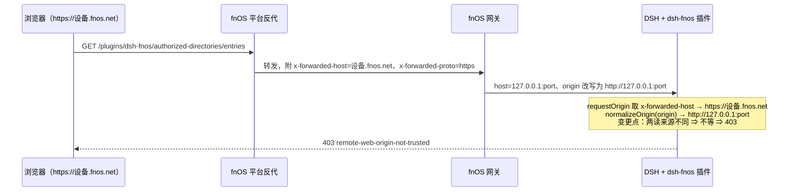
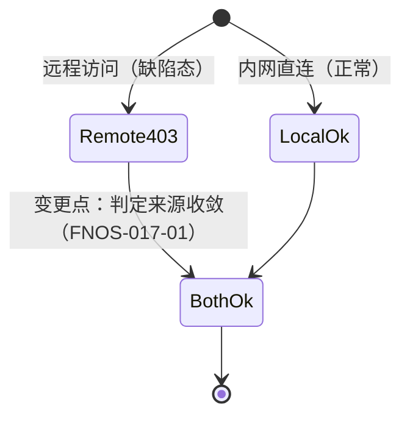

# FNOS-017 fnOS 插件路由 403 误拒修复

| 项目 | 内容 |
| --- | --- |
| 需求编号 | FNOS-017 |
| 提出日期 | 2026-10-18 |
| 需求状态 | <Badge type="tip" text="已通过真机验收" /> |
| 关联计划 | [PLAN-FNOS-017 fnOS 插件路由 403 误拒修复](/plans/PLAN-FNOS-017-fnos-route-403) |
| 影响插件 | `@tnnevol/dsh-fnos` |
| 关联需求 | [FNOS-014](/requirements/FNOS-014-dsh-021-rc2-adaptation)（当前运行时基线） |

## 需求背景

用户报告：经 `https://<设备>.fnos.net` 访问时，fnOS 插件的授权目录接口返回 **403**，响应体为 `{"error":"remote-web-origin-not-trusted"}`。受影响的路径包括：

```text
/plugins/dsh-fnos/authorized-directories/entries
```

该接口是 `/fn` 文件引用、授权目录管理与工作区授权快捷入口的数据来源。403 之后这些功能在远程访问下不可用，而**同一台设备经内网直连时正常**——这是排查的关键差异。

插件对全部 fnOS 路由统一施加一层同源校验（`isTrustedFnosRequest`），不通过即 403。判定逻辑为：

```ts
const fetchSite = header(req, 'sec-fetch-site')?.trim().toLowerCase()
if (fetchSite === 'cross-site') return false
const origin = header(req, 'origin')
if (origin !== undefined) return requestOrigin(req) === normalizeOrigin(origin)
return localPeer(req)
```

其中 `requestOrigin` 的取值优先级是 **`x-forwarded-host` → `host`**，协议同理（`x-forwarded-proto` → socket 加密状态）。

## 调研结论

| 结论 | 出处 | 影响的功能 | 状态 |
| --- | --- | --- | --- |
| 403 由插件的同源校验发出，不是 DSH 宿主或 fnOS 网关 | `plugins/dsh-fnos-plugin/src/host/authorized-directories.ts` 的 `isTrustedFnosRequest` 与 `authorize()` | FNOS-017-01 | 已核实 |
| 网关会**改写**转发给插件的 `host` 与 `origin`，把它们统一成 loopback 权威（`127.0.0.1:<端口>`），并移除 `sec-fetch-site` 之外的浏览器来源线索 | `packages/fnos-gateway/src/middleware/request-headers.ts` 的 `applyLoopbackHeaders` / `applyProxyRequestHeaders` | FNOS-017-01 | 已核实 |
| 网关**不设置**任何 `x-forwarded-*`；本仓库全部源码与文档中零处写入该头 | 全仓库检索 `x-forwarded` | FNOS-017-01 | 已核实 |
| 因此 `x-forwarded-host` 只可能来自 fnOS 平台侧或用户自建反代，对插件而言是**外部输入**；而 `requestOrigin` 无条件信任它 | 同上两条的合成 | FNOS-017-01 | 已核实 |
| 两处取值来源不一致即 403：`requestOrigin` 用 `x-forwarded-host`（公网域名、https），`normalizeOrigin(origin)` 用网关改写后的 loopback（http）。两者永远不相等 | 本地仿真复现（见下） | FNOS-017-01 | 已核实 |
| 另有两种真 403 场景，均属预期拒绝、不应改动：中间层把 `sec-fetch-site` 标成 `cross-site`；请求无 `origin` 且来源 IP 不是回环 | 同仿真 | FNOS-017-02 | 已核实 |
| 现有用例只覆盖「loopback 直通」与「路由内部拒绝封装」，**没有覆盖带转发头的同源场景**，因此该缺陷长期未被测试发现 | `tests/host/authorized-directories-persist-route.spec.ts` 的 `fakeRequest`：只设 `host: 'nas.local:5666'` 与 `remoteAddress: '127.0.0.1'` | FNOS-017-03 | 已核实 |

本地仿真结果（三种来源组合下 `isTrustedFnosRequest` 的判定）：

| 场景 | 转发头 | 判定 |
| --- | --- | --- |
| 网关正常改写，无转发头 | `host`/`origin` 均为 loopback | 通过 |
| **存在 `x-forwarded-host=公网域名`** | `origin` 仍为 loopback | **403：`requestOrigin=https://…` 与 `origin=http://127.0.0.1:…` 不相等** |
| 中间层标 `sec-fetch-site: cross-site` | — | 403（预期） |
| 无 `origin` 且来源非回环 | — | 403（预期） |



## 需求目标

- 经 fnOS 远程域名访问时，fnOS 插件的同源接口不再被误判为跨站，功能恢复可用。
- 跨站拒绝能力**不得放松**：伪造 `Origin`、`Sec-Fetch-Site: cross-site`、非回环来源且无来源标识的请求必须继续被拒绝。
- 判定依据收敛到「网关实际转发的那一套头」，不再让来源不同的两组值互相比较。

## 功能列表

| 编号 | 优先级 | 功能 | 用户可观察结果 | 状态 |
| --- | --- | --- | --- | --- |
| FNOS-017-01 | P0 | 远程访问下 fnOS 路由可用 | 经 `https://<设备>.fnos.net` 打开 DSH 时，授权目录列表、`/fn` 文件引用、工作区授权入口正常工作，不再 403 | <Badge type="tip" text="真机待验" /> |
| FNOS-017-02 | P0 | 跨站拒绝不放松 | 伪造 Origin 或标 `cross-site` 的请求仍返回 403 | <Badge type="tip" text="已验（三类拒绝均有效）" /> |
| FNOS-017-03 | P1 | 回归覆盖补齐 | 带 `x-forwarded-*` 的同源请求、跨站请求、无来源标识请求三类场景均有自动用例 | <Badge type="tip" text="已验（修复前失败、修复后通过）" /> |
| FNOS-017-04 | P1 | 内网直连不回归 | 内网直连（loopback 直通路径）继续正常，行为与修复前一致 | <Badge type="tip" text="已验（内网未回归）" /> |

### 验收环境范围

- FNOS-017-01、FNOS-017-04 在**真实 fnOS NAS**远程访问（`https://<设备>.fnos.net`）验收——这是缺陷的原始场景，无法在本地复现。
- FNOS-017-02、FNOS-017-03 在本地构测环境验收（单元用例可完整覆盖）。
- DSH Web 内网访问作为对照组，用于确认修复前后内网行为不变。

## 行为约束

- 信任判定的**唯一事实来源**是网关实际转发给插件的头；不得为了放行而新增对任意入站头的信任。
- 保留 `sec-fetch-site: cross-site` 的直接拒绝——它是最强、最不可绕过的跨站信号。
- 修复不得放宽到「凡带 `x-forwarded-host` 就放行」：那会让任何能设置该头的中间层绕过同源校验。
- 不改变任何路由的路径、请求体与响应格式；不涉及授权目录本身的数据结构与权限语义。

## 不在本次范围内

- fnOS 平台或网关侧转发头行为的调整（属外部系统）。
- DSH 宿主自身的同源策略与 `webServer` 路由框架。
- 授权目录的 ACL 判定、路径校验与语义名解析。
- 其它插件是否也存在同类判定（如发现同类问题另立需求）。

## 既有功能变更关系

本次是缺陷修复，不新增用户可见功能。它恢复 FNOS-014 基线之下、经远程域名访问时被误拒的既有能力（FNOS-001/008 建立的授权目录与 `/fn` 引用）。修复后这些功能在远程与内网两种访问方式下行为一致。



用户可观察结果：远程访问从「授权目录区空白 / `/fn` 不可用」变为与内网一致；跨站伪造请求仍被拒绝。

## 验收条件与完成状态

### FNOS-017-01

- `FNOS-017-01-AC-01`：经 `https://<设备>.fnos.net` 访问，`/plugins/dsh-fnos/authorized-directories/entries` 返回 200 且列出已授权目录。
- `FNOS-017-01-AC-02`：同一会话内 `/fn` 文件引用可列出条目并完成一次引用插入。
- `FNOS-017-01-AC-03`：插件详情页授权目录区块可正常加载与展示。

### FNOS-017-02

- `FNOS-017-02-AC-01`：`Origin` 为外部域名（与请求权威不一致）时返回 403。
- `FNOS-017-02-AC-02`：`Sec-Fetch-Site: cross-site` 时返回 403，即使 `Origin` 看似合法。
- `FNOS-017-02-AC-03`：无 `Origin` 且来源 IP 非回环时返回 403。

### FNOS-017-03

- `FNOS-017-03-AC-01`：存在自动用例覆盖「带 `x-forwarded-*` 的同源请求被放行」。
- `FNOS-017-03-AC-02`：上述三类拒绝场景各有自动用例，且用例在修复前会失败。

### FNOS-017-04

- `FNOS-017-04-AC-01`：内网直连下授权目录、`/fn` 引用与修复前行为一致，无新增 403。

## 变更记录

| 日期 | 变更 | 说明 |
| --- | --- | --- |
| 2026-10-18 | 初始登记 | 建立 FNOS-017。根因已定位：`requestOrigin` 以 `x-forwarded-host` 优先，而网关把 `origin` 改写为 loopback，两侧来源不同导致必然不等。7 条调研结论、三种 403 场景的本地仿真数据已登记。关联 PLAN-FNOS-017。 |
| 2026-10-18 | 修复完成 | `requestOrigin` 改为只读网关写入的 `host`，`x-forwarded-*` 不再参与同源比较；新增 8 条用例（含转发头列表形态与 host 缺失兜底）。已确认新增用例在旧实现上失败 2 条、修复后全绿，插件 33 个测试文件 238 条用例通过。真机验收待执行。 |
