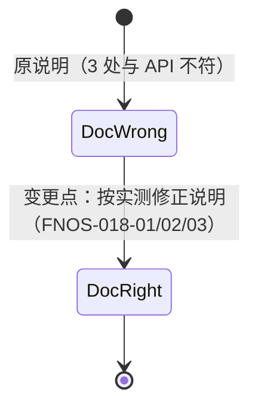

# FNOS-018 Midscene 桥接使用说明准确性修正

| 项目 | 内容 |
| --- | --- |
| 需求编号 | FNOS-018 |
| 提出日期 | 2026-10-18 |
| 需求状态 | <Badge type="tip" text="已完成（说明已修正并实测通过）" /> |
| 关联计划 | [PLAN-FNOS-018 Midscene 桥接使用说明准确性修正](/plans/PLAN-FNOS-018-midscene-skill-accuracy) |
| 影响插件 | `@tnnevol/dsh-midscene` |
| 前置需求 | [FNOS-013](/requirements/FNOS-013-midscene-browser-automation-bridge)（插件本体，已完成） |

## 需求背景

`dsh-midscene` 技能是 agent 在本环境使用 Midscene 的入口说明，其中桥接模式的操作写法和注入说明（`BRIDGE_PRELUDE`）由插件自己维护。实际使用中发现**三处表述与 `@midscene/web` 的真实 API 不符**，导致按说明操作时静默失效或报错，需要回头翻源码才能定位。

触发本次核查的场景：用 Bridge 模式驱动用户 Chrome 打开 `xiaomi-cn.fnos.net` 装应用时，按说明写 `setActiveTabId(id, { activate: false })` 无法确认静默是否生效；改用 `evaluate` 取页面数据返回 `undefined`；`.env` 放在运行目录也不会被 SDK 自动加载。

## 调研结论

| 结论 | 出处 | 影响的功能 | 状态 |
| --- | --- | --- | --- |
| `setActiveTabId` 只接受**一个**参数（`tabId`），没有第二参数选项；说明里写的 `{ activate: false }` 被静默忽略，不报错也不生效 | `@midscene/web` 类型声明 `bridge-mode/agent-cli-side.d.ts`：`setActiveTabId(tabId: string): Promise<void>`；实测传入第二参数无异常但无静默效果 | FNOS-018-01 | 已核实 |
| 标签页 id 必须传**数字**：传字符串会触发 Chrome `tabs.update` 签名错（`No matching signature`）。说明里这一点是**正确的**，应保留 | 实测报错原文：`Error in invocation of tabs.update(optional integer tabId, ...)` | FNOS-018-01 | 已核实 |
| 静默连接的选项在 **`connectCurrentTab(options)`** 上，字段名是 **`activateTab`**（默认 `true`），不是 `activate` | 类型声明 `bridge-mode/common.d.ts` 的 `BridgeConnectTabOptions`：`activateTab?: boolean`；实测 `connectCurrentTab({ activateTab: false })` 通过 | FNOS-018-01 | 已核实 |
| **Bridge 模式的类型声明里没有 `evaluate`**；实测调用返回 `undefined`（不抛错），用它取 DOM/状态会静默失败 | `bridge-mode/*.d.ts` 无 `evaluate`；实测页面内 `fetch` 断言返回 `undefined` | FNOS-018-02 | 已核实 |
| SDK 路径下 Midscene **不会自动加载 `.env`**：把四行写进运行目录的 `.env` 后 `aiQuery` 仍报 `MIDSCENE_MODEL_NAME is required`，必须由进程环境注入 | 实测报错与修复过程；`@midscene/shared` 的 `ModelConfigManager.initialize` 直接读 `process.env` | FNOS-018-03 | 已核实 |
| 说明中「查看标签页是否静默」有可用的客观依据：`getBrowserTabList()` 返回的每项含 `currentActiveTab` 字段 | 实测标签页结构键为 `id`、`title`、`url`、`currentActiveTab` | FNOS-018-01 | 已核实 |
| `/v1/health` 与 `/v1/midscene-env` 的字段与说明**一致**（`port`、`fixedModelName`、`family`；env 恰好四行非注释行），无需改动 | 对运行中桥的实测响应 | FNOS-018-04 | 已核实 |

## 需求目标

- 说明里给出的每段示例代码都能**按原样跑通**，不再出现「照抄却不生效」的写法。
- 明确写出 Bridge 模式的**能力边界**（不能 `evaluate`），让 agent 一开始就选对取证方式，而不是试错后再改。
- 明确 SDK 路径与 CLI 路径在 `.env` 加载上的差异。

## 功能列表

| 编号 | 优先级 | 功能 | 用户可观察结果 | 状态 |
| --- | --- | --- | --- | --- |
| FNOS-018-01 | P0 | 静默连接写法修正 | 按说明写出的代码能真正静默连接；标签页不被切走，且可用 `currentActiveTab` 自证 | <Badge type="tip" text="已完成（单步静默已实测）" /> |
| FNOS-018-02 | P0 | Bridge 能力边界写明 | 说明明确「Bridge 模式不支持 evaluate，取证用视觉通道或截图」，不再出现按 `evaluate` 取证失败的弯路 | <Badge type="tip" text="已完成（边界与替代路径写明）" /> |
| FNOS-018-03 | P1 | SDK 路径 .env 加载方式写明 | 说明区分 CLI（自动加载当前目录 `.env`）与 SDK（需进程环境注入）两种情形 | <Badge type="tip" text="已完成（两种加载方式已区分）" /> |
| FNOS-018-04 | P2 | 桥接口说明保持准确 | `/v1/health`、`/v1/midscene-env` 的字段描述与实现一致 | <Badge type="tip" text="已核实（无需改动）" /> |

### 验收环境范围

- 全部四项在**本地构测环境**验收：说明中的每段示例代码在真实 Chrome + 运行中的桥上执行一次，观察实际结果。
- FNOS-018-01 的「静默」需在用户浏览器有可见活动标签页时验证，确认连接后前台标签页未改变。

## 行为约束

- **不改上游技能文件**：官方 7 个技能保持与上游逐字节一致（`skills/SOURCE.md` 已约定），本次只改插件自有的 `dsh-midscene` 技能与注入说明 `BRIDGE_PRELUDE`。
- 说明中不得声称未经验证的能力；不确定的写法要么实测确认，要么明确写「未支持」。
- 保留已被证实的正确表述（标签页 id 必须传数字），不要为「统一风格」而改掉。
- 桥接服务本身的接口与行为不变，本次只改文档与说明。

## 不在本次范围内

- 上游 `@midscene/web` 的 API 变更或问题上报（属外部项目）。
- 桥接服务的模型路由、流式转换、密钥自举等实现。
- 官方 7 个技能的内容维护（跟随上游同步，见 `SOURCE.md`）。
- 新增 Bridge 模式的 DOM 求值能力（上游未提供，不在本插件职责内）。

## 既有功能变更关系

本次不改变任何运行时行为，只修正文档准确性。它修复的是 FNOS-013 交付物中的**说明缺陷**：插件能力本身正常（桥、四行配置、模型路由均按设计工作），但使用说明有三处会把人引向无效路径。

用户可观察结果：agent 按说明操作一次即成功，不再出现「静默失效 → 翻源码 → 改正」的往返。

## 验收条件与完成状态

### FNOS-018-01

- `FNOS-018-01-AC-01`：说明给出的静默连接示例可原样执行且不抛错。
- `FNOS-018-01-AC-02`：执行后经 `getBrowserTabList()` 核对，用户前台标签页未因连接而改变。
- `FNOS-018-01-AC-03`：说明保留「tab id 必须传数字」这一已验证结论。

### FNOS-018-02

- `FNOS-018-02-AC-01`：说明明确写出 Bridge 模式不支持 `evaluate`。
- `FNOS-018-02-AC-02`：说明给出可替代的取证方式（视觉 Agent / 截图 / 从目标环境日志核对）。

### FNOS-018-03

- `FNOS-018-03-AC-01`：说明区分 CLI 与 SDK 两种 `.env` 加载行为。
- `FNOS-018-03-AC-02`：SDK 示例包含把四行注入进程环境的写法。

### FNOS-018-04

- `FNOS-018-04-AC-01`：`/v1/health` 与 `/v1/midscene-env` 的字段描述与实现一致，无需改动即保持正确。

## 变更记录

| 日期 | 变更 | 说明 |
| --- | --- | --- |
| 2026-10-18 | 初始登记 | 建立 FNOS-018。核查 `dsh-midscene` 技能与 `BRIDGE_PRELUDE` 时发现三处与 `@midscene/web` 实际 API 不符，均已实测取证（静默参数位置与字段名、Bridge 无 `evaluate`、SDK 不自动加载 `.env`）；同时确认桥接口字段与「id 必须传数字」等表述正确，应保留。关联 PLAN-FNOS-018。 |
| 2026-10-18 | 修正完成 | 两处说明（`BRIDGE_PRELUDE` 与自有技能 `SKILL.md`）同步改为单步静默 `connectCurrentTab({ activateTab: false })`；补 Bridge 无 `evaluate` 的能力边界与三条替代取证路径；补 CLI 与 SDK 的 `.env` 加载差异。实施中新发现第四处缺陷（两步式串联报 `Active tab id is already set`），已一并写入说明并登记 BUG-02。实测：静默连接不抛错、前台标签页未变、视觉查询正常。新增 2 条回归用例（两处文案一致 + PRELUDE 注入全部技能）。 |
