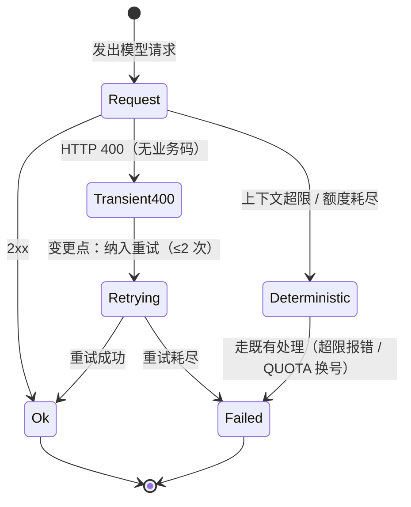

# FNOS-020 CodeBuddy 瞬时 400 终止整轮修复

| 项目 | 内容 |
| --- | --- |
| 需求编号 | FNOS-020 |
| 提出日期 | 2026-10-19 |
| 需求状态 | <Badge type="warning" text="实现完成；待发布并在真实环境复验" /> |
| 关联计划 | [PLAN-FNOS-020 CodeBuddy 瞬时 400 终止整轮修复](/plans/PLAN-FNOS-020-codebuddy-transient-400) |
| 影响插件 | `@tnnevol/dsh-codebuddy` |
| 关联需求 | [FNOS-014](/requirements/FNOS-014-dsh-021-rc2-adaptation)（当前运行时基线）、[FNOS-012](/requirements/FNOS-012-codebuddy-model-speed-and-client-version)（同插件既有缺陷修复） |

## 需求背景

用户报告：会话进行中偶发弹出 `Invalid request parameters`，**整轮直接中断**，必须手动「继续」才能恢复。同一会话内多次出现，且与原任务内容无关。

从会话事件流取证，该错误是 CodeBuddy 网关返回的 **HTTP 400**，响应体原文就是 `Invalid request parameters`：

```json
{"kind":"error","failure":{"message":"Invalid request parameters","code":"INVALID_REQUEST","status":400,"requestId":"135a6e77-…"}}
```

三处现场（均在同一次长会话内）：

| 时间 | 位置 | requestId |
| --- | --- | --- |
| 15:46:40 | turn 56 step 12 | `135a6e77-e282-472e-a2b5-949fac2af4c0` |
| 16:03:42 | turn 57 step 44 | `84832d26-a0b3-4e15-9d48-f335b63a955e` |
| 16:15:33 | turn 59 step 8 | `dba55c96-71fa-4c12-9608-cb75bf347ef6` |

关键事实：**该字符串不是 DSH 生成的**。在 `deepseek-ai/deepseek-harness` 源码中检索 `Invalid request parameters` 零命中，它是网关响应体原文，被 `wireErrorMessage` 原样取出。

## 调研结论

| 结论 | 出处 | 影响的功能 | 状态 |
| --- | --- | --- | --- |
| 该 400 由 CodeBuddy 网关返回，响应体**不带业务码**（无 `code`/`msg` 字段），只有一句话 | 会话事件流 `assistant/attempt` 的 `failure` | FNOS-020-01 | 已核实 |
| 插件把「400 且非上下文超限」一律映射为 `INVALID_REQUEST` | `plugins/dsh-codebuddy-plugin/src/host/adapter.ts` 的 `httpErrorCode` | FNOS-020-01 | 已核实 |
| DSH 默认重试集合为 `EMPTY_RESPONSE/RATE_LIMIT/SERVER/TIMEOUT/TRANSPORT`，**不含** `INVALID_REQUEST` | `packages/llm/llm/src/retry-policy.ts` 的 `DEFAULT_RETRYABLE_CODES`；运行期实测 `policyKey` | FNOS-020-01 | 已核实 |
| 插件的换号集合只含 `QUOTA`/`RATE_LIMIT`，`INVALID_REQUEST` 既不重试也不换号 | `adapter.ts` 的 `swappable` 判定 | FNOS-020-01 | 已核实 |
| 适配器可自带重试策略：`adapter.providerRetryPolicy(provider) ?? resolveRetryPolicy(undefined, …)`；基类默认返回 `undefined` | `packages/llm/llm/src/index.ts` | FNOS-020-02 | 已核实 |
| 官方 deepseek provider 就是这样做的（`override providerRetryPolicy` 返回自有配置），本插件此前未实现 | `packages/llm/llm-deepseek/src/adapter.ts` | FNOS-020-02 | 已核实 |
| 该错误在产出任何 chunk **之前**抛出，重试不会重复内容或重复执行工具 | `adapter.ts` 的 `emitted` 不变量 | FNOS-020-02 | 已核实 |
| 上下文超限与额度耗尽各自已有独立错误码（`CONTEXT_WINDOW_EXCEEDED` / `QUOTA`），不会被本次改动误重试 | 同上两条 | FNOS-020-02 | 已核实 |

### 排除项（逐条实测，均不成立）

排查阶段对以下假设逐条取证，结论是**都不是请求内容本身不合法**：

| 假设 | 实测结论 |
| --- | --- |
| 上下文过大 | 不成立。turn 1 曾到 540,544 cache token 且全程成功；失败点仅 370K/389K/398K |
| 输出触顶 | 不成立。失败前一次 output 仅 159/174/233 token，上限 393,216 |
| 参数非法（`reasoning_effort` / `max_tokens`） | 不成立。只读探测 6 个账号的实时目录，`deepseek-v4.1-flash` 在每个账号上都声明 `supportedEfforts: [low, high, max]`、`maxOutputTokens: 393216`、`maxAllowedSize: 1000000` |
| 请求内容非法 | 不成立，且有决定性反证：失败请求的会话内容是**紧随其后被接受的那个请求的严格子集** —— turn 56 step 12 在约 371,440 token 被拒，turn 57 step 1 在几乎相同的 371,400 token 成功。子集被拒而超集被接受，内容本身不可能不合法 |
| 工具调用错配 / 非法字符 / heredoc / 图片 | 逐项扫描，与三次失败均无相关性 |
| DSH 0.2.1-rc.2 的 V4.1-Flash-1017 适配 | 不成立。上游三个 1017 提交均为纯 UI 徽标，参数改动行数为 0 |

### 仍未定位的部分

**根因未定位到具体一侧。** 目前只能证明「不是请求内容」，无法证明是网关哪一侧（节点、账号态、还是读取竞态）。

代码层唯一能解释「内容合法却被拒」的机制是：`attemptStream` 里凭据、端点、客户端身份是**四次独立读取**，若账号切换正好落在两次读取之间，会出现「A 账号端点 + B 账号凭据」的不匹配组合。该假设**尚无直接证据**，因此本需求只做重试加固，不改读取时序——那需要单独取证后再动。

## 需求目标

- 瞬时 400 不再终止整轮：自动有界重试后继续，用户无需手动干预。
- 重试必须安全：不重复内容、不重复执行工具调用、不重复计费。
- 确定性失败仍要如实暴露：上下文超限、额度耗尽等各自走既有处理路径，不被误重试。

## 功能列表

| 编号 | 优先级 | 功能 | 用户可观察结果 | 状态 |
| --- | --- | --- | --- | --- |
| FNOS-020-01 | P0 | 瞬时 400 不再终止整轮 | 会话遇到 `Invalid request parameters` 时短暂停顿后自动继续，不再弹出错误并中断 | <Badge type="warning" text="实现完成，待真实环境复验" /> |
| FNOS-020-02 | P0 | 路由自带重试策略 | `codebuddy` 路由覆写 `providerRetryPolicy()`，返回含 `INVALID_REQUEST` 的有界策略 | <Badge type="tip" text="已验（单测 5 条）" /> |
| FNOS-020-03 | P1 | 不误重试确定性错误 | `CONTEXT_WINDOW_EXCEEDED` 与 `QUOTA` 不在重试集合内，行为与修复前一致 | <Badge type="tip" text="已验（单测断言）" /> |
| FNOS-020-04 | P1 | 重试次数有界 | 最多重试 2 次，避免把必然失败的请求放大成 5 次 | <Badge type="tip" text="已验（单测断言）" /> |

### 验收环境范围

- FNOS-020-02、FNOS-020-03、FNOS-020-04 在本地构测环境验收（单测可完整覆盖）。
- FNOS-020-01 依赖真实网关返回 400，**无法在本地构造**；需要在真实使用中观察是否还出现「整轮中断」，或等待下一次偶发时验证其自动恢复。

## 行为约束

- 重试**只在尚未产出任何 chunk 时**生效；一旦开始产出必须直接抛出，绝不重放。
- 不得把 `QUOTA` 放进重试集合：那会让同一个已耗尽的账号被原地重试，而正确动作是换号。
- 不得改为 `mode: 'always'`：无限重试会把确定性失败变成挂死。
- 不改变请求体、响应解析、错误码映射与换号逻辑。
- 不改动 DSH 上游代码：修复完全落在本仓库插件内。

## 不在本次范围内

- 网关侧为何返回该 400（属外部系统，需按 `requestId` 向服务侧查询）。
- `attemptStream` 四次读取的时序收敛（候选修复方向，但缺少证据，另立需求）。
- 其它 provider 路由的重试策略。
- 把 400 细分为更多错误码（响应体不带业务码，当前无法区分）。

## 既有功能变更关系

本次是可靠性加固，不新增用户可见功能。它改变的是**同一次失败的处理方式**：从「中断整轮」变为「有界重试后继续」。



用户可观察结果：偶发抖动时看到短暂停顿后继续，而不是「错误 + 手动继续」。

## 验收条件与完成状态

### FNOS-020-01

- `FNOS-020-01-AC-01`：真实使用中再次遇到该 400 时，会话自动恢复继续，不出现整轮中断。
- `FNOS-020-01-AC-02`：重试未造成重复内容输出或工具调用重复执行。

### FNOS-020-02

- `FNOS-020-02-AC-01`：`CodeBuddyAdapter.providerRetryPolicy()` 返回的策略包含 `INVALID_REQUEST`。
- `FNOS-020-02-AC-02`：该策略保留官方默认集合的全部五个错误码，不因追加而丢项。

### FNOS-020-03

- `FNOS-020-03-AC-01`：策略的 `retryableCodes` 不含 `CONTEXT_WINDOW_EXCEEDED` 与 `QUOTA`。

### FNOS-020-04

- `FNOS-020-04-AC-01`：策略为 `mode: 'normal'` 且 `maxRetries: 2`。

## 变更记录

| 日期 | 变更 | 说明 |
| --- | --- | --- |
| 2026-10-19 | 初始登记 | 建立 FNOS-020。登记三次现场取证（含 `requestId`）、六条排除项（上下文/输出/参数/内容/工具/1017 适配）与两条未定位说明。确认修复点为适配器自带重试策略：`INVALID_REQUEST` 既不在 DSH 默认重试集合，也不在插件换号集合。关联 PLAN-FNOS-020。 |
| 2026-10-19 | 实现完成 | `adapter.ts` 新增 `CODEBUDDY_RETRY_POLICY` 并覆写 `providerRetryPolicy()`：官方默认五码 + `INVALID_REQUEST`，`maxRetries: 2`。新增 `tests/retry-policy.spec.ts` 5 条用例钉住「已纳入」「有界」「不混入确定性错误码」。插件 72 个测试文件 914 条用例全绿。真实环境复验待发布后进行。 |
