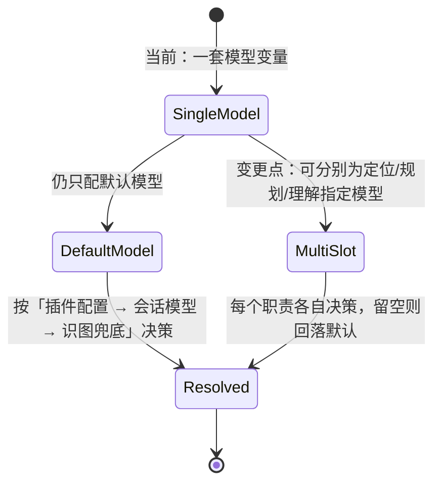
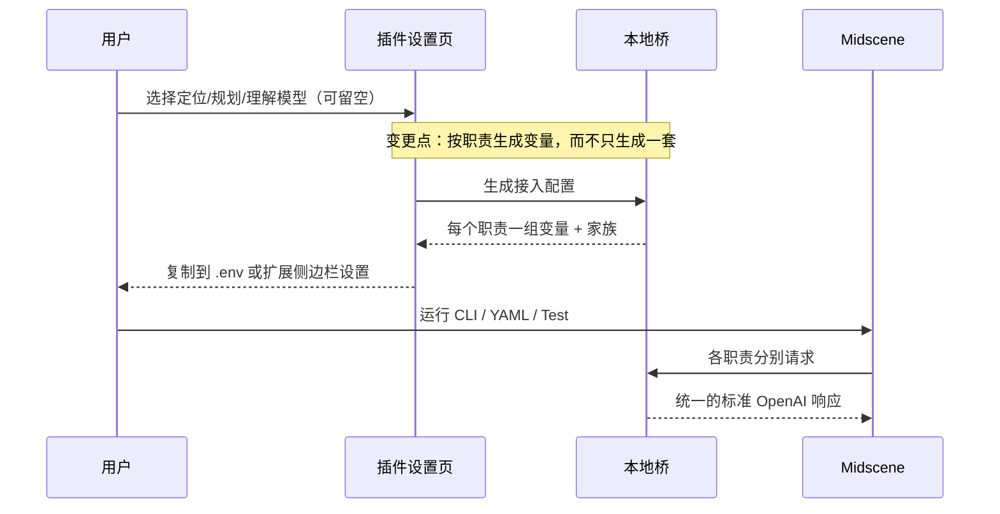

# FNOS-021 Midscene 库能力对齐与接入简化

| 项目 | 内容 |
| --- | --- |
| 需求编号 | FNOS-021 |
| 提出日期 | 2026-10-20 |
| 需求状态 | <Badge type="tip" text="已完成（2026-10-23 验收通过）" /> |
| 关联计划 | [PLAN-FNOS-021 Midscene 库能力对齐与接入简化](/plans/PLAN-FNOS-021-midscene-library-integration) |
| 影响插件 | `@tnnevol/dsh-midscene` |
| 关联需求 | [FNOS-013](/requirements/FNOS-013-midscene-browser-automation-bridge)（插件基线）、[FNOS-018](/requirements/FNOS-018-midscene-skill-accuracy)（同插件说明准确性） |

## 需求背景

插件的定位从第一天起就是一句话：**替用户把 Midscene 库的模型环境变量配置好，让用户无感知地通过 DSH 使用 Midscene 的全部能力**。它不绑定某一种运行方式——浏览器、桌面、Android、iOS、HarmonyOS 五类平台的 CLI、YAML 运行器与 Midscene Test 都读同一套 `MIDSCENE_MODEL_*`，因此「配好这套环境」就等于「这五类能力全部可用」。Bridge Mode 只是本仓库测试用例偏好的连接方式，不是插件的能力边界。

当前阻碍这条承诺的有四类问题：

**① 库版本落后 6 个发布。** 插件锁定的 `@midscene/web` / `@midscene/test` / `@midscene/computer` 为 `1.15.1`（2026-10-12），上游最新为 `1.16.5`（2026-10-22，其间经 `1.16.1`/`1.16.2` 三个补丁版）。期间新增了定位模型独立槽位（`MIDSCENE_LOCATE_MODEL_*`）、按职责独立的流式模式、`jev` 协议家族，以及渲染、报告与清理语义的一批改进。用户按 Midscene 官方文档学到的新能力，在插件托管的桥上无从表达。

**② 上游的模型策略已从「三职责」变成「四职责」，插件仍只生成一套变量。** Midscene 现支持为定位（Locate）、规划（Planning）、页面理解（Insight）分别指定模型，未配置的职责沿用默认模型；专用模型的地址与密钥**不逐字段继承**默认模型，流式设置也彼此独立。插件目前只能给出「一个模型」的四行配置，用户即使想在 DSH 里用「强模型做定位、快模型做规划」也无法表达。

**③ 上游默认关闭模型原生思考，桥却把这个意图丢掉了。** Midscene 各家族适配器会向请求体写入 `thinking.type`、`enable_thinking`、`reasoning_effort` 等字段，目的是**关闭原生思考以换取速度与稳定性**；桥只读取消息、温度、长度、工具与停止词，其余字段静默丢弃。结果是用户的 DSH 模型按宿主的默认策略开思考，Midscene 以为已经关掉——**同一任务更慢、更贵，且没有任何提示**。

**④ 两处会直接影响结果的准确性缺陷。** 一是家族推断规则顺序有误：`autoglm-phone`、`auto-glm-multilingual` 这类 AutoGLM 模型会被 `glm` 规则先命中而判成 `glm-v`，`doubao-1.5-ui-tars` 会被 `doubao` 规则先命中而判成 `doubao-vision`；而家族决定坐标解析协议，填错的表现是**点击偏几像素而不报错**。二是插件说明页有三处与实现不符：写了不存在的 `defaultProvider` 配置项与「端口占用即报错」，写了不存在的 `familyWarning` 与「协议家族下拉」，还写了不存在的 `?model=` 查询参数。

## 调研结论

| 结论 | 出处 | 影响的功能 | 状态 |
| --- | --- | --- | --- |
| 插件自身版本 `0.2.1-rc.2.10` 与 npm `next` 标签一致，插件代码没有落后于自身发布线；落后的是它依赖的 Midscene 库 | npm registry `@tnnevol/dsh-midscene` 的 `dist-tags` | FNOS-021-01 | 已核实 |
| 上游 `@midscene/*` 全系列（core/web/test/computer/android/ios/harmony/playground/shared/cli）统一发版；需求成文时为 `1.16.0`，执行期为 **`1.16.5`**（2026-10-22 发布，其间另有 `1.16.1`/`1.16.2`） | npm registry `dist-tags`，2026-10-20 与 2026-10-22 两次查询 | FNOS-021-01 | 已核实 |
| `1.15.1 → 1.16.0` 的上游变更集中在：定位模型独立槽位（1.15.6，PR #3268）、`jev` 家族与 System One 协议（1.15.6/1.16.0，PR #3271）、Puppeteer 测试节点（1.15.5，PR #3160）、Test 报告 Markdown 与统一报告工作区（1.15.3/1.15.5）、资源清理语义强化（1.16.0） | 上游 `changelog` 与各版本 GitHub Release 说明 | FNOS-021-01、02、06 | 已核实 |
| 家族白名单新增 `jev` 后共 21 项；插件内置白名单为 20 项，缺 `jev` | `@midscene/shared@1.16.0` 的 `TModelFamily` 与 `MODEL_FAMILY_VALUES` | FNOS-021-04 | 已核实 |
| 新增 `MIDSCENE_LOCATE_MODEL_*` 全 15 个变量与 `MIDSCENE_{LOCATE,PLANNING,INSIGHT}_STREAM_MODE`；`*_STREAM_MODE` 未设置时默认 `non-stream`，**不继承**默认模型设置 | `@midscene/shared@1.16.0` 的类型定义与 `parse-model-config` 实现 | FNOS-021-02 | 已核实 |
| Midscene 对每个家族都会构造 `thinking` / `enable_thinking` / `reasoning_effort` / `response_format` 等请求体字段；默认行为是**关闭**模型原生思考 | `@midscene/core@1.16.0` 各家族 adapter 的 `buildChatCompletionParams` | FNOS-021-03 | 已核实 |
| 桥当前只读取 `messages`/`temperature`/`max_tokens`/`stop`/`tools`/`stream`，其余请求体字段不参与调用 | 插件 `src/host/bridge-server.ts` 的补全路径 | FNOS-021-03 | 已核实 |
| 宿主模型层公开 `resolveModelInfo(provider, model)`，返回该模型的 `reasoning.efforts` 与 `defaultEffort`；传入不支持的档位会在发起请求前报 `UNSUPPORTED_REASONING_EFFORT` | `@deepseek-ai/dsh-llm@0.2.1-rc.2` 类型定义与 `resolveCallWithInfo` 实现 | FNOS-021-03 | 已核实 |
| 宿主 `GenerateOptions` 有 `reasoningEffort`，但**没有** `response_format` 字段；结构化输出无法直传 | 同上 `GenerateOptions` 定义 | FNOS-021-03（受限项） | 已核实 |
| **`response_format` 并非 1.16 新增**：当前基线 1.15.1 的 `glm`/`deepseek`/`doubao`/`gpt` 等 adapter 就已按 `expectedJsonObjectResponse` 发送它，而桥从未读取该字段——现有功能在完全忽略它的情况下已正常运行并通过全部验收 | `@midscene/core@1.15.1` 各 adapter 源码；桥 `bridge-server.ts` 中该字段 0 处引用 | FNOS-021-06 | 已核实 |
| Midscene 对结构化输出**有兜底**：解析失败时走 `callAiAndParseWithRetry`，把解析错误回灌给模型并要求修正后重试（`retryCount` 默认 1）。因此 `response_format` 只是提高首轮命中率，不是功能成立的必要条件 | `@midscene/core@1.16.0` 的 `service-caller/semantic-retry.js` 与 `model-call.js` | FNOS-021-06 | 已核实 |
| **DSH 已把各提供方的上游协议在宿主内归一**：实桥实测 `openai-codex/gpt-6-luna`（DSH 内部走 responses）、`za-newapi/gpt-6-luna`、`codebuddy/auto`、`opencode-go/*`、`dsh-opencode-go/*` 经 `/v1/chat/completions` 全部返回正常结果。桥对外只需 Chat Completions 一种协议即可覆盖 DSH 全部模型 | 本地实桥 `/v1/chat/completions` 逐 provider 实测（2026-10-20） | FNOS-021-06、不在范围（Responses） | 已核实 |
| 宿主 `GenerateOptions` 无 Responses 协议入口：`provider`/`model` 只选适配器路由，协议由各适配器自行决定，调用方无法要求宿主走 responses | `@deepseek-ai/dsh-llm@0.2.1-rc.2` 的 `GenerateOptions` 与 `LlmAdapter.stream` 契约 | 不在范围（Responses） | 已核实 |
| 桥的请求转换与响应组装不 import 任何 `@midscene/*`，只依赖宿主模型层；`1.15.1 → 1.16.0` 的默认协议仍为 `openai-chat`，因此库升级不需要改桥 | 插件 `src/host/` 的 import 清单；`@midscene/core@1.16.0` 的协议默认值 | FNOS-021-01 | 已核实 |
| 本仓库用到的 `@midscene/test` / `@midscene/web` 导出（`defineTestProject`、`createMidsceneNodes`、`defineNode`、`z`、`AgentOverChromeBridge`）在 `1.16.5` 签名未变；变化点为可选参数与更宽的类型，本仓库均未使用。**例外**：`TestOptions.maxConcurrency` 在 `1.16.5` 被移除并在运行期显式拒绝（见 FNOS-021-08） | 逐版本 `dist/types` 比对 | FNOS-021-01 | 已核实 |
| 上游 `web-infra-dev/midscene-skills` 的 6 个官方技能自 `dec1d1c`（2026-08-14）未再更新，与包内副本逐字节一致 | 上游仓库 head 与包内 `skills/` 逐文件比对 | FNOS-021-05 | 已核实 |
| `tnnevol/skills` 的 `midscenejs` 已更新到 `v1.16.0` 快照（skill version 1.1.0，2026-10-19），新增 `jev` 专节、Locate 槽位、`midscene-test/github-actions.md`；包内仍是 `v1.15.1` 快照 | 上游仓库 head 与包内 `skills/midscenejs/` 比对 | FNOS-021-05 | 已核实 |
| 插件家族推断规则中 `glm` 排在 `auto-glm` 之前、`doubao` 排在 UI-TARS 与 `doubao-seed` 之前，导致 AutoGLM 与豆包系 UI-TARS 被误判 | 本地执行 `guessFamily()` 实测：`autoglm-phone → glm-v`、`doubao-1.5-ui-tars → doubao-vision` | FNOS-021-04 | 已核实 |
| 插件说明页存在三处与实现不符：`defaultProvider` 配置项不存在、端口描述仍是「占用即报错」、`familyWarning` 与「协议家族下拉」不存在、`?model=` 查询参数不被读取 | 对照 `src/contracts/config.ts`、`src/host/bridge-server.ts`、`src/client/settings-section.tsx` 与 `docs/plugins/dsh-midscene.md` | FNOS-021-07 | 已核实 |
| Jev 使用 TypeSafe 私有的 System One 协议（`POST {base}/v1/systemone`），不是 OpenAI 协议；且上游明确它**不能作为默认模型** | `@midscene/core@1.16.0` 的 `system-one` 调用实现与上游模型策略文档 | FNOS-021 不在范围 | 已核实（不立项） |
| 上游仅 `gpt-5` / `gpt-6` 两个家族声明支持 `openai-responses` 协议，默认仍是 `openai-chat` | `@midscene/core@1.16.0` 的 `MODEL_ADAPTER_CONFIGS` | FNOS-021 不在范围 | 已核实（不立项） |

| `1.16.1 → 1.16.5` 的增量（需求成文后发布）：`TestOptions.maxConcurrency` 拆成 `maxConcurrentFiles`/`maxConcurrentProjects` 且**运行期显式拒绝旧字段**；新增 `defineFileSetup`/`FileSetupDefinition`/`FileSetupContext` 与 `TProjectContext` 泛型；新增 `setupTimeout`/`teardownTimeout`；四职责各新增 `AUTH_MODE`（`api-key`/`siwc`）并配套 SIWC 调用器；报告新增 `TestRunReportMetrics` | 逐版本 `dist/types` 与 `dist/es` 比对；`@midscene/test@1.16.5` 的 `TestOptions` 定义 | FNOS-021-01、08 | 已核实 |
| `1.16.5` 与 `1.16.0` 的**家族白名单（21 项，含 `jev`）、四职责变量名、`jev` 不能作默认、专用职责不继承**完全一致；思考字段形态（`thinking.type`、`enable_thinking`、`reasoning_effort`、Gemini `thinking_level`）也逐家族一致 | `@midscene/shared@1.16.5` 的 `env/types.mjs`、`model-config-manager.mjs`、`parse-model-config.mjs`；`@midscene/core@1.16.5` 各家族 adapter | FNOS-021-02、03、04 | 已核实 |
| `maxConcurrentFiles`/`maxConcurrentProjects` 的默认值均为 1（`null` 表示不限），因此移除本仓库原有的 `maxConcurrency: 1` **不改变执行语义** | `@midscene/test@1.16.5` 的 `dist/types/cli/index.d.ts` 注释与 `dist/lib/test-cli.js` 的校验分支 | FNOS-021-08 | 已核实 |
| `AUTH_MODE` 缺省为 `api-key`；只有显式设为 `siwc` 才走「ChatGPT 订阅免 API Key」的调用器 | `@midscene/shared@1.16.5` 的 `parse-model-config.mjs`；`@midscene/core@1.16.5` 的 `ai-model/service-caller/openai/siwc` | FNOS-021-08（不在范围） | 已核实 |
| `setupTimeout`/`teardownTimeout` 缺省为未设置时 `runSetupWithTimeout` 直接执行、不设上限，与 `1.16.0` 行为一致 | `@midscene/core@1.16.5` 的 `test-runner/engine/setup-timeout.mjs` | FNOS-021-08 | 已核实 |
| 上游技能快照仍停在 Midscene `v1.16.0` 文档源（`tnnevol/skills` HEAD `b3f7fd6` 未变），与库基线 `1.16.5` 存在**版本标注差异** | 上游仓库 HEAD 与 `skills/midscenejs/GENERATION.md` | FNOS-021-05 | 已核实 |

## 需求目标

- 插件托管的 Midscene 库与上游稳定版对齐，用户按官方文档学到的新能力在 DSH 里同样可用，不需要自己搭一套模型配置。
- 「默认用会话模型、优先用插件配置的模型」这条决策在**每个职责**上都成立：用户可以把定位、规划、理解分别指到不同模型，也可以全部留空让它们跟随会话；这条链路始终零密钥、零手写 `.env`。
- Midscene 想关闭模型原生思考时，桥如实照办；模型不支持该能力时不报错也不猜，按原样放行。
- 模型家族推断在 AutoGLM、豆包系 UI-TARS 等真实存在的模型上给出正确结果，不再出现「不报错但点位偏移」。
- 插件说明页只描述真实存在的行为，用户照着做就能成功。

## 功能列表

| 编号 | 优先级 | 功能 | 用户可观察结果 | 状态 |
| --- | --- | --- | --- | --- |
| FNOS-021-01 | P1 | Midscene 库基线升级 | 插件的浏览器、桌面、移动端与测试框架能力与上游稳定版（`1.16.5`）一致；既有 e2e 用例与桥接冒烟在新版本下照常通过 | <Badge type="tip" text="已完成" /> |
| FNOS-021-02 | P1 | 多职责模型的接入配置 | 用户可在插件设置页以 Tabs 分别为「默认 / 定位 / 规划 / 页面理解」指定模型；默认职责留空即跟随会话模型，其余留空即沿用默认。生成的接入配置**默认只出四行**，配置后才按职责扩展 | <Badge type="tip" text="已完成" /> |
| FNOS-021-03 | P1 | 模型原生思考开关如实传递 | 使用 Midscene 时模型的思考行为与 Midscene 的设定一致（默认不额外开思考），不因插件而变慢或变贵；模型不支持该档位时请求照常发出，不报错 | <Badge type="tip" text="已完成" /> |
| FNOS-021-04 | P2 | 模型家族推断准确性 | AutoGLM 系列判为 `auto-glm`、豆包系 UI-TARS 判为对应 UI-TARS 家族；家族白名单与上游一致 | <Badge type="tip" text="已完成" /> |
| FNOS-021-05 | P2 | 内置技能内容与上游同步 | 会话里的 Midscene 技能说明覆盖新版本能力（多职责模型、`jev` 的适用边界、CI 集成），并与上游快照一致 | <Badge type="tip" text="已完成" /> |
| FNOS-021-06 | P1 | 接入配置显式声明协议并指引误配 | 生成的接入配置直接写明桥使用的协议；用户若照 Midscene 官方文档另配 Responses 协议而打错路径时，拿到可读指引而不是困惑的 404 | <Badge type="tip" text="已完成" /> |
| FNOS-021-07 | P2 | 说明页与实现一致 | 说明页只出现真实存在的配置项、端点行为与界面控件；照着文档操作不会失败 | <Badge type="tip" text="已完成" /> |
| FNOS-021-08 | P1 | 1.16.5 新增测试编排契约的对齐 | 升级到 `1.16.5` 后，**全仓 5 处** e2e 配置都不再使用已被移除的 `maxConcurrency`（运行期会被显式拒绝），环境准备与清理有了可诊断的超时上限；文件级 setup 等新能力「可用但不采用」的理由有登记，不留下悬空选项 | <Badge type="tip" text="已完成" /> |

### 既有功能变更关系

本次不改变插件的接入模型（会话模型跟随 + 插件配置优先），只把它**从单一职责扩展到多职责**，并修正若干偏差。

变更原因：上游已把模型策略从三职责扩展为四职责，而插件只表达一个模型；用户在多职责场景下必须手写环境变量，违背「替用户配好环境」的定位。用户可观察结果：设置页多出三行可选配置，全部留空时行为与现在完全一致。

## 行为约束

- **零密钥接入不变**：接入配置里的密钥恒为桥的接入密钥，不是任何模型服务商的 key；桥不读取、不存储、不转发模型凭据。
- **默认跟随会话模型不变**：任一职责留空时，仍按「插件配置的模型 → DSH 当前会话模型（需具备识图能力）→ 目录中第一个识图模型」的既有优先级决策。
- **模型能力仍按宿主元数据门控**：只列出具备图片输入的模型；没有识图模型时给出提示而不是空下拉。
- **不改变 Midscene 的运行方式**：插件不要求、也不假设用户使用 Bridge Mode 或其他任一模式；五类平台与三种运行方式共用同一份接入配置。
- **家族推断不得变成猜测**：识别不出家族时仍回落通用协议并如实标注，不得为了「看起来支持」而硬套一个家族。
- **升级不得破坏既有接入配置**：已经按四行写入 `.env` 的用户，升级后不重新配置也能继续工作。
- **不修改上游 Midscene 代码**，也不修改 DSH 上游代码。

## 不在本次范围内

- **Jev（System One 协议）**：它是 TypeSafe 的私有协议、不是 OpenAI 协议，且不能作为默认模型使用。桥要支持它等于自建一套私有协议适配，与「用 DSH 已有模型」的定位不符。
- **Responses 协议翻译**：**不做的理由不是无法实现，而是不增加任何模型覆盖。** DSH 已在宿主内把各提供方的上游协议归一（Codex 的 responses、CodeBuddy 的私有形态都由对应适配器处理），桥对外只需 Chat Completions 一种协议即可触达 DSH 全部已配置模型——这一点经实桥逐 provider 实测确认。反向翻译（在桥里实现 `/v1/responses`）只会让客户端多一条进入同一批模型的路径，不扩大可达范围；且宿主 `GenerateOptions` 本身没有协议选择入口，实现它必须自建一套并行的请求/响应词汇，维护成本显著。
- **结构化输出（`response_format`）的直传**：宿主请求词汇没有对应字段，且 Midscene 对解析失败自带语义重试兜底、当前忽略该字段的实现在全部验收中均正常。本次**保持忽略**（不改成报错——那会把今天可用的功能推成失败），只在说明页讲清该限制与失败时的表现。
- **Puppeteer 测试节点与 Web 内置节点**（`gotoUrl` / `setCookies` / `setViewportSize` 等）：本仓库 e2e 走 Bridge Mode 并使用自有 Node，升级后可用但不额外适配。
- **上游报告工作区改版与 Markdown 结果**：随库升级自然获得，不单独设计。
- **CI 化 Midscene 流水线**：仍按 FNOS-013 的结论，视需要另立需求。
- **`AUTH_MODE` 的 `siwc` 模式（ChatGPT 订阅免 API Key）**：`1.16.5` 新增，供客户端直接持 ChatGPT 订阅凭据访问。本插件的桥用**自己的接入密钥**（`api-key`）访问 DSH 已配置的模型，凭据解析与续期留在提供方插件内；改用 `siwc` 等于绕过宿主模型层、把订阅凭据交给 Midscene，与「零密钥接入」的定位冲突。该变量缺省即 `api-key`，因此无需任何配置。

## 验收条件与完成状态

### FNOS-021-01

- `FNOS-021-01-AC-01`：插件依赖的 Midscene 库为 `1.16.5`，`pnpm install` 后锁文件与目录一致。
- `FNOS-021-01-AC-02`：插件单测、类型检查与构建全部通过。
- `FNOS-021-01-AC-03`：桥接冒烟脚本与既有 e2e 用例在新版本下通过；未出现需要改桥才能工作的失败。

### FNOS-021-02

- `FNOS-021-02-AC-01`：设置页可分别为默认、定位、规划、页面理解指定模型，四行都可留空。
- `FNOS-021-02-AC-02`：全部留空时生成的接入配置与升级前行为一致（单模型四行 + 按模型推导的家族）。
- `FNOS-021-02-AC-03`：指定定位模型后，生成的配置包含该职责的地址、密钥、模型名与家族，且家族按该职责自己的模型推导。
- `FNOS-021-02-AC-04`：指定了目录中不存在的模型时，界面如实提示并保留用户选择，不静默改选。

### FNOS-021-03

- `FNOS-021-03-AC-01`：Midscene 关闭原生思考时，桥发出的请求不带开启思考的设置；用户在报告中看到的思考行为与之相符。
- `FNOS-021-03-AC-02`：模型不支持对应档位时，请求照常发出并成功，不返回 `UNSUPPORTED_REASONING_EFFORT`。
- `FNOS-021-03-AC-03`：请求体中的无关字段不影响其它环节（消息、图片、工具、停止词行为与升级前一致）。

### FNOS-021-04

- `FNOS-021-04-AC-01`：AutoGLM 系列模型判为 `auto-glm`，豆包系 UI-TARS 判为对应 UI-TARS 家族。
- `FNOS-021-04-AC-02`：家族白名单与上游 `1.16.5` 一致。
- `FNOS-021-04-AC-03`：识别不出家族的模型仍回落通用协议并标注，不产生错误家族。

### FNOS-021-05

- `FNOS-021-05-AC-01`：会话中的 `midscenejs` 技能描述与上游 `v1.16.0` 快照一致，并注明来源与版本。
- `FNOS-021-05-AC-02`：技能内容仍带本环境说明（模型由桥提供、不索要第三方密钥），且不与上游原文冲突。

### FNOS-021-06

- `FNOS-021-06-AC-01`：生成的接入配置显式写明协议为 Chat Completions，用户不需要自己判断该配哪种。
- `FNOS-021-06-AC-02`：用户在 Midscene 侧错误设置 Responses 协议时，请求仍能到达一个给出明确指引的端点（说明「本桥只提供 Chat Completions，请把协议设回默认」），而不是无上下文的 404。
- `FNOS-021-06-AC-03`：携带 `response_format` 的请求行为与升级前一致（被忽略但请求成功），不因本次改动变成失败；模型返回非 JSON 时由 Midscene 自身语义重试兜底。
- `FNOS-021-06-AC-04`：既有正常请求（纯文本 + 图片、流式与非流式）与各提供方路由行为不变。

### FNOS-021-07

- `FNOS-021-07-AC-01`：说明页不再出现不存在的配置项、`familyWarning`、协议家族下拉与 `?model=` 参数。
- `FNOS-021-07-AC-02`：说明页描述的端口、端点与设置页字段与实现一致。
- `FNOS-021-07-AC-03`：文档构建与 SDD 检查通过。

### FNOS-021-08

- `FNOS-021-08-AC-01`：**全仓 5 处** Midscene e2e 配置（`plugins/dsh-midscene-plugin`、`plugins/dsh-codebuddy-plugin`、`plugins/dsh-failover-search-plugin`、`packages/dsh-e2e-desktop`、`apps/fn-deepseek-harness/tests`）都不再出现 `maxConcurrency`，改用 `maxConcurrentFiles`/`maxConcurrentProjects`；受影响包的 `typecheck` 与全仓 `pnpm run typecheck` 通过（旧字段在 `1.16.5` 的类型面上已不存在）。　（其中 `plugins/dsh-codebuddy-plugin/` 按仓库约定由 `.gitignore` 忽略（只在本机维护、不进版本管理），该处迁移保留在本机工作区，因此提交里只含 4 个受版本管理的配置。）
- `FNOS-021-08-AC-02`：执行语义不变——并发上限为 1（与 `1.16.0` 时代的 `maxConcurrency: 1` 等价），e2e 用例仍串行跑同一浏览器窗口。
- `FNOS-021-08-AC-03`：环境准备与清理设有显式上限；扩展未连接时得到可诊断的 `SETUP_TIMEOUT`，而不是无限等待。
- `FNOS-021-08-AC-04`：新能力中「可用但不采用」的项（`defineFileSetup`、`TProjectContext`、`AUTH_MODE=siwc`）在需求与计划里各有登记理由，不留下无结论的悬空选项。

### 验收环境范围

- FNOS-021-01、03、04、06 在本地构测环境验收（单测、桥接冒烟与实桥逐 provider 请求可覆盖）。
- FNOS-021-08 的 AC-01、AC-02、AC-04 在本地构测环境验收（类型检查与配置比对）；AC-03 的「超时生效」需在扩展未连接的真实环境验证。
- FNOS-021-02、05、07 需在 DSH Web 验收（设置页交互与技能目录）；按[需求文档规范](/charter/requirements-spec#目标环境验收)属「其他 DSH 插件」，须同时覆盖 DSH Web 与 DSH Desktop。
- 本需求不涉及 fnOS 宿主能力，**不需要真实 NAS 验收**。

## 变更记录

| 日期 | 变更 | 说明 |
| --- | --- | --- |
| 2026-10-20 | 初始登记 | 建立 FNOS-021。登记 18 条调研结论（版本差、上游新增能力、宿主可支持面、家族推断缺陷、文档漂移），确定 7 项功能与两项明确不立项（Jev、Responses）。前置调研基于对 6 个上游包 `1.15.1`/`1.16.0` 的逐文件比对与本地实测。关联 PLAN-FNOS-021。 |
| 2026-10-20 | 更正 Responses 与结构化输出的立项判断 | 用户指出「把 DSH 所有模型适配给 Midscene 库」是核心原则，不立项需给出更强理由。复核后确认三条事实并据此改写：① DSH 已在宿主内归一各提供方上游协议，实桥逐 provider 实测（codex/za-newapi/codebuddy/opencode-go/dsh-opencode-go 经 Chat Completions 全部正常）证明桥只用一种协议即可覆盖 DSH 全部模型——因此 Responses 不做的理由是**不增加模型覆盖**（而非无法实现），并补充「宿主 `GenerateOptions` 无协议选择入口」作为实现成本依据；② `response_format` 在 1.15.1 就已在发且桥一直忽略，现有功能在忽略状态下全部验收通过，故 **FNOS-021-06 由「拒绝该字段」改为「配置显式声明协议 + 误配时给指引」**，明确要求保持忽略以免把可用功能推成失败；③ 补登 Midscene 的 `callAiAndParseWithRetry` 语义重试兜底，说明结构化输出只是优化项。同步把 FNOS-021-06 从 P2 提到 P1（它承载「覆盖全部模型」这条核心承诺的可诊断性）。 |
| 2026-10-22 | 实现登记（本地构测）：七项功能全部落地 | 库基线升至 `1.16.0`；`Config` 新增 `locateModel`/`planningModel`/`insightModel`，桥按 `dsh-model@<职责>` 后缀路由到各职责自己的模型，接入配置默认仍只出四行、配置专用职责后才追加其变量组（专用职责写 `*_STREAM_MODE="non-stream"`，默认职责不写）；新增 `src/host/reasoning.ts` 把 `thinking.type`/`enable_thinking`/`reasoning_effort`/Gemini `thinking_level` 映射到宿主 `reasoningEffort`（只用宿主披露的档位，未命中不传）；`FAMILY_RULES` 顺序修正（`auto-glm` 先于 `glm-v`、UI-TARS 先于 `doubao`）且白名单补 `jev`（21 项）；`midscenejs` 同步上游 `b3f7fd6`（v1.16.0 快照，22 个文件）；接入配置头部显式声明 Chat Completions 协议，`/v1/responses` 与 `/v1/systemone` 改为带指引的 404 且**保持忽略** `response_format`。包级单测 211 条全绿，全仓类型检查 11/11。界面（DSH Web/Desktop）与真实 Chrome 冒烟、e2e、逐 provider 冒烟待环境补测。 |
| 2026-10-22 | ~~登记上游版本线变化与基线选择理由~~（**已被同日「基线推进到 1.16.5」一条取代**） | 上游 `@midscene/*` 在需求成文（2026-10-20）后继续发布 `1.16.1`（10-21）、`1.16.2`（10-21）、`1.16.5`（10-22）。本次**仍以 `1.16.0` 为基线**：① `1.16.5` 距执行时刻不足 24 小时，低于仓库 `minimumReleaseAge` 的安装等待期，越级安装需显式加入豁免列表；② 经逐文件比对，`1.16.0` 与 `1.16.5` 的**家族白名单（21 项，含 `jev`）与四个职责的变量名完全一致**，`1.16.5` 的增量是 `AUTH_MODE`（`api-key`/`siwc`）与若干适配器修复，不影响本需求任何验收项。后续可另行登记升级。 |
| 2026-10-22 | **基线推进到 `1.16.5`，并补登四项遗漏能力** | 用户确认「同步升级」后，catalog 三行与等待期豁免 6 行由 `1.16.0` 改为 **`1.16.5`**（实测 pnpm 的 `minimumReleaseAge` 门槛为 24 小时：`1.16.1` 距今 30h 免豁免，`1.16.2`（22.2h）与 `1.16.5`（3.2h）均被拦，故显式登记豁免）。对 `1.16.5` 重新核实了插件依赖的全部上游事实：白色名单 21 项、四职责变量名、`jev` 不能作默认、专用职责不继承、各家族思考字段形态**均与 `1.16.0` 一致**；`AUTH_MODE` 缺省 `api-key`，不影响现有 bearer 接入。 |
| 2026-10-22 | 新增 FNOS-021-08（1.16.5 新增测试编排契约的对齐；**实测影响全仓 5 处 e2e 配置**） | 推进基线时暴露出需求成文（基于 `1.16.0`）未覆盖的四项能力，补登为独立功能项：① `TestOptions.maxConcurrency` 被移除并在运行期显式拒绝（本仓库 e2e 配置使用旧字段，属**破坏性变更**，必须迁移）；② 新增 `maxConcurrentFiles`/`maxConcurrentProjects`（默认均为 1，迁移后语义不变）；③ 新增 `setupTimeout`/`teardownTimeout`（缺省不启用，采用为显式上限，把「扩展未连上时的无限等待」变成可诊断的 `SETUP_TIMEOUT`）；④ 新增 `defineFileSetup`/`FileSetupContext` 与 `TProjectContext` 泛型（登记为「可用但不采用」，理由见计划决策 D7）。同时把 `AUTH_MODE`/`siwc` 登记为不在范围（缺省 `api-key`，无需配置），并登记上游技能快照仍为 `v1.16.0` 文档源、与库基线 `1.16.5` 存在版本标注差异。 |
| 2026-10-23 | 验收通过 | 需求提出人确认 FNOS-021 整体验收通过，需求状态更新为「已完成」。测试记录中未执行的用例继续按事实保留，不计作通过；该部分不再阻塞整体验收结论。 |
