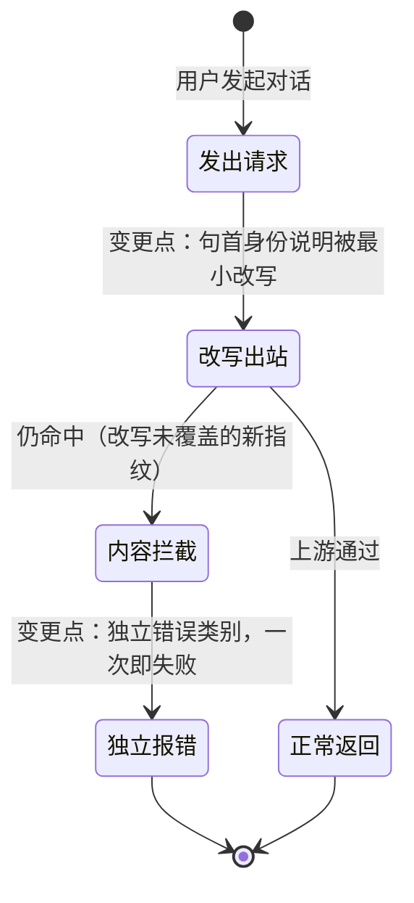

# FNOS-022 CodeBuddy 模型调用被内容审核拦截修复

| 项目 | 内容 |
| --- | --- |
| 需求编号 | FNOS-022 |
| 提出日期 | 2026-10-20 |
| 需求状态 | <Badge type="tip" text="已通过验收（DSH Web 与 DSH Desktop 双客户端）" /> |
| 关联计划 | [PLAN-FNOS-022 CodeBuddy 模型调用被内容审核拦截修复](/plans/PLAN-FNOS-022-codebuddy-content-block-fix) |
| 影响插件 | `@tnnevol/dsh-codebuddy` |
| 关联需求 | [FNOS-020](/requirements/FNOS-020-codebuddy-transient-400)（同路由 400 重试策略）、[FNOS-012](/requirements/FNOS-012-codebuddy-model-speed-and-client-version)（客户端版本指纹维护）、[FNOS-005](/requirements/FNOS-005-codebuddy-and-local-dsh)（成长任务来源，其上游项目已停更） |

## 需求背景

### 问题：CodeBuddy 插件的模型无法正常使用

在插件中选中任一 CodeBuddy 模型发起对话，模型调用全部失败——返回 HTTP 400，业务码 11128，文案「Illegal API invocation from an unapproved channel」，界面显示「请求被拦截，请重新发送」。用户无法用 CodeBuddy 模型完成任何对话。

**实测取证**：用本地 6 个 CodeBuddy 账号、插件**真实的出站请求头**复现。逐条串行、单请求、每次间隔数秒，排除任何速率因素；全程只读，未改动任何账号状态。

| 账号 | 客户端 | 带智能体框架身份句 | 不带该句（对照） |
| --- | --- | --- | --- |
| 账号 A | WorkBuddy | 400 / 11128 | 200 |
| 账号 B | CLI | 400 / 11128 | 200 |
| 账号 C | CLI | 400 / 11128 | 429 / 6004（额度耗尽） |
| 账号 D | WorkBuddy | 400 / 11128 | 429 / 6004（额度耗尽） |
| 账号 E | WorkBuddy | 400 / 11128 | 200 |
| 账号 F | WorkBuddy | 400 / 11128 | 200 |

**6 个账号全部复现**。对照组的两个「额度耗尽」结果具有独立价值：它们证明**内容审核发生在额度检查之前**——改写后的请求能穿过内容审核这一层，才轮到额度层拒绝；也说明内容拦截与额度耗尽是两类不同错误。

**触发规则的精确边界**（逐项实测）：

| 变体 | 结果 | 结论 |
| --- | --- | --- |
| 整句位于句首 | 拦截 | 触发条件 |
| 整句位于句首但后接内容 | 拦截 | 后接内容不影响判定 |
| 前面加一个换行 | 通过 | **严格锚定句首** |
| 前面加一个词 | 通过 | 同上 |
| 前面有别的句子 | 通过 | 同上 |
| 只写产品名（去掉整句） | 通过 | 匹配**整句**，非子串 |
| 改一个词（`powered by` → `powered via`） | 通过 | 最小改写即可解除 |
| 句尾加字（产品名后加 " v2"） | 拦截 | **整句精确匹配**，加字即失效 |
| 仅改大小写 | 拦截 | **忽略大小写** |
| 插入零宽字符 | 拦截 | 上游会归一化该字符 |

**结论**：触发条件是**句首锚定、忽略大小写、整句逐字精确匹配**，与账号、模型、端点、工具数量、输出上限、推理档位全部无关。

**根因**：上游内容审核对请求体做逐字精确匹配（非语义审核），一字改动即可改变判定结果。而本插件运行时所使用的智能体框架，其系统提示**固定以一句身份说明开头**（该身份说明在宿主中是唯一且硬编码的常量），宿主未暴露关闭它的开关。于是**每一次 CodeBuddy 调用都必然命中拦截**。

### 请求头不是拦截因素（已实测排除）

上游的《停止维护声明》把「对非官方客户端的识别与拦截正在收紧」列为主要原因，因此需要区分拦截究竟发生在哪一层。用官方 CLI 的真实请求做对照（抓包比对 + 5 组隔离实验）：

| 组合 | 结果 |
| --- | --- |
| 插件现有请求头 + 原始系统提示 | 400 / 11128 |
| **官方 CLI 完整请求头族** + 原始系统提示 | **400 / 11128** |
| 官方完整请求头族 + 改写后系统提示 | 200 |
| 插件现有请求头 + 改写后系统提示 | 200 |

**结论：拦截只由请求体的系统提示内容决定，与请求头族无关。** 上游用的是「已知客户端指纹黑名单」而非「官方身份白名单」——只要系统提示不以被拦指纹开头即可通过，不必长得像官方客户端。

### 修复范围的实测结论

用真实的完整系统提示实测，仅改写首句一个词即可让整个请求通过：

| 完整系统提示的处置 | 结果 |
| --- | --- |
| 原样发送 | 400 / 11128 |
| 只改写首句一个词 | 200 |
| 首句整段替换为中性句 | 200 |
| 完全去掉首句 | 200 |

即**其余内容不含其它审核指纹**，无需覆盖一整套指纹清单。

改写后的模型行为验证：普通问答正确作答、提供函数定义时正确发起工具调用、遵循中文指令精确输出。

### 来源项目已停止维护

本需求最初还包含一批「与开源项目 `workbuddy2api-panel` 对齐协议口径」的功能。该项目已于 **2026-10-21** 发布停止维护声明，明确「后续不再更新代码、不跟进上游变化」，且把「上游对非官方客户端的识别与拦截正在收紧」列为首要原因。

因此**该批对齐项全部取消**，本需求只保留真实影响插件可用性的内容拦截修复。已取消的功能登记在[已取消功能](#已取消功能)一节，保留追溯。

## 调研结论

| 结论 | 出处 | 影响的功能 | 状态 |
| --- | --- | --- | --- |
| **本地 6 个账号全部复现该拦截**：带智能体框架身份句返回 400/11128，去掉该句即通过（其中 2 个账号因额度耗尽返回 429/6004） | 本地 6 账号只读复现（插件真实出站请求头，逐条串行单请求） | FNOS-022-07、FNOS-022-08 | 已核实 |
| **触发规则为句首锚定、忽略大小写、整句精确匹配**：句首加词或换行即解除；句尾加字仍被拦；仅改大小写仍被拦；零宽字符被上游归一 | 同上（逐项变体实测） | FNOS-022-07 | 已核实 |
| 用真实完整系统提示实测，**仅改写首句一个词即整体通过**，其余内容不含其它审核指纹 | 同上（完整系统提示的四种处置对照） | FNOS-022-07 | 已核实 |
| 内容审核发生在额度检查之前：额度耗尽账号在改写后返回 429/6004 而非 11128 | 同上（对照组结果） | FNOS-022-08 | 已核实 |
| 智能体框架的身份说明在宿主中是唯一且硬编码的常量，不随 profile 或模型变化 | DSH 源码 `packages/core/system-prompt/src/index.ts` 的开场白常量 | FNOS-022-07 | 已核实 |
| 上游内容审核按**逐字精确匹配**（非语义审核），一字改动即可改变判定 | 上述变体实测 | FNOS-022-07 | 已核实 |
| **拦截只由请求体内容决定，与请求头族无关**：官方 CLI 完整请求头族（39 个头，含 SDK 指纹与追踪头）配原始系统提示仍被拦；插件现有头族配改写后系统提示即通过 | 官方 CLI 真实抓包 + 4 组隔离实验 | FNOS-022-07、FNOS-022-08 | 已核实 |
| 插件**无任何请求体改写逻辑**，系统消息原样透传；内容拦截被归入通用请求非法，与瞬时拒绝混同 | `plugins/dsh-codebuddy-plugin` 的消息序列化与错误分类实现 | FNOS-022-07、FNOS-022-08 | 已核实 |
| 内容拦截带业务码 11128，而既有重试策略针对的是「响应体只有一句话、不带业务码」的一类 400 | 上述实测 + [FNOS-020](/requirements/FNOS-020-codebuddy-transient-400) 的重试策略实现 | FNOS-022-08 | 已核实 |
| 插件对上游已有客户端身份伪装先例：因上游拦截带宿主标识的客户端标识，插件刻意使用官方客户端签名 | `plugins/dsh-codebuddy-plugin` 的客户端标识构造注释 | FNOS-022-07 | 已核实 |
| 来源项目 `workbuddy2api-panel` 已于 2026-10-21 声明停止维护，不再跟进上游变化；其首要原因即「上游对非官方客户端的识别与拦截正在收紧」 | 来源仓库 README 的停止维护声明 | 已取消功能（见下节） | 已核实 |

### 已评估但不在本需求范围内的方向

| 方向 | 不纳入原因 |
| --- | --- |
| 伪造官方客户端的完整请求头族 | 已实测无效：官方头族配原始系统提示仍被拦。做它不会改善可用性，只会增加维护面 |
| 改用官方客户端 SDK 发请求并压缩 body | 同上，属请求头与编码层，不改变内容判定 |
| 跟随上游把匹配扩展到其它句子或改为语义判定 | 属上游行为变化，无法预期；本需求的错误分类保证覆盖不全时仍可诊断 |

## 需求目标

- **CodeBuddy 模型恢复可用**：被上游内容审核拦截的调用不再必然失败，用户能正常用 CodeBuddy 模型对话。
- 内容拦截被识别为**独立且可诊断**的失败：不再与瞬时拒绝混同，不做无意义重试，不惩罚账号。

## 功能列表

| 编号 | 优先级 | 功能 | 用户可观察结果 | 状态 |
| --- | --- | --- | --- | --- |
| FNOS-022-07 | P0 | CodeBuddy 模型恢复可用 | 选中任一 CodeBuddy 模型发起对话时模型正常返回内容，不再被拦截；确被拦截时给出可理解的提示而非「请求被拦截」 | <Badge type="tip" text="已验（双客户端）" /> |
| FNOS-022-08 | P0 | 内容拦截被独立识别 | 内容拦截归入独立错误类别：不重试、不换号、不惩罚账号；失败一次即返回，错误信息说明原因 | <Badge type="tip" text="已验（双客户端）" /> |

### 已取消功能

以下功能源自已停止维护的开源项目，按「参考项目停更后不再跟进其口径」的决策**全部取消**，保留编号与原因以便追溯。取消前的分析与任务记录见变更记录。

| 原编号 | 原功能 | 取消原因 |
| --- | --- | --- |
| FNOS-022-01 | 企业账号在成长任务域被正确跳过 | 源自来源项目的企业能力门控改动；该项目已停更，不再跟进其口径 |
| FNOS-022-02 | 缓存命中量统计准确 | 源自来源项目的用量别名归一改动；同上 |
| FNOS-022-03 | 锁定任务的状态与提示属实 | 源自来源项目的待办过滤改动；同上 |
| FNOS-022-04 | 企业额度在全部边界形态下正确 | 源自来源项目的企业额度改动；同上 |
| FNOS-022-05 | 维护调用的容错恢复 | 源自来源项目的瞬时错误重试改动；同上 |
| FNOS-022-06 | 报名未生效时可被识别 | 源自来源项目的报名回读改动；同上 |
| FNOS-022-09 | 自动化覆盖范围治理 | 依附于成长任务自动化能力；该能力的上游跟进已停止，治理项随之取消 |

**编号保留说明**：FNOS-022-07、FNOS-022-08 不重排为 01、02——它们源于本地实测的生产故障，而非来源项目对齐，重排会破坏既有计划任务与测试用例的引用。

### 验收环境范围

- 两项功能均属 `@tnnevol/dsh-codebuddy` 插件，不依赖 fnOS 专属能力，**不要求真实 NAS 验收**。
- 需覆盖 **DSH Web 与 DSH Desktop** 双客户端（非 fnOS 插件的兼容基线）。
- 真实 CodeBuddy 账号是必需条件：拦截只在真实上游复现，无法用桩替代。

## 行为约束

- 改写只做**句首整句替换、改一个词**，语义保持不变；未命中时逐字不变。
- 改写不得泛化到用户正文：实测非句首出现不触发拦截，改写它属于多余误伤。
- 改写必须幂等：同一份内容重复处理不再变化。
- 内容拦截**不得重试**：它是确定性失败，重试只会原样再失败。
- 内容拦截**不得换账号**：与账号健康无关，换号只会消耗其它账号的可用额度。
- 内容拦截**不得惩罚账号**：不得计入失败次数、不得触发熔断或降权。
- 既有的瞬时请求非法（不带业务码的一类 400）仍按既有策略重试，不因本次改动改变行为。
- 只改写出站请求的副本，不回写会话、不修改本地会话历史、不影响用户在界面看到的消息。
- 不修改 DSH 上游代码，不引入新依赖。

## 不在本次范围内

- **所有源自已停止维护的参考项目的口径对齐项**（见[已取消功能](#已取消功能)）。
- 伪造官方客户端完整请求头族、改用官方 SDK 发请求——已实测对拦截无效果。
- 上游内容审核匹配规则本身的演进（属外部系统行为）。
- 账号级错误 11140（「request illegal」）：与内容拦截无关，属账号授权状态，需重新登录，不由代码修复。
- 客户端版本号跟进（当前 `2.163.0`、上游已 `2.169.0`）：属独立维护项，不在本需求内。

## 既有功能变更关系

本次是**可用性恢复 + 错误处理修正**，不新增用户可见功能。

用户可观察结果：从「每次调用都被拦截，无法使用」变为「正常对话」；若仍被拦截，看到一次明确的失败说明而不是反复重试。

## 验收条件与完成状态

### FNOS-022-07

- `FNOS-022-07-AC-01`：使用真实 CodeBuddy 账号发起含系统消息的对话，请求不再被上游内容审核拦截，模型正常返回内容。
- `FNOS-022-07-AC-02`：改写只针对已识别的审核指纹，未命中指纹的请求体逐字不变（不产生无谓改写）。
- `FNOS-022-07-AC-03`：改写后的系统消息语义不变，用户指令含义不被改变；实测中的普通问答、工具调用、遵循中文指令三项行为均正确。
- `FNOS-022-07-AC-06`：改写后的完整系统提示（长度与真实场景相当）整体通过审核，不因其余内容仍含审核指纹而失败。
- `FNOS-022-07-AC-07`：改写对不在句首的同一句文本不生效（句首锚定性），避免误改用户正文中的相似表述。

### FNOS-022-08

- `FNOS-022-08-AC-01`：内容拦截归入独立错误类别，与请求非法、额度耗尽、鉴权失败均不相同。
- `FNOS-022-08-AC-02`：内容拦截不触发重试——一次失败即返回，失败请求次数不因重试而增加。
- `FNOS-022-08-AC-03`：内容拦截不触发换号，失败账号之外的其他账号不被消耗。
- `FNOS-022-08-AC-04`：内容拦截的错误信息说明原因，不使用含义不明的通用文案。
- `FNOS-022-08-AC-05`：既有的瞬时请求非法仍按既有策略重试，内容拦截的加入不改变其行为。

## 变更记录

| 日期 | 变更 | 说明 |
| --- | --- | --- |
| 2026-10-20 | 初始登记 | 建立 FNOS-022，主题为「上游协议对齐与口径加固」。依据对开源项目 `workbuddy2api-panel` 自移植基线以来提交的逐域比对，登记 6 项口径对齐功能（企业账号门控、缓存命中别名、锁定任务提示、企业额度边界、维护调用重试、报名回读校验）与后续计划项，并登记经评估不适用的上游变更。关联 PLAN-FNOS-022。 |
| 2026-10-21 | 纳入内容拦截问题，优先级重排 | 用户要求把 CodeBuddy 模型完全不可用的问题并入本需求。经只读复现确认：模型调用全部被上游内容审核拦截（业务码 11128），触发条件为系统提示首句逐字匹配。这是插件核心功能不可用，量级高于原对齐项，故新增 FNOS-022-07（模型恢复可用）与 FNOS-022-08（内容拦截独立识别）为 P0，原企业门控降为 P1。同时补做移植基线当日上游改动的全量复核，确认漏掉了基线当日引入的请求体净化、角色归一与内容拦截独立分类。 |
| 2026-10-21 | 回填实测证据，收窄修复范围 | 用本地 6 个账号、插件真实出站请求头复现（6/6 全部复现）；逐项变体实测确定触发规则的精确边界（句首锚定、忽略大小写、整句匹配）。关键收窄：真实完整系统提示仅改写首句一个词即整体通过，修复无需照搬上游整套指纹清单。新增 AC-06（完整系统提示整体通过）与 AC-07（句首锚定性）。 |
| 2026-10-21 | 确认请求头不是拦截因素 | 用官方 CLI 真实抓包构造完整请求头族做隔离实验：官方头族配原始系统提示仍返回 400/11128，插件现有头族配改写后系统提示即通过。据此确认拦截只由请求体内容决定，把「伪造官方头族」与「改用官方 SDK」列入不在范围内。 |
| 2026-10-21 | **收窄范围：取消全部参考项目对齐项** | 参考项目 `workbuddy2api-panel` 已于 2026-10-21 发布停止维护声明（不再更新代码、不跟进上游变化，首要原因是上游正在收紧对非官方客户端的识别与拦截）。按「参考项目停更后不再跟进其口径」的决策，取消 FNOS-022-01～06 与 FNOS-022-09，本需求只保留源于本地实测的 FNOS-022-07、08。需求标题与文档标识改为「CodeBuddy 模型调用被内容审核拦截修复」，计划由三阶段收窄为两阶段。FNOS-022-07、08 编号保留不重排，避免破坏既有引用。 |
| 2026-10-21 | 阶段二完成，需求验收通过 | 在 DSH Web 与 DSH Desktop 两个客户端完成真实账号走查：同一提示词下模型均正常返回内容（Web「已完成，用时 2 秒」、Desktop「已完成，用时 1 秒」，provider/model 均为 `codebuddy` / `deepseek-v4.1-flash`）。另用本地桩注入真实拦截，验证内容拦截只失败一次、不重试、不换号（`assistant/attempt = 1`、`retry` 事件 0 条、`turn/end error.code = CONTENT_BLOCKED`）。两项功能状态改为已验，需求状态改为已完成。 |
