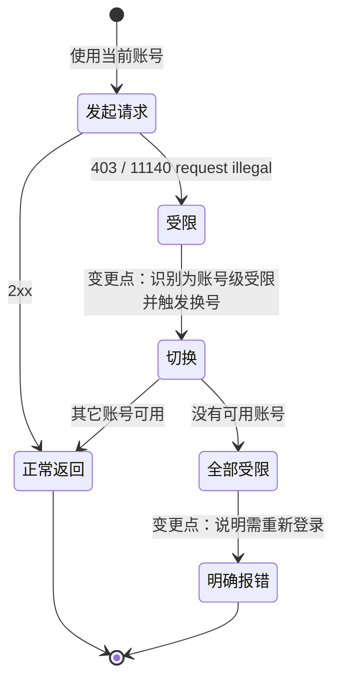

# FNOS-023 CodeBuddy 受限账号触发自动切换

| 项目 | 内容 |
| --- | --- |
| 需求编号 | FNOS-023 |
| 提出日期 | 2026-10-21 |
| 需求状态 | <Badge type="tip" text="已通过验收（DSH Web + 真实受限账号）" /> |
| 关联计划 | [PLAN-FNOS-023 CodeBuddy 受限账号触发自动切换](/plans/PLAN-FNOS-023-codebuddy-restricted-account-failover) |
| 影响插件 | `@tnnevol/dsh-codebuddy` |
| 关联需求 | [FNOS-022](/requirements/FNOS-022-codebuddy-content-block-fix)（同路由错误分类）、[FNOS-003](/requirements/FNOS-003-fpk-runtime-settings)（多账号与自动切换） |

## 需求背景

### 问题：受限账号不会触发切换，只能手动切号

上游对部分账号返回 HTTP 403、业务码 11140、文案 `request illegal`。实测该状态与请求内容、模型无关：同一时刻换用其它账号即正常，被拒账号需要重新登录才能恢复。

插件当前的分类把 401/403 一律归为鉴权失败（`AUTH`），而自动换号只对「额度耗尽」与「被限流」生效。结果是：

- 受限账号**不会触发切换**，每次请求都直接失败；
- 用户必须自己进插件面板手动「设为当前账号」才能继续；
- 若开启自动切换，手动切换入口还是隐藏的，用户更难自救。

### 该错误与内容拦截是两类问题

[FNOS-022](/requirements/FNOS-022-codebuddy-content-block-fix) 处理的内容拦截（业务码 11128）是**请求内容**问题，换号无效，因此刻意不进换号集合。本需求处理的是**账号状态**问题：内容不变、只换账号即可恢复，因此必须换号。两者不能合并处理。

## 调研结论

| 结论 | 出处 | 影响的功能 | 状态 |
| --- | --- | --- | --- |
| 受限账号返回 403 + 业务码 11140 + 文案 `request illegal`，换其它账号同时刻可正常调用 | 本地多账号实测（2026-10-21） | FNOS-023-01 | 已核实 |
| 插件当前把 401/403 一律映射为 `AUTH`，换号只认 `QUOTA` 与 `RATE_LIMIT` | `plugins/dsh-codebuddy-plugin` 的错误分类与换号判定 | FNOS-023-01 | 已核实 |
| 自动切换开启时手动「设为当前账号」入口会隐藏，受限账号下用户无法自助 | `plugins/dsh-codebuddy-plugin` 的账号面板实现 | FNOS-023-01 | 已核实 |
| 上游把 11140 视为账号级授权问题（需重新登录），并区分它承载的另一种形态：模型级限流文案 | 来源项目对该错误码的处理说明 | FNOS-023-01 | 已核实 |
| 现有换号提示文案固定为「额度不足」，对限流与受限两种原因都不准确 | `plugins/dsh-codebuddy-plugin` 的换号提示 | FNOS-023-02 | 已核实 |

### 与研究来源的关系

本需求不依赖已停止维护的 `workbuddy2api-panel` 的新提交；其关于 11140 的处理结论只作为**错误语义**的旁证，实现按本插件自身结构设计。

## 需求目标

- 受限账号不再让请求直接失败：自动切到其它可用账号继续完成本次请求。
- 切换必须对用户可见：说明是因为账号被上游限制而切换，并提示该账号需重新登录。
- 受限账号在恢复前不再被反复选中，避免每个请求都先失败一次。
- 所有账号都受限时如实报错，说明原因与下一步动作。

## 功能列表

| 编号 | 优先级 | 功能 | 用户可观察结果 | 状态 |
| --- | --- | --- | --- | --- |
| FNOS-023-01 | P0 | 受限账号触发自动切换 | 当前账号被上游限制时，请求自动改用其它可用账号继续，并提示切换原因 | <Badge type="tip" text="已验" /> |
| FNOS-023-02 | P1 | 切换提示说明真实原因 | 提示按原因区分「额度不足」「被限流」「账号受限需重新登录」，不再一律写「额度不足」 | <Badge type="tip" text="已验" /> |
| FNOS-023-03 | P1 | 受限账号在恢复前不再被选中 | 受限账号被排除出候选，后续请求不再先失败一次；该账号重新登录后恢复可用 | <Badge type="tip" text="已验" /> |
| FNOS-023-04 | P1 | 全部账号受限时如实报错 | 没有可用账号时报错说明「账号被上游限制，需重新登录」，不伪装成额度问题 | <Badge type="tip" text="已验" /> |

### 验收环境范围

- 属 `@tnnevol/dsh-codebuddy` 插件，不依赖 fnOS 专属能力，**不要求真实 NAS 验收**。
- 需覆盖 DSH Web；DSH Desktop 与 Web 共用同一宿主逻辑，按兼容基线一并走查。
- 需真实受限账号才能复现，属受控环境条件。

## 行为约束

- 受限账号触发的切换**不受「自动切换」偏好限制**：该账号无法服务任何请求，保持原样只会让插件不可用；但切换必须给出可见提示。
- 内容拦截（11128）**仍不得换号**：那是请求内容问题，换号无效。
- 鉴权失败（token 过期、凭据无效）维持既有语义，不因本次改动被归入受限。
- 受限是**账号级**判定：只按业务码与文案识别，不因模型或请求内容推断。
- 受限标记仅是进程内状态，不写入凭据文件；重新登录或重启后自然复位。
- 不改变既有额度、限流换号的行为与阈值。

## 不在本次范围内

- 上游为何限制这些账号（外部系统行为，需按账号向服务侧查询）。
- 自动重新登录（登录必须由用户在浏览器完成）。
- 把受限状态持久化到磁盘或跨进程共享。
- 多账号池、账号健康度统计等网关形态能力。

## 既有功能变更关系

用户可观察结果：从「请求失败、需手动切号」变为「自动换号后继续，并提示原账号被限制需重新登录」。

## 验收条件与完成状态

### FNOS-023-01

- `FNOS-023-01-AC-01`：当前账号返回 11140 时，请求自动改用其它可用账号并成功完成。
- `FNOS-023-01-AC-02`：切换对用户可见，且说明原因是「账号被上游限制」。
- `FNOS-023-01-AC-03`：自动切换偏好关闭时，受限账号仍触发切换（不被偏好拦住）。

### FNOS-023-02

- `FNOS-023-02-AC-01`：切换提示按原因区分额度不足、被限流、账号受限三类，不再一律写「额度不足」。

### FNOS-023-03

- `FNOS-023-03-AC-01`：受限账号在后续请求中不再被选为首个尝试账号。
- `FNOS-023-03-AC-02`：该账号重新登录后恢复可用（受限标记不再生效）。
- `FNOS-023-03-AC-03`：受限标记不写入凭据文件，重启后不复存在。

### FNOS-023-04

- `FNOS-023-04-AC-01`：全部账号受限时报错说明「账号被上游限制，需重新登录」，不显示为额度问题。
- `FNOS-023-04-AC-02`：内容拦截与鉴权失败的报错语义不因本次改动变化。

## 变更记录

| 日期 | 变更 | 说明 |
| --- | --- | --- |
| 2026-10-21 | 初始登记 | 建立 FNOS-023。依据实测：受限账号返回 403/11140，插件当前归为 `AUTH`、不换号，用户只能手动切号；自动切换开启时手动入口还隐藏。登记 4 项功能与验收条件，明确与 FNOS-022 内容拦截的区别（后者换号无效、不得换号）。关联 PLAN-FNOS-023。 |
| 2026-10-21 | 实现与验收完成 | 按需求实现：11140+`request illegal` 独立为 `ACCOUNT_RESTRICTED`；进入换号集合且不受「自动切换」偏好限制；提示按原因区分并改为完整流块输出（首版裸 delta 界面不可见，见测试 BUG-01）；受限账号记入进程内集合并从候选排除；重新登录清除标记；全部受限时报「需重新登录」。真实验证：活动账号为受限账号时自动切换至健康账号并完成（5 秒），界面可见提示；同会话第二轮受限失败 0 次。插件 941 条用例全绿。需求状态改为已完成。 |
