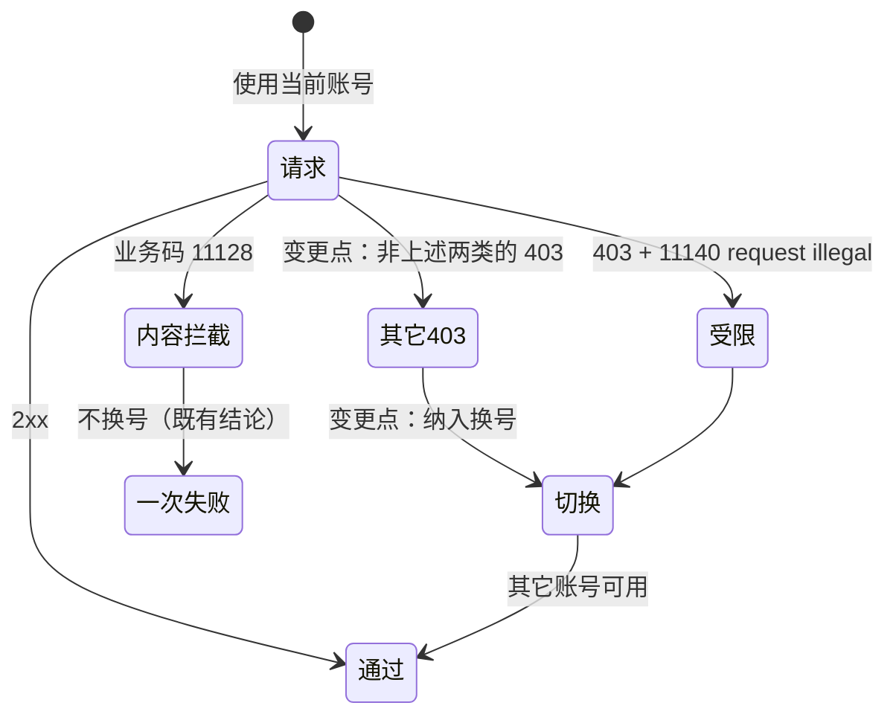

# FNOS-024 CodeBuddy 403 纳入账号切换

| 项目 | 内容 |
| --- | --- |
| 需求编号 | FNOS-024 |
| 提出日期 | 2026-10-21 |
| 需求状态 | <Badge type="tip" text="已通过验收" /> |
| 关联计划 | [PLAN-FNOS-024 CodeBuddy 403 纳入账号切换](/plans/PLAN-FNOS-024-codebuddy-403-failover) |
| 影响插件 | `@tnnevol/dsh-codebuddy` |
| 关联需求 | [FNOS-023](/requirements/FNOS-023-codebuddy-restricted-account-failover)（受限账号 11140 已纳入换号）、[FNOS-022](/requirements/FNOS-022-codebuddy-content-block-fix)（内容拦截明确不换号） |

## 需求背景

上游对请求的拒绝并不只有一种形态。除已处理的「账号级受限」（403 + 业务码 11140 + `request illegal`）与「内容拦截」（业务码 11128）外，还存在**其它 403**：例如不携带业务码的策略拒绝。

插件目前把所有 403 归入鉴权失败（`AUTH`），而换号只认额度耗尽、限流与账号受限，于是这类 403 同样不会触发切换——用户只能手动切号才能继续。

用户要求：**403 也加入换号**。

### 与两类既有问题的边界

| 形态 | 本次处理 |
| --- | --- |
| 内容拦截（业务码 11128，可能以 400 或 403 出现） | **仍不换号**：换账号不会让同一份请求内容变合法（[FNOS-022](/requirements/FNOS-022-codebuddy-content-block-fix) 的结论不变） |
| 账号级受限（403 + 11140 + `request illegal`） | 已由 [FNOS-023](/requirements/FNOS-023-codebuddy-restricted-account-failover) 处理，本次不改变其行为 |
| 其它 403 | **纳入换号**（本次新增） |

## 调研结论

| 结论 | 出处 | 影响的功能 | 状态 |
| --- | --- | --- | --- |
| 插件当前把 401 与 403 一并映射为 `AUTH`，换号集合不含它 | `plugins/dsh-codebuddy-plugin` 的错误分类与换号判定 | FNOS-024-01 | 已核实 |
| 403 同时承载内容拦截与账号受限两类已知情形，两者都有既有结论（不换号 / 已换号） | FNOS-022、FNOS-023 的实现与实测 | FNOS-024-01 | 已核实 |
| 除上述两类外，403 还可能是策略拒绝；换号对这类失败有效（换用其它账号可继续） | 用户要求与既有换号实践 | FNOS-024-01 | 已核实 |

## 需求目标

- 非内容拦截、非受限的 403 不再让请求直接失败：自动切到其它可用账号继续。
- 切换对用户可见，并说明原因是「账号被上游拒绝（403）」。
- 内容拦截（11128）与鉴权失败（401）的既有语义不变。

## 功能列表

| 编号 | 优先级 | 功能 | 用户可观察结果 | 状态 |
| --- | --- | --- | --- | --- |
| FNOS-024-01 | P1 | 403 触发自动切换 | 请求被 403 拒绝时自动改用其它账号继续 | <Badge type="tip" text="已验" /> |
| FNOS-024-02 | P2 | 403 切换提示说明原因 | 提示写「账号被上游拒绝（HTTP 403）」，不与额度/限流/受限混淆 | <Badge type="tip" text="已验" /> |

### 验收环境范围

- 属 `@tnnevol/dsh-codebuddy` 插件，不依赖 fnOS 专属能力，**不要求真实 NAS 验收**。
- 主要用本地构测与桩注入验证（真实 403 形态不可控）；真实账号侧沿用 FNOS-023 的实测基线。

## 行为约束

- 内容拦截（11128）**仍不得换号**。
- 账号级受限（11140 + `request illegal`）维持 FNOS-023 行为（含「不受自动切换偏好限制」与进程内排除）。
- 401 维持鉴权失败语义，不因本次改动被归入 403 分支。
- 403 触发的切换**不写入**受限集合：403 可能是临时策略拒绝，把账号长期排除会误伤。
- 不改变既有额度、限流换号的行为与阈值。

## 不在本次范围内

- 上游各类 403 的具体成因（外部系统行为）。
- 把 403 持久化为账号状态。
- 401 是否也应换号（本轮只按用户要求处理 403）。

## 既有功能变更关系

用户可观察结果：被 403 拒绝时不再直接失败，而是自动换号继续，并看到说明原因的提示。

## 验收条件与完成状态

### FNOS-024-01

- `FNOS-024-01-AC-01`：非内容拦截、非受限的 403 会触发换号，并成功完成本次请求。
- `FNOS-024-01-AC-02`：内容拦截（11128）仍不换号；401 仍为鉴权失败。

### FNOS-024-02

- `FNOS-024-02-AC-01`：提示写「账号被上游拒绝（HTTP 403）」，不与其它原因混用。

## 变更记录

| 日期 | 变更 | 说明 |
| --- | --- | --- |
| 2026-10-21 | 初始登记 | 建立 FNOS-024。用户要求「403 也加入换号」。登记 2 项功能与 4 条验收条件；明确内容拦截仍不换号、受限行为不变、401 不受影响、403 不写入受限集合。关联 PLAN-FNOS-024。 |
| 2026-10-21 | 实现与验收完成 | 403 拆分为三类：内容拦截（11128）、账号受限（11140+`request illegal`）与其它 403（新增 `ACCOUNT_FORBIDDEN`）；后者纳入换号集合并与受限一样不受自动切换偏好限制，提示写「账号被上游拒绝（HTTP 403）」。适配器级集成验证：桩返回 403 时自动切到真实账号并完成（`finish: stop`），提示文本正确，`autoSwitch=false` 下仍切换。插件 943 条用例全绿。需求状态改为已完成。 |
