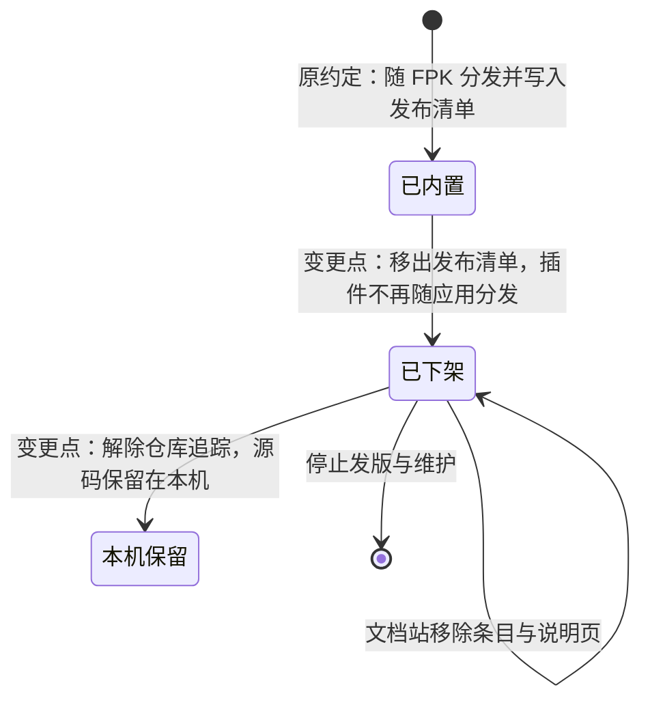
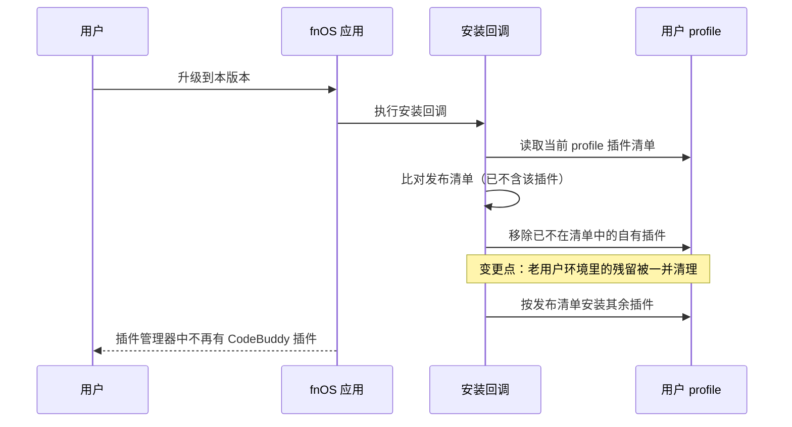

# FNOS-025 CodeBuddy 插件下架

| 项目 | 内容 |
| --- | --- |
| 需求编号 | FNOS-025 |
| 提出日期 | 2026-10-22 |
| 需求状态 | <Badge type="info" text="规划中" /> |
| 关联计划 | [PLAN-FNOS-025 CodeBuddy 插件下架](/plans/PLAN-FNOS-025-codebuddy-plugin-delisting) |
| 影响插件 | `@tnnevol/dsh-codebuddy`（停止维护并下架） |
| 关联需求 | [FNOS-012](/requirements/FNOS-012-codebuddy-model-speed-and-client-version)、[FNOS-020](/requirements/FNOS-020-codebuddy-transient-400)、[FNOS-022](/requirements/FNOS-022-codebuddy-content-block-fix)、[FNOS-023](/requirements/FNOS-023-codebuddy-restricted-account-failover)、[FNOS-024](/requirements/FNOS-024-codebuddy-403-failover) |

## 需求背景

腾讯 CodeBuddy 已开始对**非官方客户端通道**做风控：插件发出的请求被上游以 HTTP 400 与业务码 `11128`（`Illegal API invocation from an unapproved channel`）拒绝，用户无法用该模型完成任何对话。

这不是一次性的回归。仓库此前针对该拦截做过两轮适配（[FNOS-022](/requirements/FNOS-022-codebuddy-content-block-fix) 的出站最小改写、后续又改为词组级中和），每轮都在上游规则再次收紧后失效。最新一次用户实测（2026-10-22）显示，拦截触发点已从「系统提示词首句」扩展到**系统提示词任意位置**，且规则仍在灰度：短提示词放行、长提示词必拦。这意味着适配工作需要持续逆向验证上游规则，无法保证长期有效。

用户侧已有两位独立用户报告同一故障（仓库 issue #17 与 #18），确认是面向面的行为而非个别环境问题。

维护者决定：**CodeBuddy 插件停止维护并下架**。

### 下架的三条边界

| 边界 | 处理 | 理由 |
| --- | --- | --- |
| 插件源码 | **保留在本机，不删除**；但不再由仓库追踪 | 保留历史实现与后续恢复的可能；仓库只保留它的历史快照 |
| 插件分发 | 不再随 FPK 内置、不再发布、不再出现在插件市场索引 | 已停止维护，继续分发等于把不可用的功能交付给用户 |
| 插件文档 | 文档站不再收录该插件的说明页与条目 | 文档站是面向用户的现行说明，不应再介绍已下架的功能 |

### 与既有需求的边界

[FNOS-012](/requirements/FNOS-012-codebuddy-model-speed-and-client-version) 至 [FNOS-024](/requirements/FNOS-024-codebuddy-403-failover) 的编号需求均为该插件的专项需求，随插件下架而失去实施对象。这些需求作为历史验收记录保留，其正文不回改；本需求登记它们与「插件下架」的关系。

[FNOS-012](/requirements/FNOS-012-codebuddy-model-speed-and-client-version) 中的 FNOS-012-04（npm `latest` 标签校正）、FNOS-012-05（`dsh-failover-search` 兼容性清单）与 FNOS-012-06（智能搜索药丸按钮）**不依赖** CodeBuddy 插件，其结论与状态不变。

## 调研结论

| 结论 | 出处 | 影响的功能 | 状态 |
| --- | --- | --- | --- |
| 上游拦截从系统提示词首句扩展到任意位置，适配需要持续逆向验证，无法保证长期有效 | 2026-10-22 用户实测（7 组对照、3 处词组位置）与仓库 issue #18 | FNOS-025-01、FNOS-025-02 | 已核实 |
| 已有两位独立用户报告同一故障，非个别环境问题 | 仓库 issue #17（2026-10-21）与 #18（2026-10-22） | FNOS-025-01 | 已核实 |
| 应用安装期会按发布清单安装插件，插件不在清单内即不再随应用分发 | 应用安装回调的插件安装步骤与发布清单 | FNOS-025-01 | 已核实 |
| 升级时安装回调会把「已不在发布清单里的自有插件」从用户 profile 中移除 | 安装回调的孤儿自有插件清理步骤 | FNOS-025-05 | 已核实 |
| 插件清单由仓库内的插件目录动态发现，仅解除版本追踪不足以让插件退出发布与版本维护 | 插件发现逻辑与版本维护、发布命令的实现 | FNOS-025-03、FNOS-025-04 | 已核实 |
| 网关把 `/codebuddy` 作为内置插件的 RPC 通道白名单；该路径对仍持有该插件的用户仍有价值，删除成本为零 | 网关桥接的路径白名单实现与其配套用例 | FNOS-025-04 | 已核实 |

## 需求目标

- CodeBuddy 插件不再随 fnOS 应用分发，也不再出现在应用介绍与插件市场索引中。
- 文档站不再收录该插件的说明页、条目与数量断言。
- 仓库不再追踪该插件的源码，但源码在本机保留完整可读。
- 升级到本版本后，老用户环境里不再残留该插件。

## 功能列表

| 编号 | 优先级 | 功能 | 用户可观察结果 | 状态 |
| --- | --- | --- | --- | --- |
| FNOS-025-01 | P0 | 插件不再随应用内置 | 安装或升级应用后，插件管理器里不再出现 CodeBuddy 插件 | <Badge type="info" text="待验" /> |
| FNOS-025-02 | P0 | 文档站不再收录该插件 | 文档站插件总览里没有该插件，搜索不到它的说明页 | <Badge type="info" text="待验" /> |
| FNOS-025-03 | P1 | 仓库不再追踪插件源码 | 仓库中查不到该插件目录，但本机文件仍完整保留 | <Badge type="info" text="待验" /> |
| FNOS-025-04 | P1 | 发布链路不再包含该插件 | 发版与发布插件的命令不再列出、也不再产出该插件 | <Badge type="info" text="待验" /> |
| FNOS-025-05 | P2 | 升级后清理老用户环境残留 | 老用户升级后，插件管理器里不再有该插件 | <Badge type="info" text="待验" /> |

### 验收环境范围

- FNOS-025-01、FNOS-025-05 涉及 FPK 安装与升级生命周期，**必须覆盖真实 fnOS NAS**。
- FNOS-025-02 覆盖文档站构建环境。
- FNOS-025-03、FNOS-025-04 覆盖仓库的构建与发布工具链。

## 行为约束

- **不删除**本机的插件源码；只解除仓库追踪。
- 不影响其它插件：Codex Auth、fnOS、Failover Search、Midscene、Semi UI Showcase 的功能、版本与分发方式不变。
- 网关的 `/codebuddy` 通道保留：仍持有该插件的用户（手动从 npm 安装、或升级窗口期）不至于静默失效。
- 已发布到 npm 的 `@tnnevol/dsh-codebuddy` 包不做强制下架；本需求只保证仓库与文档不再推荐和分发它。
- 已完成需求的正文不回改，只在本需求登记它们的归属关系。

## 不在本次范围内

- 卸载 npm 上已发布的 `@tnnevol/dsh-codebuddy` 包。
- 撤销或删除 [FNOS-012](/requirements/FNOS-012-codebuddy-model-speed-and-client-version) 至 [FNOS-024](/requirements/FNOS-024-codebuddy-403-failover) 的历史需求、计划与测试文档。
- 其它插件可能遇到的上游同类风控问题。
- 网关 `/codebuddy` 通道的移除。
- 插件市场索引中其它条目的调整。

## 既有功能变更关系

用户可观察结果：应用安装与升级后不再出现该插件；文档站不再介绍它；老用户升级后环境里的残留被清理。

## 验收条件与完成状态

### FNOS-025-01

- `FNOS-025-01-AC-01`：应用安装或升级后，插件管理器里不出现 CodeBuddy 插件。
- `FNOS-025-01-AC-02`：应用介绍文案里的内置插件清单与实际分发内容一致。

### FNOS-025-02

- `FNOS-025-02-AC-01`：文档站插件总览里没有该插件，也没有指向它的说明页链接。
- `FNOS-025-02-AC-02`：文档站构建通过，不存在指向已删除页面的链接。

### FNOS-025-03

- `FNOS-025-03-AC-01`：仓库中不再有该插件目录的受版本管理文件。
- `FNOS-025-03-AC-02`：该插件源码在本机仍然完整存在、可读。

### FNOS-025-04

- `FNOS-025-04-AC-01`：版本维护与插件发布的候选列表里不再出现该插件。
- `FNOS-025-04-AC-02`：插件市场索引里不再收录该插件。

### FNOS-025-05

- `FNOS-025-05-AC-01`：老用户升级后，插件管理器里不再有该插件，用户原有凭据与其它插件不受影响。

## 变更记录

| 日期 | 变更 | 说明 |
| --- | --- | --- |
| 2026-10-22 | 初始登记 | 建立 FNOS-025。登记 5 项功能与 9 条验收条件；明确源码保留不删、文档站移除、FPK 移除内置、发布链路排除、升级清理残留五条边界；登记与 FNOS-012 至 FNOS-024 的归属关系，并说明 FNOS-012-04/05/06 不受影响。关联 PLAN-FNOS-025。 |
