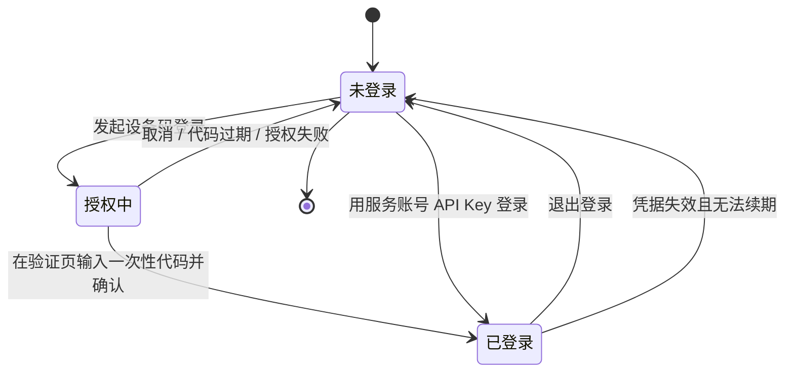
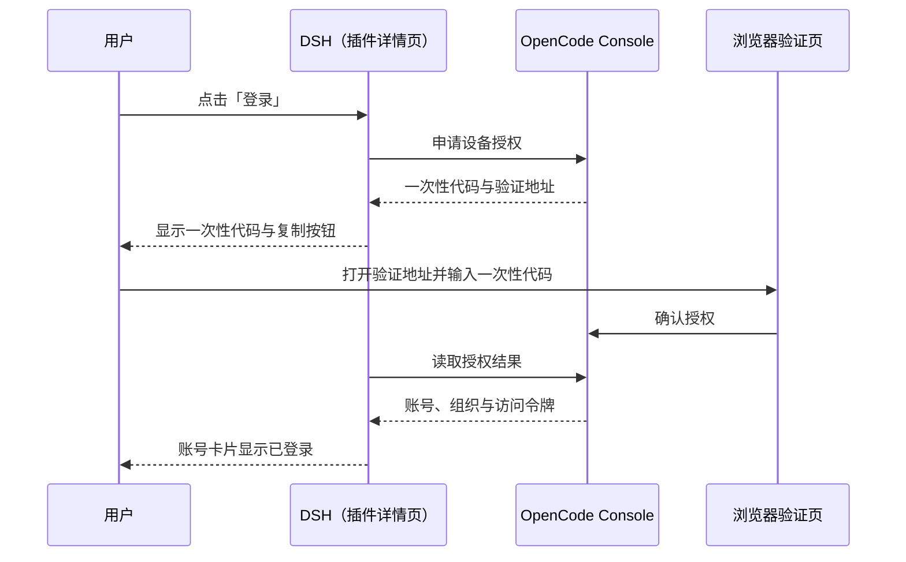
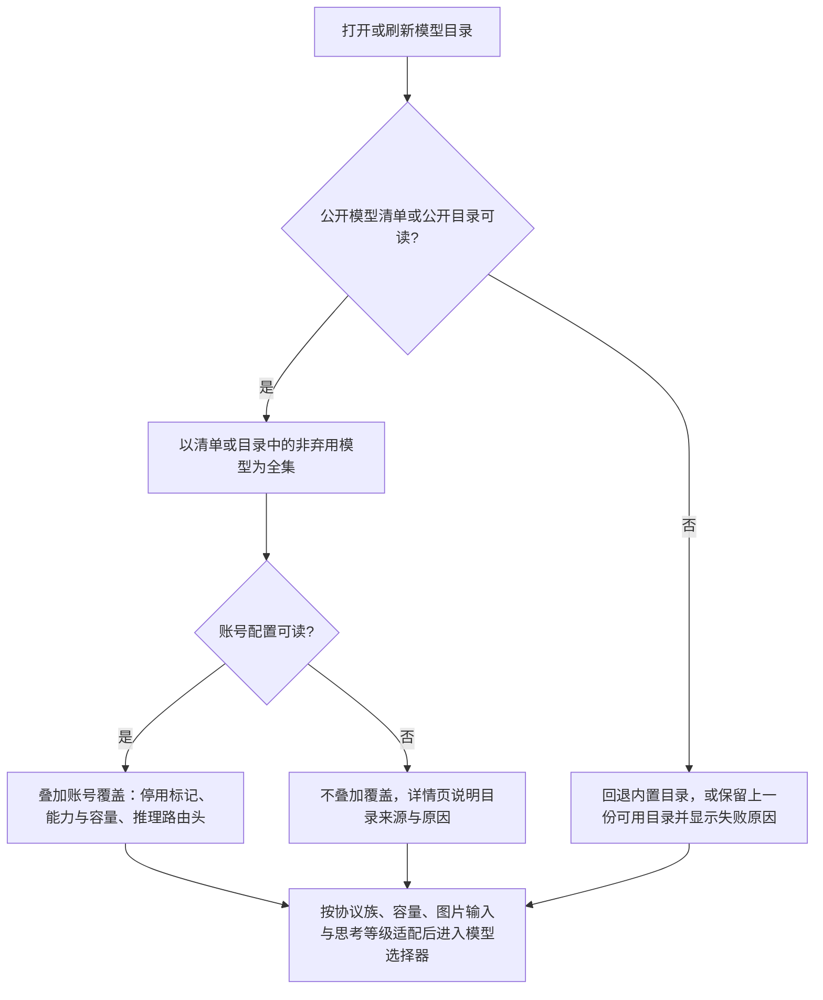

# FNOS-026 OpenCode Go 模型接入与套餐用量

| 项目 | 内容 |
| --- | --- |
| 需求编号 | FNOS-026 |
| 提出日期 | 2026-10-23 |
| 需求状态 | <Badge type="warning" text="实施中（DSH Web 与 headless 已验证；DSH Desktop 与设备码登录待验收）" /> |
| 关联计划 | [PLAN-FNOS-026 OpenCode Go 模型接入与套餐用量](/plans/PLAN-FNOS-026-dsh-opencode-plugin) |
| 影响插件 | `@tnnevol/dsh-opencode`（新增） |
| 关联需求 | [FNOS-014](/requirements/FNOS-014-dsh-021-rc2-adaptation)（DSH 0.2.1-rc.2 插件基线）、[FNOS-016](/requirements/FNOS-016-plugin-market-index)（插件市场索引与元数据） |

## 需求背景

OpenCode 是一个独立的编码代理产品，它的付费订阅 **OpenCode Console → OpenCode Go** 提供一批经过挑选的模型（Go 与 Go Plus 两档按月订阅）。用户在 OpenCode 里 `connect` 一次、`/models` 选一个就能用；在 DSH 里想用同一批模型，目前只有两种办法：

- 在模型设置里手工声明一个 OpenAI 兼容供应商，把 API Key 填进去，再逐条维护模型清单；
- 什么都不做，继续在 OpenCode 里用。

这两条路都有明显代价：

1. **手工清单会过期**。OpenCode Go 的模型由上游持续增删（官方文档明确写着「清单会随测试与新增而变化」）。手工写入的清单不会跟着变，用户只能自己盯着上游，再把新模型抄进配置。
2. **能力描述无法表达**。同一批模型分属四种上游协议，上下文窗口从数十万到百万 token 不等，最大输出、图片输入、思考等级各不相同。手工配置只能给一个「OpenAI 兼容」壳子：协议配错直接调不通，容量配错会让长对话被截断或请求被拒，思考等级更是完全没有入口。
3. **账号级的覆盖与路由信息无法表达**。Console 会下发工作空间级的模型覆盖（停用标记、能力与容量覆盖），以及推理请求需要的工作空间路由头；手工配置既写不出这些覆盖，也带不上路由头，于是会出现「Console 里停用的模型仍可选」或「模型选得到但请求被拒」的情况。
4. **套餐额度只能在浏览器里看**。DSH 对话到一半被限流时，用户得切回 Console 才能知道是 5 小时窗口、每周窗口还是每月窗口用完了、什么时候重置。

本需求新增 `@tnnevol/dsh-opencode`，把「登录 Console 账号 → 拉取 OpenCode Go 的模型清单并叠加账号级覆盖 → 在 DSH 里选择并对话 → 查看套餐额度」做成一条闭环，并补齐面向用户的说明页与插件登记。

## 调研结论

| 结论 | 出处 | 影响的功能 | 状态 |
| --- | --- | --- | --- |
| OpenCode Go 是 OpenCode Console 的月度订阅（Go 与 Go Plus 两档），包含一份会随上游测试与新增而变化的模型清单，用户用 Console 里的 API Key 接入 | [OpenCode Console Go 文档](https://opencode.ai/v2/docs/console/go/)（2026-10-23 读取） | FNOS-026-01、FNOS-026-02 | 已核实 |
| Go 的额度按「每个模型的月度上限」折算成三个窗口：5 小时为月度额度的 20%、每周 50%、每月 100%；Console 侧可以查看当前用量 | 同上（Usage limits 小节） | FNOS-026-05、FNOS-026-06 | 已核实 |
| OpenCode Go 的模型全集由公开模型清单接口提供（未鉴权可读），是目录的权威来源 | `https://opencode.ai/inference/go/v1/models`（2026-10-23 读取）；插件的目录归一化与响应夹具 | FNOS-026-02 | 已核实 |
| Go 的能力元数据可由公开目录读取（未登录即可访问），包含协议包名（Console 侧为 `aisdk:` 前缀，公开目录为 npm 包名）、输入/输出模态、上下文与输出上限、逐模型思考选项 | `https://models.opencode.ai/api.json` 的 `opencode-go` 段（2026-10-23 读取）；仓库内响应夹具 `plugins/dsh-opencode-plugin/tests/fixtures/` | FNOS-026-02、FNOS-026-03 | 已核实 |
| Go 网关同时承载四种上游协议（OpenAI Chat Completions、OpenAI Responses、Anthropic Messages、Google Generative AI），同一供应商下不同模型分属不同协议族 | [OpenCode Console Go 文档](https://opencode.ai/v2/docs/console/go/)的 Endpoints 表 | FNOS-026-03 | 已核实 |
| 公开目录中的条目存在「输出为图片」的生成模型，它们不提供对话所需的文本输入协议 | 公开目录响应（`modalities.output` 含 `image` 的条目）；插件的目录归一化会将其跳过并记录说明 | FNOS-026-03 | 已核实 |
| pi-ai 1.1.0 内置的 `opencode-go` 供应商目录是随包生成的静态快照，不随账号配置或上游目录变化；DSH 只在该路由被显式配置后才注册对应适配器 | `@earendil-works/pi-ai@1.1.0` 的 `opencodeGoProvider()` 与生成目录；`@deepseek-ai/dsh-llm-pi-ai@0.2.1-rc.2` 的路由注册实现 | FNOS-026-02 | 已核实 |
| Console 配置接口按 provider 分组返回的是**工作空间级覆盖条目**，可以为空：`models` 为空表示没有额外覆盖，不代表没有可用模型；条目可带停用标记、能力与容量覆盖 | 2026-10-23 真实账号联调（订阅账号的 `providers['opencode-go'].models` 为空对象，且用量可正常读取）与插件的解析实现、响应夹具 | FNOS-026-02、FNOS-026-03 | 已核实 |
| Console 的 provider 级 `headers`（实测 `x-opencode-org-id`）是推理请求要带的工作空间路由头，需随模型一起下发 | 2026-10-23 真实账号联调与插件的目录归一化实现 | FNOS-026-03、FNOS-026-04 | 已核实 |
| OpenCode Console 的设备授权使用「浏览器验证页 + 一次性代码」形态，也可以用 Console 服务账号的 API Key 直接登录 | [OpenCode Console 文档](https://opencode.ai/v2/docs/console/)与插件的登录契约 | FNOS-026-01 | 已核实 |
| 模型选择器里该供应商的名称由插件固定为 `OpenCode Go`；注册的路由名与 pi-ai 内置的 `opencode-go` 同名，用户此前显式配置过的同名路由会与插件注册冲突（处置方案见计划风险一） | 插件的供应商标识契约与 DSH 模型层的注册契约 | FNOS-026-02 | 已核实 |
| 登录、目录、推理三类请求都发往 `opencode.ai` 域，运行环境必须能直连该域名 | 上述各接口地址与推理端点的域名归属 | FNOS-026-01、FNOS-026-02、FNOS-026-04 | 已核实 |

## 需求目标

- 用户能在 DSH 内完成 OpenCode Console 登录，并看到当前账号与所属工作空间。
- 登录后 DSH 模型选择器出现 `OpenCode Go` 供应商，模型来自 OpenCode Go 的公开模型清单，并在账号配置可读时叠加该账号的停用标记、能力与容量覆盖与推理路由头；读不到账号配置时仍能看到公开目录里的模型，并知道未应用账号覆盖。
- 每个模型的协议族、上下文窗口、最大输出、图片输入与思考等级与上游一致；图片生成模型不进入选择器。
- 用户能在插件详情页看到 Go 套餐的 5 小时、每周、每月已用百分比与重置倒计时，并在对话输入区用胶囊随时查看。
- 插件有面向用户的说明页，能从文档站插件总览与左侧菜单进入；插件发布后登记到插件市场索引源列表。

## 功能列表

| 编号 | 优先级 | 功能 | 用户可观察结果 | 状态 |
| --- | --- | --- | --- | --- |
| FNOS-026-01 | P0 | 用 OpenCode Console 账号登录 | 详情页账号卡片显示登录入口；设备码登录时显示一次性代码与验证地址，授权后变为已登录并显示账号与组织；也可用服务账号 API Key 登录与退出登录 | <Badge type="warning" text="规划中" /> |
| FNOS-026-02 | P0 | OpenCode Go 模型出现在模型选择器 | 登录后模型选择器出现 `OpenCode Go` 供应商，列出 OpenCode Go 公开清单中的模型并叠加账号级覆盖（停用、能力与容量、路由信息）；账号配置不可读时仍提供公开目录模型并说明未应用账号覆盖的原因 | <Badge type="warning" text="规划中" /> |
| FNOS-026-03 | P0 | 模型能力完整适配 | 模型的协议族、上下文窗口、最大输出、图片输入与思考等级与上游一致；图片生成模型不出现 | <Badge type="warning" text="规划中" /> |
| FNOS-026-04 | P0 | 选中模型可正常对话 | 选中任一 OpenCode Go 模型可完成文本对话；带图片输入的模型可随消息发送图片；调用失败时显示可读错误 | <Badge type="warning" text="规划中" /> |
| FNOS-026-05 | P1 | 套餐额度展示 | 详情页额度卡片显示 5 小时、每周、每月已用百分比与重置倒计时，可手动刷新 | <Badge type="warning" text="规划中" /> |
| FNOS-026-06 | P1 | 对话输入区用量胶囊 | 输入区右侧显示用量胶囊，按 auto / always / off 策略显隐，并显示已用比例与重置时间 | <Badge type="warning" text="规划中" /> |
| FNOS-026-07 | P1 | 模型目录管理 | 目录卡片可搜索、隐藏或恢复单个模型、刷新目录；隐藏的模型不再出现在选择器 | <Badge type="warning" text="规划中" /> |
| FNOS-026-08 | P1 | 登录态与偏好持久化 | 重启 DSH 后登录态、隐藏模型、胶囊策略与刷新间隔保持；插件未启用时其它供应商不受影响 | <Badge type="warning" text="规划中" /> |
| FNOS-026-09 | P1 | 文档站与插件登记 | 文档站插件总览与左侧菜单可进入 OpenCode 说明页；插件发布后，市场索引源列表包含该包 | <Badge type="warning" text="规划中" /> |

### 验收环境范围

- FNOS-026-01 至 FNOS-026-08 属于不依赖 fnOS 宿主桥接的 DSH 插件功能，目标环境为 **DSH Web 与 DSH Desktop**（至少两者），不因项目整体部署在 fnOS 而附加真实 NAS 验收门槛。
- 登录、模型目录与对话依赖真实 OpenCode Console 账号与可直连 `opencode.ai` 的网络；额度展示还需要该账号处于 Go 或 Go Plus 订阅内。缺少这些条件时对应用例按「阻塞」登记，不判定为功能缺陷。
- FNOS-026-09 覆盖**文档站构建环境**；索引条目的生成还依赖插件发布到 npm，发布前只验收源列表与页面。

## 行为约束

- **不影响其它供应商**：插件未启用、未登录或登录失效时，其它供应商的模型、用量与设置保持原样；模型选择器不因为本插件出现空分组或残留条目。
- **不覆盖用户已有配置**：模型选择器里已有同名供应商配置时，插件以可诊断的提示结束该次注册，不静默替换用户的配置。
- **凭据不进入浏览器**：账号令牌与服务账号 API Key 只在宿主侧持有，浏览器页面、页面源码、网络响应与本地存储中不出现明文。
- **目录与额度失败不清空**：上游不可用时保留上一份可用目录与最近一次额度快照，并显示获取时间与失败原因。
- **缺失数据不补零**：没有读到的额度窗口显示为「未知」，不显示为 0%。
- **图片生成模型不参与对话**：输出为图片的模型不出现在可对话模型列表里。
- **数据兼容**：不改变既有会话格式与模型标识；退出登录或卸载插件不删除历史会话。
- **说明入口唯一**：面向用户的说明只维护 `docs/plugins/` 下的页面，不把插件目录的 README 当作现行入口。

## 不在本次范围内

- OpenCode Zen 的按量计费模型（暂不纳入本插件）。
- 图片生成、视频生成等非对话模型。
- 套餐购买、升级、额度充值与账单管理。
- 多账号并存与自动换号：同一时间只保留一个 OpenCode Console 账号。
- OpenCode CLI / TUI 的集成、Web 搜索等 Go 之外的 Console 能力。
- 随 fnOS 应用内置分发与 npm 发布操作：插件发布后另行登记到应用发布清单与插件市场索引。
- 对 DSH 0.2.1-rc.2 之前版本的兼容。

## 登录状态与模型目录流程

登录状态决定模型目录与额度的可用性，三者的关系如下（新增功能，未改变既有需求的状态或交互）：

设备码登录会打开一个浏览器验证页，用户在其中输入一次性代码；DSH 在后台等待授权结果，授权成功后账号卡片直接变为已登录，无需手动刷新页面：

模型全集按「公开模型清单 → 公开模型目录 → 内置目录或上一份可用目录」的顺序取得；账号配置不是启用列表，只在可读时叠加覆盖。任何一次失败都不会清空已经可用的目录：

用户可观察结果：登录后选择器列出 OpenCode Go 公开清单中的模型，并在账号配置可读时反映该账号的停用与能力覆盖；账号配置读不到时模型仍在，详情页说明未应用账号覆盖的原因。

## 验收条件与完成状态

### FNOS-026-01

- `FNOS-026-01-AC-01`：未登录时，插件详情页账号卡片显示登录入口与登录方式说明，页面不显示任何模型用量数据。
- `FNOS-026-01-AC-02`：选择设备码登录后，页面显示一次性代码与可在浏览器打开的验证地址；在验证页输入代码并确认后，DSH 在无需手动刷新页面的情况下变为已登录，并显示账号与组织信息。
- `FNOS-026-01-AC-03`：设备码不可用时，用户可以用 Console 服务账号的 API Key 登录，登录成功后的账号卡片状态与设备码登录一致。
- `FNOS-026-01-AC-04`：退出登录后账号卡片回到未登录状态，模型选择器不再出现 `OpenCode Go` 供应商。
- `FNOS-026-01-AC-05`：登录完成后，在页面源码、网络响应与浏览器本地存储中都查不到账号令牌或 API Key 的明文。

### FNOS-026-02

- `FNOS-026-02-AC-01`：登录后模型选择器的供应商列表出现 `OpenCode Go`，列出 OpenCode Go 公开清单中的模型；账号配置可读时，该账号的停用标记与能力覆盖在目录中生效。
- `FNOS-026-02-AC-02`：账号配置不可读时，模型选择器仍显示公开清单与公开目录中的 OpenCode Go 模型，详情页说明当前目录来源与未应用账号覆盖的原因。
- `FNOS-026-02-AC-03`：公开模型清单与公开目录都不可用时，详情页给出可理解的失败提示与重试入口；此前可用的目录不会被清空。

### FNOS-026-03

- `FNOS-026-03-AC-01`：每个模型的协议族、上下文窗口与最大输出与上游目录一致，用户可以在模型信息处看到容量。
- `FNOS-026-03-AC-02`：上游声明支持图片输入的模型可以随消息发送图片；未声明图片输入的模型不出现图片入口。
- `FNOS-026-03-AC-03`：上游为模型声明的思考等级在模型选择与对话设置中可用，未声明的等级不可选择。
- `FNOS-026-03-AC-04`：图片生成模型不出现在模型选择器中，也不作为可对话模型出现在目录卡片里。

### FNOS-026-04

- `FNOS-026-04-AC-01`：选中任一 OpenCode Go 模型发送文本消息可以收到回复。
- `FNOS-026-04-AC-02`：使用带图片输入的模型时，可以随消息发送图片并得到回复。
- `FNOS-026-04-AC-03`：切换思考等级后对话按所选等级执行；上游未声明的等级不会出现在可选列表中。
- `FNOS-026-04-AC-04`：模型调用失败时，会话中显示可读的错误信息，不出现空白回复或静默丢弃。

### FNOS-026-05

- `FNOS-026-05-AC-01`：详情页额度卡片显示 5 小时、每周、每月三个窗口的已用百分比。
- `FNOS-026-05-AC-02`：每个窗口显示距重置的倒计时，并随时间递减。
- `FNOS-026-05-AC-03`：额度接口不可用时，卡片显示失败说明与获取时间，不把未读到的窗口显示为 0%。
- `FNOS-026-05-AC-04`：点击「刷新」后立即重新读取额度，并更新获取时间。

### FNOS-026-06

- `FNOS-026-06-AC-01`：策略为 `auto` 时，仅在选中 OpenCode Go 模型时于输入区右侧显示用量胶囊；选中其它供应商模型时不显示。
- `FNOS-026-06-AC-02`：策略为 `always` 时常驻显示；策略为 `off` 时隐藏并停止自动刷新。
- `FNOS-026-06-AC-03`：胶囊展示的已用比例与详情页额度卡片一致，并可查看重置时间。
- `FNOS-026-06-AC-04`：修改策略后，下一次进入会话或下一次对话立即按新策略显示，无需重启 DSH。

### FNOS-026-07

- `FNOS-026-07-AC-01`：目录卡片支持按模型名称或标识搜索，结果即时过滤。
- `FNOS-026-07-AC-02`：隐藏某个模型后，模型选择器中不再出现该模型；重新打开开关后恢复显示。
- `FNOS-026-07-AC-03`：点击「刷新」后目录更新为最新读取结果，并显示获取时间。
- `FNOS-026-07-AC-04`：目录刷新失败时保留上一份可用目录，并显示失败原因。

### FNOS-026-08

- `FNOS-026-08-AC-01`：重启 DSH 后登录态保持，凭据未过期时无需重新登录。
- `FNOS-026-08-AC-02`：隐藏模型、胶囊策略与自动刷新间隔在重启后保持。
- `FNOS-026-08-AC-03`：插件被禁用或未登录时，其它供应商的模型与用量展示不受影响。

### FNOS-026-09

- `FNOS-026-09-AC-01`：文档站插件总览列出该插件，左侧菜单可进入 `/plugins/dsh-opencode` 说明页。
- `FNOS-026-09-AC-02`：说明页包含安装命令、登录方式、模型与能力说明、套餐额度与用量胶囊说明、已知约束与常见问题。
- `FNOS-026-09-AC-03`：插件发布后，插件市场索引的源列表包含 `@tnnevol/dsh-opencode`，且未手工改写生成的索引文件。
- `FNOS-026-09-AC-04`：文档站构建通过，新增菜单与页面内部链接均可达。

## 变更记录

| 日期 | 变更 | 说明 |
| --- | --- | --- |
| 2026-10-23 | 按真实账号联调结果更正目录口径 | 实测订阅账号的 Console 配置 `providers['opencode-go'].models` 为空对象，确认该字段是**工作空间级覆盖**而非启用列表：模型全集改以公开模型清单为准，Console 配置只在可读时叠加停用标记、能力/容量覆盖与 `x-opencode-*` 路由头；同步改写需求背景、需求目标、FNOS-026-02 的可观察结果与 AC-01/AC-02、目录流程与调研结论（新增模型清单与路由头两条结论），调研结论由 10 条增至 12 条。 |
| 2026-10-23 | 初始登记 | 建立 FNOS-026，登记 9 项功能（4 项 P0、5 项 P1）与 35 条验收条件；明确模型目录回退、能力适配、额度展示与文档登记四条链路；登记 10 条调研结论与验收环境范围（DSH Web 与 DSH Desktop，文档站构建环境）。关联 PLAN-FNOS-026。 |
