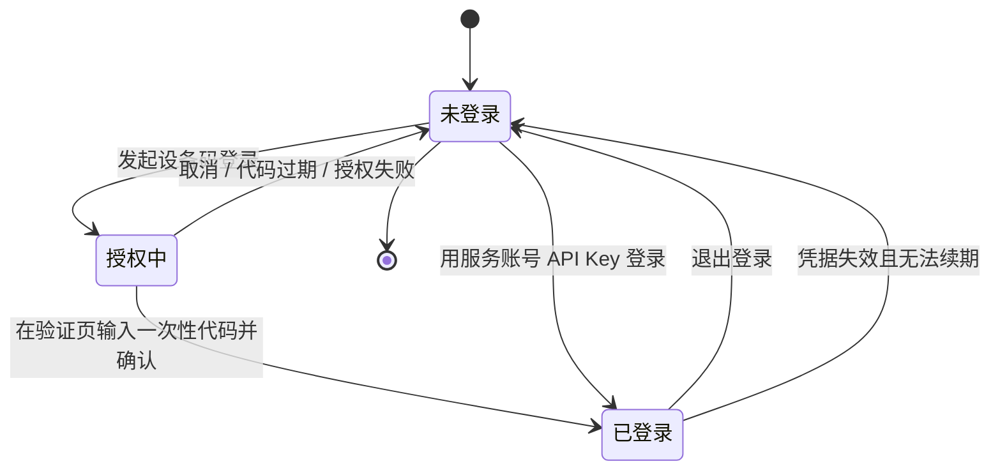
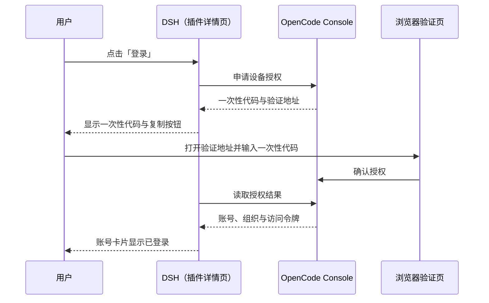
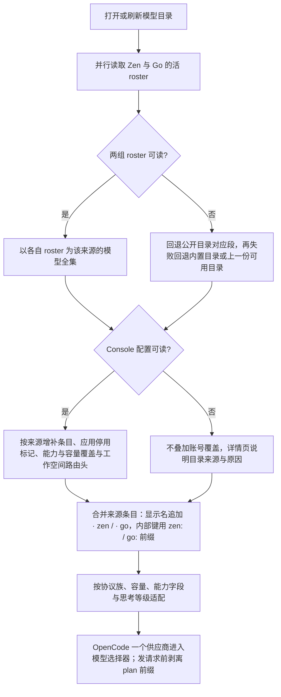

# FNOS-026 OpenCode Zen 与 OpenCode Go 模型接入及套餐用量

| 项目 | 内容 |
| --- | --- |
| 需求编号 | FNOS-026 |
| 提出日期 | 2026-10-23 |
| 需求状态 | <Badge type="tip" text="已完成验证（插件已发布到 npm，DSH Web 与 DSH Desktop 验收通过）" /> |
| 关联计划 | [PLAN-FNOS-026 OpenCode Zen 与 OpenCode Go 模型接入及套餐用量](/plans/PLAN-FNOS-026-dsh-opencode-plugin) |
| 影响插件 | `@tnnevol/dsh-opencode`（新增） |
| 关联需求 | [FNOS-014](/requirements/FNOS-014-dsh-021-rc2-adaptation)（DSH 0.2.1-rc.2 插件基线）、[FNOS-016](/requirements/FNOS-016-plugin-market-index)（插件市场索引与元数据） |

## 需求背景

OpenCode 是一个独立的编码代理产品，它在 OpenCode Console 中提供两类模型来源：

- **OpenCode Zen（按量）**：按 token 计费的模型，目录以实时模型清单（约 85 个）为准，调用需要 Console 余额；其中一批免费模型只允许在 OpenCode 客户端内使用。
- **OpenCode Go（套餐）**：Go 与 Go Plus 两档月度订阅内的模型，目录以实时模型清单（约 37 个）为准，受套餐额度约束。

用户在 OpenCode 里 `connect` 一次、`/models` 选一个就能用；在 DSH 里想用同一批模型，此前只有两种办法：

- 在模型设置里手工声明 OpenAI 兼容供应商，把 API Key 填进去，再逐条维护模型清单；
- 什么都不做，继续在 OpenCode 里用。

这两条路都有明显代价：

1. **手工清单会过期**。两类模型都由上游持续增删（官方文档明确写着「清单会随测试与新增而变化」）。手工写入的清单不会跟着变，用户只能自己盯着上游，再把新模型抄进配置。
2. **能力描述无法表达**。同一批模型分属四种上游协议，上下文窗口从数十万到百万 token 不等，最大输出、推理、工具调用、图片输入、文本输入、免费标记各不相同。手工配置只能给一个「OpenAI 兼容」壳子：协议配错直接调不通，容量配错会让长对话被截断或请求被拒，能力字段更是没有入口。
3. **账号级的覆盖与路由信息无法表达**。Console 会下发工作空间级的模型条目（可增补、停用或覆盖能力与容量），以及推理请求需要的工作空间路由头；手工配置既写不出这些覆盖，也带不上路由头，于是会出现「Console 里停用的模型仍可选」或「模型选得到但请求被拒」的情况。
4. **套餐额度只能在浏览器里看**。DSH 对话到一半被限流时，用户得切回 Console 才能知道是 5 小时窗口、每周窗口还是每月窗口用完了、什么时候重置。
5. **两类来源共用同一条链路，又各有计费口径**。Zen 按量与 Go 套餐都走同一个 Console 账号与同一个推理网关，但余额、套餐额度与可用范围完全不同。早期实现只注册单一路由 `opencode-go`，与用户手工配置的同名路由冲突，表现为登录后模型不出现在选择器；随后按来源拆成两组供应商后，同名模型在两个分组各出现一次，选择和隐藏都依赖分组，目录还要额外提供分组筛选。最新实现把两类来源合并成一个 `OpenCode` 供应商：合并列表内用 `· zen`（按量）/ `· go`（套餐）后缀区分来源，内部模型 id 用 `zen:` / `go:` 前缀保证唯一，发请求前插件剥掉前缀，网关收到的仍是原始 id。

本需求新增 `@tnnevol/dsh-opencode`，把「登录 Console 账号 → 拉取 Zen 与 Go 两类模型清单并叠加账号级覆盖 → 在 DSH 的单一 `OpenCode` 供应商内按 zen/go 后缀选择并对话 → 查看 Go 套餐额度」做成一条闭环，并补齐面向用户的说明页与插件登记。

## 调研结论

| 结论 | 出处 | 影响的功能 | 状态 |
| --- | --- | --- | --- |
| OpenCode Console 提供两类模型来源：**OpenCode Zen（按量）** 与 **OpenCode Go（套餐，Go 与 Go Plus 两档月度订阅）**；两类来源的目录、调用约束与计费相互独立 | [OpenCode Console Go 文档](https://opencode.ai/v2/docs/console/go/)（2026-10-23 读取） | FNOS-026-02、FNOS-026-05、FNOS-026-06 | 已核实 |
| **OpenCode Zen 的活 roster** 由公开接口提供（未鉴权可读），2026-10-24 读取到 85 个模型 | `https://opencode.ai/inference/v1/models`（2026-10-24 读取）；插件的目录归一化与响应夹具 | FNOS-026-02 | 已核实 |
| **OpenCode Go 的活 roster** 由公开接口提供（未鉴权可读），2026-10-24 读取到 37 个模型 | `https://opencode.ai/inference/go/v1/models`（2026-10-24 读取）；插件的目录归一化与响应夹具 | FNOS-026-02 | 已核实 |
| 两类来源的模型能力元数据分别位于公开目录的 `opencode` 段与 `opencode-go` 段；段内条目数与活 roster 不必相等，**目录集合以活 roster 为准**，公开目录用于补全能力与容量 | `https://models.opencode.ai/api.json`（2026-10-24 读取）；仓库内响应夹具 | FNOS-026-02、FNOS-026-03 | 已核实 |
| 模型能力字段可读到推理、工具调用、文本/图片输入、免费标记、上下文窗口与最大输出；思考等级由逐模型推理选项表达 | 公开目录 `opencode` / `opencode-go` 段（2026-10-24 读取） | FNOS-026-03 | 已核实 |
| Console 配置按 provider 分组返回工作空间级条目（`opencode` / `opencode-go`），`models` 可以为空；空条目表示没有额外覆盖，不代表没有可用模型。条目可**增补**模型、标记停用、覆盖能力与容量，并携带工作空间路由头 | 2026-10-23 真实账号联调与插件的解析实现、响应夹具 | FNOS-026-02、FNOS-026-03 | 已核实 |
| 插件只注册**一个**供应商路由 `dsh-opencode`（显示名 `OpenCode`）。pi-ai 内置路由名为 `opencode` / `opencode-go`，用户手工配置过同名路由时与插件注册冲突（`DUPLICATE_ADAPTER`），实测表现为**登录后模型不出现在选择器**；改用 `dsh-` 前缀后模型正常出现 | 插件的供应商标识契约、DSH 模型层注册契约、2026-10-23 联调与 2026-10-24 复测记录 | FNOS-026-02 | 已核实 |
| 合并列表内每个模型以显示名后缀 `· zen` / `· go` 标明来源（同名模型因此可区分），内部模型 id 用 `zen:<真实 id>` / `go:<真实 id>` 前缀保证唯一；插件在发请求前剥掉前缀，**网关收到的仍是原始 id**——2026-10-24 用 `zen:glm-5` 实测返回上游 402，说明请求已按原始 id 到达网关 | 插件契约、2026-10-24 DSH Web 实测 | FNOS-026-02、FNOS-026-04 | 已核实 |
| 合并后的实时目录合计 122 个模型（zen 85 / go 37），在 DSH Web 的模型选择器与目录卡片中按一个 `OpenCode` 分组展示 | 2026-10-24 DSH Web 实测 | FNOS-026-02 | 已核实 |
| Go 的额度按「每个模型的月度上限」折算成三个窗口：5 小时为月度额度的 20%、每周 50%、每月 100%；Console 侧可以查看当前用量 | [OpenCode Console Go 文档](https://opencode.ai/v2/docs/console/go/)（Usage limits 小节） | FNOS-026-05、FNOS-026-06 | 已核实 |
| 同一模型可能同时出现在 Zen 与 Go 两类来源（2026-10-24 实测 21 个），两组的端点不同；账号可能只有一种付费方式，需要把共用模型的请求统一到有钱的那组端点 | 2026-10-24 真实账号实测（Zen 端点 402、Go 端点 200） | FNOS-026-02、FNOS-026-04、FNOS-026-08 | 已核实 |
| 套餐额度只对 **OpenCode Go** 生效；`zen` 后缀的按量模型不占用套餐额度，插件也不展示按量费用或余额；`auto` 策略下只要选中任意 OpenCode 模型（`go` 或 `zen` 后缀）就显示胶囊（2026-10-24 修订：原先按套餐区分，现改为按供应商区分，`zen` 模型下同样显示账号的 Go 套餐窗口） | 上游两类来源的计费口径、2026-10-24 DSH Web 实测与产品决定 | FNOS-026-05、FNOS-026-06 | 已核实 |
| Go 网关同时承载四种上游协议（OpenAI Chat Completions、OpenAI Responses、Anthropic Messages、Google Generative AI），同一供应商下不同模型分属不同协议族 | [OpenCode Console Go 文档](https://opencode.ai/v2/docs/console/go/)的 Endpoints 表 | FNOS-026-03 | 已核实 |
| 公开目录中的条目存在「输出为图片」的生成模型，它们不提供对话所需的文本输入协议 | 公开目录响应（`modalities.output` 含 `image` 的条目）；插件的目录归一化会将其跳过并记录说明 | FNOS-026-03 | 已核实 |
| pi-ai 1.1.0 内置的 `opencode` / `opencode-go` 目录是随包生成的静态快照，不随账号配置或上游目录变化；DSH 只在该路由被显式配置后才注册对应适配器 | `@earendil-works/pi-ai@1.1.0` 的 `opencodeProvider()` / `opencodeGoProvider()` 与生成目录；`@deepseek-ai/dsh-llm-pi-ai@0.2.1-rc.2` 的路由注册实现 | FNOS-026-02 | 已核实 |
| Console 的 provider 级 `headers`（实测 `x-opencode-org-id`）是推理请求要带的工作空间路由头，需随模型一起下发 | 2026-10-23 真实账号联调与插件的目录归一化实现 | FNOS-026-03 | 已核实 |
| OpenCode Console 的设备授权使用「浏览器验证页 + 一次性代码」形态，也可以用 Console 服务账号的 API Key 直接登录 | [OpenCode Console 文档](https://opencode.ai/v2/docs/console/)与插件的登录契约 | FNOS-026-01 | 已核实 |
| **OpenCode Zen 按量模型需要 Console 余额**；余额不足时上游返回 402 `Insufficient account funds`，模型目录仍可读取，但对话无法完成 | 2026-10-24 真实账号实测（OAuth 登录状态，`zen:glm-5`） | FNOS-026-04、FNOS-026-05 | 已核实 |
| **OpenCode Zen 免费模型**（如 `big-pickle`、`*-free`）的上游调用返回 403 `FreeTierError`；这类模型只允许在 OpenCode 客户端内使用，不能由第三方客户端调用。实测在 DSH 中显示为 `API 密钥无效 AUTH`——上游 403 被 DSH 归类为 AUTH 错误，属上游限制 | 2026-10-24 真实账号实测（OAuth 登录状态，`zen:big-pickle`） | FNOS-026-04 | 已核实 |
| **OpenCode Go 套餐模型**用 OAuth 或 Console 服务账号 API Key 均可正常调用；2026-10-24 用 `go:mimo-v2.6-flash` 在 headless 与 DSH Web 会话中均成功对话（回复 `ok`，约 19.4K tok） | 2026-10-24 真实账号实测 | FNOS-026-01、FNOS-026-04 | 已核实 |
| 登录、目录、推理三类请求都发往 `opencode.ai` 域（公开目录在 `models.opencode.ai`），运行环境必须能直连该域名 | 上述各接口地址与推理端点的域名归属 | FNOS-026-01、FNOS-026-02、FNOS-026-04 | 已核实 |

## 需求目标

- 用户能在 DSH 内完成 OpenCode Console 登录，并看到当前账号与所属工作空间。
- 登录后 DSH 模型选择器出现**唯一一个 `OpenCode` 供应商**（路由 `dsh-opencode`），把 OpenCode Zen（按量）与 OpenCode Go（套餐）两组活 roster 合并成一个列表，合计约 122 个（zen 85 / go 37）：每个模型的显示名追加 `· zen` 或 `· go` 后缀（同名模型因此可区分），内部模型 id 用 `zen:` / `go:` 前缀保证合并列表内唯一，发请求前插件剥掉前缀；Console 配置可读时按来源叠加增补、停用标记、能力与容量覆盖与推理路由头，读不到账号配置时仍能看到合并后的公开目录模型，并知道未应用账号覆盖。
- 每个模型的推理、工具调用、图片输入、文本输入、免费标记、上下文窗口与最大输出与上游一致；图片生成模型不进入选择器。目录以图标表示能力，悬浮可查看勾选项。
- 用户能在插件详情页看到 OpenCode Go 套餐的 5 小时、每周、每月已用百分比与重置倒计时，并在选中任意 OpenCode 模型（`go` 或 `zen` 后缀）时用输入区胶囊随时查看；`zen` 后缀的按量模型不占用套餐额度，插件也不展示按量费用或余额。
- 插件有面向用户的说明页，能从文档站插件总览与左侧菜单进入；插件发布后登记到插件市场索引源列表。

## 功能列表

| 编号 | 优先级 | 功能 | 用户可观察结果 | 状态 |
| --- | --- | --- | --- | --- |
| FNOS-026-01 | P0 | 用 OpenCode Console 账号登录 | 详情页账号卡片显示登录入口；设备码登录时显示一次性代码与验证地址，授权后变为已登录并显示账号与组织；也可用服务账号 API Key 登录与退出登录；**已登录时账号卡片不再显示「使用 API Key 登录」入口** | <Badge type="tip" text="已完成验证" /> |
| FNOS-026-02 | P0 | OpenCode 模型出现在模型选择器 | 登录后模型选择器出现**唯一一个 `OpenCode` 供应商**（路由 `dsh-opencode`），把 Zen 与 Go 两组活 roster 合并成一个列表（合计约 122 个，zen 85 / go 37）并叠加账号级覆盖（增补、停用、能力与容量、路由信息）；每个模型的显示名带 `· zen` / `· go` 后缀（同名模型因此可区分），内部 id 用 `zen:` / `go:` 前缀保证唯一，请求前剥离前缀；账号配置不可读时仍提供合并后的公开目录模型并说明原因 | <Badge type="tip" text="已完成验证" /> |
| FNOS-026-03 | P0 | 模型能力完整适配 | 每个模型的推理、工具调用、图片输入、文本输入、免费标记、上下文窗口与最大输出与上游一致；思考等级按上游声明可选；图片生成模型不出现；合并列表中的模型名带 `· zen` / `· go` 后缀，来源可辨；目录以图标表示「推理 / 工具 / 图片 / 文本 / 免费」，悬浮气泡显示对应勾选 | <Badge type="tip" text="已完成验证" /> |
| FNOS-026-04 | P0 | 选中模型可正常对话 | 选中 `OpenCode` 供应商下带 `· zen` 或 `· go` 后缀的模型可完成文本对话；带图片输入的模型可随消息发送图片；调用失败（含 Zen 余额不足 402、免费模型 403）时显示可读的上游错误 | <Badge type="tip" text="已完成验证" /> |
| FNOS-026-05 | P1 | 套餐额度展示 | 详情页额度卡片显示 OpenCode Go 的 5 小时、每周、每月已用百分比与重置倒计时，可手动刷新；套餐额度只对 OpenCode Go 生效，`zen` 按量模型不占用套餐额度 | <Badge type="tip" text="已完成验证" /> |
| FNOS-026-06 | P1 | 对话输入区用量胶囊 | 输入区右侧显示 OpenCode Go 用量胶囊，按 auto / always / off 策略显隐，并显示已用比例与重置时间；auto 策略在选中任意 `OpenCode` 模型（`· go` 或 `· zen` 后缀）时出现，不按套餐来源区分 | <Badge type="tip" text="已完成验证" /> |
| FNOS-026-07 | P1 | 模型目录管理 | 目录卡片固定高度、内部滚动，搜索框与计数保持固定；可搜索、隐藏或恢复单个模型、刷新目录；隐藏偏好按 `plan:id` 保存，同名 zen/go 条目可分别隐藏；隐藏的模型不再出现在选择器 | <Badge type="tip" text="已完成验证" /> |
| FNOS-026-08 | P1 | 登录态与偏好持久化 | 重启 DSH 后登录态、隐藏模型、胶囊策略、刷新间隔与推理端点策略保持；插件未启用时其它供应商不受影响 | <Badge type="tip" text="已完成验证" /> |
| FNOS-026-09 | P1 | 文档站与插件登记 | 文档站插件总览与左侧菜单可进入 OpenCode 说明页；插件发布后，市场索引源列表包含该包 | <Badge type="tip" text="已完成验证" /> |

### 验收环境范围

- FNOS-026-01 至 FNOS-026-08 属于不依赖 fnOS 宿主桥接的 DSH 插件功能，目标环境为 **DSH Web 与 DSH Desktop**（至少两者），不因项目整体部署在 fnOS 而附加真实 NAS 验收门槛。
- 登录、模型目录与对话依赖真实 OpenCode Console 账号与可直连 `opencode.ai` 的网络；Zen 按量对话需要该账号有 Console 余额，Go 套餐对话需要该账号处于 Go 或 Go Plus 订阅内。缺少这些条件时对应用例按「阻塞」登记，不判定为功能缺陷。
- FNOS-026-09 覆盖**文档站构建环境**；索引条目的生成还依赖插件发布到 npm，发布前只验收源列表与页面。

## 行为约束

- **不影响其它供应商**：插件未启用、未登录或登录失效时，其它供应商的模型、用量与设置保持原样；模型选择器不因为本插件出现空分组或残留条目。
- **不冲突、不覆盖用户配置**：插件只注册 `dsh-opencode`，与用户手工配置的 `opencode` / `opencode-go` 并存；若用户也手工配置了 `dsh-opencode` 同名路由，插件以可诊断的提示结束注册，不静默替换用户的配置。
- **两类来源仍独立计费**：合并供应商不改变 Zen 按量与 Go 套餐的归属；能力覆盖、余额约束与套餐额度仍按来源生效，合并列表只负责展示与选择。
- **合并列表内标识唯一**：同名模型在合并列表内必须有唯一 id（`zen:` / `go:` 前缀），显示名后缀与来源一致；发往网关的模型 id 必须还原为原始 id，不得把前缀发给上游。
- **凭据不进入浏览器**：账号令牌与服务账号 API Key 只在宿主侧持有，浏览器页面、页面源码、网络响应与本地存储中不出现明文。
- **目录与额度失败不清空**：上游不可用时保留上一份可用目录与最近一次额度快照，并显示获取时间与失败原因。
- **缺失数据不补零**：没有读到的额度窗口显示为「未知」，不显示为 0%。
- **上游限制如实呈现**：Zen 余额不足或免费模型受限时，目录条目仍按 roster 展示，调用失败时显示上游原因（402 / 403）；插件不把上游限制伪装成本地可用，也不提供绕过上游限制的方式。
- **图片生成模型不参与对话**：输出为图片的模型不出现在可对话模型列表里。
- **数据兼容**：不改变既有会话格式与模型标识；退出登录或卸载插件不删除历史会话。
- **说明入口唯一**：面向用户的说明只维护 `docs/plugins/` 下的页面，不把插件目录的 README 当作现行入口。

## 不在本次范围内

- OpenCode 客户端的免费模型专属通道：Zen 免费模型只允许在 OpenCode 客户端内使用，本插件不提供绕过上游限制的方式。
- 图片生成、视频生成等非对话模型。
- 套餐购买、升级、额度充值与账单管理。
- OpenCode Zen 按量费用的估算、余额查询与账单展示；插件只展示 Go 套餐额度。
- 多账号并存与自动换号：同一时间只保留一个 OpenCode Console 账号。
- OpenCode CLI / TUI 的集成、Web 搜索等 Go 之外的 Console 能力。
- 按来源把供应商重新拆成多个分组，或在目录卡片恢复「全部 / Go / Zen」分组筛选；合并列表内不提供按来源过滤。
- 对前缀做通用模型 id 重写：只在插件自己的请求入口剥离 `zen:` / `go:`，不改写其它供应商或会话里的模型标识。
- 随 fnOS 应用内置分发与 npm 发布操作：插件发布后另行登记到应用发布清单与插件市场索引。
- 对 DSH 0.2.1-rc.2 之前版本的兼容。

## 登录状态与模型目录流程

登录状态决定合并后的模型目录与 Go 套餐额度的可用性，状态关系如下（新增功能，未改变既有需求的状态或交互）：

设备码登录会打开一个浏览器验证页，用户在其中输入一次性代码；DSH 在后台等待授权结果，授权成功后账号卡片直接变为已登录，无需手动刷新页面：

合并目录按「Zen / Go 活 roster → 公开目录对应段 → 内置目录或上一份可用目录」分别取得来源，再合并成一个列表；Console 配置不是启用列表，只在可读时按来源叠加增补、停用、能力与容量覆盖与路由头。任何一次失败都不会清空已经可用的目录：

用户可观察结果：登录后选择器只出现一个 `OpenCode` 供应商，模型名带 `· zen`（按量）或 `· go`（套餐）后缀，合计约 122 个（zen 85 / go 37）；账号配置可读时按来源反映增补、停用与能力覆盖；账号配置读不到时模型仍在，详情页说明未应用账号覆盖的原因。

## 验收条件与完成状态

### FNOS-026-01

- `FNOS-026-01-AC-01`：未登录时，插件详情页账号卡片显示登录入口与登录方式说明（设备码登录与 API Key 登录），页面不显示任何模型用量数据。
- `FNOS-026-01-AC-02`：选择设备码登录后，页面显示一次性代码与可在浏览器打开的验证地址；在验证页输入代码并确认后，DSH 在无需手动刷新页面的情况下变为已登录，并显示账号与组织信息。
- `FNOS-026-01-AC-03`：设备码不可用时，用户可以用 Console 服务账号的 API Key 登录，登录成功后的账号卡片状态与设备码登录一致；**已登录后账号卡片不再显示「使用 API Key 登录」入口，只保留退出登录**；设备码授权进行中同样不显示该入口。
- `FNOS-026-01-AC-04`：退出登录后账号卡片回到未登录状态，模型选择器不再出现 `OpenCode` 供应商。
- `FNOS-026-01-AC-05`：登录完成后，在页面源码、网络响应与浏览器本地存储中都查不到账号令牌或 API Key 的明文。
- `FNOS-026-01-AC-06`：API Key 兜底登录入口只在「未登录且不在授权中」时显示；设备码授权进行中、已登录与状态加载中都不显示，避免授权过程中出现第二条登录路径造成误解。

### FNOS-026-02

- `FNOS-026-02-AC-01`：登录后模型选择器的供应商列表只出现一个 `OpenCode` 供应商（路由 `dsh-opencode`），不出现按模型来源拆分的第二个供应商分组；其列表为 Zen 与 Go 两组活 roster 的合并结果，合计约 122 个（zen 85 / go 37）；每个模型名带 `· zen` 或 `· go` 后缀（例如 `DeepSeek V4.1 Flash · go`、`Big Pickle · zen`）；账号配置可读时，该账号的增补条目、停用标记与能力/容量覆盖按来源生效。
- `FNOS-026-02-AC-02`：账号配置不可读时，模型选择器仍显示合并后的活 roster 与公开目录模型，详情页说明当前目录来源与未应用账号覆盖的原因。
- `FNOS-026-02-AC-03`：某一来源的活 roster 不可用时，该来源回退公开目录对应段与内置目录，另一来源不受影响；合并目录来源都不可用时，详情页给出可理解的失败提示与重试入口，此前可用的目录不会被清空。
- `FNOS-026-02-AC-04`：合并列表内每个模型的显示名带 `· zen` / `· go` 后缀，模型 id 在列表内唯一（`zen:` / `go:` 前缀），发往网关的是去掉前缀的原始 id；目录卡片不再提供按来源分组筛选，只保留搜索、计数、能力图标气泡与逐模型显隐开关。
- `FNOS-026-02-AC-05`：用户此前已在模型设置中手工配置 `opencode` 或 `opencode-go` 路由时，登录后 `OpenCode` 供应商仍正常出现，插件不因同名路由冲突而漏注册；若用户手工配置了 `dsh-opencode` 同名路由，插件给出可诊断提示。
- `FNOS-026-02-AC-06`：推理端点策略可配置为 `auto`（默认，跟随账号套餐）、`go` 或 `zen`；共用模型会改写为目标端点，且只改写目标来源也存在同协议模型的条目；只存在于单一来源的模型保持原生端点；切回 `auto` 后恢复原生端点。
- `FNOS-026-02-AC-07`：上游明确限制只能由官方 OpenCode 客户端调用的免费模型（Zen 段 `cost` 为零且非 Go 订阅包含的条目），在模型选择器中不出现；后台目录卡片以「已禁用」状态展示这些条目，并在目录卡片上给出统一提示：部分免费模型仅限官方客户端，故做禁用处理。模型名同时出现在 Zen 与 Go 两个来源时（如 `beam-free`）两处都列出，各用自身端点；地区受限模型不做后台禁用，用户实际调用时按网关返回的地区错误提示。
- `FNOS-026-02-AC-08`：同一模型 id 在 Zen 与 Go 两个来源都出现时（2026-10-24 实测 21 个），目录与模型选择器只保留账号套餐对应的那一条：账号有 Go 时保留 `· go` 条目并去掉 `· zen` 重复项，只有 Zen 时保留 `· zen` 条目；只存在于单一来源的模型照常保留。去重后合计 101 个（原 122 个）。详情页目录卡片与模型选择器使用同一口径。
- `FNOS-026-02-AC-09`：目录卡片与模型选择器按同一顺序展示：可用的免费模型排在最前并按上架/发布时间降序（新的在前，缺时间的排在该档末尾），其次是可用的付费模型并按「输入+输出」价格从低到高，被禁用的条目（含仅官方客户端可用的免费模型）统一排到最后；同一档内以模型 id 兜底，刷新后顺序稳定。
- `FNOS-026-02-AC-10`：登录或目录刷新后模型集合发生变化时，插件主动广播 `llm/adapters-updated`，客户端的模型选择器无需禁用/重新启用插件、也无需重启客户端即可看到新模型与去重排序后的列表；目录未变化（id 与顺序都相同）时不重复广播，避免定时刷新引发无谓重拉。
- `FNOS-026-02-AC-11`：对上游限制单次请求工具数量的模型（当前为 `beam-free`，上限 128），插件**不裁剪工具**，而是在详情页目录卡片给出提示，说明启用较多插件或 MCP 时可能超出上限并返回 HTTP 400；提示只在目录里存在这类可用模型时出现。

### FNOS-026-03

- `FNOS-026-03-AC-01`：每个模型的推理、工具调用、图片输入、文本输入、免费标记、上下文窗口与最大输出与上游目录一致；用户可以在模型信息处看到容量与免费/工具能力；合并列表中的模型名带 `· zen` / `· go` 后缀，来源可辨。
- `FNOS-026-03-AC-02`：上游声明支持图片输入的模型可以随消息发送图片；未声明图片输入的模型不出现图片入口。
- `FNOS-026-03-AC-03`：上游为模型声明的思考等级在模型选择与对话设置中可用，未声明的等级不可选择。
- `FNOS-026-03-AC-04`：图片生成模型不出现在模型选择器中，也不作为可对话模型出现在目录卡片里。
- `FNOS-026-03-AC-05`：目录以图标表示「推理 / 工具 / 图片 / 文本 / 免费」，悬浮气泡显示这五项能力的勾选状态；模型不具备的能力显示为未勾选。

### FNOS-026-04

- `FNOS-026-04-AC-01`：选中 `OpenCode` 供应商下带 `· zen` 或 `· go` 后缀的模型发送文本消息可以收到回复；Zen 按量模型需要 Console 余额，Go 模型需要有效套餐。
- `FNOS-026-04-AC-02`：使用带图片输入的模型时，可以随消息发送图片并得到回复。
- `FNOS-026-04-AC-03`：切换思考等级后对话按所选等级执行；上游未声明的等级不会出现在可选列表中。
- `FNOS-026-04-AC-04`：模型调用失败时，会话中显示可读的错误信息，不出现空白回复或静默丢弃。
- `FNOS-026-04-AC-05`：OpenCode Zen 余额不足（402 `Insufficient account funds`）或调用免费模型（403 `FreeTierError`）时，会话显示包含上游原因的可读错误，不自动重试或绕过上游限制。

### FNOS-026-05

- `FNOS-026-05-AC-01`：详情页额度卡片展示 OpenCode Go 套餐 5 小时、每周、每月三个窗口的已用百分比；套餐额度只对 Go 生效，账号没有 Go 订阅时显示未订阅说明，不显示 0% 或按量费用。
- `FNOS-026-05-AC-02`：每个窗口显示距重置的倒计时，并随时间递减。
- `FNOS-026-05-AC-03`：额度接口不可用时，卡片显示失败说明与获取时间，不把未读到的窗口显示为 0%。
- `FNOS-026-05-AC-04`：点击「刷新」后立即重新读取额度，并更新获取时间。

### FNOS-026-06

- `FNOS-026-06-AC-01`：策略为 `auto` 时，只要当前会话选中的是 `OpenCode` 模型（带 `· go` 或 `· zen` 后缀均算），就在输入区右侧显示用量胶囊，不按套餐来源区分；选中其它供应商模型时不显示，也不触发套餐额度请求。
- `FNOS-026-06-AC-02`：策略为 `always` 时常驻显示；策略为 `off` 时隐藏并停止自动刷新。
- `FNOS-026-06-AC-03`：胶囊展示的已用比例与详情页额度卡片一致，并可查看重置时间。
- `FNOS-026-06-AC-04`：胶囊及其悬浮摘要采用**重置周期最短**的窗口口径——优先 5 小时窗口，读不到时退到每周、再退到每月——并展示该窗口的已用比例与重置倒计时；不按已用比例挑「最紧张的窗口」。
- `FNOS-026-06-AC-04`：修改策略后，下一次进入会话或下一次对话立即按新策略显示，无需重启 DSH。

### FNOS-026-07

- `FNOS-026-07-AC-01`：目录卡片支持按模型名称或标识搜索，结果即时过滤。
- `FNOS-026-07-AC-02`：隐藏某个模型后，模型选择器中不再出现该模型；重新打开开关后恢复显示；隐藏偏好按 `plan:id` 保存，同名 zen/go 条目可分别隐藏、互不影响。
- `FNOS-026-07-AC-03`：点击「刷新」后目录更新为最新读取结果，并显示获取时间。
- `FNOS-026-07-AC-04`：目录刷新失败时保留上一份可用目录，并显示失败原因。
- `FNOS-026-07-AC-05`：目录卡片固定高度、内部滚动；滚动模型列表时搜索框与计数保持固定可见。

### FNOS-026-08

- `FNOS-026-08-AC-01`：重启 DSH 后登录态保持，凭据未过期时无需重新登录。
- `FNOS-026-08-AC-02`：隐藏模型、胶囊策略、自动刷新间隔与推理端点策略在重启后保持。
- `FNOS-026-08-AC-03`：插件被禁用或未登录时，其它供应商的模型与用量展示不受影响。

### FNOS-026-09

- `FNOS-026-09-AC-01`：文档站插件总览列出该插件，左侧菜单可进入 `/plugins/dsh-opencode` 说明页。
- `FNOS-026-09-AC-02`：说明页包含安装命令、登录方式、模型与能力说明（含 `· zen` / `· go` 后缀）、套餐额度与用量胶囊说明、已知约束与常见问题。
- `FNOS-026-09-AC-03`：插件发布后，插件市场索引的源列表包含 `@tnnevol/dsh-opencode`，且未手工改写生成的索引文件。
- `FNOS-026-09-AC-04`：文档站构建通过，新增菜单与页面内部链接均可达。

## 验收结论

2026-10-25 完成验收：九项功能全部通过，需求状态置为「已完成验证」。

- **发布**：`@tnnevol/dsh-opencode` 已发布到 npm，市场索引源列表包含该包，索引由官方生成器产出。
- **客户端范围**：DSH Web 与 DSH Desktop（上游源码检出的开发态 Desktop，`DSH_HOME=<repo>/.dsh`）均实测通过，覆盖登录、合并目录与去重排序、能力适配、对话、套餐额度、用量胶囊、目录管理、持久化与文档站登记。
- **已知上游限制**（非插件缺陷，只做提示不绕过）：Zen 免费模型仅限官方客户端；`beam-free` 单次请求最多 128 个工具；地区受限模型由网关返回 `RegionError`。
- **遗留观察**：客户端目录缓存对「被移除条目」可能残留到下一次页面刷新（新增/更新即时生效）；已登记在插件说明的排查小节，不影响验收结论。

## 变更记录

| 日期 | 变更 | 说明 |
| --- | --- | --- |
| 2026-10-25 | 验收通过 | 九项功能全部通过验收，需求状态由「实施中」改为「已完成验证」；插件已发布到 npm 并登记市场索引源列表；新增「验收结论」小节，汇总发布状态、双客户端范围、上游限制与遗留观察。 |
| 2026-10-24 | 供应商合并为单一 `OpenCode`，以 zen/go 后缀区分来源 | 供应商由 `OpenCode Zen` / `OpenCode Go` 两组合并为一个 `OpenCode`（路由仍为 `dsh-opencode`）：合并列表内每个模型的显示名追加 `· zen`（按量）/ `· go`（套餐）后缀（同名模型因此可区分），内部 id 使用 `zen:` / `go:` 前缀保证唯一，发请求前剥掉前缀。目录卡片移除「全部 / Go / Zen」分组筛选，只保留搜索、计数、能力图标气泡与逐模型显隐开关；显隐偏好按 `plan:id` 保存，同名 zen/go 条目可分别隐藏。用量胶囊 `auto` 策略只在选中 `go` 后缀模型时显示。同步改写需求背景、需求目标、FNOS-026-02/03/06/07 的可观察结果与验收条件、目录流程与调研结论：调研结论更新为 20 条（含 2026-10-24 实测的 122 个模型 = zen 85 / go 37、前缀剥离、402 与免费模型 AUTH 归类），范围外补充「不重新拆分供应商分组或恢复分组筛选」；功能状态由「规划中」改为「待完成」。 |
| 2026-10-23 | 双供应商、路由 id 与模型列表 UI 改版 | 供应商由 1 组变为 2 组：`OpenCode Zen`（按量）与 `OpenCode Go`（套餐），路由分别使用 `dsh-opencode` / `dsh-opencode-go`，避免与用户手工配置的 `opencode-go`（llm-pi-ai）冲突——该同名冲突正是登录后模型不出现在选择器的根因。目录集合改为各组活 roster（Zen 85 个、Go 36 个），Console 配置只做增补/停用/能力与容量覆盖/路由头；模型能力字段改为推理、工具调用、图片输入、文本输入、免费、上下文、最大输出。目录卡片改为固定高度、内部滚动，搜索与计数固定；能力以图标表示并在悬浮气泡显示勾选；新增「全部 / Go / Zen」分组筛选与 plan 标签；已登录时隐藏「使用 API Key 登录」入口。套餐额度与输入区胶囊只对 `OpenCode Go` 生效。调研结论增至 18 条并登记 Zen 402/403、Go OAuth/API Key 可用等实测限制；功能 01/02/03/04/05/06/07 的可观察结果与验收条件同步更新，验收条件由 35 条增至 40 条。 |
| 2026-10-23 | 按真实账号联调结果更正目录口径 | 实测订阅账号的 Console 配置 `providers['opencode-go'].models` 为空对象，确认该字段是**工作空间级覆盖**而非启用列表：模型全集改以公开模型清单为准，Console 配置只在可读时叠加停用标记、能力/容量覆盖与 `x-opencode-*` 路由头；同步改写需求背景、需求目标、FNOS-026-02 的可观察结果与 AC-01/AC-02、目录流程与调研结论（新增模型清单与路由头两条结论），调研结论由 10 条增至 12 条。 |
| 2026-10-23 | 初始登记 | 建立 FNOS-026，登记 9 项功能（4 项 P0、5 项 P1）与 35 条验收条件；明确模型目录回退、能力适配、额度展示与文档登记四条链路；登记 10 条调研结论与验收环境范围（DSH Web 与 DSH Desktop，文档站构建环境）。关联 PLAN-FNOS-026。 |
