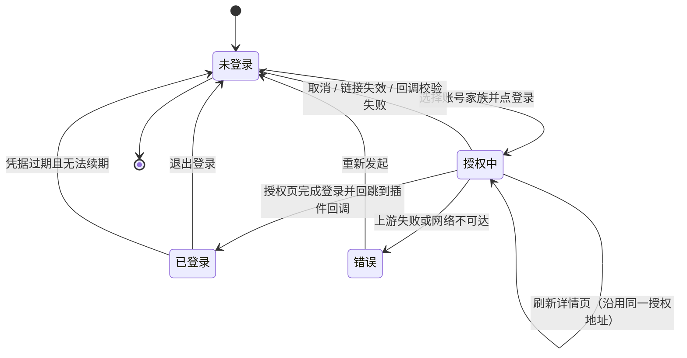
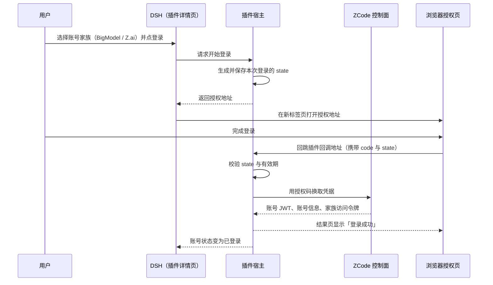
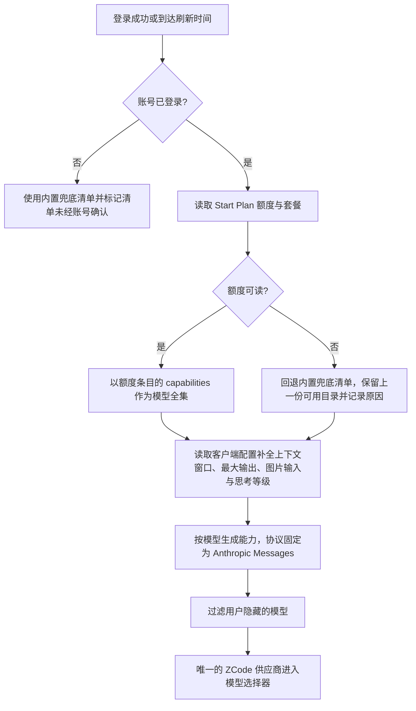
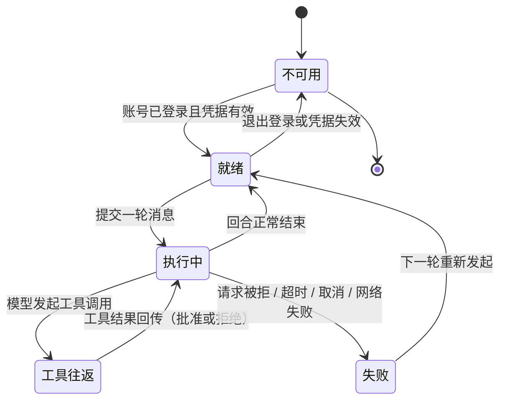
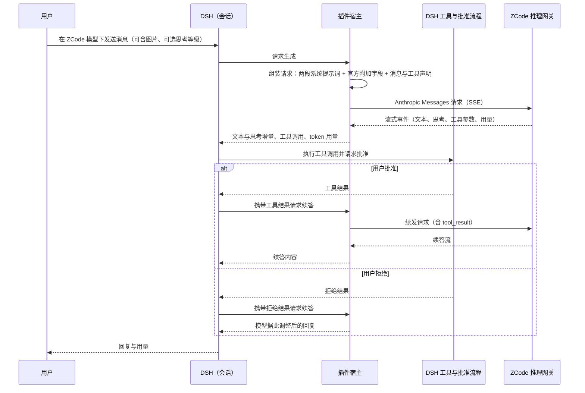

# FNOS-027 ZCode Start Plan 模型接入与账号额度

| 项目 | 内容 |
| --- | --- |
| 需求编号 | FNOS-027 |
| 提出日期 | 2026-10-24 |
| 需求状态 | <Badge type="warning" text="实施中（登录、目录、能力、额度与对话已实测；DSH Desktop 走查与失败分支待执行）" /> |
| 关联计划 | [PLAN-FNOS-027 ZCode Start Plan 模型接入与账号额度](/plans/PLAN-FNOS-027-dsh-zcode-plugin) |
| 影响插件 | `@tnnevol/dsh-zcode`（新增） |
| 关联需求 | [FNOS-014](/requirements/FNOS-014-dsh-021-rc2-adaptation)（DSH 0.2.1-rc.2 插件基线）、[FNOS-016](/requirements/FNOS-016-plugin-market-index)（插件市场索引与元数据）、[FNOS-026](/requirements/FNOS-026-dsh-opencode-plugin)（同类账号型模型供应商插件的行为基线） |

## 需求背景

ZCode 是智谱 Z.ai 的编码代理产品，它在 `zcode.z.ai` 上提供 **Start Plan**：按账号下发一组 GLM 系列模型的额度，用户买套餐、登录后即可在 ZCode 客户端里对话。模型清单与额度都由账号权益动态决定，而不是一份公开固定的模型表。

用户在 ZCode 里开箱即用；在 DSH 里想用这批模型，此前只有两种办法：

- 在模型设置里手工声明一个 OpenAI 兼容供应商，把某个 Key 填进去，再逐条维护模型清单；
- 什么都不做，继续在 ZCode 客户端里用。

这两条路都走不通或代价明显：

1. **没有可用的 Key 形态**。Start Plan 的模型请求只认账号身份，不接受 API Key。手工配置要么拿不到可用凭据，要么填进去也发不出请求——给出一个「用 Key 登录」的入口只会让用户走进死胡同。
2. **手工清单会立刻过期**。可用模型来自账号权益：套餐变体、活动赠送、到期都会改变清单。手工写入的清单不会跟着变，用户只能自己盯着上游，再把模型抄进配置。
3. **能力描述无法表达**。GLM-5.3 系列在 ZCode 上是一百万 token 上下文、十二万八千最大输出，并声明了 low / high / max 三档思考等级。手工配置只能给一个「兼容」壳子，容量配错会让长对话被截断或请求被拒，思考等级更是没有入口。
4. **额度不是单一百分比**。Start Plan 的额度按「每个模型 × 周期」表达：同一个模型可能既有日额度，又有一次性活动额度。用一个总百分比概括会掩盖「日额度用完但活动额度还有」这类实际状态。
5. **账号有两个家族，用户不该为此做技术选择**。BigModel（国内）与 Z.ai（海外）的授权页域名不同，但令牌形态、额度接口与推理端点完全相同。让用户先理解两套域名再选一个，是把上游的部署差异转嫁给用户。
6. **上游会校验请求内容**。插件直接发出的 Start Plan 请求曾被网关拒绝，返回 HTTP 405 与业务码 `3012`（`request has been blocked due to unusual activity.`）。一度据此判断「第三方客户端无法使用 Start Plan」，但该判断**已被推翻**：`3012` 的真正判据是请求的 `system` 必须以上游官方的**两段独立文本块**发出——第一段逐字等于官方身份行（42 字符），第二段以官方行为提示词（1211 字符）开头。单块无论怎么拼接都会被拒，两段独立块则正常返回。请求头、请求签名、TLS 指纹、HTTP 版本、客户端证书与凭据来源逐项实测均与此无关。也就是说，只要按这个形态组织请求，插件完全可以自己完成回合，不需要借助官方客户端。

本需求新增 `@tnnevol/dsh-zcode`，把「登录 ZCode 账号 → 按账号权益拉取模型清单并补全能力 → 在 DSH 里以唯一 `ZCode` 供应商看到并选择模型 → 查看每个模型的额度窗口 → 选中模型完成对话」做成一条闭环，补齐面向用户的说明页与插件登记，并**如实登记执行通道的依赖与限制**：请求形态必须与上游提示词版本一致，上游改字即整条通道失效；工具由 DSH 侧执行并受 DSH 批准流程约束。

## 调研结论

| 结论 | 出处 | 影响的功能 | 状态 |
| --- | --- | --- | --- |
| ZCode（`zcode.z.ai`）是智谱 Z.ai 的编码代理产品；**Start Plan 按账号下发 GLM 系列模型的额度**，可用模型与额度都由账号权益决定 | `zcode.z.ai` 账号权益接口与官方客户端行为（2026-10-24 真实账号实测） | FNOS-027-01、FNOS-027-02、FNOS-027-05 | 已核实 |
| 登录有两条上游链路：OAuth 设备授权（`POST /api/v1/oauth/cli/init`，请求头 `Authorization: Bearer <pollToken>`，请求体 `{"provider":"bigmodel"｜"zai"}`，返回 `flow_id`、`poll_token`、`authorize_url`、`expires_at`（秒）与 `poll_interval_sec`），以及桌面授权码（浏览器在授权页登录后带 `code` 回跳，再用 `POST /api/v1/oauth/token` 换取凭据） | 2026-10-24 真实账号实测（两个家族均 HTTP 200） | FNOS-027-01 | 已核实 |
| **两条链路换来的凭据完全相同**：`data.token`（ZCode JWT，204 字符）与 `data.<family>.access_token`（家族 MaaS JWT），claims 一致 | 2026-10-24 真实账号实测（两条链路各取一次并比对） | FNOS-027-01、FNOS-027-08 | 已核实 |
| **两个家族的授权页不同**：BigModel 走 `bigmodel.cn/login?appId=zcode&redirect=…&state=…`；Z.ai 走 `chat.z.ai/api/oauth/authorize?client_id=client_P8X5CMWmlaRO9gyO-KSqtg&redirect_uri=…&state=…&response_type=code`；除授权页域名外，令牌、额度与推理端点相同 | 2026-10-24 真实账号实测（两个家族各完成一次授权） | FNOS-027-01 | 已核实 |
| 设备授权轮询为 `GET /api/v1/oauth/cli/poll/<flowId>`，携带**同一个** pollToken；状态为 `pending` ｜ `failed` ｜ `ready`；`ready` 时返回账号 JWT、账号信息与家族访问令牌 | 2026-10-24 真实账号实测 | FNOS-027-01 | 已核实（当前插件不走该链路） |
| Start Plan 额度接口为 `GET /api/v1/zcode-plan/billing/balance?app_version=<版本>`；**`Authorization` 直接放 ZCode JWT，不加 `Bearer` 前缀**，且**必须携带 `X-Device-Mid`**（连同 `X-ZCode-App-Version`、`X-Platform`、`X-Os-Category`、`X-Title`、`X-Client-*`、`X-Release-Channel`）；缺少 `X-Device-Mid` 时返回 `{"code":3001,"msg":"parameter error"}`，且该设备标识必须稳定，否则同一账号会被当成新设备 | 2026-10-24 真实账号实测（有/无 `X-Device-Mid` 对照） | FNOS-027-02、FNOS-027-05 | 已核实 |
| **模型清单来自额度条目的 `capabilities`**（形如 `["model:glm-5.3"]`），不是静态表；本账号当前为 GLM-5.3 与 GLM-5.3-Flash | 2026-10-24 真实账号实测 `data.balances[]` | FNOS-027-02 | 已核实 |
| 内置兜底清单为 `GLM-5.3-Flash`、`GLM-5.2`、`GLM-5-Turbo`，**仅在额度接口不可读时使用**，用于保证未登录或接口异常时选择器不是空的 | 内置 provider 规则中的模型快照；2026-10-24 对照实测 | FNOS-027-02 | 已核实 |
| 模型能力来自 `GET /api/v1/client/configs` 的 **`data.builtinModels[]`**（不是 `data.providers[].models[]`，后者只列 GLM-5.2 与 GLM-5-Turbo）：`contextWindow`（GLM-5.3 与 GLM-5.3-Flash 为 1000000）、`maxCompletionTokens`（128000）；`reasoning.levels` 是**对象映射** `{low,high,max}` 而非数组；图片输入开关是 `capabilities.vision: true`（不是 `capabilities.inputFormat.supportsImage`）。**该接口无需鉴权**（不带 `Authorization` 也返回 200），因此不能用来判断登录态或账号权益 | 2026-10-24 真实账号实测（带 / 不带凭据对照，均 HTTP 200）＋ DSH Web 实测对照 | FNOS-027-03 | 已核实 |
| 额度条目**没有 `period` 字段**，只有 `period_start` / `period_end` / `expires_at` 三个 **Unix 秒**（不是 ISO 字符串，也不是 epoch 毫秒）；周期须由窗口时长推导：日额度实测时长 86399 秒（起止取整点，差 1 秒），部分套餐是「激活到结束」的约 1.95 天窗口，不能按上界硬判成「每周」 | 2026-10-24 真实账号实测 `data.balances[]` 原始字段 | FNOS-027-02、FNOS-027-05 | 已核实 |
| 思考等级以 **`output_config.effort`** 表达（上游客户端配置里 `reasoning.levels.<level>.anthropic.set` 就是往该路径写 low / high / max）；该字段必须由请求方显式发出，否则用户选的思考等级等于没生效 | 上游客户端配置与 2026-10-25 抓包断言请求体 | FNOS-027-03、FNOS-027-04 | 已核实 |
| 本账号当前生效两份 Start Plan：`zcode-v3-start-plan-0817`（GLM-5.3 每日 3,000,000、GLM-5.3-Flash 每日 5,000,000）与 `zcode-v3-start-plan-1024`「ZCode 1024 Dev Day」（GLM-5.3 一次性 200,000,000、GLM-5.3-Flash 一次性 300,000,000），当时两份套餐的 `used_units` 均为 0（此后 GLM-5.3-Flash 已有消耗，见后文） | 2026-10-24 真实账号实测 `data.plans[]` 与 `data.balances[]` | FNOS-027-05 | 已核实 |
| **插件自有的两条推理通道都使用 Anthropic Messages 协议**：Start Plan 端点为 `https://zcode.z.ai/api/v1/zcode-plan/anthropic`，Ultra 端点为 `https://zcode.z.ai/api/v1/ultra/anthropic`，资源均为 `/v1/messages`；请求头包含 `authorization: Bearer <令牌>` 与 `x-api-key: <同一令牌>`、`anthropic-version: 2023-06-01`，以及 `http-referer`、`user-agent`、`x-zcode-*`、`x-device-mid` 等客户端身份头 | 2026-10-24 按官方客户端行为复现并逐项核对＋2026-10-25 通道实测 | FNOS-027-04 | 已核实 |
| **`3012` 的判据是请求的 `system` 形态，不是账号风控**：`system` 必须是官方 agent 的两段独立文本块——`system[0]` 逐字等于 `You are ZCode, an interactive coding agent`（42 字符，少一个字母都失败），`system[1]` 必须以官方行为提示词（1211 字符）**开头**（其后可追加）；单块无论怎么拼接（直接相连、`\n\n` 分隔、合并成一块）**全部返回 405 + 3012**，两段独立块返回 200 | 2026-10-25 真实账号逐项二分实测 | FNOS-027-04 | 已核实（原「账号风控、无解」结论已作废） |
| 与放行**无关**的因素（逐项实测排除）：请求头（22 个全试，只有 `authorization` 必需）、请求签名（官方 agent 在 start-plan 模式下自己也不签名，`unsigned_sent/access_mode`）、TLS 指纹、HTTP 协议版本（HTTP/1.1 与 HTTP/2 结果一致）、客户端证书 / mTLS、凭据来源（设备授权与桌面授权码换来的 token 完全相同） | 2026-10-25 真实账号对照组实测 | FNOS-027-04 | 已核实 |
| 上游还要求请求任务 ID 长度为 **6–64 字符**，过短返回业务码 `1214`；因此会话标识必须规范化后再发出 | 2026-10-25 实测 | FNOS-027-04 | 已核实 |
| 官方请求体比通用 Anthropic 客户端多四项：`metadata`（`user_id` 内嵌设备与会话标识）、`tool_choice`、`thinking`、`output_config`；插件按官方值与结构补齐，不裁剪 | 2026-10-25 抓包对照 | FNOS-027-04 | 已核实 |
| 该账号的 GLM-5.3-Flash 日额度已被消耗 28,825 / 5,000,000 tokens，说明存在能实际完成模型调用的路径（此前「所有 `used_units` 为 0」的判断已被推翻） | 2026-10-24 额度快照（`used_units=28825`） | FNOS-027-04 | 已核实（原「从未消耗」判断已作废） |
| 上游业务码可用作诊断分层：`3001` 参数错误（含缺少设备标识）、`3006` 模型未授权、`3007` 需要人机校验、`1113` 额度耗尽、`1214` 请求任务 ID 不合法、`3012` 系统提示词形态不匹配 | 2026-10-24 与 2026-10-25 实测与上游响应原文 | FNOS-027-04 | 已核实 |
| 同一模型在多份套餐下会有多条额度（实测 4 条对应 2 个模型），须按「模型 × 周期」分别展示：合并后的**总量可累加**（两份套餐的日额度确实叠加），但**不同周期不得合并成一行**，否则会掩盖「日额度用完而活动额度仍有」；同时，用单一额度代表整体进度会把账号实际可用量显示错（实测出现「剩余 0%」但仍有大量额度），因此进度值须按「总剩余 / 总量」聚合，明细逐条保留 | 2026-10-24 真实账号实测与 DSH Web 实测 | FNOS-027-05、FNOS-027-06 | 已核实 |
| **ZCode 登录凭据有有效期**：失效后额度接口返回 **HTTP 401（空响应体，无业务码）**，而模型能力接口仍返回 200。因此插件必须把 401 单独识别为「需要重新登录」，不能与网络故障或 `3012` 混为一谈 | 2026-10-24 真实账号实测（存留凭据失效后的对照） | FNOS-027-02、FNOS-027-08 | 已核实 |
| **不存在 API Key 登录路径**：Start Plan 的模型请求只接受账号身份，Key 形态在本插件里没有可用路径 | 上游推理请求的鉴权形态；2026-10-24 对照探测 | FNOS-027-01 | 已核实 |
| 登录、额度与客户端配置都发往 `zcode.z.ai`；Start Plan 与 Ultra 两条推理通道也直接发往该域名。运行环境必须能直连该域名 | 上述各接口地址与推理端点归属 | FNOS-027-01、FNOS-027-02、FNOS-027-04 | 已核实 |
| **DSH Web 端到端对话已实测通过**：纯文本回合 4 秒完成、回复正确、无 `3012`；工具调用正确发起 Bash 并触发 DSH 权限审批；多轮 `tool_result` 正确续答；SSE 七类事件完整；思考块签名 24 字符并经跨轮传递；图文回合 7 秒读出图中文字与数字 | 2026-10-25 真实账号 DSH Web 实测（插件 0.2.1-rc.2.48 / 0.2.1-rc.2.49） | FNOS-027-04、FNOS-027-05、FNOS-027-06 | 已核实 |
| 图片输入必须由插件自己把附件读成字节并以 base64 `image` 块发出；只声明能力而不接线会让图片被静默丢弃（模型答非所问且无报错），属于必须验证的失败模式 | 2026-10-25 实测缺陷与修复对照 | FNOS-027-03、FNOS-027-04 | 已核实 |
| 思考等级按 **`off` / `minimal` / `low` → `low`、`medium` / `high` → `high`、`xhigh` / `max` → `max`** 归并为上游的 `output_config.effort`；该端点只有 low / high / max 三档、没有「不思考」档 | 插件转换层与 DSH Web 实测（抓包断言请求体） | FNOS-027-03、FNOS-027-04 | 已核实 |
| 工具由 DSH 侧执行：模型发起的工具调用回到 DSH 的工具实现与批准流程，用户可以批准或拒绝，被拒绝时模型收到「被拒绝」的结果并调整做法 | DSH Web 实测（Bash 调用 + 权限审批弹出） | FNOS-027-04 | 已核实 |
| 官方内置配置 `config/provider/zcode-builtin.json` 中 `account:zai-start-plan` / `account:bigmodel-start-plan` 的 `api.baseUrl` 同样是 **`https://zcode.z.ai/api/v1/zcode-plan/anthropic`**，`access.type` 为 `zhipu-account`；即**端点与凭据与插件使用的完全一致**，差异只在请求内容形态 | 官方仓库 `config/provider/zcode-builtin.json`、`packages/services/src/model-provider/accountProviderRequestAuthService.ts` | FNOS-027-04 | 已核实 |
| 官方开源项目（`zai-org/ZCode`，HEAD `3c5b2276`，v0.17.0）的 `official-coding-plan-gateway.ts` 显示客户端把 `https://open.bigmodel.cn/api/anthropic/v1/messages` 改写为 **`https://<endpointOrigin>/api/v1/ultra/anthropic/v1/messages`**——官方模型流量走的是 `ultra/anthropic` | 官方仓库 `apps/zcode-cli/packages/adapters/src/model/official-coding-plan-gateway.ts` | FNOS-027-04 | 已核实 |
| 两条端点对第三方客户端的表现不同（2026-10-24 同一凭据实测）：`zcode-plan/anthropic` 在 `system` 形态不符时返回 405 + `3012`；`ultra/anthropic` **不做内容校验**——用家族 MaaS 令牌访问返回 HTTP 429 + 业务码 `1113`（余额不足），用 ZCode 账号 JWT 访问返回 HTTP 401，两者都是**业务层**响应 | 2026-10-24 真实账号实测（两条端点 × 两种凭据矩阵） | FNOS-027-04 | 已核实 |
| 官方文档给出了两条**公开且不受该内容校验影响**的端点：Coding 套餐的 OpenAI 协议专用端点 `https://open.bigmodel.cn/api/coding/paas/v4`（实测 `/models` 返回 200，模型清单含 `glm-5.3`、`glm-5.3-flash`），以及标准端点 `https://open.bigmodel.cn/api/paas/v4`。两者用当前账号的家族 MaaS 令牌发起对话均返回 `429 / 1113`（无可用额度） | [连接模型与套餐](https://zcode.z.ai/cn/docs/configuration)与 [API 介绍](https://docs.bigmodel.cn/cn/api/introduction)（2026-10-24 读取）＋ 实测 | FNOS-027-04 | 已核实 |
| 官方文档明确：**账号只要购买过编程套餐（无论是否用完、是否到期），Anthropic 接口就不会走余额消费，需额外加白**。这解释了 `ultra/anthropic` 与 Coding 端点为何都返回 `1113`：该账号的 `providerFamilyConnectionSelections.bigmodel.kind` 为 `individual-coding-plan`，但并无对应的编程套餐额度，而它真正拥有的是 ZCode Start Plan 权益 | 同上文档「资源包 / 充值余额」小节 ＋ 账号 `setting.json` 实测 | FNOS-027-04 | 已核实 |

## 需求目标

- 用户能在 DSH 内完成 ZCode 账号登录：选择 BigModel（国内）或 Z.ai（海外）后，DSH 在浏览器打开上游授权页，完成登录后回跳到 DSH 并自动变为已登录状态，无需手动刷新页面。
- 登录后 DSH 模型选择器出现**唯一一个 `ZCode` 供应商**（路由 `dsh-zcode`）；模型清单以账号权益（每个模型 × 周期的额度条目）为准，按账号动态下发，不在插件里写死。额度接口不可读时回退内置清单，并明确告知当前清单未经账号确认。
- 每个模型的上下文窗口、最大输出、图片输入与思考等级与上游声明一致；上游未声明时使用保守默认值并说明。
- 用户能在插件详情页看到**每个模型各自的额度窗口**（已用百分比、剩余量、周期与重置或到期时间）与账号当前生效的套餐，并能在对话输入区用胶囊随时查看；胶囊的进度值按「总剩余 / 总量」聚合，逐份明细仍可展开；接口读不到时显示未知与原因，不补零。
- 选中 `ZCode` 模型发送消息后，回合由插件自行发起的请求完成并返回真实回复与 token 用量；文本、图片与思考等级在 DSH Web 中均可正常使用，工具调用回到 DSH 并受其批准流程约束；失败、超时或取消时显示可读中文诊断，不出现空白回复、不静默重试、不伪装成功。
- 插件有面向用户的说明页，能从文档站插件总览与左侧菜单进入，写明执行通道的前提与限制；插件发布后登记到插件市场索引源列表。

## 功能列表

| 编号 | 优先级 | 功能 | 用户可观察结果 | 状态 |
| --- | --- | --- | --- | --- |
| FNOS-027-01 | P0 | 用 ZCode 账号登录 | 详情页账号卡片显示登录入口，可选择 BigModel（国内）或 Z.ai（海外）；点登录后浏览器打开上游授权页，完成登录后回跳 DSH 并显示「登录成功」，账号卡片自动变为已登录并显示账号信息；卡片只提供退出登录；**不显示「使用 API Key 登录」入口** | <Badge type="warning" text="待完成" /> |
| FNOS-027-02 | P0 | 按账号权益动态出现的模型目录 | 登录后模型选择器出现唯一一个 `ZCode` 供应商（路由 `dsh-zcode`），模型清单与账号权益实时对应（本账号当前为 GLM-5.3 与 GLM-5.3-Flash），账号权益变化后刷新即可看到新清单；额度接口不可读时仍显示内置兜底清单，并说明该清单未经账号确认 | <Badge type="warning" text="待完成" /> |
| FNOS-027-03 | P0 | 模型能力完整适配 | 每个模型的上下文窗口、最大输出、图片输入与可用思考等级与上游客户端配置一致；上游未声明时使用保守默认值并在详情页说明；模型行可查看容量与能力 | <Badge type="warning" text="待完成" /> |
| FNOS-027-04 | P0 | 选中模型可发起对话并得到可读诊断 | 选中 `ZCode` 供应商下的模型发送消息时，回合由插件自行发起的请求完成并返回回复与 token 用量；文本、图片与思考等级均可正常使用；工具调用回到 DSH 并受其批准流程约束；失败、超时或取消时显示对应的中文诊断，不出现空白回复、不静默重试、不伪装成功 | <Badge type="warning" text="待完成（DSH Web 已实测通过；DSH Desktop 与失败分支待走查）" /> |
| FNOS-027-05 | P1 | 按模型展示额度窗口 | 详情页额度卡片显示账号当前生效的套餐，以及每个模型各自的额度窗口（已用百分比、剩余量、周期、重置或到期倒计时）；同一模型的日额度与一次性活动额度分别展示，不合并成一个百分比；可手动刷新；读不到的窗口显示未知而不是 0% | <Badge type="warning" text="待完成" /> |
| FNOS-027-06 | P1 | 插件详情页与用量胶囊 | 详情页由账号卡片、额度卡片、模型目录卡片与设置区组成，目录支持搜索、逐模型隐藏、刷新与获取时间；对话输入区右侧显示 ZCode 用量胶囊，按 auto / always / off 策略显隐，显示聚合后的剩余比例与重置时间，并可展开逐份额度明细 | <Badge type="warning" text="待完成" /> |
| FNOS-027-07 | P1 | 登录态与偏好持久化 | 重启 DSH 后登录态、隐藏模型、胶囊策略与刷新间隔保持；插件未启用或未登录时其它供应商不受影响 | <Badge type="warning" text="待完成" /> |
| FNOS-027-08 | P1 | 文档站与插件登记 | 文档站插件总览与左侧菜单可进入 ZCode 说明页，页面写明安装、登录（授权码 + 回调）、模型、额度与聚合口径、执行通道（请求形态与工具归属）与已知限制；插件发布后，市场索引源列表包含该包 | <Badge type="warning" text="待完成" /> |

### 验收环境范围

- FNOS-027-01 至 FNOS-027-08 属于不依赖 fnOS 宿主桥接的 DSH 插件功能，目标环境为 **DSH Web 与 DSH Desktop**（至少两者），不因项目整体部署在 fnOS 而附加真实 NAS 验收门槛。
- 登录、模型目录与额度依赖真实 ZCode 账号与可直连 `zcode.z.ai` 的网络。缺少账号条件时对应用例按「阻塞」登记，不判定为功能缺陷。
- **FNOS-027-04 已在 DSH Web 实测通过**：纯文本、工具调用、多轮工具结果与图文回合均完成并消耗套餐额度；**DSH Desktop 尚未走查**，失败与取消分支也未走查，两者按待执行登记。执行该通道**不要求安装 ZCode 客户端**。
- FNOS-027-08 覆盖**文档站构建环境**；索引条目的生成还依赖插件发布到 npm，发布前只验收源列表与页面。

## 行为约束

- **不提供 API Key 登录**：Start Plan 的模型请求只接受账号身份，插件不渲染 Key 输入入口，也不接受以 Key 形式提交的凭据。这是产品决策，不是尚未实现的功能。
- **不影响其它供应商**：插件未启用、未登录或登录失效时，其它供应商的模型、用量与设置保持原样；模型选择器不因为本插件出现空分组或残留条目。
- **不冲突、不覆盖用户配置**：插件只注册 `dsh-zcode`，与用户手工配置的 `zcode` / `zhipu` 等路由并存；若用户手工配置了同名 `dsh-zcode` 路由，插件以可诊断的提示结束注册，不静默替换用户的配置。
- **凭据不进入浏览器**：账号 JWT 与家族访问令牌只在宿主侧持有，浏览器页面、页面源码、网络响应与本地存储中不出现明文；登录回调页只显示结果文案。
- **回调必须可验证**：登录回调要求携带与发起时一致的 `state`，同一授权码不得重复使用；校验失败时给出可读原因并回到可重试状态，不写入半成品凭据。
- **目录与额度失败不清空**：上游不可用时保留上一份可用目录与最近一次额度快照，并显示获取时间与失败原因。
- **缺失数据不补零**：没有读到的额度窗口显示为「未知」，不显示为 0%；总量为 0 的窗口按 0% 呈现，不产生无效数值。
- **额度保留上游粒度**：按「模型 × 周期」展示，不把日额度与一次性额度合并成一个百分比，也不把已用比例换算成金额。
- **进度值按总量聚合**：胶囊与浮层顶部的百分比按「总剩余 / 总量」计算，不能只取单份额度；逐份明细必须仍然可见，聚合不损失信息。
- **请求形态由上上游决定**：Start Plan 请求的 `system` 必须按上游要求的两段独立文本块发出；插件不以「拼接成一块再试」的方式反复撞网关，也不伪造客户端身份或内置代理绕过校验。
- **工具归属明确**：模型发起的工具调用由 DSH 执行并受 DSH 批准流程约束；工具被拒绝时如实回传拒绝结果，不伪装成执行成功。
- **失败不伪装成功**：账号未登录、凭据失效、请求被拒、超时或取消都以可读中文诊断结束，不产生空白助手消息、不静默重试、不显示为完成。
- **数据兼容**：不改变既有会话格式与模型标识；退出登录或卸载插件不删除历史会话。
- **说明入口唯一**：面向用户的说明只维护 `docs/plugins/` 下的页面，不把插件目录的 README 当作现行入口。

## 不在本次范围内

- **复刻或伪造官方请求身份**：不实现请求签名伪造、客户端身份伪造、内置代理或反向代理转发，也不修改官方客户端发行包。
- **托管官方客户端运行时**：曾用 `zcode app-server` 子进程执行回合，该实现已于 2026-10-25 移除，不再作为通道方案（见变更记录）。
- **API Key 登录与自建 Key 导入**：Start Plan 只认账号身份，本插件不提供 Key 形态入口。
- 账号级人脸或短信二次验证、企业组织身份与管理者审批流程。
- 套餐购买、升级、额度充值与账单管理。
- 把额度换算成金额或费用估算；插件只展示上游给出的用量与周期。
- 多账号并存与自动换号：同一时间只保留一个 ZCode 账号。
- ZCode 客户端交互界面（CLI / TUI / 桌面端）与 IDE 扩展的集成；插件不依赖客户端即可完成回合。
- 上游未提供的协议族：本需求的模型请求固定使用 Anthropic Messages，若上游未来开放其它协议按新增需求处理。
- 图片生成、视频生成等非对话模型。
- 随 fnOS 应用内置分发与 npm 发布操作：插件发布后另行登记到应用发布清单与插件市场索引。
- 对 DSH 0.2.1-rc.2 之前版本的兼容。

## 登录状态与模型目录流程

登录状态决定模型目录与额度窗口的可用性，状态关系如下（新增功能，未改变既有需求的状态或交互）：

登录在浏览器里完成：DSH 在点击登录的同时打开上游授权页，用户在授权页完成登录后浏览器回跳到插件自己的回调地址，宿主侧用授权码换取凭据并写入登录态；详情页随之变为已登录，无需手动刷新。

模型目录以账号权益为准，客户端配置只用于补全能力；任何一步失败都不会把已经可用的目录清空：

用户可观察结果：登录后选择器只出现一个 `ZCode` 供应商，模型与该账号的权益对应（本账号当前为 GLM-5.3 与 GLM-5.3-Flash）；账号权益变化后刷新即生效；额度接口不可读时模型仍在，详情页说明清单来自内置兜底、未经账号确认。

## 执行通道

选中 `ZCode` 模型后，插件自行向上游发起 Anthropic Messages 请求完成回合。通道是否可用取决于登录态与上游提示词版本：

一轮对话的参与者与返回路径如下；失败时以可读诊断结束，不伪装成功：

用户可观察结果：收到模型回复与 token 用量；插入图片后模型能读出图中内容；思考等级按所选档位生效；工具调用会弹出 DSH 的权限审批；失败、超时或取消时给出指向具体原因的诊断。因不做托管，工具归属这条限制不再存在——工具始终由 DSH 执行。

## 验收条件与完成状态

### FNOS-027-01

- `FNOS-027-01-AC-01`：未登录时，插件详情页账号卡片显示登录入口与两种账号家族（BigModel 国内 / Z.ai 海外）的说明，页面不显示任何额度数据。
- `FNOS-027-01-AC-02`：选择任一账号家族并点登录后，DSH 在浏览器打开上游授权页；在该页完成登录后浏览器回跳到 DSH 并显示「登录成功」，账号卡片在无需手动刷新页面的情况下变为已登录并显示账号信息。
- `FNOS-027-01-AC-03`：授权进行中刷新详情页或重新打开页面，不会把你已经打开的授权地址换掉；取消登录后回到未登录且不写入凭据；回调的 `state` 不匹配或同一授权码被重复使用时，登录失败并给出可读原因。
- `FNOS-027-01-AC-04`：账号卡片不出现「使用 API Key 登录」或等价的 Key 输入入口；页面源码与文案中不存在以 Key 登录的说明。
- `FNOS-027-01-AC-05`：退出登录后账号卡片回到未登录状态，模型选择器不再出现 `ZCode` 供应商。
- `FNOS-027-01-AC-06`：登录完成后，在页面源码、网络响应与浏览器本地存储中都查不到账号 JWT 或家族访问令牌的明文；登录回调页不含任何令牌。

### FNOS-027-02

- `FNOS-027-02-AC-01`：登录后模型选择器的供应商列表只出现一个 `ZCode` 供应商（路由 `dsh-zcode`），其模型清单与该账号当前的权益一致（本账号为 GLM-5.3 与 GLM-5.3-Flash）。
- `FNOS-027-02-AC-02`：账号权益变化（新增套餐、活动赠送或到期）后，刷新目录即可看到对应模型的新增或消失，不需要升级插件或改配置。
- `FNOS-027-02-AC-03`：额度接口不可读时，选择器仍显示内置兜底清单（GLM-5.3-Flash、GLM-5.2、GLM-5-Turbo），详情页说明当前清单未经账号确认与失败原因；上一份可用目录不会被清空。
- `FNOS-027-02-AC-04`：用户此前已在模型设置中手工配置 `zcode` 或 `zhipu` 路由时，登录后 `ZCode` 供应商仍正常出现；若用户手工配置了同名 `dsh-zcode` 路由，插件给出可诊断提示且不覆盖用户配置。

### FNOS-027-03

- `FNOS-027-03-AC-01`：每个模型的上下文窗口与最大输出与上游客户端配置一致（本账号的 GLM-5.3 与 GLM-5.3-Flash 为 1000000 上下文、128000 最大输出），用户可以在模型信息处看到这两项。
- `FNOS-027-03-AC-02`：上游为模型声明的思考等级（low / high / max）在选择与对话设置中可用，未声明的等级不可选择；实际发出的请求携带与之对应的思考强度字段。
- `FNOS-027-03-AC-03`：上游声明支持图片输入的模型可随消息发送图片，且图片确实随请求发出（模型能读出图中内容）；未声明的不出现图片入口。
- `FNOS-027-03-AC-04`：客户端配置不可读时，模型仍出现在列表中，容量使用保守默认值，详情页说明能力来自默认值而非上游声明。

### FNOS-027-04

- `FNOS-027-04-AC-01`：选中 `ZCode` 供应商下的模型发送文本消息后，回合由插件自行发起的请求完成并返回回复；回复正文与 token 用量在会话中可见，输入区用量胶囊同步反映本次消耗。
- `FNOS-027-04-AC-02`：消息可携带图片并选择思考等级；模型能正确读出图片内容，思考等级按上游 low / high / max 映射生效（DSH Web 实测：图文回合 7 秒读出图中文字与数字）。
- `FNOS-027-04-AC-03`：请求因系统提示词形态与上游不一致被拒时，会话显示指向「前缀需与上游版本同步」的中文诊断并保留上游业务码；网络不可达、账号未登录或凭据失效时分别显示对应诊断；三者都不出现空白回复、不静默重试。
- `FNOS-027-04-AC-04`：回合超时或被调用方取消时显示明确的失败原因，不显示为成功；取消后再次发送可正常开始新回合。
- `FNOS-027-04-AC-05`：模型发起的工具调用由 DSH 执行并受 DSH 批准流程约束；用户拒绝时模型收到拒绝结果并调整做法，不重复发起同一调用；不会出现「DSH 工具不参与」这类托管通道才有的行为。
- `FNOS-027-04-AC-06`：思考块的签名随消息跨轮带回且不出现在可见正文中；多轮续答时上游接受续发请求，不因缺少签名而拒绝。
- `FNOS-027-04-AC-07`：说明页写明执行通道的前提与限制（两段系统提示词必须与上游版本一致、`3012` 的含义、工具由 DSH 执行），诊断文案不声称已绕过上游限制，也不引导用户改用非官方转发服务。

### FNOS-027-05

- `FNOS-027-05-AC-01`：详情页额度卡片显示账号当前生效的套餐（本账号为 `zcode-v3-start-plan-0817` 与 `zcode-v3-start-plan-1024`）与每个模型各自的额度窗口。
- `FNOS-027-05-AC-02`：同一模型的日额度（GLM-5.3 每日 3,000,000、GLM-5.3-Flash 每日 5,000,000）与一次性活动额度（GLM-5.3 200,000,000、GLM-5.3-Flash 300,000,000）分别展示为独立窗口，不合并成一个百分比。
- `FNOS-027-05-AC-03`：每个窗口显示已用百分比、剩余量与周期；有重置或到期时间时显示倒计时，并随时间递减。
- `FNOS-027-05-AC-04`：额度接口不可用时，卡片显示失败原因与最近一次获取时间，未读到的窗口显示未知而不是 0%。
- `FNOS-027-05-AC-05`：点击「刷新」后立即重新读取额度，并更新获取时间。

### FNOS-027-06

- `FNOS-027-06-AC-01`：详情页由账号卡片、额度卡片、模型目录卡片与设置区组成，四块都只操作本插件自己的数据。
- `FNOS-027-06-AC-02`：目录卡片支持按模型名称或标识搜索，结果即时过滤，并显示当前结果数与获取时间。
- `FNOS-027-06-AC-03`：隐藏某个模型后，模型选择器中不再出现该模型；重新打开开关后恢复显示。
- `FNOS-027-06-AC-04`：策略为 `auto` 时，仅在选中 `ZCode` 供应商模型时于输入区右侧显示用量胶囊；选中其它供应商模型时不显示，也不触发额度请求。
- `FNOS-027-06-AC-05`：胶囊展示的进度值按「总剩余 / 总量」聚合，与逐份明细自洽：同一模型只有一份额度时等于该份；多份额度时等于聚合值，且不会出现「剩余 0%」而账号实际仍有额度；展开后可逐条查看每份额度的剩余与重置时间；亮色与暗色主题下均可读。

### FNOS-027-07

- `FNOS-027-07-AC-01`：重启 DSH 后登录态保持，凭据未过期时无需重新登录。
- `FNOS-027-07-AC-02`：隐藏模型、胶囊策略与自动刷新间隔在重启后保持；越界或非法值回落到默认值。
- `FNOS-027-07-AC-03`：插件被禁用或未登录时，其它供应商的模型与用量展示不受影响。

### FNOS-027-08

- `FNOS-027-08-AC-01`：文档站插件总览列出该插件，左侧菜单可进入 `/plugins/dsh-zcode` 说明页。
- `FNOS-027-08-AC-02`：说明页包含安装命令（不含 ZCode 客户端要求）、登录步骤（授权码与回跳）、模型与能力说明、按模型额度与聚合口径、执行通道说明（请求形态与工具归属）与**已知限制**（两段系统提示词依赖上游版本、`3012` 的含义）；不出现「需要安装 ZCode 客户端」「工具由 ZCode agent 执行」「同一会话只有一个在途回合」这类与现状相反的表述。
- `FNOS-027-08-AC-03`：插件发布后，插件市场索引的源列表包含 `@tnnevol/dsh-zcode`，且未手工改写生成的索引文件。
- `FNOS-027-08-AC-04`：文档站构建通过，新增菜单与页面内部链接均可达。

## 变更记录

| 日期 | 变更 | 说明 |
| --- | --- | --- |
| 2026-10-24 | 初始登记 | 建立 FNOS-027，登记 8 项功能（4 项 P0、4 项 P1）与 36 条验收条件；明确登录只提供 OAuth 设备授权、模型清单以账号权益为准、额度按「模型 × 周期」展示；登记 16 条调研结论与验收环境范围（DSH Web 与 DSH Desktop，文档站构建环境）。 |
| 2026-10-24 | 更正执行通道结论并回填 DSH Web 实测 | 推翻原「`3012` 无解、端到端未验证」的判断：当轮改为托管官方 `zcode.cjs app-server` 子进程完成回合，`turn.completed` 返回真实回复与 usage，随后在 DSH Web 完成三轮端到端对话。据此把 FNOS-027-04 改为「托管通道完成回合 + 失败可读」，并登记通道依赖目标环境安装的 ZCode 客户端、工具由 ZCode agent 原生执行、单在途回合。 |
| 2026-10-25 | **执行通道改为插件自行发送 Anthropic Messages**（覆盖上一条的托管方案） | 决定性的二分实测确认：`3012` 的判据是请求的 `system` 必须为官方 agent 的**两段独立文本块**——`system[0]` 逐字等于 42 字符身份行、`system[1]` 以 1211 字符行为提示词开头；单块无论怎么拼接全部 `3012`，两段独立块返回 200。请求头（22 个全试，只有 `authorization` 必需）、请求签名（agent 在 start-plan 模式下自己也不签名）、TLS 指纹、HTTP 版本、客户端证书、凭据来源（两条登录链路换来的 token 完全相同）逐项排除。据此移除托管 `app-server` 通道（`src/host/bridge/` 整目录与其测试），改为插件自行收发 Anthropic Messages，并按官方补齐 `metadata` / `tool_choice` / `thinking` / `output_config` 四个附加字段。连带变化：不再需要安装 ZCode 客户端；工具由 DSH 执行并受批准流程约束（原「工具由 ZCode agent 原生执行」作废）；原「单在途回合」「会话标题本地生成」两条通道限制随之取消；新增「请求任务 ID 6–64 字符」与「系统提示词必须与上游版本一致」两条限制。登录链路同时改为授权码 + 同源回调（带 `state` 校验；两条链路换来的凭据相同）。额度展示口径新增一条约束：进度值按「总剩余 / 总量」聚合，逐份明细保留（修复实测中出现的「剩余 0%」但仍有大量额度）。FNOS-027-06 的 AC-05 相应改写。DSH Web 实测：纯文本 4 秒、工具调用带审批、多轮 `tool_result` 续答、图文 7 秒读出图中文字、SSE 七类事件完整、思考签名 24 字符跨轮传递。 |
| 2026-10-25 | 补登图片输入与适配器契约 | 图片输入曾因能力已声明但读取未接线而静默丢图（模型答非所问且无报错），修复后实测可读出图中文字与数字，故 FNOS-027-03-AC-03 明确要求「图片确实随请求发出」。同时登记适配器契约核对结果：自定义实现覆盖模型列举、模型解析、信息与取流，其余方法走上游默认实现（其中返回空值者由宿主兜底，属正确行为）。 |
