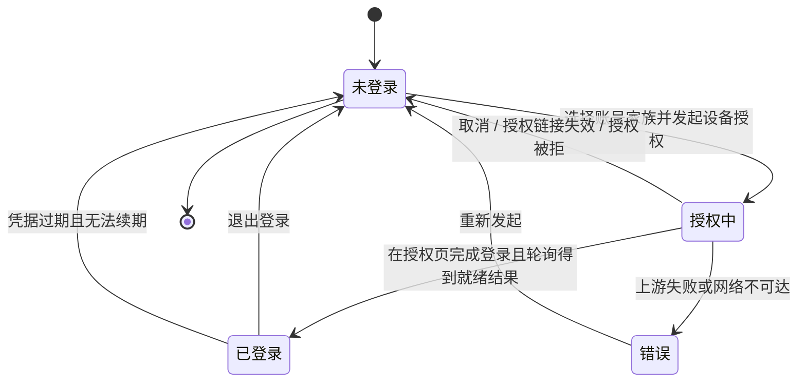
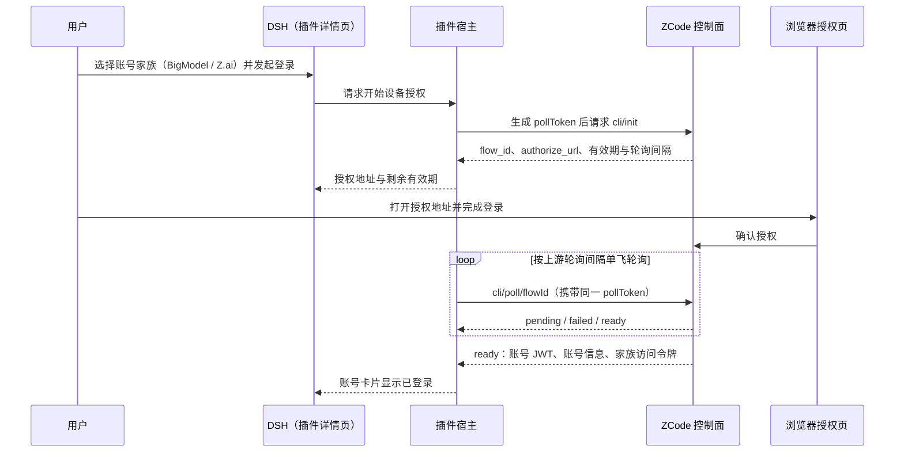
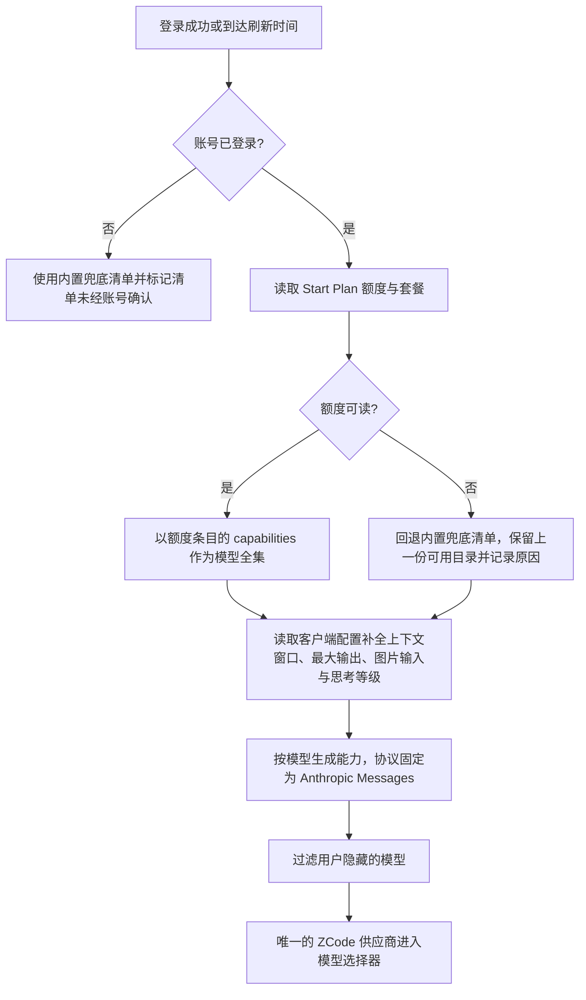

# FNOS-027 ZCode Start Plan 模型接入与账号额度

| 项目 | 内容 |
| --- | --- |
| 需求编号 | FNOS-027 |
| 提出日期 | 2026-10-24 |
| 需求状态 | <Badge type="warning" text="实施中（登录、目录、能力与额度读取已实现并通过真实账号接口实测；上游风控导致端到端对话未验证）" /> |
| 关联计划 | [PLAN-FNOS-027 ZCode Start Plan 模型接入与账号额度](/plans/PLAN-FNOS-027-dsh-zcode-plugin) |
| 影响插件 | `@tnnevol/dsh-zcode`（新增） |
| 关联需求 | [FNOS-014](/requirements/FNOS-014-dsh-021-rc2-adaptation)（DSH 0.2.1-rc.2 插件基线）、[FNOS-016](/requirements/FNOS-016-plugin-market-index)（插件市场索引与元数据）、[FNOS-026](/requirements/FNOS-026-dsh-opencode-plugin)（同类账号型模型供应商插件的行为基线） |

## 需求背景

ZCode 是智谱 Z.ai 的编码代理产品，它在 `zcode.z.ai` 上提供 **Start Plan**：按账号下发一组 GLM 系列模型的额度，用户买套餐、登录后即可在 ZCode 客户端里对话。模型清单与额度都由账号权益动态决定，而不是一份公开固定的模型表。

用户在 ZCode 里开箱即用；在 DSH 里想用这批模型，此前只有两种办法：

- 在模型设置里手工声明一个 OpenAI 兼容供应商，把某个 Key 填进去，再逐条维护模型清单；
- 什么都不做，继续在 ZCode 客户端里用。

这两条路都走不通或代价明显：

1. **没有可用的 Key 形态**。Start Plan 的模型请求只认账号身份，不接受 API Key。手工配置要么拿不到可用凭据，要么填进去也发不出请求——给出一个「用 Key 登录」的入口只会让用户走进死胡同。
2. **手工清单会立刻过期**。可用模型来自账号权益：套餐变体、活动赠送、到期都会改变清单。手工写入的清单不会跟着变，用户只能自己盯着上游，再把模型抄进配置。
3. **能力描述无法表达**。GLM-5.3 系列在 ZCode 上是一百万 token 上下文、十二万八千最大输出，并声明了 low / high / max 三档思考等级。手工配置只能给一个「兼容」壳子，容量配错会让长对话被截断或请求被拒，思考等级更是没有入口。
4. **额度不是单一百分比**。Start Plan 的额度按「每个模型 × 周期」表达：同一个模型可能既有日额度，又有一次性活动额度。用一个总百分比概括会掩盖「日额度用完但活动额度还有」这类实际状态。
5. **账号有两个家族，用户不该为此做技术选择**。BigModel（国内）与 Z.ai（海外）的授权页域名不同，但令牌形态、额度接口与推理端点完全相同。让用户先理解两套域名再选一个，是把上游的部署差异转嫁给用户。
6. **上游还会拦第三方客户端**。网关对来自第三方 harness 的模型请求返回 HTTP 405 与业务码 `3012`（`request has been blocked due to unusual activity.`）。这不是可以靠多试几次绕过的网络抖动：未授权模型返回的是另一个业务码（`3006`），说明鉴权与权益解析都已通过，被拦的是「谁在发请求」这一层。

本需求新增 `@tnnevol/dsh-zcode`，把「登录 ZCode 账号 → 按账号权益拉取模型清单并补全能力 → 在 DSH 里以唯一 `ZCode` 供应商看到并选择模型 → 查看每个模型的额度窗口」做成一条闭环，补齐面向用户的说明页与插件登记，并**如实登记**上游风控这一限制：插件不承诺端到端对话可用，也不提供绕过方式。

## 调研结论

| 结论 | 出处 | 影响的功能 | 状态 |
| --- | --- | --- | --- |
| ZCode（`zcode.z.ai`）是智谱 Z.ai 的编码代理产品；**Start Plan 按账号下发 GLM 系列模型的额度**，可用模型与额度都由账号权益决定 | `zcode.z.ai` 账号权益接口与官方客户端行为（2026-10-24 真实账号实测） | FNOS-027-01、FNOS-027-02、FNOS-027-05 | 已核实 |
| 登录只有 **OAuth 设备授权**一种形态：`POST /api/v1/oauth/cli/init`，请求头 `Authorization: Bearer <pollToken>`（pollToken 由客户端生成 32 字节随机值的十六进制串），请求体 `{"provider":"bigmodel"｜"zai"}`，返回 `flow_id`、`poll_token`、`authorize_url`、`expires_at`（秒）与 `poll_interval_sec` | 2026-10-24 真实账号实测（两个家族均 HTTP 200） | FNOS-027-01 | 已核实 |
| **两个家族的授权页不同**：BigModel 走 `bigmodel.cn/login?appId=zcode&redirect=…/callback/bigmodel&state=…`；Z.ai 走 `chat.z.ai/api/oauth/authorize?client_id=client_P8X5CMWmlaRO9gyO-KSqtg&redirect_uri=…&state=…&response_type=code`；除授权页域名外，令牌、额度与推理端点相同 | 2026-10-24 真实账号实测（两个家族各完成一次授权） | FNOS-027-01 | 已核实 |
| 轮询为 `GET /api/v1/oauth/cli/poll/<flowId>`，携带**同一个** pollToken；状态为 `pending` ｜ `failed` ｜ `ready`；`ready` 时返回 `token`（ZCode JWT）、`user{user_id,email,name,avatar}` 与 `<family>.access_token`（家族侧 MaaS JWT） | 2026-10-24 真实账号实测 | FNOS-027-01、FNOS-027-08 | 已核实 |
| Start Plan 额度接口为 `GET /api/v1/zcode-plan/billing/balance?app_version=<版本>`；**`Authorization` 直接放 ZCode JWT，不加 `Bearer` 前缀**，且**必须携带 `X-Device-Mid`**（连同 `X-ZCode-App-Version`、`X-Platform`、`X-Os-Category`、`X-Title`、`X-Client-*`、`X-Release-Channel`）；缺少 `X-Device-Mid` 时返回 `{"code":3001,"msg":"parameter error"}`，且该设备标识必须稳定，否则同一账号会被当成新设备 | 2026-10-24 真实账号实测（有/无 `X-Device-Mid` 对照） | FNOS-027-02、FNOS-027-05 | 已核实 |
| **模型清单来自额度条目的 `capabilities`**（形如 `["model:glm-5.3"]`），不是静态表；本账号当前为 GLM-5.3 与 GLM-5.3-Flash | 2026-10-24 真实账号实测 `data.balances[]` | FNOS-027-02 | 已核实 |
| 内置兜底清单为 `GLM-5.3-Flash`、`GLM-5.2`、`GLM-5-Turbo`，**仅在额度接口不可读时使用**，用于保证未登录或接口异常时选择器不是空的 | 内置 provider 规则中的模型快照；2026-10-24 对照实测 | FNOS-027-02 | 已核实 |
| 模型能力来自 `GET /api/v1/client/configs`：`providers[].models[]` 携带 `contextWindow`（GLM-5.3 与 GLM-5.3-Flash 为 1000000）、`maxCompletionTokens`（128000）与推理等级 low / high / max。**该接口无需鉴权**（不带 `Authorization` 也返回 200），因此它不能用来判断登录态或账号权益 | 2026-10-24 真实账号实测（带 / 不带凭据对照，均 HTTP 200） | FNOS-027-03 | 已核实 |
| 本账号当前生效两份 Start Plan：`zcode-v3-start-plan-0817`（GLM-5.3 每日 3,000,000、GLM-5.3-Flash 每日 5,000,000）与 `zcode-v3-start-plan-1024`「ZCode 1024 Dev Day」（GLM-5.3 一次性 200,000,000、GLM-5.3-Flash 一次性 300,000,000），两者 `used_units` 均为 0 | 2026-10-24 真实账号实测 `data.plans[]` 与 `data.balances[]` | FNOS-027-05 | 已核实 |
| 模型请求为 **Anthropic Messages 协议**：端点前缀 `https://zcode.z.ai/api/v1/zcode-plan/anthropic`，资源 `/v1/messages`；请求头包含 `authorization` 与 `x-api-key`（**两者写同一个账号 JWT**，与官方客户端一致）、`anthropic-version: 2023-06-01`、`anthropic-beta: mid-conversation-system-2026-04-07`、`http-referer: https://zcode.z.ai`、`user-agent: ZCode/<版本>`、`x-app-id`、`x-client-language`、`x-client-timezone`、`x-client-version`、`x-os-category`、`x-os-version`、`x-platform`、`x-release-channel`、`x-title`、`x-zcode-agent`、`x-zcode-app-version`、`x-device-mid`、`x-request-id`、`x-session-id`、`x-zcode-trace-id`、`x-query-id`、`x-zcode-query-source`、`x-zcode-session-type` | 2026-10-24 按官方客户端行为复现并逐项核对 | FNOS-027-04 | 已核实 |
| **该网关路径对第三方 harness 的请求返回 HTTP 405 与业务码 `3012`（`request has been blocked due to unusual activity.`）**；判据是**未授权模型返回 HTTP 400 与业务码 `3006`（`model not allowed`）**——说明鉴权与账号权益解析都已通过，被拦的是请求来源这一层 | 2026-10-24 真实账号穷举探测：带/不带签名、项目访问令牌 + 完整 Ed25519 客户端请求签名 V4、带/不带 CDN 会话 Cookie、HTTP/1.1 与 HTTP/2、在 `zcode.z.ai` 源站自身的浏览器 fetch、多种请求头组合 | FNOS-027-04 | 已核实 |
| 官方 ZCode 客户端**从未消耗该账号任何 Start Plan 额度**（所有 `used_units` 为 0），且 ZCode 自身源码带有「3012 风险控制拒绝不可复现」的注释，说明该拦截并非本插件独有的实现缺陷 | 2026-10-24 真实账号额度快照与上游客户端源码注释 | FNOS-027-04 | 已核实 |
| 有第三方 DSH 插件作者公开报告同一现象：WAF 拦截直连 HTTP，其做法是托管官方 ZCode agent 二进制做反向代理来规避 | 第三方插件作者的公开说明（2026-10 读取） | FNOS-027-04 | 已核实 |
| 上游业务码可用作诊断分层：`3001` 参数错误（含缺少设备标识）、`3006` 模型未授权、`3012` 风控拦截、`3007` 需要人机校验、`1113` 额度耗尽 | 2026-10-24 真实账号实测与上游响应原文 | FNOS-027-04 | 已核实 |
| **ZCode 登录凭据有有效期**：失效后额度接口返回 **HTTP 401（空响应体，无业务码）**，而模型能力接口仍返回 200。因此插件必须把 401 单独识别为「需要重新登录」，不能与网络故障或 `3012` 混为一谈 | 2026-10-24 真实账号实测（存留凭据失效后的对照） | FNOS-027-02、FNOS-027-08 | 已核实 |
| **不存在 API Key 登录路径**：Start Plan 的模型请求只接受账号身份，Key 形态在本插件里没有可用路径 | 上游推理请求的鉴权形态；2026-10-24 对照探测 | FNOS-027-01 | 已核实 |
| 登录、额度与客户端配置都发往 `zcode.z.ai`，推理端点在 `zcode.z.ai/api/v1/zcode-plan/anthropic` 下；运行环境必须能直连该域名 | 上述各接口地址与推理端点归属 | FNOS-027-01、FNOS-027-02、FNOS-027-04 | 已核实 |

## 需求目标

- 用户能在 DSH 内完成 ZCode 账号登录：选择 BigModel（国内）或 Z.ai（海外）后，页面给出授权地址，浏览器完成登录后 DSH 自动变为已登录并显示账号信息，无需手动刷新页面。
- 登录后 DSH 模型选择器出现**唯一一个 `ZCode` 供应商**（路由 `dsh-zcode`）；模型清单以账号权益（每个模型 × 周期的额度条目）为准，按账号动态下发，不在插件里写死。额度接口不可读时回退内置清单，并明确告知当前清单未经账号确认。
- 每个模型的上下文窗口、最大输出、图片输入与思考等级与上游声明一致；上游未声明时使用保守默认值并说明。
- 用户能在插件详情页看到**每个模型各自的额度窗口**（已用百分比、剩余量、周期与重置或到期时间）与账号当前生效的套餐，并能在对话输入区用胶囊随时查看；接口读不到时显示未知与原因，不补零。
- 插件有面向用户的说明页，能从文档站插件总览与左侧菜单进入；插件发布后登记到插件市场索引源列表。
- **上游风控限制如实呈现**：当模型请求被上游以 `3012` 拦截时，会话显示可读的中文诊断（风控拦截）而不是笼统的失败；插件不声称对话已可用，也不提供绕过上游限制的方式。

## 功能列表

| 编号 | 优先级 | 功能 | 用户可观察结果 | 状态 |
| --- | --- | --- | --- | --- |
| FNOS-027-01 | P0 | 用 ZCode 账号登录 | 详情页账号卡片显示登录入口，可选择 BigModel（国内）或 Z.ai（海外）；发起后在页面内给出可在浏览器打开的授权地址与剩余有效期，浏览器完成登录后账号卡片自动变为已登录并显示账号信息；卡片只提供退出登录；**不显示「使用 API Key 登录」入口** | <Badge type="warning" text="待完成" /> |
| FNOS-027-02 | P0 | 按账号权益动态出现的模型目录 | 登录后模型选择器出现唯一一个 `ZCode` 供应商（路由 `dsh-zcode`），模型清单与账号权益实时对应（本账号当前为 GLM-5.3 与 GLM-5.3-Flash），账号权益变化后刷新即可看到新清单；额度接口不可读时仍显示内置兜底清单，并说明该清单未经账号确认 | <Badge type="warning" text="待完成" /> |
| FNOS-027-03 | P0 | 模型能力完整适配 | 每个模型的上下文窗口、最大输出、图片输入与可用思考等级与上游客户端配置一致；上游未声明时使用保守默认值并在详情页说明；模型行可查看容量与能力 | <Badge type="warning" text="待完成" /> |
| FNOS-027-04 | P0 | 选中模型可发起对话并得到可读诊断 | 选中 `ZCode` 供应商下的模型发送文本消息时，请求按上游要求的协议与请求头发出；被上游风控拦截时，会话显示指向风控的中文诊断（业务码 `3012`）与处置建议，不出现空白回复、不静默重试、不伪装成功；模型未授权、额度耗尽、需要人机校验时分别给出对应诊断 | <Badge type="danger" text="受阻（上游风控 3012，端到端未验证）" /> |
| FNOS-027-05 | P1 | 按模型展示额度窗口 | 详情页额度卡片显示账号当前生效的套餐，以及每个模型各自的额度窗口（已用百分比、剩余量、周期、重置或到期倒计时）；同一模型的日额度与一次性活动额度分别展示，不合并成一个百分比；可手动刷新；读不到的窗口显示未知而不是 0% | <Badge type="warning" text="待完成" /> |
| FNOS-027-06 | P1 | 插件详情页与用量胶囊 | 详情页由账号卡片、额度卡片、模型目录卡片与设置区组成，目录支持搜索、逐模型隐藏、刷新与获取时间；对话输入区右侧显示 ZCode 用量胶囊，按 auto / always / off 策略显隐，并显示已用比例与重置时间 | <Badge type="warning" text="待完成" /> |
| FNOS-027-07 | P1 | 登录态与偏好持久化 | 重启 DSH 后登录态、隐藏模型、胶囊策略与刷新间隔保持；插件未启用或未登录时其它供应商不受影响 | <Badge type="warning" text="待完成" /> |
| FNOS-027-08 | P1 | 文档站与插件登记 | 文档站插件总览与左侧菜单可进入 ZCode 说明页，页面写明安装、登录、模型、额度与上游风控限制；插件发布后，市场索引源列表包含该包 | <Badge type="warning" text="待完成" /> |

### 验收环境范围

- FNOS-027-01 至 FNOS-027-08 属于不依赖 fnOS 宿主桥接的 DSH 插件功能，目标环境为 **DSH Web 与 DSH Desktop**（至少两者），不因项目整体部署在 fnOS 而附加真实 NAS 验收门槛。
- 登录、模型目录与额度依赖真实 ZCode 账号与可直连 `zcode.z.ai` 的网络。缺少账号条件时对应用例按「阻塞」登记，不判定为功能缺陷。
- **FNOS-027-04 受上游风控限制**：在第三方 harness 中发出的模型请求被上游以 `3012` 拦截，当前无法取得成功的对话证据。该功能的验收按「诊断可读、不绕过上游限制」判定；「对话成功」这一预期在限制解除前登记为阻塞，不作为本需求的完成门槛，也不据此外推为插件缺陷。
- FNOS-027-08 覆盖**文档站构建环境**；索引条目的生成还依赖插件发布到 npm，发布前只验收源列表与页面。

## 行为约束

- **不提供 API Key 登录**：Start Plan 的模型请求只接受账号身份，插件不渲染 Key 输入入口，也不接受以 Key 形式提交的凭据。这是产品决策，不是尚未实现的功能。
- **不影响其它供应商**：插件未启用、未登录或登录失效时，其它供应商的模型、用量与设置保持原样；模型选择器不因为本插件出现空分组或残留条目。
- **不冲突、不覆盖用户配置**：插件只注册 `dsh-zcode`，与用户手工配置的 `zcode` / `zhipu` 等路由并存；若用户手工配置了同名 `dsh-zcode` 路由，插件以可诊断的提示结束注册，不静默替换用户的配置。
- **凭据不进入浏览器**：账号 JWT 与家族访问令牌只在宿主侧持有，浏览器页面、页面源码、网络响应与本地存储中不出现明文。
- **目录与额度失败不清空**：上游不可用时保留上一份可用目录与最近一次额度快照，并显示获取时间与失败原因。
- **缺失数据不补零**：没有读到的额度窗口显示为「未知」，不显示为 0%；总量为 0 的窗口按 0% 呈现，不产生无效数值。
- **额度保留上游粒度**：按「模型 × 周期」展示，不把日额度与一次性额度合并成一个百分比，也不把已用比例换算成金额。
- **上游限制如实呈现**：风控拦截、模型未授权、额度耗尽与需要人机校验分别按上游业务码给出可读诊断；插件不把上游限制伪装成本地可用，也不提供绕过上游限制的方式（包括不内置代理、不模拟官方客户端二进制、不复用他人的转发服务）。
- **数据兼容**：不改变既有会话格式与模型标识；退出登录或卸载插件不删除历史会话。
- **说明入口唯一**：面向用户的说明只维护 `docs/plugins/` 下的页面，不把插件目录的 README 当作现行入口。

## 不在本次范围内

- **绕过上游风控**：不实现请求签名伪造、客户端二进制托管、反向代理转发或任何规避 `3012` 的手段；上游限制解除后按新的调研结论重新评估。
- **API Key 登录与自建 Key 导入**：Start Plan 只认账号身份，本插件不提供 Key 形态入口。
- 账号级人脸或短信二次验证、企业组织身份与管理者审批流程。
- 套餐购买、升级、额度充值与账单管理。
- 把额度换算成金额或费用估算；插件只展示上游给出的用量与周期。
- 多账号并存与自动换号：同一时间只保留一个 ZCode 账号。
- ZCode 客户端（CLI / TUI / 桌面端）的集成，以及 ZCode 中与模型对话无关的其它能力。
- 上游未提供的协议族：本需求的模型请求固定使用 Anthropic Messages，若上游未来开放其它协议按新增需求处理。
- 图片生成、视频生成等非对话模型。
- 随 fnOS 应用内置分发与 npm 发布操作：插件发布后另行登记到应用发布清单与插件市场索引。
- 对 DSH 0.2.1-rc.2 之前版本的兼容。

## 登录状态与模型目录流程

登录状态决定模型目录与额度窗口的可用性，状态关系如下（新增功能，未改变既有需求的状态或交互）：

设备授权会在浏览器打开授权页；DSH 在宿主侧按上游给出的间隔轮询，授权成功后账号卡片直接变为已登录，无需手动刷新页面。轮询是单飞的：详情页刷新不会新建第二条轮询，也不会把用户已打开的授权链接换掉。

模型目录以账号权益为准，客户端配置只用于补全能力；任何一步失败都不会把已经可用的目录清空：

用户可观察结果：登录后选择器只出现一个 `ZCode` 供应商，模型与该账号的权益对应（本账号当前为 GLM-5.3 与 GLM-5.3-Flash）；账号权益变化后刷新即生效；额度接口不可读时模型仍在，详情页说明清单来自内置兜底、未经账号确认。

## 验收条件与完成状态

### FNOS-027-01

- `FNOS-027-01-AC-01`：未登录时，插件详情页账号卡片显示登录入口与两种账号家族（BigModel 国内 / Z.ai 海外）的说明，页面不显示任何额度数据。
- `FNOS-027-01-AC-02`：选择任一账号家族后，页面显示可在浏览器打开的授权地址与剩余有效期；在授权页完成登录后，DSH 在无需手动刷新页面的情况下变为已登录，并显示账号信息。
- `FNOS-027-01-AC-03`：授权中刷新详情页或重新打开页面，不会产生第二条轮询，也不会替换用户已打开的授权地址；取消登录后回到未登录且不写入凭据。
- `FNOS-027-01-AC-04`：账号卡片不出现「使用 API Key 登录」或等价的 Key 输入入口；页面源码与文案中不存在以 Key 登录的说明。
- `FNOS-027-01-AC-05`：退出登录后账号卡片回到未登录状态，模型选择器不再出现 `ZCode` 供应商。
- `FNOS-027-01-AC-06`：登录完成后，在页面源码、网络响应与浏览器本地存储中都查不到账号 JWT 或家族访问令牌的明文。

### FNOS-027-02

- `FNOS-027-02-AC-01`：登录后模型选择器的供应商列表只出现一个 `ZCode` 供应商（路由 `dsh-zcode`），其模型清单与该账号当前的权益一致（本账号为 GLM-5.3 与 GLM-5.3-Flash）。
- `FNOS-027-02-AC-02`：账号权益变化（新增套餐、活动赠送或到期）后，刷新目录即可看到对应模型的新增或消失，不需要升级插件或改配置。
- `FNOS-027-02-AC-03`：额度接口不可读时，选择器仍显示内置兜底清单（GLM-5.3-Flash、GLM-5.2、GLM-5-Turbo），详情页说明当前清单未经账号确认与失败原因；上一份可用目录不会被清空。
- `FNOS-027-02-AC-04`：用户此前已在模型设置中手工配置 `zcode` 或 `zhipu` 路由时，登录后 `ZCode` 供应商仍正常出现；若用户手工配置了同名 `dsh-zcode` 路由，插件给出可诊断提示且不覆盖用户配置。

### FNOS-027-03

- `FNOS-027-03-AC-01`：每个模型的上下文窗口与最大输出与上游客户端配置一致（本账号的 GLM-5.3 与 GLM-5.3-Flash 为 1000000 上下文、128000 最大输出），用户可以在模型信息处看到这两项。
- `FNOS-027-03-AC-02`：上游为模型声明的思考等级（low / high / max）在选择与对话设置中可用，未声明的等级不可选择。
- `FNOS-027-03-AC-03`：上游声明支持图片输入的模型可随消息发送图片；未声明的不出现图片入口。
- `FNOS-027-03-AC-04`：客户端配置不可读时，模型仍出现在列表中，容量使用保守默认值，详情页说明能力来自默认值而非上游声明。

### FNOS-027-04

- `FNOS-027-04-AC-01`：选中 `ZCode` 供应商下的模型发送文本消息时，请求按上游要求的协议与请求头发出（Anthropic Messages、`/v1/messages`、`authorization` 与 `x-api-key` 同值、`anthropic-version`、`anthropic-beta` 与客户端身份头齐备）。
- `FNOS-027-04-AC-02`：请求被上游风控拦截（HTTP 405、业务码 `3012`）时，会话显示指向风控的中文诊断（包含上游原文 `request has been blocked due to unusual activity.`）与处置建议，不出现空白回复、不静默重试、不显示为成功。
- `FNOS-027-04-AC-03`：模型未授权（`3006`）、需要人机校验（`3007`）与额度耗尽（`1113`）时，会话分别显示对应的可读诊断，不合并成同一句「调用失败」。
- `FNOS-027-04-AC-04`：诊断文案不声称已绕过上游限制，也不引导用户改用非官方转发服务。
- `FNOS-027-04-AC-05`：`3012` 被拦截期间「模型可正常完成对话」不作为验收预期；限制解除后按本需求的调研规范重新评估并补充验收条件。

### FNOS-027-05

- `FNOS-027-05-AC-01`：详情页额度卡片显示账号当前生效的套餐（本账号为 `zcode-v3-start-plan-0817` 与 `zcode-v3-start-plan-1024`）与每个模型各自的额度窗口。
- `FNOS-027-05-AC-02`：同一模型的日额度（GLM-5.3 每日 3,000,000、GLM-5.3-Flash 每日 5,000,000）与一次性活动额度（GLM-5.3 200,000,000、GLM-5.3-Flash 300,000,000）分别展示为独立窗口，不合并成一个百分比。
- `FNOS-027-05-AC-03`：每个窗口显示已用百分比、剩余量与周期；有重置或到期时间时显示倒计时，并随时间递减。
- `FNOS-027-05-AC-04`：额度接口不可用时，卡片显示失败原因与最近一次获取时间，未读到的窗口显示未知而不是 0%。
- `FNOS-027-05-AC-05`：点击「刷新」后立即重新读取额度，并更新获取时间。

### FNOS-027-06

- `FNOS-027-06-AC-01`：详情页由账号卡片、额度卡片、模型目录卡片与设置区组成，四块都只操作本插件自己的数据。
- `FNOS-027-06-AC-02`：目录卡片支持按模型名称或标识搜索，结果即时过滤，并显示当前结果数与获取时间。
- `FNOS-027-06-AC-03`：隐藏某个模型后，模型选择器中不再出现该模型；重新打开开关后恢复显示。
- `FNOS-027-06-AC-04`：策略为 `auto` 时，仅在选中 `ZCode` 供应商模型时于输入区右侧显示用量胶囊；选中其它供应商模型时不显示，也不触发额度请求。
- `FNOS-027-06-AC-05`：胶囊展示的已用比例与详情页额度卡片一致，并可查看重置时间；亮色与暗色主题下均可读。

### FNOS-027-07

- `FNOS-027-07-AC-01`：重启 DSH 后登录态保持，凭据未过期时无需重新登录。
- `FNOS-027-07-AC-02`：隐藏模型、胶囊策略与自动刷新间隔在重启后保持；越界或非法值回落到默认值。
- `FNOS-027-07-AC-03`：插件被禁用或未登录时，其它供应商的模型与用量展示不受影响。

### FNOS-027-08

- `FNOS-027-08-AC-01`：文档站插件总览列出该插件，左侧菜单可进入 `/plugins/dsh-zcode` 说明页。
- `FNOS-027-08-AC-02`：说明页包含安装命令、登录步骤（含两个账号家族）、模型与能力说明、按模型额度说明、设置项说明与**上游风控限制**，并明确写出「端到端对话未验证」。
- `FNOS-027-08-AC-03`：插件发布后，插件市场索引的源列表包含 `@tnnevol/dsh-zcode`，且未手工改写生成的索引文件。
- `FNOS-027-08-AC-04`：文档站构建通过，新增菜单与页面内部链接均可达。

## 变更记录

| 日期 | 变更 | 说明 |
| --- | --- | --- |
| 2026-10-24 | 初始登记 | 建立 FNOS-027，登记 8 项功能（4 项 P0、4 项 P1）与 36 条验收条件；明确登录只提供 OAuth 设备授权、模型清单以账号权益为准、额度按「模型 × 周期」展示；登记 16 条调研结论与验收环境范围（DSH Web 与 DSH Desktop，文档站构建环境）。**FNOS-027-04 因上游风控拦截（HTTP 405、业务码 `3012`）标记为受阻**：未授权模型返回 `3006` 证明鉴权与权益解析已通过，被拦的是请求来源层；官方客户端从未消耗该账号额度，第三方插件作者亦报告同一现象。据此明确插件只保证诊断可读、不提供绕过方式，且「对话成功」不作为当前完成门槛。关联 PLAN-FNOS-027。 |
